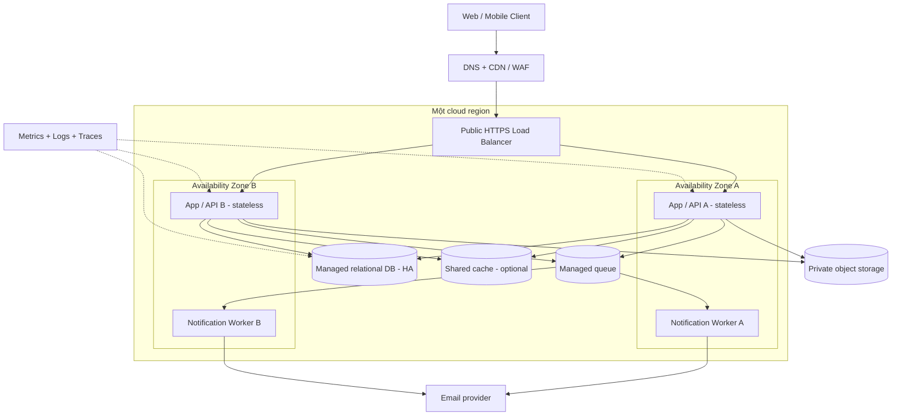
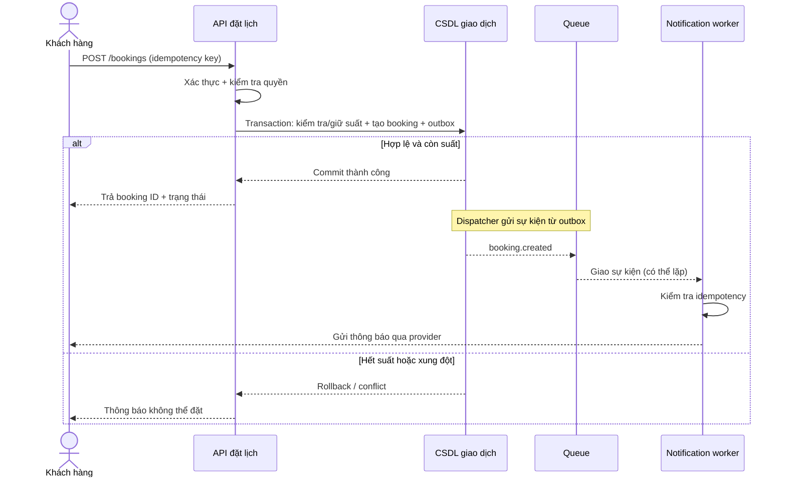

# Kiến trúc đám mây là gì và những quyết định kiến trúc cần giải quyết

> **Chương:** Tổng quan kiến trúc  
> **Phạm vi:** CLOUD_ARCHITECTURE — thiết kế kiến trúc ứng dụng trên đám mây, từ yêu cầu nghiệp vụ đến mạng, compute, dữ liệu và mô hình triển khai; đánh giá các đánh đổi về độ tin cậy, bảo mật, khả năng mở rộng, chi phí và vận hành theo tư duy Well-Architected.

## Mục tiêu học tập

Sau bài này, bạn có thể:

1. Giải thích kiến trúc đám mây khác gì với danh sách các dịch vụ cloud và vì sao kiến trúc bắt đầu từ yêu cầu nghiệp vụ.
2. Chuyển những mong muốn như “nhanh”, “ổn định”, “an toàn” thành yêu cầu có thể đo và kiểm chứng.
3. Nhận diện các quyết định chính về vùng triển khai, mạng, compute, dữ liệu, giao tiếp giữa thành phần, bảo mật, độ tin cậy, chi phí và vận hành.
4. Phác thảo một kiến trúc ứng dụng thực tế, nêu rõ giả định, phương án thay thế, hệ quả và rủi ro còn lại.
5. Đánh giá sơ bộ một phương án theo các nguyên tắc Well-Architected thay vì chỉ dựa vào số lượng công nghệ được sử dụng.

## 1. Kiến trúc đám mây thực chất là gì?

**Kiến trúc đám mây (cloud architecture)** là cách tổ chức các thành phần của một hệ thống chạy trên hạ tầng hoặc dịch vụ đám mây, xác định **chúng giao tiếp, lưu trữ dữ liệu, được bảo vệ, triển khai, mở rộng, quan sát và phục hồi như thế nào** để đáp ứng mục tiêu kinh doanh.

Kiến trúc bao gồm cả các quyết định *không nhìn thấy trên sơ đồ*: ai có quyền truy cập, dữ liệu được khôi phục trong bao lâu, thay đổi phần mềm được phát hành ra sao, chấp nhận loại sự cố nào, ngân sách vận hành là bao nhiêu và ai chịu trách nhiệm xử lý cảnh báo.

Ví dụ, câu “ứng dụng chạy trên máy ảo và dùng cơ sở dữ liệu” mới mô tả vài công nghệ. Một mô tả kiến trúc cần trả lời thêm:

- Người dùng truy cập từ đâu, qua DNS, TLS, CDN, WAF hoặc bộ cân bằng tải nào?
- Ứng dụng nằm trong mạng nào? Phần nào phải truy cập công khai, phần nào chỉ truy cập nội bộ?
- Khi một máy hoặc một vùng khả dụng (availability zone) lỗi, lưu lượng chuyển đi đâu?
- Dữ liệu nào cần giao dịch nhất quán; dữ liệu nào có thể cập nhật trễ?
- Ai được đọc bí mật kết nối, ai được triển khai, ai được xem dữ liệu nhạy cảm?
- Khi tải tăng gấp nhiều lần, thành phần nào mở rộng, thành phần nào trở thành nút thắt?
- Sự cố được phát hiện, ứng cứu và khôi phục bằng quy trình nào? Chi phí tăng theo biến số nào?

Cloud cung cấp tài nguyên cấp phát theo nhu cầu và nhiều dịch vụ quản lý sẵn, nhưng **đám mây không tự động làm cho hệ thống an toàn, luôn sẵn sàng hay tiết kiệm**. Dịch vụ được chọn, cách cấu hình và cách vận hành mới tạo ra các thuộc tính đó.

### 1.1. Các khối xây dựng thường gặp

| Nhóm | Ví dụ thành phần | Vai trò kiến trúc |
|---|---|---|
| Điểm vào (edge) | DNS, CDN, WAF, API gateway, load balancer | Định tuyến, bảo vệ và phân phối lưu lượng |
| Mạng | Virtual network/VPC, subnet, route, firewall/security group, private endpoint | Phân vùng tin cậy và kiểm soát đường đi của lưu lượng |
| Compute | VM, container, nền tảng ứng dụng quản lý, function/serverless | Thực thi mã nghiệp vụ |
| Dữ liệu | CSDL quan hệ, NoSQL, object storage, cache, search | Lưu và truy xuất dữ liệu với đặc tính phù hợp |
| Tích hợp | Queue, event bus, streaming, scheduler | Kết nối các tác vụ đồng bộ và bất đồng bộ |
| Bảo mật | IAM, secret manager, KMS, audit log, chính sách | Quản trị danh tính, quyền và khóa |
| Vận hành | Metrics, logs, traces, CI/CD, Infrastructure as Code | Theo dõi, triển khai và kiểm soát thay đổi |

Tên dịch vụ cụ thể khác nhau giữa AWS, Azure, Google Cloud và các nhà cung cấp khác. Điều quan trọng ở bước thiết kế là **vai trò, hành vi, giới hạn và miền lỗi** của từng thành phần, không phải học thuộc một tên sản phẩm.

### 1.2. Kiến trúc là tập hợp những đánh đổi

Hiếm có phương án nào đồng thời tối ưu tuyệt đối về độ trễ, tính sẵn sàng, mức nhất quán, bảo mật, chi phí và độ đơn giản. Ví dụ:

- Chạy tại một availability zone rẻ và đơn giản hơn; phân bổ qua nhiều zone chịu lỗi tốt hơn nhưng tăng độ phức tạp và có thể tăng chi phí truyền dữ liệu.
- Xử lý đồng bộ dễ theo dõi luồng nghiệp vụ; dùng hàng đợi hấp thụ tải đột biến nhưng đưa vào độ trễ và bài toán xử lý lặp.
- Cache giảm thời gian phản hồi và tải CSDL; cache cũng đặt ra vấn đề hết hạn và dữ liệu cũ.
- Nhiều microservice cho phép triển khai độc lập; một ứng dụng nguyên khối (monolith) có cấu trúc tốt thường đơn giản hơn khi sản phẩm và đội ngũ còn nhỏ.

**Một quyết định tốt là quyết định có lý do rõ ràng, phù hợp ràng buộc thực tế và có cách kiểm tra giả định**, không phải quyết định dùng nhiều dịch vụ nhất.

## 2. Từ yêu cầu nghiệp vụ đến tiêu chí kỹ thuật

Thiết kế nên bắt đầu bằng luồng sử dụng quan trọng, tác động khi luồng đó hỏng và giới hạn nguồn lực. Đừng bắt đầu bằng câu hỏi “chọn Kubernetes hay serverless?”.

Giả sử xây dựng **nền tảng đặt lịch dịch vụ**. Người dùng tìm khung giờ trống, đặt lịch, thanh toán và nhận thông báo. Một yêu cầu “khách không được đặt trùng giờ” có thể dẫn đến quyết định giao dịch và ràng buộc dữ liệu; “mở rộng trong chiến dịch quảng cáo” dẫn đến quyết định mở rộng compute và chống quá tải; “không lộ thông tin cá nhân” dẫn đến phân quyền, mã hóa và kiểm toán.

### 2.1. Phân loại yêu cầu

**Yêu cầu chức năng** mô tả hệ thống phải làm gì: đăng nhập, tra cứu, đặt lịch, thanh toán, hủy lịch, gửi email. **Yêu cầu phi chức năng** mô tả hệ thống phải hoạt động tốt đến mức nào và dưới điều kiện gì: tốc độ, độ tin cậy, khả năng mở rộng, bảo mật, khả năng vận hành, chi phí, tính tuân thủ.

Ví dụ các mục tiêu dưới đây là **giả định phục vụ bài học**, không phải ngưỡng áp dụng chung cho mọi hệ thống:

| Mong muốn nghiệp vụ | Chuyển thành yêu cầu kiểm chứng | Hệ quả thiết kế cần cân nhắc |
|---|---|---|
| Khách tra cứu nhanh | p95 thời gian phản hồi API tra cứu dưới 300 ms ở tải mục tiêu | Chỉ mục dữ liệu, cache phù hợp, đo độ trễ từng tầng |
| Đáp ứng giờ cao điểm | Chịu được 300 request/giây trong bài kiểm thử tải đã xác định | Stateless app, autoscaling, giới hạn kết nối CSDL |
| Dịch vụ ổn định | SLO khả dụng 99,9% cho các API cốt lõi theo cửa sổ 30 ngày | Loại bỏ điểm lỗi đơn, health check, cảnh báo |
| Giảm mất dữ liệu khi sự cố | Mục tiêu RPO tối đa 15 phút cho kịch bản sự cố đã thống nhất | Sao lưu, nhật ký giao dịch, chiến lược replica và kiểm tra khôi phục |
| Khôi phục dịch vụ nhanh | Mục tiêu RTO tối đa 60 phút cho cùng kịch bản | Runbook, quyền khôi phục, diễn tập failover/restore |
| Bảo vệ dữ liệu khách | Chỉ vai trò được cấp phép truy cập dữ liệu cá nhân; lưu vết hành động nhạy cảm | IAM, phân vùng mạng, mã hóa, audit log |
| Kiểm soát chi phí | Giới hạn chi tiêu theo tháng và cảnh báo vượt ngưỡng | Budget alert, tagging, đo chi phí theo môi trường/tính năng |

Các mục tiêu trên **phải được xác nhận với chủ sản phẩm, vận hành, an ninh và người chịu ngân sách**. Muốn định nghĩa SLO hữu ích, cần nói rõ API nào được đo, từ đâu đo, điều kiện tải, cách tính thành công và cửa sổ quan sát. Một mục tiêu 99,9% theo 30 ngày tương ứng khoảng 43,2 phút không khả dụng nếu tháng giả định dài 30 ngày; cần thống nhất các ngoại lệ và định nghĩa phép đo.

### 2.2. Những khái niệm dễ nhầm

| Khái niệm | Ý nghĩa | Câu hỏi thiết kế |
|---|---|---|
| **SLI** (Service Level Indicator) | Chỉ số đo thực tế, ví dụ tỷ lệ yêu cầu thành công hoặc p95 latency | Đang đo điều gì và ở đâu? |
| **SLO** (Service Level Objective) | Mục tiêu nội bộ cho một SLI trên cửa sổ cụ thể | Mức dịch vụ nào đủ cho người dùng? |
| **SLA** (Service Level Agreement) | Cam kết dịch vụ với các điều khoản được thỏa thuận | Khi vi phạm thì có hệ quả gì? |
| **RTO** (Recovery Time Objective) | Thời gian tối đa mục tiêu để khôi phục hoạt động sau sự cố | Có thể chấp nhận gián đoạn bao lâu? |
| **RPO** (Recovery Point Objective) | Mức mất dữ liệu theo thời gian tối đa có thể chấp nhận | Có thể mất tối đa bao nhiêu dữ liệu mới nhất? |

RTO và RPO **luôn gắn với một loại sự cố cụ thể**. Chịu lỗi máy, lỗi availability zone, lỗi cả region, thao tác xóa nhầm và tấn công ransomware là các tình huống khác nhau; một cấu hình Multi-AZ không tự động bảo đảm phục hồi khi cả region mất hoạt động hoặc khi dữ liệu bị xóa logic.

### 2.3. Khai thác yêu cầu bằng câu hỏi đúng

Trước khi vẽ sơ đồ, hãy làm rõ: ai là người dùng và ở khu vực nào; lưu lượng hiện tại và tăng trưởng dự báo; điểm cao tải, kích thước dữ liệu, tỷ lệ đọc/ghi; giao dịch nào phải chính xác tuyệt đối; phụ thuộc bên thứ ba nào; dữ liệu có ràng buộc về vị trí lưu trữ hay thời gian giữ lại không; ngân sách, kỹ năng đội ngũ và ngày cần phát hành; hậu quả tài chính/nghiệp vụ khi hệ thống dừng từng giờ.

Nếu chưa biết số liệu, hãy ghi **giả định cần xác minh** và đặt kế hoạch đo thử. Không biến ước lượng thành một cam kết vận hành.

## 3. Các nhóm quyết định kiến trúc cốt lõi

### 3.1. Chọn mô hình cloud và phạm vi triển khai

Ở mức nền tảng, cần quyết định dùng public cloud, private cloud hay hybrid; một nhà cung cấp hay nhiều nhà cung cấp; số region và cách sử dụng availability zone.

- **Single region, single zone:** phù hợp bản thử nghiệm hoặc workload có thể chấp nhận gián đoạn; ít tài nguyên dự phòng.
- **Single region, multi-zone:** nhiều bản sao ứng dụng và dịch vụ dữ liệu có khả năng chịu lỗi zone, thường là điểm khởi đầu hợp lý cho ứng dụng sản xuất yêu cầu sẵn sàng cao.
- **Multi-region:** mở rộng miền chịu lỗi hoặc đưa dịch vụ gần người dùng, nhưng phải giải quyết định tuyến, đồng bộ dữ liệu, xung đột ghi, vận hành và chi phí cao hơn.
- **Hybrid/multi-cloud:** có thể xuất phát từ yêu cầu tích hợp, chủ quyền dữ liệu hoặc rủi ro phụ thuộc nhà cung cấp; chúng làm tăng nhu cầu chuẩn hóa và đội ngũ vận hành.

**Region** là một khu vực địa lý do nhà cung cấp xác định; **availability zone** là miền hạ tầng tách biệt trong region theo thiết kế của nhà cung cấp. Phân bố qua hai zone chỉ có giá trị nếu mọi phụ thuộc cần thiết cũng có cơ chế chịu lỗi phù hợp. Cần kiểm tra khả năng cung cấp của từng dịch vụ tại khu vực triển khai; tên gọi và cam kết phụ thuộc nhà cung cấp.

Quyết định region bị chi phối bởi độ trễ đến khách hàng, yêu cầu pháp lý/vị trí dữ liệu, tính sẵn có của dịch vụ, chi phí và phương án khôi phục thảm họa (DR).

### 3.2. Thiết kế mạng và đường đi của yêu cầu

Một mạng cloud thường có mạng ảo (VPC/VNet), subnet, bảng định tuyến, firewall/security group, các điểm vào/ra và kết nối riêng với dịch vụ quản lý hoặc mạng doanh nghiệp.

Nguyên tắc thiết kế:

1. Chỉ thành phần thực sự cần nhận kết nối từ Internet mới nằm trên đường truy cập công khai, ví dụ bộ cân bằng tải hoặc API gateway.
2. Ứng dụng và CSDL nên hạn chế truy cập trực tiếp; CSDL thường nằm trong subnet riêng hoặc chỉ cho phép truy cập qua private endpoint.
3. Cho phép kết nối giữa các thành phần theo **nguồn, đích, cổng và mục đích cần thiết**; mặc định từ chối phần không dùng.
4. Quản lý lưu lượng ra Internet (egress) có chủ đích: NAT, proxy hoặc private endpoint tùy nhu cầu. Egress có thể tạo chi phí đáng kể.
5. Bảo vệ lớp ứng dụng với TLS, xác thực và kiểm tra đầu vào; CDN/WAF có thể hỗ trợ nhưng không thay thế bảo mật trong ứng dụng.

Ví dụ đường đi: `Trình duyệt → DNS/CDN/WAF → HTTPS load balancer → ứng dụng riêng tư → CSDL riêng tư`. Mỗi mũi tên cần trả lời được câu hỏi: kết nối có được mã hóa không, ai được phép gọi, có timeout hay giới hạn lưu lượng không, và log được ghi ở đâu?

### 3.3. Chọn compute: VM, container, PaaS hay serverless?

| Lựa chọn | Phù hợp khi | Đánh đổi/chú ý |
|---|---|---|
| **Virtual machine (VM)** | Cần kiểm soát hệ điều hành, runtime đặc biệt, phần mềm cũ | Tự quản patch OS, capacity, image, thay thế máy lỗi |
| **Container trên dịch vụ quản lý** | Cần đóng gói nhất quán, workload chạy liên tục, kiểm soát tài nguyên và rollout | Vẫn phải cấu hình autoscaling, mạng, health check; độ phức tạp tùy nền tảng |
| **PaaS/managed application runtime** | Muốn triển khai nhanh ứng dụng web/API phổ biến | Giảm quyền kiểm soát tầng dưới; có giới hạn runtime, cấu hình và chi phí |
| **Function/serverless** | Tác vụ theo sự kiện, tải thay đổi, thời gian xử lý có giới hạn phù hợp | Cold start tùy nền tảng, giới hạn thời gian/tài nguyên, concurrency và phụ thuộc dịch vụ |

Cần đánh giá **mức tải nền**, hình dạng tải đỉnh, thời gian thực thi, trạng thái trong tiến trình, khả năng scale về 0, latency khởi động, khả năng kiểm thử, kỹ năng đội ngũ và tổng chi phí sở hữu. Không mặc định serverless luôn rẻ hơn hoặc Kubernetes luôn mở rộng tốt hơn.

Một ứng dụng nguyên khối được chia module rõ ràng, chạy nhiều bản sao **stateless**, thường dễ triển khai và vận hành ban đầu. Chỉ tách microservice khi có ranh giới nghiệp vụ, yêu cầu mở rộng/triển khai độc lập, trách nhiệm đội nhóm hoặc nhu cầu cô lập lỗi đủ rõ. Tách dịch vụ làm tăng giao tiếp mạng, tính nhất quán phân tán và yêu cầu quan sát.

**Stateless** nghĩa là instance không giữ trạng thái phiên quan trọng chỉ trong bộ nhớ cục bộ; phiên hoặc dữ liệu cần chia sẻ phải nằm ở kho phù hợp. Stateless giúp bộ cân bằng tải định tuyến linh hoạt, thay thế instance và scale ngang, nhưng CSDL và phụ thuộc bên dưới vẫn có giới hạn.

### 3.4. Chọn mô hình dữ liệu và cách đảm bảo tính đúng đắn

Lựa chọn nên bắt đầu từ **kiểu truy vấn, quan hệ dữ liệu, tính nhất quán cần thiết, dung lượng, mô hình tăng trưởng và yêu cầu khôi phục**, không bắt đầu từ độ phổ biến của một loại CSDL.

- **Relational database:** phù hợp nghiệp vụ có quan hệ và giao dịch ACID, ví dụ đặt chỗ, hóa đơn, thanh toán. Cần chỉ mục, kiểm soát giao dịch, backup và kế hoạch scale đọc/ghi.
- **NoSQL/key-value/document:** hữu ích cho mô hình truy cập cụ thể hoặc nhu cầu scale; phải xem xét ràng buộc dữ liệu, mô hình nhất quán và hạn chế truy vấn của từng dịch vụ.
- **Object storage:** phù hợp ảnh, tài liệu, bản sao lưu và tệp lớn; dùng quyền truy cập chặt chẽ, lifecycle và chính sách lưu trữ.
- **Cache:** phục vụ dữ liệu được đọc nhiều và chấp nhận chiến lược đồng bộ/hết hạn; cache là tầng tối ưu, không tự là nguồn dữ liệu chuẩn.
- **Search index/analytics store:** phục vụ tìm kiếm phức tạp và phân tích; thường chấp nhận độ trễ cập nhật nhất định so với dữ liệu giao dịch gốc.

Phân biệt **khả dụng dữ liệu** và **khôi phục dữ liệu**. Replica đồng bộ/tự failover giảm gián đoạn trước lỗi hạ tầng; backup độc lập, bảo vệ khỏi xóa/sửa nhầm và thao tác khôi phục được kiểm chứng mới giải quyết các dạng mất dữ liệu khác. Cần xác định thời gian lưu, kiểm soát truy cập bản sao lưu và thường xuyên thử restore.

Ví dụ đặt lịch: nếu hai khách đặt cùng một tài nguyên/khung giờ, kiểm tra “còn chỗ” bằng truy vấn rồi ghi ở hai thao tác không được khóa/transaction có thể tạo trùng. Phải dùng **ràng buộc duy nhất phù hợp mô hình, giao dịch hoặc cơ chế đồng bộ cạnh tranh** ở nơi dữ liệu được ghi. Cache hoặc logic giao diện không bảo đảm được tính đúng đắn khi có nhiều yêu cầu đồng thời.

### 3.5. Chọn đồng bộ hay bất đồng bộ

**Gọi đồng bộ** (ví dụ HTTP/gRPC) phù hợp khi người dùng cần câu trả lời ngay: “đặt lịch thành công hay thất bại?”. Nhưng nếu API phải chờ xử lý ảnh, gửi email và gọi nhiều dịch vụ bên thứ ba, thời gian phản hồi và rủi ro lỗi dây chuyền tăng lên.

**Queue/event** phù hợp với việc có thể thực hiện sau khi giao dịch chính hoàn tất, ví dụ gửi thông báo hoặc tạo báo cáo. Thiết kế bất đồng bộ cần trả lời:

- Thông điệp được lưu bền đến mức nào, có thể được gửi lại hoặc xử lý trùng không?
- Consumer có **idempotent** không (xử lý lặp không tạo hiệu ứng ngoài mong muốn)?
- Khi xử lý thất bại, retry với backoff ra sao, khi nào chuyển vào dead-letter queue?
- Làm sao tránh trường hợp CSDL đã ghi thành công nhưng sự kiện chưa được phát hành? Có thể dùng **transactional outbox** khi cần bảo đảm liên kết hai hành động.
- Người dùng quan sát trạng thái “đang xử lý/hoàn tất/thất bại” qua đâu?

Không được mặc nhiên giả định hàng đợi bảo đảm xử lý chính xác một lần từ đầu đến cuối. Nhiều hệ thống hoạt động theo cơ chế **at-least-once delivery**; vì thế idempotency, khóa nghiệp vụ và thiết kế retry là các quyết định thiết yếu.

### 3.6. Thiết kế độ tin cậy, mở rộng và phục hồi

Phân biệt ba mục tiêu:

- **Scalability:** tăng năng lực xử lý khi nhu cầu tăng (scale ngang nhiều instance hoặc scale dọc tăng tài nguyên).
- **High availability (HA):** tiếp tục phục vụ khi một thành phần hoặc miền lỗi hỏng, nhờ dự phòng và failover.
- **Disaster recovery (DR):** khôi phục sau sự cố nghiêm trọng vượt khả năng HA thông thường, theo RTO/RPO đã định.

Các kỹ thuật thường kết hợp: nhiều instance qua zone, health check, autoscaling theo chỉ số thực sự phản ánh tải, giới hạn connection pool, timeout, retry có giới hạn kèm jitter, circuit breaker, rate limiting, backpressure, queue và cơ chế degrade có chủ đích.

**Retry thiếu giới hạn có thể làm hệ thống đang quá tải sụp nhanh hơn.** Timeout quá ngắn làm thất bại giả; quá dài giữ tài nguyên và tăng độ trễ. Nếu dịch vụ phụ thuộc hỏng, đôi khi trả kết quả một phần hoặc thông báo xử lý sau tốt hơn việc chờ vô hạn.

Phải xác định **điểm lỗi đơn (single point of failure)** trên toàn bộ đường đi: không chỉ compute mà cả DNS, load balancer, database, cache, queue, secret service, đường mạng và quy trình triển khai. Với mỗi miền lỗi cần ghi: điều gì sẽ xảy ra, ai nhận cảnh báo, cách failover, cách rollback và bằng chứng thử nghiệm.

### 3.7. Thiết kế bảo mật ngay từ đầu

Trong mô hình **shared responsibility**, nhà cung cấp thường chịu trách nhiệm về bảo mật của hạ tầng cloud, còn khách hàng chịu trách nhiệm phù hợp với loại dịch vụ về dữ liệu, danh tính, cấu hình, ứng dụng và quyền truy cập. Tỷ lệ trách nhiệm cụ thể khác nhau giữa VM, dịch vụ quản lý và serverless.

Những quyết định nền tảng gồm:

1. **Identity/IAM:** xác thực mạnh, MFA cho truy cập quản trị, phân vai trò theo công việc, quyền tối thiểu, danh tính workload thay cho khóa tĩnh khi có thể.
2. **Phân vùng và kiểm soát mạng:** chỉ mở đường vào cần thiết, bảo vệ điểm vào công khai, cô lập dữ liệu và thành phần nội bộ.
3. **Mã hóa:** TLS khi truyền, mã hóa dữ liệu lưu trữ, quản lý khóa và vòng đời khóa phù hợp độ nhạy cảm.
4. **Bí mật:** giữ mật khẩu/API key trong secret manager; không đưa vào source code, container image hoặc log.
5. **Bảo vệ và kiểm toán dữ liệu:** phân loại dữ liệu, tối thiểu hóa dữ liệu nhạy cảm, chính sách lưu/xóa, audit log và kiểm soát truy cập bản sao lưu.
6. **Chuỗi cung ứng và vận hành:** kiểm tra dependency/image, vá lỗ hổng, hạn chế quyền CI/CD, giám sát hành động bất thường và có quy trình ứng phó sự cố.

Kiểm soát bảo mật cần được kiểm chứng bằng cấu hình, test và log. Có TLS hoặc firewall chưa đồng nghĩa đã giải quyết được lỗi phân quyền ở mức đối tượng, SQL injection hay rò rỉ dữ liệu trong log.

### 3.8. Thiết kế khả năng quan sát, triển khai và chi phí

Kiến trúc phải có khả năng vận hành ngay từ ngày đầu:

- **Observability:** metrics theo SLI, log có cấu trúc, distributed tracing, correlation/request ID, dashboard và cảnh báo dựa trên tác động đến người dùng.
- **Delivery:** CI/CD, kiểm thử, rollout từng phần hoặc blue-green/canary khi phù hợp, rollback và quản lý cấu hình theo môi trường.
- **Infrastructure as Code (IaC):** phiên bản hóa cấu hình, review thay đổi, giảm drift và khôi phục môi trường lặp lại được.
- **Capacity/cost:** gắn nhãn owner/môi trường, lập budget và alert, theo dõi compute nhàn rỗi, cơ sở dữ liệu, lưu trữ, log, egress, liên vùng, dịch vụ quản lý và chi phí hỗ trợ.

**Chi phí cloud không chỉ là tiền máy chủ.** Phải tính tổng chi phí sở hữu: phát triển, vận hành, bảo mật, giám sát, khôi phục, đào tạo và thời gian đội ngũ xử lý sự cố. Tối ưu có nghĩa là chọn mức chi phí hợp lý để đạt **mức dịch vụ đã thống nhất**, không phải giảm mọi khoản mục bất kể tác động.

## 4. Ví dụ kiến trúc tham chiếu: ứng dụng đặt lịch

Giả sử sản phẩm có web/mobile client, API đặt lịch, CSDL nghiệp vụ, thông báo email và lưu ảnh. Với yêu cầu ứng dụng phục vụ nhiều instance, không muốn tự vận hành OS/database và ưu tiên khả dụng trong sự cố một zone, có thể đề xuất kiến trúc ban đầu như sau.



> Sơ đồ là **mô hình logic**, không thể hiện tất cả subnet, route, private endpoint, chính sách IAM, backup, topology thực của dịch vụ quản lý và vùng lỗi nội bộ. Mọi dịch vụ HA phải được cấu hình/kiểm chứng theo khả năng của nhà cung cấp; vẽ một hộp “HA” không tự tạo khả năng chịu lỗi.

### 4.1. Giải thích các quyết định

| Thành phần/quyết định | Lý do | Điều kiện cần kiểm chứng |
|---|---|---|
| CDN/WAF ở đầu vào | Giảm tải nội dung tĩnh và lọc một phần lưu lượng xấu | Cache policy, xác thực động, false positive, bảo vệ origin |
| Load balancer + hai app stateless ở hai zone | Phân tải và giảm phụ thuộc một instance/zone | Health check, độ sẵn sàng thực tế, min instance, autoscaling |
| Managed relational DB với cấu hình HA | Giữ giao dịch đặt chỗ nhất quán và giảm công việc vận hành DB | Failover, khả năng ghi, giới hạn kết nối, backup/PITR, chi phí |
| Managed queue + worker | Gửi email sau giao dịch, tránh giữ HTTP request chờ nhà cung cấp email | Idempotency, retries, DLQ, tắc nghẽn queue, độ trễ xử lý |
| Private object storage | Lưu ảnh/tài liệu và kiểm soát truy cập | Quyền object, signed URL, vòng đời, mã hóa, kích thước upload |
| Cache chỉ khi có phép đo | Giảm tải các truy vấn lặp có thể chấp nhận cũ | TTL, invalidation, cache stampede, cache failure |
| Logs/metrics/traces | Phát hiện sự cố và truy vết liên thành phần | SLI, alert, bảo vệ PII, thời gian giữ log và chi phí |

**Điểm cần sửa trên bản thiết kế triển khai:** giới hạn mạng phải xác định rõ load balancer công khai, app/worker và DB riêng tư; kết nối đến DB, queue, object storage qua các cơ chế private/network policy phù hợp. Nếu khách yêu cầu chịu lỗi *toàn bộ region*, bản vẽ một region này chưa đủ và phải thiết kế DR đa region riêng.

### 4.2. Luồng đặt lịch bảo đảm tính đúng đắn



Sơ đồ nhấn mạnh bốn nguyên tắc: (1) nguồn dữ liệu chuẩn quyết định còn chỗ; (2) một giao dịch hoặc cơ chế kiểm soát đồng thời bảo vệ việc ghi; (3) thông báo là bước bất đồng bộ, không quyết định giao dịch đã đặt thành công hay chưa; (4) xử lý lặp phải an toàn. Trong triển khai thực tế, **dispatcher** là tiến trình đọc outbox và phát sự kiện sau commit; ký hiệu DB → Queue biểu diễn luồng qua dispatcher, không có nghĩa CSDL tự đẩy queue.

Nếu gọi cổng thanh toán, cần thiết kế riêng cho trạng thái đang thanh toán, timeout, callback lặp, bù trừ/hủy giữ chỗ và đối soát. Không giữ transaction CSDL mở trong lúc chờ kết nối mạng chậm tới nhà cung cấp thanh toán.

### 4.3. Thử hỏng để kiểm chứng khả năng chịu lỗi

Một kiến trúc chỉ đáng tin khi các kỳ vọng được thử trong điều kiện đại diện:

| Tình huống giả lập | Kỳ vọng cần xác minh | Tín hiệu cần quan sát |
|---|---|---|
| Một app instance dừng | LB loại instance không khỏe, instance khác tiếp tục phục vụ | Error rate, p95 latency, thời gian phát hiện |
| Một zone không khả dụng | Các thành phần cần thiết ở zone còn lại tiếp tục hoặc phục hồi theo mục tiêu | Kết quả failover DB, queue backlog, khả dụng API |
| Tải tăng đột ngột | Autoscaling và giới hạn upstream tránh sập dây chuyền | CPU, RPS, số kết nối DB, 429/5xx, chi phí |
| Nhà cung cấp email chậm | Đặt lịch vẫn hoàn tất, worker retry có giới hạn | Queue age, DLQ, số lần gửi lặp |
| Xóa nhầm dữ liệu hoặc lỗi dữ liệu | Khôi phục từ backup/PITR theo kịch bản được định nghĩa | Dữ liệu phục hồi, RPO/RTO thực đo, audit log |

Các tình huống này cũng phơi bày điểm giới hạn: Multi-AZ chưa giải quyết việc mất cả region; replica có thể sao chép lỗi xóa logic; autoscaling compute không làm DB tự mở rộng vô hạn.

## 5. Đánh giá theo tư duy Well-Architected

**Well-Architected** là cách đặt câu hỏi có hệ thống về các đặc tính kiến trúc, rủi ro và việc cải tiến liên tục. Các nhà cung cấp cloud có framework với cách nhóm trụ cột khác nhau. Ví dụ, AWS Well-Architected Framework dùng sáu trụ cột dưới đây; khi triển khai trên nhà cung cấp khác, cần đối chiếu hướng dẫn và giới hạn dịch vụ tương ứng.

| Trụ cột | Câu hỏi đánh giá | Bằng chứng mong đợi |
|---|---|---|
| **Operational Excellence** (Vận hành xuất sắc) | Triển khai, quan sát, khắc phục và học từ sự cố như thế nào? | CI/CD, runbook, dashboard, diễn tập, postmortem |
| **Security** (Bảo mật) | Ai truy cập dữ liệu nào? Bí mật, cấu hình và log được bảo vệ ra sao? | IAM least privilege, mã hóa, audit, kiểm tra cấu hình |
| **Reliability** (Độ tin cậy) | Khi thành phần hoặc zone lỗi, dịch vụ phục hồi thế nào? | RTO/RPO, backup restore test, thử failover, theo dõi SLO |
| **Performance Efficiency** (Hiệu quả hiệu năng) | Nguồn lực và công nghệ có phù hợp mẫu tải, độ trễ và quy mô không? | Load test, profiling, autoscaling, capacity plan |
| **Cost Optimization** (Tối ưu chi phí) | Có đo và kiểm soát chi phí theo giá trị cung cấp không? | Budget, allocation tag, cost dashboard, đánh giá tài nguyên |
| **Sustainability** (Bền vững) | Có giảm tài nguyên lãng phí và tăng hiệu quả sử dụng không? | Scale theo nhu cầu, dọn tài nguyên thừa, chính sách lưu trữ |

Không chấm “đạt” chỉ vì có công cụ. Ví dụ, bật autoscaling mà CSDL chỉ chịu 50 kết nối đồng thời có thể làm API thất bại nhanh hơn; backup tồn tại nhưng chưa từng thử restore chưa chứng minh đáp ứng RTO/RPO.

### 5.1. Mẫu đánh giá ngắn cho một quyết định

Với phương án **single region, multi-zone**, có thể ghi:

- **Mục tiêu:** duy trì API cốt lõi khi mất một app instance hoặc một zone; tránh vận hành đa region khi chưa có yêu cầu tương ứng.
- **Lợi ích:** cách ly một số lỗi hạ tầng, cho phép thay thế instance và bảo trì thuận lợi hơn.
- **Chi phí/rủi ro:** thêm replica, truyền dữ liệu liên zone, failover và giám sát; vẫn có rủi ro sự cố toàn region.
- **Bằng chứng:** kiểm thử rút instance, mô phỏng mất zone theo khả năng môi trường thử nghiệm, đo thời gian phục hồi và số request lỗi.
- **Điều kiện xem xét lại:** SLO chưa đạt, phân bố người dùng thay đổi, quy định về địa lý dữ liệu hoặc nghiệp vụ yêu cầu chịu lỗi toàn region.

Điểm quan trọng của đánh giá là **quyết định nào đang làm tăng rủi ro, tác động của rủi ro và bằng chứng nào xác nhận phương án đủ tốt**.

## 6. Quy trình thiết kế kiến trúc có thể lặp lại

Một chu trình thực tế có thể đi theo thứ tự:

1. **Hiểu nghiệp vụ và các luồng quan trọng:** lập bản đồ tác nhân, giao dịch, phụ thuộc và hậu quả khi hỏng.
2. **Xác định yêu cầu có thể đo:** SLI/SLO, peak traffic, mô hình dữ liệu, RTO/RPO cho từng lớp sự cố, bảo mật và ngân sách.
3. **Liệt kê ràng buộc và giả định:** vị trí dữ liệu, dịch vụ hiện có, kỹ năng đội ngũ, hạn phát hành, công cụ bắt buộc; đánh dấu mục cần đo thử.
4. **Vẽ kiến trúc logic trước khi gắn dịch vụ:** điểm vào, compute, data store, tích hợp, biên bảo mật, miền lỗi và đường đi dữ liệu.
5. **So sánh ít nhất hai lựa chọn quan trọng:** độ phức tạp, độ tin cậy, chi phí vận hành, rủi ro phụ thuộc nhà cung cấp và khả năng thay đổi sau này.
6. **Lập kế hoạch kiểm chứng:** prototype, benchmark, load test, security review, restore/failover rehearsal, ước tính chi phí.
7. **Ghi quyết định và cải tiến:** dùng Architecture Decision Record (ADR), theo dõi chỉ số thực tế, cập nhật khi yêu cầu hoặc dữ liệu đo thay đổi.

### 6.1. Mẫu Architecture Decision Record (ADR) ngắn

```text
ADR-001: Dùng managed relational database cho nghiệp vụ đặt lịch

Bối cảnh:
- Đặt lịch phải ngăn trùng tài nguyên/khung giờ khi có yêu cầu đồng thời.
- Đội ngũ nhỏ, ưu tiên giảm việc vận hành máy chủ cơ sở dữ liệu.

Các lựa chọn:
A. Managed relational DB có hỗ trợ giao dịch và cấu hình HA phù hợp.
B. Tự vận hành relational DB trên VM.
C. Document/NoSQL DB với cơ chế ràng buộc riêng theo dịch vụ.

Quyết định: A, với giả định tải ban đầu nằm trong giới hạn dịch vụ.

Lý do:
- Giao dịch và unique constraint hỗ trợ bất biến nghiệp vụ.
- Backup, patching và failover được dịch vụ quản lý hỗ trợ ở mức đã chọn.

Hệ quả:
- Chi phí nền có thể cao hơn một VM nhỏ; phụ thuộc tính năng nhà cung cấp.
- Vẫn phải tối ưu truy vấn, bảo vệ kết nối, kiểm tra restore/failover.

Xác minh:
- Test race condition đặt trùng; load test giờ cao điểm.
- Thử backup restore, đo thời gian failover và chi phí thực tế.

Xem xét lại khi:
- Mô hình tải/ghi, yêu cầu RTO/RPO hoặc ngân sách thay đổi đáng kể.
```

Không cần ADR cho từng thay đổi nhỏ. Nên ghi ADR cho quyết định có tác động lâu dài, khó đảo ngược hoặc ảnh hưởng nhiều nhóm, để người đến sau hiểu **tại sao** chứ không chỉ thấy **đã chọn gì**.

## 7. Những sai lầm thường gặp và cách nhận ra

| Nhận định thiếu chính xác | Cách suy nghĩ tốt hơn |
|---|---|
| “Lên cloud là tự động high availability.” | HA phải được thiết kế trên từng phụ thuộc và thử theo miền lỗi cụ thể. |
| “Dùng microservice thì chắc chắn scale tốt.” | Scale phụ thuộc nút thắt và mô hình dữ liệu; microservice làm tăng độ phức tạp phân tán. |
| “Thêm cache sẽ luôn làm API nhanh.” | Cache có hiệu quả nếu mẫu đọc phù hợp, hit rate đủ và dữ liệu cũ được xử lý đúng. |
| “Có replica là không bao giờ mất dữ liệu.” | Replica có thể sao chép thao tác sai; cần backup, PITR và diễn tập restore. |
| “Serverless không cần vận hành.” | Vẫn cần theo dõi, phân quyền, xử lý lỗi, giới hạn concurrency và quản lý chi phí. |
| “Multi-region là lựa chọn tốt nhất cho mọi ứng dụng.” | Multi-region tăng chi phí và độ phức tạp; chỉ nên chọn khi nhu cầu phù hợp, có phương án dữ liệu rõ ràng. |
| “Firewall và TLS là đủ an toàn.” | Bảo mật gồm IAM, phân quyền ứng dụng, quản lý bí mật, dữ liệu và giám sát. |
| “Kiến trúc tốt là sơ đồ có nhiều thành phần.” | Kiến trúc tốt có thể giải thích và chứng minh đáp ứng yêu cầu với độ phức tạp hợp lý. |

## 8. Bài thực hành: đánh giá một thiết kế ban đầu

**Tình huống:** Một hệ thống đặt lịch dùng một VM công khai chạy cả web/API, một CSDL trên cùng VM, ảnh lưu trên ổ đĩa máy chủ và gửi email trực tiếp trong HTTP request. Không có kiểm thử khôi phục, chưa thu thập metrics và chưa biết mức tải giờ cao điểm.

Hãy tạo một bản đề xuất kiến trúc v1 với các đầu ra sau:

1. **Bảng yêu cầu:** ghi ít nhất ba luồng nghiệp vụ quan trọng; đề xuất SLO, RTO/RPO kèm phạm vi sự cố và ghi rõ giả định chưa được xác thực.
2. **Sơ đồ logic:** đánh dấu điểm vào công khai, phần mạng riêng tư, compute, CSDL, object storage, queue, các quyền truy cập và ít nhất một miền lỗi.
3. **Ba ADR:** chọn (a) mô hình compute, (b) lưu trữ dữ liệu giao dịch, (c) đồng bộ/bất đồng bộ cho gửi thông báo; mỗi ADR có lựa chọn thay thế và đánh đổi.
4. **Kế hoạch kiểm chứng:** một bài load test, một bài thử instance/zone failure, một bài restore từ backup và một kiểm tra bảo mật quyền tối thiểu.
5. **Đánh giá Well-Architected:** nêu một rủi ro chính cho mỗi trụ cột, mức ưu tiên và bằng chứng cần thu thập để đóng rủi ro đó.

Có thể dùng bảng quyết định sau để tự kiểm tra tính đầy đủ:

| Quyết định | Yêu cầu dẫn đến quyết định | Đánh đổi chấp nhận | Cách đo/kiểm chứng |
|---|---|---|---|
| Ví dụ: hai app instance ở hai zone | Duy trì API khi hỏng một instance/zone | Phí dự phòng và vận hành | Kiểm thử failover, theo dõi tỷ lệ lỗi |
| Vị trí dữ liệu và vùng triển khai | … | … | … |
| Compute và chiến lược mở rộng | … | … | … |
| CSDL và kiểm soát nhất quán | … | … | … |
| Backup/DR | … | … | … |
| IAM, mã hóa, bí mật | … | … | … |
| Monitoring, CI/CD và chi phí | … | … | … |

**Tiêu chí hoàn thành:** Một người khác đọc tài liệu có thể mô tả đường đi yêu cầu, dữ liệu được ghi ở đâu, cách hệ thống phản ứng trước lỗi giả định, ai có quyền thao tác, chi phí chính đến từ đâu và thử nghiệm nào chứng minh các mục tiêu đã đề ra. Nếu một hộp trên sơ đồ chưa trả lời được các câu hỏi đó, hãy ghi nó thành câu hỏi mở thay vì phỏng đoán.

## 9. Tóm lược khung tư duy

Kiến trúc cloud không bắt đầu từ danh mục dịch vụ, mà từ **yêu cầu nghiệp vụ → mục tiêu đo được → quyết định về mạng, compute, dữ liệu và triển khai → kiểm chứng → vận hành và cải tiến**. Các trụ cột Well-Architected giúp đặt câu hỏi bao quát, còn ADR và thử nghiệm giúp biến lựa chọn chủ quan thành quyết định có thể giải thích và đánh giá lại.

Khi chuyển sang các bài học sâu hơn về networking, compute, data, security, reliability hay cost, hãy luôn truy ngược mỗi công nghệ về **mục tiêu nào nó phục vụ, rủi ro nào nó giảm, chi phí nào nó tạo ra và phép thử nào chứng minh hiệu quả**.
