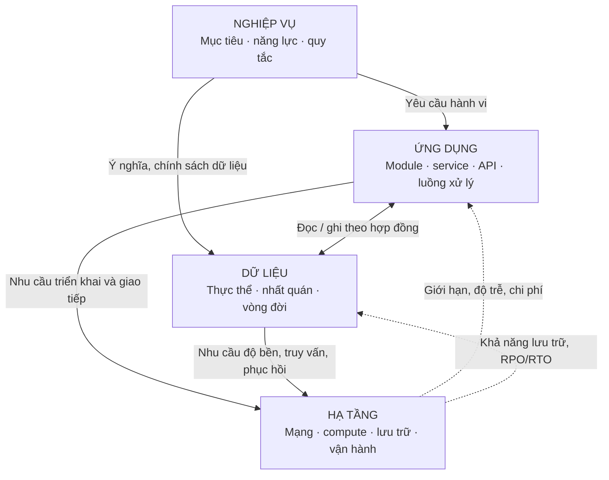

# Phân biệt kiến trúc nghiệp vụ, ứng dụng, dữ liệu và hạ tầng

Khi thiết kế một hệ thống trên đám mây, câu hỏi đầu tiên không nên là “dùng bao nhiêu máy chủ?” mà là “hệ thống phải tạo ra kết quả gì cho nghiệp vụ?”. Từ câu trả lời đó, kiến trúc sư mới xác định phần mềm cần phối hợp ra sao, dữ liệu phải được quản lý thế nào và hạ tầng cần đáp ứng những yêu cầu gì.

Bốn góc nhìn thường được dùng để kết nối các quyết định này là **kiến trúc nghiệp vụ (business architecture)**, **kiến trúc ứng dụng (application architecture)**, **kiến trúc dữ liệu (data architecture)** và **kiến trúc hạ tầng (infrastructure architecture)**. Chúng mô tả cùng một hệ thống ở những mức độ khác nhau, nên có liên hệ chặt chẽ nhưng không thể thay thế nhau.

Trong module **CLOUD_ARCHITECTURE**, việc phân biệt bốn góc nhìn giúp đi từ yêu cầu nghiệp vụ đến lựa chọn mạng, compute, dữ liệu và mô hình triển khai; đồng thời giải thích được các đánh đổi về độ tin cậy, bảo mật, khả năng mở rộng, chi phí và vận hành theo tư duy Well-Architected.

## 1. Bốn góc nhìn trả lời bốn nhóm câu hỏi

| Góc nhìn | Câu hỏi cốt lõi | Đối tượng được mô tả | Ví dụ về quyết định | Hiện vật thường dùng |
| --- | --- | --- | --- | --- |
| **Nghiệp vụ** | **Vì sao** hệ thống tồn tại? **Ai** làm gì, theo quy tắc nào, để đạt kết quả gì? | Mục tiêu, năng lực nghiệp vụ, quy trình, vai trò, chính sách, chỉ số thành công | Giữ chỗ thuê sản phẩm trong tối đa 10 phút trước khi thanh toán | Capability map, sơ đồ quy trình, business rules, KPI |
| **Ứng dụng** | **Phần mềm nào** đảm nhận chức năng nào và các thành phần **giao tiếp** ra sao? | Ứng dụng, module, service, API, luồng xử lý, hợp đồng tích hợp | Dịch vụ đặt chỗ gọi dịch vụ tồn kho; kết quả thanh toán đến qua webhook | C4 container/component, sơ đồ thành phần, sequence diagram, API contract |
| **Dữ liệu** | **Thông tin nào** cần lưu, do ai sở hữu, có ý nghĩa gì và nhất quán ra sao? | Thực thể, quan hệ, luồng dữ liệu, nguồn sự thật, vòng đời, quyền truy cập, chất lượng dữ liệu | Mỗi khung giờ thuê chỉ được có một lượt giữ chỗ còn hiệu lực | Data model, ERD, data flow, data catalog, quy tắc retention |
| **Hạ tầng** | **Chạy ở đâu**, kết nối, bảo vệ, mở rộng, khôi phục và vận hành bằng gì? | Mạng, compute, runtime, cân bằng tải, lưu trữ vật lý, IAM, giám sát, triển khai | Chạy ứng dụng trên compute được quản lý và cơ sở dữ liệu đa vùng sẵn sàng trong một region | Sơ đồ triển khai, sơ đồ mạng, IaC, cấu hình vận hành, runbook |

Một tính năng như “đặt chỗ thuê” xuất hiện ở cả bốn góc nhìn: nghiệp vụ định nghĩa điều kiện đặt chỗ, ứng dụng thực thi quy trình, dữ liệu lưu trạng thái và hạ tầng vận hành các thành phần tương ứng. Vì vậy, **không phân loại theo tên tính năng**; hãy phân loại theo *câu hỏi mà quyết định đang trả lời*.

## 2. Kiến trúc nghiệp vụ: mục tiêu, quy tắc và cách tạo giá trị

Kiến trúc nghiệp vụ mô tả tổ chức cần có những **năng lực (capabilities)** nào để đạt mục tiêu, các **quy trình (processes)** phối hợp những năng lực đó và **chính sách (business rules)** chi phối quyết định. Nó chưa buộc phải chọn ngôn ngữ lập trình, cơ sở dữ liệu hay nhà cung cấp đám mây.

Ví dụ với nền tảng cho thuê thiết bị:

- **Mục tiêu:** khách hàng đặt thuê nhanh, hạn chế đặt trùng, giảm số đơn thanh toán thất bại.
- **Năng lực:** quản lý danh mục thiết bị, tra cứu khả dụng, giữ chỗ, thanh toán, hoàn tiền, hỗ trợ khách hàng.
- **Quy trình:** tìm thiết bị → kiểm tra thời gian trống → giữ chỗ → thanh toán → xác nhận.
- **Quy tắc:** một thiết bị không được xác nhận cho hai đơn thuê chồng thời gian; lượt giữ chỗ chưa thanh toán hết hạn sau 10 phút.
- **Chỉ số:** tỷ lệ đặt chỗ thành công, tỷ lệ trùng lịch, thời gian hoàn tất đơn, chi phí phục vụ mỗi đơn.

Cần phân biệt ba khái niệm:

| Khái niệm | Ý nghĩa | Ví dụ |
| --- | --- | --- |
| **Mục tiêu** | Kết quả mong muốn | Giảm đơn bị hủy do trùng lịch |
| **Năng lực** | Điều tổ chức phải làm tốt, tương đối ổn định theo thời gian | Quản lý khả dụng của thiết bị |
| **Quy trình** | Trình tự hoạt động để tạo ra kết quả cụ thể | Kiểm tra lịch → giữ chỗ → thu tiền |

Thay đổi quy trình không nhất thiết làm thay đổi năng lực; một năng lực có thể được nhiều quy trình sử dụng. Ranh giới năng lực là đầu vào hữu ích để xác định miền nghiệp vụ và phân chia trách nhiệm phần mềm, nhưng **không có quy tắc “một năng lực = một microservice”**.

**Sản phẩm đầu ra có ích:** bản đồ năng lực, luồng nghiệp vụ, vai trò người dùng, quy tắc có thể kiểm chứng, mức độ ưu tiên và các yêu cầu phi chức năng bắt nguồn từ tác động nghiệp vụ.

## 3. Kiến trúc ứng dụng: trách nhiệm của phần mềm và cách phối hợp

Kiến trúc ứng dụng chuyển yêu cầu nghiệp vụ thành các **thành phần phần mềm** và **luồng tương tác**. Góc nhìn này trả lời ai xử lý lệnh đặt chỗ, ai xác minh thanh toán, các thành phần gọi nhau theo API hay sự kiện, khi lỗi thì phản hồi và thử lại thế nào.

Ví dụ có thể phân chia trách nhiệm theo các module logic:

| Thành phần | Trách nhiệm chính | Giao tiếp |
| --- | --- | --- |
| Catalog | Cung cấp thông tin và bộ lọc thiết bị | API đọc thông tin |
| Availability | Trả lời khung giờ nào còn trống, giữ hoặc giải phóng suất thuê | Lời gọi có kiểm soát đồng thời |
| Reservation | Quản lý vòng đời đơn đặt chỗ | API tạo/hủy, nhận sự kiện thanh toán |
| Payment integration | Gửi yêu cầu thanh toán, xác minh callback/webhook, xử lý thử lại | API nhà cung cấp và webhook được xác thực |
| Notification | Gửi xác nhận hoặc nhắc hết hạn | Nhận sự kiện, xử lý bất đồng bộ |

Các trách nhiệm trên có thể được triển khai dưới dạng **module trong một monolith** hoặc **nhiều service độc lập**. Đó là hai cách hiện thực hóa kiến trúc ứng dụng với đánh đổi khác nhau. Không nên chọn microservices chỉ vì sơ đồ có nhiều ô: càng nhiều service, càng phát sinh giao tiếp mạng, quản lý phiên bản API, quan sát phân tán và khó khăn khi giữ tính nhất quán.

Những câu hỏi quan trọng khi thiết kế ứng dụng:

1. Thành phần nào sở hữu một hành vi nghiệp vụ cụ thể?
2. Thao tác nào cần phản hồi đồng bộ, thao tác nào có thể xử lý bất đồng bộ?
3. Điều gì xảy ra nếu lời gọi bị timeout, thông điệp được gửi lại hoặc một thành phần tạm thời không sẵn sàng?
4. API, sự kiện, quyền truy cập và phiên bản hợp đồng được quản lý thế nào?
5. Có thể triển khai, mở rộng và kiểm thử riêng thành phần nào mà không làm hỏng luồng đầu cuối?

Ví dụ, tạo đơn nên có **idempotency key** để cùng một yêu cầu gửi lặp không sinh thêm nhiều lượt giữ chỗ. Với webhook thanh toán, ứng dụng cần **xác minh nguồn gửi và xử lý idempotent** vì bên cung cấp có thể gửi lại thông báo.

**Điểm phân biệt:** sơ đồ service thể hiện *ai xử lý việc gì* thuộc kiến trúc ứng dụng; lựa chọn chạy service trên máy ảo, container hay serverless chủ yếu thuộc kiến trúc hạ tầng/triển khai.

## 4. Kiến trúc dữ liệu: ý nghĩa, sở hữu và vòng đời của thông tin

Kiến trúc dữ liệu bảo đảm dữ liệu đủ đúng, nhất quán, an toàn và hữu ích cho các quy trình. Nó bao gồm cả **mô hình thông tin** lẫn **cách dữ liệu được tạo, lưu, chia sẻ, bảo vệ, phục hồi và loại bỏ**.

Ba mức mô hình thường gặp:

- **Khái niệm (conceptual):** nghiệp vụ có Khách hàng, Thiết bị, Khung giờ thuê, Đơn đặt chỗ, Thanh toán; chúng liên quan thế nào?
- **Logic (logical):** thuộc tính, định danh, quan hệ, ràng buộc và vòng đời trạng thái là gì, chưa phụ thuộc một công nghệ lưu trữ cụ thể?
- **Vật lý (physical):** bảng, chỉ mục, partition, dạng lưu trữ, chiến lược sao lưu và truy vấn cụ thể được tổ chức thế nào?

Trong ví dụ cho thuê, các thực thể và quy tắc quan trọng có thể là:

| Thực thể / dữ liệu | Ý nghĩa và trách nhiệm | Ràng buộc quan trọng |
| --- | --- | --- |
| Equipment | Thiết bị có thể cho thuê | Định danh ổn định; trạng thái bảo trì rõ ràng |
| RentalSlot | Một suất/khung thời gian có thể đặt | Không cho phép hai lượt giữ chỗ hợp lệ cùng chiếm một suất |
| Reservation | Yêu cầu thuê và trạng thái xử lý | Chuyển trạng thái hợp lệ; ghi nhận thời điểm hết hạn |
| PaymentAttempt | Một lần giao dịch với bên thanh toán | Mã giao dịch và khóa chống xử lý trùng |
| AuditEvent | Bằng chứng thay đổi trạng thái quan trọng | Lưu thời gian, tác nhân và nguyên nhân thay đổi |

**Nguồn sự thật (source of truth)** phải rõ ràng. Ví dụ, khả dụng của một suất thuê không thể chỉ dựa trên giá trị cache; quyết định giữ chỗ phải dựa vào cập nhật có điều kiện hoặc giao dịch trên kho dữ liệu có thẩm quyền. Nếu các khoảng thời gian được chọn tùy ý thay vì những suất cố định, mô hình và cơ chế ngăn trùng lịch cũng phải xử lý **khoảng thời gian giao nhau**, không thể chỉ dựa vào khóa duy nhất trên một mã suất.

Ngoài lưu trữ, kiến trúc dữ liệu còn quyết định:

- **Nhất quán:** cập nhật nào cần tính nguyên tử, dữ liệu nào có thể trễ vài giây? Không thể áp dụng nhất quán cuối cùng cho mọi ràng buộc nghiệp vụ.
- **Quyền sở hữu:** thành phần nào được phép ghi, thành phần nào chỉ đọc qua API/sự kiện? Chia sẻ trực tiếp bảng giữa các service dễ tạo phụ thuộc khó kiểm soát.
- **Bảo mật và quản trị:** phân loại thông tin nhạy cảm, quyền theo vai trò, mã hóa, lưu giữ/xóa dữ liệu và lưu vết truy cập.
- **Khả năng phục hồi:** sao lưu, kiểm tra khôi phục, mục tiêu **RPO** (lượng dữ liệu tối đa có thể mất, tính theo thời gian) và **RTO** (thời gian tối đa để khôi phục dịch vụ).
- **Chất lượng và khai thác:** tính đầy đủ, độ mới, định danh nhất quán, chỉ số báo cáo và nguồn gốc dữ liệu.

**Điểm phân biệt:** “Đơn đặt chỗ có những trạng thái gì?” là câu hỏi dữ liệu kết hợp quy tắc nghiệp vụ; “module nào chuyển trạng thái?” thuộc ứng dụng; “dùng database managed service nào và đặt ở mạng nào?” liên quan cả quyết định lưu trữ vật lý và hạ tầng.

## 5. Kiến trúc hạ tầng: môi trường chạy và những bảo đảm vận hành

Kiến trúc hạ tầng hiện thực hóa các nhu cầu của ứng dụng và dữ liệu lên tài nguyên vật lý hoặc dịch vụ đám mây. Nó mô tả cách đưa lưu lượng vào hệ thống, tách vùng mạng, cấp tài nguyên chạy, bảo vệ danh tính, giám sát sự cố và khôi phục khi thành phần bị lỗi.

| Nhóm hạ tầng | Câu hỏi kiến trúc | Ví dụ lựa chọn trên cloud |
| --- | --- | --- |
| Mạng và điểm vào | Người dùng đi đến hệ thống bằng đường nào, thành phần nào được kết nối? | DNS, CDN, load balancer/API gateway, virtual network, subnet, firewall |
| Compute và runtime | Ứng dụng chạy và mở rộng theo đơn vị nào? | VM, managed containers, Kubernetes, functions/serverless |
| Lưu trữ vật lý | Dữ liệu nằm ở đâu, độ bền và thông lượng ra sao? | Managed relational database, object storage, block storage |
| Danh tính và bí mật | Ai được phép gọi, đọc, ghi hoặc triển khai? | IAM/role, workload identity, secret manager, mã hóa khóa quản lý |
| Sẵn sàng và khôi phục | Một instance hoặc vùng sẵn sàng lỗi thì điều gì xảy ra? | Health check, nhiều availability zone, backup và quy trình restore |
| Vận hành và giao hàng | Triển khai, theo dõi, cảnh báo và thay đổi có kiểm soát thế nào? | IaC, CI/CD, logs, metrics, traces, alert, runbook |
| Chi phí và giới hạn | Tài nguyên có hiệu quả ở tải thường và tải đỉnh không? | Autoscaling, quotas, ngân sách, phân bổ chi phí, chính sách vòng đời |

Chẳng hạn, ứng dụng không có trạng thái phiên cục bộ có thể chạy trên nhiều instance sau load balancer. Tuy nhiên, **mở rộng compute không tự làm dữ liệu nhất quán hoặc database chịu được mọi mức tải**; cần đánh giá cả truy vấn, connection pool, giới hạn dịch vụ và đặc tính ghi.

Các lựa chọn hạ tầng có thể quay ngược ảnh hưởng kiến trúc ứng dụng: thời gian khởi động của serverless, giới hạn thời gian thực thi, số kết nối database, độ trễ giữa region, hoặc cơ chế giao hàng thông điệp đều ảnh hưởng đến thiết kế API, xử lý lỗi và dữ liệu.

**Điểm phân biệt:** sơ đồ mạng cho biết *thành phần chạy ở đâu và giao tiếp qua ranh giới bảo mật nào*; nó không thay cho mô tả quy trình nghiệp vụ hay các bất biến dữ liệu.

## 6. Mối quan hệ giữa bốn kiến trúc



Sơ đồ trên là **các góc nhìn của cùng một giải pháp**, không phải bốn tầng phần mềm buộc phải chạy theo thứ tự hoặc ánh xạ một-một. Một năng lực nghiệp vụ có thể cần nhiều ứng dụng; một ứng dụng xử lý nhiều thực thể dữ liệu; nhiều thành phần ứng dụng có thể dùng chung một cụm compute nhưng tuân theo các quyền truy cập khác nhau.

Thiết kế thường đi theo chiều **nghiệp vụ → ứng dụng/dữ liệu → hạ tầng**, nhưng quá trình thực tế **có phản hồi hai chiều**: giới hạn pháp lý, ngân sách, khả năng của dịch vụ cloud hoặc mục tiêu phục hồi có thể buộc nhóm phải điều chỉnh phương án ứng dụng và quy trình.

Một cách kiểm tra ranh giới nhanh:

| Phát biểu | Góc nhìn chính | Lý do |
| --- | --- | --- |
| “Khách được hủy miễn phí trước khi nhận thiết bị 24 giờ.” | Nghiệp vụ | Chính sách quyết định kết quả cho khách |
| “Reservation phát sự kiện ReservationCancelled để Notification xử lý.” | Ứng dụng | Trách nhiệm thành phần và hợp đồng tương tác |
| “Reservation lưu thời điểm hủy và mã lý do; lịch sử không được ghi đè.” | Dữ liệu | Ngữ nghĩa, mô hình, vòng đời thông tin |
| “Worker nhận sự kiện chạy trên managed container với autoscaling.” | Hạ tầng | Môi trường thực thi và năng lực mở rộng |
| “Dùng managed PostgreSQL làm kho dữ liệu giao dịch.” | Dữ liệu **và** hạ tầng | Vừa chọn kiểu lưu trữ, vừa chọn dịch vụ triển khai |
| “Dịch vụ phải phục hồi trong 30 phút khi xảy ra sự cố nghiêm trọng.” | Yêu cầu xuyên suốt | Nghiệp vụ đặt mục tiêu RTO; ứng dụng, dữ liệu và hạ tầng cùng hiện thực hóa |

## 7. Ví dụ xuyên suốt: thiết kế chức năng giữ chỗ thuê thiết bị

Giả sử một nền tảng cho thuê cần cho phép nhiều người dùng xem cùng một thiết bị nhưng chỉ một người có thể giữ chỗ cho **một suất thuê cụ thể** tại một thời điểm. Các số liệu dưới đây là **giả định để luyện thiết kế**, không phải yêu cầu mặc định cho mọi hệ thống.

### Bước 1 — Xác định quyết định nghiệp vụ

Yêu cầu: người dùng có thể giữ một suất thuê trong **10 phút** để thanh toán. Nếu thanh toán thành công, đơn chuyển sang đã xác nhận; nếu hết hạn, suất được mở lại. Một suất không bao giờ được xác nhận cho hai đơn.

Cần làm rõ với nghiệp vụ: “thành công” tính khi khách thanh toán hay khi bên thứ ba báo kết quả? Có cho thanh toán trễ sau khi giữ chỗ hết hạn không? Có hoàn tiền tự động trong tình huống đó không? Quyết định này ảnh hưởng trực tiếp tới các trạng thái và cách xử lý lỗi.

### Bước 2 — Thiết kế hành vi ứng dụng

Một phương án tối thiểu:

1. Client gửi yêu cầu tạo lượt giữ chỗ, kèm khóa chống lặp.
2. Reservation kiểm tra điều kiện và yêu cầu Availability chiếm suất bằng thao tác **nguyên tử**; nếu suất đã bị chiếm, trả kết quả xung đột.
3. Khi giữ thành công, tạo Reservation ở trạng thái **HELD** với thời điểm hết hạn.
4. Payment integration thực hiện thanh toán; webhook xác thực kết quả được xử lý **idempotent** để tránh xác nhận trùng.
5. Nếu thanh toán hợp lệ trong thời hạn, Reservation chuyển sang **CONFIRMED**; xử lý hết hạn chuyển sang **EXPIRED** và giải phóng suất. Mọi tiến trình cạnh tranh phải kiểm tra trạng thái mới nhất bằng cơ chế đồng thời an toàn.

Đây là thiết kế logic. Các module có thể nằm trong một ứng dụng để giữ giao dịch đơn giản, sau đó tách thành service nếu có nhu cầu triển khai hoặc mở rộng độc lập thật sự.

### Bước 3 — Thiết kế dữ liệu và bất biến

Với mô hình suất thuê cố định, có thể dùng cơ sở dữ liệu giao dịch để duy trì trạng thái **AVAILABLE → HELD → CONFIRMED** cho suất, hoặc mô hình hóa các bản ghi giữ chỗ kèm ràng buộc tương đương. Thao tác giữ chỗ phải khóa/cập nhật có điều kiện trong transaction để hai yêu cầu đồng thời không cùng thành công.

Ví dụ *minh họa ý tưởng* bằng SQL (tên bảng và cú pháp cần điều chỉnh theo hệ quản trị thực tế):

```sql
BEGIN;

UPDATE rental_slot
SET state = 'HELD',
    hold_expires_at = :expires_at
WHERE id = :slot_id
  AND state = 'AVAILABLE';

-- Chỉ tạo reservation nếu UPDATE ảnh hưởng đúng 1 dòng.
-- Nếu 0 dòng: rollback và trả lỗi xung đột/không còn suất.
INSERT INTO reservation (id, slot_id, status, expires_at)
VALUES (:reservation_id, :slot_id, 'HELD', :expires_at);

COMMIT;
```

Đoạn SQL trên **chưa phải implementation hoàn chỉnh**: ứng dụng phải kiểm tra số dòng cập nhật trước INSERT; cần ràng buộc dữ liệu phù hợp, transaction/rollback chính xác, xử lý hết hạn an toàn và kiểm soát giao dịch thanh toán đến trễ. Với thời gian thuê có thể chồng lấn tùy ý, thiết kế phải kiểm soát xung đột các khoảng thời gian thay vì chỉ một mã suất.

Cache có thể tăng tốc đọc danh sách thiết bị, nhưng không được là nơi duy nhất quyết định quyền chiếm suất. Nếu phát sự kiện sau khi cập nhật database, có thể cân nhắc **transactional outbox** để tránh tình trạng đã commit dữ liệu nhưng mất sự kiện; consumer phải chịu được giao hàng lặp.

### Bước 4 — Chọn hạ tầng đáp ứng hành vi

Phương án cloud ở mức khái niệm:

- API đi qua điểm vào được bảo vệ (gateway/load balancer, TLS, kiểm soát truy cập và giới hạn lưu lượng).
- Thành phần ứng dụng chạy trên managed container hoặc runtime phù hợp, có health check và mở rộng theo nhu cầu.
- Database giao dịch được quản lý, có bản sao dự phòng/khả năng failover theo mục tiêu sẵn sàng, backup và kiểm thử khôi phục.
- Queue hoặc dịch vụ sự kiện phục vụ thông báo và tác vụ bất đồng bộ; tác vụ hết hạn có thể dùng scheduler/worker với thao tác cập nhật có điều kiện.
- IAM cấp quyền tối thiểu, bí mật trong secret manager, telemetry cho luồng đặt chỗ từ đầu đến cuối.

**Không cần Kubernetes, nhiều region hay nhiều loại database ngay từ đầu** nếu lưu lượng, mục tiêu phục hồi và năng lực vận hành chưa chứng minh được nhu cầu. Ngược lại, nếu rủi ro ngừng dịch vụ cao, chỉ chạy một instance và không kiểm tra backup sẽ không đáp ứng được yêu cầu.

### Bước 5 — Truy vết yêu cầu qua các kiến trúc

| Yêu cầu gốc | Nghiệp vụ | Ứng dụng | Dữ liệu | Hạ tầng / vận hành |
| --- | --- | --- | --- | --- |
| Không đặt trùng suất | Một suất chỉ một người thuê | Luồng giữ chỗ xử lý cạnh tranh | Transaction, ràng buộc bất biến | Database hỗ trợ bảo đảm giao dịch; giám sát xung đột |
| Giữ chỗ 10 phút | Quy định thời hạn | Scheduler/worker hết hạn; xử lý webhook trễ | expires_at, chuyển trạng thái hợp lệ | Tác vụ định kỳ có retry, quan sát số lượt quá hạn |
| Bảo vệ dữ liệu khách | Quy định quyền truy cập và lưu giữ | Xác thực, phân quyền, ẩn dữ liệu trong response/log | Phân loại, retention, mã hóa | IAM, secret manager, TLS, mã hóa lưu trữ, audit |
| Phục hồi khi lỗi | Đặt RTO/RPO theo tác động kinh doanh | Retry, timeout, idempotency, chế độ suy giảm | Backup, restore, kiểm tra toàn vẹn | Nhiều vùng sẵn sàng khi cần, cảnh báo, diễn tập khôi phục |
| Chi phí/đơn hợp lý | Mục tiêu kinh tế | Giảm lời gọi dư thừa, chọn mức tách module hợp lý | Index/truy vấn hiệu quả, lifecycle | Autoscaling, định cỡ, theo dõi chi phí theo thành phần |

Nếu một yêu cầu chỉ xuất hiện trong sơ đồ hạ tầng mà không có cách kiểm chứng từ góc nhìn nghiệp vụ và hành vi hệ thống, thiết kế có thể đang giải quyết sai vấn đề.

## 8. Thuộc tính chất lượng phải đi xuyên qua bốn góc nhìn

Những thuộc tính như độ tin cậy, an toàn, hiệu năng, chi phí và khả năng vận hành **không thuộc riêng một kiến trúc**. Cách tiếp cận Well-Architected đánh giá toàn bộ chuỗi quyết định và đánh đổi:

| Thuộc tính | Nghiệp vụ xác định | Ứng dụng và dữ liệu quyết định | Hạ tầng bảo đảm/hỗ trợ | Đánh đổi thường gặp |
| --- | --- | --- | --- | --- |
| **Độ tin cậy** | Mức ngừng dịch vụ chấp nhận được, mức mất dữ liệu cho phép | Xử lý retry, idempotency, transaction, trạng thái khi một phần lỗi | Multi-AZ khi cần, backup, health check, tự động phục hồi | Tính sẵn sàng cao hơn thường tăng chi phí và độ phức tạp |
| **Bảo mật** | Rủi ro cần kiểm soát, phân quyền nghiệp vụ | Xác thực, phân quyền từng thao tác, giảm dữ liệu nhạy cảm | IAM, phân đoạn mạng, mã hóa, quản lý khóa và bí mật | Quy trình kiểm soát chặt hơn có thể tăng độ trễ phát hành |
| **Hiệu năng/mở rộng** | Thời gian đáp ứng và lưu lượng mục tiêu | Phân rã đường nóng, batching, caching, chiến lược truy vấn | Autoscaling, mạng, công suất dịch vụ | Cache giảm độ trễ nhưng tăng thách thức dữ liệu cũ |
| **Chi phí** | Ngân sách, chi phí trên giao dịch | Giảm xử lý thừa, chọn độ phức tạp phù hợp | Chọn dịch vụ/định cỡ, chính sách vòng đời, giám sát hóa đơn | Dư năng lực gây lãng phí; tối ưu quá mức có thể làm giảm dự phòng |
| **Vận hành** | Mức hỗ trợ và thời gian xử lý sự cố mong muốn | Log có ngữ cảnh, trace, hành vi lỗi dễ hiểu | Metrics, alert, IaC, pipeline, runbook | Nhiều thành phần độc lập cần nhiều năng lực giám sát hơn |
| **Bền vững** | Mục tiêu sử dụng tài nguyên hiệu quả | Tránh tính toán và truyền dữ liệu dư thừa | Điều chỉnh công suất và vòng đời tài nguyên | Tối ưu tiêu thụ phải cân bằng với hiệu năng và độ tin cậy |

Ví dụ, mục tiêu **RTO 30 phút** không được giải quyết chỉ bằng một load balancer: ứng dụng phải phục hồi trạng thái đúng, dữ liệu phải có quy trình restore hoặc failover, hạ tầng phải đủ tài nguyên, và nhóm vận hành cần diễn tập. **RPO** phải được xác định độc lập, bởi khôi phục trong 30 phút không nói lên sẽ mất bao nhiêu phút dữ liệu.

Tương tự, “99,9% availability” là một **mục tiêu** cần định nghĩa cách đo và khoảng thời gian đo; chưa phải bảo đảm chỉ vì dùng dịch vụ được quảng bá là highly available. Cần xem toàn bộ đường đi của giao dịch, các điểm lỗi đơn lẻ, sự phụ thuộc nhà cung cấp và quy trình phục hồi.

## 9. Những quyết định thường dễ bị gán nhầm

**“Kiến trúc nghiệp vụ là danh sách chức năng màn hình.”** Chưa đủ. Danh sách màn hình mô tả giao diện; kiến trúc nghiệp vụ còn bao gồm năng lực, chính sách, vai trò, dòng giá trị và tiêu chí thành công độc lập với giao diện.

**“Kiến trúc ứng dụng là sơ đồ microservices.”** Không đúng trong mọi trường hợp. Một monolith được chia module rõ ràng, có ranh giới trách nhiệm, API và luồng xử lý có kiểm soát vẫn có kiến trúc ứng dụng.

**“Kiến trúc dữ liệu là vẽ ERD.”** ERD là một hiện vật. Kiến trúc dữ liệu còn cần ngữ nghĩa, quyền sở hữu, lưu chuyển, độ mới, nhất quán, bảo mật, vòng đời và khả năng phục hồi.

**“Kiến trúc hạ tầng là chọn Kubernetes.”** Chọn runtime chỉ là một quyết định. Hạ tầng còn bao gồm mạng, danh tính, lưu trữ, phương thức triển khai, phục hồi, giám sát, giới hạn công suất và chi phí.

**“Mỗi tầng phải có một sơ đồ riêng không liên quan tầng khác.”** Sơ đồ phục vụ các câu hỏi khác nhau nhưng cần truy vết được. Nếu quy tắc nghiệp vụ thay đổi mà không ai biết API, schema và cảnh báo nào chịu ảnh hưởng, các sơ đồ chưa giúp ích cho việc ra quyết định.

**“Dịch vụ managed tự giải quyết độ tin cậy và bảo mật.”** Nhà cung cấp quản lý một phần cơ sở hạ tầng; đội phát triển vẫn chịu trách nhiệm cấu hình quyền, xử lý dữ liệu, thiết kế application-level recovery, chọn mục tiêu sao lưu và kiểm tra thực tế theo mô hình trách nhiệm chia sẻ.

## 10. Quy trình thiết kế từ nghiệp vụ đến cloud

Có thể sử dụng trình tự sau khi bắt đầu một tính năng hoặc đánh giá lại hệ thống:

1. **Phát biểu bài toán:** ai gặp vấn đề gì, kết quả kinh doanh nào cần cải thiện, đâu là ràng buộc pháp lý và ngân sách?
2. **Mô tả nghiệp vụ:** lập các quy trình chính, ranh giới năng lực, vai trò, chính sách và trường hợp ngoại lệ.
3. **Chốt yêu cầu đo được:** mức tải dự kiến, thời gian phản hồi, mục tiêu sẵn sàng, RTO/RPO, bảo mật, quy mô dữ liệu; đánh dấu rõ giả định cần xác minh.
4. **Phác thảo ứng dụng và dữ liệu cùng nhau:** chọn module, hợp đồng API/sự kiện, thực thể, nguồn sự thật, bất biến, giao dịch, chiến lược đồng bộ.
5. **Ánh xạ sang hạ tầng:** chọn mạng, compute, loại lưu trữ, cách triển khai và quan sát; cân nhắc một phương án đơn giản đủ đáp ứng mục tiêu trước.
6. **Đánh giá kịch bản lỗi và chi phí:** thử “payment gửi webhook hai lần”, “database mất kết nối”, “tải tăng đột biến”, “phục hồi từ backup”; ước lượng chi phí và công sức vận hành của từng phương án.
7. **Ghi quyết định và kiểm chứng:** lưu ADR gồm bối cảnh, các lựa chọn, quyết định, lý do, đánh đổi và cách xác nhận; dùng thử nghiệm tải, diễn tập khôi phục và số đo thực tế để cập nhật thiết kế.

Ví dụ ADR ngắn:

> **Quyết định:** giai đoạn đầu triển khai Reservation và Availability trong cùng một ứng dụng với cơ sở dữ liệu giao dịch managed.  
> **Bối cảnh:** nhóm nhỏ, số giao dịch chưa cao, quy tắc chống đặt trùng cần thao tác nguyên tử.  
> **Lý do:** giao dịch dữ liệu đơn giản hơn, ít chi phí giao tiếp và vận hành hơn so với tách service sớm.  
> **Đánh đổi:** một số thành phần phải triển khai cùng nhau; sẽ đánh giá tách module khi phát sinh nhu cầu mở rộng hoặc lịch phát hành khác biệt.  
> **Kiểm chứng:** thử giữ chỗ đồng thời, lỗi thanh toán, thời gian khôi phục và tải cao điểm.

ADR không thay cho bốn góc nhìn; nó giải thích **vì sao chọn một phương án** khi có nhiều lựa chọn hợp lý.

## 11. Tự kiểm tra bằng một thay đổi yêu cầu

Giả sử doanh nghiệp thêm quy tắc: **khách hàng thân thiết được giữ chỗ 15 phút, khách thường 10 phút**. Hãy lần theo tác động:

| Góc nhìn | Điều cần xem xét |
| --- | --- |
| Nghiệp vụ | “Thân thiết” được xác định khi nào? Nếu hạng khách thay đổi trong thời gian giữ chỗ, quy tắc nào áp dụng? |
| Ứng dụng | Ai xác định quyền lợi và truyền thời hạn vào luồng giữ chỗ? Có cần thay đổi API hoặc xử lý hết hạn? |
| Dữ liệu | Lưu thời hạn **cụ thể cho từng reservation** và nguồn quyết định quyền lợi để có thể kiểm toán, tránh chỉ suy ra thời hạn từ hạng khách hiện tại |
| Hạ tầng | Scheduler/worker có xử lý đúng số lượng deadline mới không? Cần thêm metrics về đơn hết hạn, tải và chi phí hay không? |

**Câu hỏi suy luận:** nếu nhóm chỉ đổi scheduler từ 10 lên 15 phút cho mọi đơn thì điều gì sai? Câu trả lời là nhóm đã thay đổi chính sách của khách thường và có thể tạo chỗ bị giữ lâu không hợp lệ. Đây là ví dụ cho thấy thay đổi ở hạ tầng không tự thể hiện đầy đủ điều kiện nghiệp vụ.

## 12. Checklist khi đọc hoặc đánh giá một sơ đồ kiến trúc

- **Nghiệp vụ:** có thể chỉ ra mục tiêu, người dùng, quy tắc quan trọng, trường hợp ngoại lệ và chỉ số đánh giá không?
- **Ứng dụng:** có biết thành phần sở hữu hành vi, đường đi một giao dịch, hợp đồng tích hợp và cách ứng phó lỗi không?
- **Dữ liệu:** có biết nguồn sự thật, ràng buộc nhất quán, quyền truy cập, retention, backup và trách nhiệm quản trị không?
- **Hạ tầng:** có thấy luồng mạng, ranh giới tin cậy, compute, storage, phương án mở rộng, giám sát và khôi phục không?
- **Xuyên suốt:** mỗi mục tiêu về độ tin cậy, bảo mật, hiệu năng, chi phí và vận hành có quyết định kỹ thuật cụ thể và cách kiểm chứng không?

Một kiến trúc cloud tốt không nhất thiết có nhiều dịch vụ hay nhiều sơ đồ. Điều cần đạt là **các quyết định nhất quán và truy vết được**: mục tiêu nghiệp vụ giải thích cách ứng dụng xử lý, dữ liệu duy trì đúng ràng buộc, và hạ tầng cung cấp mức an toàn, mở rộng, phục hồi cùng chi phí phù hợp.
