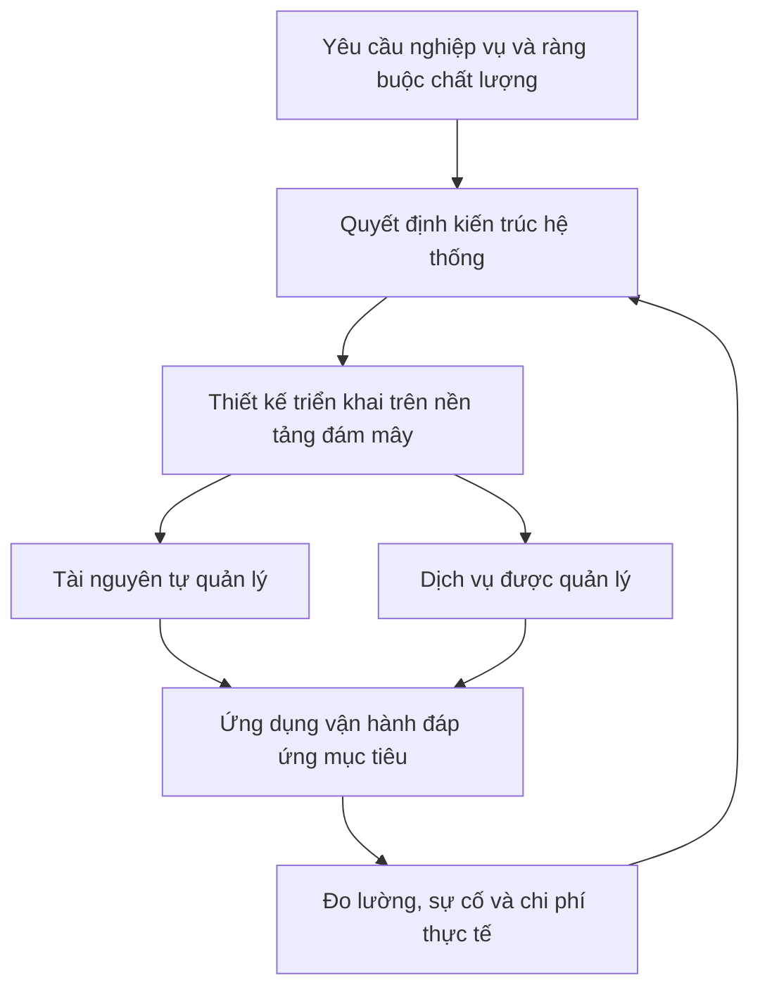
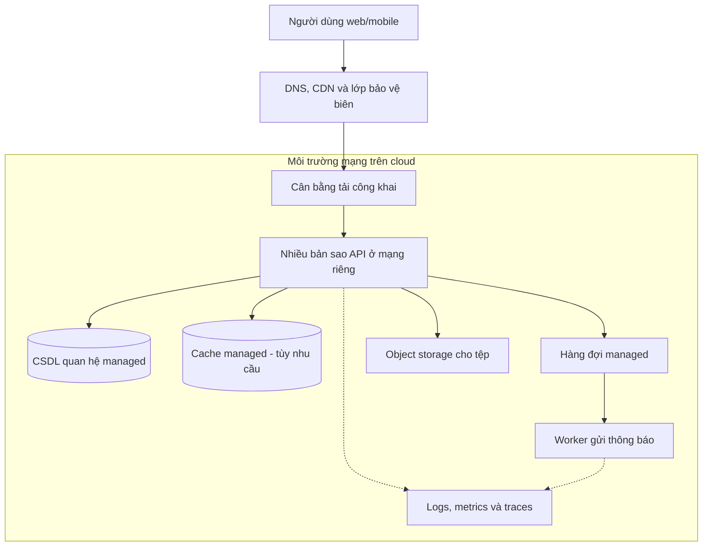

# Mối quan hệ giữa kiến trúc hệ thống, nền tảng đám mây và dịch vụ được quản lý

Khi xây dựng ứng dụng trên đám mây, ba khái niệm thường xuất hiện cùng nhau: **kiến trúc hệ thống** (*system architecture*), **nền tảng đám mây** (*cloud platform*) và **dịch vụ được quản lý** (*managed service*). Chúng có liên hệ chặt chẽ nhưng trả lời những câu hỏi khác nhau:

- **Kiến trúc hệ thống:** Ứng dụng cần những thành phần nào, chúng giao tiếp và quản lý dữ liệu ra sao để đáp ứng yêu cầu nghiệp vụ và yêu cầu chất lượng?
- **Nền tảng đám mây:** Những thành phần đó được chạy, kết nối, bảo vệ, giám sát và mở rộng trên hạ tầng nào?
- **Dịch vụ được quản lý:** Trong các thành phần triển khai trên đám mây, nhà cung cấp sẽ vận hành giúp những phần nào, và nhóm phát triển vẫn chịu trách nhiệm về điều gì?

Hiểu đúng quan hệ này giúp kiến trúc sư tránh chọn dịch vụ theo danh mục sản phẩm rồi mới tìm vấn đề để giải quyết. Điểm khởi đầu cần là **nhu cầu của hệ thống**; dịch vụ đám mây là các phương án hiện thực hóa thiết kế ấy.

## 1. Ba khái niệm và ranh giới của chúng

| Khía cạnh | Kiến trúc hệ thống | Nền tảng đám mây | Dịch vụ được quản lý |
|---|---|---|---|
| Bản chất | Tập hợp quyết định thiết kế về cấu trúc, tương tác, dữ liệu và đặc tính chất lượng | Môi trường và tập năng lực để cung cấp tài nguyên CNTT theo nhu cầu | Một cách cung cấp dịch vụ trong đó nhà cung cấp đảm nhận một phần công việc vận hành |
| Câu hỏi chính | *Thiết kế thế nào để đáp ứng yêu cầu?* | *Triển khai thiết kế ở đâu và bằng năng lực nào?* | *Ai vận hành lớp nào của giải pháp?* |
| Ví dụ | API không giữ trạng thái, giao dịch đặt chỗ cần nhất quán, xử lý thông báo bất đồng bộ | Mạng riêng ảo, máy ảo, container, cân bằng tải, lưu trữ, định danh, quan sát hệ thống | Cơ sở dữ liệu được quản lý, hàng đợi được quản lý, dịch vụ chạy container được quản lý |
| Đầu ra điển hình | Sơ đồ thành phần, luồng dữ liệu, giao ước API, quyết định kiến trúc, chỉ tiêu chất lượng | Sơ đồ triển khai, cấu hình mạng, tài nguyên, quyền truy cập, chính sách vận hành | Phân chia trách nhiệm, cấu hình dịch vụ, cam kết/giới hạn dịch vụ, quy trình ứng phó sự cố |

**Kiến trúc hệ thống không đồng nghĩa với sơ đồ dịch vụ cloud.** Sơ đồ chỉ có tên máy ảo, cơ sở dữ liệu và hàng đợi chưa cho biết vì sao các thành phần ấy tồn tại, dữ liệu nào cần giao dịch nguyên tử, khi nào hệ thống được coi là khả dụng hoặc điều gì xảy ra nếu một thành phần lỗi.

**Nền tảng đám mây không phải một kiểu kiến trúc ứng dụng duy nhất.** Cùng một nền tảng có thể chạy ứng dụng nguyên khối (*monolith*), kiến trúc dịch vụ (*services*), kiến trúc hướng sự kiện (*event-driven*) hoặc kết hợp. Ngược lại, cùng một kiến trúc logic có thể được triển khai trên máy chủ riêng, một nhà cung cấp cloud hoặc nhiều môi trường, với chi tiết vận hành khác nhau.

**Dịch vụ được quản lý là một phần của năng lực nền tảng đám mây, không phải một tầng tách biệt hoàn toàn.** Chẳng hạn, nhà cung cấp có thể cung cấp cả máy ảo để tự cài cơ sở dữ liệu lẫn cơ sở dữ liệu được quản lý. Hai lựa chọn giải quyết nhu cầu lưu trữ tương tự, nhưng thay đổi đáng kể trách nhiệm vận hành và khả năng kiểm soát.

Các mũi tên thể hiện **quy trình ra quyết định và phản hồi** chứ không phải quan hệ bắt buộc một-một. Một thành phần logic có thể dùng nhiều tài nguyên cloud; nhiều thành phần logic cũng có thể dùng chung một dịch vụ được quản lý nếu yêu cầu cách ly và bảo mật cho phép.

## 2. Từ yêu cầu nghiệp vụ đến lựa chọn cloud

Giả sử nhóm cần xây dựng hệ thống đặt chỗ trực tuyến, cho phép người dùng tìm kiếm, kiểm tra tình trạng còn chỗ, đặt chỗ và nhận thông báo. Trước khi chọn sản phẩm cloud, nhóm cần làm rõ:

1. **Nghiệp vụ:** Không được xác nhận hai đơn cho cùng một chỗ trong cùng khoảng thời gian; thông báo gửi chậm vài giây có thể chấp nhận.
2. **Lưu lượng:** Đọc/tìm kiếm nhiều hơn ghi; lưu lượng tăng mạnh vào khung giờ cao điểm.
3. **Độ tin cậy:** Mục tiêu khả dụng, thời gian khôi phục tối đa (*RTO*) và lượng dữ liệu có thể mất tối đa khi phục hồi (*RPO*) cần được định lượng.
4. **Bảo mật và pháp lý:** Dữ liệu cá nhân, phân quyền truy cập, nhật ký kiểm toán, vị trí lưu trữ và thời hạn lưu giữ cần được xác định.
5. **Nguồn lực:** Quy mô đội vận hành, ngân sách, kỹ năng hiện có và thời hạn ra mắt ảnh hưởng trực tiếp đến phương án triển khai.

Sau đó mới ánh xạ yêu cầu sang quyết định kiến trúc và dịch vụ cụ thể:

| Yêu cầu | Quyết định kiến trúc | Năng lực cloud hoặc phương án triển khai |
|---|---|---|
| Không đặt trùng chỗ | Thực hiện kiểm tra và ghi trong giao dịch có kiểm soát cạnh tranh; dùng ràng buộc dữ liệu phù hợp | Cơ sở dữ liệu quan hệ, có thể chọn dịch vụ được quản lý |
| Truy cập tăng đột biến | API không lưu phiên trong bộ nhớ cục bộ; nhiều bản sao xử lý yêu cầu | Cân bằng tải, compute có cơ chế mở rộng ngang |
| Gửi thông báo không chặn đặt chỗ | Tách xử lý thông báo khỏi giao dịch chính bằng sự kiện/hàng đợi | Hàng đợi và tác vụ nền, có thể dùng dịch vụ được quản lý |
| Bảo vệ dữ liệu cá nhân | Phân vùng mạng, xác thực và phân quyền, mã hóa, quản lý bí mật | Mạng riêng, IAM, khóa/mã hóa, quản lý secret, ghi log kiểm toán |
| Khôi phục sau lỗi | Loại bỏ điểm lỗi đơn, sao lưu và diễn tập khôi phục | Nhiều vùng sẵn sàng, backup, khả năng khôi phục theo thời điểm nếu dịch vụ hỗ trợ |
| Theo dõi chất lượng | Thu thập metric, log, trace và thiết lập cảnh báo theo hành vi người dùng | Dịch vụ giám sát, log tập trung, tracing và cảnh báo |

Việc chọn dịch vụ là **kết quả** của đánh giá yêu cầu. Nếu hệ thống nhỏ, tải ổn định và đội vận hành hạn chế, kiến trúc nguyên khối có cấu trúc rõ ràng chạy trên một dịch vụ ứng dụng được quản lý có thể phù hợp hơn việc chia thành nhiều microservice. Tăng số lượng dịch vụ không tự động làm hệ thống mở rộng hoặc đáng tin cậy hơn.

## 3. Ví dụ kiến trúc triển khai cho hệ thống đặt chỗ

Một phương án minh họa như sau. Các nhãn *managed* là lựa chọn triển khai, không phải điều kiện bắt buộc của kiến trúc logic.

Luồng đặt chỗ có thể diễn ra như sau:

1. Người dùng gửi yêu cầu tới API qua lớp truy cập công khai; API và cơ sở dữ liệu không nhất thiết có địa chỉ truy cập trực tiếp từ Internet.
2. API xác thực người dùng, kiểm tra quy tắc nghiệp vụ và ghi đặt chỗ trong **giao dịch cơ sở dữ liệu**. Với dữ liệu có thể bị tranh chấp, dùng khóa, điều kiện cập nhật nguyên tử hoặc ràng buộc duy nhất thích hợp theo mô hình dữ liệu; chỉ kiểm tra `SELECT` rồi `INSERT` tách rời thường không đủ để chống đặt trùng khi có nhiều yêu cầu đồng thời.
3. Sau khi dữ liệu đặt chỗ được ghi thành công, hệ thống tạo sự kiện cho hàng đợi. Nếu việc ghi dữ liệu và phát sự kiện phải nhất quán với nhau, có thể dùng **transactional outbox** hoặc cơ chế tương đương để tránh tình huống giao dịch thành công nhưng sự kiện bị mất.
4. Worker nhận thông báo, xử lý và đánh dấu kết quả. Vì hàng đợi có thể phát lại thông điệp, worker cần xử lý **idempotent** (lặp lại không tạo tác dụng phụ không mong muốn), có chính sách thử lại và nơi lưu thông điệp lỗi kéo dài (*dead-letter queue*) khi thích hợp.
5. Metrics, logs và traces được dùng để phát hiện việc đặt chỗ thất bại, độ trễ tăng hoặc hàng đợi tồn đọng, thay vì chỉ theo dõi máy chủ có đang chạy hay không.

Ở đây, kiến trúc hệ thống quy định **giao dịch đặt chỗ cần nhất quán**, **gửi thông báo có thể bất đồng bộ** và **API cần mở rộng ngang**. Cloud cung cấp các thành phần để thực hiện. Dịch vụ được quản lý giúp giảm công việc thiết lập, vá lỗi và vận hành một số thành phần, nhưng không thay thế việc thiết kế luồng nghiệp vụ, xử lý lỗi hoặc bảo đảm tính đúng đắn của dữ liệu.

### Kiến trúc logic và kiến trúc triển khai khác nhau thế nào?

- **Kiến trúc logic** nói rằng có API đặt chỗ, kho dữ liệu giao dịch và bộ xử lý thông báo. Nó thể hiện trách nhiệm, ranh giới và luồng dữ liệu.
- **Kiến trúc triển khai** nói API chạy trong bao nhiêu vùng sẵn sàng, đi qua subnet nào, kết nối tới endpoint nào, dùng nhóm quyền gì và mở rộng dựa trên metric nào.
- **Thiết kế vận hành** bổ sung cảnh báo, sao lưu, kế hoạch phục hồi, kiểm soát thay đổi, giới hạn tài nguyên và quy trình xử lý sự cố.

Ba góc nhìn cần khớp nhau. Ví dụ, nếu kiến trúc logic yêu cầu dịch vụ đặt chỗ sẵn sàng khi một vùng sẵn sàng gặp sự cố, sơ đồ triển khai phải chứng minh không có điểm lỗi đơn trong đường xử lý quan trọng, bao gồm compute, đường mạng, phụ thuộc dữ liệu và các cấu hình liên quan.

## 4. Managed service thay đổi trách nhiệm, không loại bỏ trách nhiệm

Các mô hình dịch vụ là một phổ mức độ kiểm soát và vận hành:

| Phương án | Nhà cung cấp thường đảm nhận | Nhóm ứng dụng vẫn đảm nhận |
|---|---|---|
| Máy ảo tự quản lý (IaaS) | Phần cứng, lớp ảo hóa và hạ tầng vật lý | Hệ điều hành, bản vá hệ điều hành, runtime, triển khai ứng dụng, dữ liệu, cấu hình bảo mật và giám sát workload |
| Nền tảng chạy ứng dụng/container được quản lý (PaaS hoặc tương đương) | Một phần hạ tầng, điều phối, runtime hoặc nền tảng triển khai tùy loại dịch vụ | Mã ứng dụng, cấu hình, quyền truy cập, phiên bản, tài nguyên, theo dõi chất lượng và dữ liệu |
| Cơ sở dữ liệu được quản lý | Thường gồm cài đặt engine, phần vận hành máy chủ, vá lỗi và các tính năng backup/HA theo gói đã chọn | Schema, truy vấn, chỉ mục, phân quyền, chọn cấu hình HA/backup, diễn tập khôi phục, kiểm soát dữ liệu và chi phí |
| Hàng đợi được quản lý | Hạ tầng broker, khả năng cung cấp dịch vụ và vận hành broker theo cam kết | Định dạng thông điệp, phân quyền, retry, idempotency, xử lý tồn đọng, thứ tự/thời hạn thông điệp và logic ứng dụng |
| SaaS | Phần lớn ứng dụng và hạ tầng của sản phẩm SaaS | Cấu hình sử dụng, quản lý tài khoản/dữ liệu, phân quyền, tích hợp, tuân thủ và quy trình nghiệp vụ của tổ chức |

Phạm vi chính xác phụ thuộc **từng sản phẩm, cấu hình và điều khoản dịch vụ**. Chẳng hạn, một dịch vụ container có thể quản lý cụm điều khiển nhưng vẫn yêu cầu nhóm ứng dụng cập nhật worker node, image, network policy và cấu hình quyền. Không thể suy ra “mọi thứ đã được quản lý” chỉ từ tên dịch vụ.

Điều này liên quan trực tiếp đến **mô hình trách nhiệm chia sẻ** (*shared responsibility*): nhà cung cấp chịu trách nhiệm về những lớp hạ tầng/dịch vụ họ cam kết; khách hàng vẫn phải bảo vệ dữ liệu, danh tính, cấu hình, ứng dụng và việc sử dụng dịch vụ trong phạm vi của mình. Mã hóa có sẵn không bảo đảm an toàn nếu quyền truy cập quá rộng; có backup tự động không bảo đảm đạt RTO nếu chưa thử quy trình restore.

## 5. Các đánh đổi kiến trúc khi dùng nền tảng đám mây

Không có phương án tốt nhất cho mọi yêu cầu. Các quyết định cần đánh giá theo mục tiêu đo được và chi phí sở hữu toàn phần.

| Mục tiêu | Cloud và managed service hỗ trợ | Giới hạn hoặc đánh đổi cần thiết kế thêm |
|---|---|---|
| **Độ tin cậy** | Triển khai đa vùng sẵn sàng, tự thay thế instance, sao lưu, dịch vụ có cơ chế HA | SLA của từng dịch vụ không đồng nghĩa với SLO toàn hệ thống; phụ thuộc chung, lỗi cấu hình và lỗi ứng dụng vẫn gây gián đoạn |
| **Bảo mật** | IAM, mạng riêng, mã hóa, quản lý secret, audit log | Cần thiết lập quyền tối thiểu, phân loại dữ liệu, cấu hình mạng đúng, bảo vệ ứng dụng và kiểm tra tuân thủ |
| **Khả năng mở rộng** | Tăng/giảm bản sao compute, cân bằng tải, dịch vụ hỗ trợ tăng dung lượng | CSDL, quota, kết nối, khóa giao dịch và phụ thuộc ngoài có thể là nút thắt; mở rộng ngang không giải quyết mọi vấn đề |
| **Hiệu năng** | Vùng triển khai gần người dùng, cache, CDN, tài nguyên linh hoạt | Cache có thể gây dữ liệu cũ; kết nối xuyên vùng làm tăng độ trễ và phí truyền dữ liệu; cần đo trên tải thực tế |
| **Chi phí** | Thanh toán theo sử dụng, giảm nhân lực vận hành, lựa chọn nhiều cỡ tài nguyên | Phí lưu trữ, backup, log, traffic ra ngoài, tài nguyên nhàn rỗi và phí managed service có thể tăng ngoài dự kiến |
| **Vận hành** | Tự động hóa provisioning, nâng cấp và giám sát một phần | Cần quy trình phát hành, quan sát end-to-end, ứng phó sự cố, quản lý giới hạn và kiểm thử phục hồi |
| **Tính linh hoạt** | Triển khai nhanh, giảm khối lượng tự xây nền tảng | API đặc thù và định dạng dữ liệu có thể gây phụ thuộc nhà cung cấp (*vendor lock-in*) |

### Ba đánh đổi dễ bị đánh giá sai

**1. High availability khác disaster recovery.** Chạy nhiều bản sao API và cơ sở dữ liệu đa vùng sẵn sàng giúp ứng phó với lỗi máy hoặc lỗi một vùng sẵn sàng. Tuy nhiên, lỗi toàn vùng địa lý, xóa dữ liệu nhầm hoặc lỗi logic lan truyền có thể vẫn cần phương án khôi phục khác: bản sao tách biệt, backup có bảo vệ, thủ tục chuyển vùng, hoặc một thiết kế dự phòng liên vùng nếu yêu cầu đòi hỏi. Phải kiểm tra **RTO** và **RPO** bằng diễn tập, không chỉ bằng thông số quảng bá.

**2. Autoscaling khác bảo đảm hiệu năng.** Thêm API instance có thể tăng khả năng tiếp nhận request nhưng cũng làm tăng số kết nối tới cơ sở dữ liệu. Nếu database quá tải, latency còn có thể xấu đi. Kiến trúc cần xem xét connection pooling, kiểm soát tải, caching an toàn, chỉ mục, hàng đợi và giới hạn tài nguyên. Trước khi đặt ngưỡng mở rộng, cần đo request/giây, thời gian đáp ứng ở các phân vị (như p95), độ sâu hàng đợi và tỉ lệ lỗi.

**3. Managed khác tự động tối ưu chi phí.** Ví dụ, database được quản lý có thể giảm công bảo trì nhưng cấu hình quá lớn, bản sao đọc không dùng đến, lưu log quá lâu hoặc backup giữ không kiểm soát vẫn gây tốn kém. Đánh giá tổng chi phí bao gồm phí dịch vụ, vận hành, downtime và chi phí chuyển đổi. Cấu hình rẻ hơn nhưng khiến mục tiêu khôi phục không đạt có thể là lựa chọn sai.

## 6. Chọn tự quản lý hay dùng dịch vụ managed

Một quy trình lựa chọn thực tế là so sánh **nhu cầu kiểm soát** với **khả năng và chi phí vận hành**:

| Câu hỏi đánh giá | Nghiêng về dịch vụ được quản lý khi... | Có thể cân nhắc tự quản lý khi... |
|---|---|---|
| Nhóm có đủ năng lực vận hành 24/7? | Đội nhỏ, muốn tập trung vào chức năng sản phẩm | Có đội chuyên trách với quy trình vá lỗi, backup, monitoring và xử lý sự cố |
| Yêu cầu tùy biến sâu đến mức nào? | Chức năng, phiên bản và cấu hình dịch vụ đáp ứng yêu cầu | Cần tiện ích, runtime, extension hoặc khả năng kiểm soát mà dịch vụ không hỗ trợ |
| Mục tiêu RTO/RPO và tính sẵn sàng? | Dịch vụ cung cấp và cho phép kiểm thử cấu hình đáp ứng mục tiêu | Cần phương án đặc biệt mà dịch vụ không hỗ trợ, và đội đủ khả năng triển khai/vận hành |
| Dữ liệu và tuân thủ? | Vị trí dữ liệu, mã hóa, kiểm toán, hợp đồng và kiểm soát truy cập phù hợp | Ràng buộc pháp lý/kỹ thuật yêu cầu cách vận hành khác |
| Chi phí dài hạn? | Chi phí dịch vụ cộng vận hành thấp và dễ dự đoán hơn | Lưu lượng lớn, ổn định cùng năng lực vận hành nội bộ tạo lợi thế đã được đo lường |
| Rủi ro phụ thuộc nhà cung cấp? | Lợi ích tốc độ triển khai vượt chi phí chuyển đổi dự kiến | Cần di chuyển thường xuyên và có đủ nguồn lực duy trì tính tương thích |

Ví dụ với cơ sở dữ liệu, dùng dịch vụ managed có thể là lựa chọn hợp lý cho đội mới ra mắt sản phẩm: nhà cung cấp hỗ trợ vận hành engine, còn nhóm tập trung vào mô hình dữ liệu, truy vấn, backup policy và phục hồi. Nếu ứng dụng cần một extension đặc thù không được hỗ trợ, phương án tự quản lý có thể khả thi hơn, nhưng phải tính đầy đủ chi phí vá lỗi, bảo mật, sao lưu, replication và trực sự cố.

Tính di động cũng là một **đánh đổi có chủ đích**. Có thể giảm phụ thuộc bằng chuẩn giao tiếp phổ biến, hạ tầng khai báo bằng mã (*infrastructure as code*), cơ chế xuất/nhập dữ liệu và giới hạn mã ứng dụng phụ thuộc API đặc thù. Tuy nhiên, trừu tượng hóa mọi dịch vụ cloud thường làm tăng độ phức tạp; chỉ đầu tư vào khả năng di chuyển ở mức phù hợp với rủi ro đã xác định.

## 7. Đánh giá giải pháp theo tư duy Well-Architected

Các khung *Well-Architected* giúp đặt câu hỏi có hệ thống thay vì chỉ kiểm tra sơ đồ đã có đủ biểu tượng cloud hay chưa. Có thể đánh giá một phương án qua sáu nhóm khía cạnh thường gặp:

| Khía cạnh | Câu hỏi cần kiểm chứng | Bằng chứng mong đợi |
|---|---|---|
| **Vận hành xuất sắc** | Có thể triển khai, quan sát, xử lý sự cố và cải tiến an toàn không? | CI/CD, runbook, dashboard, cảnh báo, quy trình rollback, diễn tập sự cố |
| **Bảo mật** | Ai truy cập dữ liệu nào? Có giới hạn quyền, phát hiện và điều tra hành vi bất thường không? | Sơ đồ luồng dữ liệu, IAM, chính sách mã hóa, threat model, audit log |
| **Độ tin cậy** | Nếu một thành phần hoặc vùng sẵn sàng lỗi thì sao? Có đạt RTO/RPO không? | Phân tích điểm lỗi đơn, bài kiểm tra failover/restore, kết quả đo SLO |
| **Hiệu quả hiệu năng** | Hệ thống đáp ứng tải mục tiêu và thay đổi theo nhu cầu ra sao? | Load test, p95/p99 latency, throughput, chỉ số giới hạn và phương án scaling |
| **Tối ưu chi phí** | Chi phí tăng theo người dùng, dữ liệu và lưu lượng thế nào? | Ước tính theo giả định tải, nhãn phân bổ chi phí, ngân sách, cảnh báo và review sử dụng |
| **Bền vững** | Có giảm lãng phí tài nguyên khi vẫn giữ mục tiêu chất lượng? | Right-sizing, scale-to-demand, vòng đời dữ liệu và theo dõi sử dụng tài nguyên |

Đây là các **góc đánh giá**, không phải chứng nhận thiết kế đã đúng. Chẳng hạn, có hai bản sao API nhưng dùng một cơ sở dữ liệu không có phương án dự phòng thì điểm lỗi đơn vẫn còn. Ngược lại, cấu hình database đa vùng sẵn sàng chưa đủ nếu ứng dụng không có timeout, retry phù hợp, kiểm soát kết nối hoặc khả năng phục hồi khi chuyển kết nối.

Để kiểm chứng một ví dụ định lượng, giả sử hệ thống đặt mục tiêu:

- **Khả dụng 99,9% mỗi tháng** cho chức năng đặt chỗ, được đo ở phía người dùng. Trong tháng 30 ngày, mức này tương ứng khoảng 43,2 phút không đáp ứng mục tiêu, nếu đo theo thời gian; cần định nghĩa rõ request nào được tính là thành công.
- **RTO tối đa 60 phút** cho sự cố nghiêm trọng: từ thời điểm gián đoạn đến khi chức năng trọng yếu phục hồi theo mức đã định nghĩa.
- **RPO tối đa 15 phút:** sau phục hồi, chấp nhận mất tối đa 15 phút dữ liệu theo điểm khôi phục.
- **P95 độ trễ API đặt chỗ dưới 500 ms** ở mức tải kiểm thử đã thống nhất, không tính riêng mỗi độ trễ của database.

Các con số trên chỉ là **giả định phục vụ thiết kế**, không phải khuyến nghị chung. Từng mục tiêu dẫn đến các quyết định kiểm chứng được: cấu hình HA, cách sao lưu và khôi phục, chiến lược kiểm thử tải, đo lường trải nghiệm người dùng, ngân sách và phương án xử lý khi vượt ngưỡng. SLO, RTO và RPO là yêu cầu cần thương lượng dựa trên tác động nghiệp vụ và chi phí, không phải tính năng được bảo đảm chỉ bằng cách chọn một dịch vụ cloud.

## 8. Quy trình thiết kế kiến trúc từ đầu đến lúc vận hành

Khi bắt đầu một dự án cloud, có thể đi theo chuỗi công việc sau:

1. **Làm rõ yêu cầu:** Xác định luồng nghiệp vụ quan trọng, quy mô tải, yêu cầu dữ liệu, ràng buộc bảo mật, ngân sách và mục tiêu đo lường như SLO, RTO, RPO.
2. **Thiết kế logic trước:** Phác họa các thành phần, ranh giới dữ liệu, giao tiếp đồng bộ/bất đồng bộ, chỗ cần nhất quán mạnh và cách xử lý lỗi; ghi lại những giả định chưa được xác minh.
3. **Ánh xạ sang nền tảng cloud:** Chọn topology mạng, compute, lưu trữ, database, IAM, secret, quan sát và mô hình triển khai; xác định vùng, vùng sẵn sàng và giới hạn dịch vụ.
4. **Quyết định mức độ managed:** Với mỗi thành phần, ghi rõ nhóm nào quản lý hệ điều hành/runtime, cấu hình, dữ liệu, backup, scaling, bảo mật và xử lý sự cố; chọn phương án theo yêu cầu và năng lực đội ngũ.
5. **Kiểm chứng đánh đổi:** Thử tải, giả lập lỗi, thử khôi phục dữ liệu, rà soát quyền truy cập, tính chi phí ở các kịch bản tải và kiểm tra quota. Điều chỉnh thiết kế bằng số đo thực.
6. **Vận hành và cải tiến:** Dùng hạ tầng khai báo bằng mã khi phù hợp, theo dõi mục tiêu dịch vụ, kiểm soát thay đổi và định kỳ đánh giá lại kiến trúc khi tải, tính năng, giá hoặc ràng buộc thay đổi.

Một **bản ghi quyết định kiến trúc** (*Architecture Decision Record — ADR*) ngắn giúp lưu lý do lựa chọn. Ví dụ:

> **Quyết định:** Dùng database quan hệ được quản lý, cấu hình dự phòng đa vùng sẵn sàng cho dữ liệu đặt chỗ.  
> **Lý do:** Cần giao dịch nhất quán và giảm gánh nặng vận hành để đội tập trung phát triển tính năng.  
> **Đánh đổi:** Chi phí dịch vụ cao hơn một số phương án tự quản lý; nhóm vẫn phải tối ưu truy vấn, kiểm thử failover và restore.  
> **Điều kiện xem xét lại:** Tải hoặc chi phí tăng vượt ngưỡng dự toán, dịch vụ thiếu tính năng cần thiết, hoặc mục tiêu RTO/RPO thay đổi.

## 9. Những ngộ nhận cần tránh

- **“Lên cloud tức là ứng dụng tự có tính sẵn sàng cao.”** Tính sẵn sàng phụ thuộc kiến trúc toàn hệ thống, cấu hình triển khai và cách ứng dụng xử lý lỗi.
- **“Dùng managed database là không cần DBA hoặc kiểm tra backup.”** Schema, truy vấn, dung lượng, bảo mật dữ liệu và kiểm thử phục hồi vẫn phải có người chịu trách nhiệm.
- **“Đã có autoscaling thì database không thể quá tải.”** Thêm compute đôi khi làm tăng áp lực lên database và hệ thống phụ thuộc.
- **“Kiến trúc cloud-native nhất thiết là microservices.”** Một ứng dụng nguyên khối được thiết kế rõ ràng vẫn có thể dùng các nguyên tắc cloud-native như tự động hóa triển khai, quan sát, phục hồi và co giãn tài nguyên.
- **“SLA của nhà cung cấp là SLA của ứng dụng.”** Chỉ tiêu của nhà cung cấp áp dụng cho phạm vi dịch vụ và điều kiện cụ thể; chức năng người dùng có thể phụ thuộc nhiều dịch vụ, mã ứng dụng và kết nối mạng.

## 10. Bài tập áp dụng

Một nhóm triển khai API xử lý đơn hàng trên **một máy ảo**, dùng **database managed** không bật cấu hình dự phòng, và gửi email trực tiếp trong cùng request tạo đơn. Khi email chậm, request thường vượt timeout; khi máy ảo hỏng, API ngừng phục vụ. Nhóm tuyên bố hệ thống “đã sẵn sàng cao vì chạy cloud và dùng managed database”.

Hãy phân tích theo ba khái niệm đã học:

1. **Ở mức kiến trúc hệ thống:** Tách việc gửi email khỏi giao dịch tạo đơn; bảo đảm xử lý gửi lại không gây trùng; xác định rõ điểm commit và xử lý lỗi. Làm rõ mục tiêu độ sẵn sàng và thời gian phục hồi.
2. **Ở mức nền tảng cloud:** Cân nhắc nhiều bản sao API sau cân bằng tải, triển khai trên nhiều vùng sẵn sàng nếu đáp ứng mục tiêu; xác định topology mạng, đo lỗi/độ trễ, kiểm tra giới hạn tài nguyên.
3. **Ở mức dịch vụ managed:** Kiểm tra cấu hình HA, backup và khả năng restore của database; xem xét hàng đợi managed cho email. Dù đã dùng managed, nhóm vẫn cần quy tắc nghiệp vụ, phân quyền và diễn tập phục hồi.

Nếu ngân sách không cho phép mọi thành phần đều dự phòng, hãy ưu tiên theo **mức ảnh hưởng nghiệp vụ** và công khai rủi ro còn lại. Chẳng hạn, chậm email có thể chấp nhận trong một khoảng ngắn, còn ghi đơn hàng sai hoặc mất dữ liệu giao dịch có thể có hậu quả lớn hơn. Đây chính là cách dùng kiến trúc để lựa chọn nền tảng và dịch vụ: **bắt đầu từ yêu cầu, giải thích được đánh đổi và xác minh bằng kết quả vận hành**.
