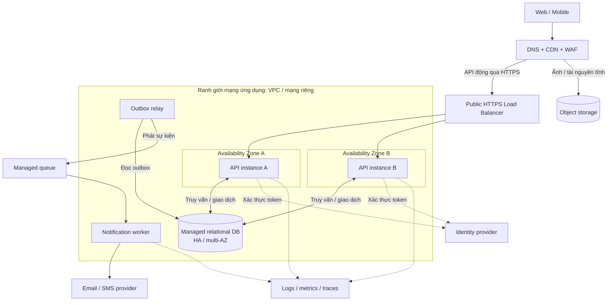
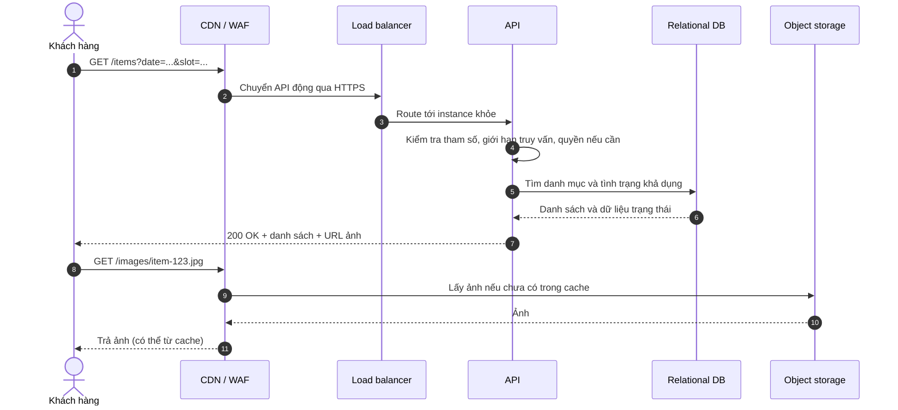

# Đọc một kiến trúc tham chiếu: từ yêu cầu đến luồng xử lý

## 1. Mục tiêu của bài học

Một **kiến trúc tham chiếu** (reference architecture) là bản mô tả cách các nhóm thành phần có thể phối hợp để giải một lớp bài toán. Nó giúp bắt đầu thiết kế, thảo luận ranh giới hệ thống và nhận diện các quyết định cần kiểm chứng. Nó **không phải** bản cấu hình sẵn bảo đảm hệ thống sẽ đạt chỉ tiêu về độ trễ, độ sẵn sàng hay bảo mật.

Sau bài này, bạn có thể:

- Chuyển yêu cầu nghiệp vụ và yêu cầu chất lượng thành các điểm cần tìm trên sơ đồ kiến trúc cloud.
- Đọc sơ đồ theo ba góc nhìn: **thành phần**, **ranh giới tin cậy** và **luồng xử lý/dữ liệu**.
- Theo dõi một yêu cầu đọc và một yêu cầu ghi từ người dùng đến nơi lưu dữ liệu, kể cả nhánh lỗi và xử lý bất đồng bộ.
- Giải thích vì sao kiến trúc chọn mạng, compute, cơ sở dữ liệu, hàng đợi và cách triển khai nhất định.
- Đặt câu hỏi đánh giá kiến trúc dựa trên độ tin cậy, bảo mật, hiệu năng/mở rộng, chi phí và khả năng vận hành theo tư duy **Well-Architected**.

Trong module **CLOUD_ARCHITECTURE**, việc đọc sơ đồ chỉ là bước đầu. Mục đích là truy vết được: **yêu cầu nào dẫn đến quyết định nào, quyết định đó tác động tới luồng nào, và kiểm chứng bằng bằng chứng gì**.

## 2. Bối cảnh: hệ thống đặt lịch thuê thiết bị

Giả sử một doanh nghiệp muốn xây ứng dụng web/mobile cho khách hàng tra cứu thiết bị có thể thuê theo khung giờ và đặt lịch. Sau khi đặt thành công, khách hàng nhận thông báo; nhân viên có thể xem các đơn đặt. Đây là **tình huống giả định phục vụ học tập**, chưa phải thiết kế triển khai cuối cùng.

### 2.1. Từ nhu cầu nghiệp vụ đến tiêu chí đo lường

| Mã | Yêu cầu giả định | Hệ quả cần xem trong kiến trúc |
|---|---|---|
| F1 | Xem danh mục, ảnh và tìm thiết bị theo thời gian | Đường đọc nhanh; lưu ảnh tách khỏi dữ liệu giao dịch; có thể cache dữ liệu danh mục |
| F2 | Đặt thiết bị theo một khung giờ | Kiểm tra xung đột đặt chỗ **trong giao dịch ghi**, không chỉ dựa vào kết quả tìm kiếm |
| F3 | Gửi thông báo khi đặt thành công | Có thể xử lý qua hàng đợi để lỗi nhà cung cấp email không làm hỏng giao dịch đặt chỗ |
| Q1 | Tại giờ cao điểm giả định **200 HTTP request/giây**, khoảng **15%** là thao tác ghi | Cần đo tải đọc/ghi, kết nối DB, CPU, số lượng instance và khả năng tự mở rộng |
| Q2 | Mục tiêu thử nghiệm: **p95** của tra cứu dưới **400 ms** và đặt lịch dưới **1,5 giây** | Cần xác định điểm bắt đầu/kết thúc đo, phân bổ ngân sách độ trễ, giám sát từng chặng |
| Q3 | Mục tiêu khả dụng API cốt lõi **99,9% mỗi tháng** | Tránh một điểm lỗi đơn, bố trí ứng dụng ở ít nhất hai Availability Zone (AZ), kiểm thử khôi phục |
| Q4 | Nếu mất một AZ: mục tiêu khôi phục **RTO ≤ 60 phút**, mất dữ liệu tối đa **RPO ≤ 15 phút** | Cần cơ chế chuyển đổi dự phòng, sao lưu/khôi phục và diễn tập; xác định rõ phạm vi sự cố |
| Q5 | Tài khoản, dữ liệu liên hệ và lịch thuê phải được bảo vệ | Xác thực, phân quyền, mã hóa, quản lý bí mật, giới hạn truy cập mạng, nhật ký kiểm toán |
| Q6 | Ngân sách vận hành có giới hạn, đội ngũ vận hành nhỏ | Ưu tiên dịch vụ được quản lý khi phù hợp; theo dõi hóa đơn, khả năng khôi phục và độ phức tạp |

Các con số Q1–Q4 chỉ là **giả định để luyện phân tích**, không phải benchmark hay cam kết của nhà cung cấp cloud. Chẳng hạn, nếu tỉ lệ ghi thực tế là 15%, ở đỉnh 200 request/giây sẽ có trung bình khoảng 30 thao tác ghi/giây; phân bố có thể không đều và mức tranh chấp trên **cùng một thiết bị/khung giờ** mới là điều quyết định độ an toàn đặt chỗ.

Trước khi chốt kiến trúc, nhóm còn phải hỏi về tăng trưởng dự kiến, số thiết bị, thời gian lưu lịch sử, phân vùng địa lý, yêu cầu lưu trú dữ liệu, quy định pháp lý, mức độ ưu tiên của thông báo và ngân sách định lượng. **Thiếu những thông tin này thì sơ đồ chỉ là một phương án có giả định.**

## 3. Đọc sơ đồ tổng thể

Sơ đồ dưới đây mô tả một lựa chọn hợp lý cho ứng dụng có một khu vực địa lý chính, sử dụng ứng dụng **stateless**, cơ sở dữ liệu quan hệ được quản lý và xử lý thông báo bất đồng bộ.



**Cách đọc ký hiệu:** mũi tên liền thể hiện luồng chính/phụ thuộc nghiệp vụ; mũi tên đứt thể hiện tích hợp hỗ trợ. Sơ đồ là **logic**: queue, object storage, identity provider và hệ thống quan sát có thể là dịch vụ cloud nằm ngoài VPC nhưng được truy cập qua endpoint/phương thức bảo mật phù hợp. Khung VPC cũng chưa thể hiện đầy đủ route table, firewall, private endpoint hay các vùng mạng vật lý. Cấu hình triển khai thực tế phải bổ sung chúng.

### 3.1. Đọc từ ngoài vào trong

| Khối | Vai trò | Câu hỏi khi thẩm định |
|---|---|---|
| DNS/CDN | Phân giải tên miền; phân phối ảnh và tài nguyên tĩnh gần người dùng | Nội dung nào được cache? TTL và cơ chế cập nhật là gì? |
| WAF và rate limiting | Lọc mẫu request rủi ro, giới hạn lạm dụng | Quy tắc nào bảo vệ API công khai? Có khả năng chặn người dùng hợp lệ không? |
| Load balancer | Kết thúc hoặc chuyển tiếp TLS, health check, phân phối request tới API khỏe | API ở bao nhiêu AZ? Request bị xử lý thế nào khi một instance/AZ chết? |
| API stateless | Thực thi nghiệp vụ, xác thực và phân quyền, phối hợp với DB | Session có bị giữ trong bộ nhớ một instance không? Có thể tăng/giảm replica an toàn không? |
| Managed relational DB | Giữ nguồn dữ liệu giao dịch chính, ràng buộc đặt chỗ, backup/failover | Ai là writer? Giao dịch và chỉ mục bảo vệ chống đặt trùng ra sao? |
| Object storage | Lưu ảnh/file, không lưu như blob lớn trong bảng giao dịch | File có công khai không? Có quyền truy cập origin hoặc signed URL thích hợp không? |
| Outbox relay + queue + worker | Chuyển sự kiện đã commit thành tác vụ gửi thông báo | Có khả năng phát/lấy trùng? Retry và dead-letter queue xử lý thế nào? |
| Identity provider | Đăng nhập, phát hành/kiểm tra danh tính theo giao thức như OIDC/OAuth 2.0 | API kiểm tra chữ ký, hạn dùng, issuer/audience và quyền truy cập ra sao? |
| Observability | Thu thập tín hiệu để phát hiện, khoanh vùng và xử lý sự cố | Có tìm được toàn bộ hành trình một request theo trace/request ID không? |

### 3.2. Đọc các ranh giới tin cậy

Chia sơ đồ thành các miền truy cập giúp hiểu vì sao **mạng** là quyết định kiến trúc:

1. **Thiết bị người dùng và Internet:** mọi dữ liệu đầu vào đều cần được kiểm tra; HTTPS bảo vệ dữ liệu trên đường truyền. WAF không thay thế kiểm tra quyền trong API.
2. **Lớp public ingress:** chỉ các endpoint dự định công khai (ví dụ load balancer) được mở cho Internet. Hạn chế port, giao thức, phương thức và mức truy cập cần thiết.
3. **Lớp ứng dụng riêng:** API/worker chạy trong mạng private khi có thể; API nhận request qua load balancer, không yêu cầu IP public trực tiếp.
4. **Lớp dữ liệu:** DB không nhận kết nối Internet trực tiếp; chỉ security group/firewall của ứng dụng và tác vụ quản trị được phép truy cập theo nguyên tắc tối thiểu.
5. **Dịch vụ managed hoặc bên thứ ba:** dùng private endpoint khi được hỗ trợ và phù hợp; nếu phải ra Internet, giới hạn egress, quản lý credential, timeout và quan sát lỗi tích hợp.

Các đường kết nối cần có cơ chế xác thực, ủy quyền và mã hóa tương ứng. Ví dụ, một request mang token hợp lệ vẫn phải được kiểm tra liệu người gọi có quyền xem **đơn đặt của người khác** hay không. Đây là kiểm tra quyền trên từng tài nguyên, khác với xác thực danh tính.

## 4. Luồng đọc: khách hàng tra cứu thiết bị

Giả sử người dùng mở trang danh sách và tìm thiết bị rảnh từ 09:00–10:00 ngày mai.



**Điểm cần truy vết:**

- **Cache đặt ở đâu?** CDN thích hợp cho ảnh và tài nguyên tĩnh. Danh sách ít thay đổi có thể cache theo thời gian ngắn, nhưng trạng thái `còn chỗ` là dữ liệu thay đổi nhanh. Không được coi một kết quả tra cứu cũ là quyền đặt chắc chắn.
- **Cơ sở dữ liệu trả về điều gì?** API nên phân trang, tránh trả toàn bộ lịch sử; truy vấn theo `item_id`, khoảng thời gian và trạng thái cần chỉ mục hợp lý, được kiểm tra bằng kế hoạch thực thi truy vấn.
- **Độ trễ đến từ đâu?** Tổng độ trễ gồm mạng, WAF/LB, xử lý API, chờ kết nối DB, truy vấn và trả kết quả. Một p95 của DB thấp không tự động đồng nghĩa p95 đầu cuối thấp.
- **Dữ liệu nào nhạy cảm?** API chỉ trả trường cần cho màn hình; nhật ký không ghi token, số điện thoại hay thông tin cá nhân ở dạng không cần thiết.

Truy vấn tra cứu có thể được tối ưu bằng cache hoặc bản sao đọc, nhưng quyết định **chấp nhận dữ liệu hơi cũ** phải được xác định rõ. Việc đặt lịch cuối cùng phải được bảo vệ ở đường ghi có giao dịch.

## 5. Luồng ghi: đặt lịch an toàn và phát thông báo

Đây là luồng có ý nghĩa nghiệp vụ lớn hơn: hai người có thể cùng nhìn thấy một thiết bị rảnh trước khi cả hai bấm **Đặt**.

### 5.1. Xác định bất biến nghiệp vụ trước khi chọn công nghệ

**Bất biến:** một thiết bị không được có hai đơn ở trạng thái chiếm chỗ cho cùng một khung giờ. Việc kiểm tra `SELECT thấy còn chỗ` rồi mới `INSERT` độc lập **không bảo đảm** bất biến khi hai request chạy đồng thời.

Với hệ thống sử dụng các khung giờ rời rạc, có thể dùng ràng buộc duy nhất cho tổ hợp `(item_id, slot_id)` ở trạng thái đang giữ/đã xác nhận, kết hợp transaction. Nếu cho thuê theo khoảng thời gian linh hoạt, cần thiết kế kiểm tra giao nhau bằng khóa thích hợp, ràng buộc khoảng thời gian của DB nếu hỗ trợ, hoặc cơ chế giữ chỗ có khả năng đồng bộ tương đương. Không có một câu lệnh SQL chung cho mọi DB và mọi quy tắc thời gian.

Mỗi lần gửi yêu cầu đặt nên mang một **idempotency key** để retry sau timeout không tạo thêm đơn. Phạm vi key (ví dụ `user_id + key`) và thời gian giữ key cần được xác định. API phải phân biệt **đặt trùng cùng yêu cầu** với **hai yêu cầu khác nhau tranh cùng khung giờ**.

### 5.2. Theo dõi luồng thành công

```mermaid
sequenceDiagram
    autonumber
    actor User as Khách hàng
    participant API as API service
    participant DB as Transactional DB
    participant Relay as Outbox relay
    participant Queue as Queue
    participant Worker as Worker
    participant Mail as Email/SMS

    User->>API: POST /bookings + token + Idempotency-Key
    API->>API: Kiểm tra quyền, đầu vào, giới hạn số lần gọi
    API->>DB: BEGIN; kiểm tra key; ghi booking + outbox; COMMIT
    alt Khung giờ khả dụng
        DB-->>API: Commit thành công, booking_id
        API-->>User: 201 Created + booking_id
        Relay->>DB: Đọc sự kiện outbox đã commit
        DB-->>Relay: booking.created
        Relay->>Queue: Publish event_id + booking_id
        Queue-->>Worker: Giao message
        Worker->>Worker: Kiểm tra event_id đã xử lý chưa
        Worker->>Mail: Gửi thông báo
        Mail-->>Worker: Kết quả gửi
        Worker-->>Queue: Ack khi xử lý thành công
    else Xung đột khung giờ
        DB-->>API: Vi phạm ràng buộc / xung đột
        API-->>User: 409 Conflict + gợi ý chọn giờ khác
    end
```

`booking` và `outbox` được ghi **trong cùng transaction**. Cách này tránh tình huống DB đã commit đơn nhưng ứng dụng chết trước khi gửi sự kiện vào queue. Relay đọc các dòng outbox và có thể publish lại khi gặp timeout; vì vậy queue/consumer nên được thiết kế theo ngữ nghĩa **at-least-once** và worker phải idempotent. Đánh dấu sự kiện đã phát, retry có backoff và theo dõi các sự kiện nằm lâu trong outbox là phần bắt buộc của thiết kế vận hành.

Mô tả gần với logic nghiệp vụ:

```text
POST /bookings (user_id, item_id, slot_id, idempotency_key)
  1. Xác thực người gọi; kiểm tra item, slot và quyền đặt.
  2. Bắt đầu transaction.
  3. Nếu (user_id, idempotency_key) đã có kết quả: lấy lại kết quả cũ.
  4. Nếu chưa có: tạo booking; DB bảo vệ xung đột item + slot
     bằng ràng buộc/khóa được thiết kế cho trạng thái chiếm chỗ.
  5. Tạo bản ghi outbox "booking.created" trong cùng transaction.
  6. Commit; trả booking_id sau khi commit thành công.

Outbox relay: tìm event chưa phát -> publish vào queue -> ghi nhận tiến độ.
Worker: nhận event -> deduplicate bằng event_id -> gửi thông báo
        -> ghi trạng thái xử lý -> ack.
```

Trong triển khai thật, nhánh lấy lại idempotency key cần dùng cơ chế atomic/ràng buộc DB để tránh hai request cùng key vẫn chạy đồng thời. Nếu một tác vụ bên ngoài không có tính idempotent, lưu riêng trạng thái gửi hoặc dùng idempotency key của nhà cung cấp khi họ hỗ trợ. Thiết kế này đạt mục tiêu **không đặt trùng**, nhưng việc gửi một email **chính xác một lần** vẫn phải được kiểm chứng theo khả năng của nhà cung cấp và cơ chế retry.

### 5.3. Theo dõi nhánh lỗi, không chỉ luồng thành công

| Sự cố | Điều gì có thể xảy ra? | Phản ứng cần có |
|---|---|---|
| Hai khách cùng đặt một slot | Cả hai request cùng đọc thấy trống | Ràng buộc/transaction chỉ cho một yêu cầu ghi thành công; yêu cầu còn lại nhận lỗi xung đột rõ ràng |
| API timeout sau khi DB commit | Người dùng tưởng chưa đặt, gửi lại | Retry với cùng idempotency key; API trả lại kết quả trước đó |
| API chết trước commit | Transaction không hoàn tất | DB rollback; request có thể thử lại an toàn |
| API chết ngay sau commit | Đơn đã tồn tại nhưng response mất | Retry bằng key; outbox vẫn tồn tại để relay phát sự kiện |
| Queue hoặc nhà cung cấp email tạm lỗi | Đơn được lưu nhưng thông báo chậm | Retry có backoff, giới hạn số lần, dead-letter queue và cảnh báo backlog |
| Worker nhận cùng message hai lần | Có thể gửi lặp email | Deduplicate theo event_id và lưu trạng thái gửi; chấp nhận giới hạn của side effect bên ngoài |
| DB failover giữa lúc ghi | Giao dịch có thể chưa rõ đã commit hay chưa | Không tự đoán; truy vấn theo idempotency key sau khi kết nối phục hồi |

Nếu sau này thêm thanh toán, cần một trạng thái như `PENDING_PAYMENT`/`CONFIRMED`, thời hạn giữ chỗ, webhook có kiểm tra chữ ký và đối soát. **Không coi việc mở trang thanh toán hoặc nhận một callback chưa được xác minh là giao dịch thanh toán thành công.** Việc mở rộng này thay đổi bất biến giữ chỗ và vòng đời đơn, nên phải vẽ thêm luồng trạng thái trước khi thay đổi schema.

## 6. Từ thành phần đến quyết định thiết kế

Đừng kết luận kiến trúc tốt chỉ vì sơ đồ có nhiều dịch vụ cloud. Với từng thành phần, hãy chỉ ra **yêu cầu → lựa chọn → đánh đổi → cách kiểm chứng**.

| Quyết định | Lý do trong ví dụ | Đánh đổi / rủi ro | Cách kiểm chứng |
|---|---|---|---|
| API stateless trên nhiều AZ | Dễ tăng instance và tiếp tục phục vụ khi một instance lỗi | Tăng số instance làm tăng kết nối DB; state tạm không được giữ trong RAM một máy | Tải đỉnh, thử tắt instance/AZ, kiểm tra connection pool |
| Managed relational DB | Cần transaction và ràng buộc nhất quán cho đặt chỗ | Có giới hạn kết nối, tăng dung lượng/IO và giá; failover có gián đoạn ngắn | Thử tranh chấp đặt chỗ, kiểm tra p95 truy vấn, diễn tập failover/restore |
| Object storage + CDN | Ảnh nhiều, ít thay đổi, phù hợp phân phối tĩnh | Cache cũ, quyền truy cập origin và chi phí truyền dữ liệu | Kiểm tra header cache, invalidation, URL/private access và hóa đơn egress |
| Queue + worker cho thông báo | Email/SMS chậm hoặc lỗi không cần chặn đặt lịch | Hệ thống bất đồng bộ khó theo dõi; message có thể lặp hoặc đến muộn | Thử queue backlog, retry, DLQ và khả năng deduplicate |
| Một region, nhiều AZ | Đơn giản hơn vận hành đa region; tăng khả dụng trước lỗi AZ | Không tự giải quyết sự cố mất cả region | Tuyên bố rõ phạm vi RTO/RPO, đánh giá khi nào cần DR liên vùng |
| Infrastructure as Code + deployment theo từng đợt | Có thể tái tạo môi trường và giảm rủi ro cấu hình thủ công | Cần quản lý secret/state và kế hoạch migration dữ liệu | Review thay đổi, kiểm tra rollout/rollback, diễn tập dựng lại môi trường |

Một bản **Architecture Decision Record (ADR)** tối giản có thể ghi:

> **Quyết định:** dùng cơ sở dữ liệu quan hệ managed cho bảng đặt chỗ.  
> **Bối cảnh:** mỗi thiết bị chỉ được đặt một lần trong một khung giờ; nhiều request ghi đồng thời.  
> **Phương án đã cân nhắc:** DB quan hệ có transaction và ràng buộc; kho key-value kết hợp cơ chế khóa riêng.  
> **Lý do chọn:** yêu cầu tính nhất quán phù hợp với transaction/ràng buộc dữ liệu, đội nhỏ không muốn tự xây giao thức khóa phân tán.  
> **Hệ quả:** phải thiết kế index, kiểm tra tranh chấp, giới hạn connection và quy trình failover.

ADR giúp biết **vì sao** một khối tồn tại; sơ đồ chỉ cho biết khối đó **ở đâu và nối với gì**.

## 7. Đánh giá các thuộc tính chất lượng

### 7.1. Độ tin cậy và khả năng khôi phục

Đặt hai API instance ở hai AZ chỉ giải quyết một phần vấn đề. Hãy kiểm tra cả đường đi: DNS/CDN, load balancer, API, DB writer, queue, worker và dịch vụ gửi thông báo. Nếu DB chỉ có một node không thể chuyển dự phòng, API nhiều instance vẫn có điểm lỗi chung.

Phân biệt rõ:

- **Availability/SLO:** tỉ lệ request hợp lệ được phục vụ đúng cam kết trong một khoảng thời gian, ví dụ mục tiêu 99,9%/tháng. Cần định nghĩa rõ request nào được tính và loại lỗi nào được loại trừ.
- **RTO (Recovery Time Objective):** thời gian tối đa đặt mục tiêu để khôi phục dịch vụ sau sự cố được định nghĩa.
- **RPO (Recovery Point Objective):** mức mất dữ liệu tối đa chấp nhận theo thời gian tại điểm phục hồi; không phải thời gian cần để sửa lỗi.
- **HA/failover:** hạn chế gián đoạn khi một thành phần hỏng; **backup/restore** giúp phục hồi cả khi mất dữ liệu, hỏng logic hoặc thao tác nhầm. HA không thay thế backup.

Trong tình huống ví dụ, RTO/RPO nêu ở mục 2 áp dụng cho **mất một AZ**. Chưa có mục tiêu cho mất cả region. Muốn cam kết phục hồi khi mất region phải làm rõ yêu cầu kinh doanh rồi đánh giá replication, backup ngoài region, DNS failover, tính nhất quán và chi phí tương ứng. Không được diễn giải `multi-AZ` thành `multi-region`.

Một bài diễn tập có giá trị là làm mất một instance, sau đó giả lập lỗi AZ và DB failover trong môi trường kiểm thử. Đo số request lỗi, thời gian khôi phục, tình trạng đặt trùng và trạng thái sự kiện outbox/queue. Backup chỉ có ý nghĩa khi **khôi phục thử thành công**.

### 7.2. Bảo mật theo đường đi dữ liệu

Đọc kiến trúc bảo mật từ **dữ liệu cần bảo vệ** ngược ra nguồn truy cập:

1. Phân loại tài khoản, thông tin liên hệ, lịch thuê, ảnh công khai/riêng tư và dữ liệu nhật ký; định nghĩa thời gian lưu, xóa và quyền truy cập.
2. Bảo vệ truyền dữ liệu bằng HTTPS/TLS; mã hóa dữ liệu lưu trữ khi thích hợp và quản lý khóa/secret ở dịch vụ chuyên dụng.
3. Tách quyền runtime API, relay, worker và quản trị; mỗi vai trò chỉ được phép thao tác tài nguyên cần thiết (least privilege).
4. Kiểm tra token, quyền trên đối tượng, input validation, giới hạn tốc độ và chống lạm dụng. WAF là lớp bổ sung, không thay thế authorization.
5. Ghi audit cho thao tác quan trọng, bảo vệ log khỏi rò rỉ thông tin cá nhân, có cơ chế xoay vòng/revoke credential.

Với file ảnh không công khai, CDN/object storage cần cơ chế kiểm soát truy cập như URL có chữ ký hoặc xác thực qua ứng dụng. Không mở toàn bộ bucket công khai chỉ để hiển thị một vài hình ảnh.

### 7.3. Hiệu năng và mở rộng

`200 request/giây` chưa đủ để chọn kích cỡ máy. Cần biết request nào nặng, kích thước payload, tỷ lệ cache hit, số truy vấn mỗi request, thời gian truy vấn, số kết nối DB và hệ số tăng đột biến. Khi scale API ngang, DB có thể trở thành giới hạn đầu tiên.

Một chuỗi kiểm chứng phù hợp:

1. Đo **p50, p95, p99** của API và truy vấn; phân biệt độ trễ client cảm nhận với độ trễ xử lý server.
2. Chạy load test với phân bố traffic thực tế (đọc/ghi, dữ liệu lớn dần, nhiều khách tranh cùng slot), gồm tăng tải đột ngột và tải kéo dài.
3. Quan sát CPU/memory, connection pool, số transaction lỗi/xung đột, lock wait, queue depth và tuổi message.
4. Cải thiện nút thắt đã đo được (index, giới hạn truy vấn, cache phù hợp, batch, autoscaling) rồi đo lại.

Chỉ cache dữ liệu được phép cũ. Kết quả tìm kiếm có thể stale; quyết định cuối cùng có được đặt hay không phải dựa vào transaction được bảo vệ trên nguồn dữ liệu có thẩm quyền.

### 7.4. Chi phí và vận hành

Chi phí không chỉ là số API instance. Cần cộng chi phí cơ sở dữ liệu và standby, lưu trữ/backup, queue, email/SMS, CDN/egress, logs/traces, NAT hoặc private endpoint, môi trường kiểm thử và lưu lượng dự phòng. Autoscaling có thể giảm chi phí compute lúc ít tải, nhưng database HA thường có phần chi phí nền vẫn duy trì.

Đặt budget alert, tag theo môi trường/dịch vụ và theo dõi **chi phí trên một giao dịch đặt thành công** để nhận diện tăng trưởng bất thường. Đừng cắt giảm log, backup hay cấu hình bảo mật theo cách khiến mục tiêu SLO/RPO không còn đạt được; cần so sánh tiền tiết kiệm với rủi ro đo được.

Ở góc nhìn vận hành, mô tả được các bước triển khai: IaC tạo mạng và dịch vụ, pipeline chạy test và kiểm tra migration, rollout dần các phiên bản API, health check kiểm tra khả năng tiếp nhận request, rollback khi chỉ số xấu. Với schema DB, nên ưu tiên migration tương thích ngược theo các bước **expand → migrate → contract**; rollback code không luôn đồng nghĩa rollback dữ liệu.

### 7.5. Kiểm tra theo tư duy Well-Architected

Các khung Well-Architected thường đặt câu hỏi theo các trụ cột. Ví dụ, **AWS Well-Architected Framework** có sáu trụ cột: *Operational Excellence, Security, Reliability, Performance Efficiency, Cost Optimization, Sustainability*. Ý tưởng đánh giá này cũng hữu ích khi thiết kế không phụ thuộc nhà cung cấp cụ thể.

| Góc nhìn | Câu hỏi đặt vào sơ đồ mẫu | Bằng chứng mong đợi |
|---|---|---|
| Vận hành xuất sắc | Ai nhận cảnh báo khi backlog thông báo tăng hoặc DB failover? | Dashboard, alert, runbook, quy trình on-call và thử sự cố |
| Bảo mật | DB có kết nối public không? Ai có quyền đọc thông tin liên hệ? | Quy tắc mạng/IAM, kiểm thử quyền, log audit, secret rotation |
| Độ tin cậy | Mất một AZ có còn đặt lịch được không? | Kịch bản failover, số liệu RTO/RPO và kết quả restore |
| Hiệu quả hiệu năng | API p95 còn đạt mục tiêu ở tải đỉnh và khi cache miss không? | Load test, trace, slow query và số liệu saturation |
| Tối ưu chi phí | Thành phần nào tạo chi phí cố định hoặc egress cao? | Breakdown hóa đơn, tag, budget và chi phí/giao dịch |
| Bền vững | Có tài nguyên nhàn rỗi hoặc lưu dữ liệu lâu hơn cần thiết không? | Theo dõi mức sử dụng, chính sách lưu trữ/xóa, tối ưu công suất |

Một đánh giá hữu ích luôn gắn câu hỏi với **bằng chứng đo được hoặc cấu hình có thể kiểm tra**, thay vì đánh dấu “đã có” chỉ vì nhìn thấy biểu tượng dịch vụ trên sơ đồ.

## 8. Quy trình 7 bước để đọc bất kỳ kiến trúc tham chiếu nào

1. **Đóng khung hệ thống.** Xác định tác nhân, chức năng quan trọng, dữ liệu nhạy cảm và phụ thuộc ngoài hệ thống; ghi rõ những giả định còn thiếu.
2. **Gắn yêu cầu với tiêu chí.** Phân biệt chức năng, SLO/SLI, RPO/RTO, bảo mật, chi phí, vận hành; không dùng từ “nhanh” hoặc “ổn định” mà thiếu đơn vị đo.
3. **Xác định thành phần và ranh giới.** Phân loại edge, mạng public/private, compute, DB, object storage, message broker, danh tính và observability; tìm điểm lỗi chung.
4. **Vẽ lại đường đọc.** Đi từ client tới dữ liệu rồi ngược ra response; kiểm tra cache, truy vấn, xác thực, phân trang và ngân sách độ trễ.
5. **Vẽ lại đường ghi.** Đi từ request tới transaction, side effect, sự kiện và phản hồi; xác định bất biến, idempotency, thứ tự commit và quyền sở hữu dữ liệu.
6. **Đi qua nhánh lỗi.** Giả lập timeout, retry, request đồng thời, instance chết, DB failover, queue backlog và mất AZ; hỏi chuyện gì xảy ra với dữ liệu đã commit.
7. **Ghi quyết định và bằng chứng.** Với mỗi lựa chọn quan trọng, nêu lý do, phương án khác, đánh đổi và phép thử/metric; lập danh sách câu hỏi còn chưa có đáp án.

Bạn có thể ghi bảng truy vết sau khi đọc sơ đồ:

| Yêu cầu | Luồng liên quan | Thành phần chịu trách nhiệm | Rủi ro còn lại | Bằng chứng cần thu thập |
|---|---|---|---|---|
| Không đặt trùng | POST /bookings | API + transaction/ràng buộc DB | Race condition khi thay đổi thuật toán giữ chỗ | Test đồng thời trên cùng slot |
| Tra cứu p95 < 400 ms | GET /items | CDN/LB/API/DB | Cache miss và query chậm | Tracing + load test p95 đầu cuối |
| Nhận thông báo | booking.created | Outbox/queue/worker | Event lặp, gửi chậm, lỗi provider | Kiểm thử retry/DLQ, backlog và log event_id |
| Mất một AZ | Cả luồng đọc và ghi | LB/API multi-AZ/DB HA | Mất kết nối lúc failover | Diễn tập phục hồi và đo RTO/RPO |

## 9. Bài thực hành: phản biện kiến trúc mẫu

**Tình huống A.** Đội phát triển đề xuất bỏ transaction, chỉ gọi `GET /availability` trước khi `POST /bookings`. Hai người bấm đặt cùng lúc. Hãy chỉ ra bất biến có thể bị vi phạm, thành phần cần bảo vệ và một kịch bản test đủ để tái hiện.

**Tình huống B.** Nhà cung cấp gửi email lỗi 15 phút. Đặt lịch vẫn phải thành công, nhưng khách cần biết trạng thái. Hãy vẽ nhánh retry của queue, dead-letter queue, cảnh báo và cách kiểm tra không gửi quá nhiều thư trùng.

**Tình huống C.** Lượng truy cập tăng gấp ba nhưng độ trễ đặt lịch tăng mạnh dù CPU API còn thấp. Đề xuất ít nhất ba phép đo trước khi quyết định tăng API instance; giải thích vì sao điểm nghẽn có thể ở DB hoặc cạnh tranh cùng một slot.

**Tình huống D.** Người quản lý yêu cầu khôi phục sau khi mất cả region trong 30 phút. Chỉ ra vì sao sơ đồ hiện tại chưa đủ, những quyết định phải bổ sung và chi phí/độ phức tạp phát sinh.

**Gợi ý tự kiểm tra:** câu trả lời tốt sẽ nêu rõ đường đi request, dữ liệu nào là nguồn sự thật, điều kiện commit, kiểu lỗi, thành phần chịu trách nhiệm và cách đo kiểm. Không cần đặt tên dịch vụ cụ thể của AWS/Azure/GCP nếu sơ đồ logic và lập luận đã rõ ràng.

## 10. Những dấu hiệu cần hỏi lại khi gặp một sơ đồ kiến trúc

- Có nhiều biểu tượng dịch vụ nhưng không biết mỗi mũi tên mang dữ liệu gì, chạy đồng bộ hay bất đồng bộ.
- Có chữ `multi-AZ`, `autoscaling` hoặc `high availability` mà không nói rõ thành phần nào được dự phòng, giả định failover và phép thử.
- Có cache nhưng không nêu loại dữ liệu, TTL, cơ chế làm mới và mức stale được chấp nhận.
- Có queue nhưng không nêu idempotency, retry, dead-letter queue, cách xử lý message trùng và sự kiện bị kẹt.
- Có DB nhưng không biết nguồn dữ liệu có thẩm quyền, giao dịch bảo vệ bất biến, cách backup và khôi phục.
- Có WAF/TLS nhưng thiếu quyền truy cập theo đối tượng, quản lý secret hoặc ranh giới mạng.
- Có mục tiêu SLO/RPO/RTO nhưng không có thước đo, phạm vi sự cố hoặc bài diễn tập kiểm chứng.
- Có phương án mở rộng mà không có dữ liệu tải, khả năng chịu tải DB, phương án rollback và chi phí dự kiến.

Đọc thành công một kiến trúc tham chiếu nghĩa là có thể **kể lại và kiểm chứng** hành trình của một yêu cầu từ nhu cầu nghiệp vụ đến lưu trữ, phản hồi và xử lý sự cố. Sơ đồ là bản đồ; transaction, ranh giới quyền, tính nhất quán, số liệu vận hành và quyết định đánh đổi mới cho biết bản đồ đó có dùng được trong điều kiện thực tế hay không.
