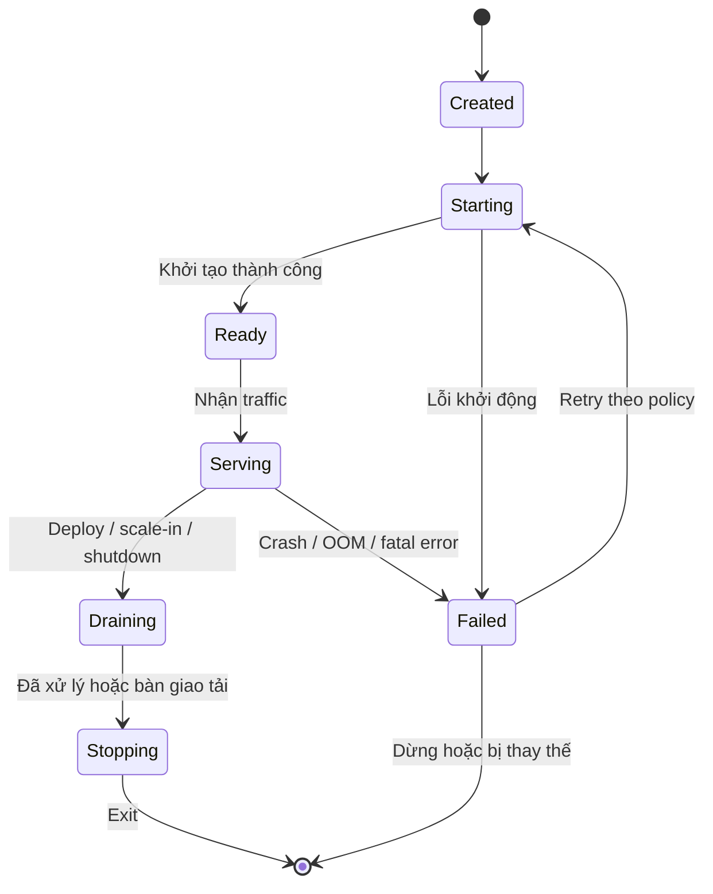
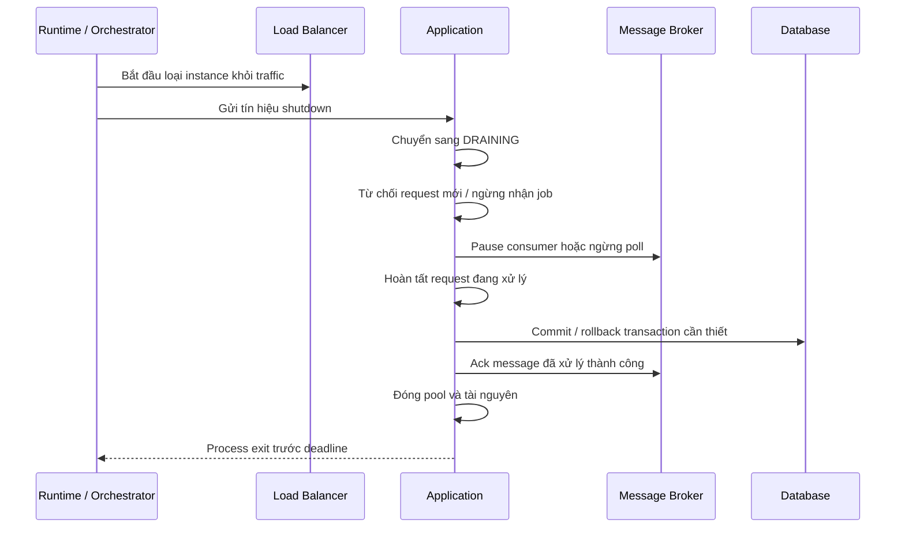
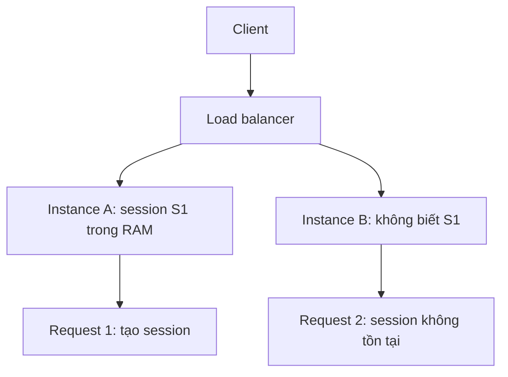
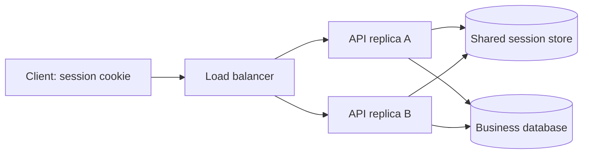
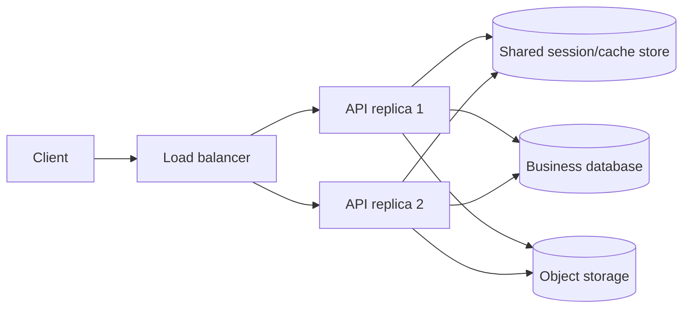

# Vòng đời tiến trình, trạng thái phiên và lưu trữ tạm thời

## 1. Vì sao vòng đời tiến trình là vấn đề kiến trúc?

Ứng dụng cloud thường chạy trên các tài nguyên có thể được tạo, thay thế, mở rộng hoặc thu hồi tự động. Một VM có thể được reboot để bảo trì; container có thể bị thay thế sau khi deploy; instance có thể bị scale-in; function có thể kết thúc ngay khi xử lý xong một lần gọi. Vì vậy, ứng dụng hoạt động tốt trên máy phát triển chưa chắc chịu được restart, mất node hoặc tăng giảm số replica trong production.

Ba khái niệm cần thiết kế cùng nhau:

- **Vòng đời tiến trình (process lifecycle):** cách tiến trình được tạo, nhận tải, dừng nhận việc, hoàn tất công việc đang xử lý và kết thúc.
- **Trạng thái phiên (session state):** dữ liệu gắn với trải nghiệm hoặc chuỗi tương tác của người dùng, chẳng hạn thông tin đăng nhập, giỏ hàng hoặc bước checkout.
- **Lưu trữ tạm thời (temporary/ephemeral storage):** dữ liệu chỉ cần tồn tại trong một khoảng thời gian hoặc trong vòng đời của instance, container hay lần thực thi.

Trong module **CLOUD_ARCHITECTURE**, chương **Kiến trúc tính toán** đặt các khái niệm này trong bối cảnh lựa chọn compute, độ tin cậy, bảo mật, khả năng mở rộng, chi phí và vận hành theo tư duy Well-Architected.

Sau bài học, bạn có thể:

1. Mô tả các giai đoạn khởi động, readiness, phục vụ tải, drain và shutdown của tiến trình.
2. Phân biệt liveness, readiness và startup checks; cấu hình shutdown có kiểm soát.
3. Nhận biết vì sao trạng thái phiên trong bộ nhớ cục bộ gây khó khăn khi scale, restart hoặc chuyển request.
4. Chọn nơi lưu session và dữ liệu tạm dựa trên thời gian sống, độ bền và khả năng chia sẻ.
5. Thiết kế ứng dụng chịu được retry, restart, scale-in, deploy và lỗi hạ tầng.
6. Viết kịch bản kiểm thử và tiêu chí vận hành cho lifecycle, session và temporary storage.

## 2. Tiến trình không phải là máy chủ

**Process** là một thực thể chương trình đang chạy với không gian bộ nhớ, thread, file descriptor, socket, biến môi trường và tài nguyên hệ điều hành. Process có thể tồn tại trong VM, container, pod, worker hoặc môi trường thực thi serverless.

| Thành phần | Ý nghĩa | Điều có thể xảy ra |
| --- | --- | --- |
| Máy vật lý | Phần cứng tại trung tâm dữ liệu | Lỗi phần cứng, bảo trì |
| VM/instance | Máy ảo được cấp CPU, RAM, network và disk | Stop, reboot, terminate, replace |
| Container | Tiến trình và filesystem được đóng gói/cô lập theo runtime | Restart, recreate, reschedule |
| Pod/workload | Đơn vị triển khai trong hệ thống điều phối | Reschedule sang node khác, scale replica |
| Process | Chương trình đang thực thi | Crash, exit, signal, OOM kill |
| Request/job | Một đơn vị công việc được process xử lý | Timeout, retry, hủy, xử lý trùng |

Một VM còn sống không đảm bảo process còn khỏe. Container có trạng thái Running không đảm bảo ứng dụng đã sẵn sàng nhận traffic. Một process khỏe cũng không đảm bảo database hoặc dịch vụ đối tác đang đáp ứng.

**Đừng gắn độ bền dữ liệu nghiệp vụ với vòng đời của process.** Bộ nhớ heap, biến static, local file và thư mục tạm có thể biến mất khi process hoặc instance bị thay thế.

## 3. Các giai đoạn trong vòng đời process

Một service web thường đi qua các giai đoạn:

1. **Created:** runtime tạo process/container/instance và gắn cấu hình.
2. **Starting:** đọc cấu hình, nạp dependency, kết nối dịch vụ cần thiết, warm cache hoặc khởi tạo pool.
3. **Ready:** hoàn tất điều kiện tối thiểu để nhận request hợp lệ.
4. **Serving:** xử lý request, message hoặc job.
5. **Draining:** không nhận thêm công việc mới, nhưng hoàn tất hoặc chuyển giao công việc đang xử lý.
6. **Stopping:** đóng kết nối, giải phóng tài nguyên và ghi nhận trạng thái cần thiết.
7. **Exited:** process kết thúc; runtime có thể giữ container, restart hoặc thay thế theo chính sách.



Sơ đồ là mô hình khái niệm. Mỗi runtime có state machine và thời gian cho phép khác nhau. Kubernetes có Pod lifecycle và termination grace period; VM có stop/terminate lifecycle; FaaS invocation có deadline thực thi. Thiết kế ứng dụng phải dựa vào hợp đồng thực tế của môi trường chạy.

### 3.1. Startup cần có deadline và phân biệt lỗi

Khởi động có thể thất bại vì thiếu biến môi trường, secret sai, schema chưa tương thích, dependency tạm thời không phản hồi hoặc cấu hình không hợp lệ. Không nên retry vô hạn một lỗi cấu hình cố định.

- **Permanent/configuration error:** thiếu secret, sai port, schema version không hỗ trợ; cần báo rõ và dừng để sửa.
- **Transient dependency error:** database hoặc secret service tạm thời gián đoạn; retry có backoff và giới hạn.
- **Slow initialization:** warm-up hoặc cache build kéo dài; cần startup timeout phù hợp và không nhận traffic quá sớm.
- **Partial capability:** một tính năng phụ chưa sẵn sàng; cân nhắc degrade có chủ đích nếu nghiệp vụ cho phép.

Startup phải có log/metric để biết process đang ở bước nào và thời gian khởi động có thay đổi sau mỗi phiên bản hay không.

## 4. Readiness, liveness và startup probe

Ba loại health check trả lời ba câu hỏi khác nhau:

| Check | Câu hỏi | Khi thất bại, hệ thống thường làm gì? |
| --- | --- | --- |
| **Startup probe** | Ứng dụng đã khởi động xong chưa? | Chưa đánh giá liveness/readiness theo chính sách cho đến khi startup đạt hoặc hết giới hạn |
| **Readiness probe** | Instance có thể nhận request mới không? | Loại endpoint khỏi traffic/load balancing hoặc đánh dấu không ready |
| **Liveness probe** | Process có còn hoạt động đúng mức cần thiết để tiếp tục không? | Runtime có thể restart container/process theo chính sách |

Không nên dùng cùng một endpoint cho mọi mục đích mà không hiểu ý nghĩa.

- Readiness có thể kiểm tra các điều kiện thật sự cần cho request mới, ví dụ cấu hình đã tải và connection pool có khả năng phục vụ.
- Liveness thường nên kiểm tra process/event loop hoặc trạng thái nội bộ cốt lõi, tránh phụ thuộc trực tiếp vào database nếu database tạm thời lỗi. Nếu mọi replica đều fail liveness khi DB down, runtime có thể restart hàng loạt và làm sự cố nặng hơn.
- Startup probe giúp ứng dụng khởi động chậm không bị liveness kết luận quá sớm là treo.

**Health check không phải bài kiểm tra toàn diện mọi dependency.** Một endpoint health quá sâu có thể tạo tải liên tục lên database hoặc khiến dịch vụ bị đánh dấu chết dây chuyền. Tách health nội bộ, readiness và kiểm tra dependency/observability theo mục đích rõ ràng.

### 4.1. Ví dụ endpoint health trong ứng dụng Java

Đoạn mã dưới đây minh họa ý tưởng, không phải cấu hình framework hoàn chỉnh:

```java
@RestController
class HealthController {
    private final ApplicationLifecycle lifecycle;

    HealthController(ApplicationLifecycle lifecycle) {
        this.lifecycle = lifecycle;
    }

    @GetMapping("/health/live")
    ResponseEntity<Map<String, String>> live() {
        return ResponseEntity.ok(Map.of("status", "alive"));
    }

    @GetMapping("/health/ready")
    ResponseEntity<Map<String, String>> ready() {
        if (!lifecycle.isReady() || lifecycle.isDraining()) {
            return ResponseEntity.status(503)
                    .body(Map.of("status", "not-ready"));
        }
        return ResponseEntity.ok(Map.of("status", "ready"));
    }
}
```

Trong thực tế, endpoint liveness phải phản ánh lỗi process mà restart thực sự có thể khắc phục. Readiness phải phù hợp với khả năng phục vụ request. Nếu database đang lỗi, có thể readiness cần chuyển false, nhưng liveness không nhất thiết phải false. Nếu chỉ một chức năng không cốt lõi bị lỗi, cân nhắc vẫn phục vụ API không phụ thuộc chức năng đó.

## 5. Graceful shutdown: dừng có kiểm soát

**Graceful shutdown** là quy trình để ứng dụng ngừng nhận tải mới, hoàn tất hoặc chuyển giao công việc đang xử lý, đóng tài nguyên và kết thúc trước khi runtime cưỡng chế dừng process.



Thứ tự cụ thể phụ thuộc protocol và runtime. Có thể cần ngừng nhận traffic ở load balancer trước khi process đóng listener; worker cần pause nhận message nhưng vẫn giữ quyền hoàn thành message đang xử lý. Nếu process không thể hoàn tất trước deadline, message phải được phép redeliver hoặc request phải thất bại theo cách client có thể retry an toàn.

### 5.1. Các bước cần có

1. Chuyển trạng thái nội bộ sang draining để không nhận công việc mới.
2. Đánh dấu readiness là false và cập nhật load balancer/service discovery.
3. Dừng nhận message mới hoặc giảm consumer concurrency.
4. Chờ in-flight request/job trong thời gian giới hạn.
5. Commit transaction đã hoàn tất hoặc rollback transaction chưa hoàn tất.
6. Chỉ ack message sau khi thay đổi bền vững đã được xác nhận.
7. Đóng HTTP server, database pool, telemetry exporter và executor.
8. Thoát process trước termination deadline; ghi log nguyên nhân.

Một request đã gửi response thành công nhưng chưa commit dữ liệu là một lỗi thiết kế. Trạng thái trả cho client phải nhất quán với kết quả nghiệp vụ đã bền vững.

### 5.2. Tín hiệu và giới hạn thời gian

Trong môi trường Linux, process thường nhận SIGTERM khi được yêu cầu dừng có kiểm soát; sau một khoảng thời gian runtime hoặc hệ điều hành có thể gửi SIGKILL. Không thể xử lý SIGKILL bằng hook ứng dụng. Trên Windows hoặc môi trường serverless, cơ chế dừng và tín hiệu có thể khác, vì vậy phải xem tài liệu runtime.

Ví dụ cấu hình minh họa trong Kubernetes:

```yaml
spec:
  terminationGracePeriodSeconds: 45
  containers:
    - name: api
      lifecycle:
        preStop:
          exec:
            command: ["/bin/sh", "-c", "sleep 5"]
```

Ví dụ chỉ minh họa một khoảng grace period và hook. Không nên sao chép sleep thành giải pháp draining mặc định: hook có thể tiêu tốn thời gian shutdown, không đảm bảo load balancer đã ngừng gửi traffic, và không thay thế logic graceful shutdown trong ứng dụng. Thiết kế thật cần phối hợp readiness, deregistration delay, preStop, shutdown hook và thời gian xử lý request.

**Ngân sách thời gian shutdown** cần đủ cho thời gian drain, hoàn tất transaction, đóng kết nối và margin an toàn. Nếu request có thể chạy 2 phút nhưng termination grace chỉ 30 giây, phải thay đổi giới hạn request, hỗ trợ checkpoint/bàn giao hoặc chọn chiến lược deploy khác.

## 6. Quản lý worker và message khi process dừng

Worker nền thường tiêu thụ message từ queue. Giả sử worker lấy một message ProcessPayment, gọi đối tác, cập nhật database rồi ack. Nếu process chết sau khi đối tác đã xử lý nhưng trước khi ack, message có thể được gửi lại.

Do đó:

- **At-least-once delivery** là phổ biến: một message có thể đến nhiều lần.
- Consumer cần idempotency hoặc inbox/deduplication để cùng một lệnh logic không tạo hiệu ứng trùng.
- Chỉ ack khi công việc bền vững đã đạt điều kiện theo hợp đồng.
- Nếu message đang xử lý mà shutdown, cần cho phép timeout/visibility timeout hết hạn hoặc chủ động release/requeue theo semantics của broker.
- Cần giới hạn thời gian xử lý, gia hạn visibility/lease khi cần và xử lý message lỗi bằng retry có giới hạn/DLQ.

Không giả định mọi queue/broker có semantics giống nhau. Có broker dùng ack/nack, có hệ thống dùng visibility timeout, partition offset hoặc lease. Hãy dựa vào semantics cụ thể để thiết kế shutdown.

### 6.1. Ví dụ consumer chống xử lý trùng

Đây là pseudo-code; kiểm tra/ghi dấu message và thay đổi nghiệp vụ phải có concurrency control phù hợp:

```java
public void handle(Message message) {
    if (inboxRepository.isProcessed(message.id())) {
        acknowledge(message);
        return;
    }

    transactionTemplate.executeWithoutResult(tx -> {
        if (inboxRepository.tryMarkProcessing(message.id())) {
            orderService.apply(message.payload());
            inboxRepository.markProcessed(message.id());
        }
    });

    acknowledge(message);
}
```

Nếu kiểm tra/ghi dấu message không có unique constraint hoặc transaction phù hợp, hai consumer có thể cùng xử lý. Nếu acknowledgement thất bại sau commit, lần gửi lại phải nhận ra message đã hoàn thành.

## 7. Session state là gì?

**Session** là chuỗi tương tác mà ứng dụng nhận diện thuộc cùng một người dùng, client hoặc workflow. Session có thể chứa trạng thái xác thực hoặc tham chiếu identity, giỏ hàng, bộ lọc, bước checkout, CSRF token hay metadata của phiên.

Cần phân biệt **authentication** và **session data**:

- Identity provider xác thực người dùng và phát token/credential theo cơ chế được chọn.
- Session store hoặc token chứa tham chiếu/thông tin cần để duy trì ngữ cảnh giữa nhiều request.
- Authorization phải được đánh giá trên từng request và tài nguyên; việc có session hợp lệ không đồng nghĩa người dùng được truy cập mọi booking.

Không đặt toàn bộ dữ liệu nghiệp vụ quan trọng vào session. Session nên giữ dữ liệu cần cho trải nghiệm/luồng tương tác; dữ liệu có thẩm quyền như đơn hàng, số dư và quyền sở hữu phải tồn tại trong kho nghiệp vụ tương ứng.

## 8. Session cục bộ và vấn đề khi scale

Ứng dụng Java truyền thống có thể lưu session trong heap JVM. Trong môi trường một instance, request tiếp theo thường quay lại process đó. Khi thêm load balancer và nhiều replica:



Hậu quả:

- Người dùng bị logout ngẫu nhiên hoặc giỏ hàng biến mất.
- Request thất bại khi autoscaling chuyển traffic sang instance mới.
- Deploy tạo instance mới làm mất session cục bộ.
- Scale-in xóa instance đang giữ session.
- Failover zone/region không mang theo session ở RAM.
- Phân bố tải lệch nếu sticky session ghim nhiều request vào một vài instance.

### 8.1. Sticky session giải quyết một phần

Load balancer có thể gửi cùng client về backend quen thuộc. Nó giúp giữ session in-memory trong một số tình huống, nhưng backend lỗi hoặc bị scale-in thì session vẫn mất; traffic có thể phân bố không đều; rollout hoặc failover vẫn làm client chuyển instance. Sticky session phù hợp như giải pháp tạm thời hoặc cho workload đặc thù, nhưng không nên là bảo đảm bền vững cho dữ liệu quan trọng.

## 9. Các chiến lược quản lý session

| Chiến lược | Cách hoạt động | Ưu điểm | Hạn chế |
| --- | --- | --- | --- |
| In-memory per instance | Session nằm trong heap process | Đơn giản, nhanh | Mất khi restart, khó chia sẻ |
| Sticky sessions | LB giữ client trên backend quen thuộc | Giảm thay đổi ban đầu | Không chịu được backend mất; lệch tải |
| External session store | Redis/database/session service | Replica truy cập chung trạng thái | Thêm dependency, chi phí, yêu cầu HA |
| Stateless signed token | Client gửi token đã ký/mã hóa theo thiết kế | Giảm lookup server-side | Revocation, token lớn, key rotation, dữ liệu stale |
| Hybrid | Token định danh + store cho state cần thu hồi/chia sẻ | Cân bằng | Vận hành phức tạp hơn |

### 9.1. External session store

Với session cần chia sẻ giữa replicas, có thể dùng Redis hoặc managed cache phù hợp:



Các điểm cần thiết kế:

- **Availability:** store lỗi thì session fail closed hay có fallback hạn chế?
- **TTL:** phân biệt absolute lifetime và idle timeout.
- **Data model:** chỉ lưu dữ liệu cần thiết, giới hạn kích thước và version schema.
- **Atomicity:** gia hạn, rotate session ID, logout và cập nhật session phải tránh race.
- **Security:** mã hóa khi truyền/lưu theo nhu cầu, ACL/network isolation và credential rotation.
- **Capacity:** số session đồng thời, kích thước trung bình, tốc độ đọc/ghi, eviction và failover.
- **Observability:** lookup latency, lỗi store, eviction, hết hạn và số phiên bị thu hồi.

Đừng mặc định Redis là kho lưu trữ bền vững. Cache có thể eviction hoặc mất dữ liệu khi failover/restart tùy cấu hình; hãy chọn durability phù hợp hoặc dùng database/session service khi dữ liệu cần bảo toàn chặt hơn.

### 9.2. Cookie và token cần bảo vệ

Cookie session nên có thuộc tính phù hợp như Secure, HttpOnly, SameSite, scope Domain/Path và thời hạn hợp lý. Cần chống session fixation: sau login hoặc thay đổi mức quyền, tạo session identifier mới. Logout hoặc phát hiện xâm nhập phải có cơ chế thu hồi/rotate theo thiết kế.

Với JWT hoặc token tự chứa:

- Ký token không đồng nghĩa payload được giấu; payload thường có thể đọc được nếu không mã hóa.
- Không đưa thông tin nhạy cảm dư thừa vào token.
- Dùng expiry ngắn phù hợp, audience/issuer validation và key rotation.
- Access token bị lộ có thể còn hiệu lực đến khi hết hạn nếu không có revocation/introspection.
- Không dùng token như nơi lưu trạng thái giỏ hàng hoặc giao dịch lớn, dễ thay đổi.

Session hợp lệ chỉ chứng minh ngữ cảnh xác thực còn hiệu lực. Với mỗi hành động, ứng dụng vẫn phải xác minh quyền với tài nguyên cụ thể. Không tin userId gửi từ client khi xác định chủ sở hữu session hay bản ghi. Multi-tenant cần kiểm tra tenant context cả ở API, truy vấn và job nền.

## 10. Session timeout và trạng thái workflow

Hai khái niệm thường bị trộn:

- **Session timeout:** khoảng thời gian phiên người dùng còn được phép tiếp tục tương tác.
- **Business workflow expiry:** thời hạn của một nghiệp vụ như hold phòng, mã xác nhận hay phiên thanh toán.

Người dùng có thể logout nhưng booking vẫn ở trạng thái chờ thanh toán; session hết hạn không được tự động xóa đơn hàng có giá trị. Ngược lại, workflow hold có thể hết hạn dù browser session vẫn còn.

| Trạng thái | Nơi lưu có thẩm quyền | TTL / hạn xử lý |
| --- | --- | --- |
| Login session | Identity/session service | Theo chính sách bảo mật |
| Cart tạm | Session store hoặc cart service | Theo thời hạn nghiệp vụ/idle |
| Booking | Booking database | Theo vòng đời đơn |
| Inventory hold | Inventory store | Ví dụ 5 phút theo chính sách |
| Payment transaction | Payment context/provider reference | Theo quy trình đối soát và retention |
| CSRF token | Session/cookie theo framework | Gắn với phiên và chính sách |

Không dùng một TTL chung cho mọi loại dữ liệu. Hệ thống cần tra cứu hold còn hiệu lực không và hiển thị cách tiếp tục/hủy phù hợp.

## 11. Temporary storage: phân loại theo độ bền và phạm vi chia sẻ

“Temporary” không phải một loại storage duy nhất. Cần xác định dữ liệu cần tồn tại bao lâu, có thể mất trong trường hợp nào và ai cần truy cập.

| Loại | Ví dụ | Phạm vi sống | Mức bền |
| --- | --- | --- | --- |
| Process memory | Cache nội bộ, buffer, object tạm | Trong process | Mất khi process kết thúc |
| Container writable layer | File tạm do app ghi trong container | Theo container instance/lifecycle | Có thể mất khi recreate/replace |
| VM ephemeral/local disk | Scratch file, temporary workspace | Theo VM/instance hoặc thiết bị | Có thể mất khi stop/terminate/replace tùy loại |
| OS temporary directory | /tmp trên Linux | Theo máy/container và cleanup policy | Không đảm bảo bền |
| Persistent block volume | Disk gắn vào VM/compute | Qua một số lần restart/replace nếu cấu hình đúng | Bền hơn scratch, vẫn cần backup/HA |
| Object storage | File upload, export, artifact | Theo retention/lifecycle policy | Bền theo cam kết/config dịch vụ |
| Database | Session cần persistence, workflow, dữ liệu nghiệp vụ | Theo record lifecycle | Cần backup/replication/retention |
| Shared filesystem | File dùng chung giữa nhiều instance | Theo lifecycle filesystem | Tùy dịch vụ và cấu hình |

Các từ ephemeral disk, local SSD, container layer và /tmp có semantics riêng giữa provider và runtime. Không giả định local storage sẽ tồn tại qua stop/restart/relocation nếu chưa kiểm tra tài liệu instance type và dịch vụ.

### 11.1. Chọn storage dựa trên câu hỏi

1. File có phải dữ liệu nghiệp vụ cần khôi phục sau lỗi không?
2. Instance khác có cần đọc dữ liệu này không?
3. Dữ liệu cần tồn tại lâu hơn process/container không?
4. Có thể tạo lại từ nguồn khác hay cần backup?
5. Tốc độ, IOPS, throughput và độ trễ yêu cầu bao nhiêu?
6. Dữ liệu có nhạy cảm không; cần encryption, access policy và retention ra sao?
7. Khi scale-out, replicas có ghi trùng hoặc xung đột tên file không?

Nếu dữ liệu có giá trị nghiệp vụ, local temp chỉ nên là bản làm việc có thể tái tạo. Bản gốc phải được lưu vào nơi có lifecycle và backup phù hợp.

## 12. Temporary files và cleanup an toàn

Ứng dụng thường tạo file tạm khi xử lý upload, render PDF, giải nén archive, xuất báo cáo hoặc convert media. Cần:

- Tạo file trong thư mục tạm được cấu hình, không ghi nhầm vào filesystem chỉ đọc của image.
- Dùng tên file khó đoán hoặc API tạo file tạm an toàn; không ghép trực tiếp tên do client gửi vào path.
- Giới hạn dung lượng, loại file, số file đồng thời và thời gian xử lý.
- Đóng stream/file descriptor trong finally hoặc construct quản lý tài nguyên tương đương.
- Xóa file sau khi hoàn tất, kể cả khi exception.
- Có job cleanup cho orphan files sau crash, với tuổi file và phạm vi path rõ ràng.
- Không coi cleanup hook là bảo đảm duy nhất: process có thể bị SIGKILL hoặc node mất điện nên không chạy hook.
- Không lưu secret, token, PII hoặc nội dung nhạy cảm vào file tạm nếu không có bảo vệ phù hợp.

### 12.1. Ví dụ Java xử lý file tạm

```java
Path tempFile = Files.createTempFile("report-", ".csv");
try {
    try (OutputStream out = Files.newOutputStream(tempFile)) {
        reportExporter.writeCsv(out);
    }
    uploadToObjectStorage(tempFile);
} finally {
    Files.deleteIfExists(tempFile);
}
```

Nếu upload thất bại và cần retry sau khi process kết thúc, không thể dựa vào file cục bộ; phải lưu job bền vững và file nguồn vào shared/object storage, hoặc tạo lại file khi retry. Cần giới hạn dung lượng filesystem để không làm đầy disk của instance.

### 12.2. Tránh path traversal và symlink attacks

Không ghép uploadDir và originalFilename do người dùng gửi. Chuẩn hóa tên, sinh ID nội bộ, kiểm tra path nằm trong thư mục được phép và mở file theo cách tránh ghi đè tài nguyên khác. Chỉ cho phép loại file/size cần thiết; không tin MIME type do client gửi. Thư mục tạm dùng chung cần quyền filesystem phù hợp, tránh để process khác đọc file đang xử lý.

## 13. Bộ nhớ tạm, cache và trạng thái nghiệp vụ

Cache trong process không đồng nghĩa storage bền. Cache có thể bị xóa, thay thế hoặc stale; dữ liệu nguồn phải có chủ sở hữu rõ.

| Dữ liệu | Cache trong process có được không? | Nguồn có thẩm quyền |
| --- | --- | --- |
| Product/catalog reference ít thay đổi | Có, với TTL/invalidation | Catalog database/service |
| Kết quả tìm kiếm | Có thể dùng cache/read model | Search index hoặc nguồn catalog |
| Số dư tài khoản | Không dùng local cache làm nguồn quyết định ghi | Ledger/accounting store |
| Trạng thái booking | Cache chỉ phục vụ đọc có giới hạn | Booking store |
| Payment final state | Cache không được dùng để xác nhận giao dịch | Payment provider/payment ledger theo policy |
| Feature flags/config | Có thể cache theo freshness và fallback được quy định | Configuration service |

Nếu process A ghi cache local nhưng request sau tới process B, dữ liệu có thể không nhất quán. Nếu cache key không chứa tenant/user scope, có thể rò rỉ dữ liệu giữa người dùng. Cần cân nhắc TTL, invalidation, version, cache stampede, stale-if-error và khác biệt giữa cache miss với nguồn dữ liệu chưa có.

## 14. Ứng dụng stateless và stateful

**Stateless compute** nghĩa là request/job không phụ thuộc vào trạng thái chỉ tồn tại cục bộ ở một process để có thể tiếp tục hoạt động. Nó không có nghĩa hệ thống không có dữ liệu hay không giữ trạng thái nghiệp vụ.

Một ứng dụng stateless thường giữ thông tin cần thiết trong request/token đã xác thực hoặc store bên ngoài; lưu business state trong database/service có thẩm quyền; có thể gửi request tới bất kỳ replica nào; xử lý retry và duplicate request an toàn; không dựa vào file cục bộ giữa các lần gọi.

Stateful workload vẫn có chỗ dùng hợp lý: in-memory compute cho mô phỏng, session affinity cho protocol nhất định, cache/stream processor giữ window state hoặc game server. Nhưng phải định nghĩa cách snapshot, replicate, checkpoint, shard và phục hồi. Không coi việc gắn một VM cố định là giải pháp bền vững cho state nếu chưa có backup/failover.



Mô hình cho phép thay thế replica mà không phụ thuộc session/file cục bộ. Tuy nhiên store ngoài cũng là dependency cần HA, capacity planning, IAM, network controls và theo dõi latency.

## 15. Retry, idempotency và request không rõ kết quả

Một tình huống nguy hiểm là client mất kết nối sau khi server đã ghi thành công. Client không biết thao tác đã hoàn tất hay chưa và nhấn lại. Process restart cũng có thể xảy ra ngay sau commit trước khi response được gửi.

Thiết kế giao thức nghiệp vụ có **idempotency**:

- Client gửi một idempotency key riêng cho một ý định logic.
- Server lưu mapping key, actor/scope và kết quả trong kho có thẩm quyền.
- Nếu nhận lại cùng key với payload tương thích, trả kết quả cũ hoặc trạng thái có thể tra cứu.
- Nếu key trùng nhưng payload khác, từ chối theo contract.
- TTL của idempotency record phải dài hơn cửa sổ retry/đối soát được chấp nhận.

Điều này quan trọng cho thanh toán, tạo booking, cấp tài nguyên, xử lý message và upload hoàn tất nhiều phần. Việc ghi record, thay đổi nghiệp vụ và liên kết kết quả phải có transaction/concurrency control phù hợp.

## 16. Compute-specific lifecycle: VM, container, Kubernetes và serverless

| Môi trường | Vòng đời điển hình | Hành vi khi dừng/thay thế | Dữ liệu cục bộ |
| --- | --- | --- | --- |
| VM/instance | Boot, service start, health, stop/reboot/terminate | Có thể graceful OS shutdown nếu có thời gian; hard failure vẫn xảy ra | Ephemeral/local disk có thể mất; persistent volume có semantics riêng |
| Container runtime | Create, start, running, stop, remove | Runtime gửi stop signal và đợi timeout theo cấu hình | Writable layer thuộc container; volume có lifecycle riêng |
| Kubernetes | Pod scheduled/started/ready/terminating/removed | Controller có thể tạo Pod mới; readiness, preStop, grace period tác động drain | emptyDir theo Pod lifecycle; PVC theo storage class/access mode |
| Serverless/FaaS | Invocation, runtime reuse có thể có, kết thúc/timeout | Environment có thể bị freeze/retire; invocation có deadline | /tmp hoặc local scratch không phải durable shared state |
| Batch/worker | Job queued, running, checkpoint, complete/failed | Retry/replace theo job policy; có thể preempt | Scratch chỉ là working copy; checkpoint/input/output phải lưu bền |

### 16.1. VM

Đối với VM, cần phân biệt restart OS, stop/start instance, terminate/recreate và host failure. Persistent block volume có thể được giữ qua một số hành động; local/ephemeral disk có thể bị xóa khi instance bị stop, host chuyển hoặc terminate tùy provider. Kiểm tra cấu hình boot/root volume, deletion behavior và backup.

Startup script/user data hữu ích cho cấu hình ban đầu, nhưng không nên là cơ chế duy nhất giữ secret dài hạn hoặc cập nhật ứng dụng không kiểm soát. Ưu tiên image chuẩn, IaC, configuration management, patch process và quản trị secret.

### 16.2. Container

Container nên được coi là artifact có thể thay thế. Image immutable chứa mã và runtime dependency; cấu hình/secret được cấp qua cơ chế riêng; dữ liệu bền không ghi vào writable layer. Khi container bị xóa, các thay đổi ở layer có thể mất.

Nếu nhiều container cần chia sẻ file, cân nhắc object storage hoặc shared filesystem có semantics và throughput phù hợp. Nếu một process cần scratch file trong một lần xử lý, local temp phù hợp miễn có quota và cleanup.

### 16.3. Kubernetes

- **Pod** có lifecycle riêng; khi Pod bị xóa, controller có thể tạo Pod khác.
- **emptyDir** được tạo cùng Pod và thường bị xóa khi Pod bị loại bỏ khỏi node theo lifecycle; dữ liệu không phải kho bền.
- **PersistentVolumeClaim (PVC)** yêu cầu storage do CSI/provider cung cấp; độ bền, access mode, performance và attach behavior tùy loại volume.
- **Readiness/liveness/startup probe** ảnh hưởng việc traffic được gửi và container được restart.
- **preStop và terminationGracePeriodSeconds** hỗ trợ drain, nhưng phải phối hợp với ứng dụng và load balancer.
- **PodDisruptionBudget** giới hạn một số hình thức gián đoạn chủ động; không bảo vệ khỏi mọi lỗi node/zone hoặc sự cố ngoài dự kiến.

Không giả định PVC luôn có thể mount đồng thời read-write từ mọi node; access mode và driver phải được kiểm tra. Volume persistent cũng không thay thế backup và restore test.

### 16.4. Serverless/FaaS

Một số platform có thể tái sử dụng execution environment để giảm cold start. Biến global hoặc thư mục /tmp có thể còn tồn tại qua một số invocation, nhưng không được dựa vào tính tồn tại đó như hợp đồng bền vững. Invocation có thể chạy trong environment mới hoặc environment cũ đã bị thu hồi.

Function nên nhận input đủ để thực hiện công việc, đọc state bền từ store, ghi kết quả theo idempotency key và kết thúc trong deadline. Không mở kết nối dài không giới hạn hoặc giả định local file sẽ có ở lần chạy sau. Chú ý giới hạn concurrency và connection storm lên database khi scale invocation nhanh.

## 17. Process và dữ liệu trong rolling deployment

Khi deploy phiên bản mới, hệ thống có thể chạy đồng thời process cũ và mới. Điều này ảnh hưởng session schema, message payload, cache và file format.

- Database migration nên dùng chiến lược **expand–migrate–contract**: thêm schema tương thích, deploy code mới, chuyển dữ liệu, rồi mới xóa field cũ.
- Session schema cần version hoặc khả năng đọc tương thích khi phiên cũ và mới cùng phục vụ.
- Message/event có thể nằm trong queue lâu hơn vòng đời deployment; worker mới phải đọc được message cũ theo contract.
- Cache key nên có version khi format thay đổi, tránh process mới đọc giá trị serialized cũ không tương thích.
- File tạm có thể bị process mới/worker khác xử lý; format và metadata cần được mô tả rõ.

Rollback không chỉ là đưa image cũ trở lại. Nếu phiên bản mới đã ghi session hoặc database theo format không tương thích, rollback binary có thể làm lỗi dữ liệu. Cần schema tương thích ngược, hạn chế migration phá hủy, xử lý session đang sống, message queue backlog, backup/restore point và xác minh trạng thái nghiệp vụ sau rollback.

## 18. Security và privacy cho session/temp storage

### 18.1. Session

- Dùng cookie/session token entropy cao, truyền qua TLS và đặt thuộc tính cookie an toàn.
- Rotate session ID sau authentication và thay đổi quyền quan trọng.
- Có idle timeout và absolute timeout; logout/disable account cần chính sách thu hồi.
- Giảm dữ liệu lưu trong session; lưu tham chiếu thay vì bản sao PII hoặc thông tin thanh toán.
- Cấp quyền truy cập session store chỉ cho workload cần dùng.
- Không ghi cookie/token/session payload vào access log, exception hoặc tracing attribute.

### 18.2. Temporary storage

- Thiết lập quyền thư mục và file theo least privilege; hạn chế file world-readable.
- Không cho phép filename do client điều khiển đường dẫn đích.
- Mã hóa disk/volume/object nếu yêu cầu; quản lý khóa phù hợp.
- Có cleanup, retention và quy trình xóa dữ liệu nhạy cảm.
- Không coi xóa file là bảo đảm mọi bản sao/snapshot/backup cũng đã bị xóa.
- Không dump heap/core chứa secret hoặc session vào nơi truy cập rộng.
- Quản lý /tmp và ephemeral disk capacity; chống DoS bằng giới hạn dung lượng và số tác vụ đồng thời.

### 18.3. Nguyên tắc dữ liệu tối thiểu

Trước khi lưu dữ liệu, hỏi liệu dữ liệu đó có thật sự cần để xử lý request không. Dữ liệu không cần thiết không nên xuất hiện trong session, local file, queue hay log. Với dữ liệu cần lưu tạm, đặt thời hạn và owner; khi hết hạn phải có cơ chế xóa hoặc hủy theo chính sách.

## 19. Capacity planning cho RAM, disk và session store

### 19.1. Ước tính session storage

Công thức sơ bộ:

```text
Session memory ≈ concurrent sessions
               × average serialized size
               × overhead factor

Ví dụ giả định:
100,000 sessions × 4 KB × 1.5
≈ 600,000 KB (xấp xỉ 586 MiB, chưa tính replication/fragmentation).
```

Cần đo kích thước serialized thực, metadata, key overhead, replication, allocator fragmentation, TTL distribution và peak concurrent sessions. Nếu session chứa danh sách lớn hoặc ảnh/file thì nên giữ dữ liệu lớn ở object/database và session chỉ giữ ID.

### 19.2. Ước tính temporary disk

Nếu mỗi tác vụ tạo file 20 MB, có tối đa 30 tác vụ đồng thời và mỗi tác vụ có thể tạo 2 file làm việc:

```text
Peak scratch ≈ 20 MB × 30 × 2
             = 1,200 MB
```

Cần thêm margin cho log, file chưa cleanup và quá trình upload/download. Đặt quota/limit, theo dõi disk utilization và có xử lý backpressure trước khi filesystem đầy. File quá lớn nên stream tới object storage hoặc dùng multipart upload thay vì giữ toàn bộ trong RAM/disk.

### 19.3. Pool kết nối và scale-out

Nếu 20 replica mỗi replica mở tối đa 50 DB connections, database có thể nhận đến 1.000 kết nối từ ứng dụng, chưa tính admin, worker và migration. Scale-out process có thể tạo connection storm. Cần tính connection pool theo tổng replica tối đa, dùng proxy/pooler phù hợp, giới hạn concurrency và theo dõi queue chờ kết nối.

## 20. Observability: đo lifecycle, session và storage

| Nhóm | Metric | Câu hỏi vận hành |
| --- | --- | --- |
| Startup | startup duration, startup failure count | Phiên bản mới có khởi động chậm hoặc lỗi không? |
| Readiness | ready replica count, unready duration | Có đủ instance nhận tải không? |
| Shutdown | drain duration, forced termination count | Có request/job bị cưỡng chế dừng không? |
| Process | restarts, OOM kills, exit reason | Vì sao process chết? |
| Request | in-flight count, latency, error rate | Shutdown hoặc tải cao có làm request lỗi không? |
| Queue | unacked/in-flight, redelivery, DLQ, lag | Worker có bỏ sót hoặc xử lý lặp không? |
| Session | active sessions, lookup latency, expiration, eviction | Người dùng có bị mất phiên hoặc session store quá tải không? |
| Temporary storage | disk usage, temp file count, cleanup failures | Có nguy cơ đầy disk hoặc rò rỉ file không? |
| Connection pool | active/idle/pending connection, timeout | Scale-out có làm DB quá tải không? |

Log nên ghi instance_id, process_id, deployment_version, trace_id, request_id và correlation ID theo chính sách; không ghi session ID thô hoặc token. Có thể lưu hash/opaque correlation reference nếu cần liên kết sự kiện.

### 20.1. Phân biệt process restart có chủ đích và lỗi

Rolling deploy tạo restart có chủ đích; OOM kill là lỗi tài nguyên; liveness failure có thể cho thấy deadlock nhưng cũng có thể là probe thiết kế quá nhạy. Cần phân loại exit reason, sự kiện orchestrator, metric CPU/RAM/GC/thread pool và trace để tìm nguyên nhân. Tăng restart limit hoặc tăng RAM mà không xác định nguyên nhân có thể che giấu lỗi.

## 21. Kiểm thử vòng đời và fault injection

| Kịch bản | Cách thử | Điều kiện đạt |
| --- | --- | --- |
| Startup chậm | Giả lập dependency khởi động chậm | Không nhận traffic trước readiness; không bị restart loop ngoài ý muốn |
| Dependency không sẵn sàng | Database tạm mất kết nối khi process đang chạy | Lỗi được thể hiện; liveness không gây restart dây chuyền vô ích |
| Graceful shutdown | Gửi yêu cầu shutdown khi có request đang xử lý | Không nhận request mới; in-flight kết thúc hoặc thất bại retry-safe |
| Scale-in | Hạ số replica khi queue có message | Message không mất; retry không tạo side effect trùng |
| OOM | Tăng tải/buffer tới giới hạn được kiểm soát | Có cảnh báo/limit; process thay thế không làm hỏng dữ liệu |
| Session failover | Tạo session trên replica A rồi request tới B | Phiên hoạt động theo thiết kế externalized/stateless |
| Session store down | Ngắt store tạm thời | Hệ thống phản ứng theo policy, không cấp quyền sai |
| Temporary disk full | Làm đầy scratch filesystem trong test | Request bị giới hạn/rollback/cleanup; không làm host mất ổn định |
| Node/instance lost | Mô phỏng mất node | Dữ liệu bền vẫn truy cập; file temp có thể tạo lại |
| Deploy schema mới | Chạy phiên bản cũ và mới cùng lúc | Cả hai xử lý session/message/schema tương thích |
| Queue redelivery | Kill worker sau khi side effect đã commit, trước ack | Consumer nhận lại nhưng không nhân đôi tác dụng |
| Request timeout | Client ngắt sau khi server commit | Client tra cứu hoặc retry cùng idempotency key |

Fault injection phải nằm trong môi trường và phạm vi được kiểm soát, có kế hoạch rollback. Diễn tập giúp chứng minh runbook và SLO.

## 22. Quy trình thiết kế cho một workload mới

1. **Xác định workload:** API, consumer, batch, realtime session hay function; ai là tác nhân và mục tiêu nghiệp vụ.
2. **Đặc tả process lifecycle:** startup dependency, readiness, request deadline, drain, shutdown deadline, restart policy.
3. **Xác định state:** dữ liệu chỉ phục vụ request, session, business state, cache và checkpoint.
4. **Xác định durability:** dữ liệu nào được phép mất; RPO, RTO, retention, owner và nguồn có thẩm quyền.
5. **Chọn storage:** heap, local scratch, ephemeral disk, persistent volume, object storage, database hoặc shared store.
6. **Thiết kế scale/replacement:** request có thể đến replica bất kỳ không; worker có thể chạy nhiều lần không; session có được chia sẻ không.
7. **Thiết kế security:** identity, authorization, cookie, secret, file permissions, encryption và retention.
8. **Đặt telemetry:** metric startup/drain, process exit, session, temp disk, queue và connection pool.
9. **Viết failure scenarios:** crash, scale-in, timeout, node loss, deploy, dependency failure, duplicate delivery.
10. **Kiểm thử và ghi ADR:** chứng minh hành vi, chi phí, năng lực vận hành và điều kiện đánh giá lại.

## 23. Tình huống thực hành: API đặt chỗ và worker xử lý báo cáo

**Bối cảnh:** Hệ thống đặt chỗ Java chạy trên Kubernetes. API có 5 replicas, session login lưu trong HTTP session của JVM; worker nhận message tạo báo cáo PDF; file PDF được tạo trong /tmp rồi gửi email. Hệ thống chuẩn bị bật autoscaling và rolling deploy.

Rủi ro:

- Request tiếp theo có thể tới replica khác làm mất session.
- Pod mới có thể nhận traffic trước khi warm-up xong.
- Worker có thể bị terminate giữa lúc tạo PDF.
- /tmp có thể đầy khi nhiều báo cáo chạy đồng thời.
- Email gửi thành công nhưng worker chết trước khi ack, gây gửi trùng khi retry.
- User logout hoặc session timeout có thể bị nhầm với hết hạn booking.

### 23.1. Đề xuất kiến trúc

- **API stateless:** dùng session store hoặc token/session hybrid phù hợp; request ở replica nào cũng xác thực/đọc trạng thái được.
- **Booking là dữ liệu có thẩm quyền:** lưu workflow trong database, tách khỏi thời hạn login session.
- **Lifecycle:** readiness chỉ true khi app sẵn sàng; SIGTERM chuyển draining; endpoint mới không nhận traffic; giới hạn in-flight theo deadline.
- **Worker:** xử lý message idempotent, ghi kết quả có transaction, chỉ ack sau khi output đã bền vững theo contract.
- **PDF:** file local là scratch; output cuối lưu vào object storage với key ổn định/versioning và metadata quyền truy cập; cleanup /tmp sau upload.
- **Email:** lưu trạng thái gửi hoặc outbox/event; consumer chống trùng bằng business key và provider reference nếu hỗ trợ.
- **Capacity:** giới hạn số job song song theo RAM/disk, connection pool và throughput object storage.
- **Quan sát:** dashboard cho restarts, draining, queue age, retry, temp disk, session lookup và report completion.

### 23.2. Ma trận kiểm chứng

| Tình huống | Kiểm thử | Kết quả cần thấy |
| --- | --- | --- |
| Login trên replica A, request sang B | Tắt sticky session và phân phối request | Session hợp lệ hoạt động như nhau |
| Rolling deploy khi có request | Trigger deployment trong khi tải bình thường | Không mất request đã cam kết; lỗi có thể retry |
| Kill worker sau khi upload PDF | Dừng worker trước ack | Message gửi lại nhưng không tạo báo cáo/gửi email trùng |
| /tmp sắp đầy | Tạo nhiều file tạm trong môi trường test | Backpressure/limit/cleanup bảo vệ process |
| Session store tạm mất | Giả lập timeout | Không cho phép truy cập sai quyền; lỗi được ghi nhận |
| Booking hold hết hạn, login session còn sống | Chờ workflow expiry | UI hiển thị hold hết hạn dù người dùng vẫn đăng nhập |
| Scale-in worker | Hạ replicas khi job đang chạy | Worker drain hoặc message redeliver an toàn |

## 24. ADR mẫu: externalize session và coi filesystem là scratch

```text
ADR-032: Stateless API, session store và object storage cho báo cáo

Bối cảnh:
- API chạy nhiều replica trên Kubernetes, autoscaling/rolling deploy.
- Session login trong JVM làm mất phiên khi đổi replica.
- Worker tạo PDF trong /tmp; job có thể bị dừng giữa chừng.

Các lựa chọn:
A. Sticky session và giữ file local.
B. External session store, object storage cho output, local disk chỉ là scratch.
C. Chạy một replica cố định và lưu file lâu dài trên VM.

Quyết định:
- Chọn B.
- Session có TTL/rotation, dữ liệu tối thiểu và access control.
- Booking/report job có trạng thái bền riêng.
- Worker idempotent; PDF upload bằng key có thể tra cứu.
- Shutdown chuyển draining, dừng nhận job mới và hoàn tất/bàn giao an toàn.

Đánh đổi:
- Thêm dependency/session store, object storage và chi phí request.
- Cần HA, quota, IAM, network policy, retry và quan sát các store này.
- Có thể cần streaming thay vì ghi file lớn vào local disk.

Kiểm chứng:
- Request chuyển giữa replica vẫn hoạt động.
- Store unavailable không gây authorization bypass.
- Worker redelivery không tạo tác dụng trùng.
- Node loss không làm mất PDF đã cam kết.
- Disk usage được giới hạn và cleanup được đo.

Điều kiện xem lại:
- Thay đổi yêu cầu latency/session consistency.
- Store trở thành bottleneck hoặc TCO vượt ngưỡng.
- Workload cần filesystem persistent/shared với semantics riêng.
```

## 25. Những lỗi thiết kế thường gặp

1. **Lưu trạng thái nghiệp vụ trong RAM:** restart hoặc scale-out làm mất dữ liệu có giá trị.
2. **Giả định container Running nghĩa là Ready:** traffic đến khi app còn khởi tạo.
3. **Dùng liveness phụ thuộc mọi database/service:** dependency lỗi gây restart storm.
4. **Không có graceful shutdown:** request/message đang xử lý bị cắt giữa chừng.
5. **Ack message trước khi commit:** message mất dù nghiệp vụ chưa hoàn tất.
6. **Ack sau commit nhưng thiếu idempotency:** redelivery tạo side effect trùng.
7. **Dùng sticky session như giải pháp persistence:** mất phiên khi backend bị thay thế.
8. **Nhét business state vào JWT:** token stale, khó revoke và khó thay đổi.
9. **Coi /tmp là nơi lưu file lâu dài:** file biến mất khi container/node thay thế.
10. **Không giới hạn disk hoặc session size:** dễ OOM, đầy disk và bị DoS.
11. **Cleanup chỉ dựa vào shutdown hook:** SIGKILL/crash có thể không chạy cleanup.
12. **Không tương thích session/message schema khi rolling deploy:** phiên cũ/job cũ bị code mới từ chối.
13. **Scale compute mà không tính DB connections:** connection storm.
14. **Dùng cache local làm nguồn quyết định:** replica khác có dữ liệu cũ hoặc không có dữ liệu.
15. **Không đo lifecycle:** không phát hiện startup chậm, forced kill, queue redelivery và temp storage leak.

## 26. Checklist trước khi đưa workload vào production

- [ ] Startup có deadline, cấu hình/secret hợp lệ và log chẩn đoán.
- [ ] Startup, readiness và liveness được phân biệt đúng mục đích.
- [ ] Process có shutdown/drain có kiểm soát và deadline đủ thực tế.
- [ ] Load balancer/ingress ngừng gửi traffic mới trước khi process kết thúc.
- [ ] Worker pause nhận job, ack đúng thời điểm và xử lý redelivery an toàn.
- [ ] Request/job quan trọng có idempotency và trạng thái có thể tra cứu.
- [ ] Session không phụ thuộc RAM của một replica nếu cần scale/failover.
- [ ] TTL, rotation, revocation và cookie/token security đã được xác định.
- [ ] Business state nằm trong store có thẩm quyền và chính sách backup/restore.
- [ ] Temporary storage có giới hạn dung lượng, cleanup và quyền file phù hợp.
- [ ] Dữ liệu cần giữ qua restart được lưu trên persistent/object/database theo đúng semantics.
- [ ] Cache, session và message schema tương thích với rolling deployment.
- [ ] RAM, disk, connection pool và session store đã được capacity planning.
- [ ] Metrics/logs không tiết lộ session ID, token hoặc dữ liệu nhạy cảm.
- [ ] Đã thử restart, scale-in, node loss, dependency failure và redelivery.
- [ ] Có owner, dashboard, runbook, RTO/RPO và điều kiện xem xét lại.

---

**Ghi nhớ:** Process, session và temporary storage đều có vòng đời. Một kiến trúc compute đáng tin cậy giả định process có thể dừng và được thay thế, request có thể retry, worker có thể nhận message lặp, còn dữ liệu tạm có thể biến mất. Vì vậy, hãy giữ trạng thái nghiệp vụ ở nơi có thẩm quyền, externalize session khi cần chia sẻ/duy trì, dùng local storage như scratch có giới hạn, và thiết kế startup, readiness, drain, shutdown cùng với cách phục hồi có thể kiểm chứng.
