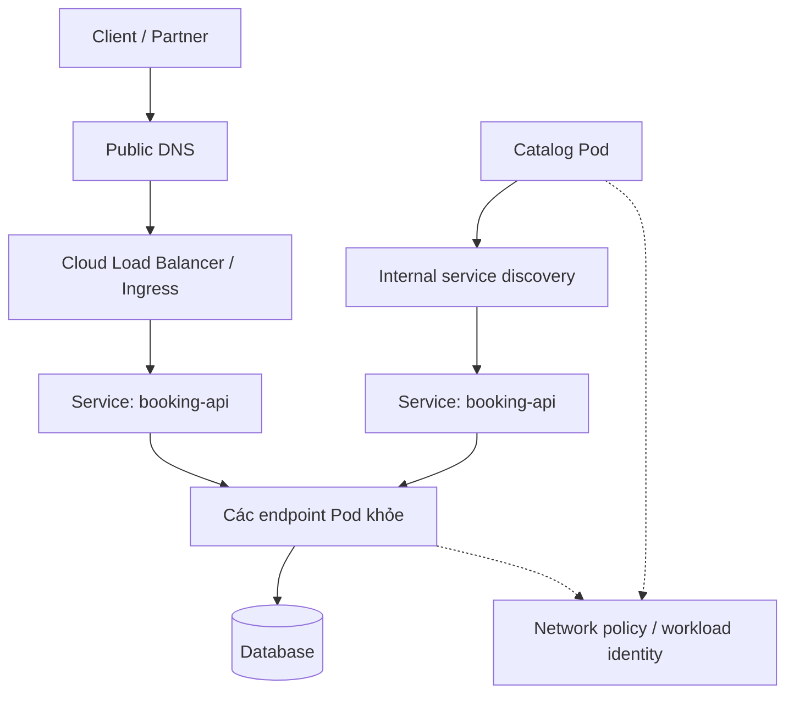
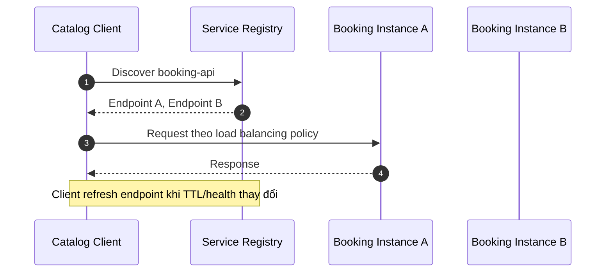
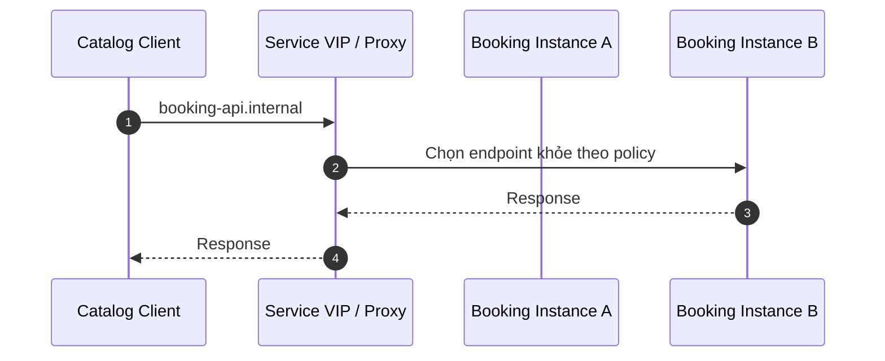
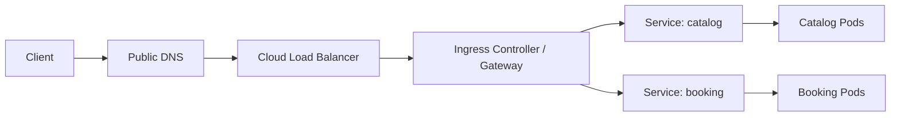
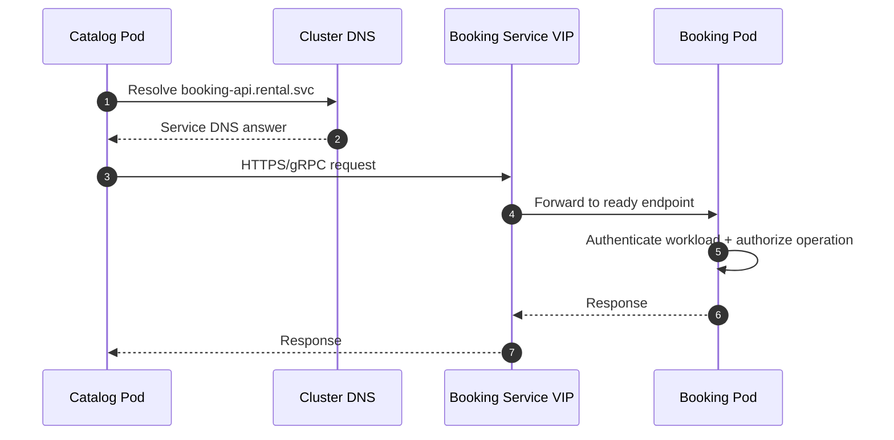
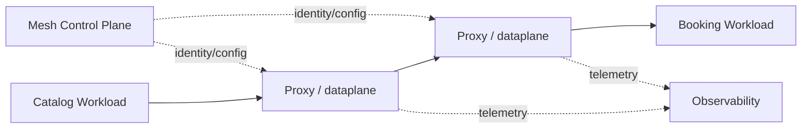
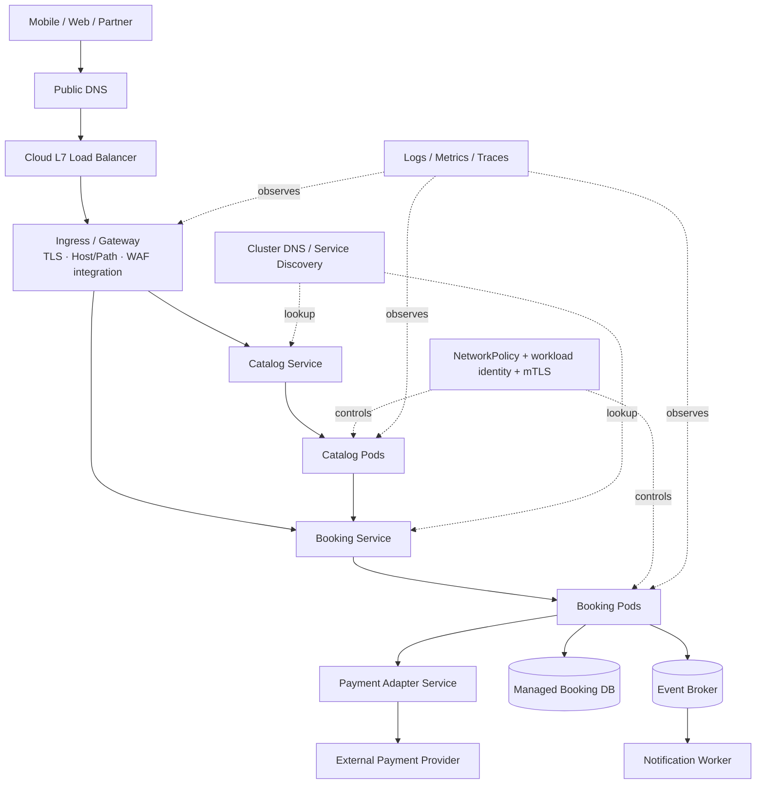

# Service discovery, ingress và kết nối dịch vụ nội bộ

Trong một hệ thống chạy bằng container, địa chỉ của một instance thường không ổn định. Pod có thể bị thay thế sau khi deploy, container có thể khởi động lại trên node khác, replica có thể tăng giảm theo tải và workload có thể chuyển vùng. Nếu các thành phần gọi nhau bằng IP cố định hoặc danh sách máy ghi thủ công, mỗi lần thay đổi triển khai đều có nguy cơ làm đứt kết nối.

Ba cơ chế giúp giải quyết bài toán này là **service discovery**, **ingress** và **kết nối dịch vụ nội bộ**. Service discovery giúp client tìm được endpoint đang phục vụ một dịch vụ. Ingress cung cấp đường vào có kiểm soát từ bên ngoài tới workload trong cluster hoặc nền tảng container. Kết nối nội bộ xác định cách các workload giao tiếp, xác thực, phân quyền, cân bằng tải và xử lý lỗi với nhau.

Trong module **CLOUD_ARCHITECTURE**, đây là một phần của thiết kế mạng, compute và mô hình triển khai. Thiết kế cần xuất phát từ yêu cầu nghiệp vụ và đánh đổi giữa độ tin cậy, bảo mật, khả năng mở rộng, chi phí và vận hành theo tư duy Well-Architected. Các ví dụ Kubernetes trong bài là minh họa phổ biến; service discovery và ingress cũng có thể được cung cấp bởi nền tảng container managed, service platform hoặc cloud load balancer khác.

## 1. Ba vấn đề cần giải quyết

| Cơ chế | Câu hỏi | Vai trò điển hình |
| --- | --- | --- |
| **Service discovery** | Một dịch vụ logic hiện có endpoint nào khỏe và có thể nhận yêu cầu? | Đăng ký/quan sát workload, ánh xạ tên dịch vụ sang endpoint, cập nhật khi replica thay đổi |
| **Ingress** | Client bên ngoài đi vào workload bằng đường nào và chịu chính sách gì? | Điểm vào HTTP(S), TLS, host/path routing, WAF integration, giới hạn lưu lượng |
| **Internal connectivity** | Các dịch vụ trong hệ thống gọi nhau qua mạng và ranh giới tin cậy nào? | DNS nội bộ, service endpoint, load balancing, network policy, identity, mTLS, timeout |

Chúng liên quan nhưng không thay thế nhau. Ingress thường gọi đến một service đích, service discovery giúp tìm endpoint phía sau service đó; còn kết nối nội bộ cần bảo vệ cả những đường đi không qua ingress.



Sơ đồ phân biệt đường **north-south** (client đi vào hệ thống) và **east-west** (workload gọi workload). Public DNS và ingress thuộc đường vào; DNS/service discovery nội bộ giúp các workload tìm nhau. Network policy và identity là các lớp kiểm soát đường giao tiếp, không tự được tạo chỉ vì có DNS.

## 2. Vì sao địa chỉ container không nên được hard-code?

Container workload có vòng đời động:

- Một Pod/instance bị xóa và tạo mới có thể nhận IP khác.
- Replica có thể tăng từ 2 lên 10 hoặc giảm xuống 1.
- Một rollout có thể chạy đồng thời phiên bản cũ và mới.
- Node lỗi hoặc autoscaler có thể chuyển workload sang node khác.
- Một service có thể có nhiều endpoint thuộc nhiều node/zone.

Giả sử Catalog gọi thẳng IP của một Booking Pod. Sau khi Pod bị thay thế, địa chỉ cũ có thể không còn tồn tại hoặc được cấp cho workload khác. Nếu Catalog giữ IP cũ, request sẽ thất bại hoặc đi sai đích. Khi có 20 replica, cập nhật danh sách IP trong từng client càng khó vận hành.

Thay vào đó, client gọi **tên logic ổn định**, ví dụ booking-api. Service discovery ánh xạ tên đó sang endpoint hiện tại. Client có thể gọi qua virtual IP/load balancer hoặc nhận danh sách endpoint tùy nền tảng và loại service discovery.

**Nguyên tắc:** client phụ thuộc vào hợp đồng dịch vụ và tên logic, không phụ thuộc vòng đời một instance cụ thể.

## 3. Các mô hình service discovery

### 3.1. Client-side discovery

Trong client-side discovery, client truy vấn registry hoặc control plane để lấy danh sách endpoint; sau đó client tự chọn endpoint và cân bằng tải.



Ưu điểm là client có quyền kiểm soát thuật toán chọn endpoint, vùng, ưu tiên và retry. Nhược điểm là mọi client phải hiểu registry, cache, health, cân bằng tải, TLS và chính sách cập nhật endpoint. Nếu có nhiều ngôn ngữ/framework, chi phí duy trì thư viện discovery có thể lớn.

### 3.2. Server-side discovery

Client gọi một endpoint ổn định như virtual IP, DNS name hoặc proxy. Thành phần phía server chọn endpoint backend.



Mô hình này đơn giản hóa client và cho phép tập trung health checking, routing và load balancing. Đổi lại, proxy/load balancer/DNS control plane trở thành phụ thuộc cần có năng lực, khả dụng và quan sát phù hợp. Một VIP hay DNS record không tự thực hiện health-aware routing trừ khi nền tảng phía sau cung cấp chức năng đó.

### 3.3. So sánh hai mô hình

| Tiêu chí | Client-side discovery | Server-side discovery |
| --- | --- | --- |
| Client | Cần thư viện/logic registry và lựa chọn endpoint | Gọi tên ổn định hoặc virtual endpoint |
| Cân bằng tải | Do client hoặc SDK đảm nhiệm | Do proxy, load balancer hoặc nền tảng đảm nhiệm |
| Khả năng kiểm soát | Client có thể áp thuật toán theo ngữ cảnh | Chính sách tập trung, ít logic ở client |
| Độ phức tạp | Tăng khi có nhiều loại client | Tăng ở hạ tầng proxy/control plane |
| Quan sát | Cần đo tại từng client và endpoint | Có thể tập trung ở proxy cộng metric backend |
| Phù hợp | SDK/service platform có discovery client thống nhất | Nhiều loại client, service DNS/VIP, gateway/proxy managed |

Hai mô hình có thể kết hợp. Ví dụ Kubernetes Service thường cung cấp tên DNS và virtual IP, kube-proxy hoặc dataplane thực hiện chuyển tiếp; service mesh có thể thêm proxy lựa chọn endpoint ở tầng ứng dụng.

## 4. Service registry, DNS và Kubernetes Service

Một service discovery thường cần ba hoạt động:

1. **Registration:** workload hoặc controller công bố endpoint có thể nhận traffic cùng metadata cần thiết.
2. **Health/readiness:** xác định endpoint có đủ điều kiện phục vụ hay không.
3. **Lookup:** client hoặc proxy tìm endpoint từ tên logic hoặc service identity.

Registry có thể là hệ thống riêng, control plane của nền tảng hoặc cơ chế endpoint tích hợp với cloud load balancer. Không phải mọi triển khai đều yêu cầu ứng dụng tự đăng ký/deregister.

### DNS nội bộ

DNS ánh xạ tên dịch vụ sang IP hoặc record khác. Với container platform, tên như:

- booking-api có thể phân giải trong cùng namespace.
- booking-api.rental.svc.cluster.local có thể dùng tên đầy đủ trong Kubernetes cluster với cluster domain mặc định tương ứng.
- booking-api.internal.example có thể là tên private DNS do tổ chức cấu hình.

Tên miền đầy đủ có thể khác nếu cluster domain hoặc DNS zone được tùy chỉnh. Không hard-code giả định cluster.local nếu nền tảng cho phép thay đổi.

DNS trả lời câu hỏi **“địa chỉ nào gắn với tên này?”**, không mặc nhiên trả lời **“endpoint có khỏe, đã sẵn sàng và được phép phục vụ loại request này không?”**. TTL, cache, negative caching và propagation có thể khiến client nhìn thấy kết quả cũ một thời gian.

### Kubernetes Service

Trong Kubernetes, đối tượng Service cung cấp một endpoint logic cho tập Pod được chọn qua label selector. ClusterIP Service thường có virtual IP ổn định trong phạm vi cluster; EndpointSlice phản ánh các endpoint backend; DNS plugin công bố tên dịch vụ để client phân giải.

Ví dụ:

```yaml
apiVersion: v1
kind: Service
metadata:
  name: booking-api
  namespace: rental
spec:
  type: ClusterIP
  selector:
    app: booking-api
  ports:
    - name: http
      port: 80
      targetPort: 8080
      protocol: TCP
```

Service này định nghĩa cổng logic 80 và chuyển tới cổng 8080 của các Pod phù hợp selector. **Service không tạo workload** và không tự đảm bảo Pod sẵn sàng. Deployment/Pod, readiness probe, selector và port phải khớp.

Pod có thể đổi IP nhưng client tiếp tục gọi booking-api.rental.svc hoặc tên tương ứng. Khi không dùng selector, Kubernetes cũng cho phép Service được nối với EndpointSlice/endpoint quản lý riêng theo mô hình phù hợp; ví dụ tích hợp dịch vụ bên ngoài cluster. Khi đó cần quản lý vòng đời endpoint cẩn thận.

### ClusterIP, NodePort và LoadBalancer

| Kiểu Service | Phạm vi truy cập | Công dụng thường gặp | Lưu ý |
| --- | --- | --- | --- |
| **ClusterIP** | Nội bộ cluster | Giao tiếp service-to-service | Không trực tiếp public internet |
| **NodePort** | Qua cổng mở trên các node | Cơ chế expose cơ bản hoặc một số tích hợp hạ tầng | Cần bảo vệ node port và kiểm soát firewall |
| **LoadBalancer** | Thường tích hợp cloud load balancer | Expose một Service ra ngoài cluster hoặc mạng được cấu hình | Hành vi và annotation phụ thuộc cloud controller/provider |

Trong nhiều kiến trúc, Ingress/Gateway là điểm vào HTTP có routing theo host/path; Service phía sau vẫn giữ vai trò endpoint nội bộ. Không nên tạo một LoadBalancer public cho từng microservice nếu một điểm vào L7 tập trung có thể đáp ứng yêu cầu với phạm vi lỗi và tải phù hợp.

### Headless Service

Kubernetes Headless Service (clusterIP: None) không cung cấp virtual IP theo kiểu ClusterIP; DNS có thể trả về địa chỉ của các Pod/endpoint tương ứng. Mô hình này hữu ích cho các workload cần biết từng member, ví dụ StatefulSet hoặc giao thức phân tán có membership riêng.

Vì client có thể nhận IP từng Pod, nó cần hiểu cập nhật DNS, readiness, kết nối lại và lựa chọn endpoint. Headless không tự cung cấp một load balancer L4/L7 hoàn chỉnh.

## 5. Readiness, liveness và startup: endpoint nào được nhận traffic?

Service discovery chỉ hữu ích nếu endpoint được công bố đúng thời điểm. Cần phân biệt ba probe thường gặp của Kubernetes:

| Probe | Câu hỏi | Hành động khi thất bại |
| --- | --- | --- |
| **Startup probe** | Ứng dụng đã khởi động đủ lâu để các probe khác có thể đánh giá chưa? | Có thể trì hoãn liveness/readiness trong lúc startup |
| **Liveness probe** | Process có đang ở trạng thái cần restart để phục hồi không? | Kubelet có thể restart container |
| **Readiness probe** | Pod có thể nhận traffic cho workload này ngay lúc này không? | Pod không được coi là endpoint sẵn sàng cho Service |

Ví dụ: Java application cần 40 giây để nạp cấu hình và warm up. Nếu liveness probe bắt đầu quá sớm, container có thể bị restart liên tục trước khi kịp phục vụ. Nếu readiness probe chỉ kiểm tra process tồn tại mà database connection pool chưa sẵn sàng, request vẫn có thể nhận lỗi.

```yaml
apiVersion: apps/v1
kind: Deployment
metadata:
  name: booking-api
  namespace: rental
spec:
  replicas: 3
  selector:
    matchLabels:
      app: booking-api
  template:
    metadata:
      labels:
        app: booking-api
    spec:
      containers:
        - name: app
          image: registry.example.com/booking-api:v1
          ports:
            - name: http
              containerPort: 8080
          startupProbe:
            httpGet:
              path: /actuator/health/liveness
              port: http
            periodSeconds: 5
            failureThreshold: 24
          livenessProbe:
            httpGet:
              path: /actuator/health/liveness
              port: http
            periodSeconds: 10
            failureThreshold: 3
          readinessProbe:
            httpGet:
              path: /actuator/health/readiness
              port: http
            periodSeconds: 5
            failureThreshold: 2
```

Đây là manifest minh họa. Path health endpoint cần được ứng dụng cấu hình; ví dụ Spring Boot Actuator có thể dùng readiness/liveness health group khi đã bật và cấu hình đúng. Không sao chép ngưỡng probe nguyên xi: thời gian startup, tải, shutdown và hành vi dependency phải được đo.

**Readiness không nên biến thành liveness.** Một database tạm mất kết nối có thể làm ứng dụng không sẵn sàng nhận request mới, nhưng restart toàn bộ Pod liên tục có thể khiến sự cố nặng hơn. Cần quyết định dependency nào thật sự bắt buộc cho readiness và xử lý suy giảm chức năng ra sao.

## 6. Ingress: đưa traffic từ bên ngoài vào cluster

Ingress là ranh giới tiếp nhận traffic north-south. Trong Kubernetes, **Ingress resource** mô tả quy tắc HTTP(S) như host/path và backend Service; một **Ingress controller** phải quan sát resource và thực thi cấu hình đó. Chỉ tạo YAML Ingress mà không cài controller tương thích thì rule không tự hoạt động.



### Ví dụ Ingress HTTP routing

```yaml
apiVersion: networking.k8s.io/v1
kind: Ingress
metadata:
  name: rental-public
  namespace: rental
spec:
  ingressClassName: public-nginx
  rules:
    - host: api.example.com
      http:
        paths:
          - path: /catalog
            pathType: Prefix
            backend:
              service:
                name: catalog-api
                port:
                  number: 80
          - path: /reservations
            pathType: Prefix
            backend:
              service:
                name: booking-api
                port:
                  number: 80
```

Manifest cho thấy routing theo host/path. Cần cấu hình DNS, load balancer, IngressClass/controller, TLS và health/observability tương ứng. Nếu muốn bỏ prefix /catalog hoặc rewrite path, phải dùng cấu hình phù hợp controller; Kubernetes Ingress core không quy định mọi extension riêng.

### Ingress và Gateway API

Kubernetes Ingress API là cách chuẩn hóa các route HTTP cơ bản, nhưng nhiều tính năng nâng cao phụ thuộc annotation/controller. **Gateway API** là bộ API mở rộng để biểu diễn GatewayClass, Gateway, HTTPRoute/TLSRoute và quan hệ giữa platform operator với developer rõ hơn. Việc chọn Ingress hay Gateway API phụ thuộc phiên bản cluster, controller và feature support. Không nên suy ra mọi controller đều hỗ trợ cùng một tập tính năng.

Các lựa chọn thường gặp:

| Mô hình | Điểm mạnh | Cần cân nhắc |
| --- | --- | --- |
| Cloud-managed L7 load balancer + controller | Tích hợp cloud certificate, WAF, health check và routing | Phụ thuộc controller, cloud quota/cost, annotation và quyền IAM |
| NGINX/Envoy ingress controller tự vận hành | Kiểm soát cấu hình proxy và khả năng portability | Nhóm phải vận hành scaling, patching, HA, certificate và capacity |
| Gateway API controller | API khai báo role/listener/route rõ và có khả năng mở rộng | Tương thích tính năng tùy controller/version |
| API Gateway managed trước ingress nội bộ | API management, quota, identity, consumer plan ở biên | Thêm hop và chi phí; tránh policy bị lặp/conflict giữa các lớp |

Ingress chỉ là **một thành phần của điểm vào**, không thay thế DNS, WAF, DDoS protection, IAM hay authorization trong backend.

## 7. Kết nối dịch vụ nội bộ: DNS là bước đầu, không phải toàn bộ thiết kế

Một service-to-service call thường gồm:

1. Workload A phân giải tên service B qua internal DNS/discovery.
2. Chọn endpoint hoặc gửi tới virtual IP/proxy.
3. Thiết lập kết nối TCP/HTTP/gRPC; nếu cần TLS/mTLS thì xác minh danh tính và chứng thư.
4. Áp timeout, connection pool, concurrency, retry và circuit breaking ở vị trí có chủ sở hữu rõ.
5. Backend B xác thực caller, phân quyền và kiểm tra điều kiện nghiệp vụ.
6. Telemetry cho phép theo dõi request xuyên qua các service.



Trong thực tế, một ClusterIP Service không nhất thiết tạo một proxy user-space riêng cho từng request; dataplane có thể dùng iptables, IPVS hoặc eBPF tùy cấu hình cluster. Sơ đồ biểu diễn vai trò logic service endpoint, không khẳng định đường đi gói tin nội bộ cụ thể.

### Dùng DNS hay gọi trực tiếp endpoint?

Với hầu hết ứng dụng, gọi qua tên Service là cách đơn giản và ổn định. Một số ứng dụng stateful cần member discovery từng Pod, hoặc thư viện client cần lựa chọn endpoint chuyên biệt; khi đó có thể dùng headless service, SRV record, registry API hay service mesh. Phải cân bằng độ linh hoạt với trách nhiệm cập nhật cache, xử lý endpoint biến mất và giữ kết nối.

**DNS không phải service health checker hoàn chỉnh.** Client có thể cache IP lâu hơn TTL, connection keep-alive cũ có thể còn trỏ tới endpoint đã bị drain. Service mesh/proxy có thể có xDS/control plane và health ejection riêng; cần xem cách hệ thống xử lý connection reuse, endpoint removal và drain.

## 8. Network policy: ai được kết nối tới ai?

Service discovery làm cho dịch vụ dễ tìm; điều đó **không có nghĩa mọi workload được phép gọi mọi workload**. Network policy giảm bề mặt lateral movement nếu một container bị xâm nhập.

Ví dụ luồng tối thiểu:

- Ingress controller được gọi Booking API ở cổng ứng dụng.
- Catalog API được phép gọi Booking API theo contract.
- Booking API được phép truy cập database và Payment API theo nhu cầu.
- Pod không liên quan không được tùy tiện truy cập database.

Một NetworkPolicy mẫu (cần CNI triển khai network policy hỗ trợ):

```yaml
apiVersion: networking.k8s.io/v1
kind: NetworkPolicy
metadata:
  name: booking-ingress
  namespace: rental
spec:
  podSelector:
    matchLabels:
      app: booking-api
  policyTypes:
    - Ingress
  ingress:
    - from:
        - podSelector:
            matchLabels:
              app: catalog-api
        - namespaceSelector:
            matchLabels:
              kubernetes.io/metadata.name: ingress-system
      ports:
        - protocol: TCP
          port: 8080
```

Policy trên chỉ minh họa kiểm soát ingress ở mức namespace/pod selector. Cần xem semantics của CNI, namespace, default-deny, egress rules và nguồn traffic từ load balancer. Không phải mọi plugin mạng đều thực thi NetworkPolicy; tạo resource mà không có enforcement tương ứng có thể tạo cảm giác an toàn giả.

### Default-deny và allow-list

Một mô hình phổ biến là áp default-deny ingress/egress cho namespace workload, sau đó mở đúng các kết nối bắt buộc như DNS, telemetry, database hoặc service phụ thuộc. Tuy nhiên, default-deny egress có thể làm hỏng DNS, certificate/status endpoint, cloud metadata hoặc dịch vụ cần thiết nếu thiếu rule.

Thiết kế policy theo **luồng được phép**, rồi test cả đường hợp lệ và bị chặn. Không dùng IP tĩnh của Pod trong policy khi label/identity selector thích hợp hơn; IP thay đổi theo vòng đời.

## 9. Workload identity và mTLS cho kết nối nội bộ

Mạng nội bộ không đồng nghĩa đáng tin cậy. Nếu một Pod bị xâm nhập và mọi Pod cùng nằm trong một mạng phẳng, kẻ tấn công có thể thử kết nối lateral tới dịch vụ khác. Cần xác thực **workload nào** đang gọi và phân quyền **workload đó** được làm gì.

| Lớp | Bằng chứng | Bảo vệ |
| --- | --- | --- |
| Network policy | Namespace/label/IP/selector theo cơ chế CNI | Giới hạn đường kết nối |
| Workload identity | Service account, cloud workload identity, SPIFFE-like identity hoặc credential được cấp an toàn | Xác định danh tính của workload |
| TLS/mTLS | Certificate, chain of trust, private key của client/server | Mã hóa transport và chứng thực peer ở mức TLS |
| Application authorization | Scope/role/relationship/tenant/object policy | Giới hạn hành động nghiệp vụ |

Không lớp nào thay toàn bộ các lớp khác. Network policy chỉ cho phép TCP connect chưa có nghĩa request hợp lệ; mTLS xác minh peer không tự chứng minh caller được phép hủy reservation của người dùng cụ thể.

### mTLS

Với mutual TLS, cả client và server đều trình chứng thư theo trust policy. Nó giúp service xác minh peer và bảo vệ đường truyền. Để triển khai cần:

- Cấp danh tính/chứng thư riêng cho mỗi workload hoặc nhóm workload theo mô hình tin cậy.
- Phân phối và bảo vệ private key, tự động rotate certificate trước khi hết hạn.
- Quản lý CA/trust bundle và thu hồi danh tính bị xâm nhập.
- Định nghĩa mapping identity sang service authorization.
- Quan sát lỗi handshake, expiry, trust mismatch và lỗi policy.

Service mesh như Istio hoặc Linkerd có thể hỗ trợ identity, certificate rotation, mTLS và policy giữa service, nhưng kéo theo control plane, proxy/sidecar hoặc ambient dataplane, tài nguyên và độ phức tạp vận hành. Có thể dùng mTLS ở application/load balancer mà không cần mesh; lựa chọn phụ thuộc yêu cầu và năng lực đội ngũ.

## 10. Service mesh: khi nào đáng dùng?

Service mesh tạo một lớp quản trị giao tiếp giữa các workload. Nó thường cung cấp:

- **Identity và mTLS** giữa workload.
- **Traffic management** như timeout, retry, circuit breaking, traffic splitting.
- **Telemetry** cho latency, error, request volume và trace.
- **Policy** ở mức service-to-service hoặc workload identity.



Service mesh không phải điều kiện bắt buộc để có microservices. Nó hợp lý khi số lượng service lớn, chính sách giao tiếp cần nhất quán, cần identity/mTLS xuyên nhiều nhóm và lợi ích đo được lớn hơn chi phí vận hành.

| Khi chưa cần mesh | Khi nên đánh giá mesh |
| --- | --- |
| Ít service, giao tiếp đơn giản | Nhiều service và nhiều team |
| Một framework/client library đã giải quyết đủ retry/telemetry | Muốn policy thống nhất cho nhiều ngôn ngữ/runtime |
| Không có yêu cầu mTLS workload phức tạp | Cần identity/mTLS và rotation tập trung |
| Nhóm chưa có năng lực vận hành control plane | Đội có năng lực theo dõi mesh, nâng cấp, debug dataplane |
| Chi phí thêm proxy không tương xứng | Cần traffic splitting, policy và quan sát phân tán ở quy mô lớn |

**Mesh không sửa được thiết kế nghiệp vụ sai.** Retry tự động ở sidecar có thể làm nhân đôi thao tác không idempotent; route policy sai có thể chặn cả ứng dụng; proxy tăng độ trễ và tiêu thụ CPU/bộ nhớ.

## 11. Cân bằng tải, kết nối và xử lý lỗi giữa các service

DNS/service endpoint chỉ giúp client tìm đường. Một ứng dụng thực tế cần hành vi rõ khi nhiều endpoint, endpoint đang drain hoặc backend lỗi.

| Cấp | Cơ chế | Tác dụng |
| --- | --- | --- |
| DNS | Trả record tới một hay nhiều endpoint | Hữu ích cho discovery, nhưng cache/TTL làm cập nhật không tức thời |
| L4 | TCP/UDP load balancing | Phân phối kết nối, ít hiểu ngữ nghĩa HTTP |
| L7 | HTTP/gRPC routing | Có thể route theo host/path/header, health, weight |
| Client library | Chọn endpoint từ registry/discovery | Tùy biến theo client, nhưng phải duy trì logic |
| Service mesh | Proxy chọn endpoint và áp policy | Tập trung traffic policy, thêm dataplane/control plane |

Với HTTP keep-alive hoặc gRPC long-lived connection, một kết nối có thể tiếp tục phục vụ nhiều request. Thay endpoint trong DNS hoặc Service không buộc tất cả kết nối đang mở lập tức chuyển sang Pod mới. Khi rollout hoặc scale down, cần **connection draining**, termination grace period và readiness false trước khi dừng nhận request mới.

### Readiness và graceful shutdown

Kịch bản scale down:

1. Controller quyết định giảm replica.
2. Pod được đánh dấu terminating và endpoint cập nhật trạng thái không còn nhận traffic mới theo cơ chế platform.
3. Ứng dụng ngừng nhận request mới, xử lý xong request đang chạy trong giới hạn thời gian.
4. Ứng dụng đóng connection/consumer và thoát.
5. Nếu quá grace period, tiến trình có thể bị kết thúc.

Ứng dụng cần xử lý SIGTERM, ngừng nhận công việc mới, drain HTTP/gRPC server và hoàn tất hoặc lưu trạng thái tác vụ. Nếu worker đang xử lý queue, cần ACK/NACK phù hợp để không mất message. **Graceful shutdown không đảm bảo mọi request hoàn tất** nếu client timeout hoặc node bị mất đột ngột; idempotency và recovery vẫn cần thiết.

### Timeout, retry, circuit breaker

Đặt timeout theo ngân sách đầu-cuối. Nếu API client có deadline 2 giây, không để ba lời gọi nội bộ mỗi lần timeout 2 giây cộng thêm retry không giới hạn. Timeout ở từng hop phải ngắn hơn deadline còn lại, truyền context/deadline nếu protocol hỗ trợ.

Retry chỉ áp dụng khi:

- Lỗi có khả năng tạm thời và việc thử lại có ích.
- Request có thể lặp an toàn, hoặc có idempotency key/đối soát.
- Tổng thời gian và số lần retry có giới hạn, có backoff và jitter.
- Tránh retry đồng thời ở mọi tầng (client, gateway, mesh, application) làm tải bị nhân lên.

Circuit breaker giảm lời gọi tới dependency đang hỏng; bulkhead giới hạn tài nguyên cho từng nhóm downstream. Chúng không thay thế sửa lỗi gốc hoặc xử lý trạng thái nghiệp vụ.

## 12. Headless, StatefulSet và giao tiếp tới thành viên cụ thể

Một số workload không chỉ cần gọi một service bất kỳ mà cần định danh **từng node/member**. Ví dụ database cluster, distributed cache hoặc broker có topology riêng.

Kubernetes StatefulSet kết hợp với Headless Service có thể tạo DNS ổn định theo ordinal, ví dụ:

- db-0.database.rental.svc
- db-1.database.rental.svc
- db-2.database.rental.svc

Tên này gắn với danh tính Pod trong StatefulSet, hỗ trợ peer discovery. Tuy nhiên, DNS name ổn định không có nghĩa member đang khỏe, đã đồng bộ hoặc đang giữ vai trò leader. Client/protocol cần biết cách kiểm tra quorum, leader election, replication lag và xử lý failover.

Đối với database, không nên để mọi client ghi vào mọi Pod chỉ vì DNS trả về ba địa chỉ. Cần dùng endpoint read/write hoặc proxy có hiểu vai trò, leader, replica và consistency được database hỗ trợ.

## 13. Giao tiếp giữa namespace, cluster, account và region

Service discovery có phạm vi. Tên DNS của Service Kubernetes thường chỉ có ý nghĩa trong cluster/zone DNS được cấu hình. Gọi workload ở cluster khác cần cơ chế định danh và routing rõ:

| Phạm vi | Cách kết nối thường gặp | Câu hỏi cần giải quyết |
| --- | --- | --- |
| Cùng namespace | Service DNS ngắn hoặc FQDN | Có thể giới hạn quyền bằng NetworkPolicy? |
| Khác namespace, cùng cluster | FQDN Service hoặc gateway nội bộ | Namespace/tenant nào sở hữu endpoint? |
| Khác cluster | Private DNS, service mesh federation, gateway, private load balancer hoặc platform discovery | Trust, routing, certificate, endpoint health, failover |
| Khác account/project/subscription | Private network connection, peering, transit hub, private endpoint | IAM cross-account, DNS resolution, route overlap, chi phí egress |
| Khác region | Global routing, region-local endpoint, service discovery đa vùng | Data residency, replication, latency, failover và split-brain |

Không nên expose toàn bộ ClusterIP giữa các cluster như một giả định mặc định. Dùng endpoint có chủ đích, contract rõ và policy theo consumer. Với giao tiếp cross-region, cân nhắc giữ call path trong region gần dữ liệu để giảm latency và chi phí, đồng thời thiết kế cho kịch bản region không sẵn sàng.

### DNS và network có thể thành hai hệ thống lệch nhau

Ví dụ private DNS record trỏ tới internal load balancer nhưng route table/firewall không cho phép source subnet kết nối. DNS resolve thành công nhưng TCP connection vẫn timeout. Ngược lại, network có route nhưng DNS record cũ có thể đưa client tới địa chỉ đã xóa.

Khi debug, kiểm tra theo thứ tự:

1. Tên service được resolve đúng trong đúng namespace/VPC/cluster chưa?
2. IP/endpoint trả về có đúng scope và trạng thái không?
3. Route, subnet, security group/firewall và NetworkPolicy có cho phép cổng/protocol không?
4. TLS/mTLS handshake có thành công, certificate/SAN/trust chain có khớp không?
5. Backend có listen đúng interface và port, readiness có đạt không?
6. Ứng dụng có trả lỗi authz/validation/timeout sau khi network đã kết nối không?

## 14. Bảo mật điểm vào và kết nối nội bộ

Thiết kế nhiều lớp:

- **Ingress:** chỉ mở listener và host/route cần thiết; TLS, WAF/DDoS protection phù hợp; không để dashboard/admin endpoint public.
- **Service discovery:** tránh công bố thông tin nội bộ không cần thiết; phân biệt public/private DNS zone; bảo vệ quyền cập nhật record/registry.
- **Network:** default-deny theo khả năng CNI, mở allow-list, tách subnet/zone theo rủi ro; quản lý egress tới dịch vụ ngoài.
- **Identity:** workload identity riêng, credential ngắn hạn, least privilege; tránh chia sẻ service account admin.
- **Transport:** TLS/mTLS theo trust boundary, rotation và kiểm tra chứng thư.
- **Application:** xác thực và authorization theo đối tượng, tenant, hành động; validate input và chống replay.
- **Operations:** audit thay đổi ingress/route/policy, quan sát connection và policy denial, review cấu hình bằng IaC.

### Những đường truy cập cần kiểm tra

Một service được cho là private có thể vẫn lộ qua:

- Service type LoadBalancer được tạo public ngoài ý muốn.
- Ingress wildcard route sang service nội bộ.
- NodePort được mở ở firewall/security group.
- Public IP của node hoặc endpoint quản trị.
- Port-forward/debug tool có quyền vượt chính sách.
- Egress unrestricted khiến workload bị xâm nhập gọi command-and-control hoặc exfiltrate data.
- DNS zone public vô tình chứa record của hệ thống nội bộ.

Kiểm tra route công khai, policy, IAM và quyền operator định kỳ. **Không dựa vào tên namespace internal để kết luận tài nguyên đã được cách ly.**

## 15. Observability: quan sát cả discovery lẫn kết nối

Chỉ đo CPU và memory của Pod không đủ để biết service discovery/kết nối có hoạt động. Nên theo dõi:

| Nhóm | Metric/log quan trọng | Dấu hiệu vấn đề |
| --- | --- | --- |
| Ingress | Request count, status, latency p95/p99, TLS errors, active connections | 4xx/5xx tăng, handshake fail, connection saturation |
| Service discovery/DNS | Query volume, NXDOMAIN, SERVFAIL, latency, cache/endpoint update | Service resolve chậm, record cũ, DNS overload |
| Endpoint readiness | Ready/NotReady count, endpoint churn, rollout status | Không còn endpoint hoặc endpoint flapping |
| Network | Connection reset, timeout, packet drop, flow logs | Policy/firewall/route sai hoặc backend quá tải |
| mTLS/identity | Certificate expiry, handshake failure, authz denial | Certificate hết hạn, trust bundle lệch, role sai |
| Backend | Request latency, saturation, pool/queue, dependency errors | Gateway healthy nhưng backend suy giảm |
| Control plane | Controller reconciliation errors, config rollout, pending resources | Ingress rule hoặc service endpoint không được áp dụng |

Trace nên truyền context qua ingress và service-to-service; log cần correlation/request ID. Không ghi bearer token, session cookie, private key hoặc payload nhạy cảm. Định tuyến alert tới owner của ingress controller, DNS/network platform và backend service đúng trách nhiệm.

## 16. Kiểm thử và diễn tập failure mode

| Kịch bản | Cách tạo | Kết quả mong đợi |
| --- | --- | --- |
| Pod bị thay IP | Xóa Pod để controller tạo Pod mới | Client gọi qua Service vẫn tìm được endpoint khỏe |
| Scale up/down | Tăng giảm replica | Endpoint được cập nhật; latency và error ở mức chấp nhận |
| Readiness fail | Làm dependency cần thiết chưa sẵn sàng | Pod không nhận traffic mới; không restart vô ích do liveness |
| DNS tạm lỗi | Mô phỏng resolver timeout/NXDOMAIN | Client timeout hợp lý, cache/retry không tạo storm; alert được kích hoạt |
| Ingress route sai | Deploy cấu hình route không hợp lệ ở staging | Test/policy phát hiện hoặc rollout bị dừng; có rollback |
| Backend slow | Tăng response time có kiểm soát | Timeout/circuit breaker/backpressure hoạt động; không cạn thread |
| NetworkPolicy chặn | Bỏ allow rule trong môi trường test | Luồng không được phép bị chặn; luồng hợp lệ vẫn hoạt động |
| Certificate hết hạn/rotation | Thay trust/cert trong môi trường kiểm thử | Rotation không gây outage; lỗi được quan sát |
| Node/zone failure | Drain hoặc dừng node/zone mô phỏng | Pod được reschedule; ingress chuyển endpoint; SLO đáp ứng |
| Mesh/proxy lỗi | Tắt dataplane hoặc làm control plane mất kết nối theo kịch bản | Phân định hành vi proxy cũ/mới, request và policy có hành vi dự kiến |

Không phải mọi nền tảng đảm bảo hành vi giống nhau khi control plane mất kết nối. Phải đọc semantics cụ thể: data plane có tiếp tục dùng cấu hình gần nhất không, endpoint có được refresh không, certificate còn hiệu lực bao lâu, và điều gì xảy ra khi proxy restart.

## 17. Đánh đổi theo các trụ cột Well-Architected

| Trụ cột | Lợi ích từ thiết kế tốt | Đánh đổi/rủi ro | Câu hỏi đánh giá |
| --- | --- | --- | --- |
| **Operational excellence** | Tên service ổn định, policy có phiên bản, dễ debug và rollout | Nhiều controller/mesh làm tăng số thành phần phải nâng cấp | Owner có theo dõi ingress, DNS, CNI, mesh và runbook không? |
| **Security** | Network segmentation, workload identity, mTLS và least privilege | Policy quá phức tạp dễ gây outage hoặc bypass khi cấu hình sai | Có test đường được phép và đường bị chặn? |
| **Reliability** | Endpoint readiness, health routing, graceful shutdown và multi-zone | DNS cache, control plane, proxy và gateway có thể thành phụ thuộc chung | Khi endpoint churn hoặc DNS lỗi, request được xử lý thế nào? |
| **Performance efficiency** | Load balance, locality, connection reuse và giảm hop không cần | Sidecar/proxy, cross-zone/region call thêm latency và CPU | Độ trễ p95/p99 và throughput sau khi thêm mesh là bao nhiêu? |
| **Cost optimization** | Scale theo service, dùng chung ingress hợp lý, tránh LB cho mỗi workload | Nhiều LB, data transfer, proxy, observability và control plane tăng chi phí | Cost/request, egress và chi phí nền tảng được đo ra sao? |
| **Sustainability** | Điều phối endpoint/replica theo tải và giảm tài nguyên rỗi | Replica dự phòng, proxy và control plane dư thừa tiêu thụ tài nguyên | Có thể giảm mức tài nguyên mà vẫn giữ SLO/khả năng phục hồi? |

Không có một số lượng ingress, cluster hoặc mesh cố định phù hợp mọi hệ thống. Một nhóm ít service có thể dùng Kubernetes Service và một ingress controller managed; hệ thống nhiều team, nhiều trust boundary có thể cần Gateway API, mesh và policy tập trung. Quyết định cần dựa trên traffic, rủi ro, mục tiêu phục hồi, năng lực trực ca và chi phí.

## 18. Ví dụ tổng hợp: đường vào và kết nối nội bộ của nền tảng thuê thiết bị

Giả định triển khai trên một Kubernetes cluster managed:

- Mobile/Web truy cập api.rental.example.
- Cloud load balancer chuyển HTTP(S) tới Ingress/Gateway.
- Ingress định tuyến /catalog tới Catalog Service, /reservations tới Booking Service.
- Catalog cần gọi Booking để kiểm tra thông tin giữ chỗ theo một API nội bộ được xác thực.
- Booking gọi Payment Adapter và database; notification được xử lý bất đồng bộ qua broker.
- Các service thuộc namespace rental; nhóm Platform vận hành ingress, DNS, CNI; nhóm sản phẩm chịu trách nhiệm service và dữ liệu của mình.



### Lựa chọn thiết kế và lý do

1. **Một ingress/gateway theo domain public** giảm số điểm public; route theo host/path tới service nội bộ. Nếu Payment webhook cần policy hoặc trust boundary khác, có thể tách listener/domain.
2. **Service DNS ổn định** cho Catalog, Booking và Payment Adapter. Client không biết Pod IP.
3. **Readiness probe** loại Pod chưa sẵn sàng khỏi endpoint; rollout chờ trạng thái ready.
4. **NetworkPolicy** giới hạn luồng Catalog → Booking và Booking → database/Payment theo nhu cầu. Cần policy tương ứng cho DNS, monitoring và broker.
5. **Workload identity và mTLS** áp dụng ở những đường cần xác thực peer mạnh; backend vẫn kiểm tra quyền nghiệp vụ.
6. **Timeout và retry** được thiết kế theo deadline, không retry lệnh giữ chỗ/thanh toán nếu chưa có idempotency.
7. **Telemetry** nối request từ ingress đến backend, với log đã redaction và alert gắn owner.

### Những giả định còn phải xác minh

- Ingress/controller có hỗ trợ host/path/TLS/WAF integration cần thiết và giới hạn throughput phù hợp không?
- CNI đang dùng có thực thi Kubernetes NetworkPolicy và xử lý egress ra sao?
- DNS resolver/cache có đáp ứng số lượng lookup và endpoint churn không?
- Workload có thể lấy identity ngắn hạn từ cloud provider mà không lưu static key trong image không?
- Có cần mTLS giữa mọi service hay chỉ các trust boundary đặc biệt?
- Booking DB và broker nằm cùng region/zone hay có phụ thuộc cross-region?
- RTO/RPO và yêu cầu data residency có cần topology khác?
- Nhóm Platform/Product có đủ năng lực vận hành ingress, network policy và certificate rotation không?

Các giả định này cần được kiểm tra bằng thử tải, security test, diễn tập node/zone failure và tài liệu nhà cung cấp trước khi coi phương án là production-ready.

## 19. Checklist khi thiết kế service discovery, ingress và kết nối nội bộ

### Service discovery

- Client gọi tên logic ổn định hay IP instance?
- Endpoint được đăng ký/cập nhật và loại bỏ theo cơ chế nào?
- Health/readiness có phản ánh đúng năng lực nhận traffic không?
- DNS TTL/cache, stale connection và headless endpoint có được hiểu rõ?
- Client/proxy có xử lý endpoint churn, retry và connection drain?

### Ingress

- Chỉ route cần thiết được public? Có listener/admin endpoint bị lộ?
- DNS, certificate, TLS, WAF/DDoS và host/path rule đã được kiểm tra?
- Controller/Gateway API implementation có hỗ trợ đúng feature/version?
- Backend có bị truy cập bypass ingress ngoài chính sách không?
- Rollout/rollback route, quota, autoscaling và HA có diễn tập?

### Kết nối nội bộ

- Có bản đồ luồng east-west và owner của từng service?
- NetworkPolicy/firewall giới hạn đúng source, destination, port và protocol?
- Workload identity, mTLS và application authorization được phân vai đúng?
- Timeout, retry, circuit breaker, graceful shutdown và backpressure có giới hạn?
- DNS, CNI, proxy/mesh và database/broker có capacity và observability?
- Cross-cluster/account/region routing có kiểm soát latency, data residency và split-brain?

### Vận hành và chi phí

- Có metric DNS, endpoint readiness, ingress, network, mTLS và backend?
- Log/trace không lộ token, secret hoặc dữ liệu nhạy cảm?
- Alert được định tuyến tới owner có runbook?
- Chi phí load balancer, proxy, cross-zone/region traffic và telemetry đã được tính?
- Có thử nghiệm lỗi và đo SLO/RTO/RPO thay vì chỉ dựa vào sơ đồ?

Service discovery làm cho endpoint động trở nên dễ tìm; ingress tạo điểm vào có kiểm soát; kết nối nội bộ bảo đảm các workload giao tiếp trong phạm vi quyền, độ tin cậy và hiệu năng đã thiết kế. Khi ba phần được liên kết với readiness, identity, network policy, observability và quy trình vận hành, kiến trúc container có thể mở rộng và thay đổi mà không buộc client phụ thuộc vào từng instance cụ thể.
