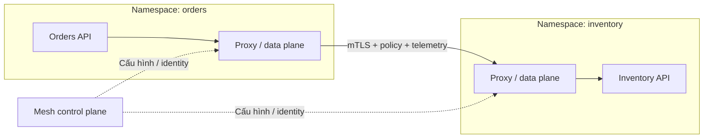
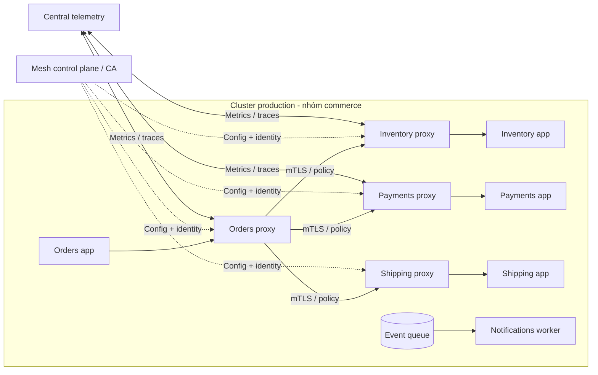

# Service mesh: điều kiện sử dụng, lợi ích và chi phí vận hành

## 1. Service mesh giải quyết bài toán gì?

Trong một hệ thống gồm nhiều dịch vụ, các thành phần không chỉ gọi nhau để xử lý nghiệp vụ mà còn phải thực hiện những công việc lặp lại: tìm địa chỉ đích, thiết lập kết nối bảo mật, xác thực danh tính dịch vụ, áp dụng timeout/retry, thu thập metric và truy vết request. Nếu mỗi nhóm tự xây các cơ chế này trong ứng dụng, chính sách dễ không đồng nhất; nếu đưa tất cả vào một thư viện dùng chung, việc nâng cấp, tương thích runtime và hỗ trợ nhiều ngôn ngữ có thể trở nên khó khăn.

**Service mesh** là một lớp hạ tầng dành cho giao tiếp dịch vụ, cung cấp các khả năng như mã hóa và xác thực kết nối, điều khiển lưu lượng, quan sát và áp dụng chính sách giữa các workload. Nhiều kiến trúc mesh đặt proxy hoặc thành phần xử lý lưu lượng bên cạnh workload trong **data plane**, đồng thời có **control plane** phân phối cấu hình và danh tính. Một số mô hình mới giảm phụ thuộc vào sidecar bằng proxy dùng chung theo node hoặc cơ chế ambient; chi tiết phụ thuộc sản phẩm.

Service mesh không tự làm cho ứng dụng trở thành microservices tốt, không thay thế API gateway cho mọi luồng north-south, không thay thế IAM nghiệp vụ và cũng không bảo đảm hệ thống luôn sẵn sàng. Nó bổ sung một lớp quản lý **east-west traffic** (giao tiếp giữa các dịch vụ), đôi khi kết hợp thêm policy cho luồng vào/ra theo năng lực nền tảng.

Bài học thuộc chương **Kiến trúc container** của module **CLOUD_ARCHITECTURE**. Ta sẽ tập trung vào điều kiện nên sử dụng, lợi ích, chi phí và cách đánh giá service mesh trong bối cảnh kiến trúc cloud cần cân bằng độ tin cậy, bảo mật, khả năng mở rộng, chi phí và vận hành theo Well-Architected.

Sau bài học, bạn có thể:

- Giải thích vai trò của data plane, control plane, proxy và danh tính workload.
- Nhận biết khi nào mesh có giá trị rõ ràng và khi nào độ phức tạp vượt lợi ích.
- Phân biệt service mesh với API gateway, ingress controller, network policy và thư viện giao tiếp trong ứng dụng.
- Đánh giá mTLS, authorization policy, traffic management và telemetry trong phạm vi mesh.
- Lập kế hoạch triển khai, thử nghiệm lỗi, dự toán tài nguyên và vận hành mesh có kiểm soát.

## 2. Kiến trúc cơ bản: control plane và data plane

### 2.1. Data plane — nơi xử lý lưu lượng thực tế

Data plane gồm các thành phần xử lý kết nối giữa workload. Trong mô hình sidecar phổ biến, một proxy được triển khai cạnh mỗi pod/instance hoặc workload. Ứng dụng gửi lưu lượng qua proxy cục bộ; proxy thiết lập kết nối tới proxy của dịch vụ đích, áp dụng chính sách và tạo telemetry.

Proxy có thể thực hiện:

- Thiết lập và quản lý kết nối, connection pool, timeout và giới hạn lưu lượng.
- Mã hóa TLS/mTLS và xác minh chứng chỉ/danh tính peer.
- Chuyển hướng theo phiên bản, weight, header hoặc điều kiện phù hợp.
- Thực thi một số policy truy cập và ghi nhận metric/log/trace.

Proxy nằm trên đường truyền dữ liệu nên có thể làm tăng latency, CPU, bộ nhớ và số hop. Nếu proxy bị quá tải, cấu hình sai hoặc không hoạt động, ứng dụng có thể không giao tiếp được dù process chính vẫn khỏe.

### 2.2. Control plane — nơi quản lý cấu hình và danh tính

Control plane quản lý cấu hình mesh và phân phối tới data plane. Tùy sản phẩm, nó có thể:

- Phát hiện workload/service và cập nhật địa chỉ endpoint.
- Phân phối cấu hình route, cluster, timeout, retry, policy và telemetry.
- Cấp phát/xoay vòng chứng chỉ hoặc phối hợp với hệ thống danh tính.
- Kiểm tra trạng thái proxy, tính hợp lệ cấu hình và phiên bản.

Control plane thường không chuyển tiếp từng request nghiệp vụ. Khi nó tạm thời mất kết nối, proxy đã nhận cấu hình trước đó có thể tiếp tục chuyển tiếp lưu lượng; tuy nhiên khả năng cập nhật endpoint, chứng chỉ, policy và phục hồi sau lỗi phụ thuộc triển khai. Phải kiểm tra hành vi thực tế thay vì giả định control plane hỏng sẽ luôn vô hại hoặc luôn làm toàn mesh dừng.

### 2.3. Sơ đồ luồng east-west



Hình chỉ mô tả khái niệm. Một số nền tảng chuyển tiếp qua proxy sidecar; một số dùng proxy gateway theo node, tunnel hoặc cơ chế khác. Hãy đọc tài liệu sản phẩm về nơi kết thúc TLS, cách xác minh danh tính, cách traffic bị redirect và cách áp dụng policy.

## 3. Các mô hình triển khai service mesh

| Mô hình | Cách hoạt động | Điểm mạnh | Chi phí/giới hạn |
|---|---|---|---|
| **Sidecar proxy** | Mỗi pod/workload có proxy riêng | Cô lập tài nguyên và policy theo workload; cách tiếp cận phổ biến, dễ hình dung | Tăng số container, CPU/RAM, startup, cấu hình và nâng cấp |
| **Node-level/ambient proxy** | Một số chức năng mạng dùng proxy/tunnel chung ở cấp node; chức năng L7 nâng cao có thể dùng waypoint/shared proxy | Giảm số sidecar và tài nguyên lặp ở mỗi pod | Phải hiểu phạm vi tin cậy, điểm chia sẻ, nơi thực thi L7 policy và khả năng tương thích |
| **Proxy gateway tập trung** | Một nhóm proxy/gateway xử lý một số luồng giữa các vùng hoặc nhóm dịch vụ | Tập trung một số policy, phù hợp boundary liên cụm/liên mạng | Dễ trở thành bottleneck/điểm lỗi; cần HA, capacity và route rõ |
| **Không dùng mesh, thư viện trong ứng dụng** | Mỗi ứng dụng tích hợp client, TLS, retry, telemetry | Ít hạ tầng mesh và kiểm soát logic nghiệp vụ linh hoạt | Chính sách có thể không đồng nhất; nâng cấp nhiều ứng dụng và ngôn ngữ |

Không có mô hình luôn tốt nhất. Sidecar cho phép policy gần workload nhưng có overhead lặp; ambient giảm số proxy nhưng tăng vai trò của thành phần chia sẻ ở cấp node; gateway tập trung phù hợp một số ranh giới song có thể gom tải vào ít điểm. Quyết định nên dựa trên số lượng workload, yêu cầu bảo mật, kỹ năng đội ngũ và phép đo hiệu năng.

## 4. Service mesh cung cấp những năng lực nào?

### 4.1. Danh tính dịch vụ và mTLS

**mTLS (mutual TLS)** xác thực cả client lẫn server trong một kết nối TLS và mã hóa dữ liệu trên đường truyền. Trong mesh, danh tính thường gắn với workload identity/service account, được biểu diễn bằng chứng chỉ hoặc thông tin xác thực do hệ thống mesh cấp.

Lợi ích:

- Xác minh workload gọi và workload nhận, giảm phụ thuộc vào vị trí mạng hoặc IP.
- Mã hóa east-west traffic mà không yêu cầu mỗi nhóm tự quản lý toàn bộ TLS handshake.
- Xây dựng policy theo service identity, namespace hoặc principal tùy hệ thống.
- Hỗ trợ xoay vòng chứng chỉ và theo dõi phiên bản trust bundle theo cơ chế nền tảng.

Những điều cần thiết kế:

- Cách cấp phát identity: workload nào được nhận identity nào, ai phê duyệt và làm sao ngăn giả mạo service account.
- Chu kỳ chứng chỉ, rotation, đồng bộ thời gian và hành vi khi CA/control plane không sẵn sàng.
- Trust domain giữa cluster/region; việc tin cậy chéo phải có chủ sở hữu và phạm vi cụ thể.
- Luồng không tham gia mesh, ứng dụng legacy và kết nối bên ngoài mesh.

**mTLS không đồng nghĩa với authorization.** Một client có chứng chỉ hợp lệ vẫn có thể không được phép gọi endpoint hoặc thao tác nghiệp vụ cụ thể. Cần authorization policy và kiểm tra quyền ở ứng dụng khi phù hợp; API vẫn phải xác thực người dùng/tenant chứ không được dựa vào danh tính proxy thay cho nghiệp vụ.

### 4.2. Authorization và phân đoạn dịch vụ

Mesh có thể dùng identity để tạo policy dạng:

- `orders-api` được gọi `inventory-api` trên các route cần thiết.
- `reporting-worker` chỉ được đọc endpoint báo cáo, không được gọi thao tác ghi đơn hàng.
- Namespace `dev` không được gọi database hoặc API thuộc `prod`.

Đây là **network/service authorization**, không tự thay thế kiểm tra vai trò người dùng, quyền sở hữu bản ghi, kiểm soát tenant và quy tắc nghiệp vụ. Nếu mesh chỉ cho phép một service gọi service khác, ứng dụng vẫn phải kiểm tra user có quyền xem/sửa dữ liệu cụ thể hay không.

### 4.3. Traffic management

Mesh có thể cung cấp một số tính năng:

| Tính năng | Mục đích | Điều kiện/rủi ro |
|---|---|---|
| Timeout | Giới hạn thời gian chờ | Timeout phải phù hợp với deadline đầu-cuối, không cắt giao dịch hợp lệ |
| Retry | Thử lại lỗi tạm thời | Chỉ retry thao tác an toàn/idempotent; retry có thể khuếch đại tải |
| Circuit breaker/outlier detection | Hạn chế gửi request tới upstream lỗi | Cần ngưỡng và thời gian phục hồi phù hợp; tránh loại nhầm instance khỏe |
| Load balancing | Phân phối request tới endpoint | Thuật toán và health signal phải phù hợp loại kết nối/workload |
| Traffic shifting | Chuyển một phần lưu lượng sang phiên bản mới | Cần metric đánh giá và rollback; tỷ lệ traffic không thay thế kiểm thử |
| Fault injection | Mô phỏng độ trễ/lỗi để kiểm tra chịu lỗi | Chỉ thực hiện trong phạm vi được phê duyệt, có tiêu chí dừng |

Mesh không thể tự quyết định một request nghiệp vụ có an toàn để retry hay không. Ví dụ API tạo thanh toán đã gửi request nhưng client timeout trước khi nhận phản hồi; retry mù có thể tạo giao dịch thứ hai. Ứng dụng cần idempotency key và cơ chế đối chiếu kết quả; timeout/retry của mesh phải phối hợp với timeout ở client, server và dependency.

### 4.4. Observability

Mesh có thể chuẩn hóa một số metric về số request, latency, error rate, kết nối, retry, TLS và lưu lượng giữa service. Nó có thể tích hợp trace propagation để theo dõi đường đi qua nhiều dịch vụ.

Tuy nhiên, **telemetry mạng không hiểu đầy đủ nghiệp vụ**. Một request HTTP 200 có thể vẫn chứa kết quả nghiệp vụ thất bại; metric proxy không thay thế metric số đơn thành công, thanh toán lỗi hay độ chính xác tồn kho.

Nên kết hợp:

- Metrics proxy: RPS, latency phân vị, response code, retry, connection pool.
- Application metrics: giao dịch thành công/thất bại, queue backlog và các KPI nghiệp vụ.
- Distributed tracing: trace ID xuyên service, chú ý propagation header và sampling.
- Logs: đủ để điều tra, nhưng tránh ghi token, dữ liệu cá nhân hoặc payload bí mật.

## 5. Khi nào nên cân nhắc sử dụng service mesh?

Service mesh bắt đầu có giá trị rõ khi chi phí quản lý giao tiếp liên dịch vụ thủ công đã trở thành vấn đề có thể đo được. Những dấu hiệu thường gặp:

1. **Nhiều dịch vụ hoặc nhiều đội:** số lượng service tăng; mỗi nhóm đang triển khai TLS, retry, telemetry và policy theo cách khác nhau.
2. **Yêu cầu identity east-west:** cần xác thực workload và mTLS đồng nhất giữa nhiều dịch vụ hoặc nhóm ứng dụng.
3. **Policy giao tiếp phức tạp:** cần giới hạn service-to-service theo danh tính, môi trường, route hoặc tenant boundary ở lớp hạ tầng.
4. **Canary/traffic shifting thường xuyên:** đội phát hành cần chuyển traffic theo phần trăm, thử nghiệm và rollback có kiểm soát trên nhiều service.
5. **Observability liên dịch vụ là điểm đau:** khó xác định service nào làm tăng latency hoặc tạo retry giữa các hop.
6. **Nền tảng container trưởng thành:** đội đã có Kubernetes hoặc môi trường điều phối phù hợp, CI/CD, IaC, SRE và năng lực xử lý control plane/proxy.

### 5.1. Khi chưa nên sử dụng

| Bối cảnh | Vì sao mesh có thể chưa đáng |
|---|---|
| Ứng dụng đơn khối hoặc chỉ vài service ít thay đổi | Ít lợi ích về policy/traffic management so với số thành phần phải vận hành |
| Giao tiếp chủ yếu qua managed service/API bên ngoài | Mesh có thể không kiểm soát đầy đủ các luồng không đi qua data plane |
| Đội chưa có năng lực vận hành Kubernetes/networking/certificate | Thêm control plane, proxy và policy làm tăng rủi ro vận hành |
| Ứng dụng đã có TLS, retry, telemetry chuẩn hóa và đáp ứng yêu cầu | Cần chứng minh mesh giải quyết khoảng trống thực tế, tránh trùng chức năng |
| Hệ thống nhạy latency hoặc tài nguyên rất hạn chế | Overhead proxy cần được benchmark trước khi quyết định |
| Chưa có tiêu chuẩn timeout/retry hoặc ownership dịch vụ | Mesh có thể làm vấn đề retry, deadline và trách nhiệm khó hiểu hơn |

Không nên triển khai mesh chỉ vì kiến trúc đang dùng Kubernetes, vì một đối thủ đã dùng, hoặc vì muốn “có zero trust”. Zero trust là cách tiếp cận kiến trúc bao gồm identity, policy, thiết bị/workload, dữ liệu và quan sát; mesh chỉ hỗ trợ một phần trong mô hình đó.

## 6. Lợi ích và chi phí vận hành phải đánh giá cùng nhau

| Khía cạnh | Lợi ích có thể đạt | Chi phí hoặc rủi ro mới |
|---|---|---|
| Bảo mật | mTLS, workload identity, policy east-west tập trung | Quản lý CA/certificate, rotation, trust domain, policy sai có thể chặn dịch vụ |
| Độ tin cậy | Timeout/retry, circuit breaker, traffic shifting và khả năng cô lập lỗi | Proxy/control plane lỗi, retry amplification, cấu hình phân phối chậm |
| Quan sát | Metric/trace đồng nhất, thấy latency giữa service | Cardinality, dung lượng log/trace, sampling, overhead và công phân tích |
| Phát hành | Canary, routing theo phiên bản, rollback có kiểm soát | Policy/routing phức tạp, cần release engineering và test nhiều đường đi |
| Phát triển | Giảm việc tự tích hợp một số cơ chế mạng trong từng ứng dụng | Debug khó hơn do thêm hop; developer cần hiểu proxy và mesh behavior |
| Tài nguyên | Tối ưu một số chức năng dùng chung ở nền tảng | CPU/RAM cho proxy/gateway, control plane, telemetry và capacity dự phòng |
| Vận hành | Một nơi quản lý policy và cấu hình giao tiếp | Đội platform phải chịu trách nhiệm phiên bản, upgrade, incident và hỗ trợ |

### 6.1. Overhead tài nguyên

Với mô hình sidecar, số proxy thường tăng cùng số pod. Một phép ước lượng sơ bộ:

\[
CPU_{proxy,total} \approx N_{proxy}\times CPU_{proxy,avg}
\]

\[
RAM_{proxy,total} \approx N_{proxy}\times RAM_{proxy,avg}
\]

Nếu có 80 pod và mỗi proxy tiêu thụ trung bình 0,08 vCPU cùng 120 MiB RAM trong tải đã đo, tổng phần proxy xấp xỉ 6,4 vCPU và 9.600 MiB RAM. Đây chỉ là phép cộng minh họa; mức tiêu thụ thật phụ thuộc request rate, kết nối, TLS, filter, telemetry, buffer, cấu hình và phiên bản proxy.

Không nên dùng giá trị trung bình để sizing production. Đo p95/p99 tài nguyên proxy ở tải đỉnh, số kết nối đồng thời và kịch bản retry/failover. Tính cả init container, agent, control plane, gateway, log/trace collector và phần headroom.

### 6.2. Chi phí quan sát và dữ liệu telemetry

Mesh có thể tạo nhiều metric theo source, destination, response code, route và version. Nếu label có cardinality cao (ví dụ user ID, request ID, URL động), chi phí lưu trữ/truy vấn và tải collector có thể tăng nhanh. Tránh đặt dữ liệu định danh cá nhân hoặc giá trị tùy biến không giới hạn làm label.

Đặt chính sách:

- Sampling trace theo tỷ lệ hoặc theo điều kiện có ích; vẫn đảm bảo bắt được lỗi hiếm cần điều tra.
- Retention metric/log theo mục tiêu vận hành và quy định dữ liệu.
- Dashboard tập trung vào service SLI, lỗi và latency; không tạo dashboard cho mọi thuộc tính mà không có người dùng.
- Kiểm tra overhead telemetry và hành vi khi backend quan sát bị chậm/không sẵn sàng.

### 6.3. Chi phí con người

Chi phí thường bị đánh giá thấp là **cognitive load** của đội: hiểu hai đường đi của request, cách xác minh chứng chỉ, nơi policy được thực thi, cách đọc metric proxy, tương tác ingress/egress và cách debug timeout. Cần có owner nền tảng, tài liệu chuẩn, template, runbook, môi trường thử nghiệm và quy trình hỗ trợ ứng dụng.

Nếu mesh chỉ giảm một ít mã thư viện nhưng khiến mọi lập trình viên phải xử lý cấu hình mạng phức tạp, lợi ích tổng thể có thể âm. Đo số incident liên dịch vụ, thời gian tìm root cause, công bảo trì thư viện trước khi và sau khi áp dụng để so sánh.

## 7. Những rủi ro kỹ thuật cần hiểu trước khi bật mesh

### 7.1. Retry storm và timeout không nhất quán

Giả sử A gọi B, B gọi C. Nếu mỗi lớp cho phép ba lần retry mà không kiểm soát, một request có thể tạo nhiều lần gọi xuống tầng dưới. Khi C chậm, lượng request tăng và làm C quá tải hơn. Cần:

- Đặt deadline tổng từ client đến khi kết thúc giao dịch; timeout tại từng hop phải nằm trong ngân sách deadline.
- Retry chỉ với lỗi tạm thời được xác định và thao tác có thể lặp an toàn; giới hạn số lần và dùng exponential backoff/jitter.
- Dùng circuit breaker/rate limit/bulkhead phù hợp, nhưng không xem các cơ chế này là thay thế fix bottleneck.
- Quan sát retry rate và upstream error đồng thời với throughput/latency.

### 7.2. Chứng chỉ và control plane

Sai cấu hình trust bundle, certificate expiry hoặc lỗi rotation có thể làm nhiều workload mất kết nối cùng lúc. Cần test:

- Cấp mới và xoay vòng certificate trước khi hết hạn.
- Proxy khởi động khi control plane tạm không khả dụng.
- Workload mở lại kết nối sau certificate rotation hoặc endpoint update.
- Cluster/region cần trust chéo và thu hồi identity.

Không đặt thời hạn chứng chỉ quá dài chỉ để giảm công vận hành; cũng không chọn chu kỳ quá ngắn mà hệ thống chưa đủ khả năng rotation an toàn. Xác minh chính sách CA và cơ chế sản phẩm.

### 7.3. Policy sai có thể chặn cả hệ thống

Một authorization policy đặt mặc định deny là hữu ích khi có inventory/allowlist đầy đủ; nếu áp dụng ngay mà quên health check, DNS, telemetry, secret service hoặc job migration, ứng dụng có thể mất chức năng. Rollout policy từng namespace/service, quan sát deny logs, có test, review và rollback. Không mở toàn bộ traffic chỉ để khôi phục nhanh rồi quên đóng.

### 7.4. Debug phức tạp hơn

Khi request lỗi, điểm lỗi có thể nằm ở code ứng dụng, local proxy, proxy đích, DNS, route, mTLS, policy, endpoint discovery hoặc upstream. Cần correlation/trace ID, quyền truy cập log và runbook để phân biệt:

- Ứng dụng không gửi request.
- Proxy từ chối hoặc không tìm được cluster/endpoint.
- TLS handshake hoặc xác minh danh tính lỗi.
- Policy authorization trả về deny.
- Proxy nhận response upstream nhưng ứng dụng xử lý sai.

Mesh làm tăng khả năng quan sát nhưng cũng tạo thêm lớp phải quan sát.

## 8. Service mesh không thay thế các thành phần mạng khác

| Thành phần | Vai trò chính | Quan hệ với service mesh |
|---|---|---|
| **Ingress controller / gateway** | Nhận traffic từ client bên ngoài vào cluster/app | Có thể tích hợp với mesh, nhưng ingress vẫn là boundary north-south cần bảo vệ riêng |
| **API gateway** | Quản lý API cho consumer: auth, quota, versioning, API product, policy | Mesh tập trung east-west; một số chức năng có thể chồng lấn, cần xác định ownership |
| **Network policy / firewall** | Giới hạn kết nối ở lớp mạng/transport theo khả năng sản phẩm | Mesh có thể thêm identity/L7 policy, nhưng network policy vẫn hữu ích để giảm đường truy cập |
| **Load balancer** | Phân phối kết nối/request tới backend | Mesh có thể điều khiển cân bằng tải giữa service; LB hạ tầng xử lý điểm vào hoặc luồng phù hợp |
| **Service discovery** | Tìm endpoint của dịch vụ | Mesh thường tích hợp discovery hoặc nhận dữ liệu từ orchestrator/DNS |
| **Thư viện client** | Retry, timeout, tracing hoặc logic ứng dụng | Mesh có thể chuyển một số chức năng sang hạ tầng; logic nghiệp vụ vẫn thuộc ứng dụng |

Ví dụ, một web client từ Internet cần đi qua CDN/WAF và ingress/API gateway. Sau đó, Orders API gọi Inventory API qua mesh. Mesh không tự động bảo đảm WAF đã cấu hình đúng hoặc user có quyền đặt đơn; mỗi boundary cần cơ chế phù hợp.

## 9. Quy trình quyết định có nên dùng mesh

### Bước 1 — Xác định vấn đề đo được

Liệt kê những khó khăn thật: thiếu mTLS, policy service-to-service không nhất quán, traffic shifting khó, telemetry liên dịch vụ không đủ, hay nhiều thư viện client khó duy trì. Đặt baseline: số incident, thời gian khắc phục, mức bao phủ mTLS, số loại retry/timeout và overhead hiện tại.

### Bước 2 — Kiểm kê kiến trúc và phạm vi

Thống kê số service, namespace, cluster, ngôn ngữ/runtime, luồng east-west, external dependencies, throughput, latency và workload nhạy hiệu năng. Xác định thành phần nào có thể tham gia mesh và luồng nào bypass (database driver, UDP, managed service, on-prem).

### Bước 3 — So sánh phương án ít phức tạp hơn

Đánh giá network policy, workload identity, thư viện client chuẩn, TLS ở ứng dụng, centralized telemetry hoặc API gateway. Nếu các công cụ này đáp ứng mục tiêu với chi phí thấp hơn, mesh có thể chưa cần thiết.

### Bước 4 — Chọn phạm vi thử nghiệm hẹp

Chọn một nhóm service đại diện có lưu lượng đủ đo, ít rủi ro nghiệp vụ, có owner và môi trường staging. Tránh bật mesh toàn cluster cùng lúc. Bắt đầu với telemetry hoặc mTLS ở chế độ quan sát/đánh giá phù hợp, sau đó mới áp dụng authorization/traffic policy có kiểm soát.

### Bước 5 — Đặt tiêu chí nghiệm thu

Ví dụ tiêu chí:

- mTLS được bật cho các cặp service trong phạm vi thử nghiệm; workload không được xác thực bị từ chối.
- Latency p95/p99 và throughput không vượt ngưỡng overhead được chấp nhận.
- CPU/RAM proxy và control plane nằm trong ngân sách, kể cả khi tải tăng.
- Timeout/retry không gây duplicate giao dịch hoặc retry storm.
- Policy có thể rollout/rollback, có log từ chối và owner phê duyệt.
- Năng lực debug, cấp chứng chỉ và nâng cấp được đội vận hành thực hiện theo runbook.

### Bước 6 — Đánh giá và mở rộng theo từng giai đoạn

Chỉ mở rộng khi lợi ích đạt tiêu chí; theo dõi lỗi proxy, resource usage, policy deny, certificate status, upgrade compatibility và chi phí telemetry. Mỗi cluster/namespace mới phải có quy tắc tham gia mesh, baseline, người phụ trách và kế hoạch rollback.

## 10. Ví dụ: hệ thống thương mại điện tử gồm nhiều dịch vụ

Giả sử nền tảng có các service Orders, Inventory, Payments, Shipping và Notifications. Orders gọi Inventory đồng bộ để giữ tồn kho; phát event vào queue để Payments/Shipping/Notifications xử lý tiếp. Đội có 15 dịch vụ, 3 nhóm phát triển, 2 cluster production và cần mTLS giữa workload cùng policy truy cập theo service.

### 10.1. Không có mesh

- Mỗi service cấu hình TLS và credential theo cách riêng.
- Retry và timeout nằm rải rác trong thư viện hoặc từng codebase.
- Metric/trace giữa service không đồng nhất.
- Khi một dịch vụ lỗi, đội vận hành phải ghép log từ nhiều hệ thống.

### 10.2. Đề xuất mesh có phạm vi

- Các service tham gia mesh dùng workload identity và mTLS; policy giới hạn Orders → Inventory và các luồng cần thiết.
- Traffic shifting dùng khi rollout Inventory v2, nhưng giao dịch giữ tồn kho vẫn cần logic tương thích và cơ chế kiểm soát nghiệp vụ.
- Proxy cung cấp metric request/latency/error; application metrics vẫn theo dõi số đơn, giữ kho, thanh toán thành công.
- Queue và consumer ngoài phạm vi mesh được ghi rõ; event vẫn cần xác thực, mã hóa và policy riêng.

### 10.3. Sơ đồ khái niệm



Hình giản lược để nhấn mạnh quan hệ; thực tế còn cần mô tả ingress, database, queue security, hệ thống định danh người dùng, external provider và nơi lưu telemetry. Không suy ra queue tự động nằm trong mesh chỉ vì xuất hiện trong cùng cluster.

### 10.4. Đánh giá quyết định

Mesh có thể mang lại lợi ích vì số service và đội phát triển đủ lớn, yêu cầu mTLS/policy rõ và đội platform có năng lực. Nhưng trước khi đưa ra production, phải chứng minh proxy overhead, hiệu năng của luồng giữ kho, certificate rotation, control plane failover, policy deny behavior và quy trình incident. Nếu nhóm không đủ người vận hành, có thể bắt đầu từ workload identity + TLS ở ứng dụng + network policy, chuẩn hóa telemetry, rồi xem xét mesh sau khi nhu cầu tăng.

## 11. Bảo mật và vận hành vòng đời mesh

### 11.1. Quản lý danh tính và chứng chỉ

- Xác định trust domain, service account và mapping giữa workload với identity.
- Chỉ cho phép cấp identity từ nguồn tin cậy; ngăn pod hoặc người dùng tự nhận danh tính service khác.
- Xoay vòng CA/intermediate và chứng chỉ theo kế hoạch; giám sát hạn dùng, lỗi cấp chứng chỉ và thời gian hệ thống.
- Quản lý trust bundle giữa cluster/region bằng quy trình có review; thu hồi quyền khi workload bị xóa hoặc nghi bị xâm phạm.
- Kiểm thử kết nối với dịch vụ ngoài mesh, legacy, webhook và health probe.

### 11.2. Nâng cấp và thay đổi policy

Proxy và control plane có phiên bản tương thích; thay đổi API hoặc cấu hình có thể tạo hành vi khác nhau. Nên:

1. Duy trì danh sách phiên bản, compatibility matrix và môi trường staging đại diện.
2. Rollout control plane và proxy theo từng nhóm workload/cluster.
3. Theo dõi config rejection, proxy restart, latency, error rate và resource usage.
4. Có khả năng rollback phiên bản/cấu hình và runbook cho certificate/policy incident.
5. Kiểm thử tải, mTLS, authorization và traffic shifting sau mỗi thay đổi lớn.

### 11.3. Phân định ownership

| Trách nhiệm | Platform/mesh team | Product/service team |
|---|---|---|
| Control plane, proxy version, CA/identity integration | Thiết kế, nâng cấp, HA, bảo mật và cảnh báo | Phối hợp kiểm thử khi thay đổi |
| Mẫu policy và traffic config | Cung cấp template/guardrail, review phạm vi nền tảng | Khai báo luồng hợp lệ, xác nhận policy nghiệp vụ liên dịch vụ |
| Timeout/retry/deadline | Đưa chuẩn mặc định và công cụ quan sát | Xác nhận semantics nghiệp vụ, idempotency và deadline |
| SLI/telemetry | Hạ tầng pipeline, proxy metrics/traces | Định nghĩa chỉ số nghiệp vụ và xử lý lỗi ứng dụng |
| Incident | Phụ trách control plane/proxy/identity | Phụ trách code, data correctness và behavior nghiệp vụ |

Không nên để một nhóm platform tự suy đoán luồng nghiệp vụ để tạo policy. Danh sách service-to-service hợp lệ cần product/service owner xác nhận và được xem xét định kỳ.

## 12. Đánh giá service mesh theo Well-Architected

| Trụ cột | Câu hỏi đánh giá |
|---|---|
| **Operational Excellence** | Có owner, runbook, automation, canary upgrade, rollback, compatibility test và diễn tập incident proxy/certificate không? |
| **Security** | Identity được cấp thế nào, mTLS có bao phủ đúng luồng, policy mặc định ra sao, CA và trust domain được bảo vệ thế nào? |
| **Reliability** | Control plane, proxy, DNS và certificate dependencies có HA? Retry có tạo load amplification? App có hành vi khi proxy không sẵn sàng? |
| **Performance Efficiency** | Overhead CPU/RAM/latency/throughput ở tải đỉnh là bao nhiêu? Cardinality telemetry và số connection có hợp lý? |
| **Cost Optimization** | Đã tính proxy theo pod, control plane, gateway, telemetry storage/egress và nhân lực vận hành? |
| **Sustainability** | Có giảm proxy/tài nguyên dư thừa, sampling telemetry và tránh duplicate logging không cần thiết? |

### 12.1. Mẫu bảng so sánh trước khi quyết định

| Tiêu chí | Không dùng mesh | Thử mesh theo phạm vi | Mesh diện rộng |
|---|---|---|---|
| mTLS/identity | Tự triển khai/ứng dụng hoặc công cụ hiện hữu | Chuẩn hóa một số luồng | Bao phủ phần lớn service đủ điều kiện |
| Policy | Network policy/client auth | Policy theo service trong pilot | Chính sách tập trung với inventory đầy đủ |
| Overhead | Ít lớp proxy | Đo được trong phạm vi nhỏ | Cao hơn về proxy/telemetry và diện tích ảnh hưởng |
| Vận hành | Ít thành phần nền tảng | Cần owner pilot | Cần platform team và quy trình upgrade/incident trưởng thành |
| Mức phù hợp | Hệ thống nhỏ, nhu cầu đơn giản | Có pain point cụ thể, cần kiểm chứng | Nhiều service/đội, yêu cầu quản trị giao tiếp đáng kể |

Điểm đánh giá không nên chỉ là “có/không”. Ghi số liệu baseline, mục tiêu, bằng chứng và người chịu trách nhiệm. Nếu pilot không giảm được pain point hoặc làm vượt ngân sách latency/CPU/nhân lực, hãy dừng hoặc thu hẹp phạm vi.

### 12.2. Mẫu quyết định kiến trúc (ADR)

Mẫu sau ghi lại lý do đưa mesh vào một phạm vi cụ thể. Các số liệu phải được thay bằng kết quả đo của dự án:

```yaml
decision_id: ADR-MESH-001
title: Introduce service mesh for selected east-west traffic
status: proposed
context:
  service_count: 15
  clusters: 2
  pain_points:
    - inconsistent_service_identity
    - fragmented_mtls_and_telemetry
decision:
  rollout: pilot_then_incremental
  initial_scope:
    - orders
    - inventory
  capabilities:
    - workload_identity
    - mtls
    - service_authorization
    - request_telemetry
alternatives:
  - network_policy_and_application_tls
  - standardized_client_libraries
acceptance:
  - proxy_cpu_and_memory_within_budget
  - p95_latency_overhead_within_threshold
  - certificate_rotation_test_passed
  - denied_identity_cannot_call_protected_route
  - rollback_and_incident_runbook_verified
review_triggers:
  - mesh_operating_cost_exceeds_budget
  - application_or_protocol_compatibility_issue
  - security_requirements_change
```

Đây là YAML minh họa cho hồ sơ quyết định, không phải cấu hình áp dụng trực tiếp cho mesh. ADR chính thức cần có người đề xuất, người phê duyệt, ngày quyết định, lựa chọn thay thế, kết quả pilot và liên kết đến dashboard/runbook. Khi pilot không đạt tiêu chí, trạng thái quyết định cần được giữ ở đề xuất hoặc điều chỉnh; không mặc định mở rộng chỉ vì đã cài control plane.

## 13. Bảng kiểm trước khi đưa service mesh vào production

- [ ] Có vấn đề đo được mà mesh giải quyết; đã so sánh với network policy, workload identity, TLS/client library và gateway hiện có.
- [ ] Đã kiểm kê service, namespace, cluster, protocol, external dependencies và các luồng bypass.
- [ ] Kiến trúc data plane/control plane và mô hình sidecar/ambient/gateway được hiểu rõ.
- [ ] Workload identity, certificate issuance/rotation, trust domain và mTLS được kiểm thử.
- [ ] Authorization policy có nguồn dữ liệu luồng hợp lệ, owner, rollout từng bước và rollback.
- [ ] Timeout/retry/circuit breaker không phá deadline hoặc tạo duplicate/retry storm; nghiệp vụ có idempotency phù hợp.
- [ ] Đã benchmark overhead proxy ở p95/p99 latency, CPU, RAM, throughput và tải đỉnh.
- [ ] Control plane, CA, DNS, telemetry và proxy có phương án dự phòng, giám sát và runbook.
- [ ] Metric/trace có sampling, retention và cardinality kiểm soát; không thu thập dữ liệu nhạy cảm tùy tiện.
- [ ] Đã có quy trình nâng cấp, kiểm thử tương thích, incident response và phân định ownership giữa platform/product.
- [ ] Tổng chi phí gồm tài nguyên data plane/control plane, gateway, telemetry, network và nhân lực được chấp thuận.

**Nguyên tắc áp dụng:** service mesh có giá trị khi tổ chức cần quản trị giao tiếp giữa nhiều workload với yêu cầu bảo mật, chính sách và quan sát nhất quán. Hãy chứng minh lợi ích bằng pilot và số liệu, đồng thời tính đủ overhead tài nguyên, độ phức tạp debug, chứng chỉ, policy, telemetry và trách nhiệm on-call. Bắt đầu từ phạm vi nhỏ, mở rộng khi đội ngũ có thể vận hành an toàn và hiệu quả.
