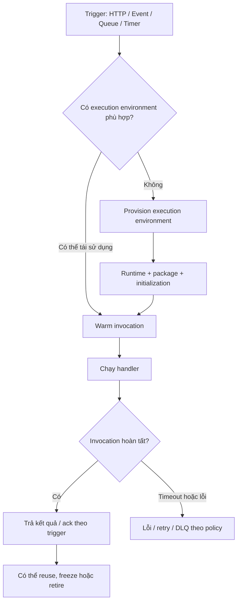
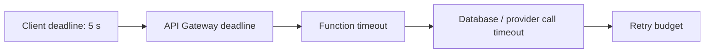
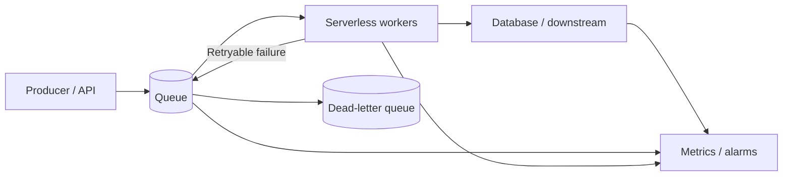
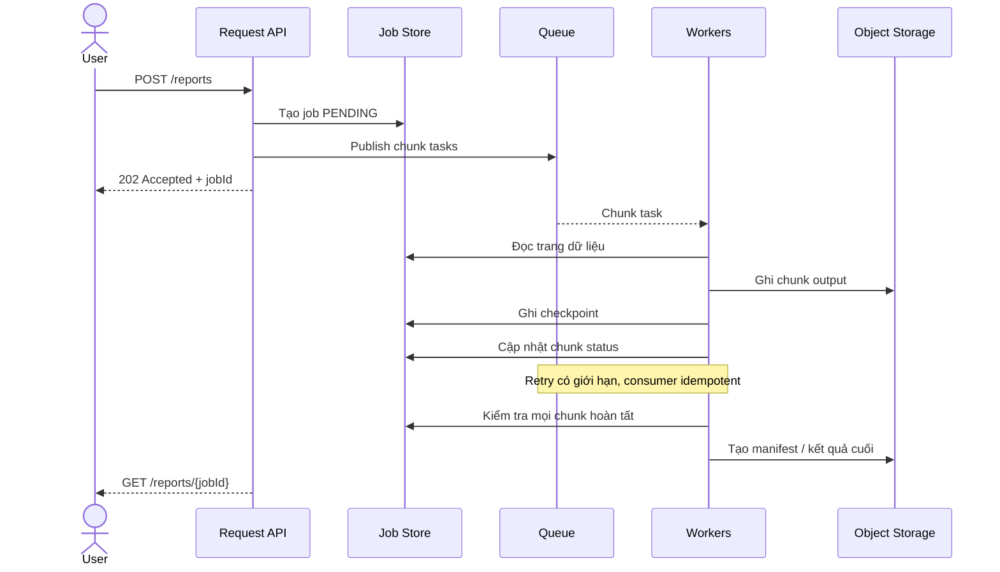

# Độ trễ khởi động, giới hạn thực thi và giới hạn đồng thời

## 1. Vì sao ba giới hạn này quyết định kiến trúc serverless?

Serverless giúp nhóm phát triển tập trung vào chức năng ứng dụng trong khi nhà cung cấp đảm nhận phần lớn việc cấp phát, duy trì và mở rộng hạ tầng thực thi. Tuy nhiên, ứng dụng serverless vẫn chạy trong một môi trường có giới hạn: một lần gọi có thể phải chờ khởi tạo runtime, một function có thể không được chạy lâu hơn deadline cho phép, và hệ thống có thể bị giới hạn số lần thực thi đồng thời hoặc tốc độ gọi.

Ba yếu tố cần hiểu cùng nhau:

- **Độ trễ khởi động (startup latency/cold start):** thời gian để môi trường thực thi sẵn sàng nhận và xử lý một invocation mới, đặc biệt khi nền tảng phải tạo execution environment mới.
- **Giới hạn thực thi (execution limits):** các giới hạn về thời gian chạy, bộ nhớ, CPU, payload, kích thước package, kết nối, số lần gọi hoặc các tài nguyên khác do runtime và dịch vụ quy định.
- **Giới hạn đồng thời (concurrency limits):** số lượng invocation hoặc request có thể được xử lý đồng thời, gồm giới hạn của function, tài khoản, region, event source và dependency.

Trong module **CLOUD_ARCHITECTURE**, chương **Kiến trúc serverless** xem các giới hạn này như đầu vào thiết kế độ tin cậy, hiệu năng, bảo mật, khả năng mở rộng, chi phí và vận hành theo tư duy Well-Architected.

Sau bài học, người học có thể:

1. Giải thích cold start, warm execution, initialization và các nguồn gây startup latency.
2. Phân biệt giới hạn timeout, memory/CPU, payload, concurrency, quota và rate limit.
3. Ước lượng concurrency từ arrival rate và thời gian xử lý.
4. Thiết kế retry, queue, backpressure, reserved/provisioned capacity và giới hạn downstream.
5. Chọn cách xử lý cho tác vụ dài, burst traffic và workload có yêu cầu latency nghiêm ngặt.
6. Thiết lập telemetry, load test, fault test và tiêu chí đánh giá lại giới hạn.

## 2. Một invocation đi qua những giai đoạn nào?

Function thường được kích hoạt bởi HTTP request, event, timer, queue message hoặc một dịch vụ khác. Mô hình tổng quát:

1. **Trigger nhận sự kiện:** nền tảng tiếp nhận request hoặc message, kiểm tra điều kiện kích hoạt.
2. **Tìm execution environment có thể tái sử dụng:** nếu phù hợp, nền tảng có thể đưa invocation vào môi trường đã khởi tạo.
3. **Provisioning:** nếu chưa có môi trường phù hợp, nền tảng cấp phát môi trường thực thi mới.
4. **Initialization:** tải runtime, package, thư viện, cấu hình và thực hiện mã khởi tạo.
5. **Invocation:** chạy handler với input cụ thể.
6. **Kết thúc hoặc chờ tái sử dụng:** môi trường có thể được giữ lại, freeze, scale down hoặc thu hồi theo chính sách nền tảng.



Mô hình chỉ mô tả khái niệm chung. Các nền tảng có thể khác nhau về cách provisioning, runtime reuse, freeze/resume, số invocation trong một environment, cách xử lý event và thời điểm tính timeout. Không giả định một cơ chế của một provider áp dụng cho provider khác.

### 2.1. Cold start và warm invocation

**Cold start** thường dùng để chỉ invocation phải chờ môi trường thực thi được cấp phát và khởi tạo trước khi handler xử lý. **Warm invocation** dùng một environment đã sẵn sàng hoặc được tái sử dụng, nên thường tránh được phần lớn chi phí khởi tạo.

Cold start không nhất thiết xảy ra với mọi lần gọi đầu tiên theo nghĩa toàn hệ thống. Mỗi environment có lifecycle riêng; một function có thể đồng thời có nhiều environment, một số warm, một số mới. Scale-out đột ngột thường tạo thêm environment mới ngay cả khi trước đó đã có invocation warm.

Các yếu tố có thể làm tăng startup latency:

- Runtime hoặc phiên bản runtime cần thời gian khởi tạo.
- Package lớn, nhiều dependency, classpath/module scan hoặc dynamic import.
- Mã khởi tạo kết nối database, gọi secret/config service hoặc tải model.
- VPC/VNet networking, DNS, endpoint hoặc thiết lập kết nối bảo mật tùy nền tảng.
- Extension, instrumentation, tracing agent và logging exporter.
- Khởi tạo SDK, compile/JIT, cache warm-up hoặc tải dữ liệu tham chiếu.
- Tải đồng thời tăng khiến nền tảng phải tạo nhiều environment mới.

Đừng kết luận cold start chỉ do runtime. Một function có runtime nhỏ vẫn có thể khởi động chậm nếu làm nhiều công việc đồng bộ trong initialization.

## 3. Đo latency đúng cách

Thời gian phản hồi mà người dùng cảm nhận bao gồm nhiều hơn thời gian chạy handler:

```text
End-to-end latency =
    trigger / queue delay
  + environment provisioning (nếu có)
  + runtime initialization (nếu có)
  + handler execution
  + downstream dependency time
  + response / acknowledgement overhead
```

Với HTTP function, tổng này xuất hiện trực tiếp ở request latency. Với queue-triggered function, người dùng có thể không chờ HTTP response nhưng độ trễ vẫn ảnh hưởng thời gian xử lý message, tuổi backlog và SLA nghiệp vụ.

### 3.1. Phân biệt các percentile

- **Average/mean:** hữu ích để xem xu hướng tổng quát nhưng có thể che giấu một nhóm request rất chậm.
- **p50:** thời gian mà một nửa request hoàn tất không lâu hơn.
- **p95:** 95% request hoàn tất trong hoặc dưới ngưỡng.
- **p99:** nhạy với tail latency, thường quan trọng với hệ thống có SLO nghiêm ngặt.

Ví dụ giả định:

| Chỉ số | Trước tối ưu | Sau tối ưu |
| --- | ---: | ---: |
| p50 | 90 ms | 85 ms |
| p95 | 1.2 s | 450 ms |
| p99 | 2.8 s | 1.1 s |
| Startup duration của environment mới p95 | 1.5 s | 650 ms |

Trong ví dụ, p50 thay đổi ít nhưng tail latency cải thiện đáng kể. Điều này có thể quan trọng nếu checkout hoặc API tương tác cần phản hồi ổn định. Các số liệu là minh họa, không phải mục tiêu mặc định.

### 3.2. Đo cold start mà không làm sai kết quả

Để đo startup latency cần phân biệt invocation thật sự tạo environment mới với invocation tái sử dụng environment. Có thể dùng log/telemetry initialization của nền tảng, runtime marker hoặc metric chuyên biệt nếu provider cung cấp.

Một phép đo có ích nên:

1. Ghi thời điểm trigger đến, thời điểm handler bắt đầu và thời điểm handler kết thúc.
2. Gắn invocation ID và environment identifier nếu nền tảng cho phép.
3. Phân loại cold/warm dựa trên dấu hiệu đáng tin cậy, tránh suy đoán chỉ từ thời gian lớn.
4. Đo theo runtime, region, memory size, package version và cấu hình mạng.
5. Lặp lại trong các tình huống ít tải, burst và scale-out.
6. Ghi rõ số mẫu và percentile; không kết luận từ một lần gọi.

### 3.3. SLO phải phản ánh hành trình người dùng

Một function có p95 handler 100 ms vẫn có thể làm checkout chậm nếu queue delay 3 giây hoặc payment provider mất 2 giây. Vì vậy hãy đo:

- Tỷ lệ HTTP request hoàn tất trong latency objective.
- Thời gian từ khi event phát sinh đến khi nghiệp vụ hoàn tất.
- Queue age hoặc event age ở thời điểm bắt đầu xử lý.
- Tỷ lệ timeout, retry, duplicate và dead-letter.
- Tỷ lệ giao dịch thành công, không chỉ invocation thành công.

## 4. Giảm cold start bằng cách nào?

Không có một kỹ thuật giảm cold start phù hợp cho mọi function. Cần xác định nguồn gây chậm trước khi thay đổi.

### 4.1. Giảm công việc trong initialization

- Chỉ import dependency thực sự cần cho handler.
- Không tải dữ liệu lớn hoặc thực hiện migration trong mỗi environment initialization.
- Tránh gọi nhiều dịch vụ bên ngoài theo chuỗi khi khởi tạo nếu có thể thực hiện lazy/on-demand.
- Khởi tạo client dùng chung ngoài handler khi runtime có thể tái sử dụng environment, nhưng không dựa vào reuse để giữ state nghiệp vụ.
- Dùng connection reuse/pooling theo giới hạn và semantics của runtime.
- Tối ưu package, image/layer và loại bỏ dependency thừa.
- Đo riêng thời gian class loading, SDK init, secret retrieval và network connection.

**Lưu ý về biến global:** biến static/global có thể tồn tại qua nhiều invocation trong cùng environment, nhưng không phải shared state giữa các environment và có thể biến mất bất cứ lúc nào. Không lưu quyền sở hữu booking, idempotency record hoặc dữ liệu cần độ bền vào biến global.

### 4.2. Chọn runtime và cấu hình tài nguyên phù hợp

Runtime, memory và CPU có thể ảnh hưởng startup lẫn handler execution. Một số nền tảng gắn năng lực CPU với cấu hình memory; tăng memory đôi khi làm function nhanh hơn và tổng thời gian tính phí giảm, dù đơn giá theo thời gian có thể tăng. Phải benchmark thay vì suy đoán từ con số MB.

Thử các cấu hình đại diện:

| Cấu hình | Điều quan sát | Kết luận cần có |
| --- | --- | --- |
| Memory thấp | CPU throttling, GC, startup và handler chậm | Có bị thiếu CPU/RAM không? |
| Memory trung bình | p50/p95, memory peak, duration | Có cân bằng latency và cost tốt không? |
| Memory cao | Thời gian giảm, chi phí mỗi invocation | Hiệu năng tăng có bù chi phí không? |
| Package tối giản | Init duration và cold-start frequency/impact | Dependency nào gây khởi tạo chậm? |
| Kết nối private | DNS/connectivity/init delay | Cần private networking đến đâu, có cải thiện/ảnh hưởng gì? |

### 4.3. Provisioned/pre-warmed capacity

Một số nền tảng cung cấp khả năng giữ sẵn một lượng execution environment đã khởi tạo hoặc mức capacity được chuẩn bị trước. Mục đích là giảm xác suất request phải chờ cold initialization.

Ưu điểm:

- Hữu ích cho traffic có thể dự báo và endpoint yêu cầu latency thấp.
- Giảm tail latency do tạo environment mới trong phạm vi capacity đã chuẩn bị.
- Có thể phù hợp với giờ cao điểm hoặc lịch sự kiện.

Đánh đổi:

- Chi phí capacity nhàn rỗi hoặc chi phí duy trì cao hơn.
- Cần dự báo số environment theo concurrency, không chỉ theo số request/phút.
- Có thể vẫn có cold start khi traffic vượt mức đã chuẩn bị hoặc khi provider phải thay thế environment.
- Không giải quyết downstream latency, queue delay, timeout hay giới hạn tài khoản.

**Provisioned concurrency không phải tên gọi chung cho mọi provider.** Azure Functions có các kiểu hosting và pre-warmed instance khác nhau; Google Cloud Run có minimum instances; AWS Lambda có Provisioned Concurrency. Cơ chế, cách tính phí, startup và scaling semantics phải được kiểm tra theo sản phẩm thực tế.

### 4.4. Scheduled warm-up

Gửi request định kỳ đôi khi được dùng để giữ environment ấm, nhưng đây không phải bảo đảm. Nền tảng có thể retire environment, warm-up không tạo đủ capacity khi burst, và việc ping nhiều lần có thể tăng chi phí mà không cải thiện SLO.

Chỉ dùng warm-up khi provider hỗ trợ/khuyến nghị hoặc có chứng cứ đo lường rằng nó cải thiện trải nghiệm với chi phí hợp lý. Không biến một request giả thành tải nền không kiểm soát.

## 5. Giới hạn thời gian thực thi (timeout)

Function thường có giới hạn thời gian tối đa cho một invocation. Một khi hết deadline, runtime hoặc nền tảng có thể dừng execution; code không có cơ hội bảo đảm hoàn thành cleanup hay commit bước cuối.

Timeout được áp dụng vì:

- Tránh giữ compute vô hạn cho công việc treo.
- Bảo vệ năng lực dùng chung của nền tảng.
- Giúp dịch vụ quản lý được scaling và billing.
- Định nghĩa hợp đồng rõ với client và event source.

### 5.1. Chọn timeout dựa trên phân bố thời gian và hậu quả

Timeout không nên chỉ bằng thời gian trung bình cộng một khoảng tùy ý. Cần xem p95/p99 trong tải mục tiêu, biến động dependency, retry budget và deadline nghiệp vụ.

Ví dụ: một API xử lý ảnh bình thường mất 1.2 giây, p99 là 4 giây. Nếu client deadline là 5 giây nhưng function timeout là 30 giây, khi downstream treo, function vẫn có thể dùng capacity sau khi client đã bỏ cuộc. Nên thiết kế deadline propagation và timeout ở từng hop để công việc dừng trong ngân sách còn lại.

### 5.2. Timeout của các tầng phải phối hợp



Sơ đồ không đề xuất giá trị timeout cụ thể. Nguyên tắc là timeout của downstream phải ngắn hơn thời gian còn lại của caller; có ngân sách cho response/cleanup; không retry khi deadline đã hết. Khi một request có nhiều bước tuần tự, tổng ngân sách cần bao phủ tất cả.

Ví dụ bảng deadline minh họa:

| Thành phần | Timeout minh họa | Vai trò |
| --- | ---: | --- |
| Client | 5.0 s | Giới hạn chờ trải nghiệm |
| API gateway | 4.5 s | Trả kết quả hoặc timeout phía biên |
| Function | 4.0 s | Chừa thời gian xử lý response |
| Payment API call | 1.5 s | Không treo cả function |
| Database operation | 800 ms | Bảo vệ pool và transaction |

Nếu timeout cắt request ngay sau khi phía thanh toán đã xử lý, client không được kết luận giao dịch thất bại và thu tiền lần nữa. Phải có idempotency key, trạng thái pending và đối soát.

### 5.3. Tác vụ dài nên chia thành workflow

Nếu một công việc kéo dài hàng phút hoặc hàng giờ, có nhiều bước chờ bên ngoài hoặc cần resume sau lỗi, đừng cố nhồi vào một function dài. Chia nhỏ thành:

- Các bước xử lý có thể hoàn thành trong giới hạn invocation.
- Queue hoặc workflow orchestrator để lưu trạng thái và điều phối.
- Checkpoint để tiếp tục từ bước đã hoàn thành.
- Retry có giới hạn và bước bù cho side effect.
- Kết quả cuối lưu trong store bền vững.

Ví dụ xử lý báo cáo 100.000 bản ghi: một function có thể tạo manifest và enqueue các chunk; worker xử lý từng chunk, ghi output vào object storage; workflow tổng hợp kết quả cuối. Việc này giúp retry một chunk thay vì chạy lại toàn bộ tác vụ.

## 6. Các giới hạn thực thi khác ngoài timeout

Timeout chỉ là một phần của execution contract. Cần rà soát các giới hạn sau ở đúng dịch vụ, region và gói đang dùng:

| Loại giới hạn | Hệ quả nếu chạm ngưỡng | Thiết kế phòng ngừa |
| --- | --- | --- |
| Memory | Out-of-memory/termination, GC lớn | Profiling, streaming, chunking, chọn memory |
| CPU | Handler chậm hoặc throttled | Benchmark cấu hình, tối ưu thuật toán |
| Package/image size | Deploy/startup fail hoặc init chậm | Giảm dependency, layers/images |
| Request/event payload | Bị từ chối hoặc phải chia dữ liệu | Lưu file lớn ở object storage, truyền reference |
| Runtime duration | Invocation bị timeout | Chia workflow, queue, checkpoint |
| File descriptor/socket | Không tạo thêm kết nối | Connection pooling, đóng tài nguyên |
| Ephemeral disk | Ghi file thất bại hoặc môi trường thiếu dung lượng | Quota, cleanup, streaming, object storage |
| Environment variables/config | Không thể cấu hình hoặc secret vượt giới hạn | Secret/config store có quản lý |
| Concurrency | Throttling hoặc queue backlog | Capacity reservation, backpressure |
| API/request rate | 429/503 từ dependency hoặc gateway | Rate limit, retry policy, load shaping |
| Connection limits | Database/proxy bị quá tải | Pool, proxy, giới hạn fan-out |

Giới hạn có thể là hard limit (không vượt được), soft/quota limit (có thể yêu cầu tăng) hoặc limit vận hành do chính đội đặt ra. Không nên ghi một con số vào tài liệu kiến trúc nếu không rõ nguồn, region, phiên bản và thời điểm xác minh.

### 6.1. Payload lớn và dữ liệu file

Không nên đưa file lớn vào event payload nếu trigger hoặc platform có giới hạn kích thước. Mẫu phổ biến:

1. Client upload file vào object storage bằng đường được ủy quyền.
2. Event chỉ mang object key, version, tenant/reference và metadata tối thiểu.
3. Function đọc stream hoặc xử lý theo chunk.
4. Kết quả lưu vào vị trí bền vững với tên/version ổn định.
5. Event hoàn tất chỉ phát sau khi kết quả được lưu và quyền truy cập đã xác minh.

Cách này giảm áp lực memory, payload và thời gian truyền; đổi lại có thêm dependency storage, IAM và lifecycle file.

## 7. Concurrency: số invocation cùng lúc

**Concurrency** là số invocation đang chạy đồng thời tại một thời điểm. Nó khác với **request rate** (số request mỗi giây) và **throughput** (số công việc hoàn tất mỗi giây).

Một ước lượng ban đầu theo định luật Little:

```text
Average concurrency ≈ arrival rate × average service time

Nếu function nhận 120 invocation/giây
và mỗi invocation trung bình chạy 0.5 giây:

Average concurrency ≈ 120 × 0.5 = 60
```

Đây là trung bình; peak concurrency còn phụ thuộc burst, phân bố service time, queueing, batch size và giới hạn platform. Nếu p95 duration tăng từ 0.5 lên 2 giây trong đợt tải cao, concurrency cần thiết có thể tăng mạnh ngay cả khi request rate không đổi.

### 7.1. Ví dụ tính theo peak

Giả định một API nhận 400 request/giây trong chiến dịch, function xử lý trung bình 250 ms:

```text
Concurrency trung bình ở peak
= 400 × 0.25
= 100 invocation
```

Nếu thời gian trung bình tăng lên 700 ms do database chậm:

```text
Concurrency trung bình mới
= 400 × 0.70
= 280 invocation
```

Chỉ riêng downstream chậm có thể làm concurrency tăng gần 2.8 lần. Khi concurrency tăng, function lại tạo nhiều request tới database, làm database chậm hơn và tạo vòng lặp quá tải.

### 7.2. Giới hạn concurrency bảo vệ hệ thống

Nhiều nền tảng có giới hạn đồng thời ở cấp function, service, project/account và region. Có thể có cấu hình concurrency tối thiểu/tối đa, reserved capacity, max instances, queue consumer concurrency hoặc giới hạn song song theo event source.

Cần phân biệt:

- **Platform/account quota:** tổng năng lực được phép dùng.
- **Function-level cap:** giới hạn một function cụ thể.
- **Reserved capacity/concurrency:** capacity dành riêng hoặc được giữ cho function, theo semantics provider.
- **Provisioned/pre-warmed capacity:** môi trường được chuẩn bị trước nhằm giảm startup delay.
- **Event source parallelism:** số partition, shard, message batch hoặc consumer có thể xử lý.
- **Downstream capacity:** database, cache, payment API và các dịch vụ khác chịu được bao nhiêu kết nối/lệnh.

Không thể giải quyết mọi vấn đề bằng cách tăng quota. Nếu database chỉ chịu được 150 kết nối đồng thời, nâng function concurrency lên 2.000 có thể làm tình hình tệ hơn.

## 8. Reserved, provisioned và maximum concurrency

Tên và semantics khác nhau giữa provider nên cần đọc tài liệu dịch vụ cụ thể. Ở mức khái niệm:

| Cơ chế | Mục tiêu | Điều cần lưu ý |
| --- | --- | --- |
| Maximum concurrency/instances | Đặt trần số invocation/instance | Bảo vệ downstream; có thể tạo queue hoặc throttling |
| Reserved concurrency/capacity | Dành một phần capacity cho workload hoặc giới hạn mức sử dụng của nó | Không đồng nghĩa luôn có environment đã warm |
| Provisioned concurrency/instances | Chuẩn bị trước execution environment/instance | Giảm cold start trong capacity được cấp; tốn chi phí |
| Minimum instances | Giữ ít nhất một số instance sẵn sàng theo cấu hình | Có thể giảm scale-to-zero delay; cách tính phí phụ thuộc sản phẩm |
| Queue consumer concurrency | Giới hạn lượng công việc consumer xử lý song song | Điều khiển backpressure và tác động dependency |

### 8.1. Đặt trần theo năng lực downstream

Ví dụ database được thiết kế chịu tối đa 250 kết nối ứng dụng, dành 80 kết nối cho API nền khác và vận hành, còn lại 170 cho serverless. Nếu mỗi invocation mở một kết nối riêng, function concurrency không nên vượt ngân sách này. Nhưng thiết kế connection pooling/proxy có thể thay đổi quan hệ giữa invocation và DB connection; phải đo số kết nối thực, không áp một tỷ lệ mặc định.

Một phép tính quản trị ban đầu:

```text
Allowed function concurrency
≤ downstream connection budget
  / maximum connections per invocation
```

Sau đó chừa headroom cho burst, reconnect, admin và failover. Nếu một invocation chỉ giữ connection trong một phần thời gian, multiplexing hoặc proxy có thể tăng hiệu quả, nhưng cũng có quota và giới hạn riêng.

### 8.2. Fan-out có thể nhân concurrency

Một request đến function A có thể fan-out ra 10 function B, mỗi B gọi 3 request tới service C. Một đợt 100 request đầu vào có thể tạo tới hàng nghìn hoạt động downstream nếu không giới hạn fan-out.

Thiết kế cần:

- Giới hạn số task song song trong mỗi request.
- Giới hạn concurrency toàn cục cho consumer.
- Dùng semaphore/worker pool hoặc queue có max in-flight phù hợp.
- Chọn batch size tránh tạo burst kết nối.
- Đặt budget deadline và hủy công việc không còn hữu ích.
- Không để một client hoặc tenant chiếm toàn bộ capacity.

## 9. Throttling, backpressure và queueing

Khi yêu cầu đến nhanh hơn khả năng xử lý, hệ thống phải quyết định: chờ, xếp hàng, từ chối hay giảm tốc.

- **Throttling:** từ chối hoặc giới hạn request khi vượt ngưỡng.
- **Backpressure:** báo ngược cho upstream để giảm tốc hoặc ngừng gửi.
- **Queueing:** lưu công việc để xử lý sau, làm phẳng burst.
- **Load shedding:** bỏ hoặc từ chối sớm công việc ít quan trọng khi quá tải.
- **Admission control:** chỉ nhận công việc nếu còn capacity hoặc nếu request đáp ứng chính sách.



Queue giảm nhu cầu phải xử lý mọi request ngay lập tức nhưng không tạo capacity vô hạn. Cần giới hạn tuổi message, dung lượng, tốc độ publish, số consumer, concurrency và chính sách DLQ. Nếu queue age vượt business deadline, công việc được xử lý thành công nhưng đã quá muộn cũng có thể là thất bại nghiệp vụ.

### 9.1. Retry có kiểm soát

Retry phù hợp với lỗi tạm thời như throttling hoặc network reset, nhưng có thể làm overload nặng thêm nếu tất cả client retry cùng lúc.

Chính sách tốt thường có:

- Exponential backoff và jitter.
- Số lần retry tối đa và deadline tổng.
- Phân biệt lỗi retryable với lỗi nghiệp vụ không thể retry.
- Idempotency cho side effect.
- DLQ hoặc cơ chế quarantine.
- Cảnh báo theo tuổi message và tỷ lệ lỗi, không chỉ số lần retry.

Không retry một thao tác thanh toán không rõ kết quả bằng một transaction key mới. Trước hết cần tra cứu/đối soát kết quả theo reference idempotent.

### 9.2. Batch size và hiệu quả xử lý

Một consumer có thể lấy batch nhiều message để giảm overhead. Batch quá nhỏ làm tăng overhead và invocation; batch quá lớn có thể tăng memory, thời gian xử lý, retry blast radius và timeout. Phải benchmark theo payload size, service time, khả năng xử lý song song và semantics của event source.

Nếu batch có một message lỗi, kiểm tra provider có hỗ trợ partial batch failure không. Nếu không, một message lỗi có thể khiến toàn bộ batch được retry, tạo xử lý trùng cho các phần đã hoàn tất.

## 10. Scale-out và scale-in trong thực tế

Serverless thường tự động điều chỉnh số environment/instance theo tải, nhưng scaling không tức thì, không vô hạn và không độc lập với quota.

### 10.1. Scale-out

Khi burst đến:

1. Platform nhận thêm event/request.
2. Environment warm hiện có nhận một phần tải nếu còn capacity.
3. Platform tạo thêm environment/instance theo policy.
4. Invocation mới có thể trải qua cold start.
5. Downstream nhận nhiều kết nối và truy vấn hơn.

Nếu scale-out nhanh hơn khả năng mở rộng của database hoặc API đối tác, hệ thống bị nghẽn ở downstream.

### 10.2. Scale-in

Khi tải giảm, platform có thể thu hồi environment. Không được dựa vào việc process sẽ được thông báo trước trong mọi tình huống. Durable state cần nằm ngoài environment; message phải có ack/retry semantics; file tạm phải có thể tái tạo.

### 10.3. Burst và ramp-up

Hai workload có cùng request trung bình có thể có hành vi rất khác:

- 100 request/s đều đặn.
- 0 request/s trong 59 giây rồi 6.000 request dồn trong một giây.

Cả hai có thể có trung bình gần nhau theo phút nhưng trường hợp thứ hai cần capacity, concurrency và downstream burst handling khác hẳn. Load test phải dùng phân bố request thật, không chỉ mức RPS trung bình.

## 11. Những pattern xử lý tác vụ dài

### 11.1. Queue-based worker

API xác thực request, ghi công việc vào queue và trả job ID; worker lấy message xử lý trong giới hạn invocation. Client tra cứu trạng thái qua API khác.

Phù hợp với tác vụ không cần phản hồi ngay như tạo báo cáo, xử lý ảnh, import dữ liệu hoặc gửi thông báo. Cần state store cho job status, retry idempotent, queue age và DLQ.

### 11.2. Workflow orchestration

Nếu công việc có nhiều bước, chờ người duyệt, delay hoặc bù trừ, dùng workflow orchestrator để lưu state và điều phối từng bước function/service. Không giữ một invocation mở trong lúc chờ nhiều phút hoặc nhiều giờ nếu nền tảng tính phí và timeout theo thời gian chạy.

### 11.3. Chunking và checkpoint

Chia dữ liệu lớn thành chunk có ID ổn định; mỗi chunk có trạng thái, retry và output riêng. Checkpoint ghi lại phần hoàn thành để không xử lý lại toàn bộ khi một bước lỗi.

### 11.4. Streaming

Với xử lý dữ liệu liên tục, streaming platform có thể phù hợp hơn function request/response đơn lẻ. Phải xét partitioning, consumer group, ordering, checkpoint/offset, replay và retention.

## 12. Ví dụ thiết kế: API tạo báo cáo

Giả sử người dùng yêu cầu báo cáo từ 2 triệu dòng dữ liệu. Một function đồng bộ đọc toàn bộ dữ liệu, tạo CSV và trả file trong một request có nguy cơ vượt timeout, memory và payload limit.

Thiết kế tách việc:



Job store lưu trạng thái có thẩm quyền như PENDING, RUNNING, PARTIAL, COMPLETED, FAILED; output lưu trong object storage; queue chỉ điều phối công việc. API trả 202 không có nghĩa báo cáo đã hoàn tất. Người dùng tra cứu job ID hoặc nhận notification khi hoàn thành.

### 12.1. Chọn kích thước chunk

Chunk quá lớn có thể timeout hoặc dùng memory cao; chunk quá nhỏ làm tăng số message và overhead. Hãy benchmark với dữ liệu thực và đặt:

- Số record hoặc bytes mỗi chunk.
- Thời gian xử lý mục tiêu nhỏ hơn timeout với margin.
- Số chunk song song không vượt DB/query capacity.
- Idempotency key theo report ID và chunk ID.
- Checkpoint và cách xử lý một chunk thất bại lặp.
- Cleanup output tạm và lifecycle của file trung gian.

## 13. Kết hợp concurrency với database và cache

Một function scale tốt có thể trở thành nguồn gây quá tải cho database:

- Mỗi invocation tạo pool riêng làm bùng số connection.
- Fan-out truy vấn nhiều bảng hoặc gọi nhiều API bên ngoài.
- Cold start đồng loạt gây connection storm.
- Retry tăng gấp nhiều lần số query.
- Một tenant gửi burst lớn, chiếm hết capacity.

Cách giảm rủi ro:

1. Sử dụng connection proxy/pooler phù hợp với serverless và database.
2. Đặt function concurrency cap theo connection budget.
3. Giảm thời gian giữ connection và transaction.
4. Tối ưu query/index và dùng pagination/chunking.
5. Cache dữ liệu ít thay đổi nhưng xác định TTL và nguồn có thẩm quyền.
6. Tách read/write workload hoặc dùng read replica khi phù hợp.
7. Có queue và admission control cho công việc nền.
8. Đo connection count, wait time, lock, IOPS và p95/p99 query latency.

**Tăng concurrency không phải cách chữa database chậm.** Khi bottleneck ở DB, tăng invocation chỉ làm nhiều công việc xếp hàng và chi phí cao hơn.

## 14. Rate limit với đối tác và fairness giữa tenant

Một payment provider có thể cho phép 100 request/s, trong khi function platform có thể chạy hàng nghìn invocation đồng thời. Nếu mọi invocation gọi provider trực tiếp, dễ nhận 429/throttling.

Các chiến lược:

- Queue outbound call và giới hạn số consumer theo rate budget.
- Dùng token bucket/leaky bucket hoặc distributed rate limiter phù hợp.
- Tách queue hoặc quota theo tenant/priority.
- Có circuit breaker khi provider lỗi liên tục.
- Retry 429 theo Retry-After nếu được cung cấp, cộng jitter.
- Lưu trạng thái pending để workflow tiếp tục sau.
- Có công cụ manual reconciliation cho giao dịch không rõ kết quả.

Fairness có nghĩa một tenant hoặc loại tác vụ không thể chiếm toàn bộ function concurrency, queue capacity hoặc quota của dependency. Có thể áp giới hạn theo tenant, priority queue, weighted fair scheduling hoặc giới hạn request ở API gateway.

## 15. Chọn cách triển khai theo dạng tải và yêu cầu latency

| Workload | Đặc điểm | Hướng lựa chọn cần cân nhắc |
| --- | --- | --- |
| API tương tác | Latency thấp, traffic có thể biến động | Giảm init, capacity đã chuẩn bị cho giờ cao điểm, giới hạn concurrency, giữ endpoint gần client |
| Event burst | Sự kiện dồn theo đợt, có thể xử lý sau | Queue, batch, backpressure, consumer scaling |
| Scheduled batch | Có lịch, khối lượng lớn, thời gian dự kiến | Chunking, workflow, batch service hoặc compute chuyên dụng |
| Long-running process | Chạy lâu, giữ bộ nhớ/trạng thái, cần signal | Container/worker/service phù hợp thay vì ép vào invocation ngắn |
| Streaming | Dữ liệu liên tục, cần ordering/checkpoint | Streaming service với consumer group và offset |
| Workload latency rất nhạy | p99 phải nhỏ, startup ảnh hưởng lớn | Provisioned/pre-warmed capacity hoặc service luôn chạy nếu TCO hợp lý |
| Workload không dự báo | Traffic thay đổi mạnh, ưu tiên scale theo demand | Scale-to-zero có thể hợp lý nếu cold start chấp nhận được |

Serverless không phải lựa chọn mặc định tốt nhất. Với workload liên tục, CPU cao, thời gian chạy dài hoặc latency yêu cầu nghiêm ngặt, container/service luôn chạy có thể đơn giản và rẻ hơn. Hãy so TCO và vận hành trên cùng một SLO.

## 16. Bảo mật khi tăng concurrency và xử lý event

Concurrency cao làm tăng số lần xử lý đồng thời, nên các lỗi phân quyền, race condition và lộ secret có thể lan rộng nhanh hơn.

- Dùng workload identity/role cho từng function hoặc nhóm năng lực; quyền tối thiểu đến queue, object, secret, database.
- Không dùng một credential quản trị chung cho mọi function.
- Xác thực và ủy quyền cho event/webhook; không tin payload chỉ vì nó đến qua queue.
- Giới hạn input size, validate schema và tenant scope.
- Idempotency và transaction chống xử lý trùng side effect.
- Không ghi token, payload PII hoặc secret vào logs.
- Kiểm soát retry và DLQ: message độc hại không được tạo vòng lặp vô hạn.
- Cô lập function xử lý dữ liệu nhạy cảm với mạng/quyền phù hợp.
- Theo dõi concurrency theo tenant và hành vi bất thường.

Một function gọi được secret store không có nghĩa payload của nó đáng tin. Authentication nguồn event, schema validation, replay protection và authorization nghiệp vụ vẫn cần thiết.

## 17. Chi phí: duration, memory, concurrency và idle capacity

Mô hình chi phí serverless tùy sản phẩm nhưng thường liên quan tới số request/invocation, thời gian chạy, memory/CPU hoặc tài nguyên instance, cấu hình capacity chuẩn bị trước, network transfer và các dịch vụ phụ trợ.

Một mô hình đơn giản để ước lượng:

```text
Compute usage ≈ invocation_count × billed_duration × configured_resource_size

Total cost ≈ compute usage cost
           + request/event cost
           + provisioned/minimum capacity cost
           + network/data transfer
           + queue, storage, logs, monitoring and workflow costs
```

Ví dụ giả định để học cách so sánh:

- 10 triệu invocation trong tháng.
- Mỗi invocation dùng 512 MB và chạy trung bình 300 ms.
- Billed duration trong ví dụ được giả định bằng execution time để đơn giản hóa.

```text
Memory-time ≈ 10,000,000 × 0.5 GB × 0.3 s
            = 1,500,000 GB-seconds
```

Con số không phải báo giá, không tính free tier, request charge, CPU model, rounding, duration floor, provisioned capacity, log hoặc data transfer. Cần dùng calculator/tài liệu giá hiện hành của provider đã chọn.

### 17.1. Tối ưu theo chi phí trên mỗi kết quả nghiệp vụ

Không chỉ giảm duration. Một function chạy cực nhanh nhưng retry 20% hoặc thường xuyên thất bại có thể có chi phí trên mỗi job thành công cao.

Đo:

- Chi phí trên một report hoàn tất hoặc booking xác nhận.
- Tỷ lệ retry và số lần chạy lặp.
- Tỷ lệ invocation timeout/failure.
- Phần capacity chuẩn bị trước thực sự được sử dụng.
- Phí queue, object storage, logging và data transfer.
- Cost do downstream bị quá tải và các lần xử lý lại.

### 17.2. Đánh đổi cold start và chi phí

Giữ sẵn nhiều capacity giảm startup latency nhưng trả chi phí khi không có tải; scale-to-zero tiết kiệm idle capacity nhưng có thể tăng tail latency. Một chiến lược hỗn hợp có thể giữ capacity theo giờ cao điểm, scale thấp ngoài giờ và dùng queue cho xử lý nền. Cần chứng minh bằng traffic pattern và SLO, không chọn dựa trên cảm giác.

## 18. Observability và cảnh báo

Metric nên phản ánh cả platform và nghiệp vụ:

| Nhóm | Metric | Ý nghĩa |
| --- | --- | --- |
| Startup | cold start count/rate, init duration | Mức ảnh hưởng của khởi tạo mới |
| Latency | handler duration, end-to-end latency, p95/p99 | Chất lượng trải nghiệm |
| Execution | timeout, error, OOM, throttling | Invocation không hoàn thành |
| Concurrency | current/max concurrency, utilization, rejected | Có chạm giới hạn không |
| Queue | age, depth, receive count, DLQ | Công việc có bị tồn hoặc xử lý lại không |
| Dependency | DB connection, query latency, provider 429/5xx | Nút thắt downstream |
| Cost | billed duration, invocation count, provisioned utilization | Hiệu quả chi phí |
| Business | jobs completed, jobs overdue, bookings confirmed | Giá trị thực tế được hoàn thành |

### 18.1. Cảnh báo theo hành động

Cảnh báo có thể kích hoạt khi:

- p95/p99 vượt SLO liên tục trong cửa sổ đo.
- Queue age vượt business deadline.
- Concurrency tiến gần hard quota hoặc configured cap.
- Throttling/429 tăng bất thường.
- Tỷ lệ timeout hoặc cold start ảnh hưởng đến user journey.
- DLQ có message mới hoặc backlog tăng.
- Payment/booking/report ở trạng thái pending quá lâu.
- Session/DB connection hoặc object storage error vượt ngưỡng.

Mỗi alert nên có owner, runbook và hành động cụ thể. Cảnh báo “concurrency 80%” chưa đủ nếu không biết dependency đang chịu tải ra sao.

## 19. Load test và kiểm thử lỗi

Một bộ kiểm thử nên mô phỏng cả phân bố tải lẫn lỗi:

| Kịch bản | Thiết kế test | Điều kiện đạt |
| --- | --- | --- |
| Cold start | Tạo môi trường mới hoặc dùng cơ chế test phù hợp, đo nhiều mẫu | Có phân bố init duration và ảnh hưởng p95/p99 |
| Burst | Tăng request theo bậc rồi đột biến | SLO và downstream limit không bị phá vỡ |
| Concurrency cap | Đặt cap thấp hơn tải đầu vào | Throttling/queue/backpressure theo policy, không mất event |
| Dependency chậm | Database/provider tăng latency | Timeout budget và circuit breaker hoạt động |
| Retry storm | Tạo lỗi tạm thời đồng loạt | Backoff/jitter giảm tải thay vì khuếch đại |
| Timeout giữa workflow | Dừng invocation giữa bước | State bền, retry tiếp tục an toàn |
| Duplicate event | Gửi lại cùng event nhiều lần | Không tạo side effect trùng |
| DLQ | Gửi payload lỗi không thể xử lý | Cô lập và cảnh báo, có quy trình redrive |
| Capacity prepared | Traffic vượt mức capacity chuẩn bị trước | Phần vượt xử lý theo thiết kế, chi phí/latency hiểu rõ |
| Downstream saturation | DB/provider đạt giới hạn | Concurrency được bảo vệ, không tạo connection storm |

Load test không nên chỉ giữ RPS cố định trong 30 giây. Hãy thử ramp-up, burst, soak test dài, skew theo tenant, payload nhỏ/lớn và workload mix thực tế.

## 20. Quy trình thiết kế giới hạn cho function mới

1. **Mô tả trigger và mục tiêu:** synchronous API, queue event, timer hay streaming.
2. **Đặt deadline đầu-cuối:** xác định client/business deadline, latency SLO và phần thời gian dành cho từng dependency.
3. **Benchmark startup:** đo cold/warm initialization theo runtime, package, memory và network.
4. **Xác định execution ceiling:** timeout, memory, payload, temporary disk, file descriptor, package và quota.
5. **Ước lượng concurrency:** dùng peak arrival rate × service time, thêm burst/headroom.
6. **Tính downstream budget:** database connection, provider rate limit, storage throughput và API quota.
7. **Chọn scale/backpressure:** maximum concurrency, queue, batch, reserved/pre-warmed capacity và admission control.
8. **Thiết kế retry/idempotency:** phân loại lỗi, DLQ, deduplication, checkpoint và reconciliation.
9. **Đặt telemetry:** startup, duration, concurrency, throttling, queue age, cost và business completion.
10. **Thử tải và lỗi:** mô phỏng scale-out, dependency slow, timeout, duplicate và capacity exhaustion.
11. **Ghi ADR:** lựa chọn, đánh đổi, chi phí và điều kiện xem lại.

## 21. Tình huống thực hành: hệ thống checkout serverless

**Bối cảnh:** Một nền tảng bán vé dùng HTTP function để nhận checkout, queue-triggered worker xác nhận thanh toán và function khác gửi email. Trong đợt mở bán, traffic có thể tăng từ 20 request/s lên 700 request/s trong vài giây. Database chịu ổn định khoảng 180 connection từ nhóm ứng dụng; payment provider có rate budget 120 request/s. p95 mục tiêu của API tạo checkout là 800 ms; việc xác nhận cuối có thể bất đồng bộ nhưng phải tra cứu được.

### 21.1. Rủi ro

- Burst làm platform tạo nhiều environment mới; cold start tăng.
- Concurrency API tăng nhanh tạo connection storm lên DB.
- Worker thanh toán gọi provider vượt 120 request/s và nhận 429.
- Retry đồng loạt làm tải nặng thêm.
- Timeout sau khi provider đã xử lý khiến client gửi checkout lại.
- Email chậm có thể làm queue backlog nhưng không được làm sai trạng thái vé.

### 21.2. Phương án thiết kế

- API validate request, dùng idempotency key và ghi checkout state bền trong transaction.
- Chỉ giữ synchronous path cho thao tác cần phản hồi ngay; xác nhận thanh toán theo state machine có thể là workflow bất đồng bộ.
- Đặt maximum concurrency cho API theo DB connection budget; cân nhắc proxy/pooler và chỉ mở connection khi cần.
- Đặt queue cho payment processing, giới hạn consumer concurrency/rate để nằm trong budget của provider.
- Dùng retry theo backoff/jitter, DLQ cho lỗi không thể xử lý và reconciliation cho trạng thái không rõ.
- Email là consumer độc lập, có thể retry và deduplicate; không chặn kết quả checkout.
- Đánh giá prepared capacity cho endpoint tương tác trong giờ mở bán theo số concurrency dự báo.
- Theo dõi p95/p99, queue age, concurrency, DB connections, provider 429, trạng thái checkout và cost per confirmed sale.

### 21.3. Bài kiểm thử

| Bài thử | Cách thực hiện | Điều kiện đạt |
| --- | --- | --- |
| Burst 700 RPS | Ramp từ 20 lên 700 trong thời gian ngắn | API giữ SLO hoặc từ chối có kiểm soát theo policy |
| Database cap | Giới hạn connection budget thấp hơn concurrency demand | Function không làm DB quá tải; queue/backpressure hoạt động |
| Provider rate limit | Mock provider trả 429 theo budget | Consumer điều tiết rate, retry có jitter |
| Ambiguous timeout | Provider xử lý nhưng response bị drop | Không thu tiền trùng; checkout có thể đối soát |
| Cold start | So sánh no-prewarm và prepared capacity | Thấy tác động lên p95/p99 và TCO |
| Queue backlog | Dừng worker có chủ đích rồi khởi động lại | Event không mất; tuổi backlog giảm về mục tiêu |
| Duplicate checkout | Gửi cùng key nhiều lần đồng thời | Một kết quả logic duy nhất |

## 22. ADR mẫu: giới hạn concurrency để bảo vệ dependency

```text
ADR-041: Đặt concurrency budget và queue cho payment worker

Bối cảnh:
- Checkout có burst traffic lớn.
- Database và payment provider có capacity thấp hơn mức scale tối đa
  mà function platform có thể tạo.
- Kết quả thanh toán có thể bất đồng bộ và phải đối soát.

Lựa chọn:
A. Để function tự scale tối đa theo quota.
B. Giới hạn concurrency, đưa payment work vào queue, điều tiết consumer.
C. Tăng concurrency và tăng retry khi provider từ chối.

Quyết định:
- Chọn B.
- API ghi trạng thái và event có idempotency.
- Worker concurrency/rate được đặt theo dependency budget.
- Retry dùng exponential backoff + jitter; lỗi kéo dài chuyển DLQ.
- Workflow reconciliation xử lý kết quả không rõ.

Đánh đổi:
- Queue tăng latency xác nhận cuối.
- Cần vận hành backlog, DLQ và state trung gian.
- Capacity có thể không tận dụng tối đa trong mọi thời điểm.

Kiểm chứng:
- Load test burst, provider 429, DB saturation và event duplicate.
- Đo end-to-end latency, queue age và cost per completion.
- Xác nhận không có charge/booking logic trùng.

Điều kiện xem lại:
- Quota dependency thay đổi.
- Workload/latency SLO thay đổi.
- Có cơ chế pool/throughput mới hoặc kiến trúc payment thay đổi.
```

## 23. Các lỗi thiết kế thường gặp

1. **Chỉ đo handler duration:** bỏ sót trigger delay, cold start, queue age và downstream time.
2. **Coi warm-up ping là bảo đảm:** environment vẫn có thể bị retire; ping có thể chỉ tăng chi phí.
3. **Tăng memory mà không benchmark:** chưa chắc giảm latency hoặc TCO.
4. **Đặt timeout dài tùy ý:** invocation giữ capacity sau khi client bỏ cuộc.
5. **Ép tác vụ dài vào function:** dễ timeout, khó checkpoint và phải làm lại toàn bộ.
6. **Để concurrency tự tăng không giới hạn theo dependency:** gây connection storm và 429.
7. **Retry ngay lập tức khi lỗi:** tạo retry storm và khuếch đại quá tải.
8. **Không idempotent:** timeout/duplicate tạo side effect lặp.
9. **Batch quá lớn:** tăng memory, duration và phạm vi retry.
10. **Nhầm request rate với concurrency:** không tính đến service time và burst.
11. **Dùng provisioned capacity nhưng không dự báo:** trả phí nhàn rỗi hoặc vẫn thiếu khi vượt capacity.
12. **Không đặt DLQ/queue age alarm:** event lỗi bị kẹt mà không ai phát hiện.
13. **Dựa vào local environment state:** mất cache/session khi environment bị thay thế.
14. **Chỉ kiểm thử steady-state:** bỏ qua burst, cold starts, scale-out và downstream degradation.
15. **Tối ưu invocation thành công mà bỏ qua nghiệp vụ:** response nhanh nhưng booking/payment không hoàn tất đúng.

## 24. Checklist trước production

- [ ] Đã đo startup/cold-start và warm latency ở runtime, memory và network configuration đã chọn.
- [ ] Có p50/p95/p99 cho handler và end-to-end user journey.
- [ ] Timeout của client, gateway, function và downstream phối hợp theo deadline budget.
- [ ] Tác vụ vượt execution limit đã được chia chunk hoặc chuyển workflow/worker phù hợp.
- [ ] Đã ghi lại hard limit, quota và soft limit của dịch vụ theo region/plan.
- [ ] Concurrency được ước lượng từ peak arrival rate và service time, có headroom cho burst.
- [ ] Maximum/reserved/provisioned/minimum capacity được phân biệt đúng semantics provider.
- [ ] Dependency connection budget và provider rate limit có kiểm soát.
- [ ] Queue, batch, backpressure, admission control và DLQ được cấu hình theo business deadline.
- [ ] Retry có giới hạn, exponential backoff/jitter và phân loại lỗi.
- [ ] Side effect quan trọng có idempotency, deduplication và reconciliation.
- [ ] Session/business state không dựa vào execution environment.
- [ ] Metrics và alerts bao gồm latency, timeout, throttling, concurrency, queue age và business completion.
- [ ] Load test có burst, soak, dependency slow, duplicate và scale-out.
- [ ] Chi phí bao gồm invocation, duration, resource size, prepared capacity, queue, logs và data transfer.
- [ ] Có owner, runbook và điều kiện xem lại quota/SLO khi tải tăng.

---

**Ghi nhớ:** Serverless có thể tự mở rộng môi trường thực thi, nhưng không loại bỏ giới hạn của runtime, thời gian, quota và dependency. Cold start ảnh hưởng tail latency; timeout xác định hợp đồng của một lần thực thi; concurrency quyết định áp lực lên toàn bộ hệ thống. Thiết kế tốt phải đo end-to-end, giới hạn tải theo năng lực downstream, dùng queue/backpressure và idempotency, đồng thời chọn capacity chuẩn bị trước khi lợi ích latency xứng đáng với chi phí.
