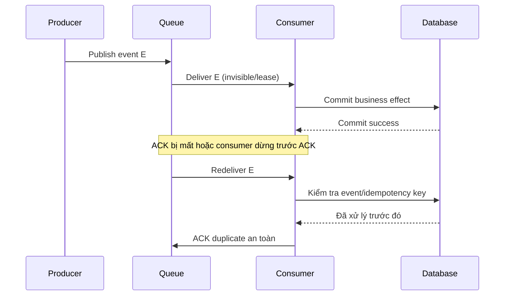
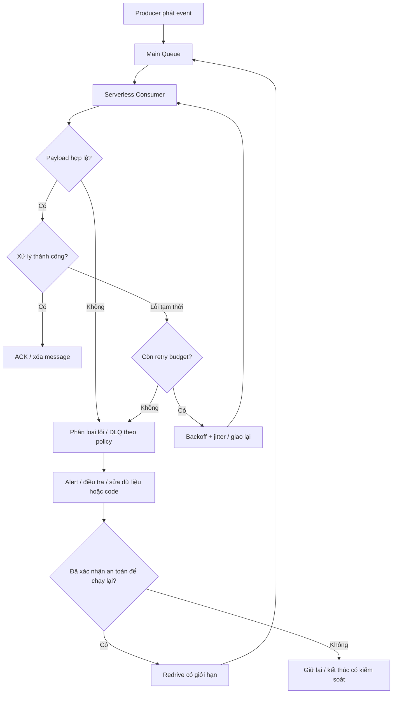
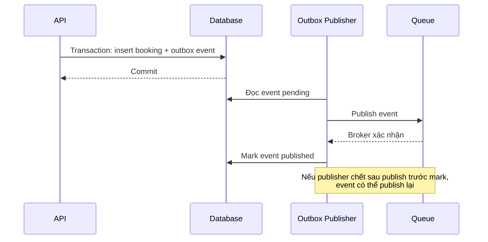
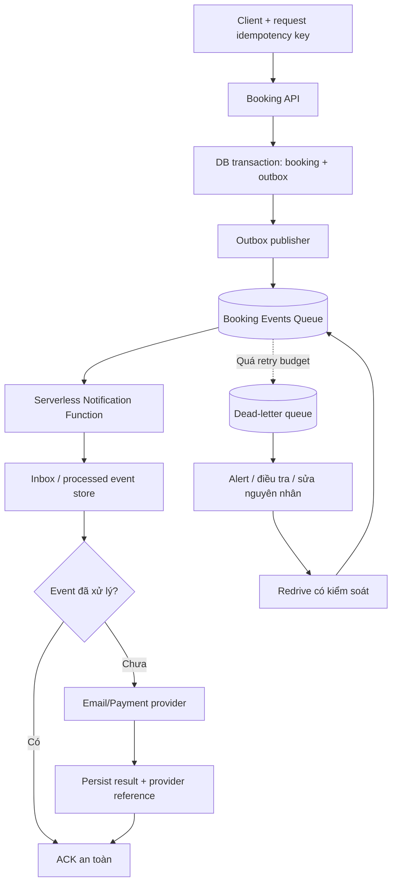

# Retry, hàng đợi lỗi và xử lý sự kiện trùng lặp

## 1. Vì sao hệ thống serverless phải thiết kế cho retry và duplicate?

Trong kiến trúc serverless, một sự kiện thường được truyền qua nhiều thành phần độc lập: API nhận yêu cầu, dịch vụ phát sự kiện, hàng đợi, function/worker và hệ thống lưu trữ hoặc đối tác bên ngoài. Các thành phần có thể tạm thời mất kết nối, quá thời gian chờ, bị giới hạn quota, khởi động lại hoặc trả về lỗi. Nền tảng thường có cơ chế thử gửi lại để tránh mất việc; vì thế cùng một sự kiện có thể đến consumer nhiều lần.

Hãy xét người dùng bấm **Đặt lịch**. API tạo bản ghi lịch, phát sự kiện `BookingCreated`, rồi một function gửi email xác nhận và yêu cầu dịch vụ thanh toán xử lý khoản đặt cọc. Nếu function đã gửi email nhưng mất kết nối trước khi báo thành công, queue có thể gửi lại sự kiện. Nếu function tạo thêm một giao dịch thanh toán ở lần retry, người dùng có thể bị tính tiền hai lần.

Do đó, cần thiết kế cùng lúc ba cơ chế:

- **Retry:** thử lại thao tác khi lỗi có khả năng tạm thời, với giới hạn và thời gian chờ phù hợp.
- **Dead-letter queue (DLQ):** cô lập sự kiện đã thất bại theo chính sách để điều tra và xử lý có kiểm soát.
- **Idempotency/deduplication:** đảm bảo xử lý cùng một yêu cầu hoặc sự kiện nhiều lần không tạo thêm tác động nghiệp vụ ngoài ý muốn.

Bài học thuộc chương **Kiến trúc serverless** của module **CLOUD_ARCHITECTURE**. Nội dung tập trung vào cách xây dựng xử lý sự kiện đáng tin cậy, cân bằng độ trễ, thông lượng, bảo mật, chi phí và vận hành.

Sau bài này, bạn có thể:

- Phân biệt at-most-once, at-least-once và các bảo đảm xử lý trong hệ thống phân tán.
- Phân loại lỗi tạm thời và lỗi không thể tự phục hồi; thiết kế retry/backoff/jitter và giới hạn retry.
- Thiết kế DLQ, quy trình redrive và xử lý poison message.
- Tạo idempotency key, deduplication store và giao dịch ghi dữ liệu an toàn.
- Giải thích transactional outbox/inbox, thứ tự sự kiện, lease/visibility timeout.
- Kiểm thử các tình huống function chạy lại, timeout sau khi đã tạo side effect và sự kiện đến trùng hoặc sai thứ tự.

## 2. Hiểu delivery semantics trước khi viết retry

Trong hệ thống phân tán, producer và consumer có thể không biết chắc phía bên kia đã hoàn tất một thao tác hay chưa. Ví dụ consumer đã commit database nhưng response ACK bị mất. Queue chỉ nhìn thấy không có ACK và có thể giao lại message; consumer không thể kết luận lần trước chưa xử lý.

### 2.1. Ba kiểu giao nhận thường gặp

| Kiểu | Ý nghĩa | Hệ quả |
|---|---|---|
| **At-most-once** | Mỗi message được giao/xử lý tối đa một lần theo cơ chế của hệ thống | Có thể mất message nếu lỗi xảy ra trước khi xử lý hoặc ACK |
| **At-least-once** | Hệ thống tiếp tục giao lại khi chưa nhận được xác nhận thành công | Message có thể được giao nhiều lần; consumer phải chịu duplicate |
| **Exactly-once** | Bảo đảm một tác động được thực hiện đúng một lần trong phạm vi xác định | Chỉ khả thi khi định nghĩa rõ ranh giới, trạng thái và phối hợp giao dịch; không thể suy ra chỉ từ tên một tính năng queue |

**Điểm quan trọng:** nhiều dịch vụ hàng đợi/event-driven phổ biến cung cấp mô hình at-least-once hoặc có thể giao trùng trong một số tình huống. Cần đọc semantics chính xác của dịch vụ cụ thể: thời điểm ACK, visibility timeout, retention, thứ tự, redelivery, retry của event source và hành vi khi function timeout.

“Exactly-once delivery” và “exactly-once business effect” cũng là hai điều khác nhau. Một message có thể đến đúng một lần trong broker nhưng ứng dụng vẫn tạo side effect hai lần do client retry. Ngược lại, message đến nhiều lần nhưng consumer có idempotency tốt vẫn có thể tạo đúng một kết quả nghiệp vụ.

### 2.2. ACK, visibility và redelivery

Ở một số queue, khi message được consumer nhận, nó trở nên **invisible** với consumer khác trong một khoảng thời gian (visibility timeout hoặc lease). Consumer xử lý xong và ACK/delete message thì queue loại bỏ nó. Nếu timeout hết trước khi ACK, message có thể được giao lại.



Trong hình, database commit thành công nhưng ACK không đến queue; lần giao thứ hai phải nhận biết sự kiện đã hoàn tất và không tạo side effect lần nữa.

Visibility timeout/lease phải phù hợp với thời gian xử lý. Nếu ngắn hơn thời gian function chạy, một message có thể đồng thời được giao cho nhiều consumer. Nếu quá dài, message thất bại có thể mất nhiều thời gian mới được giao lại. Một số dịch vụ hỗ trợ gia hạn visibility hoặc heartbeat; cần xử lý trường hợp function chết và không còn khả năng gia hạn.

## 3. Phân loại lỗi: không phải lỗi nào cũng nên retry

Retry chỉ có ích khi **lỗi có khả năng biến mất** và thao tác được phép thực hiện lại. Retry lỗi cấu hình hoặc dữ liệu sai chỉ kéo dài sự cố, tăng chi phí và làm nghẽn hệ thống.

### 3.1. Lỗi tạm thời (transient)

Ví dụ:

- Network reset, connection timeout ngắn, DNS tạm thời không phân giải được.
- Dịch vụ phụ thuộc trả HTTP 429 (rate limited) hoặc một số mã 5xx.
- Database đang chuyển primary, connection pool tạm cạn hoặc lock contention có thể giải tỏa.
- Function bị throttling do tải tăng đột ngột nhưng quota/capacity sẽ phục hồi.

Với các lỗi này, có thể retry sau thời gian chờ, giới hạn số lần và tôn trọng tín hiệu từ dependency như `Retry-After` khi có.

### 3.2. Lỗi vĩnh viễn hoặc cần sửa dữ liệu (permanent)

Ví dụ:

- Schema hoặc payload không hợp lệ, trường bắt buộc bị thiếu.
- Không hỗ trợ phiên bản event, chữ ký webhook sai hoặc dữ liệu không vượt qua validation.
- Danh tính không đủ quyền (403) hoặc tài nguyên đã bị xóa/đổi tên.
- Nghiệp vụ bị từ chối hợp lệ, ví dụ lịch đã hết chỗ.

Retry liên tục thường không sửa được các lỗi này. Nên ghi nguyên nhân, đưa vào nhánh xử lý phù hợp hoặc DLQ để điều tra; lỗi nghiệp vụ hợp lệ có thể được đánh dấu là đã xử lý theo quy ước để tránh queue lặp mãi.

### 3.3. Lỗi không rõ kết quả (ambiguous outcome)

Đây là nhóm nguy hiểm: consumer gửi lệnh ghi hoặc gọi API thành công ở phía đích, nhưng timeout trước khi nhận response. Không thể biết chắc side effect đã xảy ra hay chưa. Ví dụ:

- Gửi lệnh charge payment, đối tác đã xử lý nhưng response bị mất.
- Database đã commit nhưng kết nối bị cắt trước khi client nhận xác nhận.
- Gửi email thành công nhưng function bị terminate trước khi ACK queue.

Không được xem timeout là bằng chứng thao tác thất bại. Cách xử lý là dùng idempotency key, tra cứu trạng thái theo request ID hoặc gọi API đối tác có hỗ trợ idempotency/status query trước khi quyết định thực hiện lại.

## 4. Thiết kế retry: giới hạn, backoff và jitter

### 4.1. Exponential backoff

Thay vì retry ngay lập tức, exponential backoff tăng thời gian chờ sau mỗi lần thất bại:

\[
delay_n = \min(delay_{max},\ delay_{base}\times 2^n)
\]

Ví dụ `delay_base = 1 giây`, `delay_max = 30 giây`:

| Lần retry | Thời gian chờ không tính jitter |
|---:|---:|
| 1 | 1 giây |
| 2 | 2 giây |
| 3 | 4 giây |
| 4 | 8 giây |
| 5 | 16 giây |
| 6 trở đi | Tối đa 30 giây |

Giới hạn chờ tránh việc một sự cố kéo dài khiến retry cách nhau quá xa; giới hạn số lần hoặc tổng thời gian xử lý tránh một message chiếm tài nguyên vô hạn.

### 4.2. Jitter để tránh retry đồng loạt

Nếu hàng nghìn function cùng thất bại và cùng retry sau đúng 8 giây, chúng có thể tạo thêm một đợt tải đồng loạt (**thundering herd**). Jitter thêm độ ngẫu nhiên vào thời gian chờ:

\[
delay = random(0,\ \min(delay_{max}, delay_{base}\times 2^n))
\]

Đây là full jitter. Có nhiều biến thể; chọn theo khả năng của thư viện/nền tảng và yêu cầu latency. Mục tiêu là phân tán lần thử, không phải làm thời gian chờ hoàn toàn ngẫu nhiên không kiểm soát.

### 4.3. Giới hạn retry

Một chính sách retry cần nêu rõ:

- Số lần thử tối đa, tính cả lần đầu hay chỉ lần retry.
- Tổng deadline/thời gian tối đa một event được xử lý.
- Loại lỗi được retry; loại lỗi chuyển thẳng DLQ hoặc nhánh nghiệp vụ.
- Backoff, jitter, thời gian chờ tối đa và cách tôn trọng `Retry-After`.
- Retry xảy ra ở đâu: SDK, ứng dụng, queue, event source mapping, workflow hay đối tác.
- Hệ quả nếu nhiều lớp cùng retry.

**Tránh retry lồng nhau không giới hạn.** Ví dụ function có 3 lần retry HTTP, event source có 5 lần giao lại, workflow có 4 lần thử; tổng số lần gọi dependency có thể nhân lên đáng kể. Hãy xác định một ngân sách retry đầu-cuối và số lần thử tối đa cho từng tầng.

### 4.4. Retry budget và backpressure

Khi một dependency liên tục lỗi, tỷ lệ retry cao có thể làm hệ thống tự khuếch đại tải. Có thể giới hạn tỷ lệ request retry so với request mới, số message đồng thời, tốc độ nhận message và độ dài queue. Nếu queue backlog tăng nhanh, giảm concurrency hoặc tạm dừng consumer có thể bảo vệ dependency, nhưng cần đánh giá nguy cơ message hết retention/visibility.

Backpressure nên được thiết kế xuyên chuỗi:

1. Producer có giới hạn tốc độ hoặc buffer.
2. Queue hấp thụ burst trong giới hạn retention và dung lượng được phép.
3. Consumer giới hạn concurrency theo năng lực database/đối tác.
4. Retry có backoff/jitter; không biến hàng đợi thành nguồn tạo tải lặp vô tận.
5. Alert khi age of oldest message, backlog, throttling hoặc DLQ tăng vượt ngưỡng.

## 5. Dead-letter queue (DLQ) và poison message

### 5.1. DLQ là gì?

**Dead-letter queue** là nơi chứa message không được xử lý thành công sau chính sách giao lại hoặc không thể xử lý theo luồng bình thường. DLQ cô lập message lỗi để consumer chính tiếp tục xử lý message khác, đồng thời giữ lại dữ liệu phục vụ điều tra.

**Poison message** là message luôn gây lỗi ở consumer, thường do payload không hợp lệ, schema không tương thích hoặc một điều kiện khiến xử lý không thể tiến triển. Nếu cứ nhận và retry cùng message đầu tiên, hệ thống có thể làm nghẽn partition/queue hoặc lặp vô ích.

### 5.2. Luồng xử lý khi message vượt ngưỡng retry



DLQ không phải thùng rác để bỏ quên. Cần đặt người sở hữu, cảnh báo, retention, quyền truy cập, quy trình điều tra và thời hạn xử lý.

### 5.3. Nội dung cần lưu kèm message lỗi

Nên giữ:

- Original event ID/message ID và correlation/trace ID.
- Event type, schema version, producer, consumer, thời điểm tạo và các lần nhận.
- Thời gian lỗi, error category/code, lỗi cuối cùng và lịch sử retry cần thiết.
- Payload gốc hoặc tham chiếu tới payload đã lưu an toàn; phải tuân thủ phân loại dữ liệu.
- Phiên bản consumer, environment, deployment/build ID và queue/source.

Không đưa secret, access token hoặc dữ liệu cá nhân nhạy cảm vào log/DLQ một cách tùy tiện. DLQ có thể chứa chính payload lỗi với dữ liệu khách hàng; cần encryption, IAM riêng, audit, retention và quy trình xóa theo chính sách.

### 5.4. Redrive: phát lại có kiểm soát

**Redrive** là chuyển message từ DLQ trở lại luồng xử lý sau khi đã hiểu và xử lý nguyên nhân. Trước khi phát lại, cần:

1. Xác định lỗi do code, schema, dependency, quyền hay dữ liệu nghiệp vụ.
2. Sửa lỗi và triển khai phiên bản consumer đã được kiểm thử.
3. Xác nhận message còn hợp lệ, chưa hết thời hạn nghiệp vụ và chưa tạo side effect trước đó.
4. Kiểm tra idempotency/deduplication store còn giữ khóa tương ứng; tránh xóa khóa quá sớm.
5. Phát lại theo batch nhỏ, giới hạn tốc độ và concurrency, quan sát backlog/error/DLQ.
6. Có thể dừng redrive và giữ nguyên message nếu lỗi tái diễn.

Không redrive toàn bộ DLQ ngay sau khi sửa code mà không kiểm tra payload, vì một số message có thể là nghiệp vụ đã hết hiệu lực hoặc đã được xử lý một phần.

## 6. Xử lý sự kiện trùng lặp: idempotency và deduplication

### 6.1. Idempotency là gì?

Một thao tác **idempotent** là thao tác có thể được thực hiện nhiều lần với cùng khóa/đầu vào mà kết quả nghiệp vụ cuối cùng tương đương thực hiện một lần. Ví dụ “đánh dấu booking B là đã xác nhận” có thể idempotent nếu cập nhật trạng thái có điều kiện; “cộng thêm 100.000 đồng vào số dư” không idempotent nếu chạy lại sẽ cộng thêm lần nữa.

Idempotency cần được định nghĩa theo **tác động nghiệp vụ**:

- Tạo booking: một yêu cầu đặt lịch chỉ tạo tối đa một booking.
- Thanh toán: một ý định thanh toán chỉ tạo tối đa một lần charge.
- Gửi email: một event xác nhận chỉ gửi tối đa một email theo chính sách, nếu đối tác hỗ trợ idempotency hoặc hệ thống có thể đối chiếu trạng thái.
- Tích lũy điểm: một giao dịch nghiệp vụ chỉ cộng điểm một lần.

### 6.2. Idempotency key lấy từ đâu?

Ưu tiên dùng ID ổn định do producer tạo cho **một ý định nghiệp vụ** hoặc **một event**. Không tạo UUID mới mỗi lần consumer retry, vì mỗi lần sẽ thành một khóa khác và không phát hiện duplicate.

Có thể phân biệt:

| Khóa | Phạm vi |
|---|---|
| Request idempotency key | Một yêu cầu từ client, ví dụ một lần submit booking |
| Event ID | Một sự kiện được phát ra, ổn định xuyên các lần giao lại |
| Business key | Danh tính nghiệp vụ, ví dụ `booking_id + action_type` |
| Provider idempotency key | Khóa gửi cho hệ thống bên ngoài để đối tác ngăn thao tác lặp |

Không nên dùng payload hash làm khóa duy nhất nếu hai thao tác hợp lệ khác nhau có payload giống hệt. Ví dụ người dùng cố ý mua hai sản phẩm giống nhau hai lần; payload có thể trùng nhưng đó là hai ý định riêng. Khóa cần phản ánh đúng ranh giới giao dịch.

### 6.3. Deduplication store

Consumer có thể dùng một bảng database lưu khóa đã xử lý:

```sql
CREATE TABLE processed_events (
  consumer_name  VARCHAR(100) NOT NULL,
  event_id       VARCHAR(200) NOT NULL,
  processed_at   TIMESTAMP NOT NULL,
  result_ref     VARCHAR(200),
  PRIMARY KEY (consumer_name, event_id)
);
```

Khóa chính đảm bảo hai lần xử lý cùng một event trong cùng consumer không thể cùng tạo hai bản ghi. Tuy nhiên, **chỉ insert khóa rồi tiếp tục side effect ở bước riêng** vẫn có nguy cơ sai:

- Nếu insert khóa trước, rồi function chết trước khi cập nhật nghiệp vụ, lần sau thấy khóa đã tồn tại và bỏ qua dù chưa hoàn tất.
- Nếu cập nhật nghiệp vụ trước, rồi function chết trước insert khóa, lần sau sẽ lặp side effect.

Do đó, nếu deduplication và tác động nghiệp vụ nằm trong cùng một database, hãy thực hiện **ghi khóa và thay đổi nghiệp vụ trong cùng transaction** hoặc dùng một mô hình trạng thái đủ để phục hồi.

### 6.4. Transactional inbox pattern

Một transaction consumer có thể:

1. Bắt đầu transaction.
2. Insert `(consumer_name, event_id)` vào `processed_events`.
3. Nếu bị vi phạm unique key, xác định event đã được xử lý; không lặp side effect.
4. Nếu insert mới thành công, áp dụng thay đổi nghiệp vụ trong cùng database transaction.
5. Commit.
6. Chỉ ACK message sau khi commit thành công.

Ví dụ pseudo-code:

```text
handle(event):
    begin database transaction

    inserted = insert processed_events(
        consumer_name, event.id, now()
    ) on conflict do nothing

    if not inserted:
        commit
        acknowledge(event)
        return ALREADY_PROCESSED

    apply_business_change(event, transaction)
    commit

    acknowledge(event)
```

Nếu process chết sau commit nhưng trước ACK, queue giao lại; consumer nhận thấy khóa đã tồn tại và ACK an toàn. Nếu transaction rollback, khóa và thay đổi nghiệp vụ cùng rollback, nên lần giao lại có thể thử lại.

Mẫu này chỉ giải quyết tác động nằm trong transaction database đó. Nếu `apply_business_change` gọi API thanh toán hoặc gửi email trong lúc transaction mở, database rollback không thể hoàn tác side effect của hệ thống bên ngoài. Không nên giữ transaction lâu qua mạng và giả định mọi thứ được rollback đồng bộ.

## 7. Transactional outbox: tránh mất sự kiện sau khi ghi dữ liệu

Một vấn đề khác nằm ở producer. API có thể:

1. Commit booking vào database.
2. Publish `BookingCreated` lên queue.

Nếu database commit xong nhưng publish thất bại, booking tồn tại mà event không được phát; consumer không bao giờ gửi email. Nếu publish trước commit rồi transaction rollback, event có thể thông báo một booking không tồn tại.

**Transactional outbox** ghi business data và event vào cùng database transaction. Một publisher riêng đọc outbox rồi phát sự kiện. Việc publish có thể lặp nên consumer vẫn cần idempotency.



Publisher có thể dùng polling hoặc change-data capture tùy kiến trúc. Cần lock/lease để nhiều publisher không giành cùng một event, retry có backoff, tuổi event pending và quy trình xử lý bản ghi bị kẹt. Dù outbox giúp tránh khoảng trống giữa DB commit và publish, **nó không làm cho queue hoặc consumer exactly-once**; duplicate vẫn có thể xảy ra sau publish trước khi mark.

### 7.1. Thiết kế bảng outbox

```sql
CREATE TABLE outbox_events (
  event_id       VARCHAR(200) PRIMARY KEY,
  aggregate_id   VARCHAR(200) NOT NULL,
  event_type     VARCHAR(150) NOT NULL,
  schema_version INTEGER NOT NULL,
  payload        JSON NOT NULL,
  created_at     TIMESTAMP NOT NULL,
  published_at   TIMESTAMP,
  attempts       INTEGER NOT NULL DEFAULT 0
);
```

Trong triển khai thực tế, bổ sung trạng thái/lease, thời điểm retry tiếp theo, số partition hoặc sequence nếu cần giữ thứ tự, thông tin correlation và chính sách retention. Cần tránh hai publisher đồng thời phát cùng event bằng cơ chế claim/lease hoặc CDC phù hợp. Xóa outbox đã phát theo chính sách lưu giữ và khả năng replay/audit.

## 8. Event ordering và sự kiện đến sai thứ tự

Queue có thể không bảo đảm thứ tự toàn cục; ngay cả khi dịch vụ có chế độ FIFO/partition ordering, cần đọc phạm vi bảo đảm cụ thể và điều kiện để giữ thứ tự.

Ví dụ hai event:

- `BookingConfirmed(version=2)`
- `BookingCancelled(version=3)`

Nếu consumer nhận event version 3 trước rồi mới nhận version 2, cập nhật ngược có thể biến booking đã hủy thành đã xác nhận. Có thể dùng:

- **Aggregate ID/partition key:** gom event của cùng entity vào một partition/group nếu dịch vụ hỗ trợ.
- **Sequence/version:** chỉ áp dụng event nếu version lớn hơn version đã lưu và đúng điều kiện chuyển trạng thái.
- **State transition hợp lệ:** kiểm tra trạng thái hiện tại trước khi thay đổi; không áp dụng event cũ vào trạng thái mới.
- **Reconciliation:** truy vấn source of truth khi phát hiện thiếu/sai thứ tự thay vì cố suy luận từ một event đơn lẻ.

Không phải mọi nghiệp vụ đều cần ordering tuyệt đối. Nếu chỉ cần cập nhật trạng thái cuối cùng, có thể thiết kế theo version và xử lý độc lập; nếu cần thứ tự như ghi sổ tài chính, cần xác định rõ aggregate, partition, transaction và quy tắc khôi phục.

## 9. Retry ở đâu trong kiến trúc serverless?

Một event-driven pipeline có thể có nhiều tầng retry. Cần ghi rõ owner và semantics:

| Tầng | Ví dụ retry | Điều cần cấu hình |
|---|---|---|
| Client/API | Client thử lại khi HTTP timeout | Idempotency key, deadline, response status và retry-safe methods |
| SDK gọi dịch vụ | SDK retry 429/5xx | Số lần, backoff, jitter, timeout; tránh xung đột với retry tầng khác |
| Producer/outbox publisher | Publish message lỗi | Lease/claim, attempts, next retry, outbox backlog |
| Queue/event source | Giao lại message chưa ACK | Visibility/lease, receive count, max attempts, retention, DLQ |
| Function/workflow | Function lỗi hoặc timeout | Event retry policy, execution timeout, concurrency, failure destination/DLQ |
| Downstream API | Lỗi khi gọi database/payment/email | Idempotency, circuit breaker, retry budget, timeout |

**Không có một nút “retry” duy nhất**. Cần vẽ đường đi và xác định tầng nào đang chịu trách nhiệm. Nếu function có retry nội bộ rồi lại để queue giao lại, số lần gọi đối tác có thể tăng rất lớn.

### 9.1. So sánh queue-triggered với event-triggered function

| Đặc điểm | Queue-triggered consumer | Event notification / event bus trigger |
|---|---|---|
| Giao nhận | Thường có message visibility/ACK hoặc cơ chế tương đương | Có thể do event source/service đẩy đến function theo semantics riêng |
| Retry | Có thể theo receive count, visibility và redrive policy | Có thể có retry theo thời gian, số lần hoặc failure destination |
| Batch | Một invocation có thể nhận nhiều message | Batch/event envelope tùy nguồn sự kiện |
| Partial failure | Cần hiểu cách ACK từng message trong batch | Cần hiểu cơ chế báo sự kiện lỗi từng phần hoặc retry cả batch |
| Thứ tự | Tùy queue/partition/FIFO | Tùy event bus, source và cấu hình consumer |

Không được áp dụng trực tiếp khái niệm visibility timeout của queue cho mọi event source. Ví dụ một event bus có thể retry delivery theo lịch riêng và gửi event thất bại sang DLQ; nó không nhất thiết có hành vi lease giống message queue.

## 10. Batch processing và partial batch failure

Khi function nhận batch 10 message, 9 message thành công và 1 message lỗi, có hai khả năng:

- Nền tảng coi toàn batch thất bại và giao lại cả 10 message.
- Consumer báo chính xác message nào lỗi (partial batch response), nếu event source hỗ trợ; các message thành công không bị xử lý lại.

Nếu không có partial failure, deduplication ở từng message rất quan trọng để tránh chín tác động lặp. Cần đọc cấu hình batch size, batch window, retry, maximum concurrency và cách báo lỗi theo loại event source.

Kích thước batch lớn giúp tăng throughput và giảm số lần invocation nhưng tăng bộ nhớ, thời gian xử lý và số message có thể bị retry cùng nhau. Chọn batch dựa trên p95 processing time, payload size, timeout function và giới hạn dịch vụ.

## 11. Ví dụ end-to-end: đặt lịch và gửi thông báo

Giả sử người dùng tạo booking. API phải ghi dữ liệu và phát `BookingCreated`; worker gửi email và đặt yêu cầu thanh toán. Các số liệu thời gian trong ví dụ là **giả định để luyện thiết kế**, không phải cấu hình của nhà cung cấp.

### 11.1. Luồng thành công

1. Client gửi `POST /bookings` với idempotency key ổn định cho một ý định đặt lịch.
2. API bắt đầu database transaction; kiểm tra key, tạo booking và ghi outbox event cùng transaction.
3. Outbox publisher phát event có `event_id` ổn định vào queue.
4. Notification worker nhận message, bắt đầu inbox transaction, claim event ID và ghi trạng thái gửi cần thiết.
5. Worker gọi provider với provider idempotency key nếu API hỗ trợ; lưu provider reference và kết quả, commit rồi ACK message.

### 11.2. Trường hợp worker chết sau khi gửi thành công

Giả sử email provider nhận lệnh và gửi email; worker chết trước khi lưu kết quả/ACK. Queue sẽ giao lại message. Nếu provider hỗ trợ idempotency theo cùng key, retry có thể nhận lại kết quả trước đó thay vì gửi email lần hai. Nếu provider **không** hỗ trợ, ứng dụng không thể bảo đảm tuyệt đối một lần gửi trong mọi tình huống chỉ bằng database dedup; cần xem API tra cứu, provider message ID, webhook delivery status hoặc chấp nhận rủi ro duplicate theo nghiệp vụ.

### 11.3. Trường hợp thanh toán bị timeout

Worker gửi charge với `payment_intent_id` làm provider idempotency key. Nếu timeout, worker truy vấn trạng thái theo intent hoặc retry đúng key theo quy định của provider. Không tạo key mới cho mỗi lần thử. Khi kết quả cuối cùng chưa rõ, đưa giao dịch sang trạng thái `PENDING_RECONCILIATION` và chạy reconciliation; không tự đánh dấu thất bại rồi charge lại bằng khóa mới.

### 11.4. Sơ đồ chuỗi xử lý



Điểm ghi nhớ là API, outbox publisher, queue, function và provider đều có thể gặp lỗi ở các thời điểm khác nhau. Mỗi ranh giới cần ID ổn định, trạng thái có thể đối chiếu và quy tắc retry riêng.

## 12. Chính sách retention và thời hạn idempotency

Deduplication store không thể lưu mọi event mãi mãi. Cần xác định thời gian giữ khóa theo:

- Queue/event source có thể redeliver trong khoảng thời gian nào.
- DLQ được giữ tối đa bao lâu và khả năng redrive sau nhiều ngày.
- Client có thể gửi lại request cũ trong bao lâu.
- Đối tác thanh toán/email giữ provider idempotency key trong thời gian nào.
- Yêu cầu audit, pháp lý và khả năng replay nghiệp vụ.

Nếu dedup key hết hạn trước khi message cũ được redrive, side effect có thể lặp. Ngược lại, giữ vô hạn làm bảng dedup phình lớn; cần partition/index/TTL và quy trình archival phù hợp. Xóa khóa không được tách rời chính sách redrive và lịch sử nghiệp vụ.

## 13. Bảo mật dữ liệu và quyền vận hành

Message queue và DLQ thường chứa payload nghiệp vụ. Thiết kế cần:

- Mã hóa message khi truyền/lưu theo dịch vụ và chính sách cloud.
- Giới hạn producer chỉ publish, consumer chỉ consume, operator chỉ đọc/redrive theo trách nhiệm.
- Tách queue/DLQ giữa môi trường dev/test/staging/prod; không dùng credential production trong môi trường thấp.
- Tránh log toàn payload nếu có thông tin cá nhân, token hoặc dữ liệu thanh toán.
- Audit hành động purge, replay, redrive và sửa message.
- Giữ secret trong secret manager, không nhúng vào event hoặc outbox payload.
- Cân nhắc dữ liệu nhạy cảm trong DLQ lâu ngày và xóa theo retention đã duyệt.

Redrive là thao tác có thể tạo tác động nghiệp vụ thật. Nên yêu cầu review hoặc phê duyệt theo mức rủi ro, hỗ trợ dry run, giới hạn batch và ghi lại operator, thời gian, bộ lọc và kết quả.

## 14. Quan sát và cảnh báo

Không chỉ theo dõi số invocation. Các chỉ số hữu ích:

| Chỉ số | Ý nghĩa | Khi cần cảnh báo |
|---|---|---|
| Queue depth/backlog | Số message đang chờ | Tăng liên tục hoặc vượt capacity xử lý |
| Age of oldest message | Message cũ nhất đã chờ bao lâu | Đe dọa SLO/thời hạn nghiệp vụ |
| Retry/receive count | Tỷ lệ giao lại | Tăng đột ngột hoặc nhiều message vượt ngưỡng |
| DLQ message count | Sự kiện đã bị cô lập | Bất kỳ tăng trưởng bất thường hoặc vượt SLA điều tra |
| Function errors/throttles/timeouts | Sức khỏe consumer | Lỗi/timeout/throttling vượt ngưỡng |
| Duplicate suppression count | Số event đã bị nhận diện trùng | Tăng bất thường có thể chỉ ra ACK/timeout hoặc publisher issue |
| Outbox pending age | Event chưa được publish | Tuổi event vượt thời hạn phát hành |
| Provider error/latency | Tình trạng phụ thuộc | 429/5xx/timeout tăng hoặc circuit breaker mở |
| Redrive outcome | Kết quả chạy lại DLQ | Tỷ lệ lỗi tái diễn cao |

Gắn trace/correlation ID từ request đến event, function và provider reference khi có thể. Dùng event ID và business ID trong log có kiểm soát, nhưng tránh tạo metric label cardinality cao bằng request ID hoặc khách hàng ID. Alert nên có owner, runbook và hướng điều tra cụ thể.

## 15. Kiểm thử các tình huống lỗi có chủ đích

| Kịch bản | Cách mô phỏng | Tiêu chí đạt |
|---|---|---|
| ACK bị mất sau commit | Consumer commit DB rồi terminate trước ACK | Redelivery không tạo side effect lần hai |
| Function timeout | Dùng test handler giữ lâu hơn timeout | Message được giao lại theo policy; idempotency bảo vệ kết quả |
| Dependency 429/5xx | Mock provider trả throttling/temporary error | Backoff/jitter hoạt động; không tạo retry storm |
| Payload không hợp lệ | Đưa message schema sai | Không retry vô hạn; được cách ly/DLQ với metadata cần thiết |
| Message poison | Một event luôn kích hoạt lỗi cố định | Consumer tiếp tục tiến triển; DLQ và alert hoạt động |
| Giao event trùng | Publish cùng event ID nhiều lần | Một business effect theo định nghĩa; duplicate được ghi nhận |
| Sai thứ tự | Gửi version 3 trước version 2 | Trạng thái không bị lùi; reconciliation nếu cần |
| Publisher chết sau publish | Publish xong nhưng chưa mark outbox | Event có thể publish lại nhưng consumer idempotent |
| DLQ redrive quá nhanh | Phát lại batch lớn khi dependency hạn chế | Rate/concurrency giới hạn, có thể dừng, không gây quá tải |
| Hết hạn dedup key | Redrive event sau retention key | Không tái thực hiện side effect ngoài chính sách; trường hợp hết hạn có xử lý riêng |

Thực hiện trong môi trường thử nghiệm có dữ liệu giả hoặc provider sandbox, tiêu chí dừng và cách dọn dẹp. Không mô phỏng charge/email thật trên khách hàng production nếu chưa có quy trình được phê duyệt.

## 16. Đánh đổi và cách chọn chính sách

| Quyết định | Tăng cường độ tin cậy | Chi phí/rủi ro đi kèm |
|---|---|---|
| Nhiều lần retry | Cơ hội phục hồi lỗi tạm thời cao hơn | Tăng latency, chi phí invocation và tải dependency |
| Backoff dài | Giảm tải khi dependency quá tải | Message chờ lâu, dễ trễ deadline |
| DLQ retention dài | Tăng thời gian điều tra/redrive | Chi phí lưu trữ, bảo vệ dữ liệu và vận hành |
| Dedup store lâu dài | Giảm nguy cơ side effect lặp khi replay muộn | Tăng storage/index/cleanup và độ phức tạp |
| Batch lớn | Throughput cao, ít invocation | Partial failure phức tạp, retry cả batch, memory cao |
| Concurrency cao | Tăng tốc backlog | Có thể làm database/provider quá tải hoặc vượt quota |
| Strict ordering | Giữ chuỗi nghiệp vụ theo thứ tự | Giảm song song, tăng head-of-line blocking |

Không chọn số lần retry theo cảm tính. Định nghĩa SLO cho thời gian hoàn thành event, deadline nghiệp vụ, capacity consumer, rate limit của dependency, chi phí function và retention queue. Từ đó suy ra backoff, max attempts, DLQ và redrive.

## 17. Đánh giá theo Well-Architected

| Trụ cột | Câu hỏi khi thiết kế retry, DLQ và duplicate |
|---|---|
| **Operational Excellence** | DLQ có owner/runbook? Retry/redrive có thể quan sát và tự động hóa? Có diễn tập poison message và replay? |
| **Security** | Message/DLQ có chứa dữ liệu nhạy cảm? IAM, encryption, audit và retention được kiểm soát thế nào? |
| **Reliability** | Producer có transactional outbox? Consumer idempotent? Retry budget, backpressure và recovery có đáp ứng deadline? |
| **Performance Efficiency** | Batch, concurrency, queue depth, provider throughput và database pool có được sizing? |
| **Cost Optimization** | Retry không cần thiết, invocation, DLQ retention, outbox polling và telemetry gây chi phí bao nhiêu? |
| **Sustainability** | Tránh lặp vô hạn và xử lý dư thừa; scale consumer theo backlog thay vì giữ công suất lớn không cần thiết? |

## 18. Mẫu ADR cho xử lý sự kiện đáng tin cậy

Ví dụ ghi lại quyết định cho luồng `BookingCreated`:

```yaml
decision_id: ADR-SERVERLESS-006
title: Reliable booking event processing
delivery_assumption: at_least_once
producer:
  persistence: transactional_outbox
  stable_event_id: true
consumer:
  idempotency:
    store: processed_events
    transaction_with_business_update: true
  retry:
    policy: bounded_exponential_backoff_with_jitter
    max_attempts: 5
  failure_handling:
    destination: booking-events-dlq
    alert_owner: booking-platform
redrive:
  require_review: true
  batch_limit: 100
  rate_limit: approved_consumer_capacity
acceptance_tests:
  - ack_loss_after_database_commit
  - duplicate_event_delivery
  - poison_message_to_dlq
  - provider_timeout_with_idempotency_key
  - controlled_dlq_redrive
review_triggers:
  - event_schema_change
  - retry_or_queue_limits_change
  - provider_idempotency_policy_change
```

Đây là mẫu tài liệu hóa, **không phải cấu hình queue hay workflow có thể deploy trực tiếp**. Số lần thử, batch limit, retention, alert owner và tên dịch vụ phải được chốt theo tải, deadline, SLO, chính sách dữ liệu và giới hạn nền tảng thực tế.

## 19. Bảng kiểm trước khi đưa event pipeline vào production

- [ ] Đã hiểu delivery semantics của queue/event source và hành vi ACK, redelivery, batch, retention.
- [ ] Đã phân loại lỗi transient, permanent và ambiguous outcome.
- [ ] Retry có max attempts, deadline, exponential backoff/jitter, retry budget và owner rõ ràng.
- [ ] Không có retry lồng nhau không giới hạn; đã tính tổng số lần gọi dependency.
- [ ] Poison message được cách ly; DLQ có encryption, IAM, retention, alert và runbook.
- [ ] Redrive được kiểm soát theo batch/rate, có kiểm tra phiên bản code, tính hợp lệ và quyền phê duyệt.
- [ ] Idempotency key ổn định theo ý định nghiệp vụ/event; dedup store có unique constraint và TTL phù hợp.
- [ ] Ghi dedup marker và business effect có transaction hoặc mô hình phục hồi tương đương.
- [ ] Producer tránh mất event giữa commit dữ liệu và publish bằng outbox hoặc cơ chế tương đương.
- [ ] Side effect bên ngoài có provider idempotency key/status query/reconciliation nếu hỗ trợ; timeout không được hiểu là thất bại chắc chắn.
- [ ] Đã xét thứ tự event, version, duplicate, partial batch failure và concurrency.
- [ ] Có metric backlog, oldest age, retry, DLQ, duplicate suppression, outbox age và provider health.
- [ ] Đã kiểm thử ACK loss, function crash, timeout, poison, redrive, dependency throttling và dữ liệu trùng.
- [ ] Tài nguyên, invocation, storage DLQ/dedup/outbox, telemetry và công vận hành nằm trong ngân sách.

**Nguyên tắc áp dụng:** trong kiến trúc serverless, hãy giả định message có thể được giao lại và consumer có thể dừng ở bất kỳ thời điểm nào. Retry giúp vượt qua lỗi tạm thời; DLQ giúp cô lập lỗi kéo dài; idempotency bảo vệ tác động nghiệp vụ khi xử lý lặp. Chỉ khi cả ba cơ chế được thiết kế cùng với transaction, trạng thái, quan sát và quy trình vận hành, event pipeline mới có thể phục hồi an toàn thay vì biến lỗi tạm thời thành giao dịch trùng lặp hoặc mất dữ liệu.
