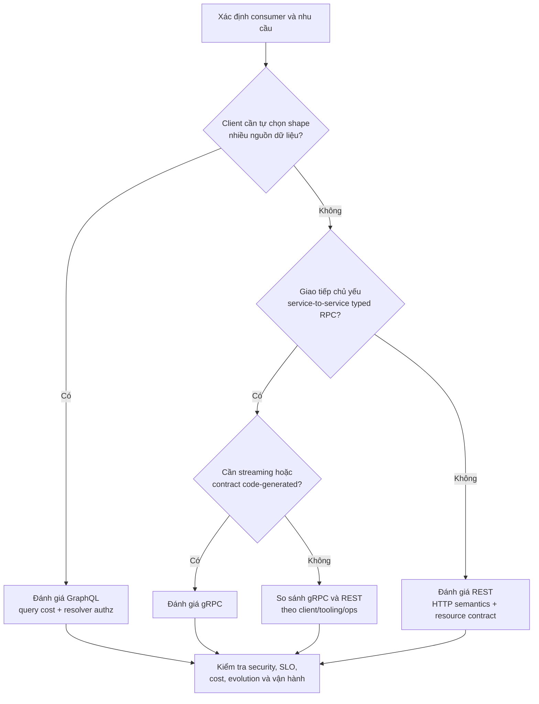
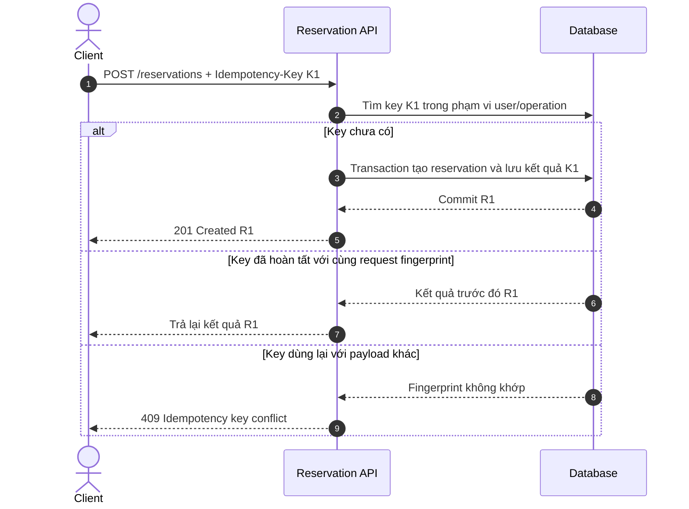

# Thiết kế hợp đồng API và lựa chọn REST, gRPC hoặc GraphQL

API là hợp đồng giữa những thành phần cần phối hợp để cung cấp một khả năng nghiệp vụ. Một API tốt giúp consumer biết **có thể yêu cầu điều gì, phải cung cấp dữ liệu nào, nhận kết quả ra sao, lỗi được biểu diễn thế nào và những thay đổi nào vẫn tương thích**. Hợp đồng API không chỉ là danh sách URL hay chữ ký hàm; nó còn bao gồm ngữ nghĩa nghiệp vụ, quyền truy cập, tính nhất quán, giới hạn hiệu năng và vòng đời hỗ trợ.

Trong module **CLOUD_ARCHITECTURE**, thiết kế hợp đồng API kết nối yêu cầu nghiệp vụ với ranh giới ứng dụng, dữ liệu và hạ tầng cloud. Việc lựa chọn **REST, gRPC hoặc GraphQL** ảnh hưởng tới cách client gọi dịch vụ, định tuyến qua mạng, xác thực, quan sát, mở rộng và vận hành. Không có lựa chọn tốt nhất cho mọi tình huống: cần cân bằng độ tin cậy, bảo mật, hiệu năng, chi phí và năng lực đội ngũ theo tư duy Well-Architected.

Bài học dùng ví dụ nền tảng cho thuê thiết bị với các khả năng xem danh mục, kiểm tra khả dụng, giữ chỗ, thanh toán và tra cứu đơn. Những tên miền, payload và giới hạn trong ví dụ là minh họa; hợp đồng thật phải được xác nhận với consumer, chủ sở hữu nghiệp vụ và yêu cầu vận hành.

## 1. API contract là gì và vì sao cần thiết?

Hãy xem API như một lời hứa có phạm vi rõ giữa bên cung cấp và bên sử dụng. Hợp đồng cần trả lời:

| Khía cạnh | Câu hỏi | Ví dụ |
| --- | --- | --- |
| **Mục đích và ngữ nghĩa** | API giải quyết hành vi nghiệp vụ nào? | Tạo một yêu cầu giữ chỗ cho một thiết bị trong khoảng thời gian |
| **Request** | Consumer gửi trường nào, kiểu gì, trường nào bắt buộc? | equipmentId, startAt, endAt, idempotencyKey |
| **Response** | Thành công có nghĩa gì và trả trạng thái nào? | Reservation được tạo ở trạng thái HELD |
| **Error model** | Lỗi nghiệp vụ và lỗi kỹ thuật được phân biệt ra sao? | 409 khi suất đã bị giữ; 503 khi dịch vụ tạm không sẵn sàng |
| **Identity và authorization** | Ai gọi được, có thể làm gì trên tài nguyên nào? | Token có scope booking:create; backend kiểm tra quyền trên đơn |
| **Consistency và concurrency** | Hai request đồng thời được giải quyết thế nào? | Chỉ một request có thể giữ cùng một suất |
| **Performance** | Deadline, kích thước payload, phân trang và throughput là bao nhiêu? | API tra cứu có p95 mục tiêu và giới hạn page size |
| **Evolution** | Trường và hành vi thay đổi thế nào mà không phá client hiện tại? | Thêm field optional tương thích, có thời gian ngừng version cũ |
| **Operations** | Metric, trace, quota và owner nào chịu trách nhiệm? | Theo dõi tỷ lệ 4xx/5xx, latency và request ID |

Nếu chỉ định nghĩa đường dẫn và JSON mẫu, nhóm vẫn chưa thống nhất được điều gì xảy ra khi request bị gửi lặp, khi dữ liệu thiếu, khi quyền thay đổi hoặc khi client nâng phiên bản chậm hơn backend.

### Contract-first và code-first

**Contract-first** bắt đầu bằng việc mô tả API độc lập với implementation, review với consumer rồi mới sinh code/interface hoặc triển khai service. Cách này hữu ích khi nhiều nhóm cùng phát triển, API được công bố cho đối tác hoặc cần kiểm tra tương thích tự động.

**Code-first** bắt đầu từ controller, method, schema hoặc annotation trong code rồi sinh tài liệu/contract. Nó có thể nhanh cho service nội bộ, nhưng dễ để implementation vô tình trở thành hợp đồng mà không có review ngữ nghĩa. Code-first vẫn có thể tạo ra API tốt nếu contract được kiểm tra, công bố và quản lý như artifact có phiên bản.

Hai cách có thể kết hợp: thống nhất contract trước cho các ranh giới quan trọng, sau đó sinh type, client và server stub để giảm công việc lặp.

## 2. Bắt đầu từ consumer và khả năng nghiệp vụ

Trước khi chọn REST, gRPC hay GraphQL, hãy xác định **ai gọi API, từ môi trường nào và muốn hoàn tất công việc gì**.

| Consumer | Đặc điểm | Điều cần ưu tiên |
| --- | --- | --- |
| Web/mobile app | Mạng không ổn định, phiên bản client tồn tại lâu, cần payload phù hợp màn hình | API dễ dùng, tương thích ngược, bảo mật người dùng, pagination và latency |
| Backend service | Có thể kiểm soát cả hai đầu, gọi thường xuyên, cần hiệu năng và kiểu dữ liệu rõ | Contract machine-readable, deadline, identity workload, tracing |
| Đối tác B2B | Nhiều hệ thống, chu kỳ tích hợp dài, cần tài liệu và onboarding | Versioning, SDK/example, quota, sandbox, error contract và hỗ trợ |
| Internal analytics | Truy vấn dữ liệu nhiều chiều, cần lọc/tổng hợp | Schema có quản trị, phân quyền dữ liệu, query cost và giới hạn tài nguyên |
| Event consumer | Nhận thông điệp bất đồng bộ, producer/consumer triển khai độc lập | Event schema, compatibility, idempotency, retry và dead-letter policy |

Ví dụ yêu cầu “đặt thuê thiết bị” cần phân rã thành các thao tác:

1. Tra cứu thông tin thiết bị và điều kiện thuê.
2. Kiểm tra một khoảng thời gian có khả dụng không.
3. Tạo giữ chỗ và bảo vệ khỏi hai request đồng thời.
4. Tạo phiên thanh toán và nhận kết quả từ nhà cung cấp.
5. Tra cứu trạng thái đơn hoặc hủy theo chính sách.

Không nên gom toàn bộ thành một endpoint làm tất cả. Mỗi thao tác có ngữ nghĩa, quyền và tính chất retry khác nhau. API tạo giữ chỗ có tác động dữ liệu; API tìm kiếm chủ yếu đọc; API nhận webhook có trust boundary khác API người dùng.

### Xác định resource, operation và workflow

- **Resource-oriented:** mô hình hóa đối tượng và trạng thái, ví dụ Equipment, Reservation, Payment.
- **Operation-oriented:** mô tả một hành động đặc biệt, ví dụ kiểm tra khả dụng hoặc xác nhận hủy.
- **Workflow-oriented:** biểu diễn một quy trình nhiều bước, thường cần state machine hoặc job resource.

REST thường phù hợp với resource và representation; gRPC thường mô tả service method; GraphQL mô tả graph dữ liệu được client chọn trường. Cả ba đều có thể biểu diễn cùng một nghiệp vụ nhưng cách thể hiện và giới hạn khác nhau.

## 3. Nguyên tắc thiết kế hợp đồng độc lập với giao thức

### 3.1. Tên và ngữ nghĩa phải nhất quán

Tên field nên thể hiện ý nghĩa nghiệp vụ, đơn vị và thời điểm. Ví dụ, startAt cần thống nhất là thời điểm UTC hay local time; amount cần đi kèm currency; status phải có tập giá trị và quy tắc chuyển tiếp được định nghĩa.

Tránh các trường chung chung như value, data, type nếu consumer không thể hiểu ý nghĩa mà không đọc implementation. Nếu trường có nhiều đơn vị, hãy biểu diễn đơn vị rõ, chẳng hạn durationSeconds thay vì duration.

### 3.2. Phân biệt bắt buộc, tùy chọn, rỗng và không có

Các ngôn ngữ schema có cách biểu diễn optional/null khác nhau. Contract phải làm rõ:

- Trường không xuất hiện nghĩa là dùng default, không thay đổi hay không có quyền xem?
- Giá trị null có khác với field bị thiếu không?
- Danh sách rỗng có nghĩa là chưa có phần tử hay consumer không được phép xem?
- Khi cập nhật một phần, trường bị bỏ qua có giữ giá trị cũ không?

Đặc biệt với PATCH, cần quy định cách xử lý field không gửi, field null và field có giá trị; nếu không, client và server có thể hiểu khác nhau.

### 3.3. Kiểu dữ liệu và giới hạn

Định nghĩa:

- ID có định dạng, độ dài và tính duy nhất trong phạm vi nào?
- Thời gian dùng ISO 8601/RFC 3339 hay epoch? Có timezone nào được chấp nhận?
- Tiền tệ sử dụng decimal, integer minor unit hay cấu trúc amount/currency?
- String có giới hạn ký tự, encoding và normalization không?
- Collection có giới hạn kích thước, page size và sort key nào?
- Payload có max size, nesting depth và file upload limit không?

Tránh dùng floating point cho phép tính tiền nếu yêu cầu chính xác về tiền tệ. Có thể sử dụng integer theo đơn vị nhỏ nhất hoặc decimal với precision/scale được định nghĩa, tùy loại tiền và nghiệp vụ.

### 3.4. Định nghĩa trạng thái và bất biến

Ví dụ một reservation có các trạng thái:

| Trạng thái | Ý nghĩa | Chuyển tiếp tiêu biểu |
| --- | --- | --- |
| HELD | Một suất được giữ tạm thời | CONFIRMED, EXPIRED, CANCELLED |
| CONFIRMED | Đơn đã được xác nhận | CANCELLED theo điều kiện nghiệp vụ |
| EXPIRED | Giữ chỗ đã hết hạn | Không tự xác nhận khi payment đến muộn |
| CANCELLED | Đơn bị hủy | Có thể cần REFUND_PENDING/REFUNDED nếu đã thanh toán |

Contract cần ghi rõ bất biến như **một suất không được xác nhận cho hai reservation có thời gian thuê xung đột**. Không chỉ ghi “API trả 201”; cần biết commit nào xác định kết quả thành công và khi nào một request lặp trả kết quả cũ.

## 4. REST: resource, HTTP semantics và representation

REST là một phong cách kiến trúc cho hệ thống phân tán, không chỉ là “JSON qua HTTP”. Một API theo hướng REST thường dùng resource URI, các phương thức HTTP và representation để thao tác trạng thái. Các nguyên tắc thường được nhắc đến gồm client-server, stateless, cacheable, uniform interface, layered system và tùy chọn code-on-demand.

### 4.1. Thiết kế URI và method

Ví dụ API cho thuê:

| Method và path | Mục đích | Hành vi tiêu biểu |
| --- | --- | --- |
| GET /v1/equipment | Liệt kê thiết bị | Read-only, hỗ trợ filter/sort/page |
| GET /v1/equipment/{equipmentId} | Đọc một thiết bị | 404 nếu không tồn tại hoặc không được tiết lộ |
| GET /v1/availability?equipmentId=... | Kiểm tra khoảng thời gian | Read-only theo contract; không giữ chỗ |
| POST /v1/reservations | Tạo reservation | Tạo resource, cần idempotency cho retry an toàn |
| GET /v1/reservations/{id} | Đọc reservation | Kiểm tra quyền sở hữu/được ủy quyền |
| PATCH /v1/reservations/{id} | Cập nhật một phần | Xác định rõ semantics của field bỏ qua/null |
| POST /v1/reservations/{id}/cancellation | Yêu cầu hủy | Operation có điều kiện nghiệp vụ riêng |

Tên resource thường dùng danh từ số nhiều, nhưng điều quan trọng là quy ước nhất quán và ngữ nghĩa HTTP rõ. Không ép mọi thao tác thành CRUD nếu hành vi nghiệp vụ như cancel, approve hay capture payment có điều kiện riêng cần thể hiện.

### 4.2. HTTP method và tính chất an toàn

| Method | Ý nghĩa chung | Safe? | Idempotent theo semantics HTTP? |
| --- | --- | --- | --- |
| GET | Lấy representation | Có | Có |
| HEAD | Lấy metadata tương tự GET, không có response body | Có | Có |
| POST | Xử lý hoặc tạo subordinate resource theo contract | Không | Không mặc định |
| PUT | Tạo/thay thế representation tại URI đã biết | Không | Có |
| PATCH | Cập nhật một phần theo patch semantics | Không | Không mặc định |
| DELETE | Xóa resource | Không | Có theo hiệu ứng dự kiến |

**Safe** nghĩa client không yêu cầu server tạo thay đổi trạng thái nghiệp vụ; **idempotent** nghĩa lặp cùng thao tác có cùng hiệu ứng dự kiến trên trạng thái server. Một GET ghi audit log kỹ thuật không làm nó trở thành thao tác nghiệp vụ không an toàn, nhưng endpoint GET không nên bị dùng để thực hiện hủy đơn hoặc thu tiền.

Idempotent không có nghĩa mọi response lặp giống byte-for-byte. Ví dụ DELETE đầu tiên trả 204 và lần sau trả 404 vẫn có thể idempotent về hiệu ứng cuối là resource không còn. Với POST tạo reservation, cần thiết kế idempotency key nếu client có thể retry khi mất response.

### 4.3. Status code theo ngữ nghĩa

| Status | Sử dụng điển hình | Ví dụ |
| --- | --- | --- |
| 200 OK | Request thành công, có response | GET reservation |
| 201 Created | Resource được tạo; có thể trả Location | POST reservation tạo mới |
| 202 Accepted | Đã nhận để xử lý bất đồng bộ | Tạo yêu cầu xuất báo cáo |
| 204 No Content | Thành công, không cần body | DELETE hoặc thao tác cập nhật không trả representation |
| 400 Bad Request | Request sai cú pháp/không thể phân tích | JSON malformed |
| 401 Unauthorized | Thiếu hoặc không có thông tin xác thực hợp lệ | Access token hết hạn |
| 403 Forbidden | Đã xác thực nhưng không đủ quyền | User không có scope/action |
| 404 Not Found | Resource/route không tồn tại hoặc cố ý không tiết lộ | Reservation ID không tìm được |
| 409 Conflict | Xung đột với trạng thái hiện tại | Suất thuê đã bị giữ |
| 412 Precondition Failed | Điều kiện HTTP như If-Match không đạt | ETag đã thay đổi |
| 422 Unprocessable Content | Cú pháp hợp lệ nhưng nội dung vi phạm validation/semantics | endAt trước startAt |
| 429 Too Many Requests | Vượt rate limit/quota | Client gọi quá nhanh |
| 500 Internal Server Error | Lỗi không dự kiến trong service | Bug hoặc invariant bị vi phạm |
| 502 Bad Gateway | Gateway nhận response không hợp lệ từ upstream | Upstream protocol error |
| 503 Service Unavailable | Tạm không thể phục vụ | Service đang bảo trì/quá tải |
| 504 Gateway Timeout | Gateway không nhận response upstream đúng hạn | Upstream quá chậm |

Không cần dùng mọi status trong mọi API. Chọn một error contract nhất quán và tránh trả 200 cho mọi tình huống rồi nhét mã lỗi vào body, vì client, proxy, monitoring và cache sẽ hiểu sai semantics.

### 4.4. Request/response minh họa

```http
POST /v1/reservations HTTP/1.1
Host: api.rental.example
Authorization: Bearer <access-token>
Content-Type: application/json
Idempotency-Key: 8fd7a2d1-example

{
  "equipmentId": "eq-123",
  "startAt": "2026-12-01T09:00:00Z",
  "endAt": "2026-12-03T09:00:00Z"
}
```

Response:

```http
HTTP/1.1 201 Created
Location: /v1/reservations/res-456
Content-Type: application/json

{
  "id": "res-456",
  "equipmentId": "eq-123",
  "status": "HELD",
  "expiresAt": "2026-11-18T05:20:00Z"
}
```

Các giá trị ngày và ID chỉ là ví dụ. Contract phải thống nhất thời hạn giữ, timezone, quyền tạo reservation, việc giữ suất đã được commit trước response và quy tắc retry bằng cùng key.

### 4.5. Pagination và filtering

Không trả một danh sách vô hạn. Hai cách thường gặp:

- **Offset pagination:** page/size hoặc limit/offset, dễ hiểu và hỗ trợ nhảy trang, nhưng dữ liệu thay đổi giữa các lần đọc có thể gây trùng/bỏ sót; offset lớn có thể tốn chi phí.
- **Cursor pagination:** response trả nextCursor dựa trên sort key ổn định, hữu ích với dữ liệu lớn hoặc thường xuyên thay đổi; khó nhảy tới trang bất kỳ và cursor cần quy định thời hạn/ngữ nghĩa.

API list nên có default/max page size, sort field được phép, filter whitelist và thứ tự ổn định. Không cho client gửi biểu thức query tùy ý tới database.

### 4.6. Cache semantics

GET có thể dùng Cache-Control, ETag, Last-Modified và conditional request để giảm tải. Nhưng cache cần xét quyền riêng tư và freshness:

- Public catalog có thể cache ở CDN nếu representation không phụ thuộc user.
- Reservation cá nhân thường cần private/no-store hoặc policy cache được thiết kế cẩn thận.
- Availability thay đổi nhanh; cache lâu có thể hiển thị suất không còn trống.
- Cache response không được dùng làm bảo đảm cuối cho transaction giữ chỗ.

## 5. gRPC: contract theo service method và Protocol Buffers

gRPC là framework RPC thường dùng HTTP/2 làm transport và Protocol Buffers làm hệ thống định nghĩa message/service mặc định. Nó phù hợp khi các service kiểm soát cả hai đầu, cần contract typed, code generation, streaming hoặc giao tiếp nội bộ hiệu quả.

### 5.1. Định nghĩa service

```proto
syntax = "proto3";

package rental.booking.v1;

service BookingService {
  rpc GetReservation(GetReservationRequest) returns (Reservation);
  rpc CreateReservation(CreateReservationRequest) returns (Reservation);
  rpc WatchReservation(WatchReservationRequest) returns (stream ReservationEvent);
}

message GetReservationRequest {
  string reservation_id = 1;
}

message CreateReservationRequest {
  string equipment_id = 1;
  string start_at = 2;
  string end_at = 3;
  string idempotency_key = 4;
}

message Reservation {
  string id = 1;
  string equipment_id = 2;
  string status = 3;
  string expires_at = 4;
}

message WatchReservationRequest {
  string reservation_id = 1;
}

message ReservationEvent {
  string event_type = 1;
  Reservation reservation = 2;
}
```

Ví dụ rút gọn để minh họa service definition. Với contract thực tế, thời gian có thể dùng google.protobuf.Timestamp thay vì string; trạng thái nên cân nhắc enum và quy tắc evolution; idempotency key có thể được đặt trong metadata hoặc request message theo convention của tổ chức. Chọn cách nào phải nhất quán và được tài liệu hóa.

### 5.2. Bốn kiểu RPC

| Kiểu | Mô tả | Trường hợp dùng |
| --- | --- | --- |
| Unary | Một request, một response | Lấy hoặc tạo reservation |
| Server streaming | Một request, nhiều response | Theo dõi event/trạng thái liên tục |
| Client streaming | Nhiều request, một response | Upload/chuyển một luồng dữ liệu theo chunks |
| Bidirectional streaming | Hai phía gửi stream độc lập | Realtime collaboration, telemetry hoặc protocol tương tác |

Streaming giữ kết nối lâu hơn, nên cần quản lý connection, backpressure, cancellation, flow control và deadline. Không dùng stream chỉ vì muốn “nhanh”; nếu request-response đơn giản đáp ứng yêu cầu, unary dễ scale và debug hơn.

### 5.3. Status và error model của gRPC

gRPC dùng status code riêng như INVALID_ARGUMENT, UNAUTHENTICATED, PERMISSION_DENIED, NOT_FOUND, ALREADY_EXISTS, FAILED_PRECONDITION, RESOURCE_EXHAUSTED, UNAVAILABLE, DEADLINE_EXCEEDED và INTERNAL. Cần map có chủ đích sang HTTP nếu có transcoding/proxy hoặc public gateway.

Phân biệt:

- **INVALID_ARGUMENT:** dữ liệu request không hợp lệ.
- **FAILED_PRECONDITION:** trạng thái hệ thống hiện tại không cho phép hành động.
- **ALREADY_EXISTS:** resource/key xung đột hoặc đã tồn tại theo contract.
- **RESOURCE_EXHAUSTED:** quota, flow-control hoặc tài nguyên đã chạm giới hạn.
- **UNAVAILABLE:** service tạm không sẵn sàng.
- **DEADLINE_EXCEEDED:** deadline đã hết; server có thể đã xử lý một phần hoặc hoàn tất trước khi client nhận kết quả.

Như HTTP timeout, deadline exceeded không chứng minh transaction chưa commit. Với method có tác động, cần idempotency và query trạng thái.

### 5.4. Deadline, cancellation và metadata

Client nên gửi deadline hữu hạn cho RPC; server nên truyền ngân sách thời gian còn lại tới dependency nếu framework hỗ trợ. Khi client cancel, server cần ngừng công việc có thể hủy, giải phóng tài nguyên và không tiếp tục xử lý vô hạn.

Metadata thường dùng để truyền authorization token, correlation ID, tracing context hoặc thông tin routing. Không đưa dữ liệu tùy ý lớn vào metadata; không log token; server phải xác minh danh tính và quyền thay vì tin mọi header.

### 5.5. Ưu điểm và giới hạn

| Ưu điểm | Giới hạn/cái giá |
| --- | --- |
| Schema typed, sinh client/server stub | Cần quản lý .proto và toolchain code generation |
| Hiệu quả nhờ HTTP/2 và binary serialization trong nhiều kịch bản | Debug thủ công bằng browser/curl thường không tiện như REST/JSON |
| Hỗ trợ streaming | Gateway, browser, proxy và observability cần hỗ trợ phù hợp |
| Contract service rõ cho backend-to-backend | Có thể kém thuận tiện với external public API/consumer đa nền tảng nếu thiếu SDK/tooling |
| Deadline/status/metadata có cấu trúc | Cần hiểu semantics cancellation, retry và compatibility |

gRPC thường phù hợp cho service-to-service nội bộ, nhưng vẫn có thể công bố ra đối tác nếu consumer tooling, security, firewall/proxy và contract support đáp ứng. Không nên quyết định chỉ dựa vào thông số throughput lý thuyết.

## 6. GraphQL: client chọn shape dữ liệu từ một graph

GraphQL cung cấp một schema có kiểu, cho phép client yêu cầu tập trường cần thiết và có thể kết hợp dữ liệu từ nhiều nguồn qua một endpoint logic. Nó thường phù hợp cho client UI có nhu cầu dữ liệu thay đổi theo màn hình hoặc nhiều consumer muốn representation khác nhau.

### 6.1. Schema minh họa

```graphql
type Equipment {
  id: ID!
  displayName: String!
  category: String
}

type Reservation {
  id: ID!
  equipment: Equipment!
  status: ReservationStatus!
  expiresAt: String
}

enum ReservationStatus {
  HELD
  CONFIRMED
  EXPIRED
  CANCELLED
}

type Query {
  equipment(id: ID!): Equipment
  reservation(id: ID!): Reservation
}

type Mutation {
  createReservation(input: CreateReservationInput!): CreateReservationPayload!
}

input CreateReservationInput {
  equipmentId: ID!
  startAt: String!
  endAt: String!
  idempotencyKey: String!
}

type CreateReservationPayload {
  reservation: Reservation
  userErrors: [UserError!]!
}

type UserError {
  code: String!
  message: String!
  field: [String!]
}
```

### 6.2. Query minh họa

```graphql
query ReservationSummary($id: ID!) {
  reservation(id: $id) {
    id
    status
    expiresAt
    equipment {
      id
      displayName
    }
  }
}
```

Client chỉ yêu cầu các trường cần hiển thị. Cấu trúc response tuân theo selection set, giúp giảm over-fetching; nhưng nếu resolver truy vấn từng item riêng lẻ, hệ thống có thể mắc **N+1 query problem** và tăng tải DB.

### 6.3. Query, mutation và subscription

| Operation | Ý nghĩa | Ví dụ |
| --- | --- | --- |
| Query | Đọc dữ liệu | Đọc reservation và thiết bị |
| Mutation | Thực hiện thay đổi | Tạo hoặc hủy reservation |
| Subscription | Nhận cập nhật khi có event | Theo dõi reservation thay đổi |

Subscription thường dựa trên WebSocket hoặc transport khác tùy implementation. Nó thêm connection dài, quản lý kết nối, auth khi connect/refresh, fan-out và backpressure. Không phải mọi GraphQL server hoặc gateway đều hỗ trợ subscription theo cùng cách.

### 6.4. GraphQL không tự giải quyết authorization

Có schema field reservation(id), nhưng từng field có thể cần chính sách riêng. Việc user được phép gọi Query.reservation không có nghĩa họ được xem mọi reservation ID hoặc các trường payment/internalNote. Cần kiểm tra quyền ở resolver/service và cân nhắc field-level authorization.

Đồng thời, query có thể lồng sâu hoặc yêu cầu quá nhiều node. Cần giới hạn:

- Depth hoặc complexity/cost của query.
- Số lượng phần tử qua pagination.
- Timeout, concurrency và tổng thời gian resolver.
- Aliases/batching và chi phí truy vấn lặp.
- Introspection và schema exposure phù hợp môi trường.
- Rate limit tính theo query cost hoặc client tier, không chỉ số HTTP request.

### 6.5. Ưu điểm và trade-off

| Ưu điểm | Giới hạn/cái giá |
| --- | --- |
| Client chọn trường, giảm over-fetching | Query tùy biến khiến cache ở HTTP/CDN phức tạp hơn |
| Aggregation nhiều nguồn trong một graph | Resolver cần orchestration, N+1 và error propagation |
| Typed schema và introspection | Schema evolution, deprecation và governance cần quy trình |
| Hữu ích cho nhiều màn hình/client | Query complexity và authorization cần được bảo vệ |
| Có thể dùng mutation/subscription | Streaming/realtime đòi hỏi connection và fan-out management |

GraphQL không bắt buộc phải dùng cho mọi API. Nếu các consumer đều cần resource representation ổn định, REST có thể đơn giản hơn. Nếu backend-to-backend cần RPC typed và streaming, gRPC có thể phù hợp hơn.

## 7. So sánh REST, gRPC và GraphQL

| Tiêu chí | REST | gRPC | GraphQL |
| --- | --- | --- | --- |
| Mô hình chính | Resource và HTTP semantics | Service method/RPC | Graph dữ liệu và selection set |
| Schema/contract | OpenAPI hoặc mô tả tương đương | Protocol Buffers/service definition | GraphQL schema |
| Transport thường gặp | HTTP/1.1 hoặc HTTP/2; có thể HTTP/3 tùy nền tảng | HTTP/2 trong cách dùng phổ biến; support transport phụ thuộc implementation | Thường HTTP; subscription có thể dùng WebSocket/transport khác |
| Payload điển hình | JSON | Protobuf binary | JSON response từ GraphQL query |
| Browser friendliness | Cao | Cần gRPC-Web/proxy hoặc hỗ trợ client phù hợp | Cao qua HTTP client |
| Streaming | Không phải mô hình chính của REST HTTP thông thường; có SSE/stream riêng | Hỗ trợ streaming RPC | Subscription tùy implementation |
| Caching | HTTP cache semantics rõ với GET | Thường do ứng dụng/proxy quản lý | Khó cache HTTP đơn giản do query thường POST |
| Kiểu truy cập dữ liệu | Resource/endpoint định nghĩa trước | Method input/output định nghĩa trước | Client chọn field và quan hệ |
| Rủi ro điển hình | Version/contract lỏng, endpoint proliferation | Tooling/debug và transport compatibility | Query cost, resolver, N+1, authorization field |
| Use case điển hình | Public API, partner API, CRUD/resource-oriented | Internal RPC, typed service communication, streaming | Frontend aggregation, UI có nhu cầu dữ liệu linh hoạt |

Các mô hình không loại trừ nhau. Một hệ thống có thể:

- Cung cấp REST API public qua API Gateway.
- Dùng gRPC giữa Booking và Inventory service trong mạng nội bộ.
- Có GraphQL BFF cho mobile/web để tổng hợp dữ liệu từ các domain.
- Dùng event/queue cho xử lý bất đồng bộ và cập nhật analytics.

Điều cần tránh là tạo nhiều lớp giao thức cho cùng một hành vi mà không có lý do rõ. Mỗi adapter/translation thêm contract, telemetry, retry và security policy cần quản lý.

## 8. Cây quyết định lựa chọn giao thức

Hãy trả lời theo consumer và tính chất tương tác:



Gợi ý thực hành:

1. **Consumer là browser/mobile/đối tác** và cần HTTP interoperability, tài liệu dễ đọc, cache semantics: bắt đầu đánh giá REST.
2. **Nhiều service backend**, kiểm soát client/server, cần typed RPC, latency/throughput và streaming: đánh giá gRPC.
3. **Nhiều màn hình cần các shape dữ liệu khác nhau**, dữ liệu nằm ở nhiều domain và có năng lực quản lý query complexity: đánh giá GraphQL.
4. Nếu công việc dài và bất đồng bộ, có thể cần job resource/queue/event thay vì cố dùng một request đồng bộ bằng bất kỳ giao thức nào.

Không chọn giao thức chỉ vì đang thịnh hành hoặc vì một benchmark isolated. Đo bằng payload, concurrency, network hop, TLS, serialization, data access, query shape và behavior khi lỗi của chính workload.

## 9. Versioning và evolution: thay đổi mà không phá consumer

API có vòng đời dài hơn một lần deploy. Mobile app có thể nằm ngoài kiểm soát của backend nhiều tháng; đối tác có lịch nâng cấp riêng; service nội bộ vẫn có rollout lệch phiên bản.

### 9.1. Những thay đổi thường tương thích

Thường an toàn hơn (nhưng vẫn cần kiểm tra theo contract và generator):

- Thêm response field **optional** mà client cũ bỏ qua được.
- Thêm operation/endpoint mới.
- Thêm enum value chỉ khi client được thiết kế xử lý giá trị chưa biết.
- Nới giới hạn có kiểm soát mà không thay semantics.
- Thêm metadata không bắt buộc.

### 9.2. Những thay đổi dễ phá tương thích

- Xóa hoặc đổi tên field, endpoint, method.
- Đổi kiểu dữ liệu hoặc đơn vị.
- Chuyển field optional thành required.
- Thay đổi semantics status hoặc error code.
- Đổi thứ tự/ý nghĩa pagination hoặc sort.
- Thu hẹp quyền hoặc thay behavior mà consumer dựa vào.
- Thêm enum value khi generated client dùng exhaustive switch.
- Trong Protobuf: tái sử dụng field number đã xóa hoặc đổi số field.
- Trong GraphQL: xóa field/argument hoặc đổi nullability không tương thích.

**Tương thích về cú pháp chưa đủ**; thay đổi hành vi có thể vẫn là breaking change. Ví dụ field status vẫn là string nhưng giá trị HELD được hiểu thành “đã thanh toán” trong bản mới sẽ phá consumer.

### 9.3. Phương pháp versioning

| Chiến lược | Ví dụ | Ưu điểm | Trade-off |
| --- | --- | --- | --- |
| URI version | /v1, /v2 | Dễ thấy, dễ route và debug | Nhiều version cùng tồn tại |
| Header/media type | Accept versioned media type | URL ổn định, negotiation linh hoạt | Ít trực quan hơn; cache cần Vary đúng |
| gRPC package/service version | rental.booking.v1 | Rõ scope trong schema/stub | Client/server phải quản lý package và migration |
| GraphQL schema evolution | Thêm field, đánh dấu deprecated rồi xóa theo lịch | Có thể tiến hóa từng field | Cần usage analytics, owner và quy trình deprecation |

Đừng tạo version mới cho mọi thay đổi nhỏ. Trước khi version, thử **additive evolution** và deprecation có thời gian. Nhưng cũng không kéo dài một contract đã có semantics sai chỉ vì ngại nâng cấp.

### 9.4. Quy trình deprecation

Một quy trình có trách nhiệm thường:

1. Xác định field/route/schema sẽ ngừng hỗ trợ và lý do.
2. Công bố version thay thế, migration guide và thời gian hỗ trợ.
3. Đo consumer đang dùng qua telemetry hoặc registry; liên hệ owner đối tác nếu có.
4. Cho phép chạy song song trong thời gian đã thống nhất.
5. Thêm cảnh báo/deprecation header hoặc GraphQL deprecation metadata khi phù hợp.
6. Ngừng hỗ trợ sau khi điều kiện và thời hạn được đáp ứng, có phương án rollback nếu việc ngừng gây lỗi diện rộng.

## 10. Error contract: lỗi có cấu trúc và có thể hành động

Một API cần giúp client phân biệt **lỗi có thể sửa**, **lỗi cần xác thực/ủy quyền lại**, **lỗi xung đột**, **lỗi tạm thời** và **lỗi chưa rõ kết quả**.

### 10.1. Error response REST

Có thể dùng định dạng theo Problem Details:

```json
{
  "type": "https://api.rental.example/problems/slot-unavailable",
  "title": "Requested time is unavailable",
  "status": 409,
  "detail": "The selected equipment is no longer available for this period.",
  "instance": "/v1/reservations",
  "code": "SLOT_UNAVAILABLE",
  "requestId": "req-123"
}
```

Ví dụ minh họa. Không đưa stack trace, SQL, secret, nội dung token hoặc dữ liệu của user khác vào detail. Trường code ổn định giúp client quyết định logic; message dành cho người đọc có thể được localize và thay đổi trong giới hạn hợp đồng.

### 10.2. Error trong GraphQL

GraphQL có thể trả HTTP 200 nhưng body chứa cả data và errors, tùy execution semantics và server. Vì thế client không được suy ra mọi request HTTP 200 đều thành công hoàn toàn. Cần quy định:

- errors có extensions.code ổn định thế nào.
- Field nào có thể null khi resolver lỗi.
- Mutation có thể trả userErrors hay top-level errors.
- Partial data có được chấp nhận và hiển thị không.
- Error có thể làm lộ thông tin field/permission nào không.

### 10.3. Retry contract

Không yêu cầu client retry mọi 5xx. Phải quy định:

- Lỗi nào có thể retry và thời điểm thử lại.
- Retry tối đa bao nhiêu, deadline tổng là bao lâu.
- Có Retry-After hay retry metadata không.
- Operation có idempotency key hay query trạng thái không.
- Khi timeout, client có thể tra cứu theo request ID nào.

### 10.4. Correlation và supportability

Mỗi request nên có request ID/correlation ID để nối gateway, backend, log và trace. Client có thể cung cấp ID này khi liên hệ hỗ trợ, nhưng không nên gửi ID như bằng chứng được quyền xem dữ liệu. Trace context phục vụ observability, không phải authorization.

## 11. Idempotency và concurrency trong hợp đồng API

API tạo đơn, thu tiền, hủy đơn hoặc gửi lệnh có hiệu ứng phải xử lý tình huống client không nhận response dù server đã commit.

### Ví dụ idempotency



Để bảo đảm:

- Khóa được scope theo consumer/user/tenant và loại operation phù hợp.
- Lưu fingerprint hoặc thông tin so sánh payload; không dùng key của user A để lấy kết quả user B.
- Việc ghi key và thay đổi nghiệp vụ xảy ra trong cùng transaction hoặc cơ chế nhất quán tương đương.
- Định nghĩa thời gian giữ key, xử lý IN_PROGRESS và request đồng thời cùng key.
- Không để key trở thành một cách đọc lại dữ liệu nhạy cảm khi quyền truy cập đã thay đổi.

### Concurrency control

Đối với giữ chỗ, không thiết kế kiểu “đọc available rồi insert” nếu hai transaction có thể cùng thấy available. Dùng transaction và ràng buộc duy nhất, conditional update, lock hoặc cơ chế phù hợp với database. Hợp đồng API phải biểu diễn xung đột ổn định, ví dụ 409, và nói rõ client có thể chọn thời gian khác.

ETag/If-Match trong REST cũng có thể bảo vệ cập nhật dựa trên version tài nguyên: client gửi version mà mình đọc; nếu đã thay đổi, server trả 412 để client đọc lại và quyết định. Đây là optimistic concurrency, không thay được mọi bất biến đa dòng hoặc ràng buộc đặt chỗ phức tạp.

## 12. Bảo mật API contract

API contract là nơi xác định bề mặt dữ liệu và quyền cần bảo vệ.

### Authentication và authorization

| Câu hỏi | Biện pháp/hợp đồng cần rõ |
| --- | --- |
| Ai đang gọi? | OAuth 2.0/OIDC access token, mTLS, workload identity hoặc API key theo use case |
| Được gọi operation nào? | Scope/role/client policy ở gateway và backend |
| Được thao tác trên object nào? | Object-level authorization, tenant boundary, resource ownership |
| Được thấy field nào? | Field-level filtering/redaction trong service hoặc resolver |
| Token hết hạn/thu hồi? | TTL, refresh/revoke strategy, key rotation, cache behavior |
| Đối tác có quyền gì? | Client credential và partner-specific contract/quota |

JWT hợp lệ không tự chứng minh quyền trên mọi reservation; API key xác định client application không tự chứng minh người dùng cuối. Với GraphQL, quyền phải áp tới field/relationship; với gRPC, mỗi method cũng cần authorization riêng; với REST, mỗi route và object phải kiểm soát.

### Input validation và resource limits

Xác thực schema không đủ. Cần giới hạn body size, string length, array count, nested depth, file type, timeout, pagination, query complexity và concurrency. Tránh để client khiến API gọi hàng nghìn resolver hoặc query không giới hạn.

### Data minimization

Chỉ đưa field consumer cần. Không trả nội bộ như DB key, provider secret, stack trace, internal URL hay thông tin khách hàng không liên quan. Chỉ log metadata cần thiết; request/response logging có thể vô tình lưu token, email, số điện thoại hoặc nội dung thanh toán.

### Transport và secrets

TLS cho kết nối bên ngoài; mTLS có thể phù hợp với B2B hoặc service-to-service. Secret/API key cần rotation, scope, expiration nếu hỗ trợ và lưu trong secret manager. Không đặt credential trong query string vì URL dễ bị ghi log và lưu trong lịch sử/trung gian.

## 13. Schema và công cụ mô tả contract

### OpenAPI cho REST

OpenAPI mô tả path, method, parameter, request/response schema, security scheme, response code và metadata. Từ một contract có thể sinh tài liệu, client stub, mock server, test skeleton hoặc API lint.

```yaml
openapi: 3.1.0
info:
  title: Rental Booking API
  version: 1.0.0
paths:
  /v1/reservations:
    post:
      operationId: createReservation
      summary: Create a temporary reservation
      security:
        - bearerAuth: []
      parameters:
        - in: header
          name: Idempotency-Key
          required: true
          schema:
            type: string
            minLength: 8
      requestBody:
        required: true
        content:
          application/json:
            schema:
              $ref: '#/components/schemas/CreateReservationRequest'
      responses:
        '201':
          description: Reservation created
          content:
            application/json:
              schema:
                $ref: '#/components/schemas/Reservation'
        '409':
          description: Requested slot conflicts with current state
        '401':
          description: Authentication is required
components:
  securitySchemes:
    bearerAuth:
      type: http
      scheme: bearer
      bearerFormat: JWT
  schemas:
    CreateReservationRequest:
      type: object
      required: [equipmentId, startAt, endAt]
      properties:
        equipmentId:
          type: string
        startAt:
          type: string
          format: date-time
        endAt:
          type: string
          format: date-time
    Reservation:
      type: object
      required: [id, equipmentId, status]
      properties:
        id:
          type: string
        equipmentId:
          type: string
        status:
          type: string
```

Đây là trích đoạn rút gọn để minh họa. Contract thật cần định nghĩa thêm response body cho lỗi, header, pagination, examples, constraints, server, tags, policy version, operation owner và các schema dùng chung. OpenAPI khai báo bearer authentication nhưng không tự thi hành authorization object-level.

### Protocol Buffers cho gRPC

File .proto là contract schema/service cho code generation. Quản lý:

- Package và service naming/version.
- Field number ổn định; không tái sử dụng field number đã xóa.
- Reserved field/name để ngăn tái sử dụng vô tình.
- Enum thêm giá trị theo cách consumer cũ có thể xử lý.
- Compatibility check khi thay schema và generated code.

### GraphQL SDL

GraphQL Schema Definition Language (SDL) mô tả type, field, argument, enum, input và directive. Cần quản lý owner, resolver, nullability, deprecation, authz, complexity và version/evolution policy. Có thể dùng schema registry/federation khi graph có nhiều domain, nhưng phải quản lý ownership và breaking change ở cấp graph.

### AsyncAPI cho hợp đồng event

Nếu API có publish/subscribe qua Kafka, RabbitMQ, MQTT hoặc broker khác, HTTP OpenAPI không mô tả đầy đủ message lifecycle. AsyncAPI có thể mô tả channel, operation, message, schema, protocol và security cho event-driven interface. Contract event cần định danh, event version, key/ordering, delivery semantics và quy tắc replay.

## 14. Testing contract và compatibility

Không chỉ test implementation hiện tại; phải test **mối quan hệ giữa provider và consumer**.

| Loại test | Xác minh điều gì? | Ví dụ |
| --- | --- | --- |
| Schema validation/lint | Contract hợp lệ và tuân convention? | OpenAPI lint, GraphQL schema validation, protobuf compile |
| Unit test | Logic mapping/validation riêng lẻ? | Tạo response status khi slot conflict |
| Provider contract test | Server thực hiện đúng contract? | 201 có schema đúng, 409 có error code ổn định |
| Consumer-driven contract test | Provider không phá cách consumer đang dùng | Web/mobile chỉ sử dụng field được công bố |
| Compatibility test | Schema mới có tương thích version cũ? | Protobuf/API schema diff |
| Integration test | Gateway, identity, DB, broker cùng tương tác đúng? | Token, database transaction, event |
| Load/performance test | Payload/concurrency/latency dưới tải thực tế? | p95/p99, saturation, cost per request |
| Security test | Có đường bypass, object access sai, query abuse? | BOLA, scope bypass, GraphQL depth abuse |
| Fault test | Timeout/retry/partial failure có giữ invariant? | Mất response sau DB commit, dependency chậm |

### Consumer-driven contract testing

Consumer mô tả cách họ gọi API và assumptions quan trọng; provider chạy verify để chứng minh thay đổi vẫn đáp ứng những expectations này. Cách này giảm rủi ro service provider thay field/hành vi mà không biết consumer nào bị ảnh hưởng.

Tuy nhiên, test suite chỉ bảo vệ **những kỳ vọng đã được ghi lại**. Không thay thế security review, validation dữ liệu, performance test hoặc hợp đồng public đầy đủ. Phải quản lý consumer version, test ownership và tránh contract test quá gắn implementation.

### Compatibility check trong CI

Pipeline có thể:

1. Validate OpenAPI/proto/GraphQL SDL/AsyncAPI.
2. Lint naming, security, pagination và error conventions.
3. So sánh schema hiện tại với bản phát hành trước để phát hiện breaking changes.
4. Chạy provider/consumer contract tests.
5. Sinh docs/SDK hoặc artifact có version.
6. Yêu cầu review khi thay đổi auth, field nhạy cảm, status semantics hay deprecation.

## 15. Thiết kế cho cloud: gateway, networking và triển khai

Contract không tồn tại độc lập với hạ tầng. Cần xác định public API đi qua API Gateway/WAF/load balancer thế nào, internal service gọi trực tiếp hay qua mesh, gRPC/HTTP2 được hỗ trợ ra sao, và GraphQL resolver có phụ thuộc nhiều downstream không.

### Public edge và internal API

| Loại API | Đường vào thường gặp | Yêu cầu quan trọng |
| --- | --- | --- |
| Public REST | DNS + CDN/WAF/API Gateway + backend | TLS, OAuth, quota, version, cache |
| Partner REST/gRPC | Public/private endpoint + mTLS/client credentials + gateway | Onboarding, cert rotation, quota, sandbox |
| Internal gRPC | Private network/service discovery/mesh | Workload identity, mTLS, deadline, tracing |
| GraphQL BFF | Public gateway → BFF/GraphQL server → domain services | Query complexity, resolver authz, N+1 protection |
| Event API | Producer → broker → consumer | ACL/topic, schema registry, DLQ, idempotency |

### Gateway không thay service contract

Gateway có thể xác thực token, route, rate limit và transform. Nhưng domain service vẫn chịu trách nhiệm về bất biến dữ liệu và authorization chi tiết. Không chuyển toàn bộ logic nghiệp vụ vào API Gateway chỉ để giữ backend đơn giản.

### Connection, timeout và protocol support

gRPC streaming cần HTTP/2 end-to-end hoặc gateway/proxy có hỗ trợ tương thích; một load balancer HTTP/1.1-only ở giữa có thể làm hỏng stream. WebSocket/GraphQL subscription cần idle timeout và connection limit phù hợp. REST request dài cần deadline và payload limit; không dùng timeout rất lớn để che một công việc batch nên chạy bất đồng bộ.

Khi triển khai nhiều replica, cần theo dõi connection pool, max concurrent stream, proxy buffer, keep-alive và autoscaling. CPU thấp không có nghĩa service còn capacity nếu đang cạn connection hoặc thread.

## 16. Observability và vận hành hợp đồng API

API cần có chỉ số kỹ thuật và nghiệp vụ:

| Tín hiệu | Ý nghĩa |
| --- | --- |
| Request count theo operation/version/client | Mức sử dụng và consumer còn dùng version cũ |
| 2xx/4xx/5xx hoặc gRPC status | Tỷ lệ thành công và phân loại lỗi |
| p50/p95/p99 latency | Trải nghiệm và tail latency |
| Payload size, query complexity, stream count | Tài nguyên mà client tiêu thụ |
| Rate limit/quota hits | Client vượt hạn mức, abuse hoặc policy quá chặt |
| Authn/Authz denial | Token lỗi, role/scope thay đổi hoặc truy cập trái phép |
| Dependency latency/error | Backend đang phụ thuộc vào service nào |
| Idempotency replay/conflict | Client retry và request-key misuse |
| Deprecated endpoint/field use | Mức sẵn sàng ngừng hỗ trợ |
| Cost per operation | Dịch vụ/API nào tiêu tốn chi phí lớn |

Log cần correlation ID, operation name, client/tenant ID ở dạng phù hợp chính sách; không ghi access token, API key, private data hoặc payload nhạy cảm. Trace phải nối qua gateway, service và database/broker khi có thể.

Mỗi API có owner, SLO, quota, lịch hỗ trợ version, runbook và escalation. Thay schema hoặc semantics là một thay đổi sản phẩm, không đơn thuần sửa file YAML.

## 17. Well-Architected: lựa chọn API cũng là lựa chọn vận hành

| Trụ cột | REST | gRPC | GraphQL |
| --- | --- | --- | --- |
| **Operational excellence** | Tooling phổ biến, tài liệu dễ chia sẻ; cần quản lý endpoint/version | Code generation và typed contract; cần tooling/diagnostics phù hợp | Linh hoạt query; cần schema governance và resolver observability |
| **Security** | HTTP middleware rộng; vẫn phải authz object-level | Identity và mTLS tốt cho service calls; authorization từng method | Field-level/relationship authorization và query cost đặc biệt quan trọng |
| **Reliability** | HTTP cache/status semantics rõ; cần idempotency cho mutation | Deadline/cancellation/stream handling; proxy support phải đúng | Partial data/resolver error; query complexity có thể làm service quá tải |
| **Performance efficiency** | Cache GET, payload JSON dễ debug; có thể verbose | Binary/HTTP2/streaming có thể hiệu quả | Giảm overfetch nhưng có nguy cơ N+1 và query nặng |
| **Cost optimization** | Dễ phân loại request và tận dụng CDN; cần tránh payload lớn | CPU/serialization có thể hiệu quả; công sức vận hành/tooling | Ít round trip ở client nhưng resolver có thể tạo nhiều truy vấn backend |
| **Sustainability** | Dễ tận dụng cache và API đơn giản | Giảm overhead trong luồng RPC phù hợp | Truy vấn theo nhu cầu có thể giảm dữ liệu dư, nhưng cần giới hạn complexity |

Bất cứ lựa chọn nào cũng cần xác minh bằng tải và vận hành thực tế. Sử dụng gRPC không tự làm hệ thống nhanh; dùng GraphQL không tự làm giảm số truy vấn; REST không đồng nghĩa với chậm hoặc lỗi thời.

## 18. Case study: chọn contract cho nền tảng cho thuê thiết bị

### Bối cảnh

Nền tảng có mobile app, đối tác B2B, các domain service Catalog, Booking, Payment và Analytics. Mobile cần lấy dữ liệu tổng hợp theo màn hình; backend Booking gọi Inventory thường xuyên; đối tác cần API rõ, dễ tích hợp và có quota.

### Phương án cân nhắc

| Nhu cầu | Phương án đề xuất để thử nghiệm | Lý do và điều kiện |
| --- | --- | --- |
| Public API cho partner | REST + OpenAPI | HTTP interoperability, docs/SDK, pagination, OAuth/client credentials và quota |
| Mobile màn hình tổng hợp nhiều domain | REST BFF hoặc GraphQL BFF | Chọn theo độ đa dạng query, năng lực resolver governance, cache và authz |
| Booking ↔ Inventory nội bộ | Đánh giá gRPC | Typed RPC, deadline, code generation; cần private networking và proxy support |
| Payment webhook | REST endpoint chuyên biệt | Xác minh chữ ký provider, idempotency, replay protection và reconciliation |
| Booking confirmed event | Event contract qua broker | Consumer bất đồng bộ, schema evolution, outbox/inbox và DLQ |

Đây là phương án tham chiếu, không phải kiến trúc duy nhất. Nếu mobile chỉ có vài màn hình ổn định, REST BFF có thể giảm độ phức tạp. Nếu nhiều client cần shape dữ liệu khác nhau và tổ chức đủ năng lực bảo vệ GraphQL query, GraphQL có thể đáng đầu tư.

### Ma trận quyết định

| Tiêu chí | Trọng số minh họa | REST | gRPC | GraphQL |
| --- | ---: | ---: | ---: | ---: |
| Dễ tích hợp public/partner | 5 | 5 | 3 | 4 |
| Typed internal service contract | 4 | 3 | 5 | 4 |
| Client chọn dữ liệu linh hoạt | 4 | 2 | 2 | 5 |
| HTTP/CDN caching | 3 | 5 | 2 | 2 |
| Tooling và năng lực hiện có | 5 | 5 | 3 | 3 |
| Query governance đơn giản | 3 | 5 | 5 | 2 |

Điểm từ 1 tới 5 chỉ là giả định minh họa để thể hiện cách so sánh; nhóm thực tế phải tự xác định trọng số, khảo sát consumer và đo PoC. Không nên cộng điểm máy móc nếu một tiêu chí là điều kiện bắt buộc.

### Quyết định và cách kiểm chứng

1. Public partner API dùng REST/OpenAPI; công bố authentication, pagination, quota, error codes và version policy.
2. Thử nghiệm gRPC cho một đường gọi nội bộ có tần suất cao; so sánh p95/p99, CPU, connection, tooling và khả năng debug so với REST.
3. Làm PoC GraphQL BFF cho một màn hình mobile có nhu cầu aggregation; đo query complexity, số truy vấn DB, cache và khả năng field authorization.
4. Payment webhook dùng REST với signature verification và reconciliation; không dùng thành công ở gateway làm bằng chứng payment đã hoàn tất.
5. Booking phát event theo outbox và consumer idempotent; event schema có version và compatibility checks.

### Những rủi ro phải xử lý

- Không cho mobile/partner bypass backend authorization.
- Không để GraphQL field resolver đọc dữ liệu chéo tenant.
- Không retry charge/capture khi chưa biết kết quả.
- Không triển khai breaking schema đồng loạt khi consumer nâng cấp chậm.
- Không để một gateway transform chứa toàn bộ logic Booking/Payment.
- Phải định tuyến alert tới owner và có runbook tương ứng từng contract.

## 19. Checklist thiết kế API contract

### Consumer và ngữ nghĩa

- Ai là consumer, họ chạy trên nền tảng nào và vòng đời nâng cấp ra sao?
- API phản ánh resource, operation hay workflow nào?
- Có xác định nguồn sự thật, bất biến dữ liệu và điểm commit không?
- Field, unit, timezone, nullability, default và pagination được định nghĩa rõ?

### Lựa chọn giao thức

- REST có tận dụng đúng method/status/cache semantics?
- gRPC có thật sự cần typed RPC, streaming hoặc internal performance?
- GraphQL có nhu cầu client-selected shape, và có năng lực quản lý query cost?
- Event/async job có phù hợp hơn request đồng bộ dài?
- Gateway, browser, proxy, SDK và toolchain hỗ trợ giao thức đã chọn?

### Security và resilience

- Authentication và object/field-level authorization có rõ?
- Payload, query depth, concurrency, timeout và quota có giới hạn?
- Request mutation có idempotency, concurrency control và trạng thái không rõ kết quả?
- Error contract có cho client biết retry hay cần người xử lý?
- Token, secret và dữ liệu nhạy cảm không bị lộ trong URL/log/trace?

### Evolution và operations

- Schema có artifact/version và compatibility checks?
- Có deprecation policy, usage tracking và migration guide?
- Provider/consumer contract test, integration, load và security test?
- Có SLO, metric, trace, owner, runbook và support window?
- Chi phí theo request/operation, egress, proxy, resolver, logging và quota store đã đo?

Thiết kế API tốt bắt đầu bằng **ngữ nghĩa và hợp đồng**, sau đó mới chọn giao thức. REST, gRPC và GraphQL là các công cụ để thể hiện hợp đồng theo nhu cầu khác nhau. Khi contract rõ, có version, có kiểm thử tương thích, bảo vệ đúng ranh giới và quan sát được trong vận hành, các nhóm có thể thay đổi implementation hoặc hạ tầng cloud mà vẫn giữ được sự tin cậy giữa provider và consumer.
