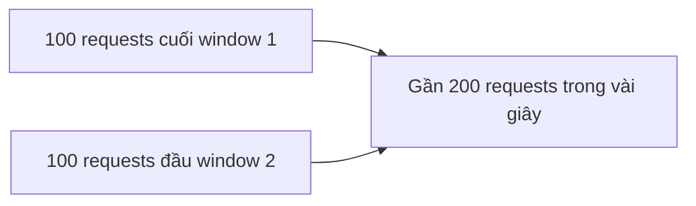
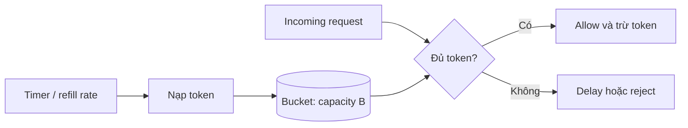
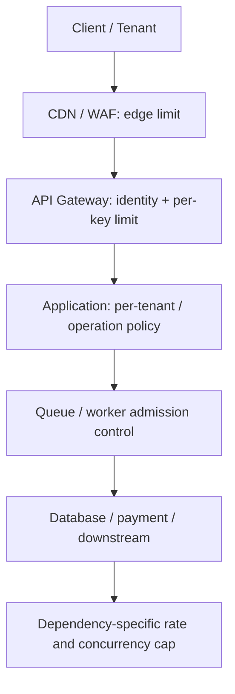

# Giới hạn tốc độ, hạn ngạch và phân bổ công bằng

## 1. Vì sao API cần giới hạn tốc độ?

Một API cloud có thể tự động tăng số instance, nhưng các dependency phía sau không mở rộng vô hạn. Database có giới hạn kết nối; dịch vụ thanh toán có quota request; hàng đợi và worker có dung lượng hữu hạn. Nếu một client gửi request quá nhanh hoặc một tenant tạo burst lớn, hệ thống có thể quá tải và ảnh hưởng tới tất cả người dùng.

Ba khái niệm cần thiết kế cùng nhau:

- **Rate limiting (giới hạn tốc độ):** giới hạn số request hoặc đơn vị công việc trong một khoảng thời gian.
- **Quota (hạn ngạch):** giới hạn tổng mức sử dụng trong một chu kỳ hoặc theo một tài nguyên, ví dụ số API call mỗi tháng hay dung lượng lưu trữ.
- **Fairness (phân bổ công bằng):** quy tắc chia năng lực dùng chung giữa client, tenant, người dùng hoặc loại công việc, tránh một bên chiếm toàn bộ tài nguyên.

Ba cơ chế này không thay thế nhau. Rate limit có thể ngăn một client gửi 1.000 request mỗi giây; quota giới hạn client đó ở 1 triệu request mỗi tháng; fairness bảo đảm tenant có backlog lớn không khiến tenant khác phải chờ vô hạn.

Trong module **CLOUD_ARCHITECTURE**, chương **Kiến trúc API** đặt các giới hạn này trong bối cảnh độ tin cậy, bảo mật, khả năng mở rộng, chi phí và vận hành theo Well-Architected.

Sau bài học, người học có thể:

1. Phân biệt rate limit, quota, concurrency limit, admission control và fairness.
2. Chọn thuật toán fixed window, sliding window, token bucket hoặc leaky bucket.
3. Thiết kế giới hạn theo client, tenant, API key, người dùng, endpoint và dependency.
4. Xác định enforcement tại gateway, ứng dụng và dịch vụ dùng chung.
5. Xử lý request vượt ngưỡng bằng HTTP semantics, Retry-After, backoff và idempotency.
6. Thiết kế quota chu kỳ, reservation, reset, cảnh báo và nâng hạn mức.
7. Kiểm thử burst, cạnh tranh, lỗi bộ đếm phân tán và công bằng dưới tải.

## 2. Phân biệt các loại giới hạn

| Khái niệm | Câu hỏi | Ví dụ |
| --- | --- | --- |
| **Rate limit** | Trong một đơn vị thời gian được thực hiện bao nhiêu request? | 100 request/phút cho một API key |
| **Quota** | Tổng mức sử dụng trong chu kỳ được phép là bao nhiêu? | 2 triệu API call/tháng |
| **Concurrency limit** | Có bao nhiêu request/job được chạy đồng thời? | Tối đa 20 export job |
| **Burst allowance** | Có thể gửi nhanh hơn tốc độ trung bình trong thời gian ngắn đến đâu? | Bucket tích lũy tối đa 50 token |
| **Fairness** | Năng lực được chia giữa các nhóm theo quy tắc nào? | Mỗi tenant có phần worker tối thiểu |
| **Admission control** | Có nhận công việc mới khi còn đủ năng lực không? | Từ chối export khi backlog vượt ngưỡng |
| **Circuit breaker** | Có tạm ngừng gọi dependency đang lỗi không? | Ngắt call payment provider sau nhiều lỗi |
| **Backpressure** | Làm sao báo upstream giảm tốc khi downstream nghẽn? | Consumer giảm pull rate hoặc trả 429/503 |

### 2.1. Rate limit khác concurrency

API có limit 60 request/phút vẫn có thể nhận 60 request gần như đồng thời nếu thuật toán cho phép burst. Ngược lại, giới hạn 10 request đồng thời vẫn có thể xử lý hàng nghìn request/phút nếu mỗi request hoàn tất rất nhanh.

Rate limit bảo vệ tốc độ tiếp nhận theo thời gian; concurrency limit bảo vệ số công việc đang giữ tài nguyên tại một thời điểm. Dùng cả hai khi API có thời gian xử lý biến động, ví dụ export dữ liệu, tạo PDF hoặc gọi dependency chậm.

### 2.2. Mỗi policy phải định nghĩa scope

“100 request/phút” chưa đủ rõ nếu không biết:

- 100 request cho mỗi IP, API key, user, tenant hay toàn hệ thống?
- Áp dụng cho mỗi endpoint, nhóm endpoint hay toàn bộ API?
- Request thành công mới tính hay mọi request đều tính?
- Retry, webhook, batch item và request bị từ chối có được tính không?
- Counter được chia sẻ giữa replicas và regions hay không?
- Window bắt đầu/reset lúc nào?

Định nghĩa hoàn chỉnh ví dụ: “Tenant X được gửi tối đa 120 request đọc/phút cho nhóm Search, burst tối đa 30 và tối đa 8 request đồng thời; limit áp dụng trên toàn region. Response 429 cung cấp thời gian thử lại phù hợp.”

## 3. Vì sao giới hạn cần thiết trong cloud?

Rate limit và quota phục vụ các mục tiêu:

- **Bảo vệ dịch vụ:** ngăn client lỗi vòng lặp, bot hoặc hành vi lạm dụng chiếm CPU, DB connection, queue và thread pool.
- **Bảo vệ dependency:** API có thể scale nhanh hơn database hoặc nhà cung cấp thanh toán; limit ngăn đẩy quá nhiều request xuống tầng chậm.
- **Công bằng đa tenant:** tránh một khách hàng SaaS chiếm hết capacity của nền tảng.
- **Quản trị chi phí:** hạn chế API đắt như OCR, AI inference, export hoặc gửi SMS.
- **Thực thi hợp đồng:** plan sản phẩm cung cấp mức sử dụng khác nhau.
- **Giảm lan truyền lỗi:** hạn chế retry và fan-out giúp lỗi một component không trở thành sự cố toàn hệ thống.
- **An toàn:** hạn chế password guessing, enumeration, spam và scraping.

Rate limiting không thay thế authentication, authorization, WAF, kiểm tra đầu vào hay fraud detection.

## 4. Xác định đơn vị tính và ngân sách năng lực

Trước khi chọn thuật toán, cần biết request nào tiêu tốn tài nguyên nhiều hơn. Một request đọc cache có thể rẻ hơn hàng trăm lần so với export dữ liệu. Nếu mọi request trừ một token như nhau, limit có thể bảo vệ sai chỗ.

### 4.1. Cost unit

Có thể tính theo số HTTP request, số bản ghi đọc/ghi, byte upload/download, CPU time, số job, số lần gọi provider hoặc trọng số do sản phẩm quy định.

| Endpoint | Cost weight minh họa | Lý do |
| --- | ---: | --- |
| GET profile | 1 | Truy vấn nhỏ, dễ cache |
| GET search | 2 | Truy vấn nhiều điều kiện |
| POST booking | 5 | Ghi dữ liệu, cạnh tranh và nhiều bước |
| POST reports | 20 | Job export lớn, dùng worker |
| POST SMS | 10 | Có phí bên thứ ba |

Một request trọng số 20 tiêu thụ 20 đơn vị quota. Trọng số phải dựa benchmark, dependency cost và giá sản phẩm.

### 4.2. Ước lượng throughput

```text
Required throughput = expected requests / time window

Example:
600,000 requests/hour
= 600,000 / 3,600
≈ 166.7 requests/second
```

Đây là throughput trung bình. Năng lực thiết kế cần tính burst, p95/p99 service time, concurrency, traffic mix và retry amplification.

### 4.3. Ước lượng concurrency

Theo định luật Little, với hệ thống ổn định:

```text
Average concurrency ≈ arrival rate × average service time
```

Ví dụ 200 request/giây với thời gian xử lý trung bình 0,4 giây tạo concurrency trung bình khoảng 80. Nếu downstream chậm và thời gian xử lý tăng lên 1,5 giây, concurrency tăng lên khoảng 300 dù tốc độ đến không đổi.

Concurreny cap và rate limit cần đi cùng nhau. Nếu chỉ giới hạn rate, request chậm có thể tích tụ và giữ hết connection, thread hoặc memory.

## 5. Các thuật toán rate limiting

### 5.1. Fixed window counter

Chia thời gian thành cửa sổ cố định, ví dụ từng phút; mỗi request tăng counter của cửa sổ hiện tại. Khi vượt ngưỡng, từ chối.

**Ưu điểm:** đơn giản, ít trạng thái, dễ triển khai.

**Hạn chế:** boundary burst. Client có thể gửi 100 request cuối phút và 100 request đầu phút kế tiếp, tạo gần 200 request trong vài giây.



Phù hợp quota chu kỳ hoặc limit thô nơi boundary burst có thể chấp nhận. Kết hợp concurrency cap nếu downstream nhạy cảm.

### 5.2. Sliding window log

Lưu timestamp từng request trong khoảng thời gian trượt. Khi request mới đến, xóa timestamp cũ rồi đếm số request còn lại.

Ưu điểm là chính xác tại mọi thời điểm. Hạn chế là bộ nhớ và thao tác atomic tăng theo số request. Thích hợp cho volume vừa hoặc hành động nhạy cảm cần độ chính xác cao.

### 5.3. Sliding window counter

Kết hợp counter của cửa sổ hiện tại và cửa sổ trước, ước lượng phần request của cửa sổ trước còn nằm trong khoảng trượt.

```text
estimated_count =
    current_window_count
  + previous_window_count × remaining_fraction

remaining_fraction =
    1 - (elapsed_in_current_window / window_size)
```

Chi phí trạng thái thấp hơn sliding log và mượt hơn fixed window, nhưng là phép ước lượng; burst tập trung trong cửa sổ trước có thể làm sai số.

### 5.4. Token bucket

Token bucket có dung lượng tối đa B token và tốc độ nạp r token/giây. Mỗi request cần một hoặc nhiều token. Nếu đủ token, request được phép và token bị trừ; nếu không đủ, request được trì hoãn hoặc từ chối.

Ví dụ bucket capacity 60 token, refill 1 token/giây:

- Khi đầy, client có thể gửi burst tối đa 60 đơn vị ngay lập tức.
- Sau khi dùng hết, tốc độ trung bình trở lại 1 đơn vị/giây.
- Sau 10 giây không dùng, bucket nhận tối đa 10 token, nhưng không vượt capacity.



Token bucket phù hợp cho API cần cho phép burst có giới hạn trong khi giữ tốc độ trung bình. Có thể dùng weighted token cho endpoint có cost khác nhau.

### 5.5. Leaky bucket

Request đến được xếp vào hàng đợi và xử lý theo tốc độ cố định hoặc gần cố định. Nếu queue đầy, request bị từ chối.

Ưu điểm là làm phẳng burst và giữ tốc độ đầu ra ổn định. Hạn chế là tăng queueing latency và cần giới hạn backlog. Phù hợp cho worker và dependency cần tốc độ xử lý đều hơn.

### 5.6. So sánh

| Thuật toán | Burst | Độ chính xác | Trạng thái | Phù hợp |
| --- | --- | --- | --- | --- |
| Fixed window | Có thể lớn ở boundary | Trung bình | Một counter/window | Quota chu kỳ |
| Sliding log | Giới hạn chính xác | Cao | Timestamp từng request | Hành động nhạy cảm |
| Sliding counter | Mượt hơn fixed | Xấp xỉ | Hai counter | API thông thường |
| Token bucket | Đến capacity | Tốt cho average rate + burst | Token và timestamp | API public |
| Leaky bucket | Queue giới hạn, output đều | Điều tiết tốt | Queue/backlog | Worker |

## 6. Token bucket và phép tính Retry-After

Các tham số chính:

- **Capacity (B):** số token tối đa.
- **Refill rate (r):** số token nạp mỗi giây.
- **Request cost (c):** số token request tiêu thụ.
- **Current tokens (T):** số token hiện có.
- **Last refill time:** timestamp lần cập nhật trước.

Cập nhật tại thời điểm t:

```text
elapsed = max(0, now - last_refill)
tokens = min(capacity, tokens + elapsed × refill_rate)

if tokens >= request_cost:
    tokens = tokens - request_cost
    allow request
else:
    reject or calculate retry_after

last_refill = now
```

Cập nhật, kiểm tra và trừ token phải atomic với các request cạnh tranh cùng bucket. Nếu nhiều replica cùng đọc T=1 và mỗi replica đều allow, policy bị vượt.

Nếu thiếu token, thời gian tối thiểu để có đủ token (chưa tính cạnh tranh từ request khác):

```text
tokens_needed = request_cost - current_tokens
retry_after = tokens_needed / refill_rate
```

Đây là ước lượng. Nếu có request khác tiếp tục lấy token, thời gian thực tế dài hơn. Không hứa một thời điểm chính xác nếu limiter không thể bảo đảm.

## 7. Quota theo chu kỳ

Quota thường áp dụng theo khoảng dài hơn:

- API calls mỗi ngày/tháng.
- Dung lượng file hoặc storage.
- Số user/seat.
- Số export job, giao dịch hoặc SMS.
- Mức sử dụng một dịch vụ bên thứ ba.

Các thuộc tính phải định nghĩa:

| Thuộc tính | Câu hỏi |
| --- | --- |
| Scope | Theo tenant, account, user hay API key? |
| Period | Phút, ngày, tháng lịch hay billing cycle? |
| Reset | UTC, timezone tenant hay ngày đăng ký? |
| Consumption | Trừ lúc nhận request hay lúc hoàn tất? |
| Reservation | Có giữ quota trước cho job async không? |
| Refund/adjustment | Request lỗi có hoàn quota không? |
| Hard/soft | Vượt quota bị chặn hay chỉ cảnh báo? |
| Rollover | Phần chưa dùng có chuyển chu kỳ sau? |
| Audit | Có giải thích được vì sao request bị từ chối không? |

### 7.1. Hard và soft quota

**Hard quota** chặn khi đạt giới hạn. Phù hợp giới hạn tài nguyên cứng hoặc chi phí nhà cung cấp.

**Soft quota** cảnh báo nhưng cho phép overage hoặc xử lý thủ công. Có thể đặt ngưỡng cảnh báo 70%, 90% và hard stop theo hợp đồng. Các mức phải là quyết định sản phẩm/tài chính, không phải mặc định.

### 7.2. Reservation cho job bất đồng bộ

Nếu chỉ trừ quota khi job hoàn thành, người dùng có thể enqueue hàng nghìn job trước khi counter được cập nhật. Có thể reserve khi nhận job:

1. Kiểm tra quota còn đủ.
2. Atomically reserve đơn vị sử dụng.
3. Enqueue job với job ID.
4. Khi hoàn tất, chuyển reservation thành usage.
5. Nếu job bị hủy/failed theo chính sách, release hoặc điều chỉnh.
6. Reconcile nếu enqueue và ghi trạng thái không cùng transaction.

Dùng idempotency/outbox hoặc workflow để tránh trừ quota nhưng mất job, hoặc tạo job mà không giữ quota.

## 8. Fairness trong hệ thống đa tenant

Nền tảng multi-tenant chia sẻ compute, database, queue và network. Một tenant lớn hoặc bug có thể chiếm gần hết worker, connection hoặc API capacity.

Fairness không nhất thiết là chia đều tuyệt đối. Plan cao hơn có thể được cấp nhiều capacity hơn. Điều cần bảo đảm là quy tắc minh bạch, có giới hạn và tránh starvation.

### 8.1. Các scope phân bổ

Có thể phân bổ theo tenant/account, API key, user, operation, service plan, priority class, loại job hoặc region.

Không dựa hoàn toàn vào IP: nhiều người dùng có thể chia sẻ một NAT address, còn client có thể đổi IP. IP là tín hiệu bổ sung cho unauthenticated traffic, không phải lúc nào cũng là identity chính.

### 8.2. Per-tenant limit và global limit

Ví dụ minh họa:

| Plan | Refill rate | Burst capacity | Concurrent jobs |
| --- | ---: | ---: | ---: |
| Basic | 10 units/s | 20 | 2 |
| Growth | 50 units/s | 100 | 10 |
| Enterprise | Theo hợp đồng | Theo hợp đồng | Theo capacity agreement |

Per-tenant limit ngăn một tenant chiếm toàn bộ API, nhưng vẫn cần global limit. Nếu 1.000 tenant mỗi tenant có 50 request/s thì potential demand là 50.000 request/s; có thể vượt backend budget.

### 8.3. Weighted fair sharing

Nếu có 100 worker slots và tenant A/B/C có weight 1/2/1, khi tất cả cùng có backlog, phần tham chiếu là 25/50/25 slots.

Work-conserving scheduler có thể cho tenant khác mượn capacity đang rảnh, nhưng phải bảo đảm tenant có weight lớn hơn lấy lại share khi nhu cầu xuất hiện. Cần giới hạn maximum share và tránh burst tích lũy vô hạn.

### 8.4. WFQ, DRR và starvation

- **Weighted fair queueing (WFQ):** mô phỏng chia sẻ tài nguyên theo weight thông qua virtual finish time.
- **Deficit round robin (DRR):** mỗi tenant có queue và deficit counter; theo vòng cộng quantum, xử lý job nếu cost không vượt deficit rồi trừ cost.

DRR phù hợp khi job có cost khác nhau và cần scheduler tương đối đơn giản. Cần giới hạn số queue và trạng thái; tenant không hoạt động không nên tích lũy capacity vô hạn.

Tránh starvation bằng minimum share, ageing để nâng priority job chờ lâu, queue riêng cho maintenance và metric oldest job age theo tenant. Fairness nên đo service time và công việc hoàn tất, không chỉ số request.

## 9. Giới hạn nhiều tầng



- **Edge/WAF:** giảm traffic không mong muốn trước compute. Cần tránh chặn nhầm nhiều người dùng chung IP.
- **API gateway:** xác thực API key/JWT, áp limit theo key/route/stage, trả response nhất quán. Gateway không luôn hiểu billing usage hoặc quota reservation.
- **Application:** hiểu tenant, actor, quyền và cost của operation; phù hợp với quota nghiệp vụ.
- **Dependency:** concurrency cap, pool, queue consumer limit hoặc bulkhead bảo vệ database và provider.

Bulkhead tách tài nguyên để lỗi một nhóm call không chiếm hết thread/connection của nhóm khác. Ví dụ payment và report export dùng pool riêng.

## 10. Bộ đếm phân tán và tính nguyên tử

Trong một instance, limiter có thể dùng counter trong memory. Khi chạy nhiều replica, counter riêng sẽ nhân giới hạn lên.

Ví dụ tenant được 100 request/phút, ứng dụng chạy 5 replica. Nếu mỗi replica cho phép 100, tenant có thể gửi gần 500 request/phút.

### 10.1. Shared counter

Có thể dùng Redis hoặc datastore atomic. Refill, kiểm tra và trừ token phải chạy atomic bằng script/transaction/primitive phù hợp.

Ưu điểm là các replica thấy cùng trạng thái. Đánh đổi là thêm network hop, store thành dependency; cần HA, capacity, eviction và persistence policy.

Chuẩn hóa limiter key và đặt TTL để tránh key cardinality attack.

### 10.2. Local quota lease

Một phương án là cấp budget tổng cho từng replica. Ví dụ global budget 1.000 token/s chia cho 10 replica, mỗi replica được lease 100 token/s.

Cách này giảm network coordination nhưng capacity có thể bị lãng phí nếu replica không dùng hết; cần tái cân bằng khi scale. Nếu lease cấp sai hoặc có split-brain, tổng allowance có thể vượt global budget.

Chọn nhất quán theo hậu quả: billing/resource cứng cần chính xác cao; abuse protection có thể chấp nhận overshoot nhỏ nếu global overload vẫn được chặn.

### 10.3. Clock và time drift

- Dùng monotonic clock cho elapsed time cục bộ.
- Dùng nguồn thời gian đồng bộ khi bộ đếm thống nhất giữa hosts.
- Không để thời gian lùi làm token tăng hoặc window reset bất thường.
- Định nghĩa semantics khi key được tạo lại sau eviction/restart.

## 11. Identity và limiter key

```text
rate_limit_key =
    tenant_id + ":" + api_plan + ":" + route_group

possible scopes:
    user_id
    api_key_id
    client_application_id
    source_ip
    tenant_id + operation
    global_dependency_name
```

Nguyên tắc:

- Xác định identity sau authentication; không tin tenant ID trong body nếu chưa kiểm chứng.
- Key ổn định qua requests và có cardinality được kiểm soát.
- Với unauthenticated route, IP có thể là scope ban đầu nhưng cần cân nhắc NAT/proxy.
- Dùng route group/cost class thay vì bucket riêng cho mọi path ID động.
- Tránh PII trực tiếp trong key/log; dùng opaque ID/hash phù hợp.
- Version hóa key khi đổi policy/schema.
- Xác định trusted proxy trước khi tin X-Forwarded-For.

Nếu một API key đại diện nhiều tenant hoặc service-to-service call, phải xác định principal và billable tenant chính xác.

## 12. HTTP behavior khi vượt giới hạn

Với HTTP API, **429 Too Many Requests** là status phù hợp khi client gửi quá nhiều request theo policy. Có thể trả header Retry-After và các header quota/remaining/reset nếu contract công bố.

```http
HTTP/1.1 429 Too Many Requests
Content-Type: application/problem+json
Retry-After: 3

{
  "type": "https://api.example.com/problems/rate-limit",
  "title": "Request rate exceeded",
  "status": 429,
  "detail": "The tenant request budget is temporarily exhausted.",
  "code": "RATE_LIMIT_EXCEEDED",
  "retryAfterSeconds": 3
}
```

Không lộ nội bộ như tên Redis cluster, counter key hoặc policy secret. Error detail cần đủ để client chọn hành động nhưng không tiết lộ cách bypass.

### 12.1. Phân biệt status code

| Status | Ý nghĩa | Hành vi client |
| --- | --- | --- |
| 401 | Chưa xác thực hoặc credential không hợp lệ | Xác thực lại |
| 403 | Đã xác thực nhưng không có quyền/policy cấm | Không retry như lỗi tạm thời |
| 429 | Quá tốc độ hoặc quota theo policy client | Chờ theo Retry-After, giảm tốc |
| 503 | Dịch vụ tạm không thể nhận thêm tải/sự cố khả dụng | Retry có backoff nếu an toàn |
| 504 | Gateway timeout | Kết quả side effect có thể chưa rõ; tra cứu trước khi retry |

Không dùng 429 cho mọi lỗi backend. Error contract cần phản ánh nguyên nhân đủ chính xác.

## 13. Retry, backoff và idempotency

Retry ngay lập tức làm tất cả client gửi lại cùng lúc và tạo burst mới.

Chính sách client hợp lý:

1. Tôn trọng Retry-After nếu có.
2. Dùng exponential backoff có giới hạn.
3. Thêm jitter để phân tán thời điểm retry.
4. Giới hạn số lần retry và deadline tổng.
5. Chỉ retry thao tác an toàn hoặc có idempotency key.
6. Dừng retry khi deadline nghiệp vụ hết.
7. Không retry lỗi validation/authorization cố định.

### 13.1. Exponential backoff với full jitter

```text
cap_n = min(max_delay, base_delay × 2^attempt)
sleep = random(0, cap_n)
```

Jitter ngăn các client retry đồng loạt. Nếu server gửi Retry-After, client tuân theo thời gian đó và có thể thêm jitter sau đó, không thử sớm hơn.

### 13.2. Idempotency với side effect

Nếu POST /payments bị 429 trước khi xử lý, retry sau thời gian chờ có thể an toàn theo contract. Nhưng nếu timeout sau khi provider xử lý, client không biết trạng thái. Phải dùng cùng idempotency key và tra cứu trạng thái, không tạo payment key mới.

Rate limit bảo vệ năng lực; idempotency bảo đảm gửi lại không tạo tác dụng nghiệp vụ trùng.

## 14. Usage metering và quota ledger

Với sản phẩm tính phí theo usage, cần cơ chế đo có thể giải thích và kiểm toán. Usage record có thể gồm:

- Tenant/account ID dạng opaque.
- Operation/resource type.
- Số unit/cost weight.
- Timestamp, billing period và source event ID.
- Trạng thái billable/non-billable/adjustment.
- Correlation/reference và policy version.

Không chỉ lưu counter tổng nếu cần giải thích cách tính phí. Có thể dùng append-only usage ledger và aggregate counter cho quyết định nhanh.

### 14.1. Xử lý trùng usage event

Worker có thể commit ledger rồi chết trước ack; event được replay. Cần event ID ổn định, unique constraint/deduplication và cập nhật ledger/inbox đủ nguyên tử. Nếu counter và ledger ở hai store, dùng outbox/reconciliation để sửa sai lệch.

### 14.2. Reset quota

Định nghĩa rõ UTC hay timezone tenant, ngày bắt đầu subscription, rollover, overage, đổi plan giữa chu kỳ và request bắt đầu trước reset nhưng hoàn tất sau reset.

Không xóa counter rồi hy vọng không có request đồng thời. Gắn usage với period key và dùng transaction/atomic update để chuyển chu kỳ.

## 15. Fairness trong queue và worker

Nếu mọi job nằm trong một FIFO queue, tenant lớn có thể tạo backlog dài và đẩy job của tenant nhỏ xuống cuối.

Các lựa chọn:

- Queue riêng theo tenant: cô lập tốt nhưng số queue có thể lớn.
- Queue theo priority class: đơn giản nhưng tenant cùng class vẫn cạnh tranh.
- Scheduler chọn job round-robin hoặc weighted fair.
- Per-tenant cap cho số job in-flight.
- Partition theo tenant khi cần ordering, nhưng tránh hot partition.
- Age-based promotion để giảm starvation.

Job có cost khác nhau; fairness theo số lượng job có thể bất công nếu job A chạy 10 giây còn B chạy 10 ms. Dùng weighted cost hoặc service-time estimate.

## 16. Multi-region và quota toàn cục

Nếu API chạy hai region và mỗi region giữ bucket 100 request/s riêng, tổng có thể gần 200 request/s.

| Mô hình | Ưu điểm | Hạn chế |
| --- | --- | --- |
| Global coordinated counter | Chính xác hơn | Thêm latency và phụ thuộc store trung tâm |
| Per-region allocation | Enforcement local nhanh | Có thể lãng phí, cần tái cấp phát |
| Eventual reconciliation | Fast path local | Chấp nhận overshoot |
| Home-region per tenant | Một owner rõ | Cross-region routing và failover phức tạp |

Quota billing hoặc bảo vệ dependency cứng cần enforcement chính xác. Abuse limit có thể chấp nhận sai số nhỏ nếu có global protection.

Trong failover, phải định nghĩa chuyển budget và ownership; nếu hai region cùng nghĩ mình là primary, split-brain có thể làm vượt quota. Lease/fencing token hoặc cơ chế owner rõ có thể cần thiết.

## 17. Failure mode của limiter

Rate limiter cũng là dependency có thể lỗi:

- **Fail-open:** cho request đi qua; tăng availability nhưng có thể vượt quota và overload.
- **Fail-closed:** từ chối request; bảo vệ dependency/chi phí nhưng giảm availability.
- **Degraded local limit:** dùng conservative local limit khi shared store lỗi; không bảo đảm chính xác toàn cục.
- **Queue/defer:** lưu công việc nếu business deadline cho phép.

Không có lựa chọn duy nhất cho mọi operation:

| Operation | Policy khi limiter store lỗi | Lý do |
| --- | --- | --- |
| Search public/cacheable | Conservative local fallback hoặc fail-open có kiểm soát | Ưu tiên trải nghiệm và bảo vệ backend |
| Charge payment | Fail-safe theo workflow/idempotency | Tác động tài chính |
| Export lớn | Fail-closed hoặc defer | Tài nguyên đắt |
| Health endpoint | Không phụ thuộc limiter dùng chung | Cần khả năng giám sát |
| Login/password verification | Fallback bảo thủ | Rủi ro brute force |

Limiter cần timeout ngắn, connection pool riêng, circuit breaker/fallback và telemetry. Không để lỗi limiter làm mất toàn bộ health/diagnostic path.

## 18. Bảo mật và chống lạm dụng

- Xác thực trước khi áp quota theo tenant; không tin tenant ID từ client.
- Chỉ tin forwarding header từ proxy được quản lý.
- Có limit riêng cho login, password reset, OTP và endpoint tốn chi phí.
- Dùng nhiều tín hiệu: account, user, IP, device risk và operation.
- Giới hạn payload, concurrency và request size.
- Chống key cardinality attack; client không được tạo vô hạn limiter keys.
- Admin override cần authorization, audit và expiration.
- Kết hợp bot management/WAF và fraud detection khi cần.

### 18.1. Tenant isolation

Tenant A không được tiêu thụ quota hoặc đọc usage ledger của B. Mọi thao tác phải xác định tenant từ identity đã xác thực; query/cache key phải mang tenant scope; admin override phải có audit.

Nếu một API key đại diện nhiều tenant, phải xác định principal và billable tenant ở từng request. Không suy từ một credential duy nhất nếu credential có thể được chia sẻ.

## 19. Observability và cảnh báo

| Metric | Ý nghĩa |
| --- | --- |
| Requests allowed/rejected | Tỷ lệ request được chấp nhận |
| 429 theo tenant/route | Ai vượt giới hạn và ở endpoint nào |
| Tokens remaining/bucket utilization | Mức tiêu thụ bucket |
| Quota used/remaining/projected | Tenant sắp hết quota |
| Concurrency/in-flight jobs | Tài nguyên đang bị chiếm dụng |
| Queue depth/oldest age theo tenant | Công việc chờ quá lâu |
| Scheduler share/service time | Phân bổ thực tế |
| Limiter backend latency/error | Limiter có thành bottleneck không |
| Retry/duplicate rate | Retry storm hoặc xử lý lặp |
| Downstream 429/5xx/timeout | Dependency quá tải |

Tránh metric label theo request ID hoặc key cardinality vô hạn. Dashboard theo tenant phải kiểm soát PII và quyền xem.

Cảnh báo hữu ích gồm quota gần ngưỡng, 429 tăng bất thường, global concurrency sát hard cap, queue age vượt deadline, một tenant chiếm quá nhiều worker time, limiter store lỗi, provider 429 tăng và usage ledger lệch counter.

## 20. Kiểm thử và xác minh giới hạn

| Kịch bản | Cách thử | Điều kiện đạt |
| --- | --- | --- |
| Vượt token bucket | Gửi burst lớn hơn capacity | Allowance khớp B/refill |
| Refill | Chờ các khoảng thời gian khác nhau | Token tăng đúng rate, không vượt capacity |
| Boundary burst | Gửi cuối và đầu fixed window | Hành vi boundary đúng policy |
| Multi-replica | Gửi đồng thời qua nhiều instance | Tổng allowance không vượt policy ngoài sai số thiết kế |
| Weighted cost | Gọi endpoint cost khác nhau | Usage trừ đúng unit |
| Concurrent jobs | Enqueue vượt cap | Số job in-flight giữ đúng giới hạn |
| Fairness | Tenant A flood, tenant B gửi ít | B vẫn được phục vụ theo contract |
| Retry storm | Dependency trả 429/503 đồng loạt | Backoff/jitter giảm tải |
| Limiter outage | Ngắt shared store | Fallback đúng policy |
| Clock drift | Giả lập timestamp skew | Counter không reset/refill bất thường |
| Quota reset | Gửi request tại ranh giới chu kỳ | Không mất usage hoặc trừ hai lần |
| Duplicate event | Replay cùng event ID | Ledger không nhân usage |
| Multi-region | Gửi vào hai region cùng lúc | Global budget/region allocation đúng |
| Tenant spoofing | Sửa tenant ID trong body/header | Không truy cập hoặc tiêu thụ quota tenant khác |

### 20.1. Invariant cho token bucket

- Token luôn từ 0 đến capacity.
- Request chỉ được allow khi đủ token tại thời điểm atomic decision.
- Token không tăng nhanh hơn refill rate.
- Bucket không vượt capacity sau thời gian idle dài.
- Tổng token tiêu thụ không vượt token ban đầu cộng refill hợp lệ.
- Request bị reject không tạo side effect.

## 21. Quy trình thiết kế

1. **Xác định mục tiêu:** chống abuse, bảo vệ DB, billing hay chia capacity.
2. **Lập workload profile:** arrival rate, burst, service time, cost unit, peak và tenant mix.
3. **Chọn scope/key:** tenant, user, API key, route, dependency hoặc global.
4. **Đặt global budget:** compute, DB, queue và provider.
5. **Chọn thuật toán:** window, token bucket, leaky bucket hoặc scheduler.
6. **Kết hợp concurrency:** đặt trần in-flight và admission control.
7. **Thiết kế fairness:** per-tenant budget, weight, minimum share và aging.
8. **Xác định failure behavior:** fail-open/closed/degraded, Retry-After, retry budget, DLQ.
9. **Xây usage metering:** ledger, period, reset, reservation, adjustment, audit.
10. **Quan sát và kiểm thử:** 429, quota, fairness, backend saturation và limiter outage.
11. **Công bố contract:** client hiểu limit, error code, reset và quy trình xin nâng hạn mức.
12. **Đánh giá lại:** theo production data, chi phí, plan và năng lực dependency.

## 22. Tình huống thực hành: nền tảng SaaS đặt chỗ

Nền tảng có ba gói:

| Plan | Rate budget | Burst | Concurrent jobs |
| --- | ---: | ---: | ---: |
| Basic | 20 units/s | 40 | 2 |
| Growth | 80 units/s | 160 | 10 |
| Enterprise | Theo hợp đồng | Theo hợp đồng | Theo capacity agreement |

Operation cost: GET profile = 1, GET search = 2, POST booking = 5, POST export = 20, POST SMS = 10. Database có budget 250 query units/s; payment provider 100 request/s; SMS provider 30 request/s. Export có thể chạy 2–5 phút.

### 22.1. Rủi ro

- Một tenant Growth có thể tạo burst khiến DB vượt budget.
- Search cache miss làm query cost tăng.
- Export chiếm worker và connection pool.
- Payment/SMS provider có limit thấp hơn tốc độ scale của API.
- Limiter store lỗi làm hệ thống fail hoặc cho traffic vượt budget.
- Usage event replay làm quota bị trừ trùng.

### 22.2. Thiết kế đề xuất

- Gateway áp token bucket theo tenant/plan và route group.
- Application tính cost unit sau authorization.
- Global limiter/admission cap bảo vệ database budget.
- Booking có concurrency cap và connection budget riêng.
- Export vào queue với quota job/tenant và weighted fair scheduling.
- Payment/SMS có queue riêng, rate cap theo provider budget và retry theo Retry-After/jitter.
- Usage ledger ghi event ID; counter dùng cho fast decision; reconciliation so với ledger.
- Tenant nhận 429 khi rate limit; hard quota exhausted có mã lỗi riêng và trang xem usage.
- Limiter outage dùng policy theo operation: export fail-closed, health path bypass, search fallback bảo thủ.
- Dashboard theo tenant, queue age, limiter latency và dependency utilization.

### 22.3. Bài kiểm thử

1. Tenant Basic flood search trong khi Enterprise booking: cả hai được xử lý theo plan.
2. 100 tenant Growth burst cùng lúc: database budget không bị vượt.
3. Payment provider trả 429: consumer điều tiết và không tạo payment duplicate.
4. Một tenant enqueue 10.000 export job: tenant khác vẫn có service share.
5. Limiter store bị ngắt: fallback đúng policy.
6. Replay usage event: ledger không tăng hai lần.
7. Quota reset: usage trước/sau reset được ghi đúng.
8. Client giả tenant ID: không tiêu thụ quota của tenant khác.

## 23. ADR mẫu: bảo vệ dependency và công bằng giữa tenant

```text
ADR-052: Token bucket theo tenant và fair scheduling cho export

Bối cảnh:
- API SaaS có nhiều tenant và gói dịch vụ khác nhau.
- Search/booking dùng chung database; export chiếm worker lâu.
- Payment/SMS có quota riêng từ nhà cung cấp.

Lựa chọn:
A. Global rate limit tại gateway cho mọi tenant.
B. Per-tenant token bucket + global dependency caps + fair queues.
C. Không giới hạn, chỉ scale compute theo tải.

Quyết định:
- Chọn B.
- Gateway áp limit sơ bộ theo identity/plan.
- Application tính cost unit sau authorization.
- Global concurrency/connection budgets bảo vệ dependency.
- Export queue có per-tenant limit và weighted fair scheduling.
- Usage ledger và idempotent event phục vụ quota/billing.

Đánh đổi:
- Thêm shared limiter state và scheduler.
- Cần vận hành queue, reconciliation và fairness metrics.
- Có thể từ chối request hợp lệ khi quota/capacity cạn.

Kiểm chứng:
- Multi-tenant burst không vượt dependency budget.
- Tenant ít tải không bị starvation.
- Limiter outage có fallback theo operation.
- Retry/replay không tạo side effect hoặc usage trùng.
- Cost và 429 rate đáp ứng mục tiêu sản phẩm.

Điều kiện xem lại:
- Database/provider capacity thay đổi.
- Plan/usage pricing thay đổi.
- Fairness hoặc tail latency không đạt SLO.
```

## 24. Những lỗi thiết kế thường gặp

1. **Chỉ có global limit:** tenant lớn vẫn chiếm phần lớn capacity.
2. **Chỉ có per-tenant limit:** tổng demand vẫn có thể vượt global budget.
3. **Không phân biệt rate và concurrency:** request chậm làm số in-flight tăng vọt.
4. **Fixed window bỏ qua boundary burst:** request dồn ở hai cửa sổ liên tiếp.
5. **Counter local trên mỗi replica:** allowance bị nhân theo số instance.
6. **Limiter update không atomic:** request cùng tiêu thụ một token.
7. **Chỉ dùng IP:** NAT/proxy gây chặn nhầm.
8. **Retry ngay sau 429:** tạo retry storm.
9. **Tính cost đồng đều:** export nặng không bị tính đúng.
10. **Quota chỉ có counter:** khó audit, điều chỉnh và phục hồi replay.
11. **Không reservation cho async job:** job và quota lệch nhau.
12. **Không fairness trong queue:** tenant backlog lớn gây starvation.
13. **Fail-open mọi nơi:** limiter lỗi làm dependency bị flood.
14. **Fail-closed mọi nơi:** health/diagnostic và chức năng ít rủi ro cũng dừng.
15. **Không quan sát 429 theo tenant:** khó tìm nguyên nhân và người bị ảnh hưởng.
16. **Contract thiếu semantics:** client không biết window, burst, reset và retry.
17. **Không có quy trình nâng quota:** support không giải thích được limit.

## 25. Checklist trước production

- [ ] Mục tiêu của từng limit được ghi rõ: abuse, dependency, billing hay fairness.
- [ ] Cost unit dựa trên benchmark và được version hóa.
- [ ] Scope/identity xác thực; không tin tenant ID từ client.
- [ ] Có per-tenant và global budget.
- [ ] Rate limit đi cùng concurrency cap khi service time biến động.
- [ ] Thuật toán phù hợp burst, độ chính xác và chi phí state.
- [ ] Shared counter có atomic update và clock semantics phù hợp.
- [ ] Quota period/reset/reservation/refund/overage được định nghĩa.
- [ ] Usage ledger có event ID, deduplication, audit và reconciliation.
- [ ] Worker fairness có minimum share/aging hoặc policy chống starvation.
- [ ] Dependency-specific limit bảo vệ DB, payment, SMS và dịch vụ ngoài.
- [ ] HTTP 429/error contract và Retry-After rõ; client có backoff/jitter.
- [ ] Retry side effect an toàn nhờ idempotency.
- [ ] Limiter outage có policy theo operation.
- [ ] Queue, DLQ, backlog age và tenant utilization được giám sát.
- [ ] Metric cardinality và log không làm lộ PII/credential.
- [ ] Đã thử multi-replica, burst, clock drift, limiter outage và fairness.
- [ ] Có runbook, owner, quy trình nâng quota và điều kiện xem lại.

---

**Ghi nhớ:** Rate limit bảo vệ tốc độ, quota quản lý tổng mức sử dụng, còn fairness quyết định cách chia năng lực giữa các bên. Kiến trúc API đáng tin cậy kết hợp cả ba với concurrency control, global dependency budget, retry có kỷ luật và telemetry theo tenant. Mục tiêu không chỉ là từ chối request vượt ngưỡng, mà còn bảo đảm hệ thống tiếp tục phục vụ công bằng, đúng hợp đồng và trong năng lực vận hành đã xác nhận.
