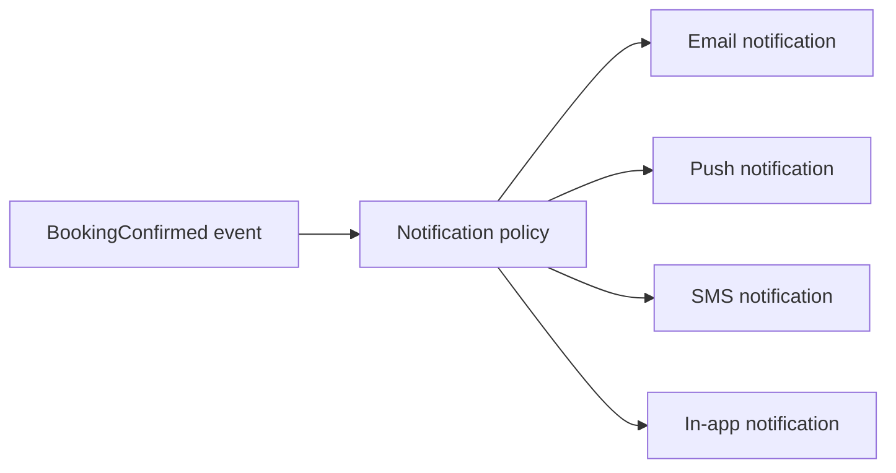
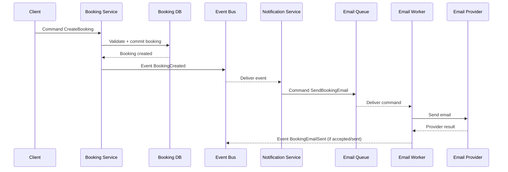
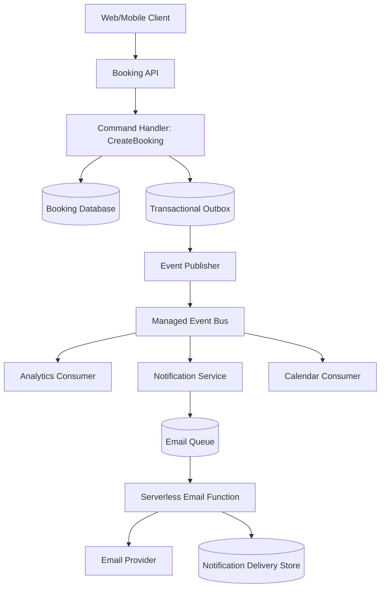

# Phân biệt lệnh, sự kiện và thông báo

## 1. Ba khái niệm gần nhau nhưng mang ý nghĩa khác nhau

Trong kiến trúc hướng sự kiện (event-driven architecture), các dịch vụ trao đổi thông tin để phối hợp xử lý nghiệp vụ. Một hệ thống có thể gửi yêu cầu tạo đơn hàng, phát tín hiệu rằng đơn hàng đã được tạo, rồi gửi thông tin cho khách hàng để xác nhận. Cả ba luồng đều có thể được biểu diễn bằng message hoặc API call, nhưng ý nghĩa và trách nhiệm của chúng khác nhau.

- **Lệnh (command)** yêu cầu một thành phần thực hiện một hành động.
- **Sự kiện (event)** mô tả một điều đã xảy ra hoặc một thay đổi đã được ghi nhận.
- **Thông báo (notification)** truyền thông tin đến một đối tượng hoặc nhóm người nhận để họ biết một điều gì đó; tùy ngữ cảnh, đây có thể là thông báo cho con người hoặc một message thông báo giữa các hệ thống.

Nếu dùng lẫn ba khái niệm, hệ thống dễ tạo phụ thuộc sai: consumer tự ý thực hiện một hành động khi chỉ nên nhận biết sự kiện, producer phát event trước khi nghiệp vụ được commit, hoặc một notification bị coi như nguồn dữ liệu chuẩn. Phân biệt rõ giúp xác định ai sở hữu hành động, ai sở hữu trạng thái, ai có quyền phát message và điều gì xảy ra khi message được gửi lại.

Bài học thuộc chương **Kiến trúc sự kiện** của module **CLOUD_ARCHITECTURE**. Ta sẽ nối ngữ nghĩa message với API, queue, event bus, function, database và các dịch vụ managed trên cloud; đồng thời xem xét độ tin cậy, bảo mật, mở rộng, chi phí và vận hành theo Well-Architected.

Sau bài học, bạn có thể:

- Nhận diện command, event và notification dựa trên mục đích, thời điểm và người nhận.
- Thiết kế tên, schema và metadata cho từng loại message.
- Chọn synchronous API, queue hay event bus theo nhu cầu phối hợp.
- Xác định ownership, quyền phản hồi, idempotency và xử lý lỗi.
- Xây dựng ví dụ luồng sự kiện có thể mở rộng và quan sát được.

## 2. Lệnh (command): yêu cầu một hành động

**Command** là thông điệp mang tính mệnh lệnh: bên gửi muốn một bên chịu trách nhiệm thực hiện hành động cụ thể. Command thường có một logical owner/handler có quyền quyết định có thực hiện hay từ chối hành động.

Ví dụ:

- `CreateBooking`: tạo một lịch đặt mới.
- `CancelBooking`: hủy một lịch đặt.
- `ReserveInventory`: giữ số lượng hàng cho một đơn.
- `CapturePayment`: yêu cầu thu tiền của một payment intent.

### 2.1. Đặc điểm của command

| Khía cạnh | Ý nghĩa |
|---|---|
| Ngữ nghĩa | Yêu cầu làm một việc |
| Hướng | Thường gửi đến một handler/owner xác định |
| Thời điểm | Trước hoặc tại thời điểm hành động được thực hiện |
| Phản hồi | Có thể thành công, từ chối, thất bại hoặc chờ xử lý |
| Quyền quyết định | Handler có thể validate và từ chối |
| Tác động | Có thể làm thay đổi trạng thái nghiệp vụ |

Command thường đặt tên bằng **động từ + đối tượng**. `ApproveLoan` rõ hơn `LoanApproved`, vì từ thứ hai mô tả một kết quả đã xảy ra.

Command không đồng nghĩa với một request HTTP. Nó có thể được truyền bằng HTTP/gRPC đồng bộ, queue bất đồng bộ hoặc workflow. Điều quan trọng là ý định thực hiện hành động và nơi chịu trách nhiệm.

### 2.2. Command có thể được chấp nhận nhưng chưa hoàn tất

Với xử lý đồng bộ, API có thể trả kết quả ngay sau khi hành động hoàn tất. Với command bất đồng bộ, hệ thống có thể trả `202 Accepted` cùng một command ID hoặc operation ID. Điều đó chỉ xác nhận yêu cầu đã được tiếp nhận theo hợp đồng API, **không có nghĩa nghiệp vụ đã hoàn tất**.

Ví dụ:

```http
POST /bookings
Idempotency-Key: 0c2b...
Content-Type: application/json

{
  "customerId": "C-100",
  "slotId": "S-202"
}
```

Phản hồi bất đồng bộ có thể là:

```http
HTTP/1.1 202 Accepted
Content-Type: application/json

{
  "commandId": "cmd-789",
  "status": "accepted",
  "statusUrl": "/operations/cmd-789"
}
```

Client cần dùng operation ID để truy vấn trạng thái hoặc nhận notification khi xử lý hoàn tất. Không nên hiển thị “đặt lịch thành công” chỉ từ việc command đã được tiếp nhận.

## 3. Sự kiện (event): ghi nhận điều đã xảy ra

**Event** mô tả một sự kiện hoặc thay đổi đã xảy ra trong miền nghiệp vụ. Nó thường được đặt tên theo thì quá khứ hoặc trạng thái đã hoàn tất:

- `BookingCreated`
- `BookingCancelled`
- `InventoryReserved`
- `PaymentCaptured`

Event cho biết **điều gì đã xảy ra**, không yêu cầu consumer phải thực hiện một hành động cụ thể. Consumer tự quyết định có quan tâm và cần phản ứng thế nào trong phạm vi trách nhiệm của mình.

### 3.1. Đặc điểm của event

| Khía cạnh | Ý nghĩa |
|---|---|
| Ngữ nghĩa | Sự thật đã được ghi nhận |
| Hướng | Có thể phát tới nhiều subscriber |
| Thời điểm | Sau khi điều kiện phát event đã xảy ra; thường sau commit trạng thái |
| Phản hồi | Consumer không nhất thiết trả lời producer |
| Quyền quyết định | Event không yêu cầu một handler duy nhất phải thực hiện đúng một hành động |
| Tác động | Bản thân event là dữ kiện; consumer có thể tạo tác động riêng |

Ví dụ, sau khi booking được commit, hệ thống phát `BookingCreated`. Các consumer có thể cập nhật lịch, gửi email, tạo analytics event hoặc kích hoạt quy trình nhắc lịch. Producer không cần biết tất cả consumer đang làm gì.

### 3.2. Event không phải là một command được đổi tên

So sánh:

| Command | Event |
|---|---|
| `ReserveRoom` | `RoomReserved` |
| `CancelBooking` | `BookingCancelled` |
| `CapturePayment` | `PaymentCaptured` |
| `ShipOrder` | `OrderShipped` |

`ReserveRoom` yêu cầu một dịch vụ giữ phòng; handler có quyền từ chối vì hết chỗ. `RoomReserved` thông báo việc giữ phòng đã thành công. Consumer nhận event không nên hiểu nó như lời gọi yêu cầu giữ phòng thêm lần nữa.

Sự khác biệt về thời điểm rất quan trọng. Không phát `PaymentCaptured` trước khi hệ thống có bằng chứng khoản thanh toán đã được ghi nhận thành công. Nếu chỉ mới yêu cầu đối tác thu tiền, có thể phát một event có ngữ nghĩa đúng hơn như `PaymentCaptureRequested` hoặc `PaymentCaptureInitiated`, nếu đó là trạng thái thật của mô hình.

## 4. Thông báo (notification): truyền thông tin cho người nhận

**Notification** là thông tin gửi đến người hoặc hệ thống để họ biết một trạng thái, kết quả hoặc thay đổi. Trong thực tế, từ “notification” có thể được dùng ở hai phạm vi:

1. **User notification:** email, SMS, push notification, in-app alert hoặc thông báo cho nhân viên vận hành.
2. **System notification:** message báo cho một hệ thống khác rằng một sự kiện hoặc kết quả cần được chú ý.

Notification hướng tới người nhận và mục tiêu truyền đạt. Ví dụ: “Lịch đặt của bạn đã được xác nhận vào 10:00 ngày mai.” Nó có thể được tạo từ `BookingConfirmed`, nhưng **không nhất thiết là event domain gốc**.

### 4.1. Event và notification liên hệ thế nào?

Một event có thể kích hoạt nhiều notification được cá nhân hóa hoặc theo kênh:



Event là dữ kiện trong miền nghiệp vụ. Notification là cách truyền thông tin tới người nhận; có thể áp dụng ngôn ngữ, template, thời gian gửi, tùy chọn nhận và trạng thái delivery. Một notification có thể được retry gửi nhiều lần nhưng không nên làm phát sinh thay đổi nghiệp vụ như xác nhận booking lần nữa.

Ví dụ:

| Message | Loại | Ý nghĩa |
|---|---|---|
| `ConfirmBooking` | Command | Yêu cầu xác nhận một booking |
| `BookingConfirmed` | Event | Booking đã chuyển sang trạng thái confirmed |
| `BookingConfirmationEmailRequested` | Command tới notification service | Yêu cầu tạo và gửi email xác nhận |
| “Lịch của bạn đã được xác nhận” | User notification | Nội dung hiển thị cho khách hàng |

Tên có chữ “notification” không tự quyết định message là command hay event. Hãy xét ngữ nghĩa thực tế: nếu nó yêu cầu một service gửi email, đó là command; nếu ghi nhận email đã được gửi, đó có thể là event `EmailSent`; nếu là nội dung gửi tới người dùng, đó là notification.

## 5. So sánh ba loại message

| Tiêu chí | Command | Event | Notification |
|---|---|---|---|
| Mục đích | Yêu cầu hành động | Ghi nhận điều đã xảy ra | Truyền thông tin tới người nhận |
| Tên thường dùng | Động từ mệnh lệnh | Sự kiện ở thì quá khứ | Nội dung/trạng thái cho người nhận |
| Đích | Handler/owner cụ thể | Một hoặc nhiều subscriber | Người dùng, nhóm hoặc hệ thống cần biết |
| Có quyền từ chối? | Có, handler quyết định | Event đã xảy ra không được “từ chối”; subscriber có thể bỏ qua hoặc lỗi khi xử lý | Người nhận có thể không nhận được; delivery service cần quản lý lỗi |
| Trạng thái hoàn tất | Accepted/processed/rejected/failed | Được phát/ghi nhận, subscriber xử lý độc lập | Queued/sent/delivered/read tùy kênh |
| Mức gắn kết | Thường biết đích cần thực hiện | Giảm phụ thuộc producer vào consumer cụ thể | Phụ thuộc kênh và người nhận |
| Ví dụ | `CancelOrder` | `OrderCancelled` | “Đơn hàng đã được hủy” |

### 5.1. Một chuỗi nghiệp vụ minh họa

1. Client gửi command `CreateBooking`.
2. Booking service kiểm tra slot và quyền, ghi booking.
3. Sau khi commit, hệ thống phát event `BookingCreated`.
4. Notification service nhận event, quyết định gửi email và phát command `SendBookingEmail` tới email worker.
5. Email provider phản hồi; worker cập nhật delivery status và có thể phát event `BookingEmailSent`.
6. Client đọc trạng thái booking từ nguồn dữ liệu chuẩn; không dựa vào việc email đã gửi để kết luận booking còn hiệu lực.

Sơ đồ:



Trong hệ thống thực, producer cần bảo đảm event không bị mất giữa database commit và publish, ví dụ bằng transactional outbox. Queue và consumer có thể giao message trùng nên worker cần idempotency. Trạng thái “provider accepted” cũng cần phân biệt với “delivered” hoặc “read”; không đánh đồng các trạng thái này.

## 6. Chọn kênh giao tiếp: API, queue hay event bus?

Ngữ nghĩa message quyết định cách thiết kế, còn transport được chọn theo nhu cầu tương tác:

| Kênh | Phù hợp khi | Ví dụ | Rủi ro cần quản lý |
|---|---|---|---|
| Synchronous HTTP/gRPC | Cần kết quả ngay hoặc đọc trạng thái hiện tại | `GetBooking`, `CreateBooking` có phản hồi tức thời | Coupling theo availability/latency, timeout, retry, backpressure |
| Queue | Cần xử lý bất đồng bộ, hấp thụ burst, giao việc tới consumer | `SendBookingEmail`, `GenerateInvoice` | Duplicate, retry, ordering, DLQ, backlog |
| Event bus/pub-sub | Một sự kiện cần được nhiều subscriber quan tâm độc lập | `BookingCreated` tới analytics, notification, calendar | Schema evolution, fan-out, subscriber lag, delivery semantics |
| Workflow/orchestration | Quy trình nhiều bước, có trạng thái và nhánh xử lý rõ | Booking → Payment → Confirmation | Chi phí điều phối, timeout bước, compensation và state retention |

Command cũng có thể được đưa vào queue, event cũng có thể được gửi qua HTTP webhook, notification cũng có thể được tạo bởi workflow. **Command/event/notification là ngữ nghĩa; HTTP/queue/event bus là cách truyền.** Không nên coi “message trên Kafka” tự động là event đúng nghĩa, hay “HTTP POST” tự động là command.

## 7. Thiết kế schema và metadata

Một message hữu ích cần đủ dữ liệu để consumer hiểu, xác thực, xử lý và quan sát. Tuy nhiên không nên nhúng toàn bộ database record hoặc dữ liệu nhạy cảm không cần thiết.

### 7.1. Envelope tham khảo

```json
{
  "messageId": "msg-901",
  "messageType": "BookingCreated",
  "schemaVersion": 1,
  "occurredAt": "2026-11-18T10:00:00Z",
  "producer": "booking-service",
  "correlationId": "req-123",
  "causationId": "cmd-789",
  "subject": "booking/B-456",
  "data": {
    "bookingId": "B-456",
    "customerRef": "C-100",
    "slotId": "S-202"
  }
}
```

Envelope là ví dụ độc lập; tên field cần thống nhất trong tổ chức. Các trường thường hữu ích:

- **messageId/eventId:** định danh duy nhất và ổn định qua các lần giao lại.
- **messageType:** phân biệt loại message theo schema.
- **schemaVersion:** xác định cấu trúc dữ liệu.
- **occurredAt:** thời điểm nghiệp vụ xảy ra, khác thời điểm consumer nhận.
- **producer/source:** dịch vụ phát message.
- **correlationId:** nhóm các thao tác trong cùng một hành trình.
- **causationId:** chỉ ra message/lệnh đã dẫn đến message hiện tại.
- **subject/aggregateId:** đối tượng nghiệp vụ liên quan.
- **data/payload:** dữ liệu tối thiểu cần cho consumer.

### 7.2. Payload command khác payload event

Command thường chứa **ý định và tham số yêu cầu**:

```json
{
  "commandId": "cmd-789",
  "commandType": "CancelBooking",
  "bookingId": "B-456",
  "reason": "customer_request",
  "requestedBy": "customer:C-100"
}
```

Event thường chứa **sự kiện đã xảy ra và dữ kiện cần thiết để hiểu nó**:

```json
{
  "eventId": "evt-456",
  "eventType": "BookingCancelled",
  "bookingId": "B-456",
  "version": 4,
  "occurredAt": "2026-11-18T10:05:00Z",
  "reason": "customer_request"
}
```

Không gửi `requestedBy` như một sự thật cuối cùng nếu handler chưa xác minh quyền. Tương tự, event không nên mô tả “sẽ hủy” khi booking mới chỉ nhận yêu cầu. Nếu cần ghi nhận quy trình bất đồng bộ, đặt tên theo trạng thái đã xảy ra như `BookingCancellationRequested` và sau đó phát `BookingCancelled` hoặc `BookingCancellationRejected` tùy kết quả.

### 7.3. Schema evolution

Consumer có thể được triển khai không đồng thời. Vì vậy:

- Ưu tiên thay đổi tương thích ngược: thêm field optional có default rõ ràng.
- Tránh đổi nghĩa hoặc xóa field đang được consumer sử dụng mà không có kế hoạch versioning.
- Consumer bỏ qua field chưa biết nếu hợp đồng cho phép.
- Kiểm tra schema bằng contract test và quản lý registry/catalog khi hệ thống cần.
- Có thời gian hỗ trợ nhiều version, migration và deprecation policy.

Event là bản ghi lịch sử: thay đổi schema không được làm cho event cũ trở nên không thể đọc. Có thể cần upcaster/translator hoặc consumer hỗ trợ các version trước đó.

## 8. Ownership và ranh giới dữ liệu

Một event nên được phát bởi **dịch vụ sở hữu sự thật nghiệp vụ**. Nếu Booking Service quyết định booking đã được xác nhận, nó chịu trách nhiệm phát `BookingConfirmed`. Notification Service không nên tự phát event đó chỉ vì nó gửi được email thành công.

| Thành phần | Trách nhiệm |
|---|---|
| Command sender | Nêu ý định, cung cấp dữ liệu cần thiết, xử lý kết quả/operation ID |
| Command handler | Xác thực, kiểm tra quy tắc, quyết định chấp nhận/từ chối, ghi trạng thái |
| Event producer | Phát sự kiện đã xảy ra theo trạng thái được sở hữu, đảm bảo event không mất |
| Event consumer | Đăng ký sự kiện mình quan tâm, xử lý độc lập, idempotent và theo dõi lỗi |
| Notification service | Quyết định kênh, template, preference, thời điểm gửi và trạng thái delivery |
| Message broker | Truyền message theo delivery semantics và chính sách cấu hình |

Không để consumer tự ý đọc/ghi trực tiếp database nội bộ của producer để suy ra sự kiện. Khi consumer cần dữ liệu, event có thể chứa dữ liệu cần thiết hoặc consumer gọi API được công bố rõ. Cách chọn phụ thuộc độ nhất quán, mức gắn kết và lượng dữ liệu cho phép chia sẻ.

## 9. Lỗi thiết kế thường gặp

### 9.1. Phát event trước khi commit

Nếu publish `BookingCreated` rồi database rollback, consumer đã gửi email cho booking không tồn tại. Ghi business state và outbox event trong cùng database transaction; publisher phát sau commit.

### 9.2. Dùng event như yêu cầu hành động

Tên `PaymentCaptured` không thể được dùng để yêu cầu payment provider thu tiền. Dùng command `CapturePayment`; chỉ phát event sau khi kết quả capture được xác nhận theo hợp đồng tích hợp.

### 9.3. Consumer phụ thuộc thứ tự không được bảo đảm

Nếu `BookingCancelled` đến trước `BookingCreated`, consumer có thể ghi trạng thái không hợp lệ. Dùng aggregate version, partition key/order guarantee phù hợp hoặc reconciliation với source of truth.

### 9.4. Notification bị xem như nguồn dữ liệu chuẩn

Email gửi thất bại không có nghĩa booking bị hủy. Trạng thái booking phải nằm trong domain service/database; trạng thái email delivery thuộc notification service.

### 9.5. Dùng chung một message cho nhiều mục đích

Một payload vừa làm command, vừa làm event, vừa làm nội dung email khiến schema khó thay đổi và quyền truy cập vượt nhu cầu. Tách message theo ngữ nghĩa và dữ liệu tối thiểu; dùng correlation ID để liên kết hành trình.

### 9.6. Gửi dữ liệu nhạy cảm trong event

Event có thể được fan-out tới nhiều consumer và lưu lâu trong broker. Không gửi password, token, thông tin thẻ hoặc dữ liệu cá nhân không cần thiết; dùng reference có quyền truy cập phù hợp nếu consumer cần lấy dữ liệu bổ sung.

## 10. Ví dụ cloud: kiến trúc đặt lịch hướng sự kiện

Giả sử ứng dụng đặt lịch chạy API trên nền tảng managed container/serverless, lưu booking trong managed database, phát event qua event bus và dùng queue cho email worker.



Các thành phần là vai trò logic; dịch vụ cụ thể, khả năng HA, cách kết nối private và delivery semantics phải được xác minh theo cloud được chọn.

### 10.1. Luồng hoạt động

1. Client gửi `CreateBooking` với idempotency key. API xác thực user và kiểm tra request.
2. Command handler kiểm tra slot còn trống, ghi booking và outbox record trong transaction.
3. Publisher phát `BookingCreated` lên event bus. Nếu publish thành công nhưng chưa đánh dấu outbox, event có thể được gửi lại; consumer phải idempotent.
4. Analytics consumer cập nhật chỉ số. Calendar consumer tạo mục lịch. Notification service áp dụng preference và tạo command gửi email.
5. Email function gọi provider, lưu provider reference và delivery status. Lỗi tạm thời được retry có giới hạn; lỗi kéo dài đi DLQ.
6. Booking API tiếp tục trả trạng thái booking theo nguồn dữ liệu chuẩn; trạng thái gửi email được theo dõi riêng.

### 10.2. Phân loại message trong luồng

| Message | Loại | Lý do |
|---|---|---|
| `CreateBooking` | Command | Client yêu cầu handler tạo booking |
| `BookingCreated` | Event | Booking đã được ghi nhận |
| `CreateCalendarEntry` (nếu dùng queue/command) | Command | Yêu cầu calendar consumer thực hiện hành động |
| `CalendarEntryCreated` | Event | Mục lịch đã được tạo |
| `SendBookingEmail` | Command | Yêu cầu gửi email |
| `BookingEmailSent` | Event | Hệ thống ghi nhận provider đã chấp nhận/gửi email theo nghĩa đã định nghĩa |
| Email “Lịch đặt của bạn đã được tạo” | User notification | Nội dung gửi tới khách hàng |

Tên `BookingEmailSent` cần được định nghĩa chính xác: provider accepted, delivered hay người dùng đã đọc. Nếu chỉ có phản hồi API chấp nhận, dùng tên/trạng thái phản ánh đúng mức xác nhận, không tuyên bố email đã đến inbox.

## 11. Bảo mật, reliability, quan sát và chi phí

### 11.1. Security

- Xác thực producer và consumer; chỉ producer sở hữu domain mới được phát event domain tương ứng.
- Cấp quyền theo message type/topic/queue thay vì quyền publish/consume toàn bộ hệ thống.
- Mã hóa đường truyền và dữ liệu lưu; quản lý khóa và secret riêng.
- Phân loại payload; không đưa token, dữ liệu thanh toán hoặc thông tin nhạy cảm vào event/log không cần thiết.
- Audit thay đổi schema, subscription, quyền truy cập và thao tác replay/purge.

### 11.2. Reliability

- Ghi business state và event qua outbox hoặc cơ chế tương đương để tránh khoảng trống commit/publish.
- Consumer idempotent; xử lý duplicate, event sai thứ tự và retry.
- Có DLQ, redrive có kiểm soát và reconciliation cho kết quả mơ hồ.
- Theo dõi backlog, tuổi event cũ nhất, retry rate và lỗi subscriber.
- Xác định retention và replay strategy; không coi event bus là backup dữ liệu nghiệp vụ thay database.

### 11.3. Observability

Nên theo dõi command accepted/rejected/processed, event published/delivered, consumer processing latency, notification queued/sent/delivered và các lỗi theo message type. Gắn `messageId`, `correlationId`, `causationId` xuyên suốt để truy vết, nhưng không dùng ID có cardinality cao làm label metric không kiểm soát.

Phân biệt:

- **Command latency:** thời gian từ khi yêu cầu đến khi được chấp nhận hoặc hoàn tất theo hợp đồng.
- **Event lag:** thời gian từ `occurredAt` đến khi consumer xử lý.
- **Notification delivery latency:** thời gian từ khi yêu cầu gửi đến trạng thái provider phản hồi/delivery.

### 11.4. Cost và vận hành

Chi phí gồm request API, publish/delivery event, queue operation, function invocation/duration, storage event/outbox, log/trace và dữ liệu truyền. Fan-out tới nhiều subscriber có thể tăng số lần delivery; payload lớn làm tăng băng thông và chi phí lưu. Chỉ đăng ký consumer cần thiết, đặt retention hợp lý và theo dõi consumer không hoạt động.

Đừng tạo event cho mọi thay đổi nội bộ nhỏ nếu không có consumer hoặc mục đích audit rõ ràng. Mỗi event type mới tạo ra hợp đồng cần versioning, bảo mật, hỗ trợ vận hành và khả năng tương thích.

## 12. Đánh giá theo Well-Architected

| Trụ cột | Câu hỏi cần đặt ra |
|---|---|
| **Operational Excellence** | Ai sở hữu command handler, event schema và notification delivery? Có runbook, replay, dashboard và quy trình deprecate consumer? |
| **Security** | Producer/consumer có quyền tối thiểu? Payload có dữ liệu nhạy cảm? Có encryption, audit và kiểm soát subscription? |
| **Reliability** | Event phát sau commit? Consumer xử lý duplicate? Có retry/DLQ/outbox/reconciliation? |
| **Performance Efficiency** | Có dùng sync cho luồng cần phản hồi tức thời, async cho burst/fan-out? Payload, concurrency và partition có hợp lý? |
| **Cost Optimization** | Có fan-out thừa, event quá lớn, retention/log quá dài hoặc consumer không cần thiết? |
| **Sustainability** | Tránh xử lý/gửi notification lặp, giảm payload và chỉ duy trì consumer có giá trị? |

## 13. Quy trình thiết kế và review message contract

1. **Mô tả ý định hoặc sự thật.** Câu hỏi “ai muốn ai làm gì?” thường là command; “điều gì đã xảy ra?” là event; “ai cần được thông báo điều gì?” là notification.
2. **Chọn owner.** Xác định service chịu trách nhiệm quyết định hành động và sở hữu trạng thái/event.
3. **Chọn transport.** Cần phản hồi ngay thì cân nhắc API đồng bộ; cần hấp thụ burst thì queue; cần nhiều subscriber độc lập thì event bus.
4. **Thiết kế schema.** Có ID, type, version, timestamp, correlation/causation và payload tối thiểu.
5. **Xác định semantics.** Delivery guarantee, duplicate, ordering, retry, timeout, retention, ACK và DLQ.
6. **Bảo vệ hợp đồng.** Authentication, authorization, encryption, data classification và audit.
7. **Kiểm thử.** Contract compatibility, consumer behavior, duplicate, out-of-order, broker outage và replay.
8. **Vận hành.** Dashboard, alert, owner, runbook, schema evolution và quy trình ngừng consumer.

### 13.1. Mẫu message catalog

| Message type | Kind | Producer/owner | Consumer | Transport | Data contract |
|---|---|---|---|---|---|
| `CreateBooking` | Command | Booking API | Booking handler | HTTP/API | Request schema v1 |
| `BookingCreated` | Event | Booking service | Notification, analytics, calendar | Event bus | Event schema v1 |
| `SendBookingEmail` | Command | Notification service | Email worker | Queue | Command schema v1 |
| `BookingEmailAccepted` | Event | Email worker | Delivery tracking | Event bus | Event schema v1 |

Mỗi dòng thực tế cần thêm owner kỹ thuật, SLA, quyền publish/consume, retention, PII classification, retry/DLQ và link đến schema/ADR.

## 14. Mẫu ADR cho quyết định command và event

Ví dụ:

```yaml
decision_id: ADR-EVENT-001
title: Separate booking commands from domain events
context:
  - "Booking creation has a clear domain owner"
  - "Multiple subscribers need booking lifecycle changes"
decision:
  commands:
    - CreateBooking
    - CancelBooking
    - SendBookingEmail
  events:
    - BookingCreated
    - BookingCancelled
    - BookingEmailAccepted
  notification_channels:
    - email
    - push
transport:
  command_submission: synchronous_api
  domain_events: managed_event_bus
  email_delivery: managed_queue
reliability:
  producer_outbox: true
  consumer_idempotency: required
  dead_letter_handling: required
security:
  least_privilege_publish_subscribe: true
  payload_data_classification: required
review_triggers:
  - "New consumer or message type"
  - "Event schema breaking change"
  - "Business ownership changes"
```

Mẫu YAML dùng cho tài liệu hóa, không phải cấu hình triển khai của broker. Quyết định chính thức phải nêu các phương án đã so sánh, người phê duyệt, kết quả kiểm thử và giới hạn còn tồn tại.

## 15. Bảng kiểm trước khi công bố message contract

- [ ] Tên và mô tả phản ánh đúng command, event hay notification.
- [ ] Command có handler/owner chịu trách nhiệm, quy tắc từ chối và cách trả trạng thái rõ ràng.
- [ ] Event chỉ được phát khi sự kiện đã xảy ra theo định nghĩa; thời điểm commit/publish được bảo đảm.
- [ ] Notification xác định người nhận, kênh, preference và trạng thái delivery cần theo dõi.
- [ ] Schema có message ID, type, version, timestamp và correlation/causation phù hợp.
- [ ] Payload tối thiểu và không chứa secret/dữ liệu nhạy cảm không cần thiết.
- [ ] Producer/consumer có quyền publish/subscribe theo phạm vi message cụ thể.
- [ ] Đã xác định synchronous hay asynchronous, delivery semantics, duplicate, ordering và retention.
- [ ] Consumer idempotent; retry, DLQ, redrive và replay có quy trình.
- [ ] Schema evolution và contract test có kế hoạch duy trì tương thích.
- [ ] Có metrics, tracing, owner, runbook và dự toán chi phí cho broker/consumer.

**Nguyên tắc áp dụng:** command nói **hãy làm việc này**, event nói **việc này đã xảy ra**, notification nói **người nhận cần biết thông tin này**. Khi tách đúng ngữ nghĩa và ownership, hệ thống cloud có thể phối hợp bất đồng bộ mà vẫn giữ được tính rõ ràng của nghiệp vụ, khả năng kiểm thử và kiểm soát rủi ro vận hành.
