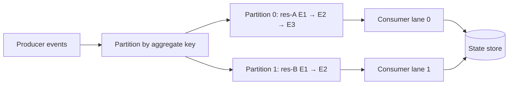
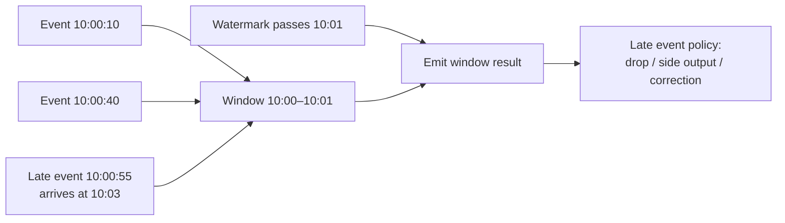
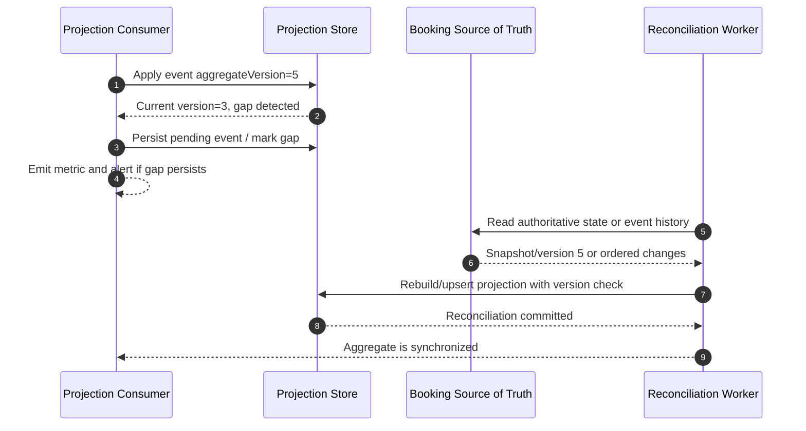
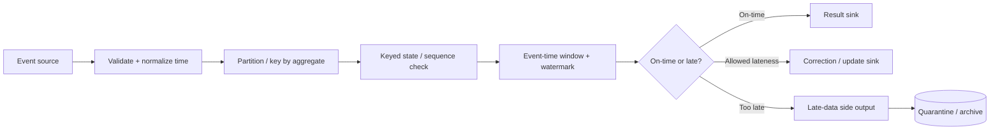
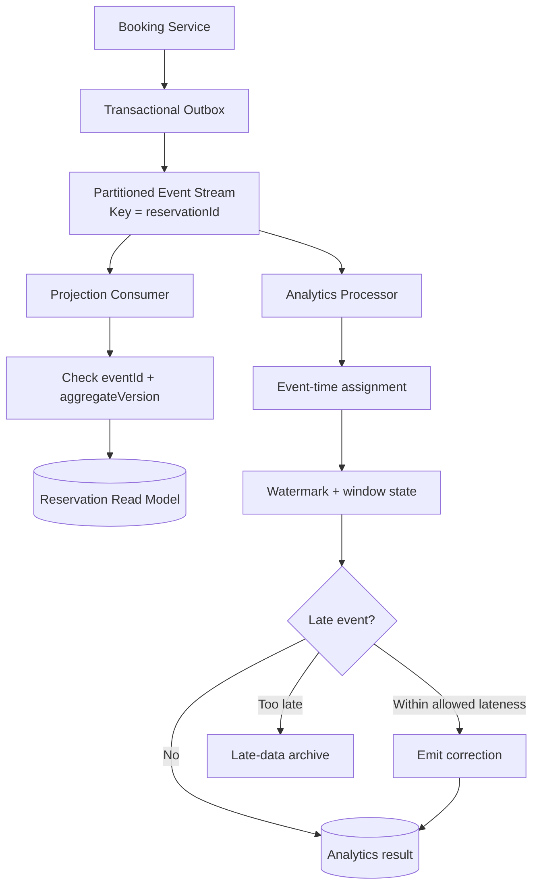

# Thứ tự sự kiện, thời gian sự kiện và sự kiện đến muộn

Trong kiến trúc hướng sự kiện, một sự kiện có thể được tạo ở service này, truyền qua broker, nằm trong hàng đợi, được consumer xử lý và cuối cùng cập nhật một mô hình dữ liệu khác. Các bước đó không nhất thiết diễn ra cùng lúc hoặc theo đúng thứ tự mà người dùng quan sát. Mạng chậm, retry, nhiều producer, partition, clock lệch và consumer dừng chạy đều có thể làm sự kiện đến trễ hoặc đến sai thứ tự.

Vì vậy, khi thiết kế event-driven architecture, cần trả lời ba câu hỏi khác nhau:

1. **Sự kiện nào xảy ra trước trong nghiệp vụ?** Đây là vấn đề thứ tự và quan hệ nhân quả.
2. **Sự kiện thực sự xảy ra lúc nào?** Đây là event time, thời điểm gắn với hành động hoặc trạng thái nghiệp vụ.
3. **Hệ thống nhận và xử lý sự kiện lúc nào?** Đây là ingestion time/processing time, thời điểm hệ thống quan sát hoặc thực thi.

Trong module **CLOUD_ARCHITECTURE**, ba vấn đề này ảnh hưởng trực tiếp tới độ tin cậy, nhất quán dữ liệu, khả năng mở rộng, chi phí xử lý luồng và vận hành hệ thống cloud. Bài học sử dụng ví dụ nền tảng cho thuê thiết bị để phân tích thứ tự sự kiện, thời gian sự kiện, watermark, sự kiện đến muộn và cách phục hồi. Các ngưỡng thời gian, partition và chính sách trong ví dụ là giả định minh họa; phải được xác định theo yêu cầu nghiệp vụ và đo đạc thực tế.

## 1. Vì sao sự kiện có thể đến không đúng thứ tự?

Giả sử một reservation trải qua các trạng thái:

HELD → CONFIRMED → CANCELLED

Booking Service phát ra hai sự kiện:

- ReservationConfirmed lúc 10:00:05.
- ReservationCancelled lúc 10:00:20.

Do mạng và retry, consumer có thể nhận ReservationCancelled trước, sau đó mới nhận ReservationConfirmed. Nếu consumer chỉ ghi đè trạng thái theo thứ tự nhận, dữ liệu cuối cùng có thể quay về CONFIRMED, dù nghiệp vụ đã hủy.

Các nguyên nhân phổ biến:

| Nguyên nhân | Điều gì xảy ra? | Rủi ro |
| --- | --- | --- |
| Nhiều producer | Mỗi service phát sự kiện theo nhịp và đồng hồ riêng | Không tồn tại một thứ tự tổng thể tự nhiên |
| Network delay | Một message đi qua đường truyền lâu hơn message khác | Sự kiện cũ có thể đến sau sự kiện mới |
| Retry/redelivery | Broker hoặc producer gửi lại message chưa được ACK | Duplicate hoặc thứ tự quan sát thay đổi |
| Nhiều partition | Message cùng một nghiệp vụ bị chia sang partition khác nhau | Consumer đọc song song mà không có thứ tự toàn cục |
| Nhiều consumer | Các message có thời gian xử lý khác nhau | Kết quả hoàn thành không theo thứ tự nhận |
| Replay/backfill | Consumer đọc lại dữ liệu lịch sử trong lúc đang nhận message mới | Sự kiện cũ xen vào trạng thái mới |
| Clock skew | Đồng hồ producer lệch nhau hoặc sai đồng bộ | Timestamp không phản ánh chính xác quan hệ nhân quả |
| Consumer outage | Message tồn đọng và được xử lý sau khi consumer phục hồi | Event time cũ nhưng processing time mới |

Một điều cần phân biệt: **thứ tự message được ghi vào broker**, **thứ tự consumer nhận message** và **thứ tự hiệu ứng nghiệp vụ được commit** là ba chuyện khác nhau. Broker có thể đảm bảo một phạm vi ordering nhất định, nhưng consumer gọi database hoặc dịch vụ bên ngoài song song vẫn có thể hoàn thành theo thứ tự khác.

## 2. Ba loại thời gian trong xử lý sự kiện

### 2.1. Event time

**Event time** là thời điểm sự kiện xảy ra theo ngữ nghĩa nguồn nghiệp vụ. Ví dụ:

- Khách nhấn xác nhận thanh toán lúc 10:00:05.
- Thiết bị rời kho lúc 10:12:00.
- Reservation hết hạn theo quy tắc nghiệp vụ lúc 11:00:00.

Event time thường được gắn vào event bởi producer hoặc nguồn có thẩm quyền. Nó nên dùng một quy ước thời gian rõ, thường biểu diễn timestamp UTC với độ chính xác phù hợp. Với các sự kiện phát sinh tại thiết bị/edge, timestamp có thể do clock của thiết bị cung cấp và cần đánh giá mức tin cậy.

### 2.2. Ingestion time

**Ingestion time** là thời điểm nền tảng nhận hoặc ghi nhận sự kiện vào hệ thống xử lý. Ví dụ event xảy ra 10:00:05 nhưng broker chỉ nhận được lúc 10:00:12 do producer retry.

Ingestion time hữu ích để đo độ trễ từ producer tới nền tảng, kiểm tra backlog và điều tra luồng dữ liệu. Nó không nhất thiết là thời điểm sự kiện xảy ra.

### 2.3. Processing time

**Processing time** là thời điểm consumer/operator thực sự xử lý event. Nếu consumer dừng 30 phút, một event xảy ra lúc 10:00 có thể chỉ được xử lý lúc 10:30.

Processing time hữu ích để đo thời gian xử lý, tải worker, độ trễ queue và vận hành. Nó thường không phù hợp làm cơ sở duy nhất cho phép tính nghiệp vụ như “doanh thu phát sinh trong giờ nào?”.

### 2.4. So sánh

| Loại thời gian | Trả lời câu hỏi | Nguồn thường gặp | Dùng cho |
| --- | --- | --- | --- |
| **Event time** | Sự kiện xảy ra lúc nào? | Timestamp nghiệp vụ do producer/nguồn tin cậy ghi | Window nghiệp vụ, phân tích theo thời điểm thực tế |
| **Ingestion time** | Hệ thống nhận sự kiện lúc nào? | Broker/ingestion service ghi nhận | Đo thời gian truyền, phát hiện chậm từ producer |
| **Processing time** | Consumer xử lý lúc nào? | Runtime/stream processor ghi nhận | Theo dõi throughput, queue lag, tài nguyên và thời gian thực thi |

Ví dụ:

| Event | Event time | Ingestion time | Processing time |
| --- | --- | --- | --- |
| ReservationConfirmed E1 | 10:00:05 | 10:00:06 | 10:00:07 |
| ReservationCancelled E2 | 10:00:20 | 10:00:21 | 10:00:22 |
| PaymentCaptured E3 | 10:00:15 | 10:01:10 | 10:01:12 |

E3 xảy ra trước E2 theo event time nhưng tới hệ thống sau E2. Nếu báo cáo doanh thu gom theo phút sự kiện, E3 phải thuộc phút 10:00 dù được xử lý sau 10:01. Nếu dashboard vận hành theo processing time, E3 lại xuất hiện ở thời điểm xử lý 10:01.

### 2.5. Thời gian không tự tạo ra thứ tự nhân quả

Hai service có thể dùng đồng hồ lệch nhau. Timestamp A nhỏ hơn timestamp B không đủ chứng minh A đã xảy ra trước B trong nghiệp vụ. Với quy trình quan trọng, cần thông tin nhân quả như:

- aggregateVersion hoặc sequence tăng theo từng entity.
- causationId để chỉ sự kiện/lệnh đã gây ra sự kiện mới.
- correlationId để liên kết một workflow.
- Quan hệ state transition được kiểm tra bởi nguồn dữ liệu có thẩm quyền.
- Logical clock/vector clock khi bài toán phân tán thực sự cần biểu diễn quan hệ nhân quả giữa nhiều node.

Không nên dùng timestamp wall-clock thay thế một sequence nghiệp vụ nếu hệ thống cần thứ tự chính xác cho cùng một aggregate.

## 3. Sự kiện đến muộn là gì?

Một event được xem là **late event** khi nó tới một xử lý/window sau thời điểm mà hệ thống dự kiến hoàn tất hoặc đóng phần dữ liệu tương ứng. Định nghĩa “muộn” phụ thuộc vào:

- Event time của message.
- Thời gian hệ thống đã tiến tới (watermark hoặc tiến độ xử lý).
- Chính sách chấp nhận trễ của từng operator/window.
- Cửa sổ lưu trạng thái và thời gian giữ dữ liệu.

Ví dụ doanh nghiệp muốn thống kê số reservation được xác nhận theo từng phút. Window 10:00–10:01 đã được emit kết quả 15 reservation. Sau đó event ReservationConfirmed có event time 10:00:42 đến vào lúc 10:03. Kết quả đúng về mặt nghiệp vụ phải là 16, nhưng hệ thống đã phát kết quả cũ.

Sự kiện đến muộn có thể xuất hiện vì:

- Producer offline rồi gửi lại batch.
- Thiết bị IoT mất kết nối và đồng bộ sau.
- Consumer/broker backlog.
- Một dịch vụ downstream retry lâu.
- Event được phục hồi từ outbox sau outage.
- Dữ liệu lịch sử được backfill.
- Clock hoặc timestamp nguồn bị sai.

Không phải mọi event đến sau đều là late event theo ngữ nghĩa xử lý. Ví dụ một thông báo ReservationCancelled mới phát sinh sau ReservationConfirmed là một thay đổi nghiệp vụ mới, không phải event trễ chỉ vì nó đến sau. Phải so sánh event time và quan hệ aggregate/version, không chỉ nhìn thứ tự nhận.

## 4. Ordering: hệ thống có thể bảo đảm thứ tự ở phạm vi nào?

### 4.1. Global ordering

Global ordering nghĩa là mọi event trong toàn hệ thống được quan sát theo một thứ tự duy nhất. Đây là yêu cầu rất mạnh, thường gây giới hạn throughput và concurrency. Nhiều broker phân tán không cung cấp thứ tự toàn cục tự động trên mọi partition.

Chỉ nên yêu cầu global ordering nếu nghiệp vụ thật sự cần, và cần phân tích chi phí serialize mọi message qua một luồng. Phần lớn hệ thống có thể dùng ordering theo entity/aggregate.

### 4.2. Per-key / per-aggregate ordering

Các event của cùng một entity như reservation hoặc order được đưa vào cùng partition/stream key. Broker có thể duy trì thứ tự append của các record cùng partition; consumer phải xử lý chúng theo semantics của partition và tránh làm song song mất thứ tự trong cùng key.

Ví dụ key là reservationId. Khi đó các event cho res-123 được định tuyến theo cùng key, còn event của res-456 có thể xử lý song song ở partition khác.

Ưu điểm:

- Giữ ordering trong phạm vi nghiệp vụ cần thiết.
- Cho phép các aggregate độc lập được xử lý song song.
- Dễ gắn sequence/version với một aggregate.

Đánh đổi:

- Một key quá nóng có thể tạo hot partition.
- Thay đổi số partition hoặc partitioning strategy có thể ảnh hưởng mapping key/order.
- Nhiều aggregate trong một workflow không tự có thứ tự tổng thể.

### 4.3. Ordering theo partition

Trong mô hình partitioned log, thứ tự thường được bảo đảm trong phạm vi một partition theo semantics của broker. Message ở partition A không được tự sắp thứ tự với message ở partition B.

Producer cần chọn key phù hợp. Chọn customerId giúp ordering tất cả event của một khách nhưng có thể tạo tải nóng; chọn reservationId tăng song song nhưng không đảm bảo event của hai reservation cùng khách có thứ tự với nhau. Key phải phản ánh **đơn vị trạng thái cần cập nhật tuần tự**.

### 4.4. Thứ tự xử lý ở consumer

Ngay cả khi broker giao tuần tự, consumer vẫn có thể:

1. Nhận record E1 rồi đưa vào thread pool.
2. Nhận E2 tiếp theo và xử lý nhanh hơn.
3. Commit hiệu ứng E2 trước E1.

Nếu ordering cần được giữ, hãy serialize xử lý theo key/partition hoặc dùng cơ chế per-key sequencing; không chạy nhiều xử lý đồng thời rồi chỉ dựa vào thứ tự nhận. Với database, có thể kiểm tra expected version trong câu lệnh cập nhật.



Sơ đồ thể hiện ý tưởng ordering theo key. Cách broker phân vùng, phân công consumer và commit offset cụ thể phụ thuộc nền tảng.

## 5. Aggregate version và sequence number

Đối với sự kiện thay đổi cùng một aggregate, một cách phổ biến là gắn **version tăng đơn điệu** vào mỗi thay đổi.

| reservationId | version | eventType | eventTime |
| --- | ---: | --- | --- |
| res-123 | 1 | ReservationHeld | 10:00:00 |
| res-123 | 2 | ReservationConfirmed | 10:00:20 |
| res-123 | 3 | ReservationCancelled | 10:04:10 |

Consumer chỉ áp dụng event nếu version phù hợp với trạng thái hiện tại:

- State đang version 1, nhận version 2: có thể áp dụng.
- State đang version 2, nhận lại version 2: duplicate, bỏ qua hoặc xác nhận đã xử lý.
- State đang version 2, nhận version 4: thiếu version 3; giữ lại, retry, truy vấn nguồn hoặc phát tín hiệu cần reconciliation theo contract.
- State đang version 3, nhận version 2: event cũ; không ghi đè state mới.

Đây là minh họa đơn giản. Cần định nghĩa chính xác sequence tăng theo aggregate như thế nào, sequence được cấp khi commit hay trước commit, và xử lý gaps ra sao. Nếu sequence được cấp ở nhiều producer độc lập mà không có cơ chế đồng thuận, nó không tự bảo đảm thứ tự hợp lệ.

### Ví dụ cập nhật có điều kiện

```sql
UPDATE reservation_projection
SET status = :new_status,
    aggregate_version = :incoming_version,
    event_time = :incoming_event_time
WHERE reservation_id = :reservation_id
  AND aggregate_version = :incoming_version - 1;
```

Nếu số dòng cập nhật bằng 0, consumer cần đọc state hiện tại để phân loại duplicate, stale event hay version gap. Không tự động coi mọi trường hợp là lỗi tạm thời để retry vô hạn.

### State transition vẫn phải được kiểm tra

Version đúng nhưng hành vi không hợp lệ vẫn có thể xảy ra nếu producer bug hoặc event không đúng aggregate. Ví dụ HELD → EXPIRED → CONFIRMED có thể bị cấm theo nghiệp vụ dù version tăng liên tục. Consumer có thể là projection thuần phản ánh source of truth, nhưng các tác vụ tạo side effect cần kiểm tra transition hợp lệ và quyền chuyển trạng thái.

## 6. Event envelope: ghi đủ thông tin để xác định thời gian và quan hệ

Một event envelope nên có tối thiểu những thuộc tính giúp định danh, truy vết và sắp thứ tự ở đúng phạm vi:

```json
{
  "eventId": "evt-01JXYZ",
  "eventType": "ReservationConfirmed",
  "eventVersion": 1,
  "aggregateType": "Reservation",
  "aggregateId": "res-123",
  "aggregateVersion": 2,
  "eventTime": "2026-11-18T10:00:20.125Z",
  "producedAt": "2026-11-18T10:00:20.130Z",
  "correlationId": "workflow-789",
  "causationId": "cmd-456",
  "producer": "booking-service",
  "payload": {
    "reservationId": "res-123",
    "status": "CONFIRMED"
  }
}
```

Ý nghĩa:

| Trường | Vai trò | Lưu ý |
| --- | --- | --- |
| eventId | Định danh duy nhất một event instance | Dùng cho inbox/deduplication; retry cùng event giữ nguyên ID |
| eventType | Loại sự kiện | Nên dùng tên ổn định và rõ ngữ nghĩa |
| eventVersion | Phiên bản schema event | Khác aggregateVersion |
| aggregateId | Entity/aggregate bị ảnh hưởng | Thường dùng làm partition key |
| aggregateVersion | Sequence của trạng thái aggregate | Hỗ trợ ordering, gap và stale-event detection |
| eventTime | Thời điểm nghiệp vụ xảy ra | Quy ước timezone/clock cần rõ |
| producedAt | Thời điểm producer tạo envelope | Có thể dùng đo producer delay |
| correlationId | Liên kết workflow | Dùng truy vết qua nhiều service |
| causationId | Chỉ command/event gây ra sự kiện | Biểu diễn quan hệ nhân quả trực tiếp |
| producer | Nguồn phát hành | Hữu ích cho audit và schema ownership |

Tên trường và format là ví dụ, không phải chuẩn bắt buộc. Có thể dùng CloudEvents hoặc envelope chuẩn khác nếu nền tảng/tổ chức đã thống nhất. Không nên sao chép các trường mà không xác định semantics; đặc biệt không dùng eventTime, producedAt và timestamp broker thay thế lẫn nhau.

**Không đưa secret hoặc dữ liệu cá nhân dư thừa vào event.** Message có thể được lưu trên broker, DLQ, archive, replay store và trace trong thời gian dài; chỉ truyền dữ liệu cần cho consumer và áp quyền truy cập theo phân loại.

## 7. Watermark: hệ thống ước lượng tiến độ của event time

Trong stream processing, hệ thống cần biết đã thấy đủ dữ liệu cho một khoảng event time đến mức nào. Nhưng không thể biết tuyệt đối rằng “sẽ không còn event cũ nào đến nữa” khi mạng và producer có thể chậm tùy ý.

**Watermark** là một ước lượng tiến độ event time: hệ thống cho rằng phần lớn dữ liệu có event time trước mốc watermark đã tới hoặc được xử lý. Khi watermark đi qua thời điểm kết thúc window, operator có thể emit kết quả và coi window đã hoàn tất theo chính sách.

Watermark **không phải timestamp của event mới nhất**, cũng không phải một cam kết tuyệt đối rằng không còn event cũ. Cách tạo watermark khác nhau giữa framework, source và cấu hình.

### Ví dụ window theo event time

Giả sử stream xử lý lượng reservation được xác nhận trong từng phút. Window đầu tiên bao phủ khoảng từ 10:00:00 (bao gồm) tới trước 10:01:00.



Nếu watermark đã qua 10:01 khi E3 tới, framework/operator có thể bỏ E3, gửi nó sang late-data output, hoặc cập nhật kết quả theo allowed lateness/retraction semantics. Lựa chọn phải phù hợp với consumer của kết quả.

### Allowed lateness

**Allowed lateness** là khoảng thời gian bổ sung mà hệ thống vẫn chấp nhận cập nhật cho window sau khi watermark đã vượt qua thời điểm kết thúc. Ví dụ window kết thúc 10:01 và allowed lateness 2 phút: hệ thống vẫn giữ state để nhận event trễ tới giới hạn chính sách khoảng 10:03 theo semantics của framework.

Khi hết allowed lateness, state window thường được dọn để giải phóng tài nguyên. Một event đến muộn hơn có thể bị bỏ hoặc chuyển sang kênh xử lý riêng.

Các quyết định cần rõ:

- Có emit kết quả tạm thời trước khi window đóng không?
- Khi event trễ đến, kết quả cũ được thay thế, cộng delta hay phát một correction event?
- Consumer downstream có hiểu update/retraction không?
- State được giữ bao lâu và chi phí memory/state backend là bao nhiêu?
- Event quá muộn được lưu ở đâu và ai xử lý?

Watermark và allowed lateness là **cơ chế xử lý stream**, không tự giải quyết nghiệp vụ stale event khi cập nhật một reservation hiện thời.

## 8. Event-time window và processing-time window

### Tumbling window

Window cố định, không chồng lấn. Ví dụ mỗi phút một window:

- 10:00:00–10:01:00
- 10:01:00–10:02:00

Phù hợp báo cáo đếm đơn theo phút/giờ, doanh thu theo kỳ hoặc số lượt sự kiện trong bucket cố định.

### Sliding window

Window có khoảng trượt, thường chồng lấn. Ví dụ tính tổng đơn trong 5 phút gần nhất, cập nhật mỗi phút. Một event có thể góp vào nhiều window.

### Session window

Window hình thành theo khoảng không hoạt động giữa các event. Ví dụ gom các thao tác của người dùng thành một phiên nếu không có hoạt động quá một khoảng timeout.

### So sánh

| Kiểu window | Cách chia | Ví dụ | Cần chú ý |
| --- | --- | --- | --- |
| Tumbling | Khoảng cố định, không overlap | Tổng số booking mỗi phút | Event trễ và ranh giới window |
| Sliding | Cửa sổ độ dài cố định, trượt định kỳ | Số request trong 5 phút | Event có thể xuất hiện trong nhiều window, tăng state/cost |
| Session | Theo khoảng im lặng giữa các event | Session tương tác khách hàng | Gap có thể thay đổi khi late event nối hai session |

### Event time hay processing time?

Chọn event time khi cần báo cáo phản ánh thời điểm nghiệp vụ, dữ liệu đến không đồng đều hoặc replay lịch sử mà kết quả phải giống thời điểm xảy ra. Chọn processing time khi mục tiêu là quan sát vận hành “đã xử lý bao nhiêu trong phút vừa rồi”, giảm phụ thuộc timestamp của producer hoặc phản hồi ngay theo thời gian xử lý.

Không phải mọi pipeline cần watermark. Một queue worker cập nhật projection theo aggregate version có thể không cần event-time windows; một hệ thống analytics tính số đơn theo phút thường cần event time và chính sách late data.

## 9. Chính sách xử lý sự kiện đến muộn

Không có một chính sách late-event phù hợp mọi loại dữ liệu. Cần phân loại theo yêu cầu nghiệp vụ.

| Chính sách | Hành vi | Phù hợp khi | Cái giá |
| --- | --- | --- | --- |
| **Drop** | Bỏ event quá thời hạn | Dữ liệu gần real-time, event quá cũ ít giá trị và có thể bỏ | Kết quả có thể thiếu; cần đo tỷ lệ dropped |
| **Side output / late-data stream** | Tách event trễ sang luồng riêng | Cần điều tra, backfill hoặc xử lý sau | Thêm storage, consumer và vận hành |
| **Update/retract result** | Cập nhật kết quả window đã emit | Dashboard/report có thể nhận correction | Downstream phải hỗ trợ cập nhật và versioning |
| **Recompute window** | Tính lại bucket từ dữ liệu gốc | Độ chính xác quan trọng hơn chi phí và độ trễ | Tốn compute/IO, cần idempotent output |
| **Manual review** | Đưa trường hợp bất thường tới người xử lý | Tác động tài chính/pháp lý cao | Chậm, tăng công vận hành |
| **Compensating event** | Phát event hiệu chỉnh thay đổi trước | Ledger/report cần audit trail rõ ràng | Consumer phải hiểu event correction và không cộng trùng |

### Phân biệt late event và stale event

Hai khái niệm này dễ nhầm:

- **Late event:** event tới xử lý sau khi hệ thống đã đi qua mốc event time hoặc đã emit window.
- **Stale event:** event phản ánh trạng thái/phiên bản cũ hơn state hiện tại của một aggregate.

Một event có thể đến muộn nhưng vẫn là version mới hợp lệ, ví dụ hệ thống nguồn phát ReservationCancelled lúc 10:05 nhưng do outage chỉ publish lúc 10:20. Ngược lại, một event tới nhanh vẫn có thể stale nếu consumer đã xử lý version mới hơn.

Late-event policy xử lý tiến độ thời gian/window. Stale-event policy xử lý trạng thái và sequence của aggregate. Nên có cả hai khi pipeline vừa phân tích time window vừa cập nhật projection nghiệp vụ.

## 10. Ví dụ: báo cáo booking theo phút với late event

Giả sử:

- Window dài 1 phút theo event time.
- Watermark được ước lượng chậm hơn max event time quan sát 30 giây.
- Kết quả window được emit khi watermark vượt end time.
- Allowed lateness là 2 phút.

Các giá trị đều là **giả định bài tập**, không phải default của framework.

| Event | Event time | Ingestion time | Diễn giải |
| --- | --- | --- | --- |
| E1 ReservationConfirmed | 10:00:10 | 10:00:11 | Đến gần thời điểm phát sinh |
| E2 ReservationConfirmed | 10:00:42 | 10:00:44 | Thuộc cùng window 10:00 |
| E3 ReservationConfirmed | 10:00:55 | 10:03:00 | Tới rất trễ nhưng vẫn thuộc window 10:00 |
| E4 ReservationCancelled | 10:01:10 | 10:01:12 | Thuộc window 10:01 nếu metric đếm event type |

Kết quả có thể được phát:

1. Ban đầu window 10:00 có count 2.
2. Sau khi E3 đến trong allowed lateness, hệ thống phát correction hoặc update count thành 3.
3. Downstream nhận correction phải thay thế/điều chỉnh kết quả cũ, không cộng cả snapshot mới như một event increment nếu contract không định nghĩa như vậy.

### Pseudocode xử lý event time và late data

```text
onEvent(event):
    validateEnvelope(event)
    eventTime = parse(event.eventTime)
    window = assignWindow(eventTime)

    if eventTime is behind finalizedWatermark:
        if withinAllowedLateness(window):
            updateWindowState(window, event)
            emitWindowCorrection(window)
        else:
            writeLateEventSideOutput(event)
    else:
        updateWindowState(window, event)

onWatermarkAdvance(newWatermark):
    emitWindowsWhoseEndPassed(newWatermark)
    finalizeAndExpireStateAfterAllowedLateness(newWatermark)
```

Đây là pseudocode để diễn giải, không phải API cụ thể của Flink, Spark Structured Streaming, Kafka Streams hay cloud stream service. Framework khác nhau ở cách tạo watermark, state retention, trigger, update mode và output semantics.

## 11. Thiết kế dữ liệu và xử lý duplicate

Ordering và late event thường đi cùng duplicate. Một producer có thể publish lại message sau khi không nhận được ACK; broker có thể redeliver; consumer có thể xử lý thành công nhưng crash trước khi commit offset/ACK.

### Event ID và inbox

Consumer có thể duy trì inbox/deduplication store:

| Trường | Vai trò |
| --- | --- |
| consumerName | Phân biệt tiến độ xử lý theo consumer |
| eventId | Định danh message đã nhận |
| processedAt | Thời điểm xử lý/ghi dấu |
| aggregateId | Entity liên quan |
| aggregateVersion | Sequence để phát hiện stale/gap |
| result/reference | Kết quả hoặc ID tác động nghiệp vụ nếu cần |

Ghi dấu inbox và thay đổi state trong cùng transaction nếu cùng database hỗ trợ. Nếu tác động đi tới external API như refund/email, dùng idempotency key của downstream nếu có, lưu trạng thái attempt và reconciliation khi kết quả không rõ.

### Vì sao “exactly once” cần nói rõ phạm vi?

Một nền tảng có thể cung cấp exactly-once semantics cho một phạm vi như đọc partition, tính toán state và ghi vào sink tích hợp theo cơ chế cụ thể. Nhưng điều đó không tự bảo đảm **một tác động nghiệp vụ xuyên nhiều hệ thống bên ngoài chỉ xảy ra đúng một lần**.

Cần tách:

- Message delivery: at-most-once, at-least-once hoặc cơ chế đảm bảo cụ thể.
- Stream processing state: checkpoint/transaction và recovery của framework.
- Sink commit: cách ghi output có transaction/idempotency.
- Business side effect: thu tiền, gửi email, cấp mã truy cập hoặc hủy đơn.

Thiết kế thực tế thường chấp nhận at-least-once delivery kết hợp idempotent processing, version check và outbox/inbox để đạt hiệu ứng nghiệp vụ đúng. Không quảng cáo exactly-once nếu chưa nói rõ ranh giới và giả định.

## 12. Reconciliation và sửa projection khi nhận event trễ hoặc sai thứ tự

Event-driven system thường duy trì projection/read model để phục vụ truy vấn. Nếu projection bị bỏ sót event, áp dụng sai thứ tự hoặc consumer bug, cần cách đưa nó về gần nguồn sự thật.

Một quy trình reconciliation:

1. Phát hiện projection có version gap, trạng thái không hợp lệ hoặc khác biệt so với source of truth.
2. Định danh aggregate và phạm vi event liên quan.
3. Truy vấn nguồn dữ liệu authoritative hoặc replay log có kiểm soát.
4. Tính lại projection từ snapshot + event theo sequence hợp lệ.
5. Ghi projection mới bằng version/cursor được kiểm tra; tránh ghi đè state mới hơn.
6. Theo dõi số lượng aggregate được sửa, lỗi replay và thời gian hội tụ.



Không phải lúc nào cũng cần truy vấn trực tiếp nguồn dữ liệu cho mọi event. Với event log có thể replay và snapshot được quản lý tốt, việc tái dựng projection có thể diễn ra từ stream. Nhưng cần tránh replay đồng thời với luồng mới mà không có checkpoint/ownership rõ; nếu không, dữ liệu mới và cũ tiếp tục đè nhau.

## 13. Thiết kế partition key và throughput

Partition key quyết định ordering scope, concurrency và phân bố tải. Một key tốt phải cân bằng:

- **Ordering:** các event cần thứ tự cùng đi vào một partition hoặc một processing lane.
- **Load distribution:** dữ liệu không tập trung quá lớn vào một key nóng.
- **Consumer parallelism:** đủ partition để tăng số consumer hữu ích.
- **State locality:** state của một aggregate được cập nhật tại cùng processor/scope khi có thể.
- **Operational evolution:** thay đổi partition count hoặc partitioning strategy không phá semantics dữ liệu đã ghi.

| Key candidate | Lợi ích | Rủi ro |
| --- | --- | --- |
| reservationId | Ordering theo reservation | Không đảm bảo thứ tự giữa nhiều reservation của cùng khách |
| customerId | Có thể giữ thứ tự theo khách | Một khách lớn có thể tạo hot partition |
| equipmentId | Hữu ích nếu mọi thay đổi availability phải tuần tự theo thiết bị | Thiết bị hot có thể giới hạn throughput |
| eventId | Phân bố đều | Không giữ ordering nghiệp vụ theo aggregate |
| constant key | Global ordering trong một luồng hẹp | Mất song song, dễ thành bottleneck |

Nếu bất biến cần đảm bảo là **không đặt chồng thời gian trên cùng thiết bị**, partition theo equipmentId có thể giúp xử lý tuần tự các lệnh liên quan, nhưng nguồn dữ liệu vẫn cần constraint/transaction có thẩm quyền. Ordering trong broker một mình không bảo vệ được thay đổi đến từ API khác hoặc database writer ngoài luồng.

### Hot partition

Một aggregate hoặc tenant có lưu lượng lớn có thể tạo hot partition. Cách xử lý tùy nghiệp vụ:

- Tách workload key nóng nếu có thể chia nhỏ mà không phá invariant.
- Dùng quota/backpressure cho producer.
- Scale consumer và partition trong giới hạn ordering cho phép.
- Xử lý aggregate nóng bằng một cơ chế serialization riêng hoặc partition chuyên biệt.
- Theo dõi partition lag, throughput, processing time và state size.

Không tăng partition count một cách tùy tiện khi broker có semantics key mapping thay đổi theo số partition. Trước khi đổi, cần hiểu cách phân phối key, consumer rebalancing, ordering cũ/mới và quy trình migration.

## 14. Event time, clock skew và chất lượng timestamp

Timestamp chỉ hữu ích khi hiểu nguồn và độ tin cậy:

### Đồng hồ hệ thống

Workload nên đồng bộ clock với dịch vụ thời gian phù hợp và giám sát clock drift. Tuy vậy, NTP/PTP và UTC không tạo ra thứ tự nhân quả tuyệt đối giữa nhiều node. Clock skew có thể gây event timestamp đi lùi hoặc vượt xa thời gian hiện tại.

### Timestamp từ thiết bị

IoT device có thể offline lâu, pin yếu hoặc đồng hồ bị chỉnh. Event time từ thiết bị cần metadata như device ID, boot/session ID, sequence number và thời gian nhận ở gateway. Khi bất thường, chính sách có thể dùng sequence để suy thứ tự trong phiên thiết bị và giữ cả deviceTime lẫn ingestionTime để audit.

### Timestamp từ server

Nếu backend là nguồn phát hành có thẩm quyền, có thể gắn eventTime tại transaction/domain boundary. Nên ghi timestamp gần thời điểm trạng thái nghiệp vụ được commit; tránh gắn quá sớm khi command vẫn có thể thất bại.

### Dữ liệu bất thường

| Bất thường | Cách xử lý gợi ý |
| --- | --- |
| Timestamp ở tương lai vượt ngưỡng | Quarantine, flag clock issue hoặc dùng policy fallback có audit |
| Timestamp quá cũ | Áp late-event policy, side output hoặc backfill |
| Timestamp thiếu | Reject hoặc gắn ingestion time theo contract rõ; không âm thầm giả định event time |
| Timestamp không có timezone | Từ chối hoặc áp quy tắc nguồn đã công bố; tránh diễn giải theo timezone máy chủ |
| Timestamp giảm so với version trước | Kiểm tra clock, sequence và causal metadata; không tự hạ aggregate version |
| Timestamp trùng nhau | Dùng aggregateVersion/eventId để phân biệt; không dựa vào timestamp làm unique key |

Không sửa event gốc một cách âm thầm để “làm đẹp” dữ liệu. Nếu normalization/fallback được áp dụng, ghi rõ raw timestamp, normalized timestamp và lý do để có thể truy vết.

## 15. Backfill, replay và late data lịch sử

Backfill dùng dữ liệu cũ để tạo lại hoặc bổ sung kết quả. Replay dùng event log để tái xử lý. Cả hai có thể đưa event cũ vào hệ thống khi consumer đang xử lý luồng mới.

| Cách làm | Mô tả | Khi phù hợp |
| --- | --- | --- |
| Replay cùng luồng chính | Dùng lại consumer/group hoặc cursor hiện có theo kế hoạch | Projection cần rebuild hoàn toàn và có thể dừng/điều phối |
| Shadow consumer | Consumer riêng ghi sang bảng/index mới | So sánh projection mới với projection hiện tại trước cutover |
| Backfill theo thời gian/partition | Xử lý từng phạm vi dữ liệu giới hạn | Dữ liệu lớn cần kiểm soát tải |
| Side input/late stream | Đưa dữ liệu trễ vào quy trình riêng | Late event ít gặp nhưng cần xử lý có kiểm soát |

Trước replay/backfill, xác định:

- Event schema version và khả năng đọc schema cũ.
- Consumer có idempotent không và side effects có được tắt/đổi sang chế độ an toàn không.
- State/offset/checkpoint bắt đầu từ đâu.
- Dữ liệu mới có tiếp tục tới không; cách merge event cũ với mới.
- Tốc độ replay để không làm quá tải database hoặc downstream.
- Cách so sánh kết quả, cutover và rollback projection.

**Không replay event tạo tác động bên ngoài như charge/refund/email vào handler production mà không có chế độ replay an toàn.** Một consumer projection có thể rebuild; một consumer thanh toán cần idempotency key, trạng thái giao dịch và policy ngăn side effect lặp.

## 16. Áp dụng trong Kafka và stream processing

### Kafka-style partitioned log

Trong hệ thống log phân vùng kiểu Kafka:

- Ordering được bảo đảm trong phạm vi partition theo vị trí record.
- Producer key thường ảnh hưởng partition được chọn.
- Consumer group phân chia partition cho consumer member; một partition tại một thời điểm được gán cho một member của group theo mô hình phổ biến.
- Consumer có thể commit offset sau khi xử lý; thời điểm commit ảnh hưởng redelivery khi crash.
- Rebalance có thể tạm dừng hoặc chuyển quyền xử lý partition.

Điều này không đồng nghĩa consumer xử lý nghiệp vụ đúng thứ tự nếu code gửi từng record sang thread pool rồi hoàn tất tùy ý. Cần thiết kế per-partition/per-key processing và commit offset sau khi hiệu ứng cần thiết đã bền vững theo contract.

### Stateful stream processor

Framework stream processing có thể duy trì keyed state, event-time windows, watermark, checkpoint và state backend. Một pipeline điển hình:



Đây là pipeline logic. Checkpoint, exactly-once state, sink transaction và event-time semantics phụ thuộc framework cùng sink. Phải đọc đúng semantics sản phẩm thay vì coi sơ đồ là cam kết implementation.

### Checkpoint và recovery

Checkpoint giúp stream processor lưu state/offset để khôi phục sau lỗi. Một checkpoint nhất quán cần phối hợp source position, operator state và sink behavior theo framework. Nếu sink không transactional hoặc idempotent, phục hồi từ checkpoint vẫn có thể tạo duplicate output.

## 17. Event ordering và thời gian ở các dịch vụ cloud

Các cloud provider cung cấp nhiều lựa chọn: queue, pub/sub, event bus, partitioned streaming log, stream analytics và workflow service. Chúng có semantics khác nhau về ordering, delivery, deduplication, retention và retry.

| Loại nền tảng | Điểm cần kiểm tra trong tài liệu dịch vụ |
| --- | --- |
| Partitioned event log | Ordering scope theo partition/key, retention, consumer offset, rebalance và replay |
| Standard queue | Delivery semantics, visibility timeout, duplicate delivery và ordering |
| FIFO/ordered queue | Ordering group, throughput limit, deduplication scope/window và retry behavior |
| Pub/sub topic | Ordering key nếu hỗ trợ, redelivery, ack deadline, subscriber parallelism |
| Event bus | Rule matching, retry policy, archive/replay, dead-letter destination |
| Managed stream processing | Event-time support, watermark, window trigger, state retention, checkpoint và output semantics |

Tên sản phẩm không đủ để suy ra guarantee. Một queue có tên FIFO có thể chỉ bảo đảm thứ tự trong một message group; pub/sub có ordering key có thể có giới hạn khi redelivery hoặc region failure. Phải xem contract dịch vụ đang sử dụng, region và cấu hình thật.

### Vị trí triển khai và latency

Producer, broker và consumer ở khác region có thể tăng độ trễ, egress cost và thời gian late event. Nếu dữ liệu thuộc vùng địa lý hoặc quy định cụ thể, cả archive, replay, DLQ và analytics sink cũng cần xét data residency.

Không nhất thiết đặt mọi consumer cùng nơi với producer. Hãy cân bằng latency, resilience, data locality, khả năng DR và chi phí truyền dữ liệu. Với event không cần real-time, batch/near-real-time có thể rẻ hơn pipeline liên tục nhưng vẫn đáp ứng nghiệp vụ.

## 18. Độ tin cậy, bảo mật và vận hành

### Reliability

- Dùng event ID ổn định để dedupe.
- Dùng aggregate key/version để bảo vệ ordering trong phạm vi cần thiết.
- Ghi outbox/inbox hoặc cơ chế transaction phù hợp để tránh mất ý định phát/ghi nhận.
- Có retry, backoff, DLQ, replay và reconciliation.
- Đặt retention đủ để consumer phục hồi; đo backlog và thời gian catch-up.
- Kiểm thử consumer crash trước/sau commit, broker outage và duplicate.

### Security

- Xác thực producer và consumer, giới hạn quyền publish/subscribe theo topic/stream.
- Mã hóa đường truyền và lưu trữ theo phân loại dữ liệu.
- Không đưa PII/secret không cần thiết vào event.
- Bảo vệ schema registry, archive và DLQ; chúng thường chứa dữ liệu tương đương message gốc.
- Ghi audit cho replay/backfill và thao tác quản trị.
- Kiểm tra quyền tenant ở consumer, không tin một field tenantId do producer tùy ý gửi.

### Operations

Theo dõi ít nhất:

| Tín hiệu | Dùng để phát hiện |
| --- | --- |
| Consumer lag / backlog age | Consumer chậm hơn producer |
| Event-time to ingestion-time delay | Producer/network phát sự kiện trễ |
| Ingestion-to-processing delay | Queue/consumer processing chậm |
| Watermark lag | Event-time progress chậm |
| Late-event rate và drop count | Clock/data delay hoặc allowed lateness quá ngắn |
| Duplicate rate | Redelivery, producer retry hoặc dedupe policy |
| Version gap/stale count | Mất event, sai thứ tự hoặc replay |
| DLQ size/age | Event lỗi chưa được xử lý |
| State size/checkpoint duration | Chi phí stateful processing và rủi ro recovery |
| Reconciliation count | Projection lệch nguồn sự thật |

Các metric cần gắn owner và alert threshold. Một consumer lag tăng chưa chắc là sự cố nếu batch xử lý theo lịch; một watermark đứng yên có thể do source idle hoặc timestamp bất thường, không chỉ do worker thiếu CPU.

## 19. Các tình huống và cách xử lý

### Tình huống A — Hủy đơn đến trước xác nhận

Reservation phát Confirmed version 2 và Cancelled version 3. Consumer nhận version 3 trước do hai partition hoặc replay.

**Cách xử lý:** nếu state đang version 1 và nhận version 3, không áp dụng mù quáng; đánh dấu gap và truy vấn source/replay version 2 rồi 3, hoặc xử lý theo snapshot authoritative. Nếu state đã version 3 và nhận version 2 thì bỏ qua stale event. Partition theo reservationId giúp giảm khả năng đảo thứ tự ở broker nhưng consumer vẫn cần version guard.

### Tình huống B — Event xảy ra trong giờ trước nhưng tới giờ sau

Thiết bị kho gửi EquipmentCheckedOut với device event time 10:59:55, nhưng mất mạng và broker nhận lúc 11:08.

**Cách xử lý:** báo cáo nghiệp vụ theo event time nên gán sự kiện cho window 10:59; ingestion/processing time dùng đo độ trễ và vận hành. Nếu window đã emit, dùng allowed lateness, correction hoặc late-data side output theo hợp đồng báo cáo. Nếu timestamp thiết bị không đáng tin, dùng sequence/session metadata và quy trình chuẩn hóa có audit.

### Tình huống C — Watermark đứng yên

Một partition không có event mới do source idle. Watermark tối thiểu của toàn job bị giữ lại vì partition này.

**Cách xử lý:** kiểm tra idle source/partition semantics và cấu hình idle timeout nếu framework hỗ trợ; cân nhắc độ đúng của watermark, late event và window closure trước khi đánh dấu source idle. Không đơn giản tăng watermark để dashboard chạy nhanh vì có thể làm mất event trễ.

### Tình huống D — Consumer crash sau khi gửi email nhưng trước khi ACK

Message được broker giao lại. Consumer gửi email lần nữa.

**Cách xử lý:** nếu mail provider hỗ trợ idempotency/request reference, dùng khóa ổn định; nếu không, ghi trạng thái và chấp nhận rằng đảm bảo exactly-once email end-to-end có giới hạn. Có thể tạo notification job/outbox và xử lý retry/compensation phù hợp; không coi commit offset là bảo đảm không trùng side effect.

### Tình huống E — Một khách hàng tạo hot partition

Key theo customerId khiến một đối tác lớn tạo phần lớn event.

**Cách xử lý:** đo partition skew; đánh giá key theo reservation/equipment nếu ordering chỉ cần theo aggregate nhỏ hơn; áp quota hoặc tách luồng khách đặc biệt. Trước khi đổi key, xác minh bất biến nghiệp vụ không cần ordering ở phạm vi customer.

## 20. Thiết kế thực hành: luồng reservation và analytics

Giả sử Booking Service phát sự kiện mỗi khi trạng thái reservation thay đổi. Hai consumer:

- **Reservation Projection** cần duy trì trạng thái mới nhất cho API tra cứu.
- **Analytics Processor** cần đếm số reservation được xác nhận theo event-time minute.

Hai consumer có yêu cầu khác nhau:

| Thuộc tính | Reservation Projection | Analytics Processor |
| --- | --- | --- |
| Mục tiêu | Trạng thái hiện tại đúng | Số liệu theo thời điểm nghiệp vụ |
| Ordering | Theo reservation aggregate | Theo event time/window; aggregate version hữu ích để dedupe |
| Late event | Phân loại stale/gap, reconciliation | Allowed lateness, correction hoặc side output |
| Duplicate | Inbox/eventId + aggregateVersion | Dedup theo eventId/business key |
| State | Projection theo reservation | Window aggregate và watermark state |
| Output | Read model phục vụ API | Dashboard/report hoặc dataset |



### Hợp đồng event cho hai consumer

Event có thể gồm:

```json
{
  "eventId": "evt-1002",
  "eventType": "ReservationConfirmed",
  "eventVersion": 1,
  "aggregateId": "res-123",
  "aggregateVersion": 2,
  "eventTime": "2026-11-18T10:00:20Z",
  "producedAt": "2026-11-18T10:00:21Z",
  "correlationId": "workflow-889",
  "payload": {
    "reservationId": "res-123",
    "status": "CONFIRMED"
  }
}
```

Không đưa toàn bộ hồ sơ khách vào event nếu Analytics chỉ cần đếm reservation. Data minimization giúp giảm rủi ro và chi phí retention/replay.

### Quyết định thiết kế

1. Partition theo aggregateId để các event của một reservation đi cùng ordering scope.
2. Giữ aggregateVersion tăng theo commit ở Booking source of truth; consumer projection kiểm tra stale/gap.
3. Ghi trạng thái booking và outbox trong cùng transaction hoặc cơ chế đảm bảo tương đương.
4. Analytics dùng eventTime cho window và producedAt/ingestion/processing time để đo delay.
5. Định nghĩa watermark/allowed lateness theo khả năng chấp nhận correction của dashboard.
6. Đưa event quá muộn sang archive/backfill; không âm thầm cộng vào báo cáo của thời điểm hiện tại.
7. Consumer có dedupe và replay safety; side effect bên ngoài có idempotency/reconciliation riêng.

### Điều cần kiểm thử

- Gửi event version 3 trước version 2.
- Gửi cùng eventId nhiều lần.
- Làm consumer crash sau khi ghi DB nhưng trước commit offset.
- Làm broker ngừng nhận event rồi phục hồi.
- Gửi event có eventTime cũ sau khi window đóng.
- Gửi event timestamp tương lai hoặc thiếu timezone.
- Tăng tải một aggregate key để quan sát hot partition.
- Replay dữ liệu lịch sử đồng thời với stream mới trong staging.

## 21. Đánh đổi theo Well-Architected

| Trụ cột | Thiết kế tốt mang lại | Đánh đổi cần quản lý | Câu hỏi kiểm chứng |
| --- | --- | --- | --- |
| **Operational excellence** | Có thể truy vết event, replay và điều tra sai lệch | Thêm schema registry, state store, DLQ, watermark monitoring và runbook | Có biết vì sao event trễ hoặc bị drop không? |
| **Security** | Phân quyền publish/consume, giảm dữ liệu dư thừa | Archive/DLQ/replay tạo thêm nơi chứa dữ liệu nhạy cảm | Ai có thể replay hoặc đọc payload lịch sử? |
| **Reliability** | Version guard, idempotency, outbox và reconciliation chống mất/sai thứ tự | State và retry phức tạp; event gap có thể cần điều tra | Sau crash hoặc replay, invariant còn đúng không? |
| **Performance efficiency** | Xử lý song song theo aggregate/partition | Key nóng, watermark chậm, state lớn gây bottleneck | Throughput, lag và state size thay đổi ra sao dưới tải? |
| **Cost optimization** | Chỉ giữ state và late data theo nhu cầu | Allowed lateness dài, archive và replay tăng storage/compute | Chi phí giữ state có tương xứng độ chính xác cần thiết? |
| **Sustainability** | Tránh tính toán lại và truyền dữ liệu không cần thiết | Replay nhiều lần và lưu retention quá dài tiêu thụ tài nguyên | Có thể giữ retention/late window ngắn hơn mà vẫn đáp ứng nhu cầu? |

Tăng allowed lateness giúp kết quả đầy đủ hơn nhưng giữ state lâu hơn. Ordering toàn cục đơn giản hóa một số consumer nhưng làm giảm throughput. Partition theo aggregate tăng song song nhưng yêu cầu version check cho mỗi aggregate. Các đánh đổi phải gắn với giá trị nghiệp vụ chứ không chỉ với tính năng broker.

## 22. Quy trình thiết kế và checklist

### Quy trình

1. **Xác định nghiệp vụ:** sự kiện nào được phát, trạng thái nào là nguồn sự thật, ordering cần ở phạm vi nào.
2. **Định nghĩa envelope:** eventId, eventType, aggregateId, aggregateVersion, eventTime, producer, correlation/causation.
3. **Chọn partition key:** bảo đảm ordering cần thiết và phân bố tải chấp nhận được.
4. **Chọn time semantics:** event-time hay processing-time; cần window/watermark hay không.
5. **Định nghĩa late-event policy:** drop, side output, correction, recompute hoặc manual review.
6. **Thiết kế duplicate và replay:** inbox/dedupe, idempotency, checkpoint, sink semantics và side-effect handling.
7. **Định nghĩa recovery:** version gap, reconciliation, DLQ, archive, replay và runbook.
8. **Đo lường:** lag, watermark, late rate, duplicate, state, checkpoint và chi phí.
9. **Kiểm thử failure mode:** crash, delay, duplicate, reorder, clock skew, backfill và hot partition.

### Checklist review

- Có phân biệt event time, ingestion time và processing time?
- Timestamp có timezone, nguồn và độ tin cậy rõ?
- Có cần thứ tự toàn cục hay chỉ theo aggregate/key?
- Partition key có phản ánh đơn vị trạng thái cần tuần tự?
- Consumer có thể hoàn thành khác thứ tự nhận không?
- Có aggregateVersion/sequence để phát hiện stale event và gap?
- Event ID có ổn định qua retry/redelivery?
- Watermark được tạo theo cơ chế nào, có idle source không?
- Allowed lateness bao lâu và state được giữ bao lâu?
- Kết quả window có correction/retraction semantics rõ?
- Event quá muộn được drop, archive, replay hay xử lý thủ công?
- Duplicate side effect như charge/refund/email được ngăn hoặc đối soát thế nào?
- Replay/backfill có an toàn khi luồng mới vẫn hoạt động?
- Producer/consumer và archive có IAM, encryption, retention và audit phù hợp?
- Dashboard có metric event delay, watermark lag, late rate, consumer lag và DLQ?
- RTO/RPO, data residency, cost và owner đã được xác định?

Thứ tự sự kiện là vấn đề **quan hệ giữa các thay đổi**; event time là **thời điểm nghiệp vụ**; late event là **dữ liệu tới sau tiến độ xử lý dự kiến**. Thiết kế đúng cần kết hợp partition/key, version, watermark, late-data policy, idempotency và reconciliation theo đúng phạm vi. Khi các semantics này được ghi rõ trong event contract và kiểm thử cùng failure mode thực tế, hệ thống cloud có thể xử lý dữ liệu bất đồng bộ đáng tin cậy mà vẫn mở rộng và kiểm soát được chi phí.
