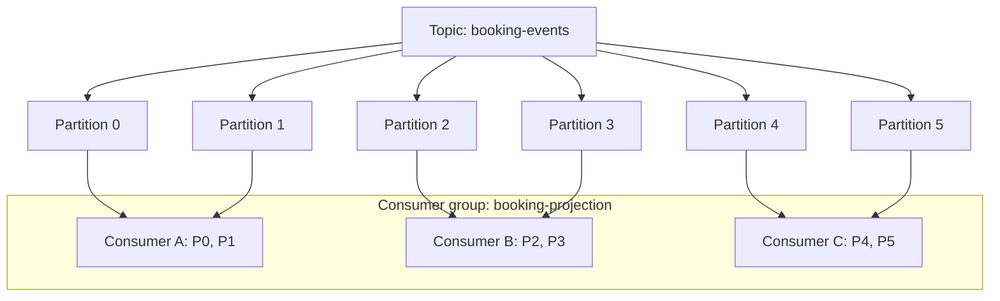
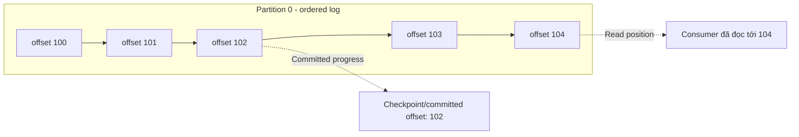
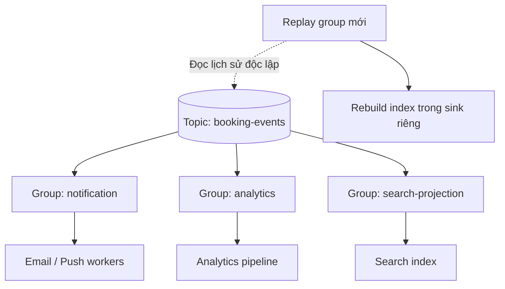
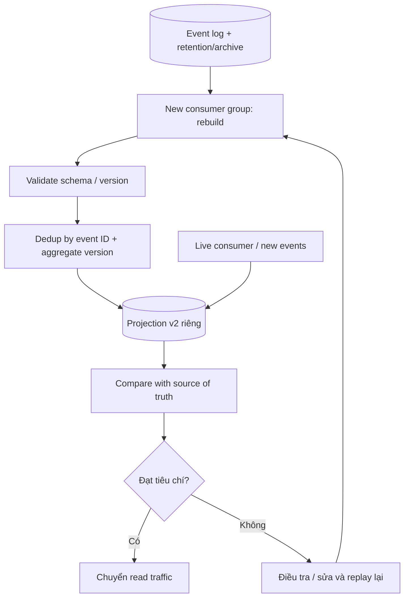

# Nhóm tiêu thụ, checkpoint và phát lại sự kiện

## 1. Vì sao phải quản lý tiến độ tiêu thụ sự kiện?

Trong kiến trúc hướng sự kiện, producer có thể phát hàng triệu sự kiện mà không chờ từng consumer xử lý xong. Broker lưu giữ dữ liệu trong một khoảng thời gian; consumer đọc theo tốc độ và trách nhiệm riêng. Khi consumer khởi động lại, mất mạng, triển khai phiên bản mới hoặc xử lý lỗi, hệ thống phải xác định **đã đọc đến đâu, phần nào đã hoàn tất và có thể đọc lại từ vị trí nào**.

Ba khái niệm cần hiểu:

- **Consumer group (nhóm tiêu thụ):** nhóm các consumer phối hợp chia nhau xử lý một luồng dữ liệu theo cơ chế của nền tảng. Một group thường đại diện cho một mục đích xử lý hoặc một ứng dụng subscriber.
- **Checkpoint (điểm xác nhận tiến độ):** trạng thái cho biết consumer đã xử lý/hoàn tất đến đâu hoặc có thể tiếp tục từ vị trí nào. Tên và semantics phụ thuộc broker; ví dụ offset commit, acknowledgment, cursor hoặc token tiếp tục.
- **Replay (phát lại):** đọc lại những sự kiện đã được giữ trong broker hoặc kho lưu trữ từ một vị trí/thời điểm xác định để khôi phục, tái tạo projection, kiểm tra hoặc xử lý lại.

Các khái niệm này liên quan trực tiếp đến độ tin cậy, khả năng mở rộng, chi phí lưu giữ và vận hành. Nếu checkpoint quá sớm, sự kiện có thể bị bỏ qua sau khi consumer lỗi. Nếu checkpoint quá muộn, sự kiện có thể được xử lý lặp. Nếu phát lại không có kiểm soát, consumer có thể tạo lại giao dịch, gửi email hoặc cập nhật dữ liệu sai.

Bài học thuộc chương **Kiến trúc sự kiện** của module **CLOUD_ARCHITECTURE**. Sau bài học, bạn có thể thiết kế consumer group, partition assignment, checkpoint, replay và quy trình khôi phục cho event streaming/queue trên cloud; phân biệt các semantics giữa broker; và đánh giá ảnh hưởng đến bảo mật, hiệu năng, chi phí và vận hành theo Well-Architected.

## 2. Consumer, subscription và consumer group

### 2.1. Consumer là gì?

**Consumer** là một tiến trình, function hoặc ứng dụng nhận message/event từ broker và thực hiện một công việc. Ví dụ:

- `booking-projection` đọc event để cập nhật màn hình lịch.
- `analytics-consumer` đọc cùng luồng event để tổng hợp chỉ số.
- `notification-worker` nhận event đặt lịch để gửi thông báo.

Một consumer có thể chạy nhiều instance để tăng throughput hoặc duy trì tính sẵn sàng. Cách nhiều instance phối hợp phụ thuộc loại broker.

### 2.2. Consumer group trong hệ thống có partition

Với broker dạng log phân vùng (ví dụ Kafka-compatible), dữ liệu của một topic được chia thành **partition**. Consumer group gồm các consumer instance cùng chia sẻ công việc; tại một thời điểm, mỗi partition thường được giao cho tối đa một consumer trong group, tùy giao thức và cơ chế assignment.

Ví dụ topic `booking-events` có 6 partition:



Trong ví dụ, ba instance chia sáu partition. Nếu chạy nhiều consumer hơn số partition, một số consumer có thể không được giao partition và không tăng thêm khả năng đọc song song cho topic đó. Nếu chỉ có một partition, tăng từ một lên mười consumer trong cùng group không làm tăng mức song song của partition.

**Consumer group không giống nhiều subscriber độc lập.** Nếu Analytics và Notification đều cần nhận mọi event, thường tạo hai group/subscription độc lập. Hai group sẽ có tiến độ riêng. Nếu đưa tất cả instance của Analytics và Notification vào cùng một group, broker có thể chia message giữa chúng, khiến mỗi ứng dụng chỉ nhận một phần luồng thay vì cả hai cùng nhận toàn bộ.

### 2.3. Group, subscription và queue không phải một khái niệm đồng nhất

| Khái niệm | Mô hình tiêu biểu | Ý nghĩa |
|---|---|---|
| Consumer group | Kafka-compatible event streaming | Nhiều consumer chia partition, dùng tiến độ riêng của group |
| Subscription | Pub/Sub hoặc event broker theo mô hình subscription | Một đăng ký logic nhận các message phù hợp; có thể có nhiều subscriber độc lập |
| Queue consumer | Message queue | Consumer nhận message; ACK/delete hoặc visibility/lease quyết định message còn được giao lại hay không |
| Event source mapping | Dịch vụ function tích hợp nguồn sự kiện | Cầu nối đọc/batch message từ nguồn và gọi function theo semantics của dịch vụ |

Không nên gọi mọi worker song song là “consumer group” theo nghĩa Kafka. SQS queue, Pub/Sub subscription và Kafka consumer group có mô hình tiến độ, acknowledgment, thứ tự và replay khác nhau. Phải đọc hợp đồng của dịch vụ được chọn trước khi áp dụng thiết kế.

## 3. Partition, key và mức độ song song

### 3.1. Vì sao partition quan trọng?

Partition là một đơn vị lưu trữ/đọc song song trong log-based streaming. Broker có thể lưu mỗi partition theo thứ tự offset tăng dần; thứ tự thường được bảo đảm trong phạm vi partition, không mặc định trên toàn topic.

Partition quyết định:

- Mức song song tối đa của một consumer group trong mô hình một consumer xử lý một partition tại một thời điểm.
- Cách phân bố tải và dữ liệu giữa các consumer.
- Phạm vi ordering mà ứng dụng có thể dựa vào.
- Kích thước checkpoint và khả năng đọc lại từ offset.
- Chi phí quản lý metadata, file/segment và số lượng consumer assignment.

### 3.2. Partition key và ordering

Nếu cần các event của cùng một booking được xử lý theo thứ tự, có thể sử dụng `bookingId` làm partition key. Broker chọn partition theo key (cách hash/phân phối tùy nền tảng); cùng một key thường đi vào cùng partition trong một cấu hình ổn định.

Ví dụ:

| Event | Key | Mục tiêu |
|---|---|---|
| `BookingCreated` | `B-100` | Tạo trạng thái booking |
| `BookingConfirmed` | `B-100` | Cập nhật cùng aggregate |
| `BookingCancelled` | `B-100` | Không xử lý trước event cần thiết nếu ordering yêu cầu |

Nhược điểm: key nóng (hot key) có thể dồn nhiều traffic vào một partition, gây mất cân bằng. Một booking có tải rất lớn không thể tự chia song song qua nhiều partition mà vẫn giữ thứ tự đơn giản cho toàn booking. Cần cân bằng giữa ordering và throughput; có thể thiết kế nghiệp vụ theo aggregate nhỏ hơn, version/sequence hoặc xử lý có thể song song.

Tăng số partition cũng có thể làm thay đổi cách hash key ánh xạ tới partition với một số chiến lược, do đó phải cân nhắc tác động đến ordering và consumer state khi tăng partition.

## 4. Offset và checkpoint: đã đọc khác với đã xử lý

### 4.1. Offset trong log-based broker

Trong Kafka-like broker, **offset** là vị trí của record trong một partition. Consumer có thể đọc offset 100, 101, 102... Offset thường tăng theo partition; không phải một số thứ tự toàn cục duy nhất giữa mọi partition.

Consumer group lưu committed offset để lần khởi động sau có thể tiếp tục. Tuy nhiên, cần thống nhất ý nghĩa offset commit:

- **Commit offset sau khi xử lý xong:** giảm nguy cơ bỏ qua event khi consumer lỗi; nhưng nếu xử lý xong rồi chết trước commit, event có thể được xử lý lại.
- **Commit offset trước khi xử lý:** tránh đọc lại trong một số trường hợp, nhưng nếu consumer chết giữa commit và side effect, event có thể bị bỏ qua.

Vì vậy, checkpoint/offset không tự bảo đảm exactly-once business effect. Cần phối hợp transaction, idempotency hoặc cơ chế atomicity mà broker và sink hỗ trợ.

### 4.2. Sơ đồ vị trí đọc và checkpoint



Hình minh họa consumer đã đọc tới 104 nhưng checkpoint chỉ xác nhận đến vị trí 102 theo quy ước của broker. Nếu consumer dừng, các record sau checkpoint có thể được đọc lại. Trong API của Kafka, committed offset thường là **offset kế tiếp cần đọc**, nên khi đã xử lý đến 102 thì commit 103. Không áp dụng cách hiểu con số trong hình như một quy ước offset chung cho mọi sản phẩm.

### 4.3. Checkpoint ở các loại nguồn sự kiện

| Nguồn | Khái niệm tiến độ thường gặp | Cách xác nhận |
|---|---|---|
| Kafka-compatible log | Offset theo partition và consumer group | Commit offset |
| Event stream quản lý theo shard | Sequence number/checkpoint theo shard | Lưu checkpoint hoặc continuation token |
| Message queue | ACK/delete, visibility/lease, receive count | ACK khi hoàn tất; message chưa ACK có thể được giao lại |
| Pub/Sub subscription | Ack deadline/ack ID và subscription state | ACK hoặc NACK/để deadline hết hạn theo dịch vụ |
| Event source gọi function | Batch progress/partial batch failure hoặc checkpoint do integration quản lý | Tuân theo semantics của event source mapping |

Checkpoint có thể được broker lưu, do consumer tự lưu vào database, hoặc được runtime quản lý. Phải xác định **ai sở hữu checkpoint**, định dạng, chu kỳ commit, khả năng khôi phục và cách chuyển checkpoint khi thay đổi topology.

## 5. Cập nhật checkpoint an toàn

### 5.1. Quy tắc cốt lõi

Trong xử lý có side effect, hãy chỉ tiến checkpoint đến vị trí mà **mọi record trước đó trong phạm vi cần xác nhận đã hoàn tất an toàn**. Nếu xử lý song song các record trong cùng partition, không được commit vượt qua một record còn đang chạy.

Ví dụ partition có offset 20, 21, 22:

- 20 hoàn tất.
- 21 còn đang ghi database.
- 22 đã hoàn tất.

Checkpoint an toàn vẫn phải dừng ở trước 21; nếu commit sau 22 rồi process chết, record 21 có thể bị bỏ qua. Consumer cần theo dõi vùng tiến độ liên tục (contiguous completed offset), không chỉ offset lớn nhất đã hoàn tất.

### 5.2. Side effect và checkpoint trong hai hệ thống khác nhau

Giả sử consumer cập nhật PostgreSQL rồi commit Kafka offset. Đây là hai hệ thống độc lập:

1. DB commit thành công, consumer chết trước offset commit → event có thể được đọc lại (duplicate).
2. Offset commit thành công trước DB commit, consumer chết → event có thể bị bỏ qua dù DB chưa đổi.

Mô hình an toàn phổ biến là **DB transaction + inbox/dedup marker**, rồi mới commit offset. Khi event được đọc lại sau DB commit, consumer nhận biết duplicate và không thực hiện side effect thêm.

Pseudo-code:

```text
for record in partition:
    begin database transaction
    if insert_inbox(record.event_id) succeeds:
        apply_business_update(record, transaction)
    commit database transaction
    mark record completed

commit only highest contiguous completed offset
```

Nếu broker và hệ thống đích cùng hỗ trợ một transaction framework tích hợp, có thể dùng giao dịch hoặc connector được thiết kế để phối hợp. Tuy nhiên, không giả định một transaction database thông thường tự nguyên tử với offset của broker.

### 5.3. Checkpoint theo batch

Batch consumer có thể xử lý nhiều record một lần rồi checkpoint. Điều này giảm overhead nhưng tăng kích thước vùng có thể bị đọc lại khi lỗi. Batch càng lớn, cần càng chú ý:

- Thời gian xử lý tối đa so với timeout/lease.
- Memory giữ payload và kết quả trung gian.
- Partial failure: record nào thành công, record nào cần retry?
- Thứ tự trong batch và trong partition.
- Kích thước checkpoint và tác động khi crash.

Nếu nguồn hỗ trợ partial batch acknowledgement, báo chính xác record thất bại để giảm xử lý lặp. Nếu không, từng record cần idempotency vì toàn batch có thể bị giao lại.

## 6. Replay: đọc lại sự kiện để làm gì?

**Replay** là đưa consumer đọc lại dữ liệu đã được broker giữ hoặc đã lưu trữ từ một offset, timestamp, sequence, checkpoint hoặc mốc nghiệp vụ. Đây là khả năng quan trọng để phục hồi consumer, xây dựng lại read model hoặc xử lý lỗi sau khi code đã được sửa.

Các mục đích thường gặp:

1. **Khôi phục sau outage:** consumer ngừng vài giờ, khởi động lại từ checkpoint cũ để bắt kịp backlog.
2. **Tái tạo projection/read model:** xây lại bảng tìm kiếm, cache, báo cáo hoặc materialized view từ event log.
3. **Sửa lỗi consumer:** phiên bản cũ xử lý sai một tập event; phiên bản đã sửa đọc lại dữ liệu đó.
4. **Tạo subscriber mới:** ứng dụng phân tích cần đọc lịch sử để khởi tạo trạng thái trước khi nhận event mới.
5. **Điều tra và đối soát:** phát lại bản sao trong môi trường cô lập để phân tích hành vi.

Replay không phải luôn là redrive DLQ. Replay có thể đọc toàn bộ dải dữ liệu lịch sử từ log; redrive thường đưa message lỗi từ DLQ trở lại luồng xử lý. Hai thao tác có rủi ro và công cụ quản lý khác nhau.

## 7. Các chiến lược replay

### 7.1. Replay từ offset/checkpoint

Phù hợp khi đã biết consumer cần đọc từ vị trí cụ thể, ví dụ offset 500 của partition 2. Ưu điểm là phạm vi rõ và có thể lặp lại. Rủi ro là phải ghi đúng offset cho mọi partition và hiểu retention; offset không tồn tại hoặc đã bị xóa thì consumer không thể đọc từ đó.

### 7.2. Replay từ timestamp

Phù hợp khi biết thời điểm xảy ra sự cố: “đọc lại sự kiện từ 10:00 UTC”. Broker có thể hỗ trợ tra offset tương ứng với timestamp hoặc API theo thời gian. Cần nhớ:

- Timestamp có thể là event time hoặc broker append time.
- Đồng hồ producer có thể lệch; sự kiện đến trễ có thể được append sau thời điểm nghiệp vụ xảy ra.
- Ánh xạ timestamp → offset được thực hiện theo từng partition/shard.
- Replay timestamp không nhất thiết cho một ranh giới nghiệp vụ chính xác.

### 7.3. Replay vào consumer group mới

Tạo một group mới giúp consumer đọc lại từ earliest hoặc mốc được cấu hình mà không thay đổi checkpoint của group production hiện hữu. Cách này hữu ích cho projection mới hoặc chạy so sánh. Phải giới hạn quyền, tài nguyên, dữ liệu đích và tác động side effect; group mới không được gửi email/thanh toán thật ngoài ý muốn.

### 7.4. Replay sang môi trường hoặc sink riêng

Để thử bản sửa, có thể đọc sự kiện vào một consumer group hoặc môi trường staging riêng, ghi vào database mới/namespace riêng và đối chiếu kết quả. Đây thường là cách an toàn để xác nhận logic trước khi thay thế trạng thái production. Nhưng cần xem quy định dữ liệu, masking, vùng lưu trữ và quyền đọc lịch sử.

## 8. Replay an toàn: tránh side effect lặp

Replay có thể làm một consumer nhìn thấy event lần nữa, kể cả khi trước đó event đã tạo tác động nghiệp vụ. Trước khi chạy, cần phân loại:

| Loại consumer | Cách replay an toàn |
|---|---|
| Projection/read model có thể xây lại | Ghi vào sink mới hoặc xóa/rebuild phạm vi rõ ràng; giữ version và so sánh kết quả |
| Analytics/warehouse | Dùng event ID để loại trùng hoặc partition theo batch/run; tránh cộng tổng hai lần |
| Gửi email/push | Không tự động gửi lại notification đã gửi; kiểm tra delivery history và idempotency |
| Thanh toán/tạo giao dịch | Không replay lệnh side effect trực tiếp; đối chiếu provider reference và trạng thái nghiệp vụ |
| Audit log | Giữ nguyên tính toàn vẹn; không ghi đè lịch sử, phân biệt bản phát lại với event gốc |

Các biện pháp chính:

- Dùng event ID ổn định, consumer-specific deduplication store và business key.
- Ghi rõ `replayRunId`, thời điểm chạy, dải offset và consumer version.
- Tách replay mode với normal live mode; có thể tắt side effect ngoài hệ thống.
- Xác định cách làm sạch hoặc rebuild sink; không reset production data khi chưa có kế hoạch.
- Giới hạn tốc độ và concurrency để replay không cạnh tranh quá mức với traffic mới.
- Ghi audit và có thao tác dừng/tiếp tục replay.

### 8.1. Replay không thay thế backup

Event log có thể hỗ trợ tái tạo trạng thái nếu nó chứa đủ sự kiện, retention đủ dài và mọi thay đổi cần thiết đều được phát đúng. Nhưng không phải hệ thống nào cũng phát event cho mọi thay đổi, giữ payload đầy đủ hoặc lưu vô hạn. Event broker **không tự động là backup database**.

Database vẫn cần backup/restore phù hợp với RPO/RTO. Replay phù hợp để tái dựng các projection hoặc quy trình được thiết kế từ event; không nên phụ thuộc vào nó để phục hồi mọi loại dữ liệu hay bí mật.

## 9. Consumer lag và khả năng bắt kịp

### 9.1. Consumer lag là gì?

**Consumer lag** mô tả khoảng cách giữa vị trí mới nhất của broker và tiến độ consumer đã xác nhận. Với log-based broker, lag có thể tính theo số record/offset hoặc thời gian từ event mới nhất đến checkpoint. Cách tính cụ thể phụ thuộc partition và công cụ giám sát.

Lag tăng có thể do:

- Producer phát nhanh hơn consumer xử lý.
- Consumer thiếu CPU/RAM hoặc bị throttling.
- Database/downstream chậm, connection pool cạn.
- Consumer group rebalance thường xuyên.
- Một partition có hot key hoặc event xử lý lâu.
- Retry, timeout hoặc poison message làm giảm throughput.

Lag không tự động đồng nghĩa với lỗi. Một hệ thống batch có thể chấp nhận lag vài giờ nếu deadline nghiệp vụ cho phép; hệ thống fraud detection có thể yêu cầu lag chỉ vài giây.

### 9.2. Ước lượng khả năng bắt kịp backlog

Giả sử:

- Broker đang nhận 800 event/giây.
- Consumer group có thể xử lý tổng cộng 1.000 event/giây khi không có replay.
- Backlog hiện tại là 3.600.000 event.

Thông lượng dư để xóa backlog là:

\[
R_{surplus}=1.000-800=200\ \text{event/giây}
\]

Thời gian bắt kịp gần đúng:

\[
T=\frac{3.600.000}{200}=18.000\ \text{giây}=5\ \text{giờ}
\]

Nếu throughput consumer chỉ bằng hoặc thấp hơn tốc độ producer, backlog không thể giảm. Đây là mô hình ước lượng lý tưởng; thực tế cần tính phân bố partition, event size, thời gian xử lý, downstream capacity, rebalance, burst và retry. Tăng consumer vượt số partition có thể không tăng throughput.

### 9.3. Cảnh báo nên có

Theo dõi:

- Lag theo partition và tổng group.
- Age of oldest unprocessed event.
- Consumer throughput và processing latency.
- Rebalance count/duration, failed heartbeat và consumer availability.
- Retry count, DLQ count, error rate.
- Downstream latency, connection saturation và throttling.
- Dung lượng log/retention còn lại so với thời gian dự kiến bắt kịp.

Alert nên dựa trên deadline nghiệp vụ. Ví dụ, nếu event phải được xử lý trong 2 phút, cảnh báo theo age of oldest event sắp vượt ngưỡng có thể hữu ích hơn cảnh báo lag bằng một con số record cố định.

## 10. Retention và giới hạn khả năng phát lại

Replay chỉ khả thi nếu dữ liệu còn được giữ. Broker có thể giới hạn retention theo thời gian hoặc dung lượng; một số stream lưu đến khi hết retention, trong khi queue có thể xóa message sau ACK.

| Chính sách | Tác động |
|---|---|
| Retention ngắn | Chi phí thấp hơn; outage dài có thể mất khả năng replay từ broker |
| Retention dài | Hỗ trợ backfill và outage dài hơn; tăng chi phí lưu trữ và quản lý dữ liệu |
| Compaction theo key | Giữ trạng thái mới nhất theo key ở một số broker; không đồng nghĩa lưu lại mọi event lịch sử |
| Archive/object storage | Giữ dữ liệu lâu hơn với chi phí phù hợp; cần quy trình đọc lại và định dạng tương thích |
| Queue xóa sau ACK | Phù hợp xử lý việc; thường không thể rewind message đã xóa nếu không có archive/replication khác |

Retention phải dài hơn khoảng thời gian outage, điều tra và replay dự kiến **có dự phòng**. Nếu yêu cầu đối soát lịch sử 1 năm nhưng broker chỉ giữ 7 ngày, cần archive hoặc event store riêng. Cần tính cả storage, replication, index, request đọc lại và chi phí egress.

## 11. Thay đổi consumer group và rebalance

### 11.1. Rebalance là gì?

Trong consumer group kiểu Kafka, broker/client có thể phân phối lại partition khi thành viên tham gia/rời đi, timeout heartbeat hoặc thay đổi số partition/subscription. Quá trình **rebalance** tạm ảnh hưởng việc đọc và có thể làm tăng lag.

Các nguyên nhân thường gặp:

- Consumer crash hoặc không gửi heartbeat đúng hạn.
- Thời gian xử lý batch quá dài khiến consumer bị xem là không hoạt động.
- Deployment rolling làm instance rời/join group liên tục.
- Thêm/bớt consumer hoặc thay đổi partition/topic subscription.
- Mạng chập chờn hoặc resource throttling.

Giảm rebalance không có nghĩa giữ group bất biến. Cần chọn timeout/poll interval phù hợp, xử lý shutdown graceful, commit tiến độ trước khi rời và tránh xử lý lâu hơn giới hạn runtime mà không có chiến lược.

### 11.2. Graceful shutdown

Khi triển khai phiên bản mới:

1. Ngừng nhận partition/message mới theo cơ chế client/broker.
2. Hoàn tất record đang xử lý trong deadline hoặc dừng có kiểm soát.
3. Commit checkpoint an toàn, không vượt qua record chưa hoàn tất.
4. Đóng kết nối/heartbeat theo giao thức.
5. Consumer mới tham gia và tiếp tục từ checkpoint.

Nếu không thể hoàn tất trong thời gian shutdown, nên dừng trước khi mất quyền sở hữu và để broker giao lại; idempotency bảo vệ side effect. Không commit toàn bộ batch chỉ vì process sắp thoát.

## 12. Replay và xử lý song song nhiều group

Một topic có thể có nhiều group:



Mỗi group có tiến độ riêng. Khi tạo group replay, cần chọn:

- Đọc từ earliest, latest, timestamp hay checkpoint cụ thể?
- Consumer xử lý live đồng thời hay cần tách thời điểm replay?
- Sink nào nhận dữ liệu: projection mới, staging hay production?
- Duplicate sẽ được loại theo event ID hay xử lý bằng idempotent upsert?
- Có cần giới hạn tốc độ để không ảnh hưởng group live?

Nếu replay và live cùng ghi một sink, event mới có thể được xử lý trước event cũ. Có thể dùng hai pha: replay đến một high-water mark, sau đó chuyển live; hoặc xử lý đồng thời với sequence/version để bảo đảm trạng thái không bị lùi.

## 13. Ví dụ thực tế: xây lại booking projection sau lỗi consumer

Giả sử ứng dụng đặt lịch phát `BookingCreated`, `BookingConfirmed` và `BookingCancelled` vào topic `booking-events`. Group `booking-projection-v1` cập nhật read model cho API tra cứu. Một bug trong phiên bản cũ làm sai timezone khi tính ngày hiển thị.

### 13.1. Phân tích sự cố

- Event gốc trong broker vẫn đúng; lỗi nằm ở logic consumer/projection.
- Read model đã bị sai; chỉ restart consumer không sửa dữ liệu đã ghi.
- Cần rebuild read model từ lịch sử trong retention hoặc archive.
- Không được replay consumer gửi email hoặc thanh toán vì các side effect đó đã xảy ra.

### 13.2. Kế hoạch phục hồi

1. Sửa logic và kiểm thử consumer v2 bằng tập event đại diện.
2. Tạo group mới `booking-projection-v2-rebuild` đọc từ mốc lịch sử cần thiết.
3. Ghi vào bảng/index riêng `booking_projection_v2`; dùng upsert theo booking ID và version để tránh duplicate/out-of-order.
4. Giới hạn replay throughput để không ảnh hưởng consumer live và database.
5. So sánh tổng booking, trạng thái, timezone và các trường hợp biên với nguồn dữ liệu chuẩn; kiểm tra event không có trong retention.
6. Bắt kịp live events đến high-water mark; dùng version/sequence để không ghi đè trạng thái mới bằng event cũ.
7. Chuyển read traffic sang projection v2 bằng rollout có kiểm soát; giữ v1 để rollback trong thời hạn đã định.
8. Sau khi xác minh, lưu hồ sơ, dừng group rebuild và dọn tài nguyên tạm theo chính sách.

### 13.3. Minh họa flow replay



Trong ví dụ, replay vào sink riêng cho phép kiểm tra trước khi thay thế projection. Nếu dữ liệu lịch sử đã hết retention, nhóm cần dùng archive hoặc nguồn dữ liệu chuẩn để rebuild; không tự suy ra broker còn giữ mọi event.

## 14. Phân biệt checkpoint, replay, retry và redrive

| Thuật ngữ | Câu hỏi được trả lời | Phạm vi |
|---|---|---|
| Checkpoint/offset commit | Consumer đã xác nhận tiến độ đến đâu? | Tiến độ đọc/xử lý |
| Replay | Có thể đọc lại lịch sử từ vị trí/mốc nào? | Luồng event/log hoặc archive |
| Retry/redelivery | Message xử lý thất bại có được thử lại không? | Một message hoặc batch chưa hoàn tất |
| Redrive | Message trong DLQ có thể được đưa trở lại luồng xử lý không? | Tập message đã bị cách ly |
| Rebuild/reconciliation | Làm sao tạo lại trạng thái đúng và đối chiếu nguồn chuẩn? | Dữ liệu đích/nghiệp vụ |

Một consumer có thể replay event từ offset cũ mà không có message nào ở DLQ. Ngược lại, redrive DLQ không nhất thiết làm lùi offset của toàn topic. Phân biệt đúng giúp tránh dùng sai công cụ phục hồi.

## 15. Bảo mật và quản trị khi phát lại dữ liệu

Replay có thể đọc dữ liệu lịch sử chứa thông tin cá nhân hoặc dữ liệu tài chính. Cần:

- IAM riêng cho quyền consume, đọc archive, reset group offset và redrive.
- Quy trình phê duyệt khi reset checkpoint của production group hoặc replay vào sink production.
- Mã hóa dữ liệu lưu và truyền; giới hạn vùng địa lý được phép đặt archive/sink.
- Không ghi payload nhạy cảm vào log; sử dụng event ID/correlation ID để điều tra.
- Audit ai đã thay đổi checkpoint, tạo group, phát lại partition nào, khoảng thời gian nào và vào sink nào.
- Hạn chế dữ liệu được replay bằng filter hoặc transform có kiểm soát; bảo đảm không làm thay đổi ý nghĩa event.
- Retention và xóa dữ liệu theo chính sách; replay không được tái tạo dữ liệu đã có yêu cầu xóa nếu nghiệp vụ/pháp lý không cho phép.

Không cấp quyền reset offset toàn bộ topic cho mọi developer. Một thao tác reset nhầm có thể tạo tải replay lớn hoặc lặp side effect trong production.

## 16. Đánh đổi chi phí và hiệu năng

| Quyết định | Lợi ích | Chi phí/rủi ro |
|---|---|---|
| Tăng số partition | Tăng khả năng song song và phân tán tải | Thêm overhead broker, metadata, file/segment và vận hành |
| Tăng số consumer trong group | Có thể tăng throughput đến giới hạn partition | Consumer idle khi vượt partition; tăng kết nối và downstream load |
| Retention dài | Replay sau outage dài, bootstrap group mới | Chi phí storage/replication và quản lý dữ liệu |
| Replay nhanh | Rút ngắn thời gian rebuild | Cạnh tranh CPU, DB, network với live traffic; tăng phí đọc và xử lý |
| Batch lớn | Giảm overhead gọi consumer/commit | Memory, latency, partial failure và vùng duplicate lớn hơn |
| Checkpoint thường xuyên | Giảm số record phải đọc lại | Tăng request/transaction overhead |
| Checkpoint thưa | Giảm overhead | Có thể đọc lại nhiều record hơn khi crash |

Để định lượng, theo dõi chi phí trên một triệu event được xử lý thành công, chi phí giữ một GB/ngày, thời gian replay một partition và công suất còn lại cho live traffic. Replay cần budget riêng nếu chạy trên hạ tầng dùng chung.

## 17. Đánh giá theo Well-Architected

| Trụ cột | Câu hỏi đánh giá |
|---|---|
| **Operational Excellence** | Có dashboard lag, runbook rebalance/replay, owner group, quy trình checkpoint reset và diễn tập phục hồi không? |
| **Security** | Ai được consume/reset/replay? Dữ liệu archive/DLQ có mã hóa, audit và retention phù hợp? |
| **Reliability** | Checkpoint chỉ tiến sau xử lý an toàn? Duplicate/out-of-order được bảo vệ? Retention đủ cho outage và rebuild? |
| **Performance Efficiency** | Partition/key/consumer count/batch có phù hợp throughput? Replay có bảo vệ live traffic? |
| **Cost Optimization** | Retention, archive, số partition, telemetry và replay compute có nằm trong ngân sách? |
| **Sustainability** | Tránh replay toàn bộ không cần thiết, dọn sink tạm, tối ưu batch và chỉ giữ dữ liệu theo nhu cầu? |

## 18. Mẫu ADR cho consumer group và replay

Ví dụ ghi lại quyết định cho luồng booking:

```yaml
decision_id: ADR-EVENT-007
title: Consumer group checkpoint and replay policy
topic: booking-events
partition_key: booking_id
consumer_groups:
  - name: booking-projection
    purpose: production_read_model
    checkpoint_owner: consumer_group
  - name: booking-analytics
    purpose: analytics_pipeline
    checkpoint_owner: consumer_group
checkpoint_policy:
  commit_after: durable_sink_write
  preserve_contiguous_partition_progress: true
replay_policy:
  target: isolated_projection_sink
  start_position: approved_offset_or_timestamp
  rate_limit: defined_by_live_capacity
  require_approval: true
idempotency:
  key: event_id
  aggregate_version_check: true
retention:
  broker_window: approved_service_setting
  archive_required: true
acceptance_tests:
  - crash_before_checkpoint_commit
  - consumer_rebalance
  - duplicate_and_out_of_order_events
  - replay_without_external_side_effect
  - replay_catchup_under_live_load
review_triggers:
  - partition_count_change
  - retention_or_schema_change
  - consumer_slo_change
```

Đây là mẫu tài liệu hóa, không phải cấu hình broker dùng trực tiếp. Số partition, retention, vị trí checkpoint, quyền reset và mức replay phải được chọn từ yêu cầu nghiệp vụ, volume, SLO, đặc tính của dịch vụ và chi phí.

## 19. Quy trình thực hành khi consumer cần khôi phục

1. **Xác định sự cố:** consumer dừng, lag tăng, dữ liệu sai hay message bị mất? Phân biệt lỗi xử lý với lỗi hiển thị của dashboard.
2. **Đóng băng thay đổi nguy hiểm:** tránh reset offset hoặc replay đồng loạt trước khi biết nguyên nhân; nếu cần, hạn chế concurrency hoặc dừng consumer có kiểm soát.
3. **Kiểm tra checkpoint và retention:** xác định group, partition, committed position, read position, high-water mark, archive và thời điểm dữ liệu sẽ hết hạn.
4. **Xác minh sink:** event nào đã tạo side effect? Dedup store và version state còn giữ không? Có trạng thái giao dịch mơ hồ không?
5. **Chọn chiến lược:** resume từ checkpoint, replay range, group mới, rebuild projection, redrive DLQ hay reconciliation.
6. **Lập kế hoạch tải:** ước lượng backlog, throughput dư, thời gian bắt kịp, quota và năng lực database/downstream.
7. **Phê duyệt và chạy thử:** replay vào sink cô lập hoặc bản sao dữ liệu; kiểm tra duplicate, ordering, dữ liệu nhạy cảm và cost.
8. **Chạy production có giám sát:** giới hạn rate/concurrency, bật alert, ghi replayRunId và có nút dừng.
9. **Đối chiếu và đóng sự cố:** so sánh số lượng/tổng hợp với source of truth, xác nhận SLO, dọn tài nguyên và cập nhật ADR/runbook.

## 20. Bảng kiểm trước khi đưa consumer vào production

- [ ] Đã xác định mô hình broker: consumer group, subscription hay queue consumer; không trộn semantics.
- [ ] Partition key đáp ứng cả ordering và phân bố tải; đã nhận diện hot partition.
- [ ] Số consumer phù hợp với số partition và năng lực downstream.
- [ ] Checkpoint/offset chỉ tiến qua vùng record đã xử lý hoàn tất; quy tắc batch/partial failure rõ ràng.
- [ ] Side effect và checkpoint được phối hợp bằng transaction/inbox/idempotency phù hợp.
- [ ] Có graceful shutdown, rebalance handling, lag/oldest event alert và runbook.
- [ ] Retention/archive đáp ứng outage, điều tra, bootstrap và replay cần thiết.
- [ ] Replay xác định được start position, sink, group, tốc độ, version và replayRunId.
- [ ] Side effect trong replay có dedup/disable/approval; không gửi lại email hoặc charge ngoài ý muốn.
- [ ] Có cách xử lý event cũ, sai thứ tự, schema version cũ và dữ liệu đã bị xóa theo chính sách.
- [ ] Quyền consume, reset checkpoint, archive read và redrive được giới hạn và audit.
- [ ] Đã thử crash trước/sau checkpoint, rebalance, replay backlog và replay song song live.
- [ ] Chi phí partition, retention, archive, replay compute và telemetry đã được dự toán.

**Nguyên tắc áp dụng:** consumer group quyết định ai chia nhau đọc luồng; checkpoint ghi nhận tiến độ có thể khôi phục; replay cho phép đọc lại dữ liệu lịch sử. Chúng chỉ tạo thành một cơ chế phục hồi đáng tin cậy khi được kết hợp với idempotency, ordering, retention, kiểm soát side effect và quy trình vận hành có giới hạn.
