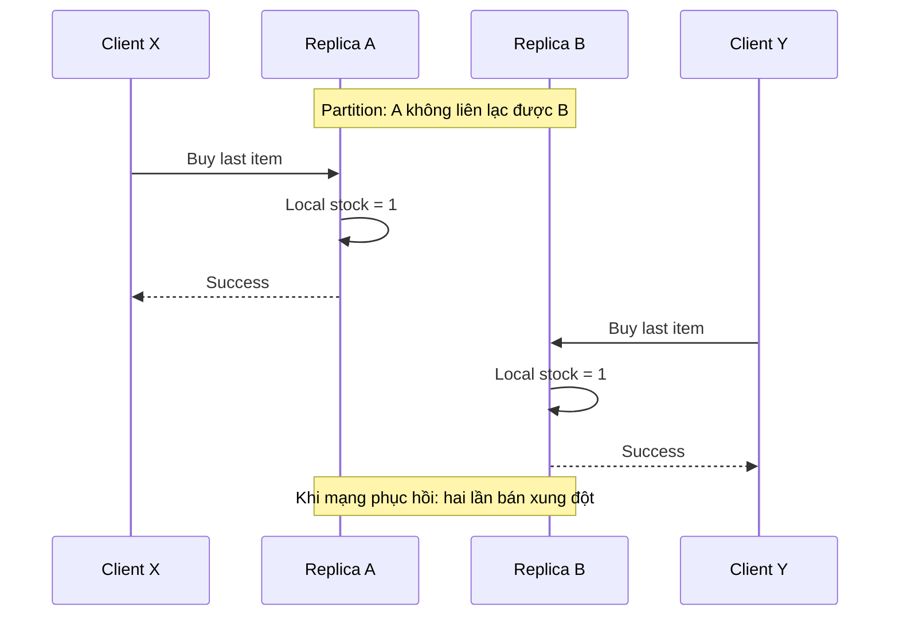
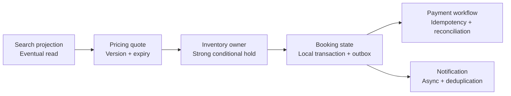
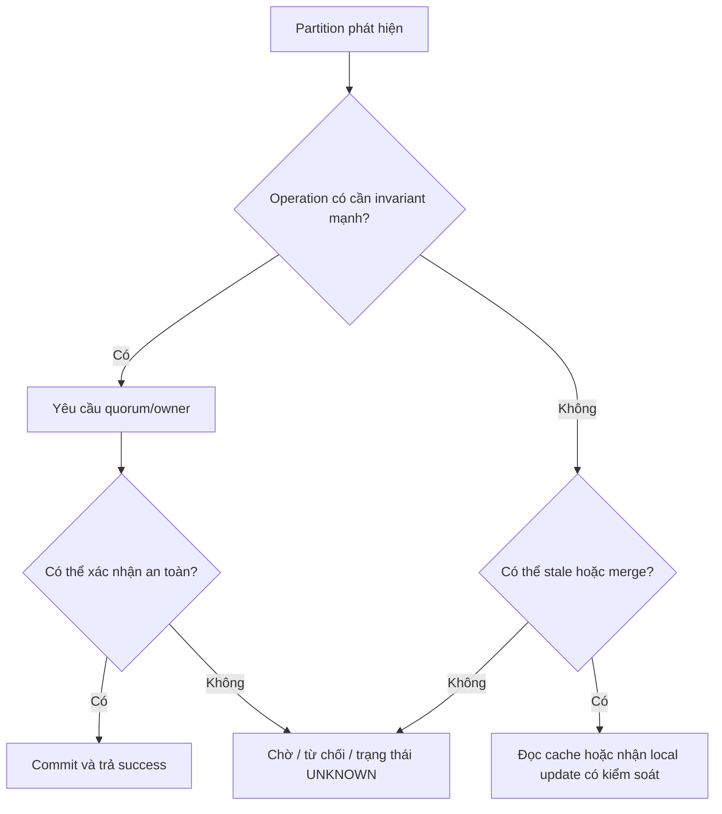

# CAP và hành vi hệ thống khi xảy ra phân hoạch mạng

## 1. Vì sao phân hoạch mạng là vấn đề kiến trúc?

Ứng dụng cloud thường chạy trên nhiều máy, availability zone hoặc region. Các node cần trao đổi dữ liệu và thông điệp để phối hợp trạng thái. Nhưng mạng có thể bị phân hoạch: một nhóm node không thể liên lạc với nhóm còn lại, dù từng node vẫn đang chạy.

Trong tình huống đó, một yêu cầu ghi có thể tới hai phía khác nhau; một replica có thể không biết replica còn lại vừa cập nhật; coordinator có thể không liên lạc được với quorum. Hệ thống phải quyết định tiếp tục phục vụ một số yêu cầu với nguy cơ dữ liệu không nhất quán, hay từ chối/chờ để giữ một thứ tự cập nhật nhất quán.

Định lý **CAP** là một cách nhìn nền tảng về đánh đổi đó. CAP thường được tóm tắt bằng ba thuộc tính:

- **Consistency (C):** các thao tác đọc/ghi tuân theo một mô hình nhất quán mạnh; trong cách phát biểu CAP, tính nhất quán gần với *linearizability*.
- **Availability (A):** mọi request đến một node không bị lỗi đều nhận được phản hồi hợp lệ trong thời gian hữu hạn theo định nghĩa CAP.
- **Partition tolerance (P):** hệ thống tiếp tục hoạt động ở một mức nào đó khi thông điệp giữa các node bị mất hoặc độ trễ không giới hạn, tức mạng bị phân hoạch.

CAP không phải công thức chọn hai trong ba tính năng để bật trên console. Trong hệ thống phân tán thực tế, partition có thể xảy ra; câu hỏi kiến trúc là **hành vi nào được chấp nhận trong thời gian các node không thể phối hợp**. Hệ thống ưu tiên consistency có thể từ chối một số thao tác không thể xác nhận an toàn; hệ thống ưu tiên availability có thể tiếp tục nhận thao tác và xử lý xung đột hoặc hội tụ sau đó.

Trong module **CLOUD_ARCHITECTURE**, chương **Tính nhất quán** đặt CAP trong bối cảnh thiết kế dữ liệu và dịch vụ cloud, nơi độ tin cậy, latency, bảo mật, khả năng mở rộng, chi phí và vận hành phải được đánh giá cùng nhau.

Sau bài học, người học có thể:

1. Giải thích đúng ba thuộc tính C, A, P và giới hạn của phát biểu CAP.
2. Mô tả hành vi hệ thống khi một mạng bị chia thành các partition.
3. Phân biệt linearizability, serializability, strong consistency, eventual consistency và các mô hình trung gian.
4. Hiểu vai trò của quorum, leader election, consensus và fencing trong việc tránh split-brain.
5. Liên hệ CAP và PACELC với lựa chọn database/topology trên cloud.
6. Thiết kế graceful degradation, timeout, retry, idempotency và reconciliation.
7. Lập kịch bản kiểm thử partition, đo SLO và ghi quyết định kiến trúc.

## 2. CAP chính xác nói điều gì?

CAP phân tích một dịch vụ dữ liệu phân tán có thể nhận thao tác đọc/ghi từ client trong khi các node giao tiếp qua mạng. Ba thuộc tính cần hiểu theo định nghĩa kỹ thuật, không chỉ theo từ ngữ đời thường.

### 2.1. Consistency trong CAP

Trong CAP, **Consistency thường được hiểu là atomic consistency/linearizability**: mỗi thao tác đọc/ghi có thể được xem như xảy ra tại một thời điểm tức thời nằm giữa lúc bắt đầu và lúc hoàn tất thao tác, và tất cả client quan sát được một thứ tự toàn cục phù hợp với thứ tự thời gian thực.

Ví dụ:

1. Client A ghi số dư mới của tài khoản thành 800. Hệ thống xác nhận thao tác thành công.
2. Sau khi nhận xác nhận, Client B đọc tài khoản đó.
3. Nếu hệ thống cung cấp linearizability, Client B phải thấy giá trị 800 hoặc một cập nhật mới hơn; không được thấy giá trị cũ 1.000.

Điểm quan trọng là **thứ tự thời gian thực**. Một lần đọc bắt đầu trước khi một lần ghi hoàn tất có thể được sắp thứ tự trước hoặc sau lần ghi tùy lịch thực thi; nhưng một lần đọc bắt đầu sau khi ghi đã trả thành công phải nhìn thấy ghi đó hoặc ghi mới hơn.

Consistency trong CAP không đồng nghĩa với mọi thứ được ghi trong một transaction SQL duy nhất, cũng không đồng nghĩa với tính toàn vẹn dữ liệu, schema validation hoặc consistency model rộng trong mọi tài liệu distributed systems.

### 2.2. Availability trong CAP

Availability có nghĩa là mỗi request tới node không bị lỗi phải nhận được một response hợp lệ trong thời gian hữu hạn, kể cả khi đang có partition.

"Response hợp lệ" không có nghĩa là tùy ý trả dữ liệu sai. Trong định nghĩa CAP cổ điển, một dịch vụ không thể từ chối mọi request ghi chỉ vì không đạt consistency rồi vẫn tự nhận là fully available cho các thao tác đó.

Ví dụ, khi partition:

- Nhóm node A không liên lạc được nhóm B.
- Client gọi ghi trên A và nhận xác nhận.
- Client khác gọi ghi trên B và cũng nhận xác nhận.
- Sau khi mạng phục hồi, hai cập nhật có thể xung đột.

Nếu hệ thống tiếp tục nhận cả hai ghi mà không có cơ chế phân xử, nó ưu tiên availability trong tình huống partition nhưng không thể giữ linearizability cho cùng dữ liệu.

### 2.3. Partition tolerance

Partition là tình trạng các node hoặc nhóm node không thể trao đổi thông điệp cần thiết. Nguyên nhân có thể là:

- Mất kết nối giữa các availability zone hoặc region.
- Routing sai, ACL/firewall thay đổi hoặc DNS lỗi.
- Packet loss, latency tăng rất cao hoặc kết nối TCP liên tục timeout.
- Gateway, transit network hoặc thiết bị kết nối gặp sự cố.
- Network congestion khiến thời gian phản hồi vượt timeout.
- Một bên bị cô lập khỏi quorum hoặc leader.

Partition không nhất thiết có nghĩa toàn bộ mạng bị ngắt. Có thể chỉ một số cặp node không liên lạc được; có thể một chiều đi được nhưng chiều về lỗi; hoặc một node chậm tới mức các node khác coi là đã mất.

Trong hệ thống phân tán thực tế, **không thể giả định P sẽ không bao giờ xảy ra**. Bài toán thiết kế là lựa chọn guarantee và hành vi khi partition, đồng thời giảm xác suất và phạm vi ảnh hưởng bằng topology, network engineering và vận hành.

## 3. Vì sao không thể giữ cả C và A khi có P?

Xét hai replica R1 và R2 lưu cùng một khóa, giá trị inventory bằng 1, nghĩa là còn một đơn vị hàng.

Trước khi partition, hai replica đồng bộ. Sau đó:

- Client X gửi yêu cầu mua đơn vị cuối tới R1.
- Client Y gửi yêu cầu mua đơn vị cuối tới R2.
- R1 và R2 không thể trao đổi thông điệp.
- Nếu cả hai đều xác nhận thành công dựa trên local state, hai khách cùng được cấp hàng cuối.
- Nếu chỉ một bên được phép xác nhận, bên còn lại phải chờ, từ chối hoặc redirect tới phía có thẩm quyền.



Nếu cả hai ghi được xác nhận, hệ thống không thể tuyên bố rằng cả hai replica duy trì cùng một thứ tự tuyến tính cho tài nguyên cuối cùng. Nếu R2 chờ xác nhận từ R1 nhưng không thể liên lạc, R2 có thể không trả kết quả cho thao tác trong thời gian hữu hạn.

Đây là trực giác cốt lõi của CAP: trong lúc partition thực sự chia cắt các node cần phối hợp, không thể đồng thời giữ linearizability và trả lời mọi request như thể mạng bình thường.

### 3.1. Ví dụ quyền sở hữu username

Giả sử username @clouduser chưa được dùng. Hai request đăng ký cùng lúc tới hai replica bị phân hoạch:

- Nếu cả hai phía đều chấp nhận, hệ thống có thể tạo hai chủ sở hữu khác nhau cho một username.
- Nếu chỉ một phía có quyền ghi, phía còn lại cần chờ hoặc từ chối khi không liên lạc được với owner.

Với dữ liệu có tính duy nhất, cấp chỗ, số dư hay quyền sở hữu, việc chọn ưu tiên consistency thường quan trọng hơn việc luôn trả lời "thành công".

## 4. Hai nhóm hành vi thường được gọi là CP và AP

Các nhãn CP/AP mô tả hành vi khi partition, nhưng không nên biến chúng thành phân loại đơn giản cho mọi database hoặc mọi service.

### 4.1. CP: ưu tiên consistency khi có partition

Một thiết kế **CP** giữ các thao tác yêu cầu consistency mạnh bằng cách chỉ xác nhận khi có thể thỏa điều kiện phối hợp/quorum theo giao thức. Phía không thể đạt quorum có thể chờ hoặc từ chối một số thao tác.

Ví dụ: hệ thống dùng consensus duy trì một thứ tự log duy nhất. Nếu majority không liên lạc được với minority, nhóm majority có thể tiếp tục; nhóm minority không thể commit ghi mới.

Đánh đổi:

- Tính đúng đắn của dữ liệu được bảo vệ tốt.
- Một số thao tác không khả dụng ở phía bị cô lập.
- Cần thiết kế timeout, lỗi tạm thời, retry và trải nghiệm degraded.
- Latency có thể tăng vì cần phối hợp nhiều node.

### 4.2. AP: ưu tiên availability khi có partition

Một thiết kế **AP** cho phép nhiều phía tiếp tục nhận và ghi dữ liệu trong thời gian partition, sau đó đồng bộ/hội tụ khi mạng phục hồi. Tùy mô hình, có thể dùng last-write-wins, version vector, CRDT hoặc quy tắc merge theo nghiệp vụ.

Đánh đổi:

- Có thể tiếp tục nhận thao tác ở cả hai phía.
- Client có thể tạm thời đọc các giá trị khác nhau.
- Xung đột phải được phát hiện và giải quyết.
- Không phù hợp cho mọi bất biến nghiệp vụ.

Ví dụ phù hợp hơn: một số loại lượt xem, lượt thích, counter thống kê hoặc ghi nhận sự kiện có thể cộng gộp. Với số dư tài khoản hoặc đơn vị tồn kho cuối cùng, tự động merge đơn giản có thể gây sai lệch nghiêm trọng.

### 4.3. So sánh hành vi

| Khía cạnh | Hướng CP | Hướng AP |
| --- | --- | --- |
| Khi partition | Chỉ một phía/quorum có thể commit; phía khác chờ/từ chối | Nhiều phía có thể tiếp tục ghi theo policy |
| Đọc | Có thể chặn hoặc định tuyến tới leader/quorum để đọc mạnh | Có thể trả bản sao local, chấp nhận stale |
| Xung đột | Ngăn nhiều cập nhật xung đột được xác nhận | Có thể tạo xung đột, cần merge/reconcile |
| Latency | Có thể tăng do coordination | Local operation có thể phản hồi nhanh hơn |
| Availability nghiệp vụ | Giảm ở phía không thể đạt quorum | Cao hơn cho loại thao tác được phép tiếp tục |
| Dữ liệu phù hợp | Tồn kho, quyền sở hữu, số dư, unique constraint | Lượt xem, activity, một số preference/counter mergeable |
| Độ phức tạp | Consensus, leader, quorum, retry | Conflict resolution, versioning, reconciliation |

Một service có thể có nhiều hành vi khác nhau cho từng operation. Ví dụ cùng một sản phẩm có thể cho phép ghi lượt xem theo hướng AP nhưng buộc xác nhận đặt hàng qua kho dữ liệu mạnh hơn.

## 5. Không phải hệ thống phải chọn CP hoặc AP vĩnh viễn

Một hiểu lầm phổ biến là gắn nhãn database là CP hoặc AP rồi cho rằng mọi thao tác luôn có cùng semantics.

Thực tế:

- Nhiều database cho phép cấu hình mức consistency khác nhau theo request hoặc transaction.
- Hệ thống có thể ưu tiên consistency cho write nhưng cho phép đọc stale từ replica.
- Service có thể trả dữ liệu cache khi nguồn chính không khả dụng nhưng từ chối ghi các trường quan trọng.
- Một số API có thể degrade có chủ đích, trong khi API khác dừng phục vụ.
- Hệ thống có thể phân vùng dữ liệu để một số key vẫn hoạt động, còn key cần phối hợp thì bị chặn.

Điều quan trọng là ghi **guarantee theo operation**: thao tác nào cần linearizable write, lần đọc có thể stale bao lâu, và hệ thống làm gì khi không thể đạt guarantee đó.

### 5.1. Availability hạ tầng và availability nghiệp vụ

Load balancer có thể healthy, compute vẫn chạy và API trả HTTP 200 cho endpoint đọc cache. Nhưng checkout có thể không xác nhận được tồn kho khi quorum DB bị mất.

Vì vậy phải đo availability theo user journey:

- Search vẫn trả kết quả nhưng có thể stale.
- Add-to-cart có thể ghi vào giỏ tạm.
- Reserve inventory cần giữ invariant không cấp trùng.
- Capture payment có thể chờ đối soát nếu kết quả chưa rõ.
- Confirmation chỉ phát khi các điều kiện đã đạt.

Dashboard báo số instance healthy không thể thay cho chỉ số đơn hàng hoàn tất đúng.

## 6. Linearizability, serializability và các mức consistency

CAP thường được giảng với linearizability, nhưng kiến trúc dữ liệu còn nhiều guarantee khác. Không nên dùng các thuật ngữ này thay thế nhau.

| Mô hình | Ý nghĩa khái quát | Ví dụ đảm bảo |
| --- | --- | --- |
| **Linearizability** | Mọi thao tác như có thứ tự toàn cục phù hợp thời gian thực | Đọc sau ghi đã xác nhận thấy ghi đó hoặc bản mới hơn |
| **Sequential consistency** | Tất cả client thấy cùng thứ tự thao tác, nhưng thứ tự không nhất thiết khớp thời gian thực | Không có thứ tự mâu thuẫn giữa tiến trình |
| **Serializability** | Kết quả transaction tương đương một thứ tự tuần tự | Transaction không tạo kết quả trái với lịch serial |
| **Strict serializability** | Serializability kết hợp thứ tự thời gian thực | Guarantee mạnh hơn serializability thường |
| **Read-your-writes** | Client nhìn thấy các ghi của chính mình | User đổi địa chỉ rồi đọc lại thấy địa chỉ mới |
| **Monotonic reads** | Client không lùi về phiên bản cũ hơn đã từng thấy | Không đọc version 12 rồi sau đó thấy version 9 |
| **Causal consistency** | Thao tác có quan hệ nhân quả được quan sát đúng thứ tự | Bình luận không xuất hiện trước bài viết |
| **Eventual consistency** | Nếu không còn cập nhật mới và đồng bộ tiếp tục, replicas cuối cùng hội tụ | Search index dần phản ánh booking đã xác nhận |

Linearizability mô tả thứ tự thao tác và thời gian thực; serializability mô tả lịch transaction. Database có serializable transaction isolation không tự động đồng nghĩa mọi lần đọc từ mọi replica đều linearizable.

### 6.1. Xác minh guarantee của dịch vụ

Nhà cung cấp có thể dùng thuật ngữ strong, strict, session hoặc bounded staleness theo định nghĩa riêng. Khi chọn dịch vụ, hãy xác minh:

- Phạm vi guarantee: một key, partition, region hay nhiều region?
- Đọc ghi qua endpoint nào: primary, replica, cache hay global endpoint?
- Guarantee có áp dụng khi failover hoặc partition không?
- Transaction isolation nào được hỗ trợ?
- Read-your-writes có được bảo đảm không?
- Staleness tối đa có thể đo/đặt hay chỉ best effort?

Đừng chỉ dựa vào từ “strong consistency” trong tài liệu giới thiệu để suy ra hành vi mọi API.

## 7. Quorum: phối hợp bằng số phiếu

Một cách phổ biến để xây dựng replicated data service là dùng quorum. Với N replica, hệ thống yêu cầu số lượng replica nhất định xác nhận read/write.

Trong mô hình quorum đơn giản:

- N: tổng số replica.
- W: số replica cần xác nhận write.
- R: số replica cần tham gia read.

Điều kiện giao nhau thường được nhắc tới:

```text
R + W > N
W > N / 2
```

Điều kiện giao nhau có thể giúp lần đọc gặp ít nhất một replica đã nhận lần ghi gần nhất, tùy giao thức và semantics. Nó **không tự động bảo đảm linearizability** nếu thiếu quy tắc version, ordering, conflict handling và protocol phù hợp.

Ví dụ N=3:

| Cấu hình | W | R | Nhận xét |
| --- | ---: | ---: | --- |
| Quorum write/read | 2 | 2 | R+W=4>3; giao nhau ít nhất một replica |
| Write all, read one | 3 | 1 | Ghi cần cả ba |
| Write one, read all | 1 | 3 | Đọc phải phân giải version/conflict |

Phải xem behavior khi replica lỗi, replica phục hồi có dữ liệu cũ, hinted handoff/repair, version conflict, read repair và leader election. W/R là một phần protocol, không phải guarantee đầy đủ đứng riêng.

### 7.1. Ví dụ partition với ba node

Ba node A, B, C; mạng bị chia A ở một phía, B+C ở phía còn lại.

Nếu quorum là 2:

- B+C có thể đạt quorum và tiếp tục commit theo protocol.
- A không có đủ quorum nên không thể xác nhận write mạnh.
- Khi mạng phục hồi, A đồng bộ theo cơ chế của hệ thống.

Nếu hệ thống cho A ghi độc lập để tăng availability, nó phải có cách phân giải các thay đổi có thể xung đột. Không thể để cả A và B+C xác nhận write xung đột rồi khẳng định mọi thao tác đều linearizable.

## 8. Consensus, leader election và split-brain

Nhiều hệ thống mạnh sử dụng consensus protocol để replicas thống nhất một log hoặc thứ tự quyết định. Raft và Paxos là các họ giao thức nổi tiếng; triển khai cụ thể có nhiều chi tiết về term/epoch, log replication, membership và snapshot.

Ý tưởng chung:

1. Một nhóm node bầu leader hoặc đạt quyết định qua quorum.
2. Leader đề xuất thay đổi.
3. Thay đổi được replicate/commit khi đạt điều kiện quorum.
4. Node mới hoặc node vừa phục hồi cập nhật log để hội tụ.
5. Node không đủ quyền/quorum không được tự ý commit ghi mới.

### 8.1. Split-brain

**Split-brain** xảy ra khi hai phía cùng tin rằng mình có quyền điều khiển/ghi cho cùng tài nguyên, tạo hai lịch cập nhật độc lập. Đây là rủi ro trong failover thủ công hoặc leader election thiếu fencing.

Biện pháp phòng ngừa:

- Dùng consensus/quorum protocol đúng nghĩa thay cho heartbeat đơn giản.
- Dùng term/epoch và fencing token tăng đơn điệu để vô hiệu hóa owner cũ.
- Không cho minority partition tự promote nếu không chứng minh được quyền.
- Failover phải kiểm soát quyền ghi ở lớp storage/transaction, không chỉ thay DNS.
- Có quy trình phục hồi node cũ và kiểm tra dữ liệu trước khi nhận ghi lại.

### 8.2. Heartbeat không chứng minh node đã chết

Nếu node A không nhận heartbeat từ B, có thể B chết, nhưng cũng có thể mạng bị partition hoặc B chỉ rất chậm. Trong môi trường bất đồng bộ, không thể luôn phân biệt node lỗi với thông điệp bị trễ chỉ từ timeout.

Timeout là **failure suspicion**, không phải bằng chứng tuyệt đối. Giao thức an toàn phải bảo đảm nhiều node nghi ngờ không cùng tự nhận quyền ghi.

### 8.3. Fencing token

Giả sử storage chấp nhận lease holder với epoch 42. Khi leader mới được bầu, nó nhận epoch 43. Storage từ chối lệnh có epoch cũ hơn 43. Dù leader cũ tỉnh lại và vẫn nghĩ mình primary, nó không còn quyền ghi.

Fencing phải được thực thi ở nơi bảo vệ tài nguyên. Chỉ gửi thông báo “hãy dừng” tới leader cũ không đủ nếu node cũ bị partition và không nhận thông điệp.

## 9. Khi partition xảy ra, API nên hành xử thế nào?

CAP là thuộc tính của hệ thống phân tán; API cần biến quyết định đó thành hành vi rõ cho client.

Một API có thể:

- Tiếp tục read từ replica/cache và gắn thông tin freshness nếu nghiệp vụ cho phép.
- Cho phép thao tác có thể merge, ví dụ ghi nháp hoặc cập nhật preference, vào local log/outbox.
- Từ chối thao tác cần invariant mạnh như cấp đơn vị cuối, chuyển tiền hoặc tạo quyền sở hữu duy nhất.
- Trả trạng thái PENDING/UNKNOWN khi chưa xác định được kết quả thay vì khẳng định thất bại hoặc thành công.
- Đưa công việc vào queue nếu có thể hoàn tất sau khi quorum/đường mạng phục hồi.
- Chỉ cho một vùng nhận ghi cho dữ liệu quan trọng và định tuyến client về owner.

### 9.1. Timeout không phải thất bại nghiệp vụ

Một request POST payment có thể đã được provider xử lý, nhưng response bị mất do partition. Client thấy timeout không chứng minh payment thất bại.

Thiết kế an toàn:

1. Client gửi idempotency key ổn định.
2. Service ghi operation intent và reference trước khi gọi provider.
3. Nếu timeout, trạng thái chuyển sang UNKNOWN hoặc RECONCILING.
4. Worker tra cứu provider theo reference hoặc nhận webhook.
5. Chỉ khi có bằng chứng mới chuyển sang AUTHORIZED, CAPTURED hoặc trạng thái thất bại.
6. Client tra cứu status thay vì tạo operation mới.

Đây là cách tách **transport outcome** khỏi **business outcome**.

### 9.2. Hành vi theo operation

| Operation | Khi partition | Hành vi có thể chọn |
| --- | --- | --- |
| Search catalog | Read replica/index vẫn hoạt động nhưng có thể stale | Trả dữ liệu gần nhất, ghi timestamp/version |
| View booking | Đọc từ owner/replica theo guarantee đã công bố | Hiển thị trạng thái với freshness phù hợp |
| Reserve last item | Không đạt quorum/owner không xác nhận | Chờ hoặc từ chối; không cấp trùng |
| Update preference | Có thể chấp nhận local update nếu merge an toàn | Queue sync và hiển thị pending |
| Transfer funds | Không có xác nhận từ ledger/consensus | Không trả success; tra cứu hoặc pending |
| Send notification | Có thể queue lại | Event idempotent, retry sau |
| Add page view | Có thể ghi cục bộ/cộng gộp | Merge/aggregate sau |

Search được phép stale, nhưng khi khách bấm Reserve, hệ thống phải kiểm tra nguồn có thẩm quyền và bảo vệ invariant.

## 10. PACELC: đánh đổi cả khi không có partition

CAP tập trung vào partition. Trong điều kiện bình thường, hệ thống vẫn phải đánh đổi giữa latency và consistency. Mở rộng tư duy này có mô hình **PACELC**:

- Nếu có **P**artition: chọn giữa **A**vailability và **C**onsistency.
- **E**lse (không có partition): chọn giữa **L**atency và **C**onsistency.

Cách viết ngắn: **P → A/C; Else → L/C**.

Ví dụ:

- Khi mạng bình thường, đọc local replica nhanh hơn nhưng có thể stale; đọc leader/quorum chậm hơn nhưng có guarantee mạnh hơn.
- Khi partition, hệ thống có thể tiếp tục đọc/ghi local hoặc buộc phải chờ quorum.

PACELC nhắc rằng đánh đổi không chỉ xuất hiện khi mạng lỗi. Read routing, synchronous replication, cross-region commit và cache policy đã tạo latency/consistency trade-off trong hoạt động thường ngày.

### 10.1. Đọc local hay đọc leader?

| Chiến lược đọc | Độ trễ | Consistency | Use case |
| --- | --- | --- | --- |
| Local replica read | Thấp hơn, gần client | Có thể stale | Catalog/search/dashboard |
| Leader read | Phụ thuộc network tới leader | Có thể strong theo protocol | Số dư, quyền sở hữu |
| Quorum read | Cần phối hợp nhiều replica | Phụ thuộc protocol/version handling | Dữ liệu phân tán |
| Cache read | Thường thấp | Staleness theo TTL/invalidation | Nội dung ít thay đổi |

Không thể suy ra tất cả leader read đều linearizable hoặc mọi quorum read đều strong; phải xác minh sản phẩm, transaction mode và API.

## 11. Từ CAP đến kiến trúc dữ liệu cloud

Các quyết định quan trọng bao gồm replication trong một AZ, đa AZ hay đa region; primary/standby, single-leader hay multi-leader; synchronous hay asynchronous replication; read từ primary, replica hoặc cache; quorum, failover và leader election; cách xử lý write khi replica/region mất liên lạc.

### 11.1. Single-writer với replicas

Một mô hình thường gặp là một primary/leader nhận write; replicas nhận dữ liệu sao chép và phục vụ một số read.

Ưu điểm:

- Dễ xác định owner cho thao tác ghi.
- Tránh nhiều nơi ghi độc lập cùng một key.
- Read scaling có thể dùng replicas nếu chấp nhận staleness.

Đánh đổi:

- Failover phải promote primary mới an toàn.
- Primary có thể là bottleneck.
- Read replica có lag.
- Nếu không đạt quorum hoặc không xác định được primary, write có thể bị dừng để tránh split-brain.

### 11.2. Multi-writer

Multi-writer cho phép nhiều region/node nhận write. Nó có thể cải thiện khả năng ghi local và trải nghiệm địa lý, nhưng cần xử lý xung đột cùng key, thứ tự update, concurrent delete/update, unique constraint toàn hệ thống, merge strategy và manual reconciliation.

Multi-writer không phải luôn AP và single-writer không tự động CP trong mọi implementation. Guarantee phụ thuộc protocol, consistency level và behavior khi partition.

### 11.3. Synchronous và asynchronous replication

| Cách sao chép | Đặc điểm | Đánh đổi |
| --- | --- | --- |
| Synchronous | Commit chờ replica/quorum xác nhận theo protocol | Latency cao hơn; mất kết nối có thể chặn ghi |
| Asynchronous | Primary xác nhận trước khi mọi replica nhận dữ liệu | Latency thấp hơn; failover có thể mất ghi chưa replicate |
| Semi-synchronous/quorum | Chờ một tập replica/quorum cụ thể | Cân bằng theo protocol; cần hiểu guarantee |

Không dùng từ multi-AZ như bằng chứng rằng mọi write đã replicate đồng bộ tới tất cả zone. Hãy xác minh guarantee của database, chế độ HA và failover behavior.

## 12. Ranh giới consistency trong ứng dụng

Không phải mọi dữ liệu đều cần cùng mức consistency. Phân loại theo invariant và hậu quả:

| Dữ liệu/operation | Guarantee gợi ý | Lý do |
| --- | --- | --- |
| Inventory unit | Strong/atomic allocation | Không cấp cùng tài nguyên hai lần |
| Số dư/ledger | Strong transaction/ordered update | Tránh tạo hoặc mất giá trị |
| Booking confirmation | Chỉ xác nhận khi có chứng cứ từ owner | Tránh hứa dịch vụ không thể cung cấp |
| Search index | Eventual consistency | Có thể chấp nhận trễ cập nhật |
| Page-view counter | Eventual/mergeable | Dữ liệu thống kê có thể cộng gộp |
| Notification status | Eventual với deduplication | Gửi lại không tạo side effect nghiệp vụ không kiểm soát |
| User preference | Read-your-writes hoặc eventual theo UX | Cần trải nghiệm sau khi chỉnh sửa |

### 12.1. Một flow có thể phối hợp nhiều consistency model

Ví dụ đặt phòng:

1. Search đọc projection có thể trễ vài giây.
2. Pricing trả quote có version và expiry.
3. Inventory dùng strong conditional write để giữ tài nguyên.
4. Booking ghi state và outbox trong transaction local.
5. Payment xử lý qua provider; timeout đưa vào trạng thái cần đối soát.
6. Notification nhận event bất đồng bộ và gửi lại có idempotency.

Không cần ép Search phải strong consistency nếu Inventory sẽ xác minh lại trước khi cấp quyền. Nhưng không thể dùng Search result làm bằng chứng duy nhất cho việc xác nhận.



## 13. Conflict resolution khi chọn AP hoặc multi-writer

Nếu ứng dụng cho phép ghi ở hai phía bị partition, phải có quy tắc xử lý xung đột. Không thể chỉ “đồng bộ lại sau” mà bỏ qua nghĩa nghiệp vụ.

- **Last-write-wins (LWW):** chọn cập nhật có timestamp/version lớn hơn. Đơn giản nhưng có thể làm mất cập nhật hợp lệ; clock skew gây nguy hiểm nếu dùng wall-clock không phù hợp.
- **Version vector:** ghi nhận quan hệ version/causal giữa replicas, phát hiện concurrent updates.
- **CRDT:** chọn cấu trúc dữ liệu và phép merge có tính chất để replicas hội tụ khi trao đổi state.
- **Domain merge:** dùng quy tắc nghiệp vụ cụ thể, ví dụ cộng counter theo event ID hoặc kết hợp các field độc lập.
- **Manual reconciliation:** đưa xung đột quan trọng vào quy trình xử lý của người có quyền.

### 13.1. Khi nào LWW nguy hiểm?

Giả sử người dùng A cập nhật địa chỉ giao hàng và người dùng B cập nhật ghi chú vào cùng một JSON document. LWW trên toàn document có thể giữ một bản và mất thay đổi còn lại, dù hai field không xung đột về ý nghĩa.

Với số dư tài khoản, LWW còn nguy hiểm hơn: hai giao dịch chuyển tiền concurrent không thể giải quyết bằng cách giữ record có timestamp mới nhất.

### 13.2. CRDT không phải giải pháp mọi xung đột

CRDT hữu ích cho kiểu dữ liệu có phép merge được định nghĩa toán học, ví dụ grow-only counter hoặc set phù hợp. Nhưng không phải business invariant nào cũng có thể merge độc lập.

CRDT counter có thể hội tụ số lượt thích, nhưng không bảo đảm giới hạn “chỉ được mua một vé cuối cùng”. Cần lựa chọn cấu trúc dữ liệu theo semantics.

## 14. Network partition khác với database failure

| Hiện tượng | Mô tả | Hệ quả có thể |
| --- | --- | --- |
| Network partition | Các node sống không trao đổi được | Hai phía thiếu thông tin về update |
| Node crash | Một node dừng hoặc không phản hồi | Quorum có thể vẫn hoạt động nếu đủ node |
| Slow node/network | Message bị trễ rất lâu | Timeout và failure suspicion |
| Disk failure | Node còn mạng nhưng không ghi được log/state bền | Không thể commit nếu durability không đạt |
| DNS/routing failure | Không tìm thấy hoặc đi sai endpoint | Client gọi sai nơi hoặc timeout |
| Dependency outage | Database/provider không phục vụ | API cần degrade theo dependency |
| Split-brain | Hai phía cùng nhận quyền ghi | Xung đột và mất một owner duy nhất |

Database có ba node nhưng cả ba cùng phụ thuộc một switch, một AZ hoặc một tuyến mạng có thể không đạt fault domain mong muốn. Replication chỉ tăng độ tin cậy khi placement và failure independence phù hợp.

## 15. Graceful degradation trong partition

Graceful degradation giảm phạm vi chức năng theo mức ưu tiên để vẫn phục vụ những việc an toàn.

Ví dụ thương mại điện tử:

- Search đọc cache/index gần nhất, hiển thị thời điểm cập nhật.
- Product detail vẫn hiển thị nội dung tĩnh.
- Wishlist có thể lưu local/pending nếu mô hình cho phép sync sau.
- Add-to-cart ghi trạng thái có thể retry nhưng chưa hứa còn hàng.
- Inventory reservation yêu cầu nguồn owner xác nhận.
- Payment không tạo lại charge khi kết quả chưa rõ.
- Checkout trả PENDING_CONFIRMATION và cung cấp API tra cứu.



Graceful degradation phải được ghi trong API contract và UX. Không trả success cho thao tác chưa commit; cũng không báo thất bại chắc chắn nếu kết quả thực tế chưa rõ.

## 16. Timeout, retry, idempotency và reconciliation

Trong partition, nhiều request timeout. Retry có thể giúp khi mạng phục hồi, nhưng retry vô hạn làm tăng tải và tạo tác dụng trùng.

- **Timeout:** đặt theo deadline đầu cuối; phân biệt connect/read/operation timeout; timeout không chứng minh phía nhận chưa xử lý.
- **Retry:** chỉ retry lỗi tạm thời, dùng exponential backoff và jitter, giới hạn lần và tổng thời gian; không retry nhiều tầng mà không có retry budget.
- **Idempotency:** thao tác tạo booking/payment dùng operation ID hoặc idempotency key ổn định; gửi lại cùng ý định trả cùng kết quả logic.
- **Reconciliation:** sau partition kiểm tra thao tác commit nhưng response mất, event chưa phát, hold hết hạn, payment đã thu nhưng booking chưa confirm, replica cần catch-up và conflict cần manual review.

Reconciliation là workflow nghiệp vụ có owner, audit và metric; không chỉ chạy một lệnh đồng bộ database.

## 17. Multi-AZ và multi-region trên cloud

### 17.1. Multi-AZ

Nhiều AZ giúp chịu lỗi một zone nếu thành phần và replication được phân bố độc lập. Nhưng synchronous replication giữa AZ có thể làm write chịu latency mạng và bị ảnh hưởng khi một zone mất kết nối.

Cần xác minh:

- Database dùng synchronous/quorum replication hay async?
- Khi mất một AZ, quorum còn đủ không?
- Primary có failover tự động không? Có fencing?
- Client cần reconnect bao lâu?
- Read replica có thể trả stale trong giai đoạn failover không?
- Backup/restore có nằm ngoài failure domain đó không?

### 17.2. Multi-region

| Mô hình | Hành vi | Đánh đổi |
| --- | --- | --- |
| Primary region + async replica | Một region nhận write | DR có thể mất ghi chưa replicate |
| Synchronous cross-region/quorum | Chờ xác nhận theo protocol | Latency cao; partition có thể làm write unavailable |
| Active-active multi-writer | Nhiều region nhận write | Cần conflict resolution/unique ownership |
| Regional ownership/sharding | Mỗi vùng sở hữu một phần key | Giảm coordination nhưng cần routing và cross-region workflow |

### 17.3. DNS failover không phải consistency protocol

Chuyển DNS sang region B không tự bảo đảm:

- Region A đã ngừng nhận write.
- Region B có đủ dữ liệu mới nhất.
- Client đã hết cache endpoint cũ.
- Connection đang mở đã đóng.
- Leader cũ bị fenced.
- Hai region sẽ không cùng nhận lệnh.

DNS là traffic steering; quyền sở hữu write và fencing cần được bảo đảm ở lớp database/service.

## 18. Security và CAP

Partition có thể tạo áp lực để đội vận hành mở tạm firewall, bỏ qua kiểm tra quorum hoặc dùng quyền admin sửa trực tiếp dữ liệu. Những việc này có thể làm mất ranh giới bảo mật hoặc tạo split-brain.

- Không tắt authorization/tenant isolation để duy trì availability.
- Không bỏ kiểm tra chữ ký webhook/event khi xử lý bất đồng bộ.
- Không promote primary chỉ dựa vào không nhận heartbeat.
- Ghi audit cho thay đổi leader, ownership và thao tác recovery.
- Dùng workload identity và quyền tối thiểu trong normal path và recovery path.
- Mã hóa traffic cross-zone/cross-region theo yêu cầu; partition không phải lý do tắt TLS.
- Break-glass access phải giới hạn thời gian, scope và audit.
- Giữ dữ liệu nhạy cảm khỏi log reconciliation hoặc debug payload.

Nếu hệ thống không thể chứng minh quyền sở hữu dữ liệu sau partition, fail-closed ở thao tác nhạy cảm có thể an toàn hơn việc nới quyền.

## 19. Chi phí và hiệu năng của consistency mạnh

Consistency mạnh thường cần coordination: leader round-trip, quorum acknowledgement, synchronous replication hoặc transaction coordination. Điều này có thể tăng latency, network transfer, cross-zone/region cost và độ nhạy với partition.

Eventual consistency có thể giảm coordination trong write path, nhưng chuyển chi phí sang read model/projection, conflict resolution, reconciliation jobs, idempotency/deduplication, UX cho trạng thái pending/stale và telemetry.

Không có lựa chọn miễn phí. So sánh **TCO và chi phí rủi ro**: một lần oversell, double charge hoặc mất quyền sở hữu có thể đắt hơn chi phí latency.

## 20. Kiểm thử partition và khả năng phục hồi

Hãy xây test có kiểm soát trong môi trường đại diện:

| Kịch bản | Cách thử | Điều cần quan sát |
| --- | --- | --- |
| Cô lập minority node | Chặn traffic giữa một node và quorum | Node cô lập có bị ngăn commit không? |
| Chia đôi cluster | Fault injection chia node thành hai nhóm | Có hai leader hoặc hai phía cùng xác nhận write không? |
| Latency cao | Thêm delay/loss trên đường replication | Timeout, retry và quorum behavior |
| Mất một AZ | Làm node zone unavailable trong test | Quorum, failover, RTO và reconnect |
| Cross-region partition | Chặn replication giữa regions | Read/write policy từng region |
| Response bị mất | Cho write commit nhưng drop response | Client retry có idempotent không? |
| Leader cũ phục hồi | Bầu leader mới rồi cho node cũ trở lại | Fencing chặn stale leader không? |
| Replica catch-up | Phục hồi node trễ dữ liệu | Log/snapshot/repair an toàn không? |
| Conflict merge | Cùng cập nhật key trên hai phía theo AP policy | Conflict được giải quyết đúng? |
| Reconciliation backlog | Tạo nhiều event/payment pending | Hệ thống xử lý backlog trong mục tiêu? |

### 20.1. Chỉ số đo trong diễn tập

- Tỷ lệ request thành công/thất bại theo operation.
- p95/p99 latency bình thường và trong partition.
- Số write bị từ chối do không đạt quorum.
- Số lần election/leader change và thời gian ổn định lại.
- RTO/RPO thực tế.
- Số conflict, duplicate, stale read và event backlog.
- Thời gian reconciliation.
- Tính đúng đắn của invariant sau phục hồi.

Test đạt không chỉ là cluster hoạt động lại. Dữ liệu và nghiệp vụ sau phục hồi phải đúng theo guarantee đã cam kết.

## 21. Quy trình chọn consistency model

1. **Liệt kê invariant:** unique ownership, không oversell, không double charge, thứ tự event.
2. **Phân loại hậu quả:** lỗi có thể merge, bù trừ hay gây mất mát không chấp nhận được?
3. **Đặt guarantee theo operation:** linearizable write, read-your-writes, bounded stale hay eventual.
4. **Chọn ownership/topology:** single-writer, shard ownership, quorum hoặc multi-writer.
5. **Định nghĩa partition behavior:** operation nào tiếp tục, operation nào chờ/từ chối, dữ liệu nào trả stale.
6. **Thiết kế recovery:** leader/fencing, replication catch-up, retry/idempotency, reconciliation và manual review.
7. **Đo SLO/TCO:** latency, availability theo journey, RTO/RPO, network cost và operation overhead.
8. **Kiểm thử partition:** fault injection, failover, conflict, duplicate và phục hồi dữ liệu.
9. **Ghi ADR/API contract:** guarantee, error/status, client behavior, owner và điều kiện xem lại.

### 21.1. Ma trận quyết định minh họa

| Loại dữ liệu | Invariant chính | Guarantee gợi ý | Behavior khi partition |
| --- | --- | --- | --- |
| Inventory unit | Không cấp trùng | Strong conditional write | Không đạt owner/quorum thì chưa xác nhận |
| Payment ledger | Không double charge/ghi sai thứ tự | Strong transaction + idempotency | Pending/reconcile, không khẳng định success |
| Search index | Chấp nhận trễ ngắn | Eventual | Tiếp tục đọc với freshness marker |
| Page-view counter | Có thể cộng gộp | Mergeable/eventual | Ghi local rồi aggregate |
| User preference | Có quy tắc merge | Read-your-writes/causal theo UX | Pending sync hoặc conflict resolution |
| Notification | Không mất event, tránh gửi lặp | At-least-once + idempotent consumer | Queue/retry sau phục hồi |

## 22. Tình huống thực hành: nền tảng đặt chỗ đa vùng

**Bối cảnh:** nền tảng đặt phòng có hai region. Mỗi region phục vụ người dùng gần nó. Inventory là dữ liệu đơn vị phòng theo khoảng ngày; Booking lưu trạng thái đặt; Payment dùng nhà cung cấp ngoài; Search index được replicate bất đồng bộ.

Partition giữa hai region kéo dài 90 giây. Một số client vẫn truy cập được region gần nhất. Hệ thống cần tránh xác nhận trùng một phòng cuối cùng, đồng thời vẫn cho phép tìm kiếm và xem thông tin.

### 22.1. Thiết kế đề xuất

- Search tiếp tục đọc index local và hiển thị freshness timestamp.
- Catalog/content phục vụ cache nếu dữ liệu không nhạy cảm.
- Inventory key có owner rõ hoặc dùng consensus/quorum để commit allocation.
- Region không đạt quorum không tự nhận quyền cấp đơn vị phòng.
- Booking có trạng thái PENDING_CONFIRMATION hoặc UNKNOWN nếu kết quả liên hệ dependency chưa rõ.
- Payment dùng idempotency/reference và reconciliation; không tạo charge mới khi timeout.
- Notification được queue và xử lý sau.
- Khi partition kết thúc, kiểm tra event backlog, hold hết hạn, payment pending và replica catch-up.

### 22.2. Câu hỏi cần giải quyết

1. Hai region có cùng quyền ghi Inventory không? Nếu có, xung đột được giải quyết bằng protocol nào?
2. Nếu chỉ một region là owner, client ở region còn lại được route/redirect hay nhận pending?
3. Read search stale 90 giây có rủi ro gì? Có cần revalidate trước checkout không?
4. Điều gì chứng minh leader cũ đã bị fenced sau failover?
5. Nếu payment đã authorize nhưng inventory không commit, workflow bù trừ là gì?
6. RTO/RPO và thời gian reconciliation có đáp ứng nghiệp vụ?
7. Làm sao chứng minh không có hai booking xác nhận cho cùng allocation?

### 22.3. Ma trận kiểm chứng

| Test | Điều kiện đạt |
| --- | --- |
| Hai region đồng thời reserve đơn vị cuối | Tối đa một allocation được xác nhận |
| Region không đạt quorum nhận write | Trả pending/reject theo contract, không báo success |
| Search index stale | Hiển thị freshness và revalidate inventory trước khi cấp |
| Payment timeout sau khi provider xử lý | Một charge logic, trạng thái được reconcile |
| Region cũ phục hồi sau failover | Stale leader bị fencing; replica catch-up an toàn |
| Queue event trùng | Không nhân đôi booking/notification side effect |
| Network trở lại | Backlog và conflict được xử lý; invariant được kiểm chứng |

## 23. ADR mẫu: single owner cho inventory

```text
ADR-061: Bảo vệ inventory bằng một write owner trong partition

Bối cảnh:
- Hai region phục vụ người dùng gần địa lý.
- Inventory chứa quyền cấp một tài nguyên trong khoảng thời gian.
- Search có thể stale nhưng việc cấp tài nguyên không được trùng.

Lựa chọn:
A. Multi-writer, hai vùng luôn nhận reserve và merge sau.
B. Một owner/consensus group cho mỗi inventory partition.
C. Cho phép cả hai region ghi và dùng timestamp chọn bản cuối.

Quyết định:
- Chọn B cho thao tác reserve/commit.
- Read search có thể local/eventual.
- Region không đạt quorum không xác nhận allocation.
- Booking dùng idempotency và trạng thái pending.
- Payment timeout được reconciliation qua provider reference.

Đánh đổi:
- Một số client ở region bị cô lập có thể không hoàn tất checkout.
- Write latency phụ thuộc đường tới owner/quorum.
- Cần vận hành leader election, fencing và recovery.

Kiểm chứng:
- Partition test không tạo hai allocation hợp lệ.
- Stale leader không thể ghi sau failover.
- RTO/RPO và p95/p99 đạt mục tiêu được phê duyệt.
- Payment/booking reconciliation không tạo side effect trùng.

Điều kiện xem lại:
- Dữ liệu được sharding theo owner khác.
- Có cơ chế reservation phân tán mới được chứng minh.
- SLA địa lý hoặc latency thay đổi.
```

## 24. Những sai lầm thường gặp

1. **“CAP là chọn hai trong ba tính năng.”** P là điều kiện thực tế của mạng; đánh đổi C/A xuất hiện khi partition.
2. **Hiểu consistency chỉ là schema đúng.** CAP nói tới guarantee đọc/ghi, thường gắn với linearizability.
3. **Đồng nhất timeout với node chết.** Node có thể chỉ bị partition hoặc rất chậm.
4. **Nghĩ replica càng nhiều luôn càng sẵn sàng.** Quorum, placement và failure domain quyết định hành vi.
5. **Cho mọi region cùng ghi để tăng availability.** Có thể tạo split-brain và xung đột không thể merge.
6. **Dùng timestamp LWW cho dữ liệu tài chính.** Có thể làm mất giao dịch hợp lệ và phụ thuộc clock.
7. **Cho rằng quorum overlap tự động bảo đảm linearizability.** Cần protocol ordering/version và read semantics phù hợp.
8. **Dùng DNS failover để giải quyết ownership.** DNS không fence primary cũ hoặc chứng minh replica đủ dữ liệu.
9. **Retry mọi timeout bằng operation ID mới.** Có thể tạo double charge hoặc booking duplicate.
10. **Bắt mọi dữ liệu strong consistent.** Tăng latency và coordination không cần thiết.
11. **Cho phép mọi read stale mà không công bố.** Người dùng có thể hành động dựa trên dữ liệu cũ.
12. **Không đo availability theo nghiệp vụ.** Hạ tầng healthy nhưng checkout vẫn không hoàn tất.
13. **Không diễn tập partition.** Failover behavior trên giấy có thể khác thực tế.
14. **Không có reconciliation owner.** Giao dịch pending/conflict tồn tại vô hạn sau khi mạng phục hồi.

## 25. Checklist trước production

- [ ] Invariant nghiệp vụ và hậu quả nếu vi phạm được ghi rõ.
- [ ] Guarantee consistency được định nghĩa theo từng operation.
- [ ] Phân biệt linearizability, serializability và eventual consistency đúng ngữ cảnh.
- [ ] Đã chọn owner, replication topology và hành vi quorum/failover.
- [ ] Có fencing hoặc cơ chế ngăn stale leader/split-brain.
- [ ] Định nghĩa rõ phía nào có thể tiếp tục khi partition và thao tác nào bị chặn.
- [ ] Read stale có freshness marker hoặc giới hạn staleness phù hợp.
- [ ] API phân biệt failed, pending và unknown outcome.
- [ ] Timeout/retry có budget, backoff và idempotency.
- [ ] Có conflict resolution và reconciliation với owner cụ thể.
- [ ] RTO/RPO được kiểm thử trên topology thực tế.
- [ ] Multi-AZ/multi-region không phụ thuộc cùng failure domain ngoài dự kiến.
- [ ] Security/IAM/audit không bị vô hiệu hóa trong degraded/recovery mode.
- [ ] Telemetry có partition, quorum, leader change, lag, conflict và business SLO.
- [ ] Đã fault-test network partition, latency, packet loss, lost response và stale leader.
- [ ] ADR ghi lại đánh đổi latency, availability, correctness, cost và vận hành.

---

**Ghi nhớ:** CAP giải thích vì sao một hệ thống phân tán không thể vừa bảo đảm linearizability vừa trả lời mọi request trong lúc các node bị partition. Thiết kế tốt không gắn nhãn CP/AP cho toàn bộ ứng dụng, mà xác định guarantee và hành vi theo từng operation: dữ liệu nào có thể stale hoặc merge, dữ liệu nào phải chờ quorum, và cách xử lý timeout, retry, failover cùng reconciliation.
