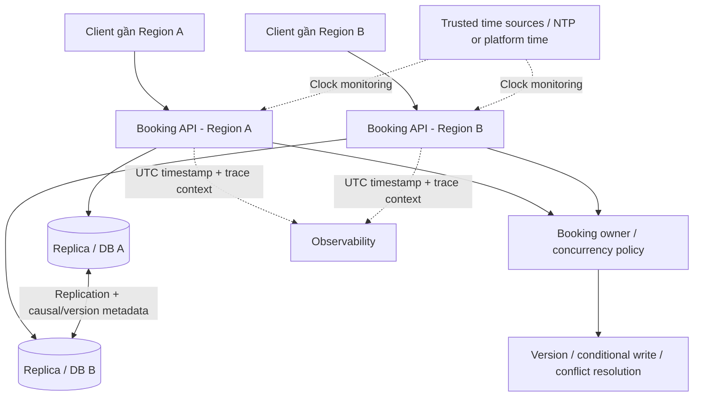

# Đồng hồ, thứ tự nhân quả và giới hạn đồng bộ thời gian

## 1. Vì sao thời gian là vấn đề trong hệ thống phân tán?

Một ứng dụng đơn giản có thể dựa vào đồng hồ hệ điều hành để ghi log, đặt lịch và đo thời gian xử lý. Khi ứng dụng chạy qua nhiều VM, container, database, queue và region, mỗi node lại quan sát thời gian từ một đồng hồ riêng. Đồng hồ có thể chạy nhanh/chậm, bị điều chỉnh, mất đồng bộ hoặc không truy cập được nguồn thời gian.

Hệ quả thường gặp:

- Log ở service B có timestamp sớm hơn service A dù B nhận request từ A sau đó.
- Hai region cập nhật cùng một bản ghi; hệ thống dùng timestamp để chọn bản “mới nhất” và vô tình ghi đè thay đổi hợp lệ.
- Lease hết hạn theo nhận định của node này nhưng node khác vẫn tin mình đang sở hữu tài nguyên.
- Token hoặc chứng chỉ bị từ chối do đồng hồ lệch.
- Consumer sắp xếp event theo thời gian và suy ra thứ tự nghiệp vụ sai.

**Đồng bộ thời gian** giúp các node có mốc thời gian gần nhau trong một giới hạn sai số. Tuy nhiên, đồng hồ đồng bộ tốt không tự chứng minh thứ tự nhân quả giữa các sự kiện. Cần phân biệt thời gian vật lý, thời gian đơn điệu và thứ tự logic:

| Khái niệm | Câu hỏi trả lời | Dùng cho |
|---|---|---|
| Physical/wall time | Trên lịch đang là lúc nào? | UTC timestamp, audit, lịch chạy, token/certificate |
| Monotonic time | Đã trôi qua bao lâu? | Timeout, deadline cục bộ, đo latency |
| Logical time | Sự kiện nào đi trước theo quan hệ nhân quả? | Đồng bộ trạng thái, replicated data, event processing |
| Sequence/version | Thay đổi nào được commit trước trong một phạm vi? | Optimistic concurrency, aggregate ordering, fencing |

Bài học thuộc chương **Tính nhất quán** của module **CLOUD_ARCHITECTURE**. Ta sẽ xem xét clock offset/skew/drift, NTP/PTP, timestamp, happens-before, Lamport clock, vector clock và hybrid logical clock; sau đó áp dụng vào database, queue, lease, cache và kiến trúc đa vùng. Mục tiêu là hiểu giới hạn của thời gian để thiết kế tính nhất quán, độ tin cậy, bảo mật và vận hành phù hợp.

Sau bài học, bạn có thể phân biệt các loại clock, giải thích vì sao timestamp không chứng minh causal order, chọn cơ chế ordering phù hợp và kiểm tra tác động của clock skew lên các thành phần cloud.

## 2. Wall clock, monotonic clock và sai lệch thời gian

### 2.1. Wall clock

**Wall clock** là đồng hồ thời gian thực của hệ điều hành, biểu diễn thời điểm theo lịch, thường dưới dạng Unix timestamp hoặc UTC. Nó hữu ích cho log, audit, lịch chạy, expiry và trao đổi thời điểm giữa các hệ thống.

Wall clock có thể bị chỉnh bởi NTP, thao tác quản trị hoặc cơ chế timekeeping của hệ điều hành. Vì vậy, phép trừ hai lần đọc wall clock có thể cho kết quả bất thường nếu đồng hồ nhảy lùi hoặc nhảy tiến giữa hai lần đọc.

### 2.2. Monotonic clock

**Monotonic clock** được thiết kế để đo khoảng thời gian trôi qua. Nó không đại diện ngày giờ lịch và thường không thể so sánh trực tiếp giữa hai máy hoặc qua reboot. Dùng nó để đo timeout, deadline cục bộ và latency sẽ an toàn hơn wall clock.

| Nhu cầu | Loại clock phù hợp | Lý do |
|---|---|---|
| Ghi thời điểm event để trao đổi service | Wall clock/UTC | Có thể diễn giải theo lịch |
| Đo thời gian xử lý request | Monotonic | Không bị ảnh hưởng bởi chỉnh giờ trong lúc đo |
| Timeout 2 giây | Monotonic/deadline API | Cần đo thời lượng |
| Lập lịch lúc 09:00 UTC | Wall clock | Là một thời điểm trên lịch |
| Lease giữa nhiều node | Authority quản lý lease, wall clock có giới hạn sai số và fencing | Một timestamp local không đủ chứng minh quyền sở hữu |

Không gửi monotonic timestamp của máy A sang máy B để so sánh. Epoch và tốc độ của monotonic clock không được thiết kế để tạo một mốc thời gian toàn cục.

### 2.3. Offset, skew, drift và uncertainty

- **Clock offset:** chênh lệch giữa clock của node và mốc tham chiếu tại cùng thời điểm.
- **Clock skew:** độ sai khác giữa hai clock hoặc giữa clock và chuẩn tham chiếu; đôi khi được dùng rộng để nói về offset.
- **Clock drift:** tốc độ clock chạy nhanh/chậm so với thời gian tham chiếu, khiến sai lệch tích lũy.
- **Clock uncertainty:** khoảng bất định ước lượng quanh timestamp. Khi uncertainty lớn, hệ thống không nên kết luận thứ tự chỉ từ mốc thời gian.

Ví dụ: node A nhanh hơn UTC 40 ms, node B chậm hơn UTC 25 ms. Độ lệch tương đối là 65 ms. Nếu A ghi event lúc 10:00:00.040, B ghi event lúc 10:00:00.025, timestamp cho thấy B trước A nhưng không chứng minh thứ tự thực tế.

Mô hình minh họa:

\[
T_{node}(t)=T_{reference}(t)+offset(t)
\]

Nếu drift gần như cố định trong khoảng ngắn:

\[
offset(t)=offset(t_0)+drift\times(t-t_0)
\]

Đây là xấp xỉ; offset thực tế còn phụ thuộc chỉnh clock, oscillator, ảo hóa, tải, mạng và thuật toán đồng bộ.

### 2.4. Vì sao các node không có cùng một clock hoàn hảo?

Oscillator phần cứng có sai số và bị ảnh hưởng bởi nhiệt độ/tuổi thọ. VM phụ thuộc timekeeping của hypervisor/host; container chia sẻ kernel. Mạng có độ trễ, bất đối xứng, packet loss và congestion. Nguồn thời gian có thể mất kết nối; clock có thể bị step hoặc slew; suspend/resume, reboot và live migration cũng ảnh hưởng hành vi.

Do đó, yêu cầu thực tế phải định nghĩa **sai lệch tối đa chấp nhận được**, cách đo và hành vi khi vượt ngưỡng, thay vì yêu cầu các máy có thời gian giống hệt nhau.

## 3. NTP và PTP: cơ chế đồng bộ

### 3.1. Network Time Protocol (NTP)

NTP cho phép client trao đổi với máy chủ thời gian để ước lượng offset và điều chỉnh wall clock. Độ chính xác phụ thuộc nguồn tham chiếu, đường truyền, tải, vị trí mạng và cấu hình. Client thường thu thập nhiều mẫu, lọc nguồn và điều chỉnh pha/tần số, không tin vào một lần trao đổi đơn lẻ.

Với bốn mốc thời gian:

- \(t_1\): client gửi request.
- \(t_2\): server nhận request.
- \(t_3\): server gửi response.
- \(t_4\): client nhận response.

Ước lượng offset khi giả định độ trễ hai chiều tương đối đối xứng:

\[
\theta\approx\frac{(t_2-t_1)+(t_3-t_4)}{2}
\]

Ước lượng round-trip delay:

\[
\delta\approx(t_4-t_1)-(t_3-t_2)
\]

Nếu đường đi và đường về bất đối xứng, offset có thể sai vì thuật toán nhầm một phần độ trễ mạng thành độ lệch clock.

### 3.2. Precision Time Protocol (PTP)

PTP (IEEE 1588) hướng đến đồng bộ chính xác hơn trong mạng được thiết kế hỗ trợ, thường tận dụng timestamp phần cứng ở NIC/switch và các thành phần như grandmaster, boundary clock hoặc transparent clock. PTP phù hợp một số hệ thống viễn thông, tài chính, công nghiệp hoặc workload cần đồng bộ rất chặt.

PTP không tự nhiên chính xác hơn trong mọi môi trường. Muốn đạt độ chính xác cao phải có thiết bị, topology, profile và giám sát phù hợp. Chỉ cài daemon PTP trong VM không chứng minh toàn hệ thống đạt một sai số cụ thể.

| Tiêu chí | NTP | PTP |
|---|---|---|
| Mục tiêu | Đồng bộ thời gian IT qua IP | Đồng bộ chính xác trong hạ tầng được hỗ trợ |
| Hạ tầng | Triển khai rộng và đơn giản hơn | Cần thiết bị/topology hỗ trợ để đạt độ chính xác cao |
| Độ chính xác | Phụ thuộc nguồn và mạng; đủ cho nhiều hệ thống IT | Có thể tốt hơn khi có timestamp phần cứng và cấu hình phù hợp |
| Vận hành | Nguồn, offset, stratum, reachability | Grandmaster, domain, profile, thiết bị và topology |

NTP/PTP chủ yếu giúp wall clock gần chuẩn. Ứng dụng vẫn cần monotonic clock để đo timeout; logical clock lại trả lời một câu hỏi khác: sự kiện nào có quan hệ nhân quả.

### 3.3. Step và slew

Hệ điều hành có thể điều chỉnh wall clock theo hai cách:

- **Step:** nhảy giá trị một lượng nhất định; timestamp có thể tiến hoặc lùi đột ngột.
- **Slew:** điều chỉnh tốc độ clock trong một khoảng thời gian để dần tiến về chuẩn, tránh bước nhảy lớn.

Không giả định wall clock luôn tăng đều. Timeout và đo duration nên dựa trên monotonic clock.

## 4. Timestamp không đồng nghĩa với thứ tự nhân quả

### 4.1. Happens-before

Quan hệ nhân quả trong hệ phân tán thường được mô hình hóa bằng quan hệ **happens-before**:

- Nếu A xảy ra trước B trong cùng tiến trình, A → B.
- Nếu A gửi message và B nhận message đó, send(A) → receive(B).
- Quan hệ có tính bắc cầu: nếu A → B và B → C thì A → C.
- Nếu không có A → B hoặc B → A, hai sự kiện có thể concurrent (không có quan hệ nhân quả được biết).

Quan hệ này dựa trên thứ tự chương trình và trao đổi message, không cần các node có đồng hồ vật lý giống nhau.

### 4.2. Timestamp có thể đảo thứ tự

Giả sử node A nhanh hơn chuẩn tham chiếu, node B chậm hơn. B có thể xử lý một thao tác sau A nhưng ghi timestamp nhỏ hơn. Network latency cũng khiến event được phát trước đến broker sau event được phát sau. Timestamp bị trùng khi độ phân giải clock không đủ hoặc nhiều event phát trong cùng một tick.

Do đó, timestamp chỉ hữu ích để phân tích thời điểm hoặc sắp xếp gần đúng. Nếu nghiệp vụ cần thứ tự chính xác, hãy dùng sequence/version, partition key, logical clock, transaction hoặc cơ chế điều phối.

### 4.3. Last-write-wins (LWW) và xung đột

Trong một số hệ thống replicated, LWW chọn giá trị có timestamp lớn hơn. Cách này đơn giản cho dữ liệu cấu hình có thể chấp nhận một cập nhật bị ghi đè, nhưng có thể làm mất thay đổi hợp lệ khi clock lệch hoặc hai thao tác concurrent.

Không dùng LWW mặc định cho số dư, giao dịch thanh toán, đặt chỗ hay tồn kho cần bảo toàn invariant. Với các dữ liệu đó, cần transaction, conditional write, version hoặc quy tắc giải quyết xung đột theo nghiệp vụ.

## 5. Lamport logical clock

### 5.1. Bảo đảm và giới hạn

Lamport clock gán bộ đếm số nguyên cho mỗi sự kiện và bảo đảm:

\[
A\rightarrow B\implies L(A)<L(B)
\]

Nếu A happens-before B thì logical timestamp của A nhỏ hơn B. Chiều ngược lại không đúng: \(L(A)<L(B)\) không chứng minh A → B, vì hai sự kiện concurrent vẫn có thể nhận hai giá trị khác nhau.

### 5.2. Quy tắc cập nhật

Mỗi tiến trình duy trì bộ đếm L:

1. Trước sự kiện cục bộ, tăng L lên 1.
2. Khi gửi message, gắn L hiện tại vào message.
3. Khi nhận message có timestamp \(L_m\), cập nhật \(L:=\max(L,L_m)+1\).

Ví dụ:

```text
Process A: event a1 -> L=1
Process A: send m  -> L=2, message carries 2
Process B: local b1 -> L=1
Process B: receive m(2) -> L=max(1,2)+1=3
Process B: event b2 -> L=4
```

Send(m) đứng trước receive(m), do đó timestamp logic của receive lớn hơn send. Nếu cần total order để hiển thị, có thể so sánh cặp (L, processId) với processId làm tie-breaker. Đó là quy ước thứ tự ổn định, không biến concurrent event thành quan hệ nhân quả thật.

Lamport clock không cho biết ngày giờ lịch và không nhận diện concurrency đầy đủ.

## 6. Vector clock

### 6.1. Nguyên lý

Vector clock lưu một vector bộ đếm theo từng tiến trình/node. Khi có sự kiện cục bộ, tiến trình tăng phần tử của mình; khi gửi message, truyền vector; khi nhận, hợp nhất từng thành phần bằng giá trị lớn nhất rồi tăng bộ đếm của tiến trình nhận.

Với hai vector \(V_a\), \(V_b\), nếu mọi thành phần của Va nhỏ hơn hoặc bằng Vb và có ít nhất một thành phần nhỏ hơn, Va có quan hệ trước Vb. Nếu không vector nào nhỏ hơn vector kia, hai sự kiện concurrent theo thông tin vector.

| Sự kiện | Vector | Diễn giải |
|---|---|---|
| A cập nhật địa chỉ | [1,0] | Sự kiện đầu ở A |
| B cập nhật tùy chọn độc lập | [0,1] | Sự kiện đầu ở B |
| A nhận thông tin B rồi cập nhật | [2,1] | Có causal knowledge từ B |

[1,0] và [0,1] không so sánh được theo quan hệ thành phần nên hai event đầu concurrent. [1,0] nhỏ hơn [2,1], thể hiện sự kiện sau có kiến thức về sự kiện trước tại A.

### 6.2. Ưu và nhược điểm

Vector clock có thể giúp phát hiện concurrent update trong một số hệ thống multi-writer hoặc replicated data type. Đổi lại:

- Metadata tăng theo số node/actor được theo dõi.
- Node tạo/xóa thường xuyên khiến vector khó quản lý.
- Cần truyền và bảo toàn causal metadata qua nhiều tầng.
- Vector không tự giải quyết conflict nghiệp vụ; vẫn cần merge rule hoặc quyết định của người dùng.

Các biến thể như dotted version vector hoặc version vector có compacting có thể giảm chi phí trong một số hệ thống. Chỉ dùng khi có nhu cầu phát hiện concurrency; không thêm vector lớn vào mọi message một cách mặc định.

## 7. Hybrid Logical Clock (HLC)

HLC kết hợp phần thời gian vật lý với bộ đếm logic, thường biểu diễn bằng cặp (physical, logical). Phần physical gần với wall clock; phần logical tăng khi thời gian vật lý không tiến hoặc khi cần giữ quan hệ nhân quả sau khi nhận message.

HLC giúp timestamp gần thời gian lịch hơn Lamport clock trong khi duy trì một số tính chất ordering nhân quả theo thuật toán. Một số hệ thống cơ sở dữ liệu phân tán sử dụng biến thể HLC; encoding, giới hạn và semantics cụ thể tùy hệ thống.

### 7.1. Trực giác cập nhật

Khi tạo event cục bộ, so sánh wall clock với physical hiện tại: nếu wall clock lớn hơn thì cập nhật physical và reset logical; nếu không, tăng logical. Khi nhận timestamp từ xa, chọn physical lớn nhất giữa local wall clock, HLC local và HLC remote, sau đó tăng logical theo trường hợp tương ứng để timestamp mới lớn hơn các timestamp liên quan.

Pseudo-code khái niệm (không phải implementation chuẩn):

```text
local_event():
    now = wall_clock()
    if now > hlc.physical:
        hlc = (now, 0)
    else:
        hlc.logical += 1

receive(remote):
    now = wall_clock()
    p = max(now, hlc.physical, remote.physical)
    if p == hlc.physical and p == remote.physical:
        l = max(hlc.logical, remote.logical) + 1
    else if p == hlc.physical:
        l = hlc.logical + 1
    else if p == remote.physical:
        l = remote.logical + 1
    else:
        l = 0
    hlc = (p, l)
```

Không dùng pseudo-code này thay thư viện HLC đã được kiểm thử. Overflow, encoding, uncertainty, restart state và clock jump cần được xử lý chính xác. HLC cũng không sửa được wall clock sai lệch vô hạn; cần monitor uncertainty và giới hạn sai số.

## 8. Giới hạn đồng bộ thời gian trong cloud

**Network asymmetry:** NTP ước lượng offset từ round-trip; thời gian truyền request và response không bằng nhau có thể làm sai ước lượng.

**Ảo hóa:** VM dựa vào hypervisor/host, container chia sẻ kernel. Nhiều workload trên cùng host có thể chịu ảnh hưởng chung nếu timekeeping của host lỗi.

**Nguồn thời gian:** nếu toàn bộ fleet chỉ dựa vào một time server, server đó trở thành failure domain và mục tiêu tấn công. Hệ thống quan trọng cần nhiều nguồn tin cậy, giám sát offset và dự phòng.

**Khoảng cách địa lý:** độ trễ truyền tín hiệu và biến động mạng khiến timestamp các region không thể coi là đồng nhất tuyệt đối.

**Giới hạn vật lý:** NTP/PTP giảm sai lệch trong giới hạn hạ tầng nhưng không tạo một đồng hồ toàn cục hoàn hảo. Khi cần thứ tự toàn cục duy nhất, phải dùng sequence/leader/consensus hoặc dịch vụ cấp phát thứ tự; time server không thay thế cơ chế đó.

## 9. Tác động đến ứng dụng cloud

### 9.1. Log và distributed tracing

Timestamp giúp ghép log nhưng skew làm timeline sai. Ghi UTC, trace/span context, request ID, correlation ID và event ID. Dùng monotonic clock để đo duration trong cùng process. Khi điều tra, đối chiếu causal trace thay vì kết luận thứ tự chỉ từ timestamp.

### 9.2. Database và optimistic concurrency

Timestamp có thể phục vụ audit hoặc LWW; nhưng cập nhật đồng thời ở nhiều region có thể trùng hoặc đảo timestamp. Với dữ liệu quan trọng, dùng transaction, version hoặc conditional write.

Ví dụ:

```sql
UPDATE account
SET balance = balance - 100,
    version = version + 1
WHERE account_id = 'A-100'
  AND version = 12;
```

Điều kiện version phát hiện cập nhật cạnh tranh theo phiên bản đã đọc; nó không dựa vào wall clock. Nếu không có dòng nào được cập nhật, ứng dụng phải đọc lại và xử lý conflict theo nghiệp vụ.

### 9.3. Cache TTL và expiry

Clock skew có thể khiến node xóa cache sớm hơn node khác hoặc token bị xem là hết hạn khác nhau. Với timeout cục bộ, dùng monotonic clock hoặc TTL do cache/broker quản lý. Với expiry chia sẻ, dùng thời gian do hệ thống lưu trữ quản lý khi có thể và định nghĩa clock-skew allowance. Không dùng TTL để bảo đảm tính đúng đắn của giao dịch tài chính.

### 9.4. Lease và distributed lock

Lease là quyền sở hữu tài nguyên trong một khoảng thời gian. Nếu A tin lease còn hiệu lực trong khi B cho rằng đã hết, cả hai có thể cùng ghi. Chỉ dựa trên wall clock cục bộ để kiểm tra lease là rủi ro.

Biện pháp:

- Dùng lease/lock service làm authority cấp quyền.
- Cấp **fencing token** tăng đơn điệu cho mỗi lần cấp lease; storage từ chối thao tác có token cũ.
- Dùng conditional write/transaction để kiểm tra owner/version.
- Renew có kiểm tra; fail closed khi không chắc quyền sở hữu.

Fencing token bảo vệ khi node cũ bị pause lâu rồi thức dậy sau khi lease đã được cấp cho node khác. Node cũ có thể vẫn nghĩ mình còn quyền, nhưng storage từ chối token cũ nếu storage thực thi kiểm tra.

### 9.5. TLS certificate và token

Chứng chỉ TLS có mốc notBefore/notAfter; token thường có iat, nbf và exp. Clock skew có thể khiến xác thực thất bại sớm hoặc muộn. Có thể cấu hình tolerance nhỏ theo chuẩn và rủi ro, nhưng không nên nới quá rộng để che một hệ thống không đồng bộ.

JWT/certificate validation cần chính sách thời gian thống nhất, giám sát clock và cảnh báo khi offset vượt ngưỡng. Timestamp trong payload không thay thế xác thực chữ ký hoặc nguồn tin cậy.

## 10. Ví dụ đa vùng: cập nhật thông tin đặt lịch

Giả sử khách hàng truy cập hệ thống đặt lịch ở Region A hoặc B. Hai region có replica phục vụ đọc gần người dùng. Người dùng cập nhật số điện thoại ở A, gần cùng lúc cập nhật tùy chọn thông báo ở B.

### 10.1. Nếu chỉ dùng LWW

Region A ghi updated_at=10:00:00.100; Region B ghi updated_at=10:00:00.080. Nếu clock A nhanh hơn 60 ms, B có thể thực sự xử lý sau nhưng timestamp vẫn nhỏ hơn. Replication LWW chọn A và có thể làm mất cập nhật hợp lệ.

LWW chỉ chấp nhận được nếu dữ liệu là cấu hình không quan trọng, nghiệp vụ chấp thuận “giá trị cuối cùng thắng”, và có thể chấp nhận mất cập nhật cạnh tranh hoặc phát hiện/khôi phục được.

### 10.2. Nếu dùng version theo aggregate

Một dịch vụ sở hữu booking tăng version theo mỗi thay đổi thành công:

| Version | Thay đổi | Quan hệ |
|---:|---|---|
| 10 | Tạo booking | Trạng thái gốc |
| 11 | Cập nhật số điện thoại | Sau version 10 |
| 12 | Cập nhật tùy chọn thông báo | Sau version 11 nếu cùng owner tuần tự hóa |

Version thể hiện thứ tự commit trong aggregate, không cần dựa vào clock giữa các service. Nếu hai region được phép ghi đồng thời, cần coordination, optimistic concurrency hoặc causal metadata; tăng version cục bộ ở cả hai region không tạo sequence toàn cục.

### 10.3. Sơ đồ khái niệm



Đây là sơ đồ khái niệm. Hệ thống thực tế phải xác định database single-writer hay multi-writer, replication đồng bộ hay bất đồng bộ, vùng nào sở hữu aggregate, cách xử lý network partition và mức trễ cho phép. Không để cả hai region ghi tùy ý chỉ vì có replica hai chiều.

## 11. Quan sát và vận hành đồng hồ

### 11.1. Metrics cần theo dõi

| Chỉ số | Ý nghĩa | Hành động khi bất thường |
|---|---|---|
| Clock offset | Lệch wall clock so với nguồn | Kiểm tra NTP source, network, host và time service |
| Root dispersion/uncertainty | Độ bất định tích lũy theo công cụ | Xác định timestamp còn đáng tin cho policy nào |
| Sync state/stratum/source | Trạng thái và nguồn đồng bộ | Cảnh báo nguồn không truy cập hoặc bất thường |
| Clock step/slew events | Đồng hồ vừa được điều chỉnh | Kiểm tra timeout, timestamp và lease |
| NTP delay/loss | Chất lượng đường đồng bộ | Kiểm tra congestion, firewall, routing và nguồn dự phòng |
| Certificate/token validation errors | Lỗi có thể liên quan thời gian | Đối chiếu skew, nbf/exp, thời hạn cert và tolerance |
| Lease/fencing rejections | Thao tác bằng quyền sở hữu cũ | Kiểm tra pause, partition, renew và correctness |

### 11.2. Runbook khi offset vượt ngưỡng

1. Xác định node, region, host và workload bị ảnh hưởng.
2. Kiểm tra nguồn thời gian, kết nối, offset, uncertainty, stratum và sự kiện step/slew.
3. Liệt kê hệ thống phụ thuộc timestamp: token/certificate, lease, TTL, ordering và audit.
4. Tạm dừng thao tác nhạy cảm nếu cần hoặc chuyển sang version/sequence/authority; không tùy tiện chỉnh giờ production.
5. Khôi phục đồng bộ theo quy trình nền tảng, quan sát offset ổn định và xác minh kết nối.
6. Đối soát giao dịch, lease và token trong cửa sổ sai lệch; lưu bằng chứng và cập nhật incident report.

Không chỉ chạy lệnh chỉnh giờ rồi đóng sự cố. Cần xác định nguyên nhân host/time source và liệu dữ liệu đã bị sắp xếp hoặc ghi đè sai trong thời gian clock lệch hay chưa.

## 12. Đánh đổi trong thiết kế

| Cách tiếp cận | Lợi ích | Chi phí/giới hạn |
|---|---|---|
| NTP toàn fleet | Mốc wall clock gần nhau, hỗ trợ log/audit/certificate | Sai số vẫn tồn tại; phụ thuộc nguồn và mạng |
| PTP trong hạ tầng hỗ trợ | Có thể chính xác hơn cho workload đặc thù | Thiết bị, topology, cấu hình và vận hành phức tạp |
| Lamport clock | Theo dõi happens-before không cần giờ toàn cục | Không xác định concurrency đầy đủ hoặc thời gian lịch |
| Vector clock | Phát hiện concurrent update trong mô hình phù hợp | Metadata lớn theo số actor; cần conflict resolution |
| HLC | Gần wall time và giữ thông tin logic | Cần implementation đúng và xử lý uncertainty |
| Sequence/version do owner cấp | Thứ tự rõ trong phạm vi aggregate | Cần owner/điểm tuần tự hóa, có thể hạn chế ghi đa vùng |
| LWW theo timestamp | Đơn giản cho dữ liệu ít quan trọng | Có thể loại bỏ cập nhật đúng do skew/concurrency |

Chọn theo invariant nghiệp vụ. Bảng dashboard có thể chấp nhận LWW; số dư tài khoản, thanh toán hoặc giữ chỗ không nên dựa vào timestamp cục bộ để quyết định giao dịch nào thắng.

## 13. Đánh giá theo Well-Architected

| Trụ cột | Câu hỏi cần đánh giá |
|---|---|
| **Operational Excellence** | Nguồn thời gian có owner, dự phòng và dashboard? Offset/uncertainty có alert? Runbook đã được diễn tập? |
| **Security** | Time source có được bảo vệ? Token/certificate có tolerance hợp lý? Lease có fencing để chặn actor cũ? |
| **Reliability** | Timeout dùng monotonic clock? Có xử lý timestamp đảo thứ tự, clock step và NTP outage? |
| **Performance Efficiency** | Logical metadata có quá lớn? PTP có thực sự cần? Đồng bộ có tạo overhead không cần thiết? |
| **Cost Optimization** | Mức chính xác có đúng nhu cầu? Hạ tầng time service, log và giám sát có tương xứng rủi ro? |
| **Sustainability** | Tránh telemetry/đồng bộ dư thừa; không triển khai hạ tầng chính xác cao cho mọi service khi không cần? |

## 14. Mẫu quyết định kiến trúc về thời gian

Mẫu YAML sau dùng để ghi nhu cầu và chính sách; đây là tài liệu minh họa, không phải cấu hình của một nhà cung cấp:

```yaml
decision_id: ADR-CONSISTENCY-007
title: Time and causal ordering policy
requirements:
  wall_clock:
    use: audit_and_cross_service_event_timestamp
    standard: UTC
    max_offset_ms: 100
  elapsed_time:
    use_monotonic_clock: true
  causal_order:
    booking_aggregate: owner_sequence
    cross_service_trace: correlation_and_causation_id
time_sync:
  source: approved_platform_time_service
  monitor_offset_and_uncertainty: true
  alert_on_unsynchronized_nodes: true
data_policy:
  critical_writes: version_or_conditional_transaction
  last_write_wins: only_for_approved_noncritical_fields
lease_policy:
  authority: centralized_lease_service
  fencing_token: required
validation:
  - clock_offset_and_source_failure_test
  - wall_clock_step_behavior
  - certificate_and_token_skew_test
  - concurrent_update_and_reordering_test
review_triggers:
  - new_region_or_time_source
  - clock_offset_slo_change
  - database_replication_model_change
```

Ngưỡng 100 ms chỉ là giả định minh họa. Dự án phải xác định ngưỡng theo yêu cầu, đặc tính dịch vụ và hậu quả sai lệch.

## 15. Quy trình thiết kế và kiểm thử

1. **Phân loại nhu cầu:** audit timestamp, timeout, TTL, lịch chạy, certificate, lease hay thứ tự giao dịch?
2. **Chọn clock:** wall clock cho mốc lịch; monotonic cho thời lượng; logical/sequence cho causal order và thứ tự nghiệp vụ.
3. **Đặt giới hạn sai số:** xác định offset/uncertainty tối đa, phạm vi và hành vi khi vượt ngưỡng.
4. **Chọn nguồn đồng bộ:** NTP, PTP hay platform time; xác minh dự phòng, network, quyền quản trị và phạm vi region/host.
5. **Bảo vệ invariant:** dùng transaction, sequence/version, fencing hoặc causal metadata thay vì timestamp đơn lẻ.
6. **Thiết kế quan sát:** ghi UTC, trace/correlation ID, đo monotonic duration, theo dõi offset và nguồn đồng bộ.
7. **Thử sự cố:** NTP outage, clock step, VM pause/resume, region skew, event reorder, token/cert expiry và lease hết hạn.
8. **Đối soát:** kiểm tra dữ liệu, thứ tự nghiệp vụ, quyền sở hữu và log trước khi đóng sự cố.

### Bảng kiểm trước production

- [ ] Mỗi timestamp được định nghĩa là event time, processing time hay ingestion time.
- [ ] Dùng UTC cho thời điểm trao đổi; không so sánh monotonic timestamp giữa máy.
- [ ] Timeout và đo duration dùng monotonic clock/deadline phù hợp.
- [ ] Có nguồn thời gian được phê duyệt, dự phòng và giám sát offset/uncertainty.
- [ ] Hiểu step/slew, VM suspend/resume và NTP outage.
- [ ] Không dùng timestamp đơn lẻ để suy ra causal order hoặc quyết định giao dịch cạnh tranh.
- [ ] Aggregate cần ordering có sequence/version hoặc owner/transaction phù hợp.
- [ ] Token/certificate có clock tolerance hợp lý và cảnh báo lỗi thời gian.
- [ ] Lease/lock có authority và fencing/conditional write để chống owner cũ.
- [ ] Multi-region conflict policy được xác định; LWW chỉ dùng cho dữ liệu được phép.
- [ ] Có trace/correlation metadata và quy trình đối chiếu timestamp với causal order.
- [ ] Đã thử clock skew, clock jump, source outage, concurrent update và event reorder.

**Nguyên tắc áp dụng:** đồng bộ thời gian giúp các node có mốc lịch gần nhau, nhưng không tạo ra một chiếc đồng hồ toàn cục hoàn hảo và không tự xác định thứ tự nhân quả. Hãy dùng wall clock cho thời điểm, monotonic clock cho khoảng thời gian, logical clock hoặc version cho thứ tự cần thiết; với giao dịch quan trọng, dựa vào transaction, authority và invariant nghiệp vụ thay vì chỉ so timestamp.
