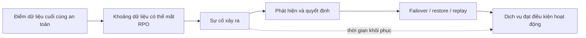
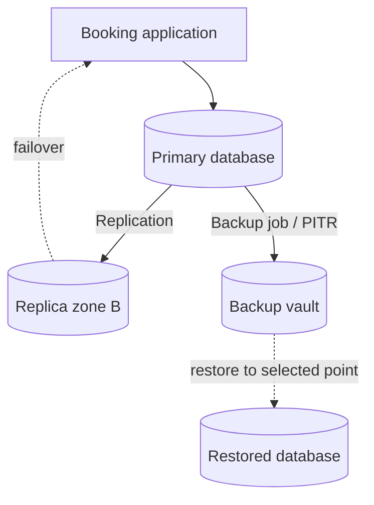
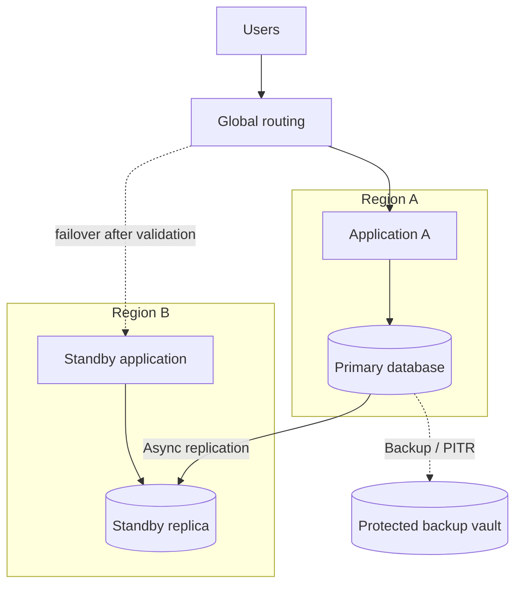
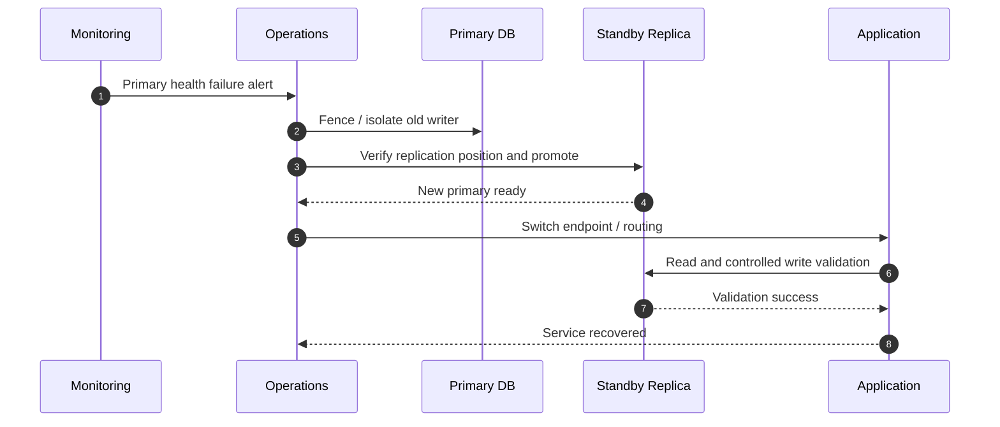

# Độ bền dữ liệu, mức sẵn sàng và phạm vi sao chép

Khi một ứng dụng cloud lưu đơn thuê, hồ sơ khách hàng hoặc giao dịch thanh toán, câu hỏi không chỉ là dữ liệu nằm ở database nào. Kiến trúc phải trả lời: **dữ liệu có còn tồn tại sau sự cố không, dịch vụ có tiếp tục đọc/ghi được không, và bản sao đang nằm trong phạm vi lỗi nào?** Ba câu hỏi này tương ứng với độ bền dữ liệu, mức sẵn sàng và phạm vi sao chép. Chúng liên quan chặt chẽ nhưng không thể thay thế cho nhau.

Trong module **CLOUD_ARCHITECTURE**, việc lựa chọn lưu trữ cần xuất phát từ yêu cầu nghiệp vụ và cân bằng độ tin cậy, bảo mật, khả năng mở rộng, chi phí và vận hành theo nguyên tắc Well-Architected. Bài học dùng ví dụ nền tảng cho thuê thiết bị: hệ thống lưu reservation, payment record, catalog và dữ liệu phân tích. Các con số RPO/RTO, số bản sao và thời gian trong ví dụ là giả định để luyện thiết kế; kiến trúc thực tế phải xác định bằng phân tích tác động nghiệp vụ, giới hạn dịch vụ và thử nghiệm phục hồi.

## 1. Ba thuộc tính thường bị nhầm lẫn

| Thuộc tính | Câu hỏi chính | Điều nó đo lường | Ví dụ |
| --- | --- | --- | --- |
| **Durability – độ bền dữ liệu** | Khi đã xác nhận ghi thành công, xác suất dữ liệu bị mất là bao nhiêu? | Khả năng giữ dữ liệu qua lỗi phần cứng, tiến trình, node, zone hoặc thảm họa trong mô hình bảo vệ đã thiết kế | Một booking đã commit vẫn còn sau khi ổ đĩa hoặc node lỗi |
| **Availability – mức sẵn sàng** | Khi có sự cố, người dùng còn đọc/ghi được không và gián đoạn bao lâu? | Khả năng cung cấp dịch vụ theo thời gian, thường gắn với SLI/SLO | Database tự chuyển sang node dự phòng sau lỗi |
| **Replication scope – phạm vi sao chép** | Bản sao được đặt và cập nhật ở đâu, chịu chung những lỗi nào? | Ranh giới địa lý, vật lý, quản trị và consistency giữa các bản | Replica trong cùng zone, khác zone hoặc khác region |

Một hệ thống có thể **bền dữ liệu nhưng tạm thời không sẵn sàng**: database giữ nguyên dữ liệu nhưng failover kéo dài nên client không truy cập được trong vài phút. Ngược lại, một dịch vụ có thể trả lời rất nhanh nhờ replica nhưng vẫn có nguy cơ mất dữ liệu mới nếu replica bất đồng bộ chưa nhận lần ghi cuối trước thảm họa.

Replication cũng không đồng nghĩa backup. Replica thường sao chép cả thay đổi sai hoặc thao tác xóa; backup được thiết kế để giữ một điểm khôi phục theo thời gian và có thể cách ly khỏi thay đổi hiện tại. Cần cả hai nếu yêu cầu nghiệp vụ đòi hỏi tiếp tục phục vụ nhanh và khôi phục khỏi hỏng dữ liệu.

## 2. Xác định tác động nghiệp vụ trước khi chọn công nghệ

Không phải mọi dữ liệu đều có cùng giá trị và mục tiêu khôi phục. Hãy phân loại theo hậu quả khi mất, khi không truy cập được và khi dữ liệu sai:

| Nhóm dữ liệu | Tác động khi mất | Tác động khi không truy cập được | Gợi ý mục tiêu |
| --- | --- | --- | --- |
| Reservation và trạng thái giữ chỗ | Có thể đặt trùng, mất cam kết với khách | Không thể tạo/xác nhận đơn | Bảo vệ transaction và khả năng khôi phục cao |
| Payment ledger / giao dịch | Sai lệch tiền, đối soát và nghĩa vụ tài chính | Thanh toán hoặc hoàn tiền bị gián đoạn | Durability, audit và reconciliation rất nghiêm ngặt |
| Catalog mô tả thiết bị | Có thể tái tạo từ nguồn quản trị | Người dùng không tra cứu được | Có thể chấp nhận RPO/RTO rộng hơn tùy nguồn |
| Search index | Thường tái tạo được từ dữ liệu nguồn | Tìm kiếm bị suy giảm | Có thể rebuild; không nhất thiết backup cùng mức database gốc |
| Analytics aggregate | Ảnh hưởng báo cáo và quyết định | Dashboard có thể chậm | Có thể chấp nhận trễ/backfill theo lịch |
| Log/audit | Có thể là bằng chứng điều tra hoặc tuân thủ | Khó ứng cứu sự cố | Retention, chống sửa/xóa và quyền đọc riêng |

Với mỗi nhóm, cần hỏi:

1. **Nguồn sự thật ở đâu?** Database giao dịch, event log, hệ thống ngoài hay file gốc?
2. **Có thể tái tạo không?** Search index có thể rebuild nhưng payment ledger không nên được suy ra từ dashboard tổng hợp.
3. **Ai được phép khôi phục?** Restore có thể làm mất dữ liệu phát sinh sau backup hoặc ghi đè state mới.
4. **Có yêu cầu vị trí lưu trữ không?** Region/zone và đường truyền bản sao có thể chịu ràng buộc pháp lý hoặc hợp đồng.
5. **Điều gì xảy ra nếu dữ liệu sai nhưng vẫn được sao chép?** Cần khả năng point-in-time recovery, immutable backup hoặc phê duyệt trước restore.

Phân loại này giúp tránh chi tiền để sao chép mọi dữ liệu như nhau hoặc ngược lại đặt cùng một chính sách yếu cho cả ledger và cache.

## 3. RPO và RTO: chuyển nhu cầu thành mục tiêu đo được

Hai chỉ số nền tảng trong kế hoạch phục hồi:

- **RPO (Recovery Point Objective):** mức mất dữ liệu tối đa tổ chức chấp nhận, thường biểu diễn thành khoảng thời gian dữ liệu có thể phải dựng lại.
- **RTO (Recovery Time Objective):** thời gian mục tiêu để khôi phục dịch vụ hoặc quy trình về mức hoạt động được xác định.

Ví dụ RPO 5 phút nghĩa là trong kịch bản được nêu, tổ chức chấp nhận khôi phục tới một điểm dữ liệu có thể lùi tối đa khoảng 5 phút so với thời điểm sự cố. RTO 30 phút nghĩa là mục tiêu khôi phục chức năng trong vòng 30 phút. Hai con số không tự chứng minh nền tảng có thể đạt được; phải tính cả phát hiện, quyết định failover/restore, cấp tài nguyên, kiểm tra dữ liệu, chuyển lưu lượng và xác nhận nghiệp vụ.

### 3.1. RPO và RTO không phải SLA

RPO/RTO là mục tiêu phục hồi cho một kịch bản sự cố. SLA/SLO đo chất lượng cung cấp dịch vụ trong một kỳ quan sát. Một database có SLO availability cao nhưng RPO backup 24 giờ vẫn có thể mất nhiều thay đổi khi cần restore. Ngược lại, bản sao dữ liệu cập nhật gần thời gian thực có thể đạt RPO thấp nhưng failover DNS, ứng dụng hoặc quyền truy cập mất lâu, làm RTO kém.

### 3.2. Ví dụ mục tiêu cho nền tảng thuê thiết bị

| Workload | RPO giả định | RTO giả định | Lý do |
| --- | ---: | ---: | --- |
| Reservation giao dịch | 1 phút | 15 phút | Tránh mất nhiều booking đã xác nhận |
| Payment record | Gần 0 đối với giao dịch đã được xác nhận theo thiết kế | 30 phút | Cần đối soát và bảo toàn dấu vết tài chính |
| Catalog | 1 giờ | 4 giờ | Dữ liệu có thể phục hồi từ nguồn quản trị |
| Search index | 4 giờ | 8 giờ | Có thể rebuild từ catalog |
| Analytics aggregate | 1 ngày | 1 ngày | Có thể chạy lại batch hoặc replay |

Đây chỉ là ví dụ để thảo luận. RPO gần 0 không có nghĩa có thể bảo đảm không mất dữ liệu trong mọi tình huống. Cần định nghĩa chính xác “giao dịch đã xác nhận”, phạm vi lỗi, replication mode, storage durability, acknowledgment semantics và kịch bản vùng/region.

### 3.3. Mỗi loại sự cố có RPO/RTO riêng

Không nên chỉ ghi một cặp số cho cả hệ thống. Hãy tách:

- Container/process lỗi.
- Node hoặc ổ đĩa lỗi.
- Mất một availability zone.
- Mất cả region.
- Lỗi logic hoặc deploy gây hỏng dữ liệu.
- Credential bị xâm phạm hoặc thao tác xóa trái phép.
- Nhà cung cấp dịch vụ hoặc đường truyền liên vùng không sẵn sàng.

Replication đồng vùng có thể giải quyết lỗi node nhưng không giúp khi region mất. Backup immutable có thể bảo vệ khỏi xóa ác ý nhưng restore từ backup có thể mất nhiều giờ. Mỗi cơ chế cần gắn với failure scenario cụ thể.

## 4. Replica và backup giải quyết hai bài toán khác nhau

### 4.1. Replica phục vụ tính liên tục

Replica duy trì bản sao dữ liệu trên node, thiết bị, zone hoặc region khác. Khi primary lỗi, một replica phù hợp có thể được thăng cấp thành primary hoặc phục vụ đọc theo thiết kế. Mục tiêu thường là giảm downtime và/hoặc tăng throughput đọc.

### 4.2. Backup phục vụ khôi phục

Backup là điểm lưu có thể sử dụng để khôi phục dữ liệu về một thời điểm hoặc phiên bản. Backup có thể là snapshot, full/incremental backup, continuous backup hoặc bản export logic. Nó cần retention, encryption, quyền truy cập, kiểm tra tính toàn vẹn và thử restore.

| Thuộc tính | Replica | Backup |
| --- | --- | --- |
| Mục tiêu | Tiếp tục phục vụ, đọc phân tán hoặc dự phòng | Khôi phục dữ liệu sau mất mát/hỏng/xóa |
| Độ mới | Có thể gần thời gian thực hoặc đồng bộ | Theo lịch/chính sách point-in-time |
| Thay đổi sai | Có thể lan sang replica | Có thể chọn điểm trước khi dữ liệu bị hỏng |
| Xóa nhầm | Thường được sao chép sang bản khác | Có thể khôi phục nếu backup còn retention |
| Chuyển đổi | Có thể promote/failover | Cần restore/import, kiểm tra và cutover |
| Chi phí | Compute/storage/network liên tục | Storage/retention và chi phí restore/test |

Một thiết kế bảo vệ dữ liệu thường gồm:

1. Replica cho node/zone failure và yêu cầu availability.
2. Backup định kỳ hoặc point-in-time recovery cho logical corruption và xóa nhầm.
3. Bản backup tách quyền hoặc immutable/offline cho ransomware và credential compromise.
4. Quy trình restore/reconciliation được diễn tập.

### 4.3. Minh họa sự khác biệt

Replica có thể giúp ứng dụng tiếp tục hoạt động khi primary lỗi. Backup giúp quay về điểm trước khi một thao tác xóa/sửa sai lan truyền. Hai mũi tên biểu diễn hai cơ chế khác nhau; không nên coi replica là backup.

## 5. Replication đồng bộ và bất đồng bộ

### 5.1. Synchronous replication

Trong sao chép đồng bộ, primary chỉ xác nhận commit sau khi điều kiện ghi ở replica hoặc quorum cần thiết được đáp ứng. Nhờ vậy, dữ liệu đã được acknowledgment có thể tồn tại trên nhiều failure domain theo guarantee của hệ thống.

Ưu điểm:

- Giảm khoảng dữ liệu chưa sao chép được xác nhận.
- Có thể đạt RPO rất thấp cho phạm vi lỗi mà quorum bảo vệ.
- Failover có cơ sở chọn replica đã nhận commit.

Đánh đổi:

- Commit latency phụ thuộc round trip mạng và tốc độ replica.
- Nếu replica/quorum không khả dụng, ghi có thể bị chặn hoặc giảm khả dụng.
- Phức tạp hơn khi đặt replica xa về địa lý.

### 5.2. Asynchronous replication

Trong sao chép bất đồng bộ, primary có thể xác nhận commit trước khi replica nhận dữ liệu. Điều này thường giảm latency ghi và tăng khả năng tiếp tục ghi khi replica chậm, nhưng tạo một cửa sổ replication lag. Nếu primary mất đột ngột, các commit chưa đến replica có thể bị mất khi failover.

Ưu điểm:

- Độ trễ ghi thấp hơn khi replica ở xa.
- Ít làm transaction chính phụ thuộc trực tiếp vào replica chậm.
- Phù hợp DR cross-region với khoảng cách địa lý lớn.

Đánh đổi:

- Có thể mất các write chưa replicate.
- Replica đọc có thể stale.
- Failover cần xác định log/LSN/offset nào đã được áp dụng và reconciliation phần thiếu.

### 5.3. So sánh

| Tiêu chí | Synchronous | Asynchronous |
| --- | --- | --- |
| Commit acknowledgment | Chờ điều kiện replica/quorum | Có thể ACK trước khi replica nhận |
| Write latency | Có thể cao hơn | Thường thấp hơn |
| RPO trong phạm vi thiết kế | Có thể gần 0 với các commit đã ACK | Có thể lớn hơn 0 theo replication lag |
| Availability khi replica chậm | Có thể bị ảnh hưởng | Primary có thể tiếp tục ghi |
| Phạm vi phù hợp | Node/zone gần nhau, yêu cầu bảo vệ commit chặt | Cross-region, DR, read replica |
| Rủi ro | Quorum không đạt làm ghi bị chặn | Failover có thể thiếu write chưa replicate |

Không phải hệ thống nào cũng có chế độ synchronous/asynchronous nhị phân đơn giản. Một số database dùng quorum, semi-synchronous, consensus protocol hoặc acknowledgment policy tùy loại transaction. Phải đọc ý nghĩa cụ thể của “commit thành công” trong dịch vụ được chọn.

## 6. Replication scope: cùng node, khác node, zone hay region

Phạm vi bản sao quyết định loại sự cố mà hệ thống có thể chịu được và chi phí phải trả.

| Phạm vi | Có thể bảo vệ trước | Không nhất thiết bảo vệ trước | Đánh đổi |
| --- | --- | --- | --- |
| Nhiều disk trong cùng host | Một thiết bị lưu trữ lỗi | Host, nguồn điện, rack hoặc zone lỗi | Chi phí thấp, failure domain chung lớn |
| Khác node, cùng zone | Node/host lỗi | Zone, mạng hoặc sự cố vật lý diện rộng của zone | Latency thấp, nhưng chưa có zone isolation |
| Khác availability zone | Sự cố một AZ theo thiết kế provider | Sự cố cả region, lỗi logic hoặc credential chung | Tăng network latency/cost và yêu cầu failover |
| Khác region | Sự cố region và một số thảm họa diện rộng | Lỗi logical được replicate, thao tác quản trị sai ở cấp toàn cục | Egress, latency, replication lag và vận hành cao hơn |
| Khác account/project và failure boundary | Một số lỗi quyền/quản trị hoặc xóa toàn bộ scope | Credential/global admin hoặc policy chia sẻ vẫn có thể ảnh hưởng | Tăng quản trị, cần IAM và quy trình cross-boundary |

### 6.1. Cùng zone không đồng nghĩa độc lập

Hai replica ở hai node có thể vẫn chịu chung sự cố mạng, nguồn điện, storage fabric hoặc control plane của zone. Nếu yêu cầu chịu lỗi một zone, cần đặt bản sao qua các availability zone thực sự độc lập theo định nghĩa nhà cung cấp.

### 6.2. Multi-region không mặc nhiên là tốt hơn

Cross-region replication có thể giảm tác động khi mất cả region, nhưng:

- Tăng độ trễ và chi phí truyền dữ liệu.
- Có thể tạo replication lag lớn hơn.
- Cần giải quyết DNS/routing, identity, key, secret và capacity ở vùng dự phòng.
- Phải quyết định active-passive hay active-active.
- Cần xử lý conflict nếu hai region cùng nhận ghi.
- Có thể chịu giới hạn về data residency và chuyển dữ liệu xuyên biên giới.

Chọn multi-region khi yêu cầu RTO/RPO, khả năng tiếp tục kinh doanh hoặc yêu cầu địa lý chứng minh nhu cầu và tổ chức có thể vận hành, kiểm thử topology đó.

## 7. Availability zone và region: chọn topology phù hợp

### Single-zone

Một database hoặc storage workload chỉ chạy trong một zone có thể có chi phí và độ trễ thấp. Tuy nhiên, sự cố zone có thể làm dịch vụ mất khả dụng cho tới khi phục hồi hoặc restore ở nơi khác. Mô hình này có thể chấp nhận cho môi trường dev, dữ liệu có thể tái tạo hoặc workload có RTO rộng.

### Multi-zone

Các bản sao hoặc instance trải qua nhiều AZ giúp giảm phụ thuộc vào một zone. Cần xác định:

- Mô hình primary/standby hay nhiều node có thể nhận ghi.
- Cơ chế quorum và failover.
- Có giữ endpoint ổn định cho ứng dụng không.
- Replica có đồng bộ và phục vụ đọc được không.
- Điều gì xảy ra khi mất kết nối giữa AZ.
- Backup có nằm trong failure domain khác không.

### Multi-region

Các mô hình phổ biến:

| Mô hình | Cách hoạt động | Dùng khi | Rủi ro |
| --- | --- | --- | --- |
| Active-passive | Một region nhận ghi chính; region khác dự phòng | DR, cần topology dễ xác định quyền ghi | Failover/failback và replication lag |
| Active-active | Nhiều region cùng phục vụ; có thể cùng nhận ghi | Global latency/availability và ứng dụng xử lý phân tán tốt | Conflict, consistency, routing và dữ liệu trùng |
| Read-local/write-primary | Đọc gần người dùng, ghi về primary | Workload đọc nhiều, chấp nhận read lag | Read-after-write không nhất quán ở region khác |
| Regional ownership/sharding | Mỗi region chịu trách nhiệm nhóm dữ liệu riêng | Data residency hoặc tenant/region partition | Chuyển tenant, failover ownership và cross-region workflow |

Đây là active-passive minh họa. Failover cần kiểm tra replica đã đủ dữ liệu, cô lập primary cũ, chuyển quyền ghi, cập nhật routing và xác minh ứng dụng. Chỉ đổi DNS khi chưa giải quyết split-brain có thể làm hai database cùng nhận ghi.

## 8. Availability không chỉ nằm ở database

Để người dùng tiếp tục sử dụng hệ thống, nhiều thành phần phải cùng hoạt động:

- Compute và application instance.
- Network path, DNS, load balancer và firewall.
- Database endpoint, storage và replication.
- Identity, KMS, secrets và certificate.
- Message broker, cache và dependency ngoài.
- Control plane hoặc cơ chế thay đổi cấu hình khi failover.

Một database multi-AZ không giúp nhiều nếu ứng dụng chỉ có một instance ở AZ khác đang lỗi. Một region dự phòng không thể phục vụ nếu certificate, secret, image registry hoặc IAM role không hoạt động tại đó.

### Dependency map

Với mỗi service, hãy vẽ các phụ thuộc runtime và phụ thuộc phục hồi. Ví dụ:

| Thành phần | Phụ thuộc runtime | Phụ thuộc khi khôi phục |
| --- | --- | --- |
| Booking API | Database, identity, cache, message broker | Image registry, secret/KMS, DNS, migration tool |
| Payment Adapter | External PSP, secret manager, audit store | Network egress, certificate, credential rotation |
| Database | Storage, replication network, KMS | Backup vault, snapshot restore, DNS/endpoint, operator |
| Analytics | Event stream, object storage, compute | Schema registry, archive, checkpoint/state store |

Một thiết kế khôi phục phải dựng được cả các phụ thuộc này. Cần lưu cấu hình, runbook và quyền break-glass ngoài phạm vi failure domain có thể mất cùng primary.

## 9. Quorum, consensus và nguy cơ split-brain

Khi nhiều node cùng giữ bản sao và tham gia quyết định ghi, hệ thống cần cơ chế xác định ai có quyền commit hoặc node nào là leader.

### 9.1. Quorum

Trong một nhóm có N voter, quorum là số phiếu tối thiểu để đạt quyết định theo giao thức. Với nhiều consensus protocol phổ biến, quorum đa số thường là floor(N/2)+1. Ví dụ 3 voter cần 2 phiếu; nếu chỉ còn 1 node, hệ thống không đạt quorum và có thể dừng ghi để tránh hai phía cùng nhận quyết định trái ngược.

Đây là khái niệm tổng quát; quorum read/write, replication factor và số voter cụ thể tùy protocol/database. Không áp công thức majority vào mọi hệ thống storage mà không đọc semantics của nhà cung cấp.

### 9.2. Split-brain

Split-brain xảy ra khi hai phía của một hệ thống phân tán cùng tin rằng mình là primary hoặc có quyền ghi. Khi mạng partition, cả hai phía có thể nhận thay đổi không tương thích. Sau khi kết nối hồi phục, hệ thống cần conflict resolution hoặc có thể không biết bản nào là đúng.

Để giảm rủi ro:

- Dùng leader election/consensus/quorum được thiết kế cho topology.
- Có fencing token hoặc epoch để ngăn primary cũ tiếp tục ghi sau failover.
- Cô lập node cũ trước khi mở writer mới.
- Không quyết định quyền ghi chỉ bằng DNS health check.
- Kiểm thử network partition và failover/failback.

### 9.3. Availability và consistency có đánh đổi

Khi các node không thể liên lạc, một hệ thống cần quyết định tiếp tục chấp nhận ghi ở cả hai phía hay từ chối một phía để giữ consistency. Đây là một lựa chọn theo semantics, không thể chỉ bật thêm replica để giải quyết.

Với payment ledger hoặc quyền chiếm suất thuê, chấp nhận hai primary ghi đồng thời có thể tạo tác động tài chính hoặc đặt trùng. Có thể ưu tiên consistency/quorum cho write và chấp nhận một số request bị từ chối khi quorum không đạt. Với catalog hoặc analytics, có thể chấp nhận read replica cũ hoặc eventual consistency.

## 10. Consistency của replica và read-after-write

Replica bất đồng bộ thường có độ trễ áp dụng dữ liệu. Một client vừa ghi thành công ở primary rồi lập tức đọc từ replica có thể chưa thấy thay đổi vừa ghi.

Các lựa chọn:

| Mẫu đọc | Ý nghĩa | Đánh đổi |
| --- | --- | --- |
| Read from primary | Đọc từ nơi nhận ghi chính | Giữ read-after-write tốt hơn, nhưng tải tập trung |
| Read from replica | Phân tải đọc | Có thể stale theo replication lag |
| Session stickiness | Đọc phiên tiếp theo từ primary hoặc node đã nhận write | Cần theo dõi session/causal token |
| Read-your-writes token | Client gửi version/LSN và chỉ đọc từ replica đủ mới | Tăng độ phức tạp và có thể phải chờ |
| Bounded staleness | Chấp nhận dữ liệu cũ tối đa theo ngưỡng | Phù hợp dữ liệu không yêu cầu tức thời, phải đo lag |

### Ví dụ

Khách tạo reservation thành công ở primary. Frontend gọi API GET ngay sau đó nhưng route đọc được cân bằng tới replica chậm 2 giây. Nếu client thấy “chưa có reservation”, họ có thể bấm tạo lại.

Giải pháp có thể là:

- Đọc từ primary cho đường read-after-write.
- Trả resource version/consistency token và route đọc tới node đủ mới.
- Dùng client polling trạng thái rõ ràng thay vì tạo lại.
- Thiết kế idempotency cho POST.

Không dùng cache hoặc read replica làm nguồn quyết định cuối cho giao dịch giữ chỗ. Kiểm tra khả dụng ban đầu là gợi ý; transaction tại nguồn dữ liệu authoritative mới quyết định suất được giữ.

## 11. Durability và cơ chế commit

Khi database trả lời commit thành công, điều gì đã được bảo vệ?

Cần hiểu:

- Write đã vào memory hay đã flush xuống storage bền vững?
- Transaction log/WAL đã được fsync hoặc commit theo guarantee nào?
- Commit có chờ synchronous replica/quorum không?
- Acknowledgment có thể đến trước khi remote copy hoàn tất không?
- Cache của storage/provider có battery-backed hoặc durability guarantee nào?
- Khi mất điện, kernel crash hoặc node bị fence, dữ liệu đã ACK có còn?

**Durability guarantee là đặc tính của toàn đường ghi**, từ ứng dụng qua driver, database, transaction log, storage layer và replication. Không thể suy ra chỉ từ số lượng ổ đĩa hoặc số bản sao.

### Write acknowledgment và ứng dụng

Nếu API trả 201 ngay sau khi dữ liệu chỉ được ghi vào buffer chưa được bảo đảm bền vững, một sự cố đột ngột có thể làm mất dữ liệu mà client tưởng đã xác nhận. Nên dùng commit semantics phù hợp với giá trị dữ liệu và chỉ trả thành công sau mốc được thiết kế.

Với thao tác liên quan nhiều hệ thống, ví dụ Booking DB và Payment Provider, database commit không chứng minh cả quy trình đã hoàn tất. Cần trạng thái workflow, outbox/inbox, idempotency và reconciliation như một thiết kế phân tán riêng.

## 12. Backup, point-in-time recovery và kiểm thử restore

### 12.1. Các loại backup

| Loại | Mô tả | Lưu ý |
| --- | --- | --- |
| Full backup | Bản sao toàn bộ dữ liệu theo định nghĩa công cụ | Tốn storage/time nhưng đơn giản hơn khi restore độc lập |
| Incremental backup | Chỉ ghi phần thay đổi từ điểm tham chiếu | Cần chuỗi backup và kiểm tra tính đầy đủ |
| Differential backup | Ghi thay đổi từ full backup gần nhất | Restore có thể cần full + differential mới nhất |
| Snapshot | Ảnh trạng thái volume/database tại thời điểm/quy trình nhất định | Cần kiểm tra consistency/application quiesce và tính portable |
| Continuous log/PITR | Lưu transaction log/change stream để khôi phục tới thời điểm | Cần bảo vệ log, retention và khả năng áp dụng liên tục |
| Logical export | Xuất dữ liệu ở mức bảng/collection/object | Portable hơn nhưng có thể restore chậm và mất một số metadata |

### 12.2. Point-in-time recovery

PITR cho phép khôi phục về một thời điểm nằm trong khoảng retention nếu backup base và log cần thiết còn nguyên. Ví dụ ứng dụng vô tình xóa reservation lúc 14:05; có thể khôi phục bản database phụ tới 14:04:59, lấy dữ liệu cần thiết rồi reconcile vào hệ đang hoạt động, thay vì rollback toàn bộ production về thời điểm đó.

Không phải mọi database đều cho phép restore một record đơn lẻ từ PITR. Quy trình an toàn có thể cần:

1. Restore vào instance/cluster cô lập.
2. Xác minh dữ liệu và schema.
3. Trích xuất record hoặc nhóm dữ liệu có liên quan.
4. Đối chiếu với các thay đổi phát sinh sau thời điểm backup.
5. Merge có kiểm soát, tránh ghi đè state mới.

### 12.3. Immutable và isolated backup

Nếu tài khoản admin production bị xâm phạm, kẻ tấn công có thể xóa database, replica, snapshot và cả backup nếu tất cả dùng cùng quyền. Cân nhắc:

- Backup vault/account/project riêng với IAM độc lập.
- Immutable retention hoặc object lock theo chính sách.
- MFA/approval cho thao tác xóa sớm.
- Encryption key có quản trị và recovery procedure riêng.
- Bản sao offline hoặc cross-account/cross-region khi mức rủi ro yêu cầu.
- Audit, alert cho backup deletion/retention changes.

Immutable không đồng nghĩa bất biến vĩnh viễn; vẫn cần chọn thời gian retention, cách xử lý dữ liệu hết hạn và quyền legal hold theo chính sách.

### 12.4. Restore test

Một job báo “backup completed” chưa chứng minh dữ liệu phục hồi được. Hãy diễn tập:

- Restore một database mẫu vào môi trường cô lập.
- Đo thời gian từ lúc yêu cầu tới khi ứng dụng truy cập được.
- Kiểm tra row/document count, checksum, referential integrity và business invariants.
- Xác minh encryption key, credential, network, DNS và application version.
- Chạy thử API quan trọng và đối soát sự kiện.
- Ghi lại RPO/RTO thực đo, lỗi và hành động khắc phục.

## 13. Failover và failback: phục hồi không chỉ là đổi endpoint

### 13.1. Failover

Failover chuyển hoạt động từ primary sang replica/region dự phòng. Một quy trình an toàn thường:

1. Phát hiện primary lỗi và đánh giá phạm vi.
2. Quyết định failover dựa trên runbook/approval phù hợp.
3. Fence hoặc cô lập primary cũ để ngăn split-brain.
4. Chọn replica có log/sequence phù hợp và promote.
5. Cập nhật endpoint, DNS/routing hoặc service discovery.
6. Xác minh read/write, consistency, quyền truy cập và các consumer.
7. Theo dõi lỗi, replication và nghiệp vụ trước khi tuyên bố phục hồi.

Sơ đồ là trình tự logic; nhiều dịch vụ managed tự động hóa một phần. Dù tự động, owner vẫn cần hiểu tiêu chí promote, dữ liệu có thể thiếu, thời gian failover và cách ứng dụng reconnect.

### 13.2. Failback

Failback đưa workload về region/primary ban đầu sau khi khôi phục. Đây có thể là thao tác rủi ro hơn failover:

- Primary cũ có thể đã lỗi thời.
- Cần đồng bộ ngược hoặc dựng lại replica.
- Traffic và dữ liệu mới phải tiếp tục đi về đúng writer.
- DNS/client cache và connection cũ có thể còn hoạt động.
- Phải có cửa sổ, kiểm tra và phương án rollback.

Không failback chỉ vì region cũ đã “healthy”. Cần đồng bộ, xác nhận quyền ghi duy nhất, kiểm tra dữ liệu và kế hoạch cutover.

## 14. Active-active và giải quyết conflict

Active-active có thể phục vụ người dùng ở nhiều region và giảm latency, nhưng dữ liệu cần mô hình ghi phân tán.

Các chiến lược:

| Chiến lược | Ý tưởng | Phù hợp | Hạn chế |
| --- | --- | --- | --- |
| Single-writer per record/key | Mỗi record có một region/owner ghi | Reservation/ledger cần quyết định duy nhất | Có thể tăng latency khi client ở xa owner |
| Partition ownership | Mỗi region/tenant chịu trách nhiệm một phần dữ liệu | Tenant hoặc dữ liệu phân vùng độc lập | Failover ownership cần fencing và chuyển vùng |
| Last-write-wins | Chọn phiên bản theo timestamp/metadata | Dữ liệu đơn giản chấp nhận ghi đè | Clock skew, mất cập nhật và không phù hợp tiền/đặt chỗ |
| Mergeable data/CRDT | Thiết kế cấu trúc có phép merge xác định | Counter, set hoặc trạng thái có thể hợp nhất | Không phù hợp mọi nghiệp vụ và khó mô hình hóa |
| Application conflict resolution | Giữ các version/command và áp luật domain | Nghiệp vụ có quy tắc riêng | Phức tạp và cần audit/reconciliation |

Ví dụ, hai region cùng chấp nhận giữ một suất thuê vì đều nhìn thấy inventory còn trống có thể tạo reservation xung đột. Last-write-wins không giải quyết được cam kết nghiệp vụ. Có thể định tuyến quyền giữ suất về một owner, dùng transaction/consensus hoặc phân vùng thiết bị theo region. Sự lựa chọn cần phản ánh invariants.

## 15. Mã hóa, khóa và phạm vi bảo mật của replica

Replica và backup chứa bản sao dữ liệu gốc nên phải kế thừa phân loại và chính sách bảo vệ tương ứng.

- **Encryption at rest:** mã hóa volume/database/object/backup.
- **Encryption in transit:** TLS hoặc cơ chế bảo vệ đường replication.
- **Key management:** chọn provider-managed hay customer-managed key; xác định rotation, access và recovery.
- **Separation of duties:** người quản trị database không nhất thiết có quyền xóa backup hoặc sử dụng key.
- **Region and residency:** kiểm tra dữ liệu/key/metadata có được sao chép qua biên địa lý không.
- **Audit:** ghi nhận ai tạo replica, đổi topology, restore, export hoặc xóa backup.

Nếu tất cả replica dùng cùng key và key bị disable/xóa, nhiều bản sao có thể không giải mã được. Kế hoạch DR phải kiểm chứng KMS/key availability ở vùng dự phòng và quy trình khôi phục key khi primary control plane gặp sự cố.

## 16. Cloud storage patterns và điều cần xác minh

Các loại lưu trữ có tính chất khác nhau:

| Loại | Ví dụ workload | Khả năng sao chép thường gặp | Điều phải kiểm tra |
| --- | --- | --- | --- |
| Block storage | Volume cho database/VM | Snapshot, replication theo dịch vụ hoặc giải pháp database | Crash consistency, attach/failover, zone scope, IOPS |
| Managed relational database | Reservation/payment transaction | Multi-AZ HA, read replica, cross-region replica, PITR | Commit semantics, automatic failover, lag, backup retention |
| NoSQL/key-value | Session, catalog metadata, reservation state | Replication theo partition/region, quorum hoặc consistency mode | Read/write consistency, conflict policy, hot partition |
| Object storage | Ảnh thiết bị, document, backup | Versioning, cross-zone/region replication, lifecycle | Object lock, delete marker, replication lag, event notification |
| File storage | Shared content, legacy app | Multi-AZ/region theo dịch vụ hoặc backup | Locking, metadata consistency, throughput, failover semantics |
| Cache | Session/cache/search response | Replicas/cluster, snapshot tùy hệ thống | Cache có phải source of truth không, persistence và rebuild |

Tên tính năng của AWS, Azure, Google Cloud hoặc nhà cung cấp khác không nói lên guarantee chung. Multi-AZ database khác cross-region read replica; object replication khác point-in-time recovery; snapshot volume có thể không nhất quán ứng dụng nếu database chưa flush/quiesce. Đọc SLA, durability/availability scope và giới hạn cụ thể của dịch vụ trước khi thiết kế.

### Durability không phải con số duy nhất

Provider có thể công bố durability theo số 9, phạm vi object hoặc một năm quan sát. Con số đó có giả định và phạm vi áp dụng cụ thể; không thể trực tiếp suy ra RPO, RTO, application availability hay khả năng khôi phục sau thao tác xóa. Hãy xem định nghĩa dịch vụ, điều kiện, exclusion và trách nhiệm của khách hàng.

## 17. Đánh giá theo Well-Architected

| Trụ cột | Cách thiết kế hỗ trợ | Đánh đổi/rủi ro | Câu hỏi đánh giá |
| --- | --- | --- | --- |
| **Operational excellence** | Runbook failover/restore, backup test, dashboard replication lag | Topology phức tạp, cần trực ca và diễn tập | Ai được quyền promote/restore? Đã đo thời gian thực tế? |
| **Security** | Encryption, IAM tách biệt, immutable backup, audit | Thêm quản trị key, quyền cross-account và quy trình recovery | Kẻ xâm nhập production có xóa được backup không? |
| **Reliability** | Replica qua failure domain, quorum, backup/PITR | Replica có thể stale; multi-region có split-brain/conflict | Mỗi scenario có RPO/RTO kiểm chứng? |
| **Performance efficiency** | Read replica, locality, storage tier phù hợp | Replication lag, consistency và egress ảnh hưởng truy vấn | Có thể đọc stale trong bao lâu? |
| **Cost optimization** | Chỉ sao chép dữ liệu cần thiết, chọn retention/tier theo giá trị | Cross-region transfer, storage trùng lặp, restore compute | Chi phí giữ bản sao so với chi phí gián đoạn là bao nhiêu? |
| **Sustainability** | Retention hợp lý, lifecycle và dọn dữ liệu có kiểm soát | Replica/backup dài hạn tiêu thụ storage và năng lượng | Có lưu quá nhiều bản sao không cần thiết? |

Điểm cốt lõi là thiết kế theo **failure scenario và mức tác động**, không chạy theo số lượng replica. Số bản sao lớn hơn có thể tăng chi phí mà vẫn không bảo vệ khỏi logical corruption, credential chung hoặc sai cấu hình toàn cục.

## 18. Case study: lưu trữ cho nền tảng cho thuê thiết bị

### 18.1. Phân loại workload

| Workload | Pattern đề xuất để đánh giá | Mục tiêu |
| --- | --- | --- |
| Reservation DB | Managed relational database, HA qua AZ và backup/PITR | Transaction và constraint chống đặt trùng |
| Payment record | Durable ledger/transaction store, audit và backup tách biệt | Bảo toàn giao dịch, reconciliation |
| Catalog | Database/storage có backup và replica đọc nếu cần | Đọc nhiều, có nguồn dữ liệu tái tạo |
| Images/documents | Object storage với versioning/lifecycle và replication theo nhu cầu | Độ bền object, tải phân phối |
| Search index | Có thể rebuild từ Catalog hoặc pipeline | Phục hồi chức năng tìm kiếm |
| Analytics | Object storage/warehouse và event archive | Replay và xử lý batch |

### 18.2. Luồng ghi reservation

1. Client gửi request tới Booking API với idempotency key.
2. Booking API kiểm tra quyền và transaction giữ suất trong Reservation DB.
3. Database commit theo durability/replication policy được chọn.
4. API trả kết quả sau mốc commit được xác định trong contract.
5. Outbox/event được phát để analytics và notification xử lý bất đồng bộ.
6. Backup/PITR bảo vệ trường hợp dữ liệu bị xóa/sửa sai; replica bảo vệ khả năng tiếp tục phục vụ khi node/zone lỗi.

Không nên trả thành công chỉ vì event đã vào broker nếu database chưa commit. Ngược lại, email notification chậm không nhất thiết làm reservation đã commit bị coi là thất bại.

### 18.3. Kịch bản mất một availability zone

Nếu primary database ở AZ A lỗi:

- Hệ thống HA đánh giá replica ở AZ B/C theo quorum/health policy.
- Promote hoặc chuyển endpoint theo cơ chế dịch vụ.
- Booking API reconnect, xử lý connection errors và retry các request có idempotency.
- Đối soát request timeout có thể đã commit.
- Theo dõi lag, error rate và reservation invariants sau failover.

### 18.4. Kịch bản xóa nhầm dữ liệu

Nếu operator xóa một nhóm reservation:

- Read replica cũng có thể nhận delete.
- Failover sang replica không khôi phục dữ liệu đã xóa.
- Dừng/giới hạn luồng gây lỗi nếu còn tiếp tục.
- Restore PITR sang môi trường cô lập ở thời điểm trước lệnh xóa.
- Xác minh record và liên hệ với payment/event/audit.
- Merge dữ liệu được phép khôi phục vào hệ thống hiện tại, không rollback toàn bộ dữ liệu mới nếu không cần.
- Ghi audit, root cause và kiểm tra quyền thao tác.

### 18.5. Kịch bản mất region

Với active-passive cross-region:

- Đánh giá region primary có thể phục hồi hay phải failover.
- Đo replication lag và xác định RPO thực tế.
- Fence writer cũ nếu có nguy cơ quay lại.
- Promote replica và chuyển traffic.
- Xác minh encryption key, secret, identity, network, capacity và event consumers.
- Reconcile transaction có thể bị mất trong replication window.
- Khi region cũ phục hồi, chỉ failback sau đồng bộ và validation.

### 18.6. Các phép đo phải có

| Chỉ số | Mục đích |
| --- | --- |
| Replication lag / log apply delay | Ước lượng dữ liệu chưa có ở replica |
| Backup age và PITR window | Biết điểm khôi phục còn nằm trong retention không |
| Restore duration | Đo RTO thực tế |
| Restore validation failures | Phát hiện backup không dùng được hoặc dữ liệu không hợp lệ |
| Failover duration | Đo thời gian từ phát hiện tới service ready |
| Recovery point/version | Biết state nào đã được khôi phục |
| Cross-region egress/storage cost | Kiểm soát chi phí bảo vệ |
| Backup deletion / policy change audit | Phát hiện thao tác nguy hiểm |

## 19. Những sai lầm thường gặp

**1. Có read replica nên không cần backup.** Delete/corruption cũng được replicate; cần PITR và backup độc lập.

**2. Có multi-AZ nên đã có DR.** Multi-AZ thường giải quyết failure ở một AZ trong region; mất cả region cần kế hoạch khác.

**3. Replica luôn có dữ liệu mới nhất.** Async replication có lag; phải đo và xác định read consistency.

**4. RPO bằng 0 chỉ vì dùng synchronous replication.** Guarantee phụ thuộc phạm vi lỗi, commit semantics, quorum, failover và sink/ứng dụng.

**5. Failover chỉ là đổi DNS.** Cần fence primary cũ, promote đúng replica, xác minh dữ liệu, reconnect, cập nhật dependency và tránh split-brain.

**6. Backup job thành công nghĩa là restore được.** Chỉ restore test mới chứng minh chuỗi backup, key, network, schema và quyền đủ hoạt động.

**7. Cùng một admin có thể quản trị cả production và backup.** Credential compromise có thể xóa mọi bản sao; cần tách quyền/vault và audit.

**8. Active-active luôn tốt hơn active-passive.** Active-active có thể giảm latency nhưng tạo conflict, ownership và consistency khó hơn.

**9. Timestamp mới nhất quyết định bản ghi thắng.** Clock skew và concurrent write có thể khiến last-write-wins mất dữ liệu nghiệp vụ.

**10. Mọi dữ liệu cần cùng một retention.** Ledger, log, catalog và cache có giá trị, nghĩa vụ và khả năng tái tạo khác nhau.

## 20. Quy trình thiết kế durability và replication

### Bước 1 — Phân loại dữ liệu và failure impact

Xác định nguồn sự thật, khả năng tái tạo, mức nhạy cảm và hậu quả khi mất/không truy cập/sai dữ liệu.

### Bước 2 — Định nghĩa RPO/RTO theo scenario

Tách node, zone, region, logical corruption, credential compromise và thao tác nhầm. Nêu rõ phạm vi dữ liệu và chức năng cần phục hồi.

### Bước 3 — Chọn replication scope

Chọn node/zone/region/account theo failure domain, yêu cầu consistency, residency và chi phí. Xác định primary/standby, read replica hay active-active.

### Bước 4 — Xác định commit/acknowledgment semantics

Biết khi nào dữ liệu được coi là durable, replica/quorum nào phải ACK và ứng dụng trả success ở mốc nào.

### Bước 5 — Thiết kế backup độc lập

Định nghĩa full/incremental/PITR, retention, immutable vault, key, quyền restore/xóa và vị trí lưu.

### Bước 6 — Thiết kế failover/failback và split-brain protection

Ghi rõ trigger, authority, fencing, promotion, routing, validation, recovery point và quy trình quay lại.

### Bước 7 — Diễn tập và cập nhật

Thử mất node/AZ/region, logical corruption, backup restore và credential compromise. Ghi RPO/RTO đo thực tế, điểm không đạt và cải tiến.

## 21. Bài tập thực hành

### Bài tập A — Read replica trễ

Khách tạo reservation thành công lúc 10:00:00. API đọc được cân bằng tới replica chậm 8 giây. Khách không thấy đơn và bấm tạo lần nữa.

**Câu hỏi:** cần điều chỉnh ở storage và API thế nào?

**Gợi ý:** định nghĩa read-after-write, route đọc primary hoặc dùng consistency token/version; thiết kế idempotency ở POST; đo replication lag và không lấy replica làm nguồn quyết định giữ suất.

### Bài tập B — Xóa nhầm được sao chép

Operator chạy lệnh xóa nhầm 500 reservation. Multi-AZ failover vẫn hoạt động bình thường và read replica cũng đã nhận lệnh xóa.

**Câu hỏi:** cơ chế nào giúp khôi phục?

**Gợi ý:** PITR/backup tách biệt, restore vào môi trường cô lập, xác minh và merge dữ liệu cần thiết; review quyền destructive operation và audit. Promote replica không giải quyết.

### Bài tập C — Mất region và primary cũ quay lại

Region A mất kết nối; Region B được promote. Sau 20 phút, Region A hồi phục và vẫn nhận request từ một client có DNS cache cũ.

**Câu hỏi:** làm sao tránh split-brain?

**Gợi ý:** fencing/epoch/lease theo cơ chế storage, chặn writer cũ, endpoint/credential rõ, kiểm tra routing và không mở lại primary cũ trước khi đồng bộ. DNS TTL thấp không thay fencing.

### Bài tập D — Backup có nhưng thiếu khóa mã hóa

Backup vault còn snapshot nhưng key đã bị disable hoặc xóa theo chính sách quản trị khác.

**Câu hỏi:** durability và recovery thực tế có còn?

**Gợi ý:** dữ liệu tồn tại về vật lý nhưng không thể giải mã thì không phục hồi được. Key lifecycle/escrow/recovery, tách quyền và restore test phải là một phần kế hoạch.

### Bảng tự đánh giá

| Câu hỏi | Bằng chứng nên có |
| --- | --- |
| Dữ liệu nào là nguồn sự thật và mức mất chấp nhận? | Data inventory, business impact analysis, RPO |
| Dịch vụ cần hoạt động lại trong bao lâu? | RTO, SLO, failover runbook |
| Replica nằm ở failure domain nào? | Topology và replication configuration |
| Khi ACK, commit đã được bảo vệ tới đâu? | Durability/consistency contract, transaction settings |
| Replica lag và read consistency được đo thế nào? | Monitoring, client policy, test |
| Backup có độc lập với production không? | Vault/account, IAM, immutable policy |
| Restore có hoạt động và đạt thời gian mục tiêu? | Restore exercise, validation report |
| Split-brain và failback được xử lý ra sao? | Fencing, ownership, runbook và diễn tập |
| Key, secret và quyền quản trị có sẵn ở vùng dự phòng? | Key recovery, IAM, audit |
| Chi phí bảo vệ có tương xứng giá trị dữ liệu? | Cost model và quyết định kiến trúc |

Độ bền dữ liệu bảo vệ **việc đã ghi không bị mất trong failure model đã định nghĩa**; mức sẵn sàng bảo vệ **khả năng tiếp tục cung cấp dịch vụ**; phạm vi sao chép quyết định **những lỗi nào các bản sao có thể cùng chịu hoặc độc lập**. Thiết kế tốt kết hợp replica, backup, consistency, fencing, key management và restore drill theo từng nhóm dữ liệu. Chỉ khi đo được RPO/RTO bằng diễn tập và hiểu rõ semantics commit/failover, tổ chức mới có thể tin cậy vào chiến lược lưu trữ cloud của mình.
