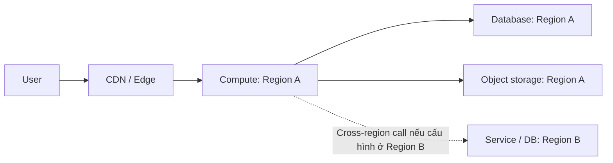
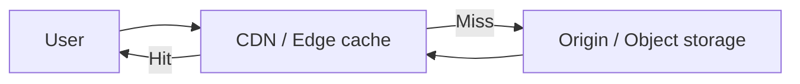

# Ảnh hưởng của độ trễ, băng thông và phí truyền dữ liệu

## 1. Vì sao vị trí dữ liệu ảnh hưởng cả hiệu năng lẫn chi phí?

Một ứng dụng cloud có thể dùng compute mạnh, database được quản lý và object storage có độ bền cao nhưng vẫn chậm hoặc tốn kém nếu dữ liệu nằm xa nơi xử lý, được truyền nhiều lần hoặc đi qua các tuyến mạng không cần thiết. Một trang sản phẩm tải hàng chục ảnh từ nhiều vùng địa lý, một API gọi database qua nhiều round trip, hay một pipeline analytics liên tục chuyển dữ liệu giữa regions đều có thể tạo ra độ trễ và hóa đơn mạng lớn.

Ba yếu tố cần xem cùng nhau:

- **Latency (độ trễ):** thời gian từ khi gửi một yêu cầu hoặc gói dữ liệu đến khi nhận được phản hồi. Trong ứng dụng, thường cần phân biệt network round-trip time, thời gian xử lý và end-to-end latency.
- **Bandwidth (băng thông):** năng lực truyền dữ liệu tối đa của một đường truyền trong điều kiện nhất định, thường biểu diễn bằng bit/giây.
- **Data transfer cost (phí truyền dữ liệu):** khoản phí phát sinh khi dữ liệu đi qua một ranh giới tính phí, ví dụ ra Internet, giữa availability zones, giữa regions hoặc qua một dịch vụ mạng.

Ba yếu tố có quan hệ nhưng không đồng nghĩa. Băng thông cao không bảo đảm latency thấp; latency thấp không bảo đảm throughput cao; cùng một luồng dữ liệu có thể không mất phí ở một tuyến nhưng bị tính phí ở tuyến khác tùy nhà cung cấp, dịch vụ, region và cấu hình.

Trong module **CLOUD_ARCHITECTURE**, chương **Kiến trúc lưu trữ** giúp đánh giá vị trí đặt dữ liệu, cách truy cập và đường truyền theo yêu cầu nghiệp vụ, độ tin cậy, khả năng mở rộng, bảo mật, chi phí và vận hành.

Sau bài học, người học có thể:

1. Phân biệt latency, bandwidth, throughput, IOPS và data transfer volume.
2. Phân tích ảnh hưởng của network round trip, payload size và vị trí dữ liệu đến thời gian phản hồi.
3. Ước lượng thời gian truyền dữ liệu và nhận diện điểm nghẽn.
4. Hiểu các ranh giới tính phí như Internet egress, inter-zone, inter-region, CDN và private connectivity.
5. Thiết kế data placement, cache, CDN, replication, compression và batching phù hợp.
6. Tính chi phí mạng theo workload và tránh tối ưu một metric làm xấu tổng chi phí.
7. Lập kế hoạch đo latency/throughput, kiểm thử tải và theo dõi hóa đơn truyền dữ liệu.

## 2. Phân biệt các thông số mạng quan trọng

| Thuật ngữ | Ý nghĩa | Đơn vị thường gặp | Ví dụ |
| --- | --- | --- | --- |
| **Latency** | Thời gian để thông tin đi từ điểm này tới điểm khác hoặc hoàn thành round trip | ms, µs | API gọi database mất 8 ms network RTT |
| **Bandwidth** | Năng lực truyền tối đa của đường truyền | bit/s, Gbit/s | NIC có mức bandwidth tối đa theo instance type |
| **Throughput** | Lượng dữ liệu thực tế truyền trong một đơn vị thời gian | byte/s, MB/s, Gbit/s | Copy object đạt 700 MB/s |
| **IOPS** | Số thao tác I/O mỗi giây | operations/s | Volume đạt 10.000 IOPS |
| **Payload size** | Kích thước dữ liệu mỗi request/response | byte, KB, MB | Response JSON 40 KB |
| **Transfer volume** | Tổng lượng dữ liệu qua ranh giới trong kỳ | GB, TB | 12 TB egress/tháng |
| **Jitter** | Độ biến động của latency | ms | RTT dao động 5–45 ms |
| **Packet loss** | Tỷ lệ gói tin không tới đích | % | Một phần packet bị mất và phải retransmit |

Bandwidth thường là năng lực danh định hoặc giới hạn được quảng bá; throughput phụ thuộc vào congestion, protocol, CPU, storage, packet size, concurrency, TLS, shaping và các giới hạn dịch vụ. Không lấy bandwidth tối đa làm throughput cam kết cho ứng dụng.

### 2.1. Latency một chiều và round-trip time

**One-way latency** là thời gian gói tin đi từ A tới B. **Round-trip time (RTT)** là thời gian gửi từ A sang B và nhận phản hồi về A. Công cụ thông dụng thường đo RTT vì khó đồng bộ clock chính xác giữa hai đầu để đo một chiều.

Một thao tác ứng dụng thường cần nhiều round trip:

- Thiết lập TCP connection.
- TLS handshake.
- DNS resolution.
- Gửi request và nhận response.
- Query database và nhận kết quả.
- Gọi thêm service khác trong chuỗi xử lý.

Connection reuse, keep-alive, TLS session resumption và multiplexing có thể giảm phần overhead lặp lại, nhưng không loại bỏ latency của từng lần trao đổi bắt buộc.

### 2.2. Bandwidth không phải tốc độ tải file thực tế

Nếu một đường mạng có bandwidth 1 Gbit/s, giới hạn lý thuyết tương đương khoảng 125 MB/s trước overhead vì 8 bit bằng 1 byte. Nhưng ứng dụng có thể chỉ đạt thấp hơn do TCP window, packet loss, encryption, remote storage throttling, CPU hoặc đường truyền chia sẻ.

Cần ghi rõ đơn vị:

- **Mb/s hoặc Mbps:** megabit mỗi giây.
- **MB/s:** megabyte mỗi giây.
- **Gbps:** gigabit mỗi giây.
- **GB/TB:** dung lượng dữ liệu, không phải tốc độ.

Nhầm Mbps với MB/s tạo sai số tám lần trong dự báo truyền dữ liệu.

## 3. Một request có thể tốn thời gian ở đâu?

Thời gian phản hồi đầu cuối không chỉ là thời gian xử lý trong compute:

```text
End-to-end latency =
    DNS / connection setup
  + network round trips
  + request transfer time
  + service processing time
  + storage read/write time
  + downstream calls
  + response transfer time
  + queueing / retries
```

Không phải mọi thành phần đều xuất hiện trong mọi request. Một kết nối đã mở có thể bỏ qua DNS/TCP/TLS setup; một API dùng cache có thể không gọi database; một pipeline bất đồng bộ có thể không đòi hỏi client chờ hết thời gian xử lý.

### 3.1. Ví dụ một API gọi ba dịch vụ tuần tự

Giả sử API cần đọc profile, lấy giá và kiểm tra inventory. Mỗi dependency có network RTT 12 ms và xử lý 8 ms.

Nếu ba call tuần tự:

```text
Total dependency time ≈ 3 × (12 ms + 8 ms)
                      = 60 ms
```

Nếu hai call độc lập chạy song song, thời gian có thể gần bằng call chậm nhất cộng overhead orchestration, thay vì tổng tất cả. Tuy nhiên, gọi song song làm tăng số connection và request đồng thời; phải xác minh dependency chịu được fan-out.

### 3.2. Chatter: nhiều request nhỏ gây chậm

Một ứng dụng gọi database 40 lần cho một request có thể bị chi phối bởi RTT dù tổng payload nhỏ. Thay vì truyền một lượng dữ liệu lớn, nó liên tục chờ các round trip.

Các cách giảm chatter:

- Gom các query tương thích thành batch.
- Dùng join hoặc query projection phù hợp để giảm round trip.
- Đọc nhiều bản ghi theo trang thay vì gọi từng bản ghi.
- Reuse connection và prepared statement.
- Cache reference data ít thay đổi.
- Gửi event thay vì polling liên tục khi mô hình phù hợp.

Batching có thể tăng payload và memory, nên cần giới hạn batch size và tránh tạo query quá lớn.

## 4. Quan hệ giữa payload, RTT và throughput

Một phép ước lượng đơn giản cho thời gian truyền payload:

```text
Transfer time (seconds) ≈ payload size (bits) / effective throughput (bits/s)
```

Ví dụ payload 100 MB truyền qua đường hiệu dụng 200 Mbit/s:

```text
100 MB × 8 = 800 Mbit
800 Mbit / 200 Mbit/s = 4 seconds
```

Thời gian thực tế còn có latency, protocol overhead, congestion, encryption, retransmission và tốc độ đọc/ghi ở hai đầu. Công thức chỉ mô tả phần truyền payload trên một đường lý tưởng.

### 4.1. Khi nào latency chi phối, khi nào bandwidth chi phối?

- **Nhiều request nhỏ/round trip:** latency thường chi phối.
- **Một file lớn/stream liên tục:** bandwidth và throughput thường chi phối.
- **Nhiều request đồng thời:** cả latency, queueing và capacity downstream đều quan trọng.
- **Gói tin mất hoặc congestion:** RTT tăng, throughput TCP có thể giảm.
- **Payload lớn với CPU giới hạn:** serialization, compression và TLS có thể thành bottleneck.

### 4.2. Bandwidth-delay product

Bandwidth-delay product (BDP) ước tính lượng dữ liệu có thể đang "trên đường truyền" tại một thời điểm:

```text
BDP = bandwidth × round-trip time
```

Nếu đường truyền đạt 1 Gbit/s và RTT 40 ms:

```text
BDP = 1 Gbit/s × 0.04 s
    = 40 Mbit
    = 5 MB
```

Điều này gợi ý cần đủ dữ liệu in-flight/window để tận dụng đường truyền. Nếu TCP window hoặc ứng dụng chỉ giữ vài KB dữ liệu outstanding, throughput có thể thấp hơn năng lực đường truyền. Các stack TCP hiện đại có cơ chế điều chỉnh window, nhưng proxy, socket configuration và application pattern vẫn có thể làm giới hạn này lộ ra.

## 5. Vị trí dữ liệu và network locality

**Data locality** là đặt compute gần dữ liệu hoặc tổ chức luồng xử lý sao cho tránh truyền dữ liệu xa không cần thiết. Một database ở region A trong khi application chạy region B có thể làm mỗi query mất thêm RTT và tạo cross-region transfer.

Các câu hỏi cần đặt trước khi triển khai:

- Người dùng chủ yếu ở khu vực địa lý nào?
- Compute và storage có nằm trong cùng region không?
- Database và application có cùng availability zone hay không?
- Luồng đọc/ghi có qua NAT, firewall, transit hub, proxy hoặc public Internet không?
- Dữ liệu có được sao chép tới nhiều region không?
- Request cần đồng bộ ngay hay có thể xử lý bất đồng bộ?
- Dữ liệu được phép lưu ở những geography nào?

### 5.1. Sơ đồ placement và round trip



Nếu API ở Region A gọi DB ở Region B cho mỗi request, mọi operation phụ thuộc DB có thể thêm latency WAN. Nếu cần đọc dữ liệu gần user ở Region B, cân nhắc replica/read model local, cache hoặc thiết kế API bất đồng bộ, nhưng phải chấp nhận semantics consistency và chi phí replication.

### 5.2. Cùng region không nhất thiết cùng zone

Đặt compute và database trong cùng region có thể tránh một số chi phí/latency cross-region, nhưng vẫn có thể phát sinh transfer giữa AZ, gateway hoặc dịch vụ. Availability zone là failure domain độc lập theo thiết kế provider; không nên đặt mọi thành phần vào một zone chỉ để tránh phí transfer mà làm mất khả năng phục hồi.

Chọn placement phải cân bằng:

- Availability và failover.
- Latency giữa compute và data.
- Phí transfer liên zone/region.
- Data residency và compliance.
- SLO của user journey.
- Chi phí replication và capacity dự phòng.

## 6. Các loại data transfer và ranh giới tính phí

Mỗi nhà cung cấp có bảng giá và quy tắc riêng, nhưng về kiến trúc thường cần nhận diện những nhóm luồng:

| Loại luồng | Ví dụ | Điểm cần kiểm tra |
| --- | --- | --- |
| Internet ingress | User upload file vào cloud | Ingress có miễn phí/được tính thế nào theo dịch vụ |
| Internet egress | Cloud trả ảnh/API response cho user | Egress tier, region, destination và volume |
| Inter-AZ | App gọi DB hoặc service ở AZ khác | Phí transfer theo hướng và dịch vụ |
| Inter-region | Replicate object/database hoặc gọi API vùng khác | Phí theo GB, replication và request |
| Same-region service transfer | Compute tới object/database cùng region | Quy tắc cụ thể của sản phẩm, endpoint và topology |
| CDN delivery | Edge trả object cho user | CDN egress, origin fetch và cache hit/miss |
| NAT/Firewall processing | Workload đi Internet hoặc qua inspection | Data processing, hourly/capacity và transfer liên quan |
| Dedicated connectivity/VPN | Kết nối on-premises với cloud | Port/connection, provider, data processing và egress |
| Backup/replication | Copy snapshot hoặc log sang vùng khác | Snapshot storage, copy/transfer và retention |

**Không được suy diễn giá từ tên luồng.** Một số loại ingress có thể không bị tính phí ở dịch vụ cụ thể; một số service-to-service path có cơ chế tính riêng; giá khác nhau theo region, tier, destination và hợp đồng. Luôn kiểm tra pricing calculator và tài liệu giá của provider tại thời điểm thiết kế.

### 6.1. Egress và ingress

Trong nhiều mô hình cloud, Internet egress là thành phần chi phí đáng quan tâm vì dữ liệu rời khỏi cloud hoặc vùng tính phí. Nhưng không có một quy tắc phổ quát áp dụng cho tất cả sản phẩm.

Với một website ảnh:

- Upload ảnh gốc vào object storage tạo inbound traffic.
- Xử lý ảnh tạo output object.
- Người dùng tải ảnh qua CDN tạo delivery traffic.
- Cache miss khiến CDN phải fetch origin.
- Replication sang region khác tạo thêm transfer.

Đo tổng luồng thay vì chỉ đếm kích thước object lưu trong bucket.

### 6.2. Hai chiều truyền có thể được tính khác nhau

Một kết nối có cả request và response nhưng quy tắc giá có thể khác theo hướng. Ví dụ request nhỏ đi vào và response lớn đi ra; chi phí chủ yếu nằm ở chiều response. Khi ước lượng, phải cộng dung lượng từng hướng và đối chiếu cách provider đo billable bytes.

## 7. Ước lượng chi phí truyền dữ liệu

Một mô hình dự toán đơn giản:

```text
Monthly transfer cost ≈
    Σ (billable volume by route × applicable rate)
  + gateway / processing charges
  + CDN / private connectivity charges
  + related request and storage charges
```

Không nên gom mọi GB vào một rate duy nhất. Hãy chia theo route, destination, region, direction và dịch vụ.

### 7.1. Ví dụ egress của API

Giả định:

- 2 triệu request/ngày.
- Response trung bình 80 KB.
- 30 ngày/tháng.
- Trong ví dụ này, tạm bỏ qua compression, cache và protocol overhead.

Dung lượng egress gần đúng:

```text
2,000,000 × 80 KB = 160,000,000 KB/day
≈ 160 GB/day (decimal approximation)
≈ 4,800 GB/month
```

Nếu bật compression giảm payload còn trung bình 30 KB:

```text
2,000,000 × 30 KB × 30
≈ 1,800 GB/month
```

Chênh lệch là khoảng 3 TB egress/tháng trước khi xét các khoản phí liên quan. Mức tiết kiệm tiền cụ thể phải nhân với rate áp dụng cho đúng tuyến và tính cả CPU/latency của compression.

### 7.2. Ví dụ replication giữa hai regions

Giả sử một database phát sinh 50 GB log thay đổi mỗi ngày và replica ở region khác nhận dữ liệu liên tục. Dự toán transfer thô trong 30 ngày:

```text
50 GB/day × 30 days = 1,500 GB/month
```

Đây chưa phải bill cuối cùng. Cần xét replication protocol, compression, retransmission, snapshot initial seed, traffic hai chiều, storage và dịch vụ database quản lý.

### 7.3. Data transfer budget

Một dự án nên có ngân sách theo thành phần:

| Thành phần | Dự báo dữ liệu/tháng | Đơn giá cần xác minh | Owner |
| --- | ---: | --- | --- |
| Public API egress | GB | Theo region/destination | API team |
| CDN delivery | GB | Theo edge geography/tier | Web platform |
| Origin fetch | GB | Theo origin path | Storage team |
| Cross-AZ traffic | GB | Theo service/zone route | Platform |
| Cross-region replication | GB | Theo cặp region/dịch vụ | Data team |
| NAT/firewall processing | GB + hours | Theo gateway/inspection | Network team |
| Backup copy | GB | Theo copy/retention policy | Data ops |

Cần theo dõi variance giữa dự báo và hóa đơn thực tế; không để chi phí transfer chỉ xuất hiện cuối tháng mà không có alert.

## 8. Compression: giảm byte hay tăng CPU?

Compression giảm số byte cần truyền, có thể giảm latency và egress cost, nhưng tiêu thụ CPU và có thể tăng thời gian xử lý.

Phù hợp với:

- JSON/text response lớn.
- Log/event payload.
- File dạng văn bản.
- Artifact hoặc object có thể nén trước khi lưu/truyền.

Ít phù hợp hơn với:

- JPEG/PNG/WebP đã nén.
- Video/audio codec đã nén.
- Payload nhỏ đến mức header/compression overhead lớn hơn lợi ích.
- Workload CPU-bound hoặc yêu cầu latency rất thấp.

### 8.1. Đánh giá theo tổng chi phí

So sánh:

```text
Net benefit =
    transfer cost saved
  + latency / bandwidth benefit
  - compression CPU cost
  - additional memory / complexity cost
```

Ví dụ response JSON 1 MB nén xuống 150 KB. Tiết kiệm khoảng 85% payload, nhưng phải benchmark compression CPU, p95 latency và chi phí compute. Dùng thuật toán phù hợp như gzip hoặc Brotli theo hỗ trợ client/proxy; không nén mù mọi loại file.

### 8.2. Nén dữ liệu ở storage và khi truyền

Nén object trước khi lưu có thể giảm storage và replication volume, nhưng ảnh hưởng range request, random access, deduplication và khả năng xử lý trực tiếp. Nén ở HTTP layer chỉ thay đổi representation lúc truyền; object nguồn vẫn giữ nguyên. Hãy xác định cần tiết kiệm network, storage hay cả hai.

## 9. Caching và CDN để giảm latency, egress origin

Cache giữ bản sao dữ liệu gần nơi sử dụng nhằm giảm round trip tới origin và tránh truyền dữ liệu lặp lại. Các vị trí thường gặp:

- Browser cache.
- CDN/edge cache.
- API gateway cache.
- Reverse proxy.
- Application in-memory cache.
- Distributed cache.
- Database buffer/cache.



CDN cache hit giúp giảm tải origin và có thể giảm transfer origin-to-edge, nhưng CDN delivery tới user vẫn có chi phí theo biểu giá CDN. Không giả định cache làm toàn bộ egress miễn phí.

### 9.1. Cache hit ratio

```text
Cache hit ratio = cache hits / total eligible requests

Origin requests ≈ total requests × (1 - hit ratio)
```

Nếu 10 triệu request đủ điều kiện cache và hit ratio 90%, origin nhận khoảng 1 triệu request thay vì 10 triệu. Tuy nhiên phải kiểm tra byte hit ratio: hit count cao không nhất thiết đồng nghĩa phần lớn dữ liệu byte được cache.

### 9.2. Cache correctness và invalidation

Cache có thể tạo stale data. Cần xác định:

- Dữ liệu public hay private.
- TTL và stale-while-revalidate nếu hỗ trợ.
- Cache key gồm query/header/cookie nào.
- Có thể purge/invalidate khi cập nhật không?
- Dữ liệu nhạy cảm có nguy cơ cache chéo tenant không?
- Khi origin down, có được trả stale không?
- Có giới hạn tuổi stale cho dữ liệu nghiệp vụ không?

Không cache response chứa PII hoặc quyền riêng tư vào shared cache nếu thiếu cache-control và key isolation phù hợp.

### 9.3. Cache stampede

Khi một key phổ biến hết hạn, hàng nghìn request có thể cùng gọi origin. Dùng request coalescing/single-flight, TTL jitter, stale-while-revalidate hoặc refresh sớm để giảm đồng bộ hóa tải.

## 10. Data placement: đặt compute và dữ liệu ở đâu?

Một lựa chọn placement thường so sánh ba trục:

1. Nơi dữ liệu được lưu lâu dài.
2. Nơi dữ liệu được đọc/ghi thường xuyên.
3. Nơi compute thực hiện xử lý nặng.

Nếu compute và storage xa nhau, dữ liệu có thể đi qua mạng mỗi lần xử lý. Với batch lớn, chuyển compute tới gần data có thể rẻ hơn chuyển hàng TB dữ liệu về compute. Với API tương tác, replica/cache local có thể giảm latency cho read path.

### 10.1. Mẫu placement phổ biến

| Mẫu | Khi phù hợp | Đánh đổi |
| --- | --- | --- |
| Compute và primary data cùng region | API OLTP cần RTT ổn định | User ở xa vẫn chịu WAN latency |
| Read replica gần user | Read-heavy, chấp nhận lag | Replication cost và stale read |
| CDN/edge cache | Nội dung public, ít thay đổi | Invalidation, cache miss và edge charges |
| Object storage + event processing gần bucket | Pipeline xử lý file lớn | Thiết kế event, regional availability và egress |
| Central data lake | Analytics tập trung | Chuyển dữ liệu từ nhiều nguồn/region |
| Regional data partition | Data residency và locality | Cross-region query/workflow phức tạp |

### 10.2. Đưa compute tới data hay data tới compute?

Với 5 TB dữ liệu analytics, chạy job ở region có data có thể tránh transfer 5 TB qua region khác. Nhưng nếu job cần dữ liệu từ nhiều region, có thể phải transfer một phần hoặc dùng aggregation local.

Câu hỏi quyết định:

- Data set có được phép xử lý ở region hiện tại không?
- Compute có quota/capacity phù hợp ở đó không?
- Kết quả đầu ra có nhỏ hơn dữ liệu đầu vào nhiều không?
- Có thể gửi summary thay vì raw data không?
- Có yêu cầu tập trung hóa audit/governance không?
- Chi phí transfer có lớn hơn chi phí compute local không?

## 11. Replication: tăng độ sẵn sàng nhưng tăng lưu lượng

Replication tạo bản sao dữ liệu để tăng khả năng phục hồi, giảm read latency hoặc phục vụ nhiều vùng. Nhưng nó cũng tạo network transfer liên tục và độ trễ đồng bộ.

### 11.1. Synchronous và asynchronous replication

- **Synchronous replication:** commit chờ xác nhận từ replica/quorum theo guarantee của dịch vụ. Có thể tăng latency và phụ thuộc kết nối.
- **Asynchronous replication:** nguồn xác nhận trước khi tất cả replicas nhận dữ liệu. Giảm độ trễ ghi nhưng có replication lag và nguy cơ mất một số ghi chưa chuyển khi failover.
- **Semi-synchronous/quorum variants:** chờ một nhóm replica nhất định; semantics tùy engine/provider.

Không suy ra guarantee chỉ từ nhãn multi-AZ hay multi-region. Phải xem database service bảo đảm điều gì khi failover và partition.

### 11.2. Read scaling

Read replica giúp phân phối tải đọc và có thể đặt gần compute/user. Nhưng replication lag có nghĩa request đọc ngay sau write có thể thấy bản cũ. Các giải pháp có thể gồm:

- Route read-after-write về primary trong một khoảng.
- Session consistency token/version.
- Chọn replica đáp ứng replication position.
- Trả timestamp/version và chấp nhận stale trong UX.
- Revalidate dữ liệu quan trọng tại nguồn có thẩm quyền.

### 11.3. Tính volume replication

Nếu nguồn thay đổi trung bình 8 MB/s và có replica ở hai regions:

```text
Raw replication flow ≈ 8 MB/s × 86,400 s/day
                     ≈ 691,200 MB/day
                     ≈ 691 GB/day (decimal)
```

Cần cộng snapshot seed, protocol overhead, retry và các bản sao bổ sung; nén log có thể làm volume thấp hơn nhưng tăng CPU.

## 12. Batching, streaming và giao thức truyền

Cách truyền có thể làm thay đổi cả latency lẫn chi phí.

**Batching:** gom nhiều item thành một request giảm overhead/round trip, nhưng tăng kích thước request, memory và phạm vi retry.

**Streaming:** truyền dữ liệu theo luồng thay vì chờ tạo xong toàn bộ payload, giúp giảm peak memory và time-to-first-byte cho file lớn. Nhưng cần xử lý backpressure, client disconnect và retry.

**Multipart upload:** chia object lớn thành nhiều part để upload song song và resume; có chi phí quản lý part, abort incomplete upload và lifecycle.

**Compression:** giảm bytes nhưng tăng CPU.

**Protocol multiplexing:** cho nhiều request dùng chung một kết nối hoặc stream, giảm connection setup nhưng cần hiểu flow control và head-of-line behavior của protocol.

### 12.1. Time to first byte và time to last byte

Đối với streaming/download:

- **TTFB:** thời gian từ request đến byte đầu tiên.
- **Completion time:** thời gian tới khi nhận đủ dữ liệu.
- **Throughput:** tốc độ trong suốt quá trình stream.

Một hệ thống có TTFB thấp nhưng throughput thấp vẫn làm người dùng chờ lâu để nhận file lớn. Đo cả ba.

## 13. Multi-region và data residency

Multi-region có thể giảm latency cho người dùng địa lý phân tán và tăng khả năng DR, nhưng network topology phức tạp hơn.

Cần xác định:

- Region nào là owner cho write.
- Read replica/cache có được phép đặt ở geography nào.
- Dữ liệu nào được sao chép, mã hóa và lưu giữ bao lâu.
- Cross-region replication có đồng bộ hay bất đồng bộ.
- Failover có làm mất một phần write hoặc tạo conflict không.
- DNS/traffic steering có phản ánh region thực sự có dữ liệu mới nhất không.
- Chi phí transfer, snapshot copy, backup và log export.

Data residency có thể giới hạn việc đưa raw data sang region khác; trong trường hợp đó có thể aggregate/anonymize ở local region rồi chuyển dữ liệu đã giảm nhạy cảm nếu chính sách cho phép. Việc anonymize không tự động bảo đảm không thể tái nhận dạng; phải theo chính sách dữ liệu thực tế.

## 14. Private connectivity, NAT và firewall: phí xử lý trên đường dữ liệu

Đường tới object storage hoặc database có thể đi qua public endpoint, private endpoint, NAT, proxy hoặc firewall tùy thiết kế. Đường đi ảnh hưởng latency, bảo mật, quan sát và giá.

Một số điểm cần xác minh:

- Private endpoint có tính phí theo endpoint-hour, data processing hoặc loại service không?
- NAT Gateway có phí theo giờ và theo GB xử lý không?
- Firewall/appliance có phí capacity, processing hoặc cross-zone transfer không?
- Traffic giữa endpoint và workload có đi qua AZ/region không?
- DNS có phân giải tới private address theo đúng network scope không?
- Egress allowlist có làm mọi request vòng qua một hub tập trung không?

Không phải lúc nào private path cũng rẻ hơn public path. Giá trị chính có thể là private exposure, policy và governance; tổng cost cần tính cả endpoint, gateway và transfer.

## 15. Lưu lượng analytics, backup và log thường bị bỏ quên

Các luồng không nằm trên user request vẫn có thể tạo chi phí lớn:

- Database snapshot copy giữa regions.
- Backup export ra object storage.
- Log shipping đến central workspace.
- Metrics/tracing gửi đến observability platform.
- Data lake ingestion từ nhiều dịch vụ.
- Replication cho search index hoặc cache.
- Container image pull từ registry ở region khác.
- Package/artifact download trong mỗi deployment.

Hãy lập data flow inventory và owner cho từng luồng. Log/trace cần lọc, sampling, retention và aggregation; không gửi payload nhạy cảm hoặc toàn bộ raw event khi summary là đủ.

### 15.1. Backup locality

Backup cùng region có thể phục hồi nhanh khi lỗi logic hoặc hỏng dữ liệu, nhưng không bảo vệ đầy đủ khi cả region gặp sự cố. Copy backup sang region khác tăng resilience nhưng phát sinh transfer/storage cost và phải kiểm tra encryption key, retention, restore permissions và data residency.

### 15.2. Observability volume

Ví dụ một service tạo 5.000 log events/s, mỗi event trung bình 1 KB:

```text
5,000 × 1 KB × 86,400 s
≈ 432,000,000 KB/day
≈ 432 GB/day (decimal approximation)
```

Chỉ một service đã có thể tạo volume lớn. Structured logs, sampling, aggregation và retention policy giúp giảm lượng dữ liệu cần truyền/lưu mà vẫn giữ thông tin phục vụ điều tra.

## 16. Security cho dữ liệu trên đường truyền

Tối ưu latency và cost không được làm suy yếu bảo vệ dữ liệu.

- Dùng TLS cho traffic cần bảo vệ, kể cả khi đi trong network private nếu threat model yêu cầu.
- Xác thực service-to-service và kiểm tra quyền truy cập object/database.
- Mã hóa dữ liệu at rest theo policy; quản lý key và quyền decrypt.
- Không cache shared response chứa dữ liệu riêng tư nếu chưa có tenant/user isolation.
- Không ghi nội dung nhạy cảm vào CDN, proxy, firewall hoặc flow logs.
- Giới hạn egress và các destination cần thiết; quan sát bất thường.
- Kiểm soát presigned URL, thời hạn, method và object scope.
- Đặt retention và deletion lifecycle cho temporary replica/cache/object.

Compression trước TLS có thể có rủi ro side-channel trong một số ngữ cảnh nếu secret và dữ liệu do attacker điều khiển cùng bị nén; dùng cấu hình theo security guidance của ứng dụng thay vì bật vô điều kiện.

## 17. Đo và chẩn đoán hiệu năng dữ liệu

Một bài đo có ích phải tách các thành phần:

| Lớp | Chỉ số | Câu hỏi |
| --- | --- | --- |
| Client/edge | TTFB, total latency, cache hit | Người dùng thực sự chờ bao lâu? |
| Network | RTT, packet loss, retransmission, jitter | Đường truyền có ổn định? |
| Compute | CPU, memory, serialization/compression time | App có xử lý kịp không? |
| Storage | IOPS, throughput, queue depth, read/write latency | Disk/database có bị nghẽn? |
| Database | Query latency, connection wait, replication lag | Truy vấn và replica ra sao? |
| Data transfer | GB theo route/direction/region | Tiền đang phát sinh ở tuyến nào? |
| CDN/cache | Byte hit ratio, origin fetch, stale response | Cache giảm được bao nhiêu origin traffic? |
| Cost | Cost per GB, per request, per job | Hiệu quả kinh tế có cải thiện không? |

### 17.1. Phân biệt latency đo từ đâu

Ping từ laptop developer tới public endpoint không đại diện latency giữa function và database trong VPC/VNet. Phép đo phải được thực hiện từ đúng runtime, subnet/region, protocol và workload pattern.

Có thể dùng:

- Distributed tracing để thấy thời gian từng dependency.
- Application metrics cho query/serialization/transfer.
- Network telemetry/flow logs theo khả năng provider.
- Benchmark copy/stream với payload đại diện.
- Synthetic probe từ region/zone thực tế.
- Billing export/cost allocation để xác định billable transfer.

### 17.2. Test throughput có kiểm soát

Bài test cần ghi rõ payload, số connection, concurrency, duration, warm-up, compression, encryption và vị trí hai đầu. Tăng tải từ từ; đo cả throughput và latency p95/p99. Một kết quả peak ngắn không đại diện cho throughput bền vững nếu buffer/kernel cache đang che giấu giới hạn storage.

## 18. Tối ưu chi phí mà không làm xấu SLO

Các biện pháp nên dựa trên data flow và đo đạc:

1. **Đặt compute gần primary data** cho workload đọc/ghi thường xuyên.
2. **Cache/CDN** cho nội dung public hoặc ít thay đổi, với key và invalidation đúng.
3. **Compression** cho payload text lớn khi CPU còn headroom.
4. **Batching** để giảm round trip trong workload phù hợp.
5. **Streaming/multipart** cho object lớn để giảm memory và cho phép resume.
6. **Tạo summary/aggregate tại nguồn** thay vì chuyển toàn bộ raw data.
7. **Giảm replication dư thừa** nhưng vẫn giữ RTO/RPO.
8. **Tối ưu log/trace** bằng sampling, filtering và retention.
9. **Tránh vòng qua NAT/firewall/hub không cần thiết**, song vẫn giữ policy bảo mật.
10. **Theo dõi byte hit ratio và egress theo endpoint/tenant** để xử lý nguồn phát sinh lớn.

Không tối ưu bằng cách gom tất cả workload vào một AZ để tránh transfer nếu điều đó làm giảm khả năng chịu lỗi. Cần lượng hóa chi phí sự cố và downtime bên cạnh network bill.

## 19. Ví dụ tổng hợp: nền tảng media

Một nền tảng lưu ảnh/video có người dùng ở nhiều quốc gia:

- User upload ảnh/video gốc.
- Compute tạo thumbnail/transcode.
- Object storage lưu master và derivative.
- CDN phục vụ nội dung public.
- Metadata nằm trong database.
- Analytics thu thập view events.

Nếu mọi request tải media đều đi thẳng về một bucket ở xa, latency và egress origin tăng. Phương án có thể là:

- Upload vào object storage qua endpoint phù hợp với region user.
- Trigger processing bất đồng bộ trong cùng region data.
- Lưu derivative với key/version rõ ràng.
- CDN cache theo immutable URL/content hash.
- Database metadata có primary owner và read strategy riêng.
- View events được batch/aggregate trước khi chuyển sang data lake.
- Lifecycle xóa multipart upload dở dang và object trung gian.
- Dashboard theo CDN byte hit ratio, origin egress, cross-region replication và cost per playback.

### 19.1. Câu hỏi kiến trúc

1. File nào cần phục vụ toàn cầu và file nào có thể chỉ ở một geography?
2. Upload/download có cần resumable/multipart không?
3. CDN cache hit byte ratio là bao nhiêu?
4. Có cần signed URL/private content không?
5. Transcode compute nên chạy ở region chứa object hay region có CPU rẻ/capacity?
6. Có thể gửi event summary thay raw playback log không?
7. Replication sang DR region có phù hợp RPO và ngân sách?
8. Khi origin region lỗi, CDN có thể trả cached object tới đâu và trong bao lâu?

## 20. ADR mẫu: đặt xử lý gần dữ liệu và dùng CDN cho delivery

```text
ADR-074: Regional media processing và CDN delivery

Bối cảnh:
- Media upload từ nhiều khu vực.
- File gốc lớn; thumbnail/video derivative được truy cập lặp lại.
- Origin egress và user latency cần kiểm soát.
- Metadata và quyền truy cập cần giữ nguồn có thẩm quyền.

Lựa chọn:
A. Một region xử lý và phục vụ toàn bộ traffic.
B. Xử lý object gần region lưu trữ, dùng CDN cho nội dung đủ điều kiện cache.
C. Replicate mọi object sang mọi region.

Quyết định:
- Chọn B làm baseline.
- Processing được trigger theo object event ở region phù hợp.
- Output có version/immutable key để cache hiệu quả.
- Metadata/authorization vẫn được kiểm tra từ service có thẩm quyền.
- Replication chỉ áp dụng cho object/data có yêu cầu DR hoặc locality.

Đánh đổi:
- CDN, regional processing và lifecycle tăng thành phần cần vận hành.
- Cache invalidation/private content cần policy rõ.
- Có thể có egress giữa region cho replication và failover.

Kiểm chứng:
- Đo TTFB, total latency và byte hit ratio theo geography.
- Dự báo origin/CDN/cross-region transfer cost.
- Thử origin outage, cache miss và quyền truy cập private object.
- Xác minh RTO/RPO và data residency.

Điều kiện xem lại:
- Traffic geography thay đổi.
- Egress hoặc CDN cost vượt ngân sách.
- RTO/RPO hoặc residency requirement thay đổi.
```

## 21. Những lỗi thiết kế thường gặp

1. **Đồng nhất bandwidth và throughput:** dự báo truyền dữ liệu quá lạc quan.
2. **Nhầm Mbps với MB/s:** sai số tám lần trong tính toán.
3. **Chỉ đo compute duration:** bỏ qua network RTT, queueing và storage latency.
4. **Đặt database xa compute:** mọi query đều cộng WAN latency và transfer.
5. **Cho rằng cùng region nghĩa là không có transfer cost:** bỏ qua AZ, gateway và service-specific path.
6. **Không phân loại egress:** không biết tuyến nào làm hóa đơn tăng.
7. **Cache theo request count mà không xem bytes:** hit ratio cao nhưng byte hit ratio thấp.
8. **Cache response nhạy cảm thiếu tenant isolation:** nguy cơ lộ dữ liệu chéo khách hàng.
9. **Nén mọi file:** tiêu tốn CPU cho object đã nén hoặc payload nhỏ.
10. **Batch quá lớn:** tăng memory, latency và phạm vi retry.
11. **Replication mọi dữ liệu đến mọi region:** phí transfer, storage và complexity vượt nhu cầu.
12. **Chạy analytics tập trung rồi kéo raw data liên tục:** chuyển dữ liệu lớn không cần thiết.
13. **Bỏ qua log/trace volume:** phí observability tăng âm thầm.
14. **Tối ưu phí bằng cách bỏ HA:** tiết kiệm nhỏ nhưng tăng rủi ro downtime/mất dữ liệu.
15. **Dựa vào bảng giá cũ hoặc rate chung:** dự toán sai do region, tier và service khác nhau.
16. **Không có owner cho data flow:** không ai điều tra khi transfer cost tăng.

## 22. Checklist trước production

- [ ] Latency, bandwidth, throughput, IOPS và payload size được phân biệt rõ.
- [ ] Đã đo RTT/TTFB/end-to-end latency từ đúng region và runtime.
- [ ] Các round trip tuần tự và chatter được nhận diện, tối ưu phù hợp.
- [ ] Compute và storage placement đáp ứng locality, availability và residency.
- [ ] Đã liệt kê transfer theo direction, destination, zone, region và service.
- [ ] Egress, inter-AZ, inter-region, CDN, NAT/firewall và backup flow đã được dự toán.
- [ ] Đơn giá được xác minh từ pricing hiện hành cho đúng region/service/tier.
- [ ] Cache có key, TTL, invalidation, stale policy và tenant isolation rõ.
- [ ] Compression/batching/streaming được benchmark với payload thực.
- [ ] Replication mode, lag, transfer volume, RTO/RPO được xác định.
- [ ] Log, metric, trace và backup volume có retention/sampling hợp lý.
- [ ] Traffic lớn có backpressure và giới hạn downstream phù hợp.
- [ ] Có dashboard cho GB theo tuyến, byte hit ratio, p95/p99 và cost per operation.
- [ ] Đã test network congestion, packet loss, slow storage và origin failure.
- [ ] Tối ưu cost không làm giảm fault-domain isolation hoặc bảo mật.
- [ ] Có owner, budget alert và quy trình đánh giá variance giữa forecast và actual.

---

**Ghi nhớ:** Latency quyết định thời gian chờ, bandwidth đặt giới hạn năng lực truyền, còn data transfer cost phụ thuộc dữ liệu đi qua ranh giới nào và theo quy tắc tính phí nào. Thiết kế lưu trữ cloud tốt phải đặt compute gần dữ liệu phù hợp, giảm round trip và byte không cần thiết, dùng cache/replication có mục tiêu, đồng thời đo hiệu năng và chi phí theo từng luồng thực tế.
