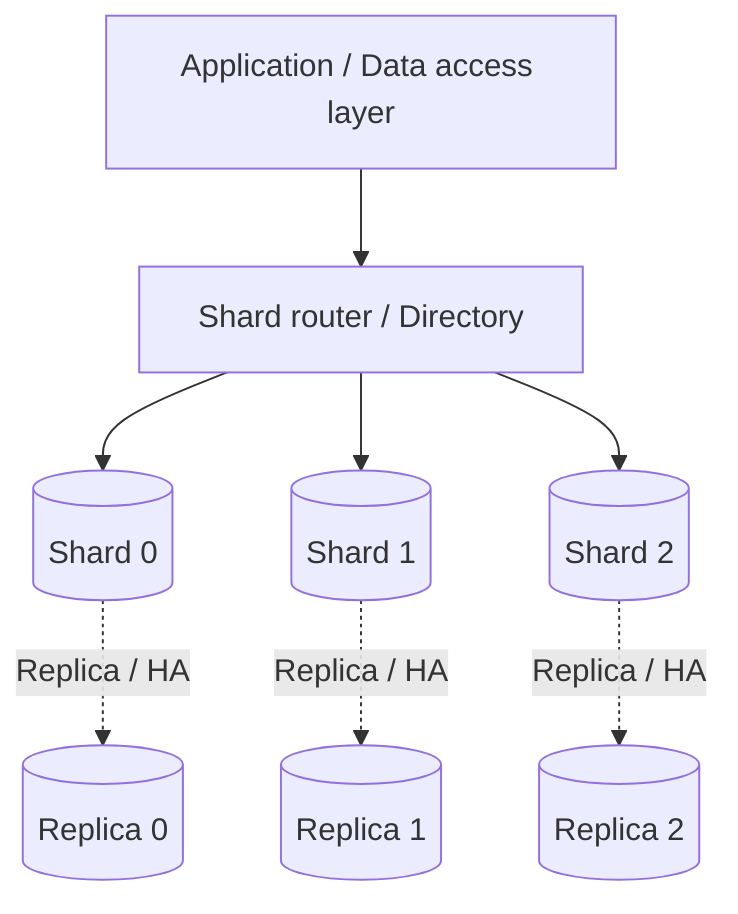
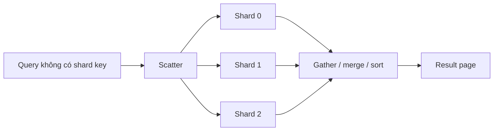
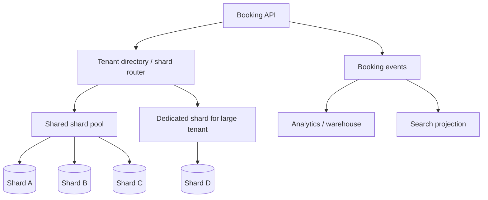

# Phân vùng, sharding và xử lý điểm nóng

## 1. Khi một cơ sở dữ liệu không còn đáp ứng được nhu cầu

Một ứng dụng có thể bắt đầu với một database và một bảng lớn. Khi số lượng người dùng, giao dịch và dữ liệu tăng lên, database có thể gặp giới hạn CPU, bộ nhớ, dung lượng, IOPS, network throughput hoặc số kết nối. Một truy vấn quét toàn bảng làm chậm nhiều request; một tenant lớn có thể chiếm phần lớn năng lực; một vài sản phẩm được truy cập liên tục có thể tạo tải không đều trên các node.

**Partitioning (phân vùng)** chia một tập dữ liệu thành các phần nhỏ hơn theo một quy tắc. Trong database, partition có thể vẫn nằm trong cùng một database instance hoặc được quản lý như các đơn vị lưu trữ riêng.

**Sharding** thường chỉ việc phân chia dữ liệu theo chiều ngang qua nhiều database node/instance để tăng năng lực lưu trữ hoặc xử lý, đồng thời phân phối tải. Mỗi shard giữ một phần dữ liệu và hệ thống cần định tuyến request đến shard đúng.

**Điểm nóng (hotspot)** xuất hiện khi một partition, shard, node, key hoặc tài nguyên nhận tải lớn không cân xứng so với phần còn lại. Thêm node không tự giải quyết hotspot nếu mọi request vẫn dồn vào cùng một key hoặc một shard.

Bài học thuộc chương **Kiến trúc cơ sở dữ liệu** của module **CLOUD_ARCHITECTURE**. Mục tiêu là hiểu cách chia dữ liệu, lựa chọn khóa phân vùng và xử lý tải lệch trong kiến trúc cloud; cân bằng hiệu năng, tính nhất quán, độ tin cậy, bảo mật, chi phí và khả năng vận hành.

Sau bài học, bạn có thể:

- Phân biệt partitioning trong một database với sharding qua nhiều node.
- Lựa chọn range, hash, list và composite partition key theo truy vấn.
- Nhận diện cardinality, skew, hot key và hot partition.
- Thiết kế định tuyến, resharding, rebalance và truy vấn xuyên shard.
- Đánh giá tác động của partitioning/sharding đến transaction, index, backup, restore và DR.
- Xây dựng kế hoạch đo tải, phát hiện hotspot và xử lý mà không làm gián đoạn dịch vụ.

## 2. Phân biệt partitioning, sharding và replication

Ba kỹ thuật này có thể kết hợp nhưng giải quyết các vấn đề khác nhau.

| Kỹ thuật | Cách tổ chức | Mục tiêu thường gặp | Không tự giải quyết |
|---|---|---|---|
| **Partitioning** | Chia một bảng/tập dữ liệu thành các partition theo key hoặc phạm vi | Giảm phạm vi scan, quản lý dữ liệu lớn, lifecycle/retention | CPU hoặc connection limit của một instance nếu mọi partition vẫn dùng chung tài nguyên đó |
| **Sharding** | Chia dữ liệu ngang qua nhiều database node/instance | Scale dung lượng và throughput theo chiều ngang | Hot key, transaction xuyên shard, query không có shard key |
| **Replication** | Sao chép dữ liệu giữa các node/region | High availability, đọc gần người dùng, DR | Tăng dung lượng ghi duy nhất; có thể tạo lag hoặc conflict |

### 2.1. Partitioning trong một database

Database có thể chia bảng lớn thành các partition logic/physical. Ứng dụng vẫn truy vấn một bảng logic; optimizer có thể loại bỏ partition không liên quan nếu predicate phù hợp (partition pruning). Các partition có thể có lifecycle riêng, ví dụ tách theo tháng để archive dữ liệu cũ.

Ví dụ bảng lịch sử giao dịch được partition theo tháng:

```text
transactions
  partition_2026_01
  partition_2026_02
  partition_2026_03
  ...
```

Trong nhiều hệ quản trị, các partition vẫn thuộc một database instance hoặc một cụm được quản lý. Partitioning có thể cải thiện quản trị và phạm vi truy vấn nhưng không đồng nghĩa với việc có thêm nhiều database server độc lập.

### 2.2. Sharding qua nhiều database

Sharding đặt các phần dữ liệu trên nhiều database node:



Ứng dụng hoặc lớp proxy/router cần biết record thuộc shard nào. Mỗi shard có thể có replica riêng cho HA/đọc, nhưng replication trong một shard khác với việc phân phối dữ liệu giữa các shard.

### 2.3. Vertical partitioning và horizontal partitioning

- **Horizontal partitioning:** chia các hàng (rows) theo key. Ví dụ khách hàng có ID 1–1 triệu ở shard A, phần còn lại ở shard B; hoặc hash customer ID để phân đều.
- **Vertical partitioning:** chia các cột hoặc nhóm thuộc tính. Ví dụ bảng customer core chứa ID/trạng thái, còn hồ sơ lớn hoặc dữ liệu ít truy cập nằm ở bảng/service khác.

Vertical partitioning có thể giảm kích thước hàng nóng và cô lập workload đọc/ghi, nhưng tăng số lần join hoặc số dịch vụ cần gọi. Horizontal partitioning giúp chia dữ liệu theo số lượng record nhưng làm phức tạp truy vấn và transaction giữa các phần.

## 3. Khi nào nên partition hoặc shard?

Không phải mọi database lớn đều cần sharding. Trước khi chia dữ liệu, cần đo bottleneck và xem tối ưu query/index, connection pooling, cache, read replica, nâng cấp instance hoặc archive có đáp ứng không.

### 3.1. Dấu hiệu partitioning phù hợp

- Bảng lịch sử tăng đều theo thời gian; truy vấn thường lọc theo ngày/tháng.
- Cần archive/drop dữ liệu cũ theo lifecycle.
- Một số truy vấn chỉ cần phạm vi dữ liệu rõ và có thể prune partition.
- Maintenance, vacuum/reindex hoặc backup ở bảng khổng lồ khó quản lý.

### 3.2. Dấu hiệu cân nhắc sharding

- Một database instance đã gần giới hạn CPU, IOPS, memory, network hoặc dung lượng sau khi tối ưu.
- Write throughput không thể tăng bằng vertical scaling hoặc replica đọc.
- Dữ liệu có thể chia thành các miền độc lập theo tenant, customer hoặc aggregate.
- Có thể định tuyến phần lớn request tới một shard mà không cần join/transaction xuyên shard.
- Đội ngũ đủ khả năng vận hành nhiều database, backup/restore, migration và DR.

### 3.3. Khi chưa nên shard

| Dấu hiệu | Vì sao cần cân nhắc lại |
|---|---|
| Chưa có baseline và chưa xác định bottleneck | Có thể vấn đề nằm ở query/index hoặc connection, sharding làm tăng độ phức tạp mà không chữa nguyên nhân |
| Nhiều transaction cần atomicity giữa nhiều entity | Distributed transaction/saga phức tạp hơn; latency và failure modes tăng |
| Query thường xuyên tìm kiếm trên toàn bộ dữ liệu | Fan-out tới nhiều shard, scatter-gather và merge kết quả gây tốn tài nguyên |
| Tenant hoặc key rất lệch | Shard vẫn nóng dù tổng dữ liệu đã chia |
| Đội vận hành chưa có automation/observability | Tăng số node kéo theo backup, patching, failover và incident khó hơn |

Sharding thường là quyết định kiến trúc dài hạn. Hãy xác nhận lợi ích bằng benchmark và mô hình chi phí; không triển khai chỉ vì tổng dung lượng database lớn.

## 4. Các chiến lược phân vùng

### 4.1. Range partitioning

Chia theo khoảng giá trị của key, ví dụ ngày hoặc ID:

```text
created_at < 2026-04-01       -> partition_early
2026-04-01 <= created_at < 2026-07-01 -> partition_q2
created_at >= 2026-07-01      -> partition_recent
```

**Ưu điểm:**

- Truy vấn theo khoảng thời gian hoặc key range có thể chỉ đọc một số partition.
- Dễ archive/drop partition cũ.
- Có thể đặt partition mới trên storage/tier khác theo vòng đời dữ liệu.

**Nhược điểm:**

- Ghi dữ liệu mới thường dồn vào partition mới nhất (right-edge hotspot).
- Phân bố dữ liệu không đều nếu một số khoảng có lượng record lớn.
- Range query rộng vẫn có thể chạm nhiều partition.

Range phù hợp với event/time-series, lịch sử giao dịch hoặc dữ liệu truy vấn theo mốc thời gian, nhưng cần kế hoạch cho partition hiện tại bị nóng.

### 4.2. Hash partitioning

Tính hash trên partition key rồi ánh xạ vào số partition hoặc shard:

```text
bucket = hash(customer_id) mod N
```

**Ưu điểm:** phân phối khá đều nếu key đủ đa dạng và hash tốt; giảm việc mọi record mới tập trung vào một khoảng.

**Nhược điểm:** range query theo key khó tối ưu; đổi N có thể làm nhiều record phải chuyển bucket; hash không giải quyết một key có tần suất truy cập vượt trội.

Hash partitioning thường phù hợp khi workload truy cập theo ID và yêu cầu phân tải quan trọng hơn range scan.

### 4.3. List partitioning

Chia theo tập giá trị rời rạc, ví dụ region, loại dữ liệu hoặc tenant tier:

```text
region = 'north'  -> partition_north
region = 'south'  -> partition_south
region = 'central'-> partition_central
```

Ưu điểm là quy tắc dễ hiểu, có thể phục vụ yêu cầu data residency hoặc lifecycle riêng. Nhược điểm là các nhóm có thể lệch quy mô; một region hoặc tenant lớn có thể tạo hotspot riêng.

### 4.4. Composite partitioning

Kết hợp hai hoặc nhiều chiều, chẳng hạn range theo tháng rồi hash theo customer ID trong từng tháng. Cách này cân bằng quản lý lifecycle và phân phối ghi, nhưng làm tăng số partition và metadata, đòi hỏi giới hạn số partition hợp lý.

### 4.5. So sánh chiến lược

| Chiến lược | Tốt cho | Rủi ro hotspot | Phù hợp truy vấn |
|---|---|---|---|
| Range | Dữ liệu theo thời gian/khoảng | Dồn ghi ở biên mới nhất | Range scan, time window |
| Hash | Truy cập theo key, phân tán | Một key cực nóng vẫn nóng | Point lookup theo key |
| List | Miền dữ liệu rời rạc, region/tier | Một nhóm quá lớn | Filter theo nhóm |
| Composite | Kết hợp time lifecycle và phân tải | Phức tạp; key chọn chưa hợp lý vẫn lệch | Query theo nhiều chiều có prefix phù hợp |

## 5. Chọn partition key hoặc shard key

Đây thường là quyết định quan trọng nhất. Chọn sai key có thể khiến một shard chứa phần lớn dữ liệu hoặc nhận phần lớn traffic; đổi key sau này có thể cần di chuyển dữ liệu quy mô lớn.

### 5.1. Tiêu chí của một key tốt

1. **Cardinality đủ cao:** có đủ giá trị khác nhau để phân phối record và tải.
2. **Phân bố tương đối đều:** tránh một vài giá trị chiếm phần lớn record hoặc request.
3. **Phù hợp truy vấn:** các request chính thường có key để định tuyến đến một shard.
4. **Ổn định:** key không thường xuyên thay đổi, tránh phải chuyển dữ liệu.
5. **Tương thích ownership:** dữ liệu có quan hệ nghiệp vụ cần transaction nên có thể cùng shard khi hợp lý.
6. **Không gây rủi ro bảo mật:** không dùng PII hoặc dữ liệu nhạy cảm làm lộ trong routing metadata/log; có thể dùng ID opaque.

### 5.2. Ví dụ chọn key

| Ứng dụng | Key tiềm năng | Điểm mạnh | Rủi ro |
|---|---|---|---|
| SaaS nhiều tenant | tenant_id | Cô lập dữ liệu và truy vấn theo tenant | Một tenant lớn có thể áp đảo shard |
| Thương mại điện tử | customer_id hoặc order_id | Truy vấn đơn hàng theo khách hoặc theo đơn | Query theo sản phẩm/kho có thể cần fan-out |
| Lịch đặt chỗ | venue_id hoặc booking_id | Aggregate cùng địa điểm/booking có thể ở gần nhau | Venue phổ biến tạo hot key |
| Time-series | device_id kết hợp time bucket | Truy vấn theo thiết bị và khoảng thời gian | Thiết bị gửi quá nhiều có thể nóng |
| Social feed | user_id hoặc account_id | Truy xuất dữ liệu cá nhân theo user | Celebrity/follower fan-out gây hotspot |

Không có key tốt cho mọi truy vấn. Hãy thống kê query pattern, tỷ trọng read/write, cardinality, kích thước dữ liệu và tần suất từng key trước khi chọn.

### 5.3. Cardinality không đồng nghĩa phân phối đều

Một key có hàng triệu giá trị vẫn có thể lệch nếu một số giá trị phổ biến hơn hẳn. Ví dụ 90% khách hàng có dưới 100 đơn nhưng 1% khách hàng lớn tạo 50% tổng traffic. Hash customer ID phân tán các khách hàng nhưng toàn bộ traffic của một customer vẫn hướng đến cùng shard nếu dùng key này.

Đánh giá phân phối bằng histogram và percentile:

- Số record trên mỗi key/shard.
- Request/giây và write bytes theo key.
- p50/p95/p99 của kích thước tenant/key.
- Tỷ trọng top 1, top 10 và top 1% key.

### 5.4. Định tuyến bằng shard map

Ứng dụng phải xác định shard của key. Có thể dùng:

- **Directory-based mapping:** bảng directory ánh xạ tenant/key → shard. Linh hoạt khi di chuyển tenant nhưng cần tính sẵn sàng và cache invalidation.
- **Hash modulo:** tính shard = hash(key) mod N. Đơn giản nhưng đổi N khiến nhiều key đổi shard.
- **Consistent hashing:** ánh xạ key và node lên vòng hash, thường giảm số key phải di chuyển khi thêm/bớt node; vẫn cần xử lý virtual node, hot key và mapping version.
- **Range map:** lưu các khoảng key và shard sở hữu; dễ định tuyến range nhưng cần split/merge và cập nhật map.

Shard map phải có version, cơ chế cache/refresh và quy tắc xử lý khi routing metadata cũ. Không để mỗi service tự hard-code mapping khác nhau.

## 6. Hotspot là gì và nhận diện ra sao?

**Hotspot** là điểm trong kiến trúc nhận tải hoặc tranh chấp vượt xa các phần còn lại. Có thể là:

- **Hot partition:** một partition chứa/nhận nhiều record hơn phần khác.
- **Hot shard:** một database shard có CPU, IOPS hoặc connections cao hơn rõ rệt.
- **Hot key:** một key có lượng request/write quá lớn; mọi truy cập đều hướng đến cùng partition/shard/row.
- **Hot row/index page:** nhiều transaction cập nhật cùng hàng hoặc vùng index, gây lock/contention.
- **Hot tenant:** một tenant sử dụng tài nguyên nhiều hơn phần còn lại.
- **Hot range:** dữ liệu mới liên tục rơi vào partition/range cuối.

### 6.1. Dấu hiệu quan sát

| Dấu hiệu | Nguyên nhân có thể |
|---|---|
| CPU/I/O một shard cao, shard khác nhàn | Key skew, routing lệch, workload riêng hoặc query nặng |
| p99 tăng dù CPU toàn cụm trung bình thấp | Một partition nóng hoặc lock contention bị che bởi trung bình |
| Một partition tăng nhanh hơn hẳn | Hot tenant, range mới hoặc producer key phân bố lệch |
| Queue backlog dồn vào một partition | Key nóng hoặc consumer assignment không cân bằng |
| Lock wait/deadlock tăng ở một bảng/row | Ghi cạnh tranh cùng key hoặc transaction giữ lock lâu |
| Thêm node nhưng throughput gần như không đổi | Hot key, bottleneck single-writer, global index hoặc dependency chung |

### 6.2. Dashboard nên tách theo shard/partition

Theo dõi tối thiểu:

- CPU, memory, storage capacity, IOPS, throughput và network từng shard.
- Query latency p50/p95/p99 theo shard và loại truy vấn.
- Active connections, connection pool saturation, lock wait, deadlock.
- Rows/bytes và tốc độ tăng dữ liệu từng partition.
- Read/write requests và bytes theo partition key hoặc tenant đã được ẩn danh/nhóm.
- Replication lag, failover events, rebalance/migration progress.
- Hot key top-N, giới hạn cardinality và chính sách tránh lộ thông tin nhạy cảm.

Không chỉ nhìn metric trung bình toàn cụm. Một shard ở 99% CPU cùng năm shard ở 10% vẫn có thể làm toàn bộ hệ thống chậm.

## 7. Chiến lược xử lý hot partition và hot key

### 7.1. Thêm shard hoặc split partition

Nếu hotspot do nhiều key độc lập cùng nằm trong một shard, chia shard/range và di chuyển dữ liệu có thể giảm tải. Nhưng nếu chỉ có một key chiếm gần như toàn bộ request, split theo hash của cùng key vẫn không giúp nếu mọi request giữ nguyên routing key.

Trước khi split:

- Xác định hotspot là do dữ liệu, request rate, query nặng hay lock.
- Chọn ranh giới mới sao cho tải có thể phân phối.
- Ước lượng thời gian backfill, replication/catch-up và dung lượng tạm.
- Lập kế hoạch routing version, cutover, rollback và đối soát.

### 7.2. Salting hoặc key bucketing

Khi một key rất nóng nhưng thao tác có thể phân tán, thêm suffix/bucket:

```text
physical_key = business_key + "#" + hash(request_id) mod B
```

Ví dụ bộ đếm view của một video rất phổ biến có thể chia thành 32 bucket rồi cộng gộp khi đọc. Tuy nhiên, thao tác đọc cần aggregate 32 bucket; cập nhật số dư tài khoản hoặc trạng thái đặt chỗ không thể tùy tiện salt vì cần bảo toàn atomicity/invariant.

Salting phù hợp với counter, analytics hoặc workload có thể merge. Không dùng nếu các thao tác cần một giá trị duy nhất được khóa đồng thời mà không có cơ chế hợp nhất chính xác.

### 7.3. Tách tenant lớn (tenant isolation)

Tenant lớn có thể được chuyển sang shard riêng hoặc pool riêng trong khi tenant nhỏ dùng shared shards:

- Pool/shared tier giúp tiết kiệm tài nguyên cho phần lớn tenant nhỏ.
- Dedicated shard cho tenant lớn giúp cách ly noisy neighbor và có thể điều chỉnh cấu hình riêng.
- Directory định tuyến tenant đến shard/pool; cần hỗ trợ migration mà không làm đổi API nghiệp vụ.

Cần quản lý chi phí idle capacity và tránh tạo quá nhiều shard nhỏ chỉ để cô lập ngắn hạn.

### 7.4. Cache và read scaling

Nếu hotspot chủ yếu là đọc:

- Cache kết quả hoặc dữ liệu bất biến/ít thay đổi.
- Dùng CDN hoặc cache phân tán tùy loại dữ liệu và ranh giới bảo mật.
- Dùng read replica khi mô hình nhất quán cho phép.
- Dùng request coalescing/single-flight để nhiều request cùng miss chỉ tạo một truy vấn nguồn.
- TTL/jitter để tránh hết hạn đồng thời và cache stampede.

Cache có thể giảm read pressure nhưng không giải quyết write hotspot; cache invalidation và stale data phải được thiết kế theo yêu cầu nghiệp vụ.

### 7.5. Queue và write buffering

Với workload ghi theo đợt, queue có thể hấp thụ burst, sau đó worker ghi theo tốc độ database chịu được. Cần:

- Giới hạn consumer concurrency và batch size.
- Chọn partition key để giữ ordering cần thiết nhưng tránh hot partition.
- Đặt retry/backoff, DLQ và idempotency.
- Theo dõi oldest message age và backlog; queue không làm mất đi giới hạn throughput dài hạn.

### 7.6. Aggregate hoặc counter theo bucket

Counter toàn cục được cập nhật trong mỗi request có thể tạo một row nóng. Có thể lưu bộ đếm theo bucket, sau đó aggregate định kỳ hoặc khi đọc. Cần xác định độ trễ nhất quán chấp nhận được và cách khử trùng lặp sự kiện.

Không áp dụng counter phân tán nếu nghiệp vụ yêu cầu kiểm tra giới hạn cứng trong một transaction duy nhất (ví dụ không được bán vượt số chỗ). Khi đó cần cơ chế reserve/conditional update hoặc phân bổ quota có kiểm soát.

### 7.7. Định tuyến theo tải và admission control

Có thể từ chối hoặc giới hạn request cho tenant/key quá tải, ưu tiên giao dịch quan trọng, áp dụng quota theo khách hàng hoặc shed load. Cần trả lỗi có thể retry có hướng dẫn (ví dụ 429 và Retry-After), không để retry từ client tạo thêm burst.

## 8. Shard routing và truy vấn xuyên shard

### 8.1. Point query có shard key

Nếu request chứa shard key, router có thể định tuyến đến đúng shard:

```sql
SELECT order_id, status, created_at
FROM orders
WHERE tenant_id = 'T-100'
  AND order_id = 'O-900';
```

Nếu tenant_id là shard key và mapping rõ ràng, query chỉ cần một shard. Đây là truy vấn lý tưởng cho kiến trúc sharded.

### 8.2. Scatter-gather

Nếu truy vấn không chứa shard key, hệ thống có thể gửi query đến tất cả shard, sau đó merge/sort kết quả:



Độ trễ thường bị chi phối bởi shard chậm nhất cộng overhead fan-out/merge. Chi phí tăng theo số shard, số bytes trả về và cách phân trang. Hãy giới hạn phạm vi, timeout từng shard, page size và concurrency.

### 8.3. Global secondary index

Nếu cần tìm theo một thuộc tính không phải shard key (ví dụ email hoặc SKU), có thể duy trì global index/search projection ánh xạ thuộc tính → entity/shard. Index này có thể được xây bằng event stream hoặc database riêng. Nó giúp tránh scatter-gather nhưng tạo thêm consistency, backfill, retry và vận hành index.

Không xây global index nếu truy vấn ít dùng; cân nhắc read model, search service hoặc endpoint nghiệp vụ riêng.

### 8.4. Pagination

Offset pagination trên nhiều shard có thể phải đọc và bỏ qua nhiều bản ghi, và kết quả thay đổi khi dữ liệu mới được chèn. Keyset/continuation token thường hiệu quả hơn nếu có sort key ổn định. Token cần chứa hoặc tham chiếu vị trí từng shard, sort order, filter và snapshot/version nếu yêu cầu tính nhất quán.

## 9. Transaction và tính nhất quán xuyên shard

Khi các bản ghi liên quan nằm cùng shard, transaction cục bộ có thể đảm bảo atomicity. Khi thao tác chạm nhiều shard, cần cân nhắc:

- **Distributed transaction/2PC:** cung cấp atomic commit khi các hệ thống hỗ trợ giao thức phù hợp; đổi lại coordinator, lock duration, availability và vận hành phức tạp.
- **Saga:** chia quy trình thành nhiều transaction cục bộ với bước bù (compensation) khi lỗi; phù hợp workflow dài nhưng không tương đương rollback tức thời.
- **Outbox/event choreography:** phát sự kiện sau commit và consumer cập nhật phần còn lại; cần idempotency, retry và reconciliation.
- **Data co-location:** đặt dữ liệu cùng aggregate/tenant trong một shard để giảm transaction xuyên shard.

Chọn shard key có thể ưu tiên tính đúng đắn nghiệp vụ hơn phân bố hoàn hảo. Tuy vậy, gom quá nhiều dữ liệu của một tenant lớn vào cùng shard dễ tạo hotspot. Có thể dùng dedicated shard hoặc tách aggregate theo ranh giới nghiệp vụ.

## 10. Rebalancing và resharding

### 10.1. Khi nào phải thay đổi phân bố?

- Thêm/bớt shard để tăng capacity hoặc giảm chi phí.
- Một tenant lớn vượt giới hạn shard hiện tại.
- Partition/range tăng dữ liệu quá nhanh.
- Thay đổi shard key hoặc thuật toán hash.
- Khôi phục sau sự cố và phân phối lại dữ liệu theo topology mới.

**Rebalancing** là phân phối lại partition/shard giữa các node theo topology hiện hành. **Resharding** thường là thay đổi cấu trúc/ranh giới hoặc số shard, có thể yêu cầu chuyển dữ liệu và cập nhật routing.

### 10.2. Các chiến lược migration

| Chiến lược | Cách làm | Ưu/nhược |
|---|---|---|
| Offline migration | Tạm dừng ghi, copy dữ liệu, đổi routing rồi mở lại | Đơn giản hơn nhưng downtime có thể dài |
| Dual-write | Ghi vào shard cũ và mới trong giai đoạn chuyển đổi | Có thể giảm downtime nhưng dễ lệch dữ liệu nếu một bên lỗi |
| Change-data capture (CDC) | Copy snapshot, phát lại thay đổi từ log sang shard mới | Giảm thời gian cutover; cần quản lý lag, ordering và duplicate |
| Lazy migration | Đọc shard cũ, chuyển từng key khi có truy cập/ghi | Chuyển dần nhưng phải hỗ trợ hai nơi và có thể kéo dài |

### 10.3. Quy trình resharding an toàn

1. **Đo và lập kế hoạch:** dung lượng, write rate, read rate, index size, replication lag, downtime cho phép.
2. **Tạo topology đích:** capacity đủ, HA/backup/monitoring sẵn sàng và routing version mới.
3. **Snapshot/backfill:** copy dữ liệu theo range/key có checkpoint; xác minh số lượng/checksum.
4. **Bắt kịp change stream:** apply các cập nhật mới, giữ thứ tự cần thiết và đo replication/copy lag.
5. **Xử lý dual-write/cutover:** có owner duy nhất cho ghi hoặc cơ chế fencing để không ghi đồng thời không kiểm soát.
6. **Đối soát:** count, aggregate, checksum, foreign reference, index và transaction state.
7. **Chuyển routing:** cập nhật directory/map theo version; invalidate cache và hỗ trợ client/router cũ trong thời hạn định trước.
8. **Theo dõi và rollback:** quan sát error, latency, duplicate, missing record và tải shard; giữ đường rollback rõ.
9. **Kết thúc:** chỉ xóa dữ liệu cũ sau khi hết cửa sổ rollback, kiểm toán và xác nhận bản sao/backup.

Không chạy cutover chỉ vì copy xong snapshot. Cần bắt kịp các write mới, xác định điểm chuyển quyền ghi và chứng minh không mất hoặc ghi đôi dữ liệu.

## 11. Ví dụ xuyên suốt: sharding hệ thống đặt lịch

Giả sử một nền tảng đặt lịch có hàng chục triệu booking, nhiều tenant/địa điểm và tải không đồng đều. API thường truy vấn booking theo `tenant_id` và `booking_id`; báo cáo toàn hệ thống theo ngày; một số tenant lớn có lưu lượng vượt trội.

### 11.1. Mô hình dữ liệu ban đầu

```text
Booking(
  booking_id,
  tenant_id,
  venue_id,
  customer_id,
  slot_id,
  status,
  created_at,
  version
)
```

Các query chính:

- Tra cứu một booking: `tenant_id + booking_id`.
- Danh sách booking của tenant: `tenant_id + created_at`.
- Kiểm tra chỗ trống: `venue_id + slot_id`.
- Báo cáo toàn nền tảng: tổng hợp theo thời gian/region/status.

### 11.2. Chọn key và phát hiện đánh đổi

`tenant_id` định tuyến tốt cho query tenant và cách ly dữ liệu tenant. Tuy nhiên, tenant lớn có thể trở thành hot shard. `booking_id` có cardinality cao hơn nhưng query danh sách tenant cần index phụ/global index hoặc fan-out. `venue_id` giúp co-location dữ liệu giữ chỗ nhưng venue nổi tiếng có thể nóng.

Không thể giải quyết mọi query bằng một shard key. Cần ưu tiên transaction quan trọng, query chiếm đa số và cách scale tenant lớn.

### 11.3. Phương án hybrid

- Shared shard pool: tenant nhỏ được hash theo tenant ID để phân phối tương đối đều.
- Dedicated shard: tenant lớn được đưa sang shard riêng khi vượt threshold.
- Trong mỗi tenant, booking được partition theo time bucket để quản lý lifecycle, nhưng vẫn giữ key/routing nhất quán cho transaction cần thiết.
- Báo cáo toàn nền tảng dùng event pipeline/warehouse hoặc read model riêng, không chạy query nặng fan-out trực tiếp trên OLTP.
- Tra cứu theo booking ID từ hệ thống bên ngoài dùng directory/index được quản lý và cập nhật nhất quán.

### 11.4. Sơ đồ khái niệm



Sơ đồ minh họa một lựa chọn kiến trúc; mapping, partition key và vị trí dữ liệu phải được cụ thể hóa trong directory/IaC. Data warehouse/search projection có thể nhất quán trễ so với OLTP và phải thông báo đúng semantics cho người dùng.

## 12. Bảo mật và cô lập dữ liệu

Sharding thay đổi ranh giới dữ liệu và quyền truy cập. Cần bảo đảm:

- Router xác thực tenant identity từ nguồn tin cậy; không nhận shard ID tùy ý từ client.
- Mọi query áp dụng tenant filter hoặc quyền truy cập tương ứng; shard không phải ranh giới authorization duy nhất.
- Credential/service identity có quyền tối thiểu trên shard cần truy cập; cân nhắc tách quyền shared pool và dedicated shard.
- Encryption at rest/in transit, key management, backup và archive tuân thủ data residency.
- Log routing/diagnostic không lộ PII, connection string, shard credential hoặc dữ liệu nhạy cảm.
- Redrive/migration/resharding được audit và có quyền riêng.
- Kiểm thử tenant isolation, cross-tenant query và quyền directory.

Nếu một tenant được di chuyển, phải cập nhật cả routing map, cache, backup policy, read replica, CDC consumer và quyền. Chuyển dữ liệu mà quên quyền hoặc observability có thể tạo lỗ hổng xuyên tenant.

## 13. Backup, restore và disaster recovery

Mỗi shard là một phần dữ liệu nghiệp vụ; backup chỉ một shard không có nghĩa khôi phục được toàn hệ thống nếu các shard liên quan phụ thuộc nhau.

Kế hoạch cần trả lời:

- Backup snapshot/log có độc lập theo shard hay dùng dịch vụ quản lý toàn cụm?
- Cách giữ nhất quán giữa các shard tại một mốc logic khi có transaction xuyên shard?
- Restore một shard có cần replay event/change log để bắt kịp các shard còn lại?
- Directory/routing metadata được backup và khôi phục ra sao?
- Khi failover region, shard map, DNS, credential và consumer có chuyển đúng không?
- RTO/RPO của từng shard và toàn hệ thống là gì?

Thử restore định kỳ; kiểm tra application read/write sau restore, integrity, index, sequence, mapping và replication. Không coi snapshot thành công là bằng chứng ứng dụng đã phục hồi.

## 14. Hiệu năng, chi phí và năng lực vận hành

### 14.1. Dự toán dung lượng và throughput

Nếu tổng dữ liệu hiện tại là D, tốc độ tăng trung bình là G mỗi tháng, thời hạn thiết kế là M tháng và dự phòng là H, dung lượng sơ bộ:

\[
D_{target}\approx(D+G\times M)\times(1+H)
\]

Đây là ước lượng đơn giản; cần cộng index, replica, WAL/log, backup, temporary space và overhead của engine. Mỗi shard cần đủ headroom cho failover, resharding và maintenance.

Throughput tổng không nhất thiết bằng số shard nhân throughput một shard. Hot key, router, network, coordinator, global index và dependency chung có thể giới hạn hệ thống trước khi shard đạt capacity lý thuyết.

### 14.2. Chi phí thường bị bỏ sót

- Database instance/storage/IOPS cho từng shard và replica.
- Backup, snapshot, archive, restore test và data transfer.
- Router/directory, cache mapping, connection pool và proxy.
- CDC/event pipeline, global index, search/warehouse.
- Cross-shard query, cross-region replication và egress.
- Capacity dư để rebalance/failover; temporary storage trong migration.
- Nhân lực vận hành nhiều database, patching, schema migration và incident.

### 14.3. Theo dõi cost per workload

Không chỉ nhìn hóa đơn tổng. Có thể phân bổ theo tenant, shard, query class hoặc một triệu giao dịch thành công. Theo dõi shard sử dụng thấp kéo dài, tenant tiêu thụ vượt quota và chi phí scatter-gather. Điều này giúp quyết định gộp shard, tách tenant hoặc thay đổi policy.

## 15. Đánh giá theo Well-Architected

| Trụ cột | Câu hỏi review |
|---|---|
| **Operational Excellence** | Shard map/IaC có version? Có runbook split/move/failover? Có thể đối soát và rollback resharding? |
| **Security** | Tenant routing có đáng tin? Quyền, encryption, backup, data residency và audit có nhất quán trên mọi shard? |
| **Reliability** | Shard/replica có failure isolation? Một shard lỗi ảnh hưởng toàn hệ thống đến đâu? Recovery và consistency được kiểm thử? |
| **Performance Efficiency** | Key phân bố thế nào? Hot partition được phát hiện? Query pruning/routing có hiệu quả? |
| **Cost Optimization** | Số shard/replica, cross-shard traffic, backup và vận hành có đúng quy mô? |
| **Sustainability** | Có thể right-size/gộp shard ít tải, tránh fan-out và di chuyển dữ liệu không cần thiết? |

## 16. Mẫu ADR cho chiến lược partitioning/sharding

Mẫu sau giúp ghi lại lựa chọn và tiêu chí xác minh. Đây là tài liệu minh họa, không phải cấu hình database có thể áp dụng trực tiếp:

```yaml
decision_id: ADR-DATABASE-004
title: Partition and shard strategy for booking data
workload:
  primary_queries:
    - tenant_id_and_booking_id
    - tenant_id_and_created_at
  peak_write_rate: measured_before_approval
partitioning:
  method: time_range_within_tenant
  lifecycle: archive_old_partitions
sharding:
  method: directory_based_tenant_mapping
  default_pool: shared
  large_tenant_policy: dedicated_shard
hotspot_controls:
  - per_tenant_quota
  - hot_key_monitoring
  - cache_for_read_heavy_paths
  - controlled_write_buffering
consistency:
  transaction_boundary: within_tenant_aggregate
  cross_shard_workflow: saga_or_event_driven
operations:
  rebalance: snapshot_plus_change_capture
  validation: counts_checksums_and_business_invariants
  rollback: old_routing_map_retained_during_cutover
acceptance_tests:
  - skew_and_hot_tenant_load_test
  - cross_shard_query_cost_test
  - shard_failure_and_restore_test
  - online_migration_reconciliation
review_triggers:
  - shard_skew_exceeds_threshold
  - tenant_growth_changes
  - query_pattern_or_slo_changes
```

Các trường như peak write rate và threshold phải được điền bằng số liệu thật. ADR hoàn chỉnh cần thêm owner, phê duyệt, lựa chọn thay thế, ước tính chi phí và kết quả benchmark.

## 17. Quy trình thiết kế và triển khai

1. **Đo workload:** read/write rate, query pattern, data growth, cardinality, skew, latency p95/p99 và dependency.
2. **Tối ưu trước khi chia:** index, query plan, schema, cache, connection pooling, read replica và vertical scaling.
3. **Chọn ranh giới dữ liệu:** aggregate/tenant/region và transaction cần co-location.
4. **Chọn partition/shard key:** kiểm tra phân bố, hotspot và routing cho các query quan trọng.
5. **Mô phỏng:** benchmark dữ liệu phân bố đều và skew; thử hot tenant, hot key, range query và fan-out.
6. **Thiết kế vận hành:** shard map, health check, backup, DR, metrics, alert, quota, migration và owner.
7. **Di chuyển có kiểm soát:** snapshot/backfill, CDC, catch-up, dual-write nếu cần, đối soát, cutover và rollback.
8. **Theo dõi sau triển khai:** shard utilization, lag, errors, cross-shard query, cost và tenant distribution.
9. **Rà soát định kỳ:** split/merge/rehash khi số liệu chứng minh cần; cập nhật ADR và tài liệu routing.

## 18. Bảng kiểm trước production

- [ ] Đã đo bottleneck và xem xét tối ưu đơn giản hơn sharding.
- [ ] Phân biệt rõ partitioning trong database, sharding qua node và replication.
- [ ] Chọn key dựa trên query pattern, cardinality, phân phối, ownership và transaction boundary.
- [ ] Đã kiểm tra hot key, hot tenant, hot range và phân vị tải, không chỉ trung bình.
- [ ] Router/directory có version, cache strategy, HA và cách cập nhật nhất quán.
- [ ] Query không có shard key có giới hạn fan-out, timeout, pagination và global index khi cần.
- [ ] Cross-shard transaction có lựa chọn 2PC/saga/outbox/co-location rõ ràng.
- [ ] Retry/queue/cache không tạo duplicate hoặc làm tăng hotspot.
- [ ] Có metric riêng theo shard/partition/tenant và alert theo p95/p99, lag, lock wait.
- [ ] Resharding có snapshot/CDC, cutover owner, reconciliation, rollback và cửa sổ maintenance.
- [ ] Backup/restore/DR đã kiểm thử cùng shard map và dữ liệu liên quan.
- [ ] IAM, tenant isolation, encryption, data residency và audit được áp dụng sau migration.
- [ ] Chi phí instance, replica, storage, I/O, network, backup và nhân lực được dự toán.
- [ ] Có ADR, owner, runbook, IaC và tiêu chí review khi tải thay đổi.

**Nguyên tắc áp dụng:** partitioning giúp chia và quản lý dữ liệu; sharding giúp phân phối dữ liệu và tải qua nhiều node; xử lý hotspot đòi hỏi hiểu key nào đang tập trung request hoặc dữ liệu. Chỉ chọn chiến lược sau khi đo workload, thiết kế routing và transaction boundary, đồng thời chứng minh có thể backup, rebalance, phục hồi và vận hành an toàn.
