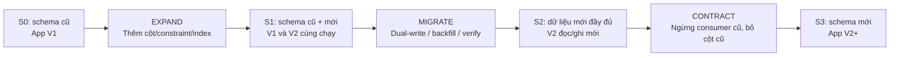
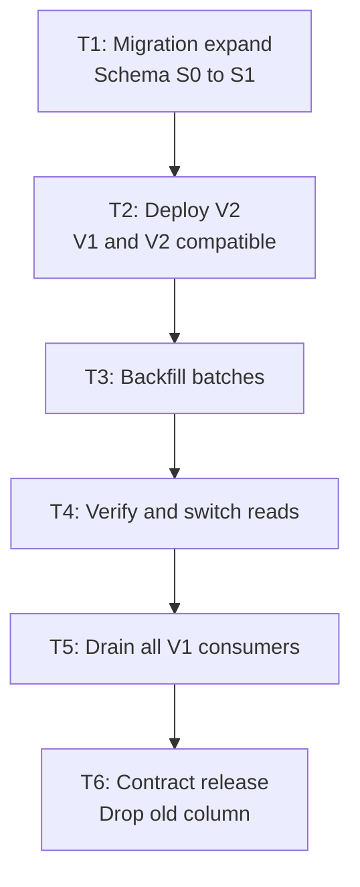
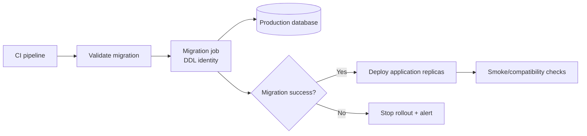

# Nâng cấp lược đồ tương thích với triển khai liên tục

Trong một hệ thống cloud được phát hành thường xuyên, ứng dụng và cơ sở dữ liệu không được nâng cấp cùng một thời điểm. Một đợt rolling deployment có thể chạy đồng thời phiên bản cũ và mới; worker nền có thể còn xử lý message theo contract cũ; mobile app cũ có thể tiếp tục gọi API nhiều tuần. Nếu migration đổi hoặc xóa cột ngay khi phiên bản mới được deploy, instance cũ có thể lỗi, request bị gián đoạn hoặc dữ liệu bị mất.

**Nâng cấp lược đồ tương thích với triển khai liên tục** là kỹ thuật thay đổi schema và dữ liệu theo nhiều bước nhỏ, để các phiên bản ứng dụng đang chạy cùng lúc vẫn làm việc được trong giai đoạn chuyển tiếp. Mục tiêu là phát hành liên tục nhưng vẫn bảo vệ tính đúng đắn của dữ liệu, giới hạn downtime và giữ đường phục hồi rõ ràng.

Trong module **CLOUD_ARCHITECTURE**, chủ đề này kết nối kiến trúc database với compute, CI/CD, độ tin cậy, bảo mật, hiệu năng, chi phí và vận hành. Bài học dùng ví dụ nền tảng cho thuê thiết bị với bảng Reservation. Schema, SQL, thời gian rollout và ngưỡng batch là minh họa; cú pháp, lock behavior, transactional DDL và khả năng rollback phụ thuộc engine/database version cụ thể.

## 1. Vì sao schema change nguy hiểm trong continuous deployment?

Giả sử bảng Reservation ban đầu có cột `customer_name`. Ứng dụng V1 đọc và ghi cột này. Yêu cầu mới muốn tách tên thành `customer_first_name` và `customer_last_name`.

Nếu deploy migration xóa `customer_name` trước, các instance V1 còn chạy sẽ gặp lỗi SQL. Nếu deploy code mới chỉ ghi hai cột mới mà V1 vẫn đọc cột cũ, request cũ có thể nhìn thấy dữ liệu thiếu hoặc cũ. Nếu đổi kiểu dữ liệu lớn trong một transaction, lock có thể chặn truy vấn production.

| Rủi ro | Nguyên nhân | Hậu quả |
| --- | --- | --- |
| Ứng dụng cũ không tương thích | Migration xóa/đổi cột trước khi consumer cũ ngừng dùng | Lỗi request trong rollout |
| Dữ liệu thiếu hoặc lệch | Chỉ ghi schema mới hoặc backfill chưa hoàn tất | Phiên bản cũ và mới nhìn thấy giá trị khác nhau |
| Lock kéo dài | ALTER/UPDATE tác động hàng triệu dòng hoặc index lớn | Latency tăng, connection pool cạn, timeout |
| Migration chạy lặp | Job restart hoặc pipeline retry khi chưa rõ kết quả | DDL/DML lỗi hoặc side effect lặp |
| Rollback không khả thi | Code cũ không đọc schema mới hoặc dữ liệu đã biến đổi mất thông tin | Không thể chỉ deploy binary cũ |
| Replica lag | Migration tạo write burst lớn | Read replica chậm, failover/backup bị ảnh hưởng |
| Consumer nền bị quên | Worker, cron, ETL hoặc BI vẫn dùng schema cũ | Lỗi xuất hiện sau release |

**Database schema là hợp đồng dùng chung giữa các tiến trình**, không phải chi tiết nội bộ của một binary. Trước khi sửa, phải tìm các consumer: API instances, background workers, scheduled jobs, migration scripts, ETL, BI/reporting, admin tool và service khác.

## 2. Nguyên tắc tương thích giữa ứng dụng cũ và mới

Trong rolling deployment, tại một thời điểm có thể tồn tại V1 đọc/ghi schema cũ, V2 đọc schema mở rộng, worker V1 đang xử lý job cũ và consumer mới nhận event theo contract mới. Schema transition cần xác định những tổ hợp nào phải tương thích.

**Backward compatibility** và **forward compatibility** được dùng hơi khác nhau giữa database, API và schema registry. Vì vậy, đừng chỉ ghi “compatible”; hãy trả lời các câu cụ thể: V2 có đọc được schema cũ không? V1 có tiếp tục làm việc khi schema có cột mới không? Consumer cũ có bỏ qua field mới được không?

Một cột mới thường có thể tương thích với V1 nếu V1 dùng danh sách cột tường minh và cột mới không có ràng buộc khiến insert cũ thất bại. Nhưng nếu V1 dùng INSERT không nêu tên cột hoặc bảng mới có NOT NULL column không default, migration có thể phá V1.

### Compatibility matrix

| Schema | App V1 | App V2 |
| --- | --- | --- |
| S0: chỉ có customer_name | Phải hoạt động | Chỉ hoạt động nếu V2 đọc schema cũ |
| S1: customer_name và hai cột mới | Phải hoạt động | Hoạt động, có thể dual-read/dual-write |
| S2: dữ liệu mới đã backfill và verify | V1 vẫn phải hoạt động nếu còn instance | V2 đọc/ghi cột mới |
| S3: customer_name đã bỏ | Không còn tương thích | V2 hoạt động |

Chỉ chuyển S2 sang S3 sau khi chứng minh không còn consumer nào cần cột cũ. Deployment V2 hoàn tất không đồng nghĩa worker, cron, mobile app và job cũ đã biến mất.

## 3. Mô hình Expand–Migrate–Contract

Một mẫu phổ biến để thay đổi schema an toàn là chia thành ba giai đoạn:

1. **Expand:** mở rộng schema theo cách không phá phiên bản cũ.
2. **Migrate:** triển khai ứng dụng tương thích chuyển tiếp và di chuyển/backfill dữ liệu.
3. **Contract:** sau khi không còn consumer cũ, loại bỏ schema cũ và logic tương thích.



### 3.1. Expand

Chỉ thêm cấu trúc tương thích:

- Thêm cột nullable hoặc có default an toàn.
- Tạo bảng mới.
- Thêm index bằng phương thức online/concurrent nếu engine hỗ trợ.
- Thêm view hoặc constraint theo cách không làm request cũ thất bại đột ngột.
- Thêm cột mới nhưng vẫn giữ cột cũ.

Tránh ngay lập tức xóa cột cũ, đổi tên cột trong một bước, thay kiểu dữ liệu có thể truncate hoặc đổi semantics, thêm NOT NULL column mà phiên bản cũ không cung cấp giá trị, hoặc tạo index blocking trên bảng lớn chưa đánh giá lock.

### 3.2. Migrate

Deploy V2 biết đọc schema chuyển tiếp. Khi cần, V2 có thể dual-write sang cột cũ và mới hoặc ghi một nguồn rồi backfill theo quy trình. Dữ liệu cũ được chuyển theo batch có thể resume. Trong giai đoạn này, cần đo số bản ghi còn thiếu và sai lệch giữa hai representation.

### 3.3. Contract

Chỉ contract sau khi mọi application instance cũ đã dừng; worker, cron và consumer cũ đã nâng cấp; backfill hoàn thành và được xác minh; truy vấn/report không còn dùng cột cũ; rollback window theo chính sách đã kết thúc. Contract nên phát hành riêng sau một khoảng quan sát vì đây là bước khó quay lại nhất.

## 4. Ví dụ: tách customer_name thành first/last name

### Schema ban đầu

```sql
CREATE TABLE reservation (
    id BIGINT PRIMARY KEY,
    customer_name VARCHAR(200) NOT NULL,
    start_at TIMESTAMP NOT NULL,
    end_at TIMESTAMP NOT NULL,
    status VARCHAR(30) NOT NULL
);
```

V1 đọc cột customer_name. V2 cần customer_first_name và customer_last_name. Không đổi tên cột ngay.

### Bước 1 — Expand: thêm cột mới

```sql
ALTER TABLE reservation
    ADD COLUMN customer_first_name VARCHAR(100),
    ADD COLUMN customer_last_name VARCHAR(100);
```

Tùy database engine, ADD COLUMN có thể nhanh hoặc gây rewrite/lock. Phải kiểm tra phiên bản và loại cột/default cụ thể trên staging với dữ liệu gần production. Cột nullable giúp V1 tiếp tục insert vì V1 không biết hai cột mới.

Nếu thêm cột có default, database có thể phải cập nhật vật lý nhiều dòng ở một số engine/version. Không giả định mọi DDL metadata-only.

### Bước 2 — Deploy V2 tương thích

V2 đọc bản ghi theo quy tắc: nếu cột mới có giá trị thì dùng first/last; nếu chưa backfill thì tạm đọc customer_name và áp quy tắc chuyển đổi có kiểm soát.

Khi ghi, chiến lược chuyển tiếp có thể giữ cột cũ đồng bộ:

```sql
UPDATE reservation
SET customer_name = :full_name,
    customer_first_name = :first_name,
    customer_last_name = :last_name
WHERE id = :id;
```

Đây là SQL đơn giản. Thực tế phải xác định nguồn chuẩn, transaction, validation, xử lý tên nhiều thành phần, tên không có dấu cách, tên tổ chức và giá trị chỉ có một phần. Không nên tách tên bằng một quy tắc ngôn ngữ duy nhất nếu dữ liệu đa quốc gia.

### Bước 3 — Backfill dữ liệu cũ

Các bản ghi trước expand có thể chưa có hai cột mới. Chuyển dữ liệu theo batch nhỏ, kiểm soát lock, transaction duration và replication lag.

```sql
UPDATE reservation
SET customer_first_name = :derived_first_name,
    customer_last_name = :derived_last_name
WHERE id > :last_id
  AND id <= :next_id
  AND customer_first_name IS NULL
  AND customer_last_name IS NULL;
```

Đây là range batching minh họa. Việc derive tên nên thực hiện ở migration worker/application với quy tắc đã review; không dùng split đơn giản làm mất dữ liệu. Ghi checkpoint sau mỗi batch để resume.

### Bước 4 — Verify

```sql
SELECT COUNT(*) AS missing_new_name
FROM reservation
WHERE customer_first_name IS NULL
   OR customer_last_name IS NULL;
```

So sánh representation cũ/mới trong phạm vi dữ liệu có thể chuyển đổi. Với tên không thể tách tự động, có thể giữ trạng thái cần xử lý hoặc duy trì cột display/full name như nguồn chuẩn lâu hơn.

### Bước 5 — Contract

Sau khi chứng minh mọi consumer đã chuyển sang cột mới, dừng dual-write, loại fallback và cuối cùng bỏ cột cũ trong release riêng. Nếu business vẫn cần full display name, cân nhắc tạo derived field khi đọc hoặc giữ trường đó như representation chính; không xóa chỉ vì sơ đồ đã “sạch”.

## 5. Thứ tự release: migration trước hay application trước?

Với expand–migrate–contract, thứ tự phổ biến:

1. Deploy expand migration trước.
2. Xác minh schema đã có thay đổi additive.
3. Deploy code V2 tương thích schema mở rộng và fallback cho dữ liệu chưa backfill.
4. Chạy backfill và verify.
5. Chuyển read path sang cột mới; quan sát.
6. Xác nhận không còn consumer cũ rồi mới contract.

Không phải mọi thay đổi đều cần cả hai phiên bản chạy lâu. Nhưng nếu deployment có rolling update, nhiều replica hoặc worker nền, phải giả định overlap có thể xảy ra.



Migration thêm cột nullable có thể tương thích với V1, nhưng thêm NOT NULL constraint ngay có thể làm V1 insert thất bại. Trigger đồng bộ có thể tương thích chức năng nhưng gây latency hoặc deadlock. Phải đánh giá cả behavior, lock và hiệu năng.

## 6. Backfill dữ liệu lớn: batch, checkpoint và khả năng resume

Khi bảng có hàng triệu hoặc hàng tỷ dòng, một UPDATE toàn bảng có thể giữ lock lâu, sinh nhiều WAL/redo log, tăng replication lag, gây I/O burst, làm chậm query production hoặc vượt deployment timeout.

### 6.1. Chia batch

```text
lastKey = loadCheckpoint()
while true:
    rows = select next bounded batch
           where key > lastKey and migration_state = PENDING
    if rows is empty:
        break
    transform and update rows in bounded transaction
    verify affected row count
    commit transaction
    persist checkpoint(lastKey of batch)
    observe latency, lock wait, replication lag
    throttle or pause when thresholds are exceeded
```

Pseudocode cần bổ sung chiến lược xử lý bản ghi được cập nhật đồng thời, checkpoint atomicity và retry. Keyset/range pagination thường ổn định hơn OFFSET lớn, nhưng key phải duy nhất và có index phù hợp.

### 6.2. Idempotent batch

Batch có thể chạy lại sau crash. Điều kiện cập nhật nên khiến việc chạy lại không làm hỏng dữ liệu, ví dụ chỉ cập nhật dòng còn migration_state = PENDING hoặc field đích còn thiếu. Lưu checkpoint sau commit dữ liệu; nếu checkpoint được ghi trước rồi transaction dữ liệu rollback, một đoạn dữ liệu có thể bị bỏ qua.

Nếu update data và checkpoint ở hai hệ thống khác nhau, cần thiết kế resume/reconciliation để tìm lại batch đã ghi nhưng chưa checkpoint hoặc ngược lại.

### 6.3. Throttle và pause

Theo dõi lock wait, thời gian transaction, CPU, IOPS, connection saturation, WAL/redo generation, disk usage, replica lag, p95/p99 API latency, số dòng còn lại và tốc độ backfill. Backfill giảm batch hoặc tạm dừng khi tải production vượt ngưỡng. Mục tiêu là không làm suy giảm SLO, không phải chạy nhanh nhất.

## 7. Dual-write, dual-read và nguồn dữ liệu chuẩn

Trong chuyển tiếp, ứng dụng đôi khi phải ghi cả schema cũ và mới. Đây là cách hữu ích nhưng có thể tạo hai nguồn dữ liệu lệch nhau.

### 7.1. Dual-write trong cùng database

Nếu hai cột nằm trong cùng một database transaction, có thể cập nhật cùng lúc. Cần bảo đảm hai giá trị được tạo từ cùng input và validation; không có code path chỉ cập nhật một cột; trigger, stored procedure, batch và admin tool cũng tuân quy tắc; transaction rollback thì cả hai thay đổi cùng rollback.

### 7.2. Dual-write qua hai hệ thống

Nếu ghi database A và database B hoặc database và event broker, không có transaction nguyên tử chung thì có nguy cơ một bên thành công, bên kia thất bại. Dùng transactional outbox, CDC hoặc workflow reconciliation thay vì giả định hai write luôn cùng thành công.

### 7.3. Dual-read

V2 có thể đọc field mới nếu có; nếu chưa có thì fallback field cũ. Cần metric đếm fallback. Khi fallback về 0 trong khoảng quan sát đủ dài, có thể xem xét bỏ logic tương thích. Tránh fallback im lặng mãi mãi vì nó che giấu backfill chưa hoàn tất.

### 7.4. Chọn một source of truth

Trong mọi giai đoạn phải xác định cột cũ hay mới là nguồn chuẩn; nếu hai cột khác nhau bên nào thắng; backfill có ghi đè dữ liệu mới trong lúc chạy không; request V1 ghi sau backfill có làm cột mới stale không; khi ngừng dual-write consumer nào được phép cập nhật dữ liệu. Không có câu trả lời rõ, dual-write chỉ nhân đôi nơi có thể sai.

## 8. DDL online, index và lock behavior

Thay đổi schema gồm thêm cột, đổi type, thêm constraint, tạo index hoặc drop cột. DDL có thể cần metadata lock, table rewrite hoặc scan toàn bảng tùy engine.

### 8.1. Thêm index trên bảng lớn

Một lệnh tạo index bình thường có thể chặn ghi hoặc ảnh hưởng đọc tùy database. Một số engine có tùy chọn concurrent/online index build; đổi lại có thể cần nhiều tài nguyên, thời gian dài và xử lý failure riêng.

Ví dụ PostgreSQL:

```sql
CREATE INDEX CONCURRENTLY idx_reservation_status_created
ON reservation (status, created_at);
```

CREATE INDEX CONCURRENTLY có các ràng buộc riêng, chẳng hạn không chạy trong transaction block thông thường ở PostgreSQL. Nếu thất bại, có thể để lại index invalid cần kiểm tra/dọn. Cú pháp và semantics này không áp dụng cho mọi database.

### 8.2. Thêm constraint

Với dữ liệu lớn, kiểm tra constraint có thể scan bảng và gây tải. Một số engine cho phép thêm constraint chưa validate, sau đó validate riêng; PostgreSQL có NOT VALID cho một số constraint và VALIDATE CONSTRAINT. Cần kiểm tra engine và loại constraint.

Một chiến lược là thêm constraint ở trạng thái phù hợp để chặn dữ liệu sai mới nhưng chưa scan toàn bộ lịch sử nếu engine hỗ trợ; sửa/backfill dữ liệu cũ theo batch; validate constraint trong bước riêng; theo dõi lock và query latency.

### 8.3. Đổi kiểu dữ liệu

Đổi kiểu có thể rewrite dữ liệu, truncate, đổi collation hoặc semantics. Không giả định ALTER COLUMN TYPE luôn online. Với thay đổi lớn, thêm cột mới với kiểu đích, deploy code chuyển tiếp, backfill theo batch, dual-write/CDC theo kế hoạch, verify và chuyển read path, cuối cùng contract xóa cột cũ.

### 8.4. DDL transaction khác nhau giữa engine

PostgreSQL, MySQL, SQL Server, Oracle và managed database có khác biệt về transactional DDL, metadata lock, online operation, timeout và replication. Một số DDL tự commit hoặc không rollback như DML. Chạy thử trên đúng engine/version và ghi rõ lệnh nào có thể rollback, lệnh nào cần roll-forward/repair.

## 9. NOT NULL, default và constraint trong rollout nhiều phiên bản

Nếu V1 chưa biết cột mới, thêm ngay cột NOT NULL có thể thất bại hoặc gây rewrite vì insert cũ không cung cấp giá trị. Chiến lược thường an toàn hơn:

1. Thêm cột nullable hoặc default có hành vi đã hiểu rõ.
2. Deploy code mới luôn ghi giá trị.
3. Backfill các dòng cũ.
4. Kiểm tra không còn NULL.
5. Thêm/validate NOT NULL constraint.
6. Chỉ sau đó mới loại fallback/default nếu chính sách yêu cầu.

Default ở database và default trong application có thể khác nhau. Nếu V1 và V2 tự gán hai giá trị khác nhau, dữ liệu có thể không nhất quán. Hãy xác định default authoritative ở một nơi hoặc đảm bảo mọi writer thống nhất.

## 10. Rename và drop column: coi là breaking change

Đổi tên cột trong một bước khiến code cũ thất bại. Có thể mô phỏng rename bằng expand-contract:

1. Thêm cột mới.
2. Deploy code ghi cả hai và đọc cột mới có fallback.
3. Backfill và verify.
4. Chuyển mọi consumer sang cột mới.
5. Theo dõi usage cột cũ về 0.
6. Drop cột cũ trong release riêng.

Trước khi drop phải kiểm tra query trong code/repository; stored procedure, trigger, view và function; worker, batch job, cron; BI/report/ETL và export; database user/query từ bên ngoài; replica, CDC connector, archive/replay pipeline; backup retention và khả năng phục hồi dữ liệu đã bỏ.

Nếu có audit hoặc lịch sử cần giữ, không xóa dữ liệu chỉ để bỏ một cột. Có thể giữ archived field hoặc chuyển sang bảng lịch sử với ownership rõ.

## 11. Migration dữ liệu thay đổi semantics

Migration đôi khi cần đổi giá trị, không chỉ cấu trúc. Ví dụ đổi status từ PENDING_PAYMENT thành AWAITING_PAYMENT, hợp nhất nhiều trạng thái hoặc đổi đơn vị từ phút sang giây.

Các bước cần:

- Liệt kê tập giá trị cũ và mapping đích.
- Xác định consumer có hard-code enum.
- Thêm khả năng đọc cả giá trị cũ và mới trước khi ghi mới.
- Chuyển producer sang ghi giá trị mới.
- Backfill dữ liệu lịch sử theo batch.
- Chờ consumer cũ hết vòng đời hoặc hỗ trợ giá trị mới.
- Xác minh không còn giá trị cũ trước contract.

Nếu đổi đơn vị, đừng chỉ đổi tên cột. Ví dụ duration từ phút thành giây có thể khiến client cũ tính sai gấp 60 lần dù kiểu dữ liệu vẫn là integer.

Thêm enum value có thể phá client sinh code dùng exhaustive switch. Client cần default/unknown handling hoặc deployment sequence bảo đảm client sẵn sàng trước khi producer phát giá trị mới. Với database enum type, việc thêm/xóa/đổi value phụ thuộc engine và migration tool.

## 12. Rollback hay roll-forward sau khi schema đã thay đổi?

Rollback ứng dụng không tự rollback dữ liệu. Nếu V2 ghi vào cột mới rồi deploy lại V1, V1 có thể bỏ qua thay đổi mới và ghi dữ liệu cũ. Nếu đã drop cột, binary cũ có thể không khởi động.

### 12.1. Mẫu rollback an toàn

- Expand migration được thiết kế additive và có thể để nguyên khi rollback code.
- Trong giai đoạn dual-write, V1 vẫn đọc được schema cũ.
- Nếu V2 lỗi, quay code về V1 nhưng giữ cột mới; không drop schema mới vội.
- Điều tra dữ liệu lệch và chọn roll-forward/repair.
- Chỉ contract sau khi hết rollback window.

### 12.2. Roll-forward

Với migration destructive hoặc dữ liệu đã biến đổi, roll-forward thường an toàn hơn cố chạy down migration. Ví dụ đã chuyển enum và xóa thông tin cũ, migration ngược có thể không biết khôi phục giá trị ban đầu. Tạo migration mới sửa dữ liệu hoặc khôi phục representation lành mạnh hơn.

### 12.3. Down migration

Down migration hữu ích cho thay đổi đơn giản và thực sự đảo ngược được. Nhưng drop column không thể khôi phục giá trị đã mất nếu không có backup; chuyển đổi many-to-one không thể đảo ngược chính xác; DDL rollback có thể tốn thời gian/lock; code mới có thể đã ghi giá trị mà schema cũ không biểu diễn được. Có file down.sql không chứng minh rollback an toàn.

## 13. Migration tool và quản lý thứ tự thực thi

Các công cụ như Flyway, Liquibase hoặc migration framework của ứng dụng có thể quản lý version migration, checksum và lịch sử chạy. Dù dùng công cụ nào, cần quyết định:

- Migration chạy trong pipeline hay bởi job triển khai riêng?
- Ai có quyền DDL production?
- Một migration có được chạy đồng thời bởi nhiều replica không?
- Cách khóa/serialize migration runner.
- Cách xử lý timeout hoặc crash giữa chừng.
- Checksum thay đổi sau khi migration đã apply có bị phát hiện?
- DDL có transaction không, lỗi một phần xử lý ra sao?
- Môi trường dev/staging/prod có cùng thứ tự migration không?

**Không nên để mỗi application instance tự chạy toàn bộ migration khi khởi động** trong deployment nhiều replica, trừ khi framework/tool có cơ chế leader/lock được hiểu rõ. Nhiều instance cùng tranh DDL có thể gây deadlock hoặc áp migration không kiểm soát.

### Migration job riêng

Một pattern là pipeline tạo migration job có quyền DDL, chờ job hoàn tất rồi mới rollout application. Job có log, identity và giới hạn riêng; app runtime chỉ có quyền DML cần thiết.



Migration expand có thể chạy trước code mới; contract chạy sau khi code cũ biến mất và điều kiện đã được kiểm chứng.

### Migration history

Lịch sử migration nên cho biết version, checksum, thời điểm, trạng thái và runner. Không tự sửa lịch sử để che lỗi. Nếu một migration dở dang, xác định DDL/DML đã áp tới đâu rồi tạo recovery procedure có audit.

## 14. CI/CD pipeline cho schema change

Một pipeline an toàn có thể gồm:

1. **Static validation:** cú pháp migration, naming, dangerous operation, dependency/version.
2. **Compatibility check:** schema change có phá code hiện tại hoặc consumer đã đăng ký?
3. **Test với database engine thật:** không chỉ mock repository; dùng version tương đồng production.
4. **Migration performance test:** dataset gần quy mô production, đo lock, duration, I/O và replication.
5. **Deploy expand:** chạy một lần có kiểm soát.
6. **Deploy app:** rolling/canary với schema compatibility.
7. **Backfill job:** throttle, checkpoint, retry và monitoring.
8. **Verify:** NULL count, mismatch count, constraints, query plan và business invariant.
9. **Observe:** lỗi ứng dụng, latency, replica lag, storage và lock.
10. **Contract release:** chỉ khi consumer cũ hết và approval/guardrail đạt.

### Pipeline gate

Không chỉ dựa vào exit code migration. Gate nên kiểm tra postcondition: cột/index/constraint tồn tại và hợp lệ; backfill đạt tiêu chí; không có consumer cũ còn gọi cột/endpoint cũ trong khoảng quan sát; replica lag và latency ở mức cho phép; backup/recovery point hợp lệ trước destructive change; owner phê duyệt contract step.

CI không nên chạy destructive contract sớm. Build V2 có thể tạo migration expand và code tương thích. Contract là release riêng hoặc job có approval vì điều kiện phụ thuộc trạng thái runtime và consumer thực tế, không chỉ source code trên branch.

## 15. Kiểm soát quyền và bảo mật migration

Migration có khả năng thay đổi/xóa toàn bộ dữ liệu. Nên tách quyền:

| Identity | Quyền đề xuất | Mục đích |
| --- | --- | --- |
| Application runtime | SELECT/INSERT/UPDATE/DELETE cần thiết, không có DDL tổng quát | Giảm tác động nếu runtime credential bị lộ |
| Migration runner | DDL và DML migration theo phạm vi được duyệt | Thực hiện thay đổi schema |
| Backfill worker | DML giới hạn trên bảng/column cần chuyển | Chuyển dữ liệu theo batch |
| Backup/restore operator | Quyền backup/restore theo vault và approval | Phục hồi dữ liệu |
| Read-only analyst | SELECT trên view/dataset đã phân loại | Báo cáo, không sửa dữ liệu |

Không nhúng password database trong file migration hoặc image. Dùng secret manager, workload identity và credential ngắn hạn nếu nền tảng hỗ trợ. Log migration không được in token, PII hoặc dữ liệu bản ghi đầy đủ.

### Destructive migration safeguards

- Review bắt buộc khi DROP/TRUNCATE/ALTER TYPE hoặc giảm độ dài.
- Xác nhận backup/recovery point có thể dùng được.
- Row count và scope predicate được kiểm tra trước DELETE/UPDATE lớn.
- Có dry-run hoặc thống kê affected rows nếu phù hợp.
- Có timeout/lock_timeout và cách dừng job an toàn.
- Audit ai khởi tạo, ai duyệt, artifact version nào và thời gian nào.

## 16. Database replication, read replicas và migration

Migration có thể tạo lượng ghi lớn làm replica chậm. Backfill sinh WAL/redo/binlog; tạo index/table rewrite gây I/O burst; replica có thể nhìn thấy dữ liệu chưa chuyển; replica lag tăng làm read-after-write kém hoặc failover khó đạt RPO; backup/snapshot cùng lúc có thể kéo dài hoặc tăng tải.

Trước migration lớn, đặt ngưỡng replication lag, disk usage và query latency để throttle/pause. Nếu ứng dụng đọc từ replica, quyết định khi nào chuyển traffic hoặc chờ replica bắt kịp schema/data. DDL được replicate nhưng locking/behavior có thể khác biệt giữa primary và replica.

Không chạy migration tác động lớn đồng thời với backup full, index rebuild và batch ETL nếu chưa đánh giá cạnh tranh I/O. Lịch workload là một phần thiết kế migration.

## 17. Zero-downtime migration có nghĩa gì?

“Zero downtime” thường là mục tiêu không có gián đoạn quan sát được đối với user trong một thay đổi cụ thể. Nó không bảo đảm không có request retry, tăng latency, lock ngắn, replica lag, dữ liệu tạm chưa đồng nhất hoặc không cần deployment window.

Đặt định nghĩa đo được, ví dụ tỷ lệ lỗi không vượt ngưỡng, p99 không vượt SLO, không mất transaction đã xác nhận và thời gian gián đoạn tối đa bằng 0 hoặc giá trị cho phép. Sau đó đo trong rollout.

Ngay cả DDL online vẫn có thể cần lock ngắn lúc bắt đầu/kết thúc hoặc cạnh tranh metadata lock. Query dài đang giữ transaction có thể làm DDL chờ. DDL chờ lock có thể tạo hàng đợi request phía sau; một ALTER nhanh về execution time vẫn có thể gây outage do waiting.

Theo dõi lock wait, transaction age, deadlock và số connection đang chờ. Dùng lock timeout phù hợp để DDL fail nhanh thay vì chờ vô hạn, nhưng chuẩn bị retry và runbook khi lệnh bị hủy.

## 18. Tránh migration đồng thời và race condition

Hai migration runner không nên đồng thời áp thay đổi không phối hợp. Migration job cần lock/serialization ở phạm vi database hoặc deployment system.

Backfill cũng có race với application writer:

1. Backfill đọc bản ghi cũ.
2. V2 cập nhật field mới theo giá trị mới.
3. Backfill ghi đè field mới bằng kết quả derive cũ.

Giải pháp gồm conditional update chỉ khi row chưa có giá trị mới; dùng version/updated_at và compare-and-set; chia batch theo row lock ngắn; chọn nguồn chuẩn và quy tắc conflict; có checkpoint/reconciliation sau khi hoàn tất.

```sql
UPDATE reservation
SET normalized_status = :mapped_status
WHERE id = :id
  AND normalized_status IS NULL
  AND status = :observed_old_status;
```

Nếu application đã đổi status trong lúc backfill, điều kiện không còn đúng và row không bị ghi đè. Worker phải đọc lại, phân loại và thử với trạng thái mới theo mapping. Điều kiện compare-and-set cần index/transaction phù hợp và xử lý số dòng cập nhật bằng 0.

## 19. Thay đổi quan hệ: split table, merge table và foreign key

### 19.1. Tách bảng

Nếu Reservation chứa cả thông tin khách và dữ liệu thanh toán, có thể tách Payment thành bảng riêng:

1. Tạo bảng Payment mới, FK/index phù hợp.
2. Deploy code ghi dữ liệu mới theo transaction hoặc outbox/workflow.
3. Backfill payment records từ bảng cũ.
4. Dual-read/fallback và so sánh.
5. Chuyển truy vấn và quyền truy cập.
6. Dừng ghi field cũ, contract sau.

Nếu dữ liệu tách sang service/database khác, không còn một transaction ACID chung đơn giản. Cần quyết định consistency, outbox/inbox và saga/reconciliation.

### 19.2. Thêm foreign key

Thêm FK vào bảng lớn có thể scan/lock. Một số engine hỗ trợ validate constraint riêng. Trước khi thêm, kiểm tra orphan rows; backfill/repair dữ liệu không hợp lệ; tạo index phù hợp ở cột tham chiếu; đánh giá lock; có kế hoạch deploy code không tạo orphan trong lúc migration.

### 19.3. Merge bảng

Gộp bảng có thể đổi ownership, cardinality và query pattern. Cần mapping khóa, xử lý duplicate, collision, audit/retention và khả năng chạy cả đường đọc cũ/mới. Không xóa bảng nguồn trước khi đối soát tổng số dòng, quan hệ và các consumer phụ thuộc.

## 20. Quan sát migration trong production

Migration phải có telemetry giống một workload production:

| Nhóm | Chỉ số cần theo dõi | Vì sao |
| --- | --- | --- |
| Tiến độ | Rows processed/remaining, checkpoint, batch duration | Biết migration có tiến triển |
| Database health | CPU, IOPS, disk, connection saturation | Tránh migration chiếm tài nguyên |
| Lock | Lock wait, blocked query, deadlock, transaction age | Phát hiện request bị chặn |
| Replication | WAL/redo volume, replica lag, apply rate | Bảo vệ read consistency và failover |
| Application | Error rate, p95/p99, timeout, pool wait | Xác nhận user-facing SLO |
| Data quality | NULL, mismatch, duplicate, orphan, invariant violation | Chứng minh dữ liệu mới đúng |
| Migration control | Job status, runner identity, artifact version, checksum | Audit và tránh chạy nhầm |
| Recovery | Backup age, restore test status, recovery point | Biết destructive step có đường bảo vệ |

Log batch nên ghi range/key, số dòng xử lý, thời lượng, checkpoint và error category; tránh log toàn bộ row payload. Alert khi không có tiến độ, replica lag vượt ngưỡng, lock chờ kéo dài hoặc data mismatch không giảm.

## 21. Case study: chuyển Reservation sang state model mới

### Bối cảnh

Hệ thống hiện có cột status dạng string với giá trị HELD, PAID, CANCELLED. Yêu cầu mới phân biệt HELD, PAYMENT_PENDING, CONFIRMED, CANCEL_PENDING, CANCELLED và EXPIRED. Các phiên bản cũ vẫn chạy trong rolling deployment và một worker cũ còn xử lý payment event.

### Kế hoạch migration

**Expand**

- Giữ cột status cũ.
- Thêm cột state_code hoặc bảng state transition theo thiết kế.
- Thêm index phục vụ query mới theo phương thức online nếu engine hỗ trợ.
- Tạo mapping từ state cũ sang state mới.

**Application transition**

- V2 hiểu cả trạng thái cũ và mới.
- Khi nhận trạng thái cũ, chuyển sang representation chuẩn mới.
- Khi ghi, duy trì cột cũ theo mapping tương thích trong giai đoạn chuyển tiếp.
- Worker payment được nâng cấp trước khi producer phát giá trị mới.

**Backfill**

- Duyệt reservation theo ID range.
- Chuyển PAID thành CONFIRMED theo mapping đã duyệt.
- HELD có thể cần xem expires_at để phân loại còn hiệu lực hay đã EXPIRED; không mapping mù theo string.
- Ghi checkpoint, throttle và kiểm tra số lượng từng loại.

**Verify**

- So sánh count theo trạng thái.
- Kiểm tra transition hợp lệ và reservation đã hết hạn.
- Đối chiếu payment provider/ledger cho trạng thái CONFIRMED.
- Đo fallback từ V2 về status cũ và usage của worker cũ.

**Contract**

- Khi mọi consumer dùng state_code và không còn đọc status cũ, bỏ dual-write.
- Sau rollback window và phê duyệt, drop cột cũ trong release riêng.

| Giá trị cũ | Giá trị mới dự kiến | Cần xác minh |
| --- | --- | --- |
| HELD | HELD hoặc EXPIRED | So sánh expires_at và thời điểm hiện tại theo chính sách |
| PAID | CONFIRMED | Đối soát payment capture thành công |
| CANCELLED | CANCELLED | Xác định có refund pending hay đã refund |

Không tự động map nếu cần thông tin ngoài cột status. Những row không đủ thông tin phải vào exception report để xử lý theo quy tắc nghiệp vụ.

## 22. Những anti-pattern thường gặp

1. Deploy code mới và drop column trong cùng release. Rolling deploy có thể còn instance cũ; cần expand trước, contract sau.
2. Thêm NOT NULL column khi ứng dụng cũ chưa ghi giá trị. Cần nullable/default an toàn, deploy writer, backfill rồi validate constraint.
3. Backfill toàn bảng trong một transaction. Có thể tạo lock, log và replication lag lớn; chia batch, checkpoint và throttle.
4. Dùng dual-write nhưng không có source of truth. Hai cột có thể lệch; định nghĩa conflict rule và đo mismatch.
5. Dùng down migration để hứa rollback. Dữ liệu đã xóa hoặc chuyển đổi mất thông tin có thể không đảo ngược.
6. Chỉ kiểm tra API instance, quên worker và reporting. Consumer cũ có thể lỗi sau rollout.
7. Migration chạy từ mọi replica khi startup. Nhiều runner tranh DDL; dùng job/lock có kiểm soát.
8. Coi DDL online là không có lock. Vẫn có lock phase, resource overhead và metadata contention.
9. Không test trên quy mô dữ liệu gần production. Migration nhanh ở staging nhỏ nhưng có thể gây outage ở bảng lớn.
10. Contract ngay khi V2 đã deploy. Cần chờ consumer cũ, dữ liệu, report và rollback window hoàn tất.
11. Dùng timestamp hoặc ID range mà không xét record cập nhật đồng thời. Backfill có thể ghi đè dữ liệu mới.
12. Không lưu migration history và artifact checksum. Khó biết môi trường đã ở schema version nào.

## 23. Quy trình thiết kế schema migration tương thích

1. **Inventory consumer và dependency:** tìm application, worker, cron, ETL, report, stored procedure, trigger và tool bên ngoài; gắn owner/version.
2. **Viết compatibility matrix:** liệt kê schema versions, app versions và tổ hợp phải hoạt động trong rolling deployment, rollback window và job tồn tại dài.
3. **Phân loại thay đổi:** additive hay destructive; có rewrite/lock không; dữ liệu có mất thông tin không; cần online index/backfill hay multi-release transition?
4. **Thiết kế expand:** thêm cột/bảng/index/constraint theo cách V1 vẫn hoạt động; đánh giá default, nullable, transaction, lock timeout và replica.
5. **Deploy code chuyển tiếp:** V2 đọc cũ/mới khi cần, ghi theo quy tắc rõ, có metric fallback/mismatch.
6. **Backfill và verify:** batch nhỏ, idempotent, checkpoint, throttle; kiểm tra count, null, mismatch, orphan và invariant.
7. **Drain consumer cũ:** chờ instance, worker, cron, report, scheduled task và integration dùng schema mới.
8. **Contract có kiểm soát:** tách release destructive; backup/recovery point, approval, lock timeout, runbook và postcondition rõ.
9. **Dọn compatibility code:** loại dual-write, fallback, feature flag và metric tạm; cập nhật schema docs/ERD/ownership.

## 24. Bài tập thực hành

### Bài tập A — Thêm cột NOT NULL

V1 insert vào bảng Reservation nhưng không biết cột booking_source. Yêu cầu mới bắt buộc cột này.

**Câu hỏi:** làm sao thêm constraint mà V1 vẫn chạy trong rollout?

**Gợi ý:** expand nullable/default an toàn; deploy V2 ghi giá trị; backfill V1 data; kiểm tra NULL và validate NOT NULL; chỉ contract khi không còn writer cũ. Xác minh DDL/lock theo engine.

### Bài tập B — Chuyển kiểu dữ liệu

price hiện là integer theo đơn vị đồng; hệ thống mới muốn lưu amount decimal và currency riêng.

**Câu hỏi:** làm sao tránh V1 đọc số mới sai đơn vị?

**Gợi ý:** thêm amount/currency field; định nghĩa mapping và rounding; code chuyển tiếp đọc/ghi có source of truth; backfill; so sánh tổng tiền; không đổi đơn vị ngay trên cùng field; contract sau khi consumer nâng cấp.

### Bài tập C — Tạo index trên bảng lớn

Bảng reservation có hàng trăm triệu dòng. Tạo index đồng bộ làm query ghi tăng latency.

**Câu hỏi:** cần thử và theo dõi gì?

**Gợi ý:** kiểm tra online/concurrent index support và semantics theo engine/version; thử trên dữ liệu đại diện; monitor lock, I/O, WAL, replica lag, query latency; đặt timeout và runbook xử lý invalid index.

### Bài tập D — Rollback sau dual-write

V2 ghi status_code mới và cột status cũ theo mapping. Sau 30 phút phát hiện một trạng thái mới không biểu diễn được ở cột cũ.

**Câu hỏi:** có thể quay về V1 không?

**Gợi ý:** nếu cột cũ không biểu diễn state mới, rollback binary có thể làm mất semantics. Xác định trạng thái mới đã phát sinh chưa, tạm dừng producer/traffic thích hợp, roll-forward mapping hoặc compatibility layer; không giả định down migration giải quyết được.

### Tiêu chí tự đánh giá

| Tiêu chí | Bằng chứng cần có |
| --- | --- |
| Compatibility | Matrix schema/app versions và consumer inventory |
| Data correctness | Mapping, invariants, count/mismatch checks |
| Operational safety | Batch, checkpoint, throttle, lock/lag metrics |
| Recovery | Rollback/roll-forward decision và backup/PITR |
| Security | DDL identity riêng, approval và audit |
| Deployment | Pipeline gate, migration job và contract release riêng |
| Verification | Test trên engine/version và dataset tương tự production |

## 25. Checklist review trước production

- Đã liệt kê application, worker, cron, report và external consumer?
- Có compatibility matrix cho schema cũ/mới và app cũ/mới?
- Migration expand có thực sự additive và an toàn với insert/query cũ?
- Có hiểu lock, table rewrite, transactional DDL và engine/version cụ thể?
- Backfill có batch, checkpoint, idempotency, throttle và resume?
- Có source of truth, dual-write/dual-read conflict rule rõ?
- Có đo row count, NULL, mismatch, orphan và business invariant?
- Có theo dõi p95/p99, lock wait, WAL/redo, disk và replica lag?
- Có migration runner riêng, serialization và migration history?
- Credential DDL có tách khỏi application runtime?
- Rollback có giữ schema mới và dữ liệu có thể khôi phục?
- Contract có là release riêng sau khi consumer cũ hết?
- Có backup/PITR, restore test và runbook trước destructive step?
- Có audit, owner và approval cho DROP/TRUNCATE/ALTER TYPE?
- Có kế hoạch quan sát và dọn compatibility code sau migration?

Nâng cấp schema tương thích với triển khai liên tục là quá trình **phối hợp vòng đời dữ liệu với vòng đời ứng dụng**. Expand–migrate–contract, compatibility matrix, batch backfill, verification và contract release giúp các phiên bản cũ/mới cùng hoạt động trong giai đoạn chuyển tiếp. Khi migration được coi là một workload production có quyền hạn, SLO, telemetry, recovery và owner rõ ràng, nhóm có thể thay đổi cấu trúc dữ liệu thường xuyên mà vẫn giữ tính đúng đắn và khả năng phục hồi của hệ thống cloud.
