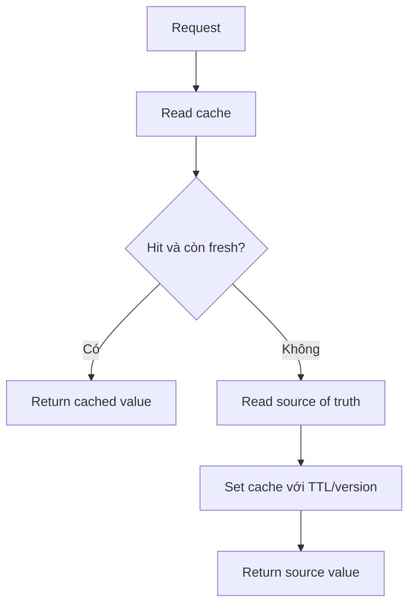
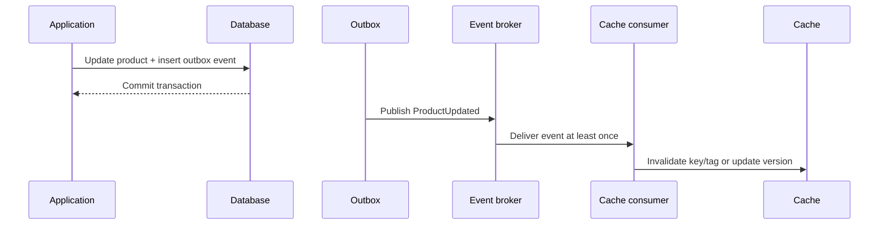
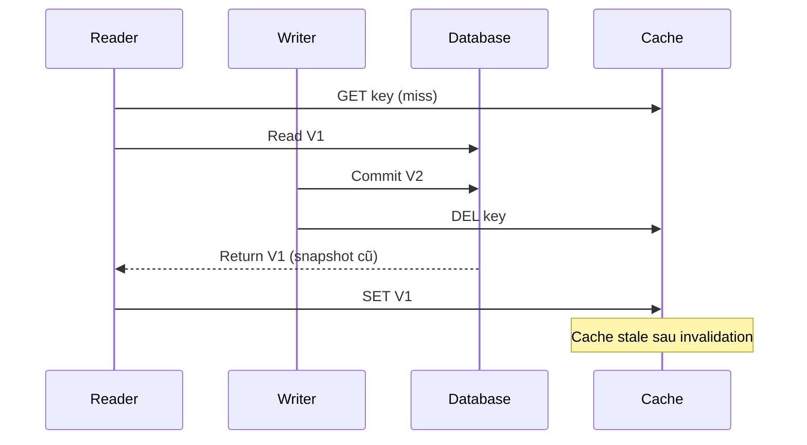
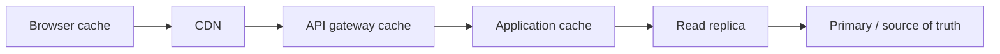

# TTL, vô hiệu hóa và yêu cầu về độ mới dữ liệu

## 1. Vì sao TTL và invalidation quan trọng?

Cache lưu bản sao dữ liệu ở nơi đọc nhanh hơn hoặc gần người dùng hơn, giúp giảm latency và tải cho nguồn có thẩm quyền. Nhưng bản sao có thể cũ ngay khi dữ liệu gốc thay đổi. Do đó, kiến trúc cache phải xác định dữ liệu nào được phép cũ trong bao lâu và cách đưa bản sao về trạng thái phù hợp.

Ba khái niệm cần thiết kế cùng nhau:

- **TTL (Time To Live):** khoảng thời gian một cache entry được xem là còn hiệu lực theo policy. Hết TTL, entry thường trở thành stale hoặc đủ điều kiện bị xóa; thời điểm xóa thực tế tùy cache engine.
- **Invalidation (vô hiệu hóa):** hành động làm một entry hoặc nhóm entry không còn được dùng như dữ liệu hợp lệ, thường sau khi nguồn thay đổi.
- **Data freshness (độ mới dữ liệu):** mức độ dữ liệu cache phản ánh trạng thái hiện tại có thẩm quyền. Freshness có thể mô tả bằng tuổi dữ liệu, version, thời điểm cập nhật hoặc giới hạn staleness nghiệp vụ.

TTL tạo giới hạn thời gian cho một bản sao; invalidation phản ứng với thay đổi cụ thể. Chỉ dựa vào TTL có thể để dữ liệu vừa thay đổi tiếp tục hiển thị cho tới hết hạn. Chỉ dựa vào invalidation có thể bỏ sót event, thất bại khi cache store mất kết nối hoặc không xóa được mọi biến thể của key.

Trong module **CLOUD_ARCHITECTURE**, chương **Bộ nhớ đệm** xem freshness là thuộc tính kiến trúc cần cân bằng với latency, availability, khả năng mở rộng, chi phí và tính đúng đắn nghiệp vụ.

Sau bài học, người học có thể phân biệt TTL, expiration, eviction, invalidation và freshness; chọn TTL theo nghiệp vụ; so sánh cache patterns; thiết kế invalidation theo key/tag/version/event; xử lý race và cache stampede; đồng thời xây dựng telemetry và test cho freshness.

## 2. Phân biệt TTL, expiration, eviction và invalidation

| Thuật ngữ | Ý nghĩa | Ví dụ |
| --- | --- | --- |
| **TTL** | Thời lượng entry được xem là còn hiệu lực | Cache sản phẩm trong 5 phút |
| **Expiration** | Entry đạt điều kiện hết hạn theo TTL hoặc mốc tuyệt đối | expires_at đã qua |
| **Eviction** | Cache store loại entry để giải phóng bộ nhớ hoặc theo policy | LRU loại key ít dùng |
| **Invalidation** | Chủ động đánh dấu/xóa entry vì dữ liệu nguồn đã đổi | Update giá làm vô hiệu cache |
| **Refresh** | Lấy dữ liệu mới và thay entry hiện tại | Đọc lại từ database |
| **Staleness** | Mức dữ liệu cache cũ so với nguồn có thẩm quyền | Bản cache chậm 20 giây |
| **Freshness** | Mức dữ liệu đáp ứng yêu cầu mới nhất chấp nhận được | Inventory phải revalidate |

Hết TTL không nhất thiết đồng nghĩa entry bị xóa ngay khỏi RAM. Nhiều cache chỉ kiểm tra thời hạn khi đọc hoặc dọn entry theo tác vụ nền. Eviction cũng có thể xảy ra trước TTL nếu bộ nhớ đầy.

**TTL là policy hiệu lực; eviction là quản lý tài nguyên; invalidation là phản ứng với thay đổi.**

## 3. Xác định freshness bằng yêu cầu nghiệp vụ

Không có một TTL tốt cho toàn bộ hệ thống. Hãy hỏi:

- Dữ liệu thay đổi với tần suất nào?
- Người dùng chịu stale trong vài giây, vài phút hay không được stale?
- Dữ liệu dùng để hiển thị hay để quyết định side effect?
- Event thay đổi có được phát tin cậy không?
- Nếu event bị mất, TTL tối đa có giới hạn được staleness không?
- Khi cache không truy cập được, có thể đọc nguồn trực tiếp không?
- Có thể phục vụ stale tạm thời khi nguồn chính lỗi không?
- Có yêu cầu read-your-writes sau khi người dùng cập nhật không?

| Dữ liệu | Freshness kỳ vọng | Policy có thể chọn |
| --- | --- | --- |
| Nội dung bài viết public | Có thể stale vài phút | CDN TTL + purge khi publish |
| Product description | Vài chục giây hoặc phút | Cache-aside + event invalidation |
| Price/discount | Ngắn hơn, phụ thuộc campaign | Versioned cache + invalidation |
| Inventory | Rất nhạy với oversell | Cache để gợi ý; revalidate tại nguồn |
| Booking/payment status | Cần trạng thái có thẩm quyền | Đọc nguồn mạnh hoặc revalidate |
| User profile | Read-your-writes quan trọng | Invalidate sau commit hoặc bypass |
| Feature/config flags | Phụ thuộc phạm vi tác động | TTL ngắn, version/event |
| Analytics aggregate | Có thể trễ phút/giờ | Batch refresh + watermark |

Dữ liệu chỉ để hiển thị có thể stale mà không gây hại lớn; cùng dữ liệu đó nếu dùng xác nhận giao dịch có thể vi phạm invariant. Hãy phân loại theo operation và hậu quả.

### 3.1. Freshness SLO

Ví dụ SLO:

- 99% product detail phản ánh thay đổi đã publish trong 60 giây.
- 99,9% profile update được chính người dùng nhìn thấy ngay sau thao tác thành công.
- Inventory cache không được dùng làm bằng chứng duy nhất để xác nhận reservation.
- Dashboard analytics có thể chậm tối đa 15 phút và hiển thị thời điểm cập nhật gần nhất.

TTL 60 giây không tự động chứng minh freshness trong 60 giây nếu event delivery, refresh và replica lag cộng thêm thời gian. SLO phải mô tả population, cửa sổ đo, nguồn sự thật và cách đo.

## 4. Chọn TTL

TTL dài thường tăng hit ratio và giảm tải nguồn nhưng kéo dài staleness. TTL ngắn giới hạn tuổi entry nhưng làm tăng miss, refresh traffic, chi phí và nguy cơ stampede.

Các yếu tố quyết định:

1. Tốc độ thay đổi của dữ liệu.
2. Hậu quả nếu client đọc stale.
3. Khả năng refresh và capacity của source.
4. Chi phí query hoặc API call khi miss.
5. Replication lag của nguồn đọc.
6. Độ tin cậy của event invalidation.
7. Geography và vị trí cache.
8. Kích thước entry, key cardinality và memory pressure.

### 4.1. TTL jitter

Nếu hàng triệu key được tạo cùng lúc với TTL đúng 300 giây, chúng có thể hết hạn cùng thời điểm. Thêm jitter để phân tán expiry:

```text
effective_ttl = base_ttl × random(0.8, 1.2)

Ví dụ:
base_ttl = 300 seconds
effective_ttl nằm trong khoảng 240–360 seconds
```

Jitter giảm đồng bộ expiry giữa các key. Với freshness SLO nghiêm ngặt, TTL tối đa cộng thời gian refresh vẫn phải nằm trong budget.

### 4.2. TTL theo freshness class

| Class | Ví dụ | Cách quản lý |
| --- | --- | --- |
| Static | Asset immutable/versioned | TTL dài, version trong URL/key |
| Slowly changing | Catalog metadata | TTL trung bình, event invalidation |
| Frequently changing | Price/config | TTL ngắn, version hoặc push invalidation |
| Critical mutable | Inventory/payment | Bypass/revalidate nguồn có thẩm quyền |
| Aggregated | Analytics/report | Refresh schedule, watermark |

Đây là khung phân loại, không phải TTL mặc định. Duration phải dựa traffic, source capacity và business SLO.

## 5. TTL tương đối, tuyệt đối và sliding expiration

- **Relative TTL:** bắt đầu khi entry được tạo/cập nhật; phù hợp cache-aside.
- **Absolute expiration:** entry hết hạn tại mốc cố định; hữu ích với quote, token hoặc promotion.
- **Sliding expiration:** mỗi lần truy cập có thể gia hạn; entry nóng có thể tồn tại lâu.
- **Idle timeout:** hết hạn sau một khoảng không truy cập.
- **Maximum lifetime:** giới hạn tuổi tuyệt đối dù entry liên tục được đọc.

Sliding expiration không nên dùng một mình cho dữ liệu cần giới hạn tuổi. Nếu key luôn nóng, nó có thể không bao giờ hết hạn và không được refresh. Có thể kết hợp idle timeout với max lifetime.

## 6. Cache-aside và xử lý cache miss

Cache-aside (lazy loading) là pattern phổ biến:

1. Application đọc cache theo key.
2. Nếu hit và entry còn fresh, trả dữ liệu.
3. Nếu miss/stale, đọc database hoặc nguồn có thẩm quyền.
4. Ghi kết quả vào cache với TTL/version.
5. Trả dữ liệu cho client.



Ưu điểm: đơn giản, chỉ cache dữ liệu được truy cập, application kiểm soát policy. Hạn chế: miss tăng latency; nhiều request miss cùng key tạo stampede; update path có thể quên invalidation; cache outage có thể dồn tải xuống database.

### 6.1. Cache miss đồng thời

Nếu 1.000 request cùng hỏi key vừa hết hạn, tất cả có thể query database. Cách giảm:

- **Single-flight/request coalescing:** một request refresh, request khác chờ kết quả chung.
- **Distributed lock:** chỉ một worker refresh key trong thời gian lease.
- **Stale-while-revalidate:** trả stale trong giới hạn cho phép và refresh nền.
- **TTL jitter:** phân tán thời điểm hết hạn.
- **Negative caching:** cache kết quả không tồn tại trong thời gian ngắn.

Lock cần lease và ownership rõ; lock bị mất hoặc hết hạn trong lúc refresh có thể tạo hai loader. Không dùng cache lock làm cơ chế transaction nghiệp vụ.

## 7. Write patterns và consistency của cache

### 7.1. Cache-aside khi ghi

Application ghi database trước, sau đó invalidate cache:

1. Commit thay đổi vào database.
2. Xóa cache key hoặc tăng version.
3. Request sau đó miss và load dữ liệu mới.

Ưu điểm: database là nguồn có thẩm quyền, cache tái tạo được. Rủi ro: DB commit thành công nhưng process chết trước invalidation; entry cũ vẫn được phục vụ tới TTL hoặc lần invalidation tiếp.

### 7.2. Write-through

Application ghi qua cache layer; cache layer cập nhật data store theo semantics đồng bộ trước khi xác nhận.

Ưu điểm: read sau write có thể hit cache đã cập nhật. Hạn chế: write path phụ thuộc cache và storage; cần xử lý lỗi giữa hai hệ thống. Write-through không tự động là distributed transaction.

### 7.3. Write-behind/write-back

Application ghi cache trước, cache layer flush xuống nguồn sau theo batch/async.

Ưu điểm: write latency có thể thấp và gom nhiều cập nhật. Rủi ro: cache node mất dữ liệu trước flush, backlog tăng, thứ tự cập nhật bị đảo và client nhận success trước khi dữ liệu bền vững. Chỉ dùng khi nghiệp vụ chấp nhận độ trễ ghi xuống nguồn và durability/replay đã được chứng minh.

### 7.4. Read-through và refresh-ahead

- **Read-through:** cache provider tự đọc nguồn khi miss.
- **Refresh-ahead:** làm mới key phổ biến trước expiry dựa trên access pattern.

Refresh-ahead giảm miss nhưng có thể refresh dữ liệu không còn được dùng. Cần dự báo lợi ích, jitter và giới hạn concurrency.

| Pattern | Đường đọc | Đường ghi | Đánh đổi |
| --- | --- | --- | --- |
| Cache-aside | App đọc cache, miss thì đọc nguồn | App ghi DB rồi invalidate | Đơn giản, cần xử lý invalidation gap |
| Read-through | Cache tự load khi miss | Tùy write pattern | Abstraction đơn giản |
| Write-through | Cache đọc | Ghi cache và nguồn đồng bộ theo implementation | Cache gắn chặt write path |
| Write-behind | Cache đọc | Ghi cache rồi flush async | Nhanh nhưng có rủi ro durability/order |
| Refresh-ahead | Cache đọc entry đã refresh | Trigger refresh nền | Giảm miss, tốn traffic nền |

## 8. Invalidation: xóa cái gì?

Invalidation có thể xóa một key, nhiều key, nhóm theo tag hoặc làm phiên bản cũ không còn được tham chiếu.

### 8.1. Theo key

Sau khi cập nhật sản phẩm 42, xóa key product:42. Cách này rõ ràng nhưng một entity có thể có nhiều representation: detail, list, search result, locale, currency hoặc price list.

### 8.2. Theo tag/dependency

Entry gắn các tag như product:42, category:shoes, tenant:abc. Khi sản phẩm đổi, invalidate các entry mang tag phù hợp.

Ưu điểm: quản lý nhiều representation. Hạn chế: tag index tốn metadata; fan-out invalidation có thể lớn; xóa tag rộng dễ tạo stampede.

### 8.3. Versioned key

Đưa version/generation vào key:

```text
product:42:v17
product:42:v18
```

Khi dữ liệu thay đổi, tăng version từ nguồn có thẩm quyền. Reader dùng version mới nên entry cũ không còn được tham chiếu và tự hết hạn về sau.

Ưu điểm: tránh xóa hàng loạt key. Hạn chế: cần quản lý version nhất quán; đọc version cũ vẫn có thể chọn key cũ; entry cũ cần cleanup để không chiếm memory mãi.

### 8.4. Key design

Key phải có các dimension ảnh hưởng kết quả:

```text
product:{tenant}:{productId}:{locale}:{currency}:{priceListVersion}
```

Nếu thiếu tenant/locale/currency, cache có thể trả sai dữ liệu hoặc lộ dữ liệu giữa tenant. Nếu thêm quá nhiều dimension không cần thiết, cardinality tăng nhanh. Tránh wildcard delete diện rộng nếu cache engine không bảo đảm thao tác đó an toàn và hiệu quả.

## 9. Event invalidation và transactional outbox

Khi nguồn thay đổi, service phát event để cache consumer xóa hoặc cập nhật entry.



Nếu application commit DB rồi publish event trực tiếp, process có thể chết giữa hai bước: DB đã đổi nhưng event chưa gửi. Transactional outbox ghi business update và event record trong cùng transaction. Publisher riêng đọc outbox và gửi broker; có thể gửi lặp nên consumer phải idempotent.

Outbox thu hẹp khoảng trống giữa commit và phát event nhưng không làm invalidation tức thời tuyệt đối. Cần đo delivery lag, retry, dead-letter và giữ TTL/reconciliation làm lớp bảo vệ cuối.

### 9.1. Event ordering và version

Event version 18 có thể đến trước version 17. Consumer không nên ghi đè cache bằng version cũ sau khi đã thấy version mới. So sánh sequence/version và chỉ áp dụng bản mới hơn.

### 9.2. Freshness budget

```text
Observed staleness ≈
    source commit to outbox publish
  + broker delivery lag
  + consumer processing delay
  + cache invalidation/update time
  + subsequent read/cache fill behavior
```

Nếu freshness SLO là 60 giây, chỉ đặt TTL 60 giây có thể không đủ. Phải chia budget cho event lag, refresh và replica lag.

## 10. Race condition giữa update và cache fill

Một lỗi khó phát hiện xảy ra khi read miss và write update cạnh tranh:

1. Reader A cache miss, đọc database và nhận giá trị cũ V1.
2. Writer B commit giá trị mới V2.
3. Writer B invalidate cache.
4. Reader A hoàn tất query cũ và set V1 vào cache.
5. Request tiếp theo đọc V1 dù invalidation đã chạy sau commit.



Xóa key sau commit là chưa đủ nếu reader cũ có thể set lại stale data.

Cách giảm:

- **Version check:** reader ghi kèm source version.
- **Generation key:** writer tăng generation; reader set vào namespace của generation đọc được.
- **Conditional set:** chỉ ghi cache nếu generation vẫn khớp, với primitive atomic.
- **Read-after-write bypass:** người dùng vừa ghi được đọc nguồn hoặc dùng session version.
- **Single-flight/lock:** giảm loader cạnh tranh nhưng phải phối hợp update path.

TTL ngắn chỉ giảm thời gian tồn tại, không loại bỏ race. Chọn kỹ thuật dựa trên atomic primitive của cache store; check-then-set rời rạc vẫn có race.

## 11. Cache stampede, thundering herd và hot key

- **Cache stampede:** nhiều request cùng refresh key khi key hết hạn hoặc bị invalidation.
- **Thundering herd:** nhiều request/worker cùng gọi dependency sau một sự kiện.
- **Hot key:** một key nhận traffic lớn hơn hẳn phần còn lại, gây bottleneck ở node/shard hoặc lock.

| Biện pháp | Cách hoạt động | Đánh đổi |
| --- | --- | --- |
| TTL jitter | Phân tán expiry | Không bảo đảm single refresh |
| Single-flight | Một loader, request khác chờ | Có thể tăng latency chờ |
| Distributed lock | Một owner refresh | Cần lease và xử lý owner chết |
| Stale-while-revalidate | Trả stale trong giới hạn, refresh nền | Chỉ phù hợp data class được stale |
| Refresh-ahead | Làm mới trước expiry | Tốn background capacity |
| Request rate cap | Giới hạn loader/downstream | Có thể từ chối request |
| Key sharding/replica | Phân tán hot-key reads | Write/update phức tạp hơn |

### 11.1. Stale-while-revalidate

Entry có thể có hai mốc:

- fresh_until: thời điểm hết giai đoạn fresh.
- stale_until: thời điểm cuối cùng được phép trả stale.

Hành vi:
1. Trước fresh_until: trả ngay.
2. Từ fresh_until tới stale_until: có thể trả stale và kích hoạt một refresh nền.
3. Sau stale_until: phải chờ nguồn hoặc trả lỗi/degraded response.

Không dùng cho số dư, quyền, inventory hoặc payment nếu stale dẫn tới quyết định sai.

## 12. Negative caching

Negative caching lưu kết quả “không tìm thấy” trong khoảng ngắn để tránh query lặp cho cùng key không tồn tại. Ví dụ username ngẫu nhiên hoặc product ID sai có thể tạo nhiều database lookup.

Rủi ro:

- Record mới được tạo nhưng negative entry vẫn tồn tại.
- Attacker tạo nhiều key ngẫu nhiên làm cache cardinality tăng.
- Không phân biệt 404 thật với lỗi database tạm thời.

Không cache timeout, 5xx hoặc lỗi authorization như “not found” nếu điều đó che giấu lỗi hoặc tạo data leak. Khi tạo record mới, invalidate negative cache tương ứng.

## 13. Nhiều tầng cache và freshness chain

Một request có thể đi qua browser cache, CDN, API gateway, application cache, distributed cache và database read replica. Freshness đầu cuối không đơn giản bằng TTL nhỏ nhất nếu một tầng refresh từ tầng khác đang stale.

Ví dụ:
- CDN TTL 60 giây.
- Gateway cache TTL 30 giây.
- Application cache TTL 5 phút.
- Origin đọc replica có lag 2 phút.

CDN miss sau 60 giây vẫn có thể nhận dữ liệu cũ từ application cache/replica.



Cần xác định mỗi tầng lấy dữ liệu từ đâu, khi nào revalidate và version/timestamp có được truyền xuyên tầng không.

### 13.1. HTTP cache semantics

- Cache-Control max-age: thời gian response được xem là fresh.
- s-maxage: thời hạn dành cho shared cache theo semantics HTTP.
- no-cache: có thể lưu nhưng phải revalidate trước khi reuse.
- no-store: không lưu response.
- private: chỉ private cache, không dùng shared cache.
- ETag: validator của representation.
- Last-Modified: thời điểm cập nhật để conditional request.
- Vary: request header ảnh hưởng cache key.

no-cache không đồng nghĩa no-store. Response có thể vẫn được lưu nhưng phải xác nhận lại trước khi dùng. Thiết kế header theo dữ liệu public/private và hành vi CDN/proxy cụ thể.

### 13.2. Conditional request

Client/cache gửi If-None-Match với ETag. Nếu representation chưa đổi, server trả 304 Not Modified; cache giữ body cũ và cập nhật metadata theo HTTP semantics. Cách này giảm payload nhưng vẫn có round trip revalidate tới origin.

Với dữ liệu private, ETag và cache key phải có scope phù hợp; không dùng validator chung làm lộ trạng thái giữa user/tenant.

## 14. Read-your-writes và session consistency

Người dùng vừa cập nhật profile nhưng lần đọc kế tiếp có thể tới replica/cache khác. Giải pháp:

- Invalidate cache ngay sau DB commit.
- Trả version từ write response; lần đọc gửi version tối thiểu cần thấy.
- Trong một khoảng sau write, route read về primary.
- Dùng session-local overlay chứa thay đổi vừa ghi.
- Bypass cache cho operation cần xác nhận ngay.

Không giữ sticky session như bảo đảm duy nhất. Request có thể tới instance hoặc region khác.

Ví dụ write trả resourceVersion 42. Request đọc sau gửi minVersion 42. Read path chỉ trả replica/cache có version bằng hoặc mới hơn; nếu chưa có, route primary hoặc chờ trong deadline. Đây là contract cần hỗ trợ xuyên API, cache và data store.

## 15. Invalidation và race trong CDN

CDN có thể cache nhiều URL/variant trên nhiều edge. Khi purge:

- Event purge có thể cần thời gian lan truyền.
- URL khác nhau có thể đại diện cùng object.
- Query string, header, cookie và Vary tạo cache key khác nhau.
- Browser cache riêng vẫn có thể giữ response.
- Edge có thể fetch origin trước khi purge tới nơi khác.

Các pattern:

1. Versioned/immutable URL dùng content hash hoặc version.
2. Purge theo URL/tag khi publish.
3. Short TTL + revalidation để giới hạn stale khi purge chậm.
4. Stale-if-error với age cap cho dữ liệu được phép stale.

Asset tĩnh đã version hóa có thể dùng TTL dài vì cùng URL không đổi nội dung. Nội dung private/dynamic cần cache key và authorization rõ.

## 16. Cache failure và bảo vệ nguồn dữ liệu

Cache outage có thể làm origin nhận toàn bộ traffic đột ngột.

Các policy:

- **Fail open to origin:** bỏ cache và đọc nguồn; đơn giản nhưng có thể gây DB overload.
- **Degraded local cache:** dùng in-memory cache với TTL ngắn, chấp nhận khác biệt giữa replicas.
- **Serve stale:** trả dữ liệu stale trong giới hạn an toàn.
- **Fail closed:** từ chối một số request khi không thể bảo đảm freshness/consistency.

Không chọn một policy cho mọi loại dữ liệu. Search/catalog có thể serve stale; payment authorization hay inventory commit không nên dựa vào stale cache.

Biện pháp bảo vệ:

- Rate limit origin reads và giới hạn concurrency.
- Circuit breaker tránh retry liên tục.
- Stale-while-revalidate cho data class phù hợp.
- Request coalescing theo key.
- Load shedding cho endpoint ít ưu tiên.
- Capacity plan cho cold cache/failover.
- Theo dõi cache error và origin QPS cùng nhau.

Cache hit ratio cao có thể che giấu việc origin không đủ capacity khi cache bị flush. Hãy load test cold cache và cache outage.

## 17. Security và multi-tenant isolation

Cache có thể làm lộ dữ liệu giữa tenant nếu key hoặc HTTP cache policy không chứa đúng scope.

- Đưa tenant/user/authorization scope vào key khi representation phụ thuộc quyền.
- Không dùng shared cache cho response private nếu thiếu key isolation.
- Không cache secret/token ngoài nhu cầu và policy.
- Giới hạn cardinality và độ dài key do client ảnh hưởng.
- Dùng Cache-Control private/no-store cho response PII khi phù hợp.
- Invalidation không được làm lộ existence của resource tenant khác.
- Log key/metadata theo cách tránh PII và credential.
- TTL hết hạn không thay thế deletion/retention obligation.
- Có quy trình purge khi user/tenant bị xóa hoặc quyền thay đổi.

Một response có thể cache được về kỹ thuật nhưng không được phép cache theo privacy hoặc data residency policy.

## 18. Observability: đo freshness, không chỉ cache hit

Cache hit ratio cao chỉ cho biết nhiều request được phục vụ từ cache; không chứng minh dữ liệu còn mới.

| Metric | Ý nghĩa |
| --- | --- |
| Cache hit/miss ratio | Mức độ cache được sử dụng |
| Byte hit ratio | Tỷ lệ byte được phục vụ từ cache |
| Entry age at read | Tuổi entry khi trả |
| Stale response count/age | Số lượng và tuổi response stale |
| Invalidation lag | Thời gian từ source commit tới invalidation |
| Outbox/broker lag | Event đang chờ phát/nhận |
| Refresh duration/failure | Làm mới có thành công không |
| Stampede/single-flight waiters | Request cùng chờ một key |
| Eviction/expired count | Entry bị loại do expiry/bộ nhớ |
| Origin QPS/latency | Cache miss tác động nguồn |
| Version mismatch | Cache trả version cũ hơn yêu cầu |
| Purge propagation time | CDN invalidation lan tới edge mất bao lâu |

Có thể gắn metadata nội bộ vào trace: cache_status (hit/miss/stale/revalidated), cache_age_ms, source_version, source_updated_at, invalidation_event_id và refresh_reason. Chỉ công bố ra API thông tin phù hợp; không tiết lộ key nội bộ hay tenant.

Alert hữu ích: p99 invalidation lag vượt budget; entry age vượt mức critical; outbox backlog tăng; version mismatch sau write; refresh failure cùng origin latency; cache outage làm origin QPS quá capacity; purge propagation chậm hơn publish SLO.

## 19. Kiểm thử TTL và invalidation

| Kịch bản | Cách thử | Điều kiện đạt |
| --- | --- | --- |
| TTL cơ bản | Set entry, đọc trước/sau expiry | Fresh/stale đúng contract |
| Eviction sớm | Tăng memory pressure | Cache miss không mất dữ liệu gốc |
| Invalidation theo key | Update entity rồi đọc | Không trả bản cũ ngoài budget |
| Event delay | Trễ consumer/broker | Freshness SLO giữ hoặc degradation rõ |
| Event duplicate | Gửi lại cùng event | Invalidation idempotent |
| Event out-of-order | Gửi version 18 rồi 17 | Cache không ghi lùi |
| Read/write race | Loader đọc V1, writer commit V2 | V1 không ghi đè generation mới |
| Cache stampede | Đồng loạt expire hot key | Loader/downstream được giới hạn |
| Cache outage | Tắt cache store | Origin không bị flood |
| Negative cache | Cache 404 rồi tạo record | Record mới xuất hiện đúng policy |
| Multi-layer cache | CDN/gateway/app cùng dùng | Freshness end-to-end đúng |
| Tenant isolation | Cùng resource ID ở hai tenant | Không trả chéo representation |
| Read-your-writes | Update rồi đọc replica/cache khác | Client thấy version yêu cầu |
| Clock skew | Thay đổi clock có kiểm soát | Expiry không sai lệch bất thường |

Invariant cần kiểm tra: entry không được trả là fresh sau fresh_until; invalidation version mới không bị loader cũ ghi đè; cache outage không mất nguồn có thẩm quyền; tenant A không đọc key của B; event replay không đổi sai trạng thái; TTL tối đa cộng event/replica lag không vượt freshness objective; operation strong-consistency không quyết định chỉ từ cache stale.

## 20. Quy trình thiết kế TTL và invalidation

1. **Xác định nguồn có thẩm quyền:** database/service nào quyết định trạng thái đúng?
2. **Phân loại dữ liệu/operation:** hiển thị, ra quyết định hay tạo side effect?
3. **Định nghĩa freshness SLO:** staleness tối đa, read-your-writes và hành vi khi stale.
4. **Chọn cache pattern:** cache-aside, read-through, write-through, write-behind hoặc refresh-ahead.
5. **Đặt TTL:** theo update frequency, source capacity, cost, replication lag và stale budget.
6. **Chọn invalidation:** key, tag, version, event hoặc CDN purge.
7. **Thiết kế race handling:** outbox, idempotent consumer, version/generation và conditional set.
8. **Phòng stampede:** jitter, single-flight, lock, SWR và concurrency limit.
9. **Thiết kế fallback:** origin, stale, local cache, queue hoặc fail-closed theo dữ liệu.
10. **Đặt security boundary:** key scope, tenant isolation, HTTP cache policy và retention.
11. **Đo và kiểm thử:** age, invalidation lag, freshness SLO, outage và replay.
12. **Ghi ADR/runbook:** policy, owner, purge/refresh và điều kiện xem lại.

## 21. Tình huống thực hành: cache cho nền tảng đặt chỗ

**Bối cảnh:** Nền tảng lưu catalog, giá, availability, booking và user profile. CDN phục vụ ảnh/nội dung public; API dùng distributed cache cho product detail; database là nguồn có thẩm quyền. Mô tả căn hộ thay đổi vài lần mỗi ngày, giá đổi theo chiến dịch, availability đổi liên tục khi khách giữ phòng.

| Dữ liệu | Policy gợi ý | Lý do |
| --- | --- | --- |
| Ảnh/versioned asset | TTL dài, immutable URL | URL đổi khi nội dung đổi |
| Mô tả căn hộ | TTL vài phút + event | Có thể stale ngắn |
| Giá/discount | TTL ngắn + version/event | Ảnh hưởng quyết định |
| Availability/search | Cache để discovery, revalidate trước reserve | Tránh oversell |
| Booking status | Nguồn có thẩm quyền hoặc read-your-writes | Trạng thái quan trọng |
| User profile | Invalidate sau commit, bypass sau write | UX read-your-writes |

### 21.1. Luồng cập nhật giá

1. Host cập nhật giá; database commit version mới.
2. Cùng transaction ghi outbox event PriceUpdated.
3. Publisher gửi event tới broker.
4. Consumer invalidates hoặc tăng generation của key liên quan.
5. Read tiếp theo tải version mới từ source phù hợp.
6. Nếu event trễ, TTL fallback giới hạn stale; metric báo invalidation lag.
7. Nếu campaign có thời điểm bắt đầu/kết thúc cố định, dùng absolute expiry để không cache giá qua thời điểm hiệu lực.

### 21.2. Luồng reserve availability

1. Search trả availability cache kèm timestamp.
2. Khi user reserve, API kiểm tra nguồn có thẩm quyền bằng transaction/conditional update.
3. Chỉ xác nhận hold sau khi update thành công.
4. Phát event invalidation/update cache.
5. Cache có thể hiển thị stale nhưng không được quyết định cấp phòng.
6. Booking response có version/status rõ và read-your-writes.

### 21.3. Kiểm thử

- Hai người cùng reserve phòng cuối; chỉ một hold thành công.
- Price update commit nhưng publisher dừng; outbox tiếp tục gửi sau khởi động.
- Loader đọc giá cũ rồi set cache sau invalidation; generation chặn ghi lùi.
- CDN giữ ảnh version cũ; URL immutable mới được dùng sau publish.
- Cache store down; search degrade có kiểm soát, reserve vẫn kiểm tra nguồn.
- PriceUpdated phát hai lần hoặc sai thứ tự; cache giữ version mới nhất.
- User update profile rồi request tới replica khác; đọc thấy version mới.
- Hot property expire đồng thời; single-flight giới hạn origin QPS.

## 22. ADR mẫu: TTL có giới hạn và event invalidation

```text
ADR-083: Freshness policy cho catalog, price và availability

Bối cảnh:
- Catalog được đọc nhiều, cập nhật không thường xuyên.
- Price thay đổi theo chiến dịch.
- Availability thay đổi thường xuyên và không được cấp trùng.
- CDN và distributed cache có thể giữ stale data qua nhiều tầng.

Lựa chọn:
A. Dùng một TTL ngắn cho toàn bộ dữ liệu.
B. Dùng TTL theo freshness class, event invalidation và revalidation.
C. Không dùng cache, mọi request đọc database.

Quyết định:
- Chọn B.
- Asset immutable dùng versioned URL và TTL dài.
- Catalog dùng cache-aside, TTL jitter và event invalidation.
- Price dùng version/generation cùng event; absolute expiry cho campaign boundary.
- Availability cache chỉ phục vụ discovery; reservation luôn revalidate nguồn.
- Transactional outbox phát sự kiện sau commit.

Đánh đổi:
- Tăng độ phức tạp event, outbox, generation và reconciliation.
- Có thể hiển thị stale catalog/price trong freshness budget.
- Cache/store/broker cần HA, capacity và observability.

Kiểm chứng:
- Đo p99 invalidation lag và entry age.
- Race test loader cũ với writer mới.
- Event duplicate/out-of-order không làm cache lùi version.
- Cache outage không gây origin overload.
- Reservation invariant được giữ khi cache stale.

Điều kiện xem lại:
- Freshness SLO hoặc tần suất update thay đổi.
- Origin/cache/broker capacity thay đổi.
- Phát sinh data class nhạy cảm hoặc yêu cầu compliance mới.
```

## 23. Những lỗi thiết kế thường gặp

1. **Một TTL cho mọi dữ liệu:** không phản ánh hậu quả stale khác nhau.
2. **Coi TTL là invalidation:** dữ liệu mới đổi vẫn có thể hiển thị tới hết TTL.
3. **Cho rằng hết TTL sẽ xóa ngay:** cache có thể lazy-expire hoặc cleanup nền.
4. **Chỉ dựa vào event:** event có thể trễ, trùng hoặc mất nếu không có outbox/monitoring.
5. **DB commit rồi delete cache nhưng bỏ qua loader race:** reader cũ có thể set lại stale data.
6. **TTL mọi key cùng lúc:** tạo stampede.
7. **Sliding expiration không có max lifetime:** entry nóng có thể tồn tại vô hạn.
8. **Dùng inventory cache làm nguồn xác nhận:** có thể oversell.
9. **Không version hóa representation:** invalidation thiếu biến thể hoặc event cũ ghi đè mới.
10. **Negative cache 404 quá lâu:** record mới tạo vẫn bị ẩn.
11. **Cache outage fail-open không kiểm soát:** database bị flood.
12. **Không kiểm tra nhiều tầng:** CDN miss vẫn nhận stale từ app cache/replica.
13. **Cache response private trong shared cache:** rò dữ liệu tenant/user.
14. **Chỉ đo hit ratio:** không biết dữ liệu có mới hay không.
15. **Không có freshness SLO:** không xác định được stale bao lâu là chấp nhận được.
16. **Purge CDN nhưng bỏ browser cache:** client vẫn giữ representation cũ.
17. **Write-behind thiếu durability/replay:** cache failure làm mất write đã xác nhận.
18. **Không test event reorder/duplicate:** cache có thể lùi version hoặc refresh sai.

## 24. Checklist trước production

- [ ] Nguồn có thẩm quyền cho từng loại dữ liệu được xác định.
- [ ] Freshness/staleness SLO mô tả theo operation và hậu quả nghiệp vụ.
- [ ] TTL, absolute expiry, idle timeout và max lifetime được phân biệt.
- [ ] TTL theo freshness class, có jitter khi phù hợp.
- [ ] Cache pattern đọc/ghi và hành vi khi miss được ghi rõ.
- [ ] Invalidation theo key/tag/version/event có phạm vi đầy đủ.
- [ ] Database commit và event publish có outbox hoặc cơ chế tương đương.
- [ ] Consumer idempotent, xử lý version/order và replay.
- [ ] Race giữa loader cũ và writer có version/generation/conditional set.
- [ ] Stampede/hot key có single-flight, lock hoặc giới hạn phù hợp.
- [ ] Stale-while-revalidate chỉ áp dụng cho data class được stale.
- [ ] Cache outage có fallback theo operation và bảo vệ origin.
- [ ] Nhiều tầng cache có freshness chain và revalidation rõ.
- [ ] HTTP Cache-Control, ETag, Vary, private/no-store đúng privacy boundary.
- [ ] Cache key có tenant/locale/currency/authorization dimension cần thiết.
- [ ] Metrics có entry age, stale age, invalidation lag, refresh failure và origin load.
- [ ] Đã test expiry, eviction, event delay/reorder/duplicate, race, outage và tenant isolation.
- [ ] Có owner, runbook purge/refresh, reconciliation và điều kiện xem lại TTL.

---

**Ghi nhớ:** TTL giới hạn tuổi bản sao, invalidation phản ứng với thay đổi, còn freshness SLO xác định dữ liệu cũ tới mức nào vẫn chấp nhận được. Thiết kế cache đáng tin cậy kết hợp các cơ chế này với versioning, event delivery có thể phục hồi, xử lý race, giới hạn stampede và fallback theo hậu quả nghiệp vụ. Cache tăng tốc việc đọc; nguồn có thẩm quyền vẫn phải quyết định những thao tác quan trọng.
