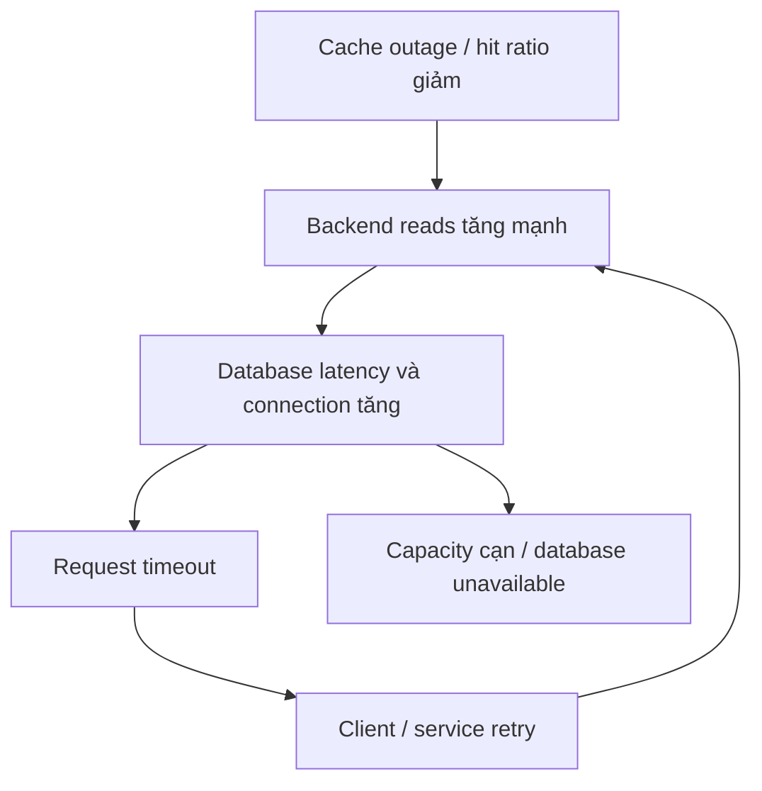
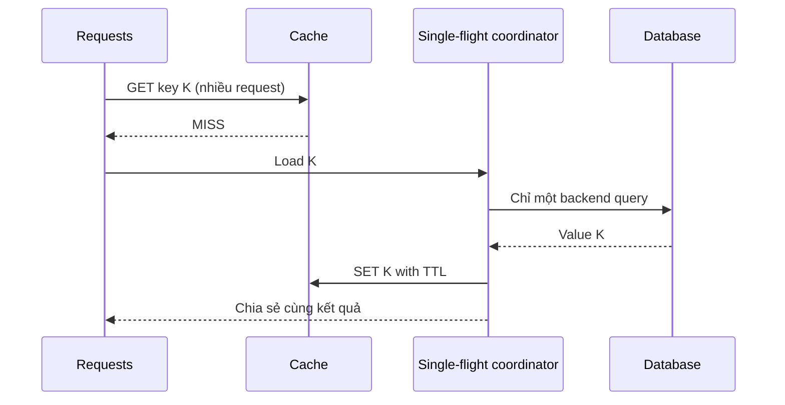
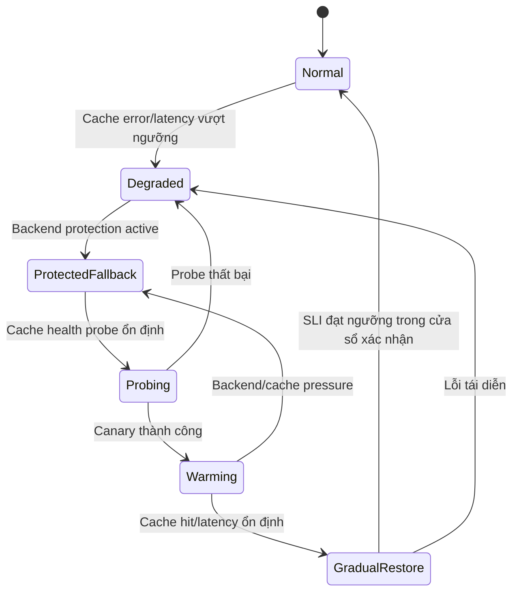
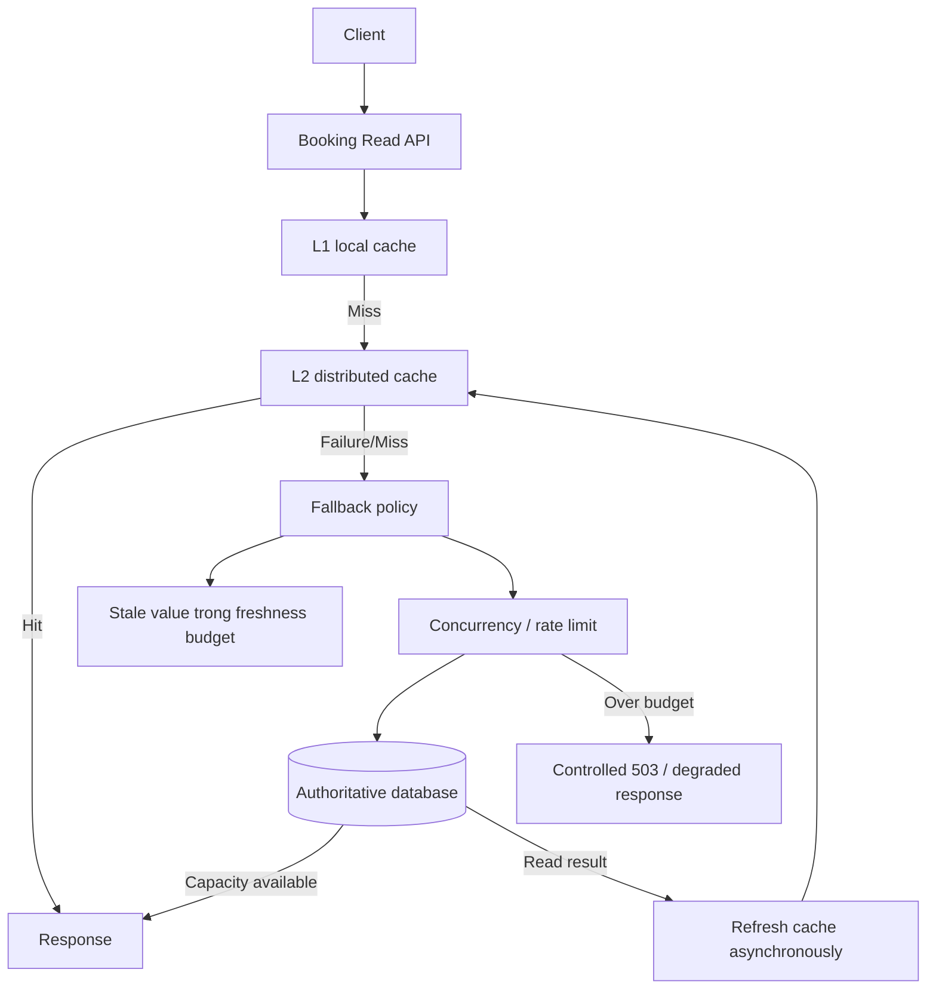

# Xử lý khi bộ nhớ đệm lỗi và tránh phụ thuộc sẵn sàng ngược

## 1. Cache giúp hệ thống nhanh hơn nhưng cũng tạo thêm một dependency

Cache thường được thêm vào để giảm độ trễ, giảm tải database hoặc phục vụ dữ liệu đọc thường xuyên. Ứng dụng có thể dùng cache trong tiến trình, cache phân tán, CDN hoặc cache do nền tảng quản lý. Khi cache hoạt động tốt, nhiều request được trả lời mà không cần truy cập nguồn dữ liệu chính.

Nhưng khi cache chậm, mất kết nối, hết dung lượng, bị evict dữ liệu hoặc khởi động lại, ứng dụng có thể đồng loạt quay về database. Một database vốn chỉ chịu tải khi cache hit có thể bất ngờ nhận toàn bộ traffic, gây timeout, cạn connection và làm hỏng cả đường đọc vốn trước đó vẫn hoạt động. Cache outage vì thế có thể chuyển thành **sự cố dây chuyền (cascading failure)**.

Bài học này tập trung vào hai mục tiêu:

- **Phục hồi an toàn khi cache lỗi:** xác định khi nào có thể bỏ qua cache, khi nào cần trả dữ liệu cũ, khi nào phải từ chối hoặc giảm tải.
- **Ngăn cache tạo phụ thuộc sẵn sàng ngược:** tránh để sự cố hoặc hành vi phục hồi của cache làm nguồn dữ liệu chính quá tải và làm giảm availability của toàn hệ thống.

Trong module **CLOUD_ARCHITECTURE**, chương **Bộ nhớ đệm**, chủ đề này kết nối lựa chọn cache với compute, database, mạng, độ tin cậy, bảo mật, chi phí và vận hành theo Well-Architected.

Sau bài học, bạn có thể phân tích cache failure mode, lựa chọn fail-open/fail-closed, thiết kế stale fallback, TTL jitter, request coalescing, circuit breaker, bulkhead, load shedding và triển khai phục hồi theo từng giai đoạn.

## 2. Hiểu các kiểu lỗi cache

Cache không chỉ có trạng thái “hoạt động” hoặc “ngừng hoạt động”. Mỗi dạng lỗi tác động khác nhau đến request và nguồn dữ liệu phía sau.

| Failure mode | Biểu hiện | Rủi ro với ứng dụng |
|---|---|---|
| Cache node/service unavailable | Kết nối bị từ chối, timeout, DNS lỗi | Request đổ về database |
| Latency tăng cao | Cache vẫn trả lời nhưng chậm hơn nguồn dữ liệu | Request giữ worker/connection lâu, timeout dây chuyền |
| Partial outage | Chỉ một shard/AZ/replica lỗi | Một nhóm key lỗi, retry hoặc fallback không đồng đều |
| Cache miss tăng đột biến | Key bị evict, TTL hết cùng lúc, cold start | Database chịu tải đột ngột |
| Cache data stale | Invalidation thất bại, replication lag | Ứng dụng trả dữ liệu cũ |
| Cache unavailable sau restart | Cache rỗng hoặc warm-up chưa xong | Cold cache tạo read storm |
| Connection/resource exhaustion | Pool, file descriptor, memory hoặc network bị cạn | Client timeout và retry liên tục |
| Eviction bất thường | Working set lớn hơn memory hoặc policy không phù hợp | Hit ratio giảm và backend load tăng |

Một cache phân tán có thể còn trả lời được một số key dù một phần node lỗi; một cache local có thể sống qua outage mạng nhưng mỗi instance giữ dữ liệu khác nhau. Cần hiểu topology, replication, consistency và behavior của client library trước khi chọn fallback.

### 2.1. Cache miss bình thường khác cache failure

Cache miss là kết quả hợp lệ: key chưa có, đã hết TTL hoặc bị evict. Cache failure là lỗi khi không thể thực hiện thao tác cache như dự kiến. Hai tình huống thường cần metric và policy khác nhau:

- Miss có thể đọc nguồn dữ liệu và ghi cache.
- Failure có thể bỏ qua cache, trả stale data hoặc giới hạn truy cập nguồn dữ liệu.
- Nếu gộp tất cả failure thành miss, một outage có thể biến thành hàng triệu backend read.

Không nên dùng một nhánh “catch mọi exception rồi đọc database” mà không phân loại timeout, connection failure, authentication error, serialization error và lỗi lập trình.

## 3. Fail-open và fail-closed

Hai cách xử lý cơ bản được chọn theo mức độ quan trọng của dữ liệu và tác động nghiệp vụ.

### 3.1. Fail-open: cache lỗi thì tiếp tục bằng nguồn dữ liệu

**Fail-open** trong ngữ cảnh cache thường nghĩa là không để cache failure chặn request; ứng dụng bỏ qua cache và đọc nguồn dữ liệu chính.

Phù hợp khi:

- Cache chỉ là lớp tối ưu hiệu năng, dữ liệu chuẩn nằm trong database.
- Database còn đủ capacity dự phòng để nhận lượng đọc tăng.
- Đọc nguồn dữ liệu vẫn đáp ứng yêu cầu bảo mật và tính nhất quán.
- Có thể áp dụng giới hạn tải để không làm backend quá tải.

Rủi ro: nếu cache phục vụ 90% read traffic, mất cache có thể làm backend nhận nhiều request hơn rất nhiều so với bình thường. Fail-open không có rate limit, concurrency limit hoặc fallback sẽ biến outage cache thành outage database.

### 3.2. Fail-closed: từ chối hoặc dừng request khi cache lỗi

**Fail-closed** nghĩa là không tiếp tục thao tác khi thành phần cần thiết không sẵn sàng. Với cache, cách này có thể phù hợp khi cache là nơi chứa trạng thái bắt buộc cho một quyết định, hoặc đọc backend trong tình huống lỗi có nguy cơ gây vi phạm invariant/giới hạn.

Tuy nhiên, cache thông thường không nên được coi là nguồn dữ liệu chuẩn. Nếu quyết định nghiệp vụ quan trọng chỉ có thể đọc từ cache, cần xem lại kiến trúc: trạng thái thiết yếu có thể thuộc database/transaction store hoặc một hệ thống có consistency guarantee rõ ràng.

Ví dụ có thể tạm từ chối request tra cứu không thiết yếu để bảo vệ backend khi cache chết, thay vì cho phép toàn bộ request làm sập database. Đây là chế độ suy giảm có chủ đích, cần trả lỗi có thể hiểu và retry sau.

### 3.3. Chọn theo loại dữ liệu và hành động

| Use case | Hướng xử lý thường phù hợp | Lý do |
|---|---|---|
| Ảnh/avatar public | Fail-open qua origin/CDN hoặc trả stale | Dữ liệu cũ trong thời gian ngắn thường chấp nhận được |
| Trang danh mục sản phẩm | Stale-while-revalidate, fallback có giới hạn | Ưu tiên availability; giá/tồn kho cần quy tắc riêng |
| Hồ sơ cá nhân | Đọc database có giới hạn; không trả dữ liệu của người khác từ cache | Bảo mật và phân vùng tenant quan trọng |
| Tồn kho để hiển thị | Stale có cảnh báo hoặc đọc nguồn chuẩn | Hiển thị có thể cũ nhưng không dùng để xác nhận giao dịch |
| Giữ chỗ/đặt lịch | Quyết định bằng database/conditional transaction; không dựa cache để khẳng định còn chỗ | Phải bảo toàn invariant |
| Quyền truy cập/revocation | Có thể fail-closed hoặc kiểm tra authoritative source theo risk | Cache stale có thể giữ quyền đã bị thu hồi |
| Feature flag không nhạy cảm | Stale có giới hạn thời gian và default an toàn | Phải định nghĩa hành vi khi không lấy được cấu hình |

Không có policy chung cho mọi cache key. Mỗi loại dữ liệu cần xác định độ stale tối đa, nguồn chuẩn, độ nhạy bảo mật và hậu quả nếu trả dữ liệu cũ hoặc từ chối request.

## 4. Cache outage có thể làm sập database như thế nào?

Giả sử một API phục vụ 10.000 request/giây. Cache hit ratio bình thường là 95%, nên database chỉ nhận khoảng 500 cache miss/giây cho đường đọc này. Khi cache ngừng hoạt động và toàn bộ ứng dụng fail-open, database có thể nhận gần 10.000 read/giây, chưa kể retry và traffic nền.

Nếu database chỉ chịu được 2.000 read/giây trong điều kiện còn write traffic, lượng request vượt năng lực sẽ tạo queue, lock/connection contention và latency tăng. Khi request timeout, client có thể retry, tiếp tục tăng tải. Đây là vòng phản hồi tiêu cực:



Đây là **cache-induced cascading failure**. Cách ngăn chặn phải nằm ở toàn chuỗi: timeout, concurrency, rate limit, circuit breaker, load shedding và kế hoạch degraded mode.

### 4.1. Ước lượng áp lực backend khi cache mất

Có thể dùng mô hình đơn giản:

```text
backend_read_rate =
    total_read_rate * (1 - cache_hit_ratio)
```

Với 10.000 request đọc/giây:

| Trạng thái | Hit ratio | Read rate ước tính đến backend |
|---|---:|---:|
| Bình thường | 95% | 500/giây |
| Cache degraded | 80% | 2.000/giây |
| Cache miss storm | 50% | 5.000/giây |
| Cache outage | 0% | 10.000/giây |

Đây là mô hình minh họa, giả định mọi request cần một backend read và chưa tính batching, query cache, local cache, retry hoặc request coalescing. Dùng số đo thật để xác định headroom; không dựa vào hit ratio trung bình toàn hệ thống nếu một nhóm key quan trọng đang miss liên tục.

## 5. Ngăn cache stampede và thundering herd

**Cache stampede** xảy ra khi nhiều request cùng lúc phát hiện một key hết hạn/miss và đồng thời truy vấn nguồn dữ liệu để tái tạo giá trị. **Thundering herd** là hiện tượng nhiều client/worker cùng thức dậy hoặc thử lại một tài nguyên tại một thời điểm, tạo tải đột biến.

### 5.1. TTL jitter

Nếu hàng triệu key được nạp cùng lúc và có TTL 10 phút giống hệt nhau, chúng có thể hết hạn gần đồng thời. Thêm jitter vào TTL giúp phân tán thời điểm hết hạn:

```text
effective_ttl = base_ttl + random(-jitter, +jitter)
```

Hoặc chọn random trong một khoảng dương phù hợp. TTL không được vượt giới hạn freshness mà nghiệp vụ cho phép. Với token, quyền truy cập hoặc dữ liệu có thời hạn pháp lý, không thêm jitter tùy tiện làm kéo dài hiệu lực.

### 5.2. Request coalescing / single-flight

Khi nhiều request cùng miss một key, chỉ cho một request đi lấy nguồn dữ liệu; các request còn lại chờ cùng kết quả:



Single-flight có thể triển khai trong một process hoặc qua coordination phân tán. Single-flight cục bộ chỉ gộp request trong cùng instance; khi có 100 instance, vẫn có thể còn 100 backend query. Coordination phân tán giảm số query hơn nhưng thêm dependency, lock/lease và failure mode.

### 5.3. Stale-while-revalidate

Giữ giá trị đã hết fresh TTL trong một khoảng stale window. Request có thể nhận dữ liệu cũ trong giới hạn cho phép trong khi một worker cập nhật giá trị mới:

- Fresh TTL: dữ liệu được coi là mới.
- Stale window: dữ liệu có thể được trả tạm thời.
- Hard expiry: sau mốc này không tiếp tục dùng stale; cần đọc nguồn hoặc trả lỗi phù hợp.

Không dùng stale-while-revalidate cho dữ liệu mà stale có thể gây hành động nguy hiểm, ví dụ xác nhận còn chỗ, quyền đã bị thu hồi hoặc giá cần bảo đảm tại thời điểm thanh toán.

### 5.4. Probabilistic early refresh

Với một số workload, có thể refresh ngẫu nhiên trước khi TTL hết hạn, dựa trên thời gian còn lại và chi phí tạo cache. Cách này phân tán refresh nhưng phức tạp hơn và cần kiểm soát tỷ lệ. Thông thường, TTL jitter và single-flight đủ cho nhiều use case; chỉ dùng thuật toán xác suất khi có số liệu chứng minh stampede còn đáng kể.

## 6. Giới hạn tải khi cache lỗi

Fail-open cần một **backend protection layer** để database không nhận vô hạn traffic.

### 6.1. Concurrency limit và bulkhead

Giới hạn số request đọc database đang chạy đồng thời. Khi đạt ngưỡng, request mới có thể chờ trong queue nhỏ có deadline, dùng stale data hoặc bị shed sớm.

Bulkhead tách tài nguyên theo nhóm: ví dụ API tìm kiếm không thể chiếm hết connection pool của API thanh toán hoặc luồng giữ chỗ. Có thể tách thread pool, connection pool, semaphore và quota theo tenant/route.

### 6.2. Rate limiting và load shedding

Rate limiting giới hạn tốc độ; load shedding chủ động từ chối phần tải vượt khả năng để bảo vệ chức năng cốt lõi.

Ưu tiên:

- Giữ request ghi nghiệp vụ cốt lõi nếu nguồn chuẩn và capacity còn đáp ứng.
- Giảm hoặc tạm vô hiệu hóa endpoint đọc không thiết yếu.
- Hạn chế tenant/route có traffic bất thường theo quota công bằng.
- Trả mã lỗi nhất quán như 429 hoặc 503 cùng Retry-After khi phù hợp.
- Không để client retry nhanh hơn khả năng phục hồi của backend.

### 6.3. Timeout và deadline

Timeout cache cần ngắn hơn deadline tổng của request; nếu cache chậm, ứng dụng phải sớm quyết định fallback. Nhưng timeout quá ngắn có thể biến cache latency spike nhỏ thành hàng loạt miss. Chọn timeout từ phân bố latency thực tế, p95/p99 và ngân sách latency; đo cả false timeout.

Mọi tầng cần dùng deadline tổng có truyền tiếp: client → API → cache → database. Không để mỗi tầng tự retry và chờ hết timeout riêng, khiến tổng thời gian vượt SLO.

### 6.4. Circuit breaker

Circuit breaker theo dõi tỷ lệ lỗi/timeout tới cache:

- **Closed:** request được phép gọi cache.
- **Open:** tạm ngừng gọi cache khi lỗi vượt ngưỡng; ứng dụng đi vào fallback policy.
- **Half-open:** cho một số probe thử lại để xác minh cache đã phục hồi.

Breaker tránh gửi liên tục request vào cache đang lỗi và giảm connection/thread bị chiếm. Cần phân biệt lỗi theo endpoint/shard/operation; một key lỗi serialization không nên khiến toàn bộ cache cluster bị mở circuit.

Không nên cho tất cả instance half-open cùng lúc. Cần jitter hoặc probe coordination để tránh tạo đợt reconnect đồng loạt.

## 7. Fallback strategy: thứ tự ưu tiên và giới hạn

Một fallback tốt phải được xác định trước, không phải thêm catch-all khi sự cố xảy ra.

Ví dụ chuỗi đọc hồ sơ công khai:

1. Đọc L1 local cache nếu còn fresh.
2. Đọc L2 distributed cache với timeout ngắn.
3. Nếu L2 lỗi, dùng stale value trong stale window nếu có.
4. Nếu không có stale, đọc database qua bulkhead và concurrency limit.
5. Nếu backend cũng quá tải, trả lỗi có kiểm soát hoặc dữ liệu tối thiểu được phê duyệt.

Với dữ liệu nhạy cảm, fallback phải giữ nguyên authorization. Không được trả cache của tenant khác hoặc bỏ qua kiểm tra quyền chỉ vì auth service/cache lỗi. Nếu policy không thể xác minh, có thể cần fail-closed.

### 7.1. Cache local như fallback

Cache L1 cục bộ có thể giúp ứng dụng tiếp tục phục vụ một phần dữ liệu khi L2 lỗi. Nhưng L1 phân tán theo từng instance:

- Dữ liệu có thể khác nhau giữa các instance.
- Invalidation có thể không đến được một instance đang partition mạng.
- Cache local chiếm RAM và có thể bị cold sau deploy/scale-out.
- User/tenant-specific data cần namespace và authorization rõ ràng.

L1 phù hợp với dữ liệu có freshness policy cho phép và có invalidation/TTL. Không coi local cache là nguồn chuẩn.

### 7.2. Stale fallback và freshness budget

Định nghĩa rõ:

| Mốc | Ý nghĩa | Hành vi |
|---|---|---|
| Fresh TTL | Khoảng dữ liệu được xem là mới | Trả trực tiếp |
| Soft TTL | Mốc bắt đầu refresh | Có thể trả stale trong khi refresh |
| Stale window | Thời gian được phép trả dữ liệu cũ | Cảnh báo/giám sát stale age |
| Hard expiry | Mốc không còn được phép dùng giá trị | Đọc source hoặc từ chối |

Freshness budget phải theo nghiệp vụ, không theo khả năng của cache. Một trang thông tin ít thay đổi có thể chịu stale vài phút; trạng thái quyền truy cập hoặc đặt chỗ có thể cần nguồn authoritative ngay tại thời điểm quyết định.

## 8. Cache recovery: phục hồi từng bước, không tạo cold-start storm

Khi cache hoạt động trở lại, mọi instance có thể đồng loạt reconnect, warm toàn bộ key phổ biến hoặc ghi lại dữ liệu cùng lúc. Cần phục hồi có kiểm soát:

1. Xác nhận cache node/cluster khỏe, replication và network ổn định.
2. Mở breaker theo canary/probe; không chuyển 100% traffic ngay.
3. Reconnect với exponential backoff và jitter; giới hạn connection mới.
4. Warm cache theo tập key quan trọng và tốc độ giới hạn; ưu tiên dữ liệu có hit rate và giá trị kinh doanh cao.
5. Giữ backend protection cho đến khi hit ratio và latency ổn định.
6. Theo dõi eviction, memory pressure, replication lag và cache write errors.
7. Chuyển dần traffic về cache bình thường; đóng degraded mode sau khi các SLI đạt ngưỡng ổn định.

Không preload toàn bộ database vào cache nếu không có dung lượng và mục đích rõ ràng. Warm-up có thể tạo read storm lớn hơn traffic bình thường.

### 8.1. State machine minh họa



Trạng thái và ngưỡng trong sơ đồ cần được cụ thể hóa bằng metric, thời gian ổn định, owner và rollback. Không dùng một health check đơn giản (ví dụ TCP port mở) để kết luận cache đã sẵn sàng chịu tải production.

## 9. TTL, invalidation và consistency khi cache lỗi

Cache recovery không thể tách khỏi consistency. Cache có thể hoạt động nhưng dữ liệu vẫn sai do invalidation bị mất hoặc replication trễ.

### 9.1. TTL là giới hạn stale, không phải consistency guarantee

TTL xác định cache entry có thể được dùng trong bao lâu theo policy. Nếu dữ liệu nguồn đổi sau khi entry được ghi, cache có thể vẫn trả giá trị cũ đến hết TTL. TTL ngắn giảm stale window nhưng tăng miss/backend load; TTL dài tăng hit ratio nhưng dữ liệu có thể cũ hơn.

### 9.2. Invalidation failure

Nếu update database thành công nhưng invalidation cache thất bại, cần:

- Ghi nhận invalidation event/outbox để retry.
- Dùng version hoặc generation key để nhận biết dữ liệu cũ.
- Cân nhắc write-through/write-behind chỉ khi semantics và failure handling rõ.
- Có reconciliation định kỳ cho các key quan trọng.

Không giả định publish invalidation message thành công chỉ vì database commit thành công; cần atomic outbox hoặc cơ chế tương đương.

### 9.3. Negative caching

Cache kết quả “không tồn tại” có thể giảm truy vấn lặp, nhưng negative TTL phải ngắn và có invalidation khi tạo record. Nếu cache miss user/tenant hoặc quyền truy cập thành “not found” quá lâu, record mới có thể bị ẩn hoặc người dùng nhận trạng thái sai.

Không dùng negative cache để che lỗi backend. Phân biệt “không tồn tại” với “không thể truy vấn” và “không có quyền”.

## 10. Cache failure và bảo mật

- Không để cache outage làm ứng dụng bỏ qua authorization hoặc tenant isolation.
- Cache key phải bao gồm đủ context an toàn như tenant, locale, role/entitlement hoặc version khi dữ liệu phụ thuộc các yếu tố này.
- Không lưu token, secret hoặc dữ liệu nhạy cảm trong cache nếu không cần; nếu có, encryption, access control và TTL phải được thiết kế.
- Không chia sẻ stale data giữa hai người dùng/tenant khi cache namespace không đầy đủ.
- Cache poisoning cần được phòng chống bằng validation đầu vào, quyền ghi cache, canonicalization key và kiểm tra nguồn.
- Log fallback và cache key ở mức đủ điều tra nhưng không ghi PII/secret.
- Khi cache authentication/authorization data lỗi, chọn fail policy theo rủi ro; có thể xác minh với authoritative service hoặc fail-closed.

## 11. Ví dụ thực tế: API xem thông tin đặt lịch

Giả sử API đặt lịch phục vụ 8.000 read request/giây. Cache phân tán có hit ratio 92%; database còn capacity dành cho tối đa 1.500 read/giây trong khi vẫn xử lý write. Nếu cache chết hoàn toàn, backend không thể chịu tất cả 8.000 read/giây.

### 11.1. Thiết kế bình thường

- L1 local cache giữ dữ liệu danh mục/metadata ít thay đổi với TTL ngắn.
- L2 distributed cache chứa booking summary được phân vùng theo tenant/booking.
- Database là source of truth.
- Cache key chứa tenant ID và booking ID; authorization vẫn được kiểm tra.
- Invalidation được phát qua outbox sau commit.

### 11.2. Degraded mode khi L2 lỗi

- Circuit breaker theo L2 cluster mở sau ngưỡng timeout/error đã đo.
- API dùng L1/stale summary nếu dữ liệu còn trong freshness budget.
- Với cache miss, chỉ cho tối đa mức concurrency database đã kiểm thử; các endpoint đọc không thiết yếu bị rate limit hoặc shed.
- Endpoint xem lịch sử chi tiết có thể trả 503 khi backend budget cạn; luồng tạo/hủy booking vẫn đi qua database transaction và capacity riêng.
- Retry từ client có backoff/Retry-After; không retry ngay liên tục.

### 11.3. Khôi phục

Sau khi L2 khỏe:

1. Probe một nhóm instance và một tập key mẫu.
2. Giới hạn reconnect, dùng jitter.
3. Warm key truy cập cao theo tốc độ database cho phép.
4. Mở traffic cache theo từng phần, theo dõi hit ratio, eviction và database read rate.
5. Giữ fallback protection cho đến khi cache ổn định.

### 11.4. Sơ đồ



Đây là mô hình tham khảo. Nếu dữ liệu summary có field nhạy cảm hoặc quyết định giao dịch, stale response phải được tách khỏi luồng ra quyết định. API chỉ có thể trả 503/partial response khi hợp đồng sản phẩm đã định nghĩa rõ.

## 12. Kiểm thử cache failure và degraded mode

Không thể xác nhận resilience bằng cách chỉ tắt cache trong môi trường phát triển với ít request. Cần thử các trạng thái và quan sát backend:

| Kịch bản | Cách kiểm thử | Tiêu chí đạt |
|---|---|---|
| Cache connection refused | Chặn kết nối tới cache trong môi trường thử | Fallback hoạt động; DB không vượt concurrency budget |
| Cache latency cao | Thêm delay/packet loss | Timeout đúng deadline, breaker mở, worker không bị giữ lâu |
| Partial shard outage | Cô lập một phần node/key range | Ảnh hưởng được giới hạn, routing không tạo retry storm |
| Cold cache | Restart/flush cache test | Warm-up và read throughput không làm quá tải DB |
| TTL expiry đồng thời | Nạp nhiều key cùng TTL rồi chờ hết hạn | Jitter/single-flight giảm stampede |
| Backend chậm khi cache lỗi | Mock DB latency/connection exhaustion | Bulkhead/load shedding bảo vệ chức năng cốt lõi |
| Cache phục hồi chập chờn | Lặp up/down trong thời gian ngắn | Probe/reconnect có backoff; không flapping |
| Invalidation bị mất | Ngắt event path sau DB commit | Outbox/reconciliation đưa cache về trạng thái đúng |
| Cross-tenant cache key | Thử truy cập dữ liệu giữa tenant | Không trả dữ liệu sai tenant khi hit/fallback |
| Stale data hết hạn | Tạo entry vượt hard expiry | Không tiếp tục trả dữ liệu cũ trái policy |

Fault injection phải có phạm vi, owner, ngưỡng dừng và phương án rollback. Không flush cache production hoặc chặn database thật nếu chưa có kế hoạch và phê duyệt phù hợp.

## 13. Observability: đo sức khỏe của cả cache lẫn backend

Chỉ theo dõi cache hit ratio là chưa đủ. Một hệ thống có hit ratio 95% vẫn có thể bị hot key, một shard chậm hoặc stale data.

| Metric | Ý nghĩa |
|---|---|
| Hit/miss ratio theo route/key class | Phân biệt cache miss bình thường và suy giảm bất thường |
| Cache latency p50/p95/p99 | Nhận biết cache chậm trước khi connection timeout |
| Error/timeout rate | Phát hiện cache unavailable hoặc partial outage |
| Backend read rate/latency | Đo tác động fallback tới database |
| DB active connections/queue/lock wait | Nhận biết backend gần cạn capacity |
| Fallback rate | Biết bao nhiêu request đang bypass cache |
| Stale response count/age | Theo dõi mức sử dụng dữ liệu cũ |
| Single-flight waiters/coalescing ratio | Đo hiệu quả chống stampede |
| Circuit state/open duration | Biết khi nào cache đang ở degraded mode |
| Cache memory/eviction/replication lag | Phát hiện capacity hoặc consistency issue |
| Warm-up progress | Biết cache recovery đã đến đâu |

Alert phải kết hợp chỉ số cache và database. Ví dụ: miss rate tăng cùng backend read rate và DB p99 tăng là tín hiệu nghiêm trọng; miss rate tăng nhưng DB vẫn dưới budget có thể là biến động chấp nhận được.

## 14. Chi phí và đánh đổi

| Biện pháp | Lợi ích | Chi phí/giới hạn |
|---|---|---|
| L1 local cache | Giảm network và latency | RAM mỗi instance, stale/invalidation và dữ liệu phân tán |
| Stale fallback | Giữ availability khi cache/backend gián đoạn | Freshness giảm, cần quy tắc theo dữ liệu |
| Request coalescing | Giảm duplicate backend reads | Waiter latency, coordination và xử lý lỗi kết quả chung |
| TTL jitter | Giảm expiry đồng thời | Thời gian cache khác nhau; phải giữ freshness bound |
| Circuit breaker | Giảm request tới dependency lỗi | Có thể mở nhầm, probe và recovery phức tạp |
| Bulkhead/concurrency limit | Bảo vệ database | Một số request bị chờ/từ chối dù backend còn chút capacity |
| Warm-up | Tăng hit ratio sau restart | Tốn backend read và compute; có thể gây storm nếu không giới hạn |
| Dedicated cache capacity | Cô lập workload và tenant | Chi phí tài nguyên nhàn rỗi |

Chi phí cache không chỉ là memory/instance; cần tính request, network, replication, backup nếu có, observability, engineering và capacity dự phòng cho backend. Một cache rất rẻ nhưng khiến outage gây database downtime có thể đắt hơn nhiều về tổng chi phí.

## 15. Đánh giá theo Well-Architected

| Trụ cột | Câu hỏi đánh giá |
|---|---|
| **Operational Excellence** | Có runbook cache outage, breaker, warm-up, rollback và owner? Dashboard thể hiện đồng thời cache/backend/fallback? |
| **Security** | Fallback có giữ authorization và tenant isolation? Cache key/secret/PII được bảo vệ? |
| **Reliability** | Cache failure có làm backend quá tải? Có TTL jitter, single-flight, bulkhead, stale policy và controlled recovery? |
| **Performance Efficiency** | Timeout, concurrency, hit ratio, hot key và cache tier được benchmark ở tải đỉnh? |
| **Cost Optimization** | Cache capacity, replication, L1 memory, backend headroom, warm-up và telemetry có được tính đầy đủ? |
| **Sustainability** | Tránh refresh/retry vô ích, warm đúng key và scale theo nhu cầu thay vì duy trì tài nguyên quá mức? |

## 16. Mẫu ADR cho cache failure policy

YAML sau là ví dụ tài liệu hóa quyết định, không phải cấu hình triển khai trực tiếp:

```yaml
decision_id: ADR-CACHE-008
title: Cache failure and backend protection policy
source_of_truth: booking_database
cache_tiers:
  - local_cache
  - distributed_cache
failure_policy:
  public_summary:
    stale_window_seconds: 120
    fallback: stale_then_limited_database_read
  booking_availability:
    fallback: authoritative_database_transaction
    stale_value_for_decision: false
protection:
  cache_timeout_ms: measured_budget
  circuit_breaker: enabled
  database_read_concurrency: approved_limit
  per_route_rate_limit: enabled
stampede_controls:
  ttl_jitter: enabled
  request_coalescing: enabled
recovery:
  reconnect_backoff: exponential_with_jitter
  warmup: rate_limited
  rollout: canary_then_gradual
observability:
  - fallback_rate
  - backend_read_rate
  - cache_latency_p99
  - stale_response_age
review_triggers:
  - database_capacity_change
  - cache_topology_change
  - freshness_requirement_change
```

Các giá trị thời gian và concurrency phải được đo, thử tải và duyệt theo từng môi trường. ADR chính thức cần có owner, lựa chọn thay thế, tiêu chí nghiệm thu, runbook và bằng chứng fault injection.

## 17. Quy trình thiết kế và triển khai

1. **Phân loại dữ liệu:** source of truth, freshness budget, độ nhạy bảo mật và hậu quả nếu stale/missing.
2. **Đo baseline:** hit ratio, latency, backend read rate, DB capacity và traffic theo key/tenant.
3. **Thiết kế failure policy:** fail-open/closed, stale fallback, controlled error và hành vi theo route.
4. **Đặt backend protection:** timeout/deadline, concurrency pool, rate limit, bulkhead, circuit breaker và load shedding.
5. **Chống stampede:** TTL jitter, single-flight, refresh strategy và negative caching đúng policy.
6. **Thiết kế recovery:** probe, reconnect backoff, warm-up có giới hạn, gradual restore và rollback.
7. **Kiểm tra consistency/security:** invalidation/outbox, version, tenant isolation, authorization và stale hard expiry.
8. **Fault injection:** cache down/slow/partial, cold start, DB slow, invalidation failure và flapping.
9. **Vận hành:** dashboard, alert, runbook, owner, budget và diễn tập định kỳ.

## 18. Bảng kiểm trước production

- [ ] Cache được xác định đúng vai trò; source of truth không bị nhầm với cache.
- [ ] Mỗi nhóm dữ liệu có freshness budget và fail-open/fail-closed policy.
- [ ] Cache outage không làm toàn bộ read traffic đổ về DB không giới hạn.
- [ ] Timeout và deadline có ngân sách; không retry lồng nhau vô hạn.
- [ ] Database có concurrency limit, bulkhead, rate limit hoặc load shedding phù hợp.
- [ ] Có circuit breaker/probe với jitter và phạm vi failure được xác định.
- [ ] TTL jitter/request coalescing giảm cache stampede theo số đo.
- [ ] Stale fallback có stale window/hard expiry; không dùng stale để quyết định invariant quan trọng.
- [ ] L1/local cache có namespace, invalidation và tenant isolation rõ.
- [ ] Cache recovery có reconnect backoff, warm-up rate limit và gradual traffic restoration.
- [ ] Invalidation failure được phục hồi qua outbox/event/reconciliation.
- [ ] Authorization và data protection không bị bỏ qua trong degraded mode.
- [ ] Dashboard kết hợp cache, fallback và backend metrics; alert có runbook.
- [ ] Đã kiểm thử cache down/slow/partial, cold cache, DB saturation và recovery flapping.
- [ ] Chi phí cache, backend headroom, replication, warm-up và vận hành nằm trong ngân sách.

**Nguyên tắc áp dụng:** cache phải giúp nguồn dữ liệu chính có thêm headroom, không biến nó thành điểm sụp đổ khi cache lỗi. Hãy định nghĩa fallback theo từng loại dữ liệu, giới hạn tải đi xuống backend, chống stampede và phục hồi cache từ từ. Availability chỉ thực sự được cải thiện khi degraded mode vẫn bảo vệ đúng dữ liệu, quyền truy cập và năng lực của toàn hệ thống.
