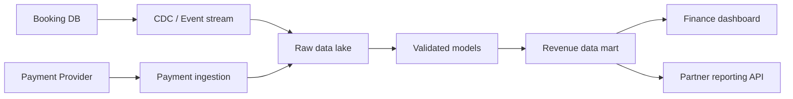
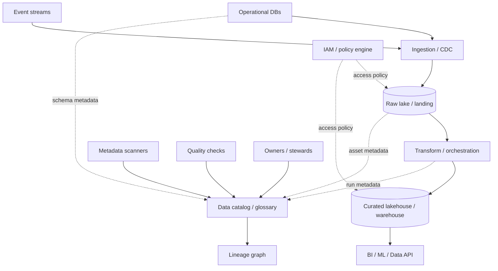
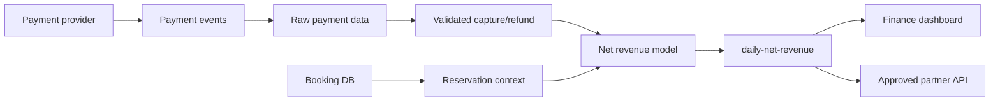

# Chất lượng dữ liệu, danh mục, nguồn gốc và quyền sở hữu

Một nền tảng dữ liệu chỉ có giá trị khi người dùng tìm được dữ liệu phù hợp, hiểu đúng ý nghĩa, biết dữ liệu đến từ đâu, được phép sử dụng và có thể tin cậy kết quả. Một bảng có hàng tỷ dòng nhưng không ai biết cột nào là doanh thu đã đối soát, dữ liệu cập nhật lúc nào hoặc ai chịu trách nhiệm khi sai thì chưa phải tài sản dữ liệu có thể khai thác tốt.

**Chất lượng dữ liệu, danh mục dữ liệu, nguồn gốc dữ liệu và quyền sở hữu dữ liệu** tạo thành nền tảng vận hành của data platform. Chất lượng đo mức độ phù hợp của dữ liệu với mục đích; data catalog giúp khám phá và hiểu tài sản dữ liệu; data lineage ghi lại nguồn và các bước biến đổi; ownership xác định trách nhiệm ra quyết định, sửa lỗi, cấp quyền và duy trì hợp đồng dữ liệu.

Trong module **CLOUD_ARCHITECTURE**, các năng lực này liên kết lưu trữ, ingestion, xử lý batch/stream, warehouse/lakehouse, bảo mật và vận hành. Bài học sử dụng ví dụ nền tảng cho thuê thiết bị, từ booking database đến dashboard doanh thu và dữ liệu đối tác. Các ngưỡng chất lượng trong ví dụ chỉ là giả định; mỗi tổ chức cần định nghĩa theo tác động nghiệp vụ, quy định và SLO thực tế.

## 1. Bốn câu hỏi mà một data platform phải trả lời

| Năng lực | Câu hỏi | Kết quả cần có |
| --- | --- | --- |
| **Data quality** | Dữ liệu có đúng, đủ, nhất quán, mới và phù hợp mục đích không? | Quy tắc, kiểm thử, metric, ngưỡng và quy trình xử lý lỗi |
| **Data catalog** | Có dữ liệu nào, nằm ở đâu, ý nghĩa và cách sử dụng thế nào? | Danh mục tài sản, schema, mô tả nghiệp vụ, owner, phân loại và quyền truy cập |
| **Data lineage** | Dữ liệu đến từ đâu, đã đi qua những transformation nào, được dùng ở đâu? | Đồ thị nguồn-gốc, dependency và impact analysis |
| **Data ownership** | Ai chịu trách nhiệm về định nghĩa, chất lượng, quyền và vòng đời? | Owner/steward rõ, data contract, SLO và quy trình escalation |

Một ví dụ: dashboard báo doanh thu thuê thiết bị giảm 20%. Chỉ có dashboard không đủ để điều tra. Nhóm cần biết “doanh thu” là tiền đã capture, tiền pending hay tổng giá trị reservation; dashboard dùng model nào; pipeline có bỏ sót PaymentCaptured event không; ai sở hữu nguồn payment và ai duyệt định nghĩa metric; dữ liệu được phép chia sẻ với bộ phận/đối tác nào.

Khi bốn năng lực cùng hoạt động, tổ chức có thể trả lời các câu hỏi đó có bằng chứng và có người chịu trách nhiệm.

## 2. Chất lượng dữ liệu là phù hợp với mục đích sử dụng

Không có một con số data quality duy nhất phản ánh mọi nhu cầu. Một trường email có thể không cần thiết cho báo cáo tồn kho, nhưng phải có quy tắc chặt hơn nếu dùng để gửi thông báo khách hàng. Dashboard vận hành có thể chấp nhận dữ liệu chậm 5 phút; đối soát thanh toán cần phát hiện sai lệch nhanh hơn.

Vì vậy, hãy định nghĩa chất lượng **theo dataset, field, use case và hậu quả khi sai**. Tránh đánh giá một bảng chỉ bằng số dòng không NULL.

## 3. Các chiều chất lượng dữ liệu

| Dimension | Ý nghĩa | Ví dụ trong nền tảng thuê thiết bị | Cách đo |
| --- | --- | --- | --- |
| **Accuracy – độ chính xác** | Giá trị phản ánh đúng thực tế/sự thật được xác nhận | Reservation status khớp trạng thái nghiệp vụ | So sánh với nguồn authoritative, audit sample |
| **Completeness – tính đầy đủ** | Các trường/bản ghi bắt buộc hiện diện | Payment record có paymentId và amount | Tỷ lệ field/bản ghi đáp ứng required rule |
| **Validity – tính hợp lệ** | Giá trị tuân schema, miền giá trị và định dạng | startAt nhỏ hơn endAt | Tỷ lệ record pass validation |
| **Consistency – tính nhất quán** | Các nguồn/trường biểu diễn cùng sự thật không mâu thuẫn | Tổng payment capture/refund khớp ledger | Cross-field/cross-table reconciliation |
| **Timeliness – tính kịp thời** | Dữ liệu có sẵn trong thời gian cần thiết | Dashboard booking cập nhật trong 5 phút | Freshness lag, age của dữ liệu mới nhất |
| **Uniqueness – tính duy nhất** | Không có duplicate vượt quy tắc | Một eventId chỉ được ghi nhận một lần trong projection | Duplicate rate, unique constraint violations |
| **Integrity – tính toàn vẹn** | Quan hệ, khóa và ràng buộc được giữ | Reservation tham chiếu equipment tồn tại | FK/orphan checks, invariant checks |
| **Conformity – tính tuân thủ chuẩn** | Giá trị dùng format/vocabulary đã thống nhất | Country code, currency code chuẩn | Tỷ lệ theo chuẩn, số giá trị ngoài vocabulary |
| **Accessibility – khả năng truy cập** | Người được phép có thể tìm và sử dụng dữ liệu | Analyst có quyền đọc curated view | Access success, request fulfillment |

Accuracy và validity không giống nhau. Một ngày đúng format vẫn có thể sai so với ngày thực tế của giao dịch. Completeness cũng không đồng nghĩa quality: một bảng đầy đủ nhưng toàn giá trị sai vẫn vô ích.

### Chọn dimension theo tác động

- Payment ledger cần integrity, accuracy, completeness và audit cao.
- Catalog cần validity, completeness, freshness để hỗ trợ tìm kiếm và hiển thị.
- Search index có thể chấp nhận lag ngắn vì tái tạo được.
- Dataset phân tích hành vi có thể chấp nhận thiếu một số sự kiện telemetry, nhưng cần đo coverage và bias.

## 4. Từ yêu cầu nghiệp vụ tới quality rule

Một quality rule tốt có dataset/field áp dụng, điều kiện cụ thể, mức nghiêm trọng, owner, tần suất chạy, ngưỡng cảnh báo/fail và cách xử lý.

| Rule ID | Dataset/field | Rule | Severity | Hành động |
| --- | --- | --- | --- | --- |
| DQ-RES-001 | reservation.id | Không NULL và duy nhất | Critical | Chặn publish curated dataset, alert owner |
| DQ-RES-002 | reservation.start_at/end_at | start_at nhỏ hơn end_at | High | Đưa record lỗi vào quarantine |
| DQ-PAY-001 | payment.amount | Không âm, currency hợp lệ | Critical | Chặn reconciliation output và điều tra |
| DQ-PAY-002 | payment.event_id | Không duplicate trong phạm vi idempotency | Critical | Dedupe hoặc quarantine |
| DQ-CAT-001 | equipment.category | Thuộc controlled vocabulary | Medium | Normalize mapping hoặc gửi review |
| DQ-AN-001 | revenue_daily | Freshness không quá 15 phút | High | Đánh dấu dashboard stale và cảnh báo |

Các ngưỡng và severity là ví dụ, không phải chuẩn mặc định.

### Hard rule và soft rule

- **Hard rule:** vi phạm khiến dữ liệu không được đưa vào bước quan trọng, ví dụ payment thiếu currency.
- **Soft rule:** vi phạm được ghi nhận/cảnh báo nhưng có thể tiếp tục với nhãn chất lượng, ví dụ ảnh thiết bị thiếu alt text trong báo cáo nội bộ.

Không phải mọi rule đều nên fail toàn pipeline. Nếu một dòng lỗi có thể cô lập, quarantine phần lỗi và tiếp tục phần hợp lệ sẽ giảm blast radius. Với dữ liệu tài chính hoặc định danh, có thể cần fail-closed theo yêu cầu nghiệp vụ.

### Rule ở đâu?

Quality check có thể chạy ở producer/source, ingestion, transformation, curated/publish và consumption. Mỗi lớp nên chịu trách nhiệm cho rủi ro mà nó phát hiện tốt nhất; tránh sao chép cùng một rule không cần thiết.

## 5. Đo lường chất lượng: metric, score và SLO

Một metric cần có tử số, mẫu số, phạm vi thời gian và cách xử lý dữ liệu chưa biết.

- valid_rate = valid_records / evaluated_records × 100%.
- completeness = non_null_records / eligible_records × 100%.
- freshness_lag = now - max(source_event_time).

Đối với pipeline có nhiều nguồn hoặc event đến muộn, freshness cần đo thêm ingestion time và processing time; chỉ lấy max event time có thể che giấu một partition bị đứng.

| Metric | Giá trị giả định | Mục tiêu | Trạng thái |
| --- | ---: | ---: | --- |
| Reservation ID unique rate | 100% | 100% | Đạt |
| Payment required-field completeness | 99.98% | ≥ 99.99% | Cảnh báo |
| Catalog category validity | 99.5% | ≥ 99% | Đạt |
| Revenue dataset freshness | 22 phút | ≤ 15 phút | Vi phạm |
| Orphan reservation rate | 0.03% | 0% | Vi phạm |

Không gộp tất cả dimension thành một quality score duy nhất rồi che khuất lỗi critical. Nếu cần score tổng hợp, hiển thị metric con, weighting, dataset coverage và rule critical riêng.

### Data quality SLO

Một SLO ví dụ: trong mỗi ngày, ít nhất 99.99% payment records được ingest có eventId hợp lệ, amount/currency đúng contract và được đối soát; mọi record thất bại được quarantine và có owner nhận xử lý.

SLO phải định nghĩa population: chỉ record đã tới pipeline hay tất cả giao dịch nguồn? Nếu upstream không gửi sự kiện, quality check downstream có thể không thấy bản ghi thiếu. Cần source-to-sink reconciliation hoặc heartbeat để phát hiện missing data.

## 6. Data contract: thỏa thuận giữa producer và consumer

Data contract mô tả cách producer công bố dữ liệu và điều consumer có thể dựa vào. Nó thường gồm:

- Dataset/topic/table và owner.
- Schema, kiểu, required/optional, enum, unit và timezone.
- Semantics nghiệp vụ và primary/business key.
- Quality rules và freshness expectation.
- Versioning/compatibility và deprecation.
- Security classification, access policy và retention.
- Delivery/update behavior và xử lý late/duplicate.

Ví dụ contract cho event PaymentCaptured:

```yaml
name: payment-captured
owner: payment-domain
schema_version: 2
key: payment_id
fields:
  payment_id:
    type: string
    required: true
  reservation_id:
    type: string
    required: true
  amount_minor:
    type: integer
    required: true
    description: Amount in the currency's minor unit
  currency:
    type: string
    required: true
    examples: [VND, USD]
  event_time:
    type: timestamp_utc
    required: true
quality:
  unique_key: [payment_id, event_id]
  rule_amount: amount_minor >= 0
  freshness_target: 2m
security:
  classification: confidential
  pii: false
compatibility:
  mode: backward_compatible
```

Đây là YAML khái niệm. Contract thật cần syntax schema/registry cụ thể và semantics uniqueness rõ. amount_minor chỉ phù hợp nếu currency có minor-unit convention mà hệ thống xử lý đúng; với VND hoặc currency khác cần định nghĩa mapping/precision có chủ đích.

Schema có thể xác nhận amount là integer nhưng không tự xác nhận đây là tiền đã capture, tiền pending hay giá trị reservation. Business semantics phải có mô tả và owner chịu trách nhiệm.

## 7. Data catalog: tìm, hiểu và đánh giá tài sản dữ liệu

Data catalog là nơi tập trung metadata về tài sản như database, table, view, topic, file, dashboard, model hoặc API dataset. Catalog tốt giúp người dùng khám phá dữ liệu có kiểm soát.

| Nhóm metadata | Ví dụ |
| --- | --- |
| Technical metadata | Catalog/schema/table/column, datatype, partition, format, location |
| Business metadata | Định nghĩa revenue, active customer, completed reservation |
| Ownership | Domain owner, technical owner, steward, support channel |
| Quality | DQ rules, recent result, freshness, known issue |
| Lineage | Nguồn, transformation, upstream/downstream |
| Security | Classification, PII tag, allowed purpose, retention |
| Lifecycle | Created, updated, deprecated, archived, deletion date |
| Usage | Popularity, query count, consumer list, last access |

### Technical catalog và business glossary

Technical catalog cho biết bảng/field thực tế. Business glossary thống nhất khái niệm nghiệp vụ. Hai phần cần liên kết.

Ví dụ “Doanh thu đã thu” có thể ánh xạ tới metric được tính từ payment capture trừ refund đã xác nhận. Dashboard khác dùng tổng reservation value phải có tên và định nghĩa khác.

### Search và discovery

Người dùng nên tìm dataset theo từ khóa nghiệp vụ, alias/glossary, domain, owner, loại dữ liệu, classification, freshness, quality status và certification. Catalog không nhất thiết chứa payload; nó chủ yếu chứa metadata và liên kết tới nơi lưu dữ liệu. Quyền xem dữ liệu vẫn phải được thực thi ở storage/query engine.

### Certified và trusted dataset

Có thể gắn nhãn:

- **Raw:** gần dữ liệu nguồn, ít biến đổi.
- **Validated:** đã qua schema/quality checks cơ bản.
- **Curated:** đã chuẩn hóa và có semantics được domain owner xác nhận.
- **Certified:** được governance process phê duyệt cho use case cụ thể.

Đây là taxonomy nội bộ, không phải chuẩn chung. Phải định nghĩa tiêu chí, owner và thời hạn xem xét để certification không trở thành badge trang trí.

## 8. Metadata lifecycle và tự động hóa catalog

Catalog chỉ đáng tin nếu metadata được cập nhật cùng thay đổi hệ thống. Một quy trình có thể gồm:

1. Scanner/connector phát hiện schema/table/topic mới.
2. Thu thập technical metadata từ database, warehouse, object storage, BI và orchestrator.
3. Phân loại/đề xuất sensitivity tag và nhận diện PII bằng rule hoặc classifier.
4. Owner/steward xác nhận business definition, classification và intended use.
5. Thu thập quality result, freshness, usage và lineage.
6. Theo dõi schema change, đánh dấu deprecated hoặc ownerless.
7. Dọn metadata khi asset retire theo retention/audit policy.

Không tự động publish dataset nhạy cảm vào catalog công khai chỉ vì scanner phát hiện. Catalog metadata cũng có thể tiết lộ tên khách hàng, hệ thống nội bộ hoặc business metric; phải có access control ở cấp catalog.

Technical platform team có thể vận hành scanner và catalog service. Domain owner xác nhận business meaning và data contract. Security/privacy steward duyệt classification và purpose.

## 9. Data lineage: nguồn gốc và đường biến đổi

**Data lineage** ghi lại dữ liệu đi từ đâu tới đâu và được biến đổi thế nào. Có thể quan sát ở các mức:

- **System-level:** source database → event stream → lake/warehouse → BI.
- **Dataset-level:** table/view/model nguồn nào tạo ra dataset đích.
- **Column-level:** cột net_revenue phụ thuộc captured_amount và refund_amount từ đâu.
- **Run-level:** một lần chạy pipeline dùng batch/partition/commit nào, thành công hay thất bại.



Lineage thực tế nên ghi job, transformation version, time range, source offsets/partitions và run ID khi có thể.

### Lineage để làm gì?

- **Impact analysis:** nếu cột nguồn đổi tên, model/dashboard/API nào bị ảnh hưởng?
- **Root cause:** metric sai từ producer, ingestion, transformation hay semantic layer?
- **Audit:** con số báo cáo được tạo từ source và logic nào?
- **Compliance:** dữ liệu cá nhân đi vào dataset nào, được chia sẻ ở đâu?
- **Change management:** biết consumer trước khi xóa field hoặc retire table.
- **Reproducibility:** tái tạo kết quả với input và code version tương ứng.

### Static lineage và runtime lineage

Static lineage phân tích code/SQL/orchestration để suy ra dependency; có thể bỏ sót dynamic SQL, stored procedure, logic application hoặc thao tác thủ công.

Runtime lineage thu thập những gì thực sự chạy, từ query history, job event, OpenLineage-compatible emitter hoặc engine integration. Nó phản ánh execution thực tế nhưng có thể thiếu coverage nếu hệ thống không phát metadata.

Kết hợp hai nguồn cho bức tranh tốt hơn. Catalog cần thể hiện độ tin cậy/coverage; đừng hiển thị đồ thị suy đoán như bằng chứng đầy đủ.

### Column-level lineage

Ví dụ: net_revenue = SUM(payment.captured_amount) - SUM(refund.confirmed_amount). Lineage cần chỉ rõ nguồn từng cột, trạng thái payment/refund được chọn, join key, duplicate handling, partial refund, currency conversion và rounding.

## 10. Lineage của dữ liệu cá nhân và tác động xóa dữ liệu

Email/phone trong Customer dimension có thể được sao chép vào raw zone, enriched model, analytics mart và export đối tác. Khi có yêu cầu xóa hoặc hạn chế sử dụng:

1. Xác định subject key và nguồn authoritative.
2. Tìm downstream dataset, cache, export và archive bằng lineage.
3. Áp policy theo retention/legal basis; không xóa audit record bắt buộc nếu có nghĩa vụ lưu.
4. Xóa, tokenize, mask hoặc restrict theo mục đích và chính sách.
5. Rebuild/reprocess downstream nếu dữ liệu nhạy cảm đã materialize trong aggregate.
6. Lưu bằng chứng xử lý và kiểm tra không có bản sao không được quản lý.

Dataset aggregate có thể vẫn chứa PII gián tiếp; chỉ xóa cột email khỏi một bảng chưa chắc loại bỏ dữ liệu nhận diện. Lineage metadata cũng phải tránh mang giá trị PII vào graph/log.

## 11. Ownership, stewardship và trách nhiệm

Data ownership xác định ai có trách nhiệm đối với tài sản dữ liệu và quyết định liên quan. Nó không có nghĩa owner phải tự vận hành mọi database hoặc xử lý từng dòng lỗi.

| Vai trò | Trách nhiệm điển hình |
| --- | --- |
| **Data owner** | Chịu trách nhiệm nghiệp vụ, định nghĩa, acceptable quality, quyền sử dụng và ưu tiên xử lý |
| **Data steward** | Duy trì glossary, metadata, quality rules, classification và quy trình stewardship |
| **Technical/data platform owner** | Vận hành storage, ingestion, catalog, lineage, access control và reliability |
| **Producer owner** | Tạo dữ liệu đúng contract, công bố schema change và xử lý lỗi ở nguồn |
| **Consumer owner** | Dùng dữ liệu đúng mục đích, phản hồi lỗi và bảo vệ downstream dependency |
| **Security/privacy owner** | Định nghĩa policy, review quyền, retention, sensitivity và compliance |
| **Data engineer/analytics engineer** | Xây pipeline/model, test transformation, instrument lineage và quality |

Một người có thể kiêm nhiều vai trò trong tổ chức nhỏ, nhưng trách nhiệm phải được ghi rõ. “Team Data” là owner chung cho mọi dataset thường dẫn tới không ai có quyền quyết định semantics nghiệp vụ.

### Ownership theo domain

Với data mesh hoặc mô hình domain-oriented, domain team có thể sở hữu data product; platform team cung cấp self-service capabilities và governance guardrails. Ownership theo domain không loại bỏ tiêu chuẩn chung về schema, privacy, quality, discoverability và interoperability.

### RACI minh họa

RACI cho biết ai Responsible (thực hiện), Accountable (chịu trách nhiệm cuối), Consulted (được tham vấn) và Informed (được thông báo).

| Hoạt động | Data owner | Steward | Platform | Producer/consumer |
| --- | --- | --- | --- | --- |
| Định nghĩa business metric | A | R | C | C |
| Thiết lập catalog connector | I | C | A/R | I |
| Quality rule nghiệp vụ | A | R | C | R/C |
| Schema change producer | A | C | C | R |
| Phân loại PII | A | R | C | C |
| Incident dữ liệu nguồn | A | C | C | R |
| Incident pipeline platform | I | C | A/R | C |

Đây là ví dụ phân vai. RACI thực tế phải phản ánh cơ cấu tổ chức, quyền phê duyệt và cách trực vận hành.

## 12. Data product và hợp đồng vận hành

Một data product không chỉ là một bảng. Nó là tài sản có mục đích, interface, owner, chất lượng và consumer được xác định.

Metadata tối thiểu gồm tên/domain, owner/steward/support channel, business purpose, schema/contract/key, quality rules/SLO/freshness, security classification/access process, lineage, versioning/deprecation, operational status và cost attribution.

Ví dụ data product reservation-analytics có thể công bố số reservation theo ngày, khu vực và loại thiết bị; không bao gồm địa chỉ hoặc email khách. Contract phải nói rõ số đếm theo created date hay confirmed date, xử lý cancellation và late event, timezone ngày báo cáo, freshness và grain.

## 13. Data governance: guardrail và quyết định dùng dữ liệu

Data governance thiết lập nguyên tắc và quy trình để dữ liệu được quản lý an toàn, nhất quán và có trách nhiệm.

| Lĩnh vực | Guardrail |
| --- | --- |
| Metadata | Naming, description, owner, glossary, lifecycle |
| Quality | Required rule, criticality, SLO, incident process |
| Security | Identity, least privilege, classification, encryption, audit |
| Privacy | Purpose limitation, minimization, retention, deletion workflow |
| Interoperability | Schema, vocabulary, timezone, currency, key |
| Change management | Compatibility, deprecation, consumer notification |
| Usage | Approved purpose, sharing boundary, export control |
| Cost | Storage lifecycle, query budget, owner/cost attribution |

### Centralized và federated governance

- **Centralized:** một nhóm trung tâm đặt nhiều tiêu chuẩn và phê duyệt; dễ nhất quán nhưng có thể tạo bottleneck.
- **Federated:** domain owner quyết định theo phạm vi của họ trong guardrail chung; linh hoạt nhưng cần taxonomy, policy và interoperability vững.
- **Hybrid:** platform/security định nghĩa guardrail bắt buộc; domain owner chịu business semantics và chất lượng; workflow tự động hóa phần kiểm tra.

Không mô hình nào tối ưu cho mọi tổ chức. Mức tập trung cần phù hợp quy mô, rủi ro và khả năng tự quản của domain team.

## 14. Phân loại dữ liệu và quyền truy cập

| Nhóm | Ví dụ | Kiểm soát thường cần |
| --- | --- | --- |
| Public | Danh mục thiết bị đã công bố | Truy cập rộng, kiểm tra integrity |
| Internal | Metric vận hành nội bộ | SSO/IAM, audit và giới hạn chia sẻ |
| Confidential | Thông tin giao dịch/đối tác | Least privilege, encryption, purpose restriction |
| Restricted/PII | Email, phone, địa chỉ, định danh nhạy cảm | Field/row-level policy, masking, retention và audit tăng cường |

Tên classification và nghĩa vụ phải theo policy tổ chức, không phải nhãn chung có giá trị pháp lý tự động.

### Access theo dataset, row và column

- **Dataset-level:** ai được đọc bảng/view.
- **Column-level:** ai được thấy field nhạy cảm.
- **Row-level:** chỉ thấy hàng thuộc tenant/region/department được phép.
- **Purpose-based:** dữ liệu chỉ dùng cho mục đích đã phê duyệt.

Analyst cần tính tỷ lệ hủy đơn nhưng không cần email khách. Cung cấp curated view đã loại PII an toàn và dễ quản trị hơn cấp raw customer table rồi kỳ vọng mọi truy vấn tự nhớ mask.

### Catalog không phải authorization engine

Catalog có thể hiển thị owner, classification và cách xin quyền. Việc cho phép query phải được enforce ở warehouse/lakehouse/object storage/API bằng IAM, policy tag, row/column security hoặc cơ chế tương ứng. Gắn nhãn confidential trong catalog mà storage vẫn public là không đủ.

## 15. Kiến trúc metadata, catalog và lineage trong data platform



Catalog, lineage và DQ có thể là module riêng hoặc tích hợp trong cùng nền tảng. Quan trọng là metadata có định danh ổn định và liên kết dataset/run/owner/version.

Metadata store cần lưu asset identity (environment, platform, catalog/schema/table/topic), schema snapshot/change history, ownership/glossary/classification, quality result, lineage edge, run/job metadata và usage/lifecycle. Không nhất thiết lưu mọi metadata trong một database vật lý; có thể liên kết catalog service, schema registry, orchestrator và warehouse query history. Cần tránh nhiều nguồn metadata mâu thuẫn mà không có system of record cho từng loại.

## 16. Lineage standards và công cụ tích hợp

Các công nghệ thường gặp:

- **OpenLineage:** mô hình event/metadata để job phát thông tin run, job và dataset.
- **Marquez:** backend có thể thu thập và khám phá lineage theo OpenLineage.
- **DataHub, OpenMetadata, Apache Atlas:** nền tảng catalog/metadata với phạm vi tích hợp khác nhau.
- **dbt artifacts/manifest:** metadata model và dependency trong workflow dbt.
- **Warehouse query history:** nguồn runtime lineage hoặc usage tùy khả năng engine.

Danh sách này là ví dụ hệ sinh thái. Trước khi chọn, kiểm tra connector, mức column-level lineage, quyền truy cập, deployment model, scale, API, retention và chi phí vận hành. Không giả định công cụ tự khám phá mọi logic trong application code hoặc dynamic SQL.

### Instrumentation cần thiết

Một job pipeline nên phát job/run ID và job version, input/output dataset và partition, start/end time/status/error category, source offsets/watermark hoặc batch range, transformation code/version, row counts và quality check results.

Lineage chỉ đáng tin khi metadata emission có coverage, định danh asset nhất quán và run status phản ánh đúng thực tế. Nếu job bị kill trước completion event, catalog phải thể hiện incomplete/unknown thay vì đánh dấu thành công.

## 17. Data quality incident và quy trình xử lý

Data quality issue nên được vận hành như incident có owner và mức độ, không chỉ là con số đỏ trên dashboard.

1. Phát hiện qua DQ check, freshness alert, consumer feedback hoặc reconciliation.
2. Gắn severity theo tác động: tiền, quyết định nghiệp vụ, privacy, báo cáo hay dataset phụ.
3. Xác định phạm vi ảnh hưởng bằng lineage.
4. Thông báo owner/steward và consumer bị ảnh hưởng.
5. Cô lập/quarantine dữ liệu sai hoặc đánh dấu dataset degraded.
6. Sửa nguồn hoặc transformation, replay/backfill nếu cần.
7. Re-run quality checks và đối soát.
8. Công bố trạng thái phục hồi và post-incident actions.

Ví dụ dashboard doanh thu giảm đột ngột vì Payment ingestion bỏ qua event của một partition. Freshness vẫn mới do partition khác có traffic, nên check đơn giản không phát hiện. Điều tra cần partition-level watermark/offset completeness, expected vs actual event count, lineage từ Payment event đến Revenue mart, logic dedupe/DLQ và owner ingestion/metric.

| Severity | Tác động | Phản ứng |
| --- | --- | --- |
| SEV-1 | Sai payment/PII leak hoặc dữ liệu gây quyết định tài chính sai diện rộng | Ngăn publish, notify owner/security, xử lý khẩn |
| SEV-2 | Dataset trọng yếu stale/incorrect ảnh hưởng quy trình chính | Đánh dấu degraded, incident owner, ETA |
| SEV-3 | Một tập record lỗi có thể quarantine, không ảnh hưởng toàn bộ | Ticket theo SLA và theo dõi |
| SEV-4 | Metadata thiếu hoặc issue chất lượng thấp tác động giới hạn | Backlog cải tiến |

Severity phải theo incident policy thực tế, không dùng bảng ví dụ thay cho quy trình trực ca.

## 18. Observability cho data platform

| Nhóm | Metric/tín hiệu | Câu hỏi |
| --- | --- | --- |
| Pipeline health | Job success/failure, duration, retry, backlog | Pipeline có chạy đúng lịch? |
| Data freshness | Age của record/partition, source lag, watermark | Dữ liệu mới tới đâu? |
| Data completeness | Expected/actual count, missing partition | Có dữ liệu bị bỏ sót? |
| Data validity | Rule pass/fail, invalid records, quarantine | Payload có đúng schema/logic? |
| Data consistency | Reconciliation difference, orphan, duplicate | Các nguồn có khớp nhau? |
| Lineage coverage | Tỷ lệ job/dataset có lineage và unknown edge | Ta có nhìn thấy dependency thật? |
| Catalog health | Asset scan age, ownerless assets, stale metadata | Catalog có còn đúng? |
| Access governance | Access request, denied access, policy drift, audit | Quyền có phù hợp? |
| Cost | Storage, scan, query, transform cost theo owner | Chi phí phát sinh ở đâu? |

Infrastructure observability với CPU, memory và job status có thể bình thường trong khi dữ liệu sai do mapping lỗi. Data observability bổ sung tín hiệu distribution, volume, schema, freshness và lineage. Nó không thay mọi business quality rule: anomaly detector không biết payment sai currency có hợp lệ về nghiệp vụ hay không.

## 19. Data quality trong batch, stream và ML

**Batch:** có ranh giới run rõ, input partition, row count, output, quality check và retry. Có thể chặn publish khi validation critical fail; giữ output cũ được chứng nhận cho tới khi batch mới đạt điều kiện.

**Stream:** cần xử lý event trễ, duplicate, out-of-order, schema evolution và chất lượng theo partition/window. Job liên tục không có nghĩa dữ liệu luôn đầy đủ; watermark và source heartbeat giúp đánh giá tiến độ.

**Machine learning:** dataset cần feature definition, point-in-time correctness, training/serving consistency, missingness, distribution drift, label freshness/quality, PII/legal basis và dataset/model lineage. Catalog nên cho biết dataset nào được phép dùng để train model.

## 20. Kiến trúc lakehouse: raw, validated và curated

| Zone | Mục đích | Governance kỳ vọng |
| --- | --- | --- |
| Raw/landing | Giữ dữ liệu gần nguồn, phục vụ replay/audit theo policy | Schema capture, access hẹp, retention rõ |
| Validated/clean | Chuẩn hóa format, quarantine record sai, áp schema | DQ result, data contract, lineage |
| Curated/business | Model theo domain/use case, metric được định nghĩa | Owner, glossary, certified status, SLO |
| Serving/product | Dataset/API/dashboard phục vụ consumer cụ thể | Access policy, freshness, usage và support |

Không phải mọi hệ thống cần bốn physical storage zone riêng. Đây là logical separation; có thể triển khai bằng database/schema/table/catalog namespace. Raw không có nghĩa “được lưu mãi”; dữ liệu thô có thể chứa PII, nên retention, masking và access control phải áp dụng từ đầu.

## 21. Ownership trong mô hình data mesh

Data mesh xem domain là đơn vị chịu trách nhiệm tạo và cung cấp data product, với platform dùng chung cho self-service và governance liên kết.

- Domain team sở hữu semantics và quality của data product.
- Platform team cung cấp ingestion, catalog, lineage, access, orchestration và observability.
- Governance federated đặt chuẩn chung về interoperability, security, quality và discoverability.
- Consumer phản hồi contract và được thông báo breaking change.

Rủi ro gồm tạo data product trùng lặp/metric khác nhau, domain thiếu kỹ năng vận hành, catalog ownerless, vocabulary phân mảnh và chi phí platform tăng. Data mesh không chỉ là chia team theo domain hoặc tạo nhiều lake; nếu thiếu self-service platform, ownership và standards, mô hình này có thể tăng phân mảnh.

## 22. Case study: quản trị dữ liệu nền tảng cho thuê thiết bị

### Bối cảnh

Nền tảng thu dữ liệu từ Booking database (reservation, equipment, customer reference), Payment provider/event (capture, refund, dispute), Inventory service và Web/mobile event. Consumer gồm Finance dashboard, Operations dashboard, Customer analytics và Partner reporting API.

### Data product: daily-net-revenue

| Thuộc tính | Định nghĩa |
| --- | --- |
| Business meaning | Tiền đã capture trừ refund đã xác nhận theo ngày nghiệp vụ |
| Grain | Một dòng cho ngày, currency, business region |
| Owner | Finance data owner |
| Technical owner | Data platform/analytics engineering |
| Source | Payment capture/refund ledger |
| Quality | Unique grain, currency valid, reconciliation với ledger |
| Freshness | Cập nhật mỗi 15 phút (giả định) |
| Classification | Confidential, không chứa PII trực tiếp |
| Consumer | Finance, executive dashboard và API được phê duyệt |

Định nghĩa này ngăn người dùng gọi tổng reservation value là net revenue khi chưa payment capture.

### Quality checks

- Mỗi payment event có eventId duy nhất trong phạm vi consumer.
- Amount không âm theo quy tắc transaction; refund amount liên kết payment gốc.
- Currency thuộc vocabulary được hỗ trợ.
- Capture/refund count và total amount đối soát với nguồn ledger.
- Partition theo ngày có heartbeat/completeness check.
- Pipeline không publish certified status nếu critical checks thất bại.

### Lineage



Khi provider đổi schema refund, lineage cho biết validated model và revenue mart bị ảnh hưởng; Finance owner có thể đánh giá metric trước khi deploy.

### Quyền sở hữu và access

- Payment domain chịu trách nhiệm semantics capture/refund và event contract.
- Finance owner chịu trách nhiệm định nghĩa net revenue.
- Data steward duy trì glossary và certification.
- Platform team vận hành ingestion, catalog, lineage và access integration.
- Security/privacy duyệt purpose và quyền đối tác.

Partner API chỉ nhận dimension đã phê duyệt; không cấp quyền đọc raw payment/customer table. Tất cả access được audit.

## 23. Triển khai catalog và governance theo giai đoạn

### Giai đoạn 1 — Ưu tiên dữ liệu trọng yếu

- Lập inventory payment, reservation, customer và catalog.
- Gán owner và classification.
- Viết glossary cho metric ảnh hưởng tài chính/vận hành.
- Định nghĩa quality checks cho primary key, completeness, reconciliation và freshness.

### Giai đoạn 2 — Tự động metadata

- Kết nối database, object storage, warehouse, orchestration và BI.
- Thu thập schema, job run, query usage.
- Hiển thị quality status và lineage.
- Tạo quy trình owner xác nhận/duyệt metadata.

### Giai đoạn 3 — Governance trong delivery

- Data contract và schema compatibility check trong CI.
- Quality gate trước publish curated dataset.
- Lineage impact check khi thay đổi schema.
- IAM/policy tag theo classification.
- Incident workflow và owner escalation.

### Giai đoạn 4 — Tối ưu và federate

- Mở self-service cho domain team.
- Theo dõi metadata coverage và ownerless asset.
- Đo chi phí theo data product.
- Deprecate dataset trùng lặp/stale.
- Đưa data quality SLO vào review vận hành.

## 24. Những sai lầm thường gặp

1. **Chỉ có catalog nhưng không có owner.** Metadata kỹ thuật có thể đầy đủ nhưng không ai chịu trách nhiệm định nghĩa và chất lượng.
2. **Chỉ đo NULL rate.** Accuracy, validity, consistency, uniqueness và freshness vẫn có thể sai.
3. **Gộp mọi dimension thành một score.** Critical error bị che khuất bởi rule dễ đạt.
4. **Coi schema hợp lệ là dữ liệu đúng.** Giá trị đúng kiểu vẫn có thể sai nghiệp vụ.
5. **Lineage chỉ có table-level.** Impact analysis của field/metric nhạy cảm cần column-level hoặc transformation detail khi khả thi.
6. **Tin lineage tự động là hoàn chỉnh.** Dynamic SQL, notebook và logic application có thể không được capture.
7. **Catalog metadata mở công khai.** Tên asset, field và mô tả có thể tiết lộ thông tin nội bộ.
8. **Gắn PII tag nhưng không enforce ở storage.** Classification cần nối với policy engine/query access.
9. **Quality check chỉ chạy cuối pipeline.** Lỗi nguồn có thể lan tới nhiều consumer trước khi bị phát hiện.
10. **Không có late-data/replay policy.** Stream/batch có thể thiếu dữ liệu nhưng không có cách sửa.
11. **Ownership tập trung hết vào platform team.** Domain meaning và quality không thể chỉ do hạ tầng quyết định.
12. **Không retire dataset cũ.** Catalog phình to, người dùng chọn nhầm bảng không còn được hỗ trợ.

## 25. Đánh đổi theo Well-Architected

| Trụ cột | Lợi ích | Đánh đổi/rủi ro | Câu hỏi kiểm chứng |
| --- | --- | --- | --- |
| **Operational excellence** | Catalog, lineage và quality incident giúp điều tra nhanh | Thêm scanner, metadata store, emitter và stewardship | Coverage có đủ? Owner có xử lý alert? |
| **Security** | Classification, owner và lineage hỗ trợ least privilege/privacy | Catalog/lineage cũng có metadata nhạy cảm; quyền có thể lệch giữa catalog và storage | Policy có enforce tại query/storage? |
| **Reliability** | Quality gates, reconciliation và lineage phát hiện lỗi sớm | Hard gate quá chặt có thể chặn dữ liệu không trọng yếu | Có phân severity và quarantine theo dataset? |
| **Performance efficiency** | Metadata/usage giúp tối ưu query và pipeline | Profiling/lineage collection có overhead | Tần suất scan/profiling có phù hợp? |
| **Cost optimization** | Phát hiện asset trùng, query đắt và dữ liệu hết giá trị | Retention metadata, quality scan và lineage storage tốn chi phí | Cost có gán tới data product/owner? |
| **Sustainability** | Lifecycle, dedupe và retire asset giảm lưu trữ/compute dư | Lưu history/lineage lâu có thể tăng storage | Retention và scan schedule có dựa trên nhu cầu? |

Governance tốt giảm công tìm kiếm, sửa lỗi và xử lý quyền; governance quá nặng có thể làm nhóm bỏ qua quy trình hoặc tạo shadow dataset. Ưu tiên guardrail có thể tự động hóa và yêu cầu review con người ở quyết định ảnh hưởng semantics, quyền hoặc dữ liệu nhạy cảm.

## 26. Quy trình thiết kế và checklist

### Quy trình

1. **Chọn data product trọng yếu:** xác định consumer, tác động nếu sai và source of truth.
2. **Định nghĩa chất lượng:** chọn dimensions, rules, thresholds, freshness và severity.
3. **Viết data contract:** schema, semantics, owner, version, security, lifecycle.
4. **Đăng ký catalog:** technical metadata, glossary, classification và access process.
5. **Instrument lineage:** source, transformation, run, column dependency và downstream.
6. **Gán ownership:** owner/steward/producer/consumer/platform/security.
7. **Enforce governance:** IAM, purpose, retention, quality gate và change review.
8. **Vận hành:** dashboard, alert, incident, reconciliation và deprecation.
9. **Đánh giá:** coverage, quality SLO, time-to-discover, incident recovery và cost.

### Checklist review

- Dataset có business purpose, grain, source of truth và consumer rõ?
- Data owner, steward và technical owner được gán?
- Schema, vocabulary, unit, timezone và data contract được công bố?
- Quality dimensions và rule critical có đo được?
- Có freshness, completeness và reconciliation check?
- Rule fail có quarantine/repair/escalation?
- Catalog có technical/business metadata, owner và classification?
- Glossary term liên kết với model/metric?
- Lineage ghi upstream/downstream và mức coverage?
- Column-level lineage có cho metric/data nhạy cảm?
- Schema change có impact analysis và compatibility test?
- PII classification nối với IAM/storage/query enforcement?
- Retention, deletion, archive và audit có rõ?
- Consumer biết dataset degraded/deprecated và có migration guide?
- Catalog/lineage/quality service có SLO, backup, access control và cost owner?

## 27. Bài tập thực hành

### Bài tập A — Dashboard mới nhưng thiếu dữ liệu

Dashboard doanh thu cập nhật 2 phút trước, nhưng tổng doanh thu thấp hơn ledger 12%. Freshness check vẫn pass.

**Câu hỏi:** cần kiểm tra thêm điều gì?

**Gợi ý:** completeness theo source partition, expected/actual event count, late/DLQ, reconciliation và lineage từ event đến mart. Freshness chỉ chứng minh có dữ liệu mới, không chứng minh mọi dữ liệu đã tới.

### Bài tập B — Hai dataset cùng tên revenue

Finance và Operations dùng hai dashboard cùng nhãn Revenue, nhưng một bên tính reservation value, bên kia tính payment captured trừ refund.

**Câu hỏi:** catalog và glossary nên thay đổi gì?

**Gợi ý:** định nghĩa business terms riêng, liên kết mỗi term với metric/model, ghi owner/grain/time basis và certification theo use case. Không ép hai metric khác nghĩa thành một cột chung.

### Bài tập C — Xóa thông tin cá nhân

Một khách yêu cầu xóa dữ liệu cá nhân. Email đã được copy sang raw lake, curated customer model và partner export.

**Câu hỏi:** lineage và ownership giúp gì?

**Gợi ý:** tìm downstream copy, xác định owner/consumer, áp retention/legal basis, mask/delete/rebuild theo policy, kiểm tra archive/export và lưu audit bằng chứng. Catalog chỉ ra asset; execution phải được enforce ở storage/pipeline.

### Bài tập D — Thay đổi schema payment

Producer chuyển field amount từ integer đơn vị nhỏ nhất sang decimal major unit. Một số consumer chưa nâng cấp.

**Câu hỏi:** cần kiểm soát nào trong data contract và catalog?

**Gợi ý:** version contract, compatibility matrix, unit semantics, owner và consumer inventory; publish field mới additive, dual-read/convert có kiểm tra, quality validation và lineage impact; chỉ deprecate field cũ khi consumer chuyển xong.

### Bảng tự đánh giá

| Năng lực | Bằng chứng đạt |
| --- | --- |
| Quality | Rule, SLI/SLO, dashboard, incident và reconciliation |
| Catalog | Asset metadata, glossary, owner, classification, lifecycle |
| Lineage | Upstream/downstream, transformation/run và coverage |
| Ownership | RACI, escalation, contract approval và consumer communication |
| Governance | IAM enforcement, privacy, retention, audit và change process |
| Operations | SLO cho platform, cost attribution, runbook và recovery |

Chất lượng dữ liệu cho biết dữ liệu có đủ đáng tin cho mục đích; catalog giúp con người và hệ thống tìm, hiểu và đánh giá tài sản; lineage cho thấy dữ liệu được tạo và biến đổi ra sao; ownership đặt trách nhiệm vào đúng domain và đội vận hành. Khi bốn năng lực được nối qua data contract, metadata automation, quality gate, IAM và incident process, data platform trở thành một hệ thống có thể khám phá, kiểm chứng và chịu trách nhiệm thay vì chỉ là nơi tập trung bảng và file.
