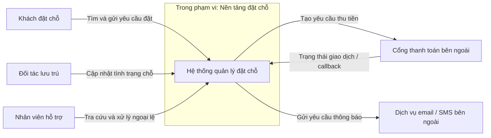
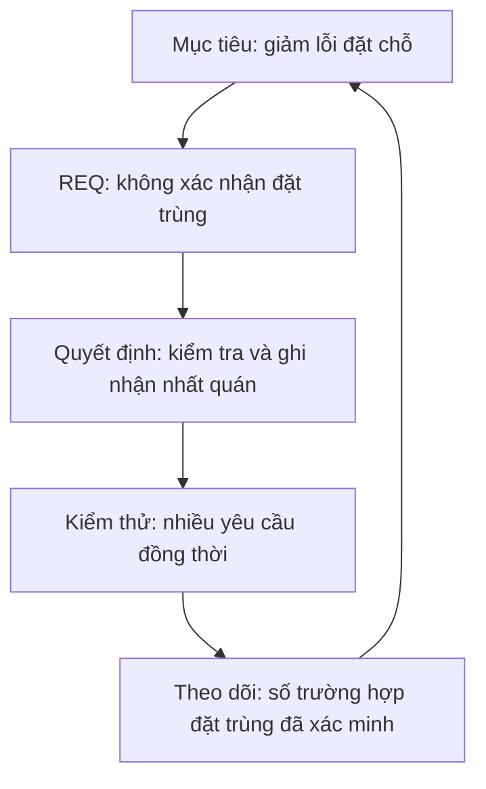

# Xác định mục tiêu nghiệp vụ, bên liên quan và phạm vi hệ thống

## 1. Vì sao phải làm rõ yêu cầu trước khi thiết kế cloud?

Một kiến trúc cloud tốt không bắt đầu bằng việc chọn Kubernetes, serverless, cơ sở dữ liệu hay nhà cung cấp dịch vụ. Nó bắt đầu bằng câu hỏi: **hệ thống cần tạo ra kết quả gì cho tổ chức, phục vụ ai và chịu trách nhiệm đến đâu?** Khi chưa có câu trả lời, một phương án có thể rất hiện đại về công nghệ nhưng vẫn thất bại vì không giải quyết đúng vấn đề, chi phí vượt khả năng chi trả hoặc không đáp ứng yêu cầu bảo mật và vận hành.

Trong quy trình thiết kế kiến trúc ứng dụng trên đám mây, việc xác định mục tiêu nghiệp vụ, các bên liên quan và phạm vi hệ thống tạo ra đầu vào cho mọi quyết định tiếp theo về mạng, compute, dữ liệu, triển khai và vận hành. Đây cũng là nền tảng để đánh giá các đánh đổi giữa **độ tin cậy, bảo mật, khả năng mở rộng, hiệu năng, chi phí và khả năng vận hành** theo tư duy Well-Architected.

Sau bài học, bạn có thể:

- Phân biệt mục tiêu nghiệp vụ, chỉ số thành công, yêu cầu chức năng, yêu cầu chất lượng và giải pháp kỹ thuật.
- Nhận diện người dùng, bên ra quyết định, bên vận hành và các hệ thống/đối tác phụ thuộc; xác định ai có quyền phê duyệt từng yêu cầu.
- Diễn đạt phạm vi trong/ngoài hệ thống, các ranh giới tin cậy, luồng dữ liệu và trách nhiệm tích hợp.
- Biến các kỳ vọng mơ hồ thành yêu cầu có tiêu chí đo lường, ưu tiên, chủ sở hữu và cách xác minh.
- Soạn một bản tóm tắt yêu cầu kiến trúc đủ rõ để nhóm kỹ thuật bắt đầu so sánh phương án cloud.

## 2. Bốn khái niệm dễ bị nhầm lẫn

| Khái niệm | Câu hỏi cần trả lời | Ví dụ đối với ứng dụng đặt chỗ |
| --- | --- | --- |
| **Mục tiêu nghiệp vụ** (*business objective*) | Tổ chức muốn cải thiện kết quả nào và vì sao? | Giảm tỷ lệ khách bỏ dở quá trình đặt chỗ. |
| **Yêu cầu** (*requirement*) | Hệ thống phải làm gì hoặc đáp ứng điều kiện nào? | Khách có thể giữ chỗ trong thời gian giới hạn; một chỗ không được xác nhận cho hai khách cùng lúc. |
| **Phạm vi hệ thống** (*system scope*) | Nhóm xây dựng chịu trách nhiệm cung cấp chức năng, dữ liệu và tích hợp nào? | Quản lý tồn chỗ và trạng thái đặt chỗ; dùng cổng thanh toán bên ngoài để thu tiền. |
| **Giải pháp kiến trúc** (*architecture decision*) | Thiết kế kỹ thuật nào đáp ứng yêu cầu với đánh đổi chấp nhận được? | Sử dụng giao dịch có ràng buộc nhất quán khi xác nhận đặt chỗ, và hàng đợi cho thông báo. |

Thứ tự lập luận hữu ích là: **vấn đề nghiệp vụ → kết quả mong muốn → yêu cầu kiểm chứng được → phương án kiến trúc → đo lường sau triển khai**. Không nên viết “phải dùng microservices” như một mục tiêu nghiệp vụ. Đó là một lựa chọn thiết kế cần được chứng minh bằng các yêu cầu cụ thể, chẳng hạn khả năng triển khai độc lập, ranh giới sở hữu dữ liệu hoặc quy mô tổ chức phát triển.

Một mục tiêu như “hệ thống phải nhanh” chưa đủ để kiến trúc sư chọn công nghệ. Cần biết **tác vụ nào nhanh**, mức độ nhanh bao nhiêu, trong điều kiện tải nào, đo ở đâu, trong giai đoạn nào và do ai chấp thuận. Nếu những thông số chưa có bằng chứng, ghi chúng là giả định cần xác nhận thay vì biến thành cam kết.

## 3. Bước 1 — Hiểu bối cảnh và kết quả nghiệp vụ

### 3.1. Bắt đầu từ vấn đề thực tế

Phỏng vấn bên sở hữu sản phẩm và người trực tiếp sử dụng quy trình hiện tại (*as-is*). Thu thập các điểm nghẽn, chi phí, rủi ro và hệ quả nếu không thay đổi:

1. **Bối cảnh:** Ai thực hiện công việc? Quy trình hiện nay diễn ra thế nào? Các hệ thống nào đang hỗ trợ?
2. **Vấn đề:** Tổ chức đang mất doanh thu, tốn nhân lực, gặp rủi ro hay không đạt kỳ vọng của khách hàng ở đâu?
3. **Bằng chứng:** Có số liệu, nhật ký sự cố, phản hồi khách hàng hoặc dữ liệu vận hành nào chứng minh vấn đề?
4. **Kết quả mong muốn:** Thay đổi nào có giá trị với tổ chức nếu dự án thành công?
5. **Giới hạn:** Thời hạn, ngân sách, nghĩa vụ tuân thủ, dữ liệu đang có và các hệ thống cũ hạn chế lựa chọn nào?

Ví dụ, câu nói “cần đưa hệ thống lên cloud để mở rộng” là một **đề xuất hướng giải pháp**. Sau khi hỏi thêm, nhóm có thể xác định vấn đề thực sự là “các đợt khuyến mại làm tăng số lượt đặt chỗ và hệ thống hiện tại thường không xử lý kịp”. Thông tin thứ hai có giá trị hơn để lựa chọn cách mở rộng, kiểm soát tồn chỗ và hoạch định chi phí.

### 3.2. Viết mục tiêu đo được, đồng thời nêu rào chắn

Mục tiêu cần cụ thể, đo được, có thời hạn và gắn với kết quả kinh doanh. Có thể dùng cấu trúc:

> Đến **[mốc thời gian]**, cải thiện **[chỉ số nghiệp vụ]** từ **[giá trị hiện tại]** lên **[mục tiêu]** cho **[nhóm người dùng/quy trình]**, dựa trên **[nguồn dữ liệu]**, dưới các điều kiện **[ràng buộc]**.

Các con số trong bảng dưới đây **chỉ là ví dụ giả định để luyện tập**, không phải mức chuẩn áp dụng cho mọi hệ thống:

| Thành phần | Cách ghi có thể kiểm chứng |
| --- | --- |
| Mục tiêu kinh doanh | Trong 6 tháng sau khi ra mắt, tăng tỷ lệ hoàn tất đặt chỗ hợp lệ từ 68% lên 78%. |
| Định nghĩa chỉ số | Tỷ lệ = số phiên đặt chỗ hợp lệ hoàn tất / tổng số phiên đặt chỗ hợp lệ bắt đầu trong cùng kỳ. |
| Dữ liệu và chủ sở hữu | Sự kiện phân tích hành trình khách hàng; Product Owner chịu trách nhiệm xác nhận cách tính. |
| Rào chắn chất lượng | Không tăng tỷ lệ đặt trùng, không vi phạm yêu cầu bảo vệ dữ liệu cá nhân và không vượt ngân sách vận hành đã duyệt. |
| Thời điểm đánh giá | Đo đường cơ sở trước khi thay đổi, theo dõi hằng tuần sau phát hành, đánh giá sau 6 tháng. |

Không đồng nhất **KPI nghiệp vụ** với **SLO kỹ thuật**. Tỷ lệ hoàn tất đặt chỗ chịu ảnh hưởng của giá, trải nghiệm người dùng, chính sách hủy và nhiều yếu tố ngoài kiến trúc. Ngược lại, thời gian phản hồi ở phân vị p95, tỷ lệ yêu cầu lỗi và độ sẵn sàng là các chỉ số mà nhóm kỹ thuật có thể tác động trực tiếp hơn. Cần nối chúng bằng giả thuyết có thể kiểm chứng, chẳng hạn “giảm độ trễ trong bước thanh toán sẽ giảm số phiên bị bỏ dở”, rồi đo xem giả thuyết có đúng hay không.

### 3.3. Phân loại mục tiêu, ràng buộc và giả định

- **Mục tiêu:** Điều muốn tối ưu, ví dụ giảm thời gian xác nhận đặt chỗ.
- **Ràng buộc bắt buộc:** Điều không được vi phạm, ví dụ giới hạn xử lý dữ liệu theo chính sách pháp lý đã được bộ phận phụ trách xác nhận.
- **Giả định:** Điều đang tạm tin nhưng chưa xác thực, ví dụ “dịch vụ thanh toán luôn trả callback trong 30 giây”.
- **Phụ thuộc:** Điều dự án không tự kiểm soát hoàn toàn, ví dụ hợp đồng và giới hạn API của nhà cung cấp thanh toán.

Mỗi giả định nên có người xác minh, bằng chứng cần thu thập và hạn chót xác nhận. Thiết kế dựa trên giả định chưa kiểm chứng có thể khiến cả mô hình triển khai phải thay đổi về sau.

## 4. Bước 2 — Xác định các bên liên quan và quyền quyết định

**Stakeholder** là cá nhân, nhóm hoặc tổ chức có ảnh hưởng đến dự án hoặc chịu tác động từ kết quả dự án. **Actor** là người hoặc hệ thống trực tiếp tương tác với hệ thống trong một luồng nghiệp vụ. Một bên liên quan có thể không phải actor, ví dụ bộ phận tài chính phê duyệt ngân sách nhưng không sử dụng chức năng đặt chỗ.

### 4.1. Bản đồ các bên liên quan

| Nhóm | Điều họ quan tâm | Câu hỏi cần xác nhận |
| --- | --- | --- |
| Sponsor / người bảo trợ | Lợi ích, chi phí, tiến độ, rủi ro | Tiêu chí nào quyết định dự án thành công và ai phê duyệt đánh đổi lớn? |
| Product Owner / nghiệp vụ | Quy trình, phạm vi phát hành, trải nghiệm | Quy trình nào cần hỗ trợ đầu tiên? Trường hợp ngoại lệ nào là quan trọng? |
| Người dùng cuối | Độ dễ dùng, tốc độ, tính đúng đắn | Bước nào hiện gây thất bại hoặc chậm trễ? |
| Đơn vị vận hành nghiệp vụ | Xử lý ngoại lệ, đối soát, hỗ trợ khách hàng | Khi thanh toán thành công nhưng xác nhận thất bại thì xử lý ra sao? |
| Kiến trúc sư / đội phát triển | Tính khả thi, tích hợp, dữ liệu, khả năng thay đổi | Những hệ thống và hợp đồng API nào đã tồn tại? |
| Platform / SRE / vận hành cloud | Giám sát, triển khai, phục hồi, trực sự cố | Ai chịu trách nhiệm on-call, backup, khôi phục và chi phí môi trường? |
| An toàn thông tin / pháp chế | Truy cập, bảo vệ dữ liệu, tuân thủ | Loại dữ liệu nào nhạy cảm? Yêu cầu lưu trữ, xóa, kiểm toán là gì? |
| Tài chính / mua sắm | Ngân sách và hợp đồng | Ngưỡng chi phí, cách phân bổ chi phí và giới hạn cam kết là gì? |
| Nhà cung cấp ngoài | API, giới hạn, SLA hợp đồng | Họ đảm bảo gì, phụ thuộc gì và có phương án xử lý khi họ ngừng hoạt động không? |

Không chỉ hỏi người đưa ra yêu cầu ban đầu. Người vận hành thường biết các kịch bản lỗi và ràng buộc mà người lập kế hoạch chưa nhìn thấy; bộ phận bảo mật hoặc tài chính có thể phát hiện yêu cầu buộc phải đổi kiến trúc từ sớm.

### 4.2. Gán trách nhiệm bằng RACI

RACI giúp tránh tình trạng yêu cầu không có người phê duyệt:

- **R — Responsible:** Thực hiện công việc.
- **A — Accountable:** Chịu trách nhiệm cuối cùng, có quyền phê duyệt; thông thường chỉ một A cho mỗi quyết định.
- **C — Consulted:** Được tham vấn trước quyết định.
- **I — Informed:** Được thông báo kết quả.

Ví dụ phân quyền cho một dự án cloud (vai trò thực tế có thể khác):

| Quyết định / đầu ra | Sponsor | Product Owner | Kiến trúc sư | SRE | Security |
| --- | :---: | :---: | :---: | :---: | :---: |
| Chốt mục tiêu và KPI nghiệp vụ | A | R | C | I | I |
| Chốt chức năng cho lần phát hành đầu | I | A | R | C | C |
| Chọn phương án kiến trúc đáp ứng yêu cầu | I | C | A/R | C | C |
| Xác nhận phương án trực vận hành và phục hồi | I | C | R | A | C |
| Xác nhận yêu cầu kiểm soát an toàn thông tin | I | C | R | C | A |

Ma trận là điểm khởi đầu để thảo luận, không phải sơ đồ tổ chức cố định. Nếu hai bên yêu cầu trái nhau, ví dụ đội kinh doanh muốn phát hành sớm còn đội bảo mật yêu cầu hoàn thiện kiểm soát truy cập, hãy ghi rõ xung đột, hệ quả, người có quyền quyết định và phương án xử lý; không được âm thầm bỏ qua yêu cầu bắt buộc.

## 5. Bước 3 — Hiểu quy trình nghiệp vụ và tác nhân tương tác

Trước khi vẽ các thành phần kỹ thuật, hãy mô tả **luồng nghiệp vụ từ đầu đến cuối** theo ngôn ngữ mà người sở hữu quy trình có thể kiểm tra. Một luồng nên có tác nhân khởi tạo, điều kiện bắt đầu, các bước chính, trạng thái thành công, trường hợp ngoại lệ và dữ liệu tạo ra.

Ví dụ luồng “khách đặt một chỗ lưu trú”:

1. Khách chọn ngày và xem thông tin khả dụng.
2. Hệ thống kiểm tra khả dụng, áp dụng chính sách giá và tạo một yêu cầu giữ chỗ tạm thời.
3. Khách thực hiện thanh toán thông qua nhà cung cấp bên ngoài.
4. Hệ thống nhận và kiểm tra kết quả thanh toán; nếu hợp lệ, xác nhận đặt chỗ và cập nhật tồn chỗ.
5. Hệ thống gửi thông báo; bộ phận hỗ trợ có thể xem trạng thái để giải quyết bất thường.

Các câu hỏi kiểm tra bắt buộc gồm: Nếu hai người giữ cùng một chỗ thì sao? Nếu thanh toán đã trừ tiền nhưng callback đến trễ thì sao? Nếu người dùng nhấn nút hai lần thì sao? Nếu dịch vụ thông báo ngừng hoạt động thì đặt chỗ có bị coi là thất bại không? Nếu khách hủy, điều kiện hoàn tiền và hoàn tồn chỗ do ai định nghĩa?

Chính các nhánh ngoại lệ này dẫn đến yêu cầu về **nhất quán dữ liệu, idempotency, retry, timeout, đối soát và quan sát hệ thống**. Chúng nên được nêu rõ trước khi chọn database, message queue hoặc kiểu triển khai.

## 6. Bước 4 — Vẽ ranh giới và xác định phạm vi hệ thống

### 6.1. Chọn đúng “hệ thống đang thiết kế”

**System of interest** là hệ thống hoặc phần hệ thống mà nhóm có trách nhiệm thiết kế. Một sơ đồ ngữ cảnh kiểu C4 System Context giúp trả lời: Ai dùng nó? Nó giao tiếp với hệ thống nào? Dữ liệu đi qua ranh giới nào? Ai sở hữu phần còn lại?

Sơ đồ ngữ cảnh dưới đây minh họa hệ thống đặt chỗ ở mức khái niệm:



Đường bao trong hình thể hiện **trách nhiệm hệ thống**, không tự động tương đương với ranh giới VPC, tài khoản cloud, vùng triển khai hay ranh giới tuân thủ. Những ranh giới kỹ thuật và bảo mật này cần được làm rõ riêng ở giai đoạn thiết kế. Dù cổng thanh toán nằm ngoài phạm vi xây dựng, hợp đồng API, lỗi tích hợp, dữ liệu trao đổi và quy trình xử lý ngoại lệ vẫn thuộc trách nhiệm **tích hợp** của hệ thống đặt chỗ.

### 6.2. Phân biệt trong phạm vi, ngoài phạm vi và phụ thuộc

| Hạng mục | Pha 1 | Giải thích / ranh giới trách nhiệm |
| --- | --- | --- |
| Tra cứu chỗ trống, yêu cầu giữ chỗ, xác nhận/hủy đặt chỗ | **Trong phạm vi** | Đội dự án chịu trách nhiệm xử lý trạng thái và quy tắc nghiệp vụ. |
| API quản lý tình trạng chỗ cho đối tác | **Trong phạm vi** | Có hợp đồng xác thực, phân quyền, giới hạn tốc độ và kiểm tra dữ liệu. |
| Kết nối nhà cung cấp thanh toán | **Trong phạm vi tích hợp** | Hệ thống gọi API, tiếp nhận callback, đối soát và xử lý lỗi. |
| Xử lý thanh toán lõi và lưu dữ liệu thẻ | **Ngoài phạm vi** | Nhà cung cấp bên ngoài đảm nhận theo hợp đồng; cần xác nhận phạm vi dữ liệu đi qua hệ thống. |
| Công cụ gợi ý địa điểm bằng máy học | **Ngoài phạm vi pha 1** | Có thể đưa vào roadmap nếu sau này được duyệt. |
| Tính sẵn có của API nhà cung cấp và hợp đồng dịch vụ | **Phụ thuộc bên ngoài** | Cần kế hoạch timeout, retry, cảnh báo, đối soát và đầu mối liên hệ. |

Một phạm vi đầy đủ nên trả lời cả các câu hỏi:

- **Chức năng:** Hành trình người dùng và hành vi nào được hỗ trợ trong lần phát hành này?
- **Dữ liệu:** Hệ thống tạo, đọc, chỉnh sửa, lưu giữ hay xóa loại dữ liệu nào? Ai là nguồn dữ liệu đáng tin cậy (*system of record*)?
- **Tích hợp:** Có phụ thuộc đồng bộ/bất đồng bộ vào hệ thống khác hay không? Ai chịu trách nhiệm khi hệ thống kia lỗi?
- **Người dùng và khu vực:** Nhóm khách hàng, đối tác, vùng địa lý và khung thời gian sử dụng nào được hỗ trợ?
- **Vận hành:** Ai giám sát, quản trị quyền truy cập, xử lý sự cố, sao lưu và khôi phục?
- **Giai đoạn:** Phần nào bắt buộc trong pha 1, phần nào có thể hoãn? Điều kiện mở rộng pha là gì?

### 6.3. Ranh giới dữ liệu và ranh giới tin cậy

Đối với mỗi luồng đi qua ranh giới hệ thống, ghi rõ **dữ liệu trao đổi, bên điều khiển, cơ chế xác thực, yêu cầu mã hóa, quyền truy cập, thời gian lưu giữ, khả năng truy vết và cách xử lý lỗi**. Ví dụ:

| Luồng | Dữ liệu chính | Rủi ro / câu hỏi kiến trúc cần xác nhận |
| --- | --- | --- |
| Khách → ứng dụng | Danh tính, ngày đặt, thông tin liên hệ | Cách xác thực, chống lạm dụng, bảo vệ dữ liệu cá nhân và chống giả mạo yêu cầu. |
| Đối tác → ứng dụng | Số chỗ, giá, lịch khả dụng | Ai có quyền cập nhật? Xử lý cập nhật trễ hoặc xung đột thế nào? |
| Ứng dụng ↔ cổng thanh toán | Mã giao dịch, số tiền, trạng thái | Xác minh callback/chữ ký, idempotency, timeout, đối soát giao dịch; giới hạn dữ liệu nhạy cảm. |
| Ứng dụng → dịch vụ thông báo | Địa chỉ nhận, mẫu thông báo | Bảo vệ thông tin cá nhân, retry và thời hạn xử lý khi nhà cung cấp lỗi. |

Không giả định rằng “dùng dịch vụ cloud được quản lý” có nghĩa là nhà cung cấp gánh mọi trách nhiệm bảo mật. Cần xác định phần trách nhiệm của đội ứng dụng và phần trách nhiệm của nhà cung cấp đối với cấu hình, danh tính, dữ liệu, mạng, ghi log và khả năng phục hồi.

## 7. Bước 5 — Chuyển mong muốn thành yêu cầu kiến trúc có thể kiểm chứng

### 7.1. Yêu cầu chức năng và yêu cầu chất lượng

**Yêu cầu chức năng** mô tả hành vi hệ thống: tra cứu chỗ, tạo đặt chỗ, thanh toán, hủy, báo cáo. **Yêu cầu chất lượng / phi chức năng** mô tả hệ thống phải thực hiện các hành vi đó tốt đến đâu và dưới điều kiện nào. Chúng quyết định phần lớn đánh đổi khi thiết kế cloud.

| Thuộc tính | Câu hỏi cần làm rõ | Tác động đến phương án cloud |
| --- | --- | --- |
| Độ tin cậy và tính sẵn sàng | Luồng nào quan trọng nhất? Chấp nhận gián đoạn bao lâu? | Dự phòng, kiến trúc chống lỗi, triển khai nhiều vùng sẵn sàng, kế hoạch phục hồi. |
| Tính đúng đắn / nhất quán | Dữ liệu nào không được ghi sai hoặc mất? | Giao dịch, mô hình dữ liệu, cơ chế khóa/đặt chỗ, xử lý trùng lặp. |
| Hiệu năng | p95/p99 của thao tác nào, ở tải và vùng người dùng nào? | Cache, compute, cấu trúc truy vấn, phân phối lưu lượng, mạng. |
| Khả năng mở rộng | Tải trung bình, đỉnh, tăng trưởng và mẫu burst ra sao? | Scale ngang/dọc, kiểm soát backpressure, xử lý bất đồng bộ. |
| Bảo mật và quyền riêng tư | Ai được phép truy cập loại dữ liệu nào? Cần kiểm toán gì? | IAM, phân đoạn mạng, mã hóa, quản lý bí mật, logging và kiểm soát dữ liệu. |
| Khả năng vận hành | Ai trực sự cố? Cần phát hiện, chẩn đoán và triển khai thế nào? | Logs, metrics, traces, cảnh báo, runbook, CI/CD, rollback. |
| Phục hồi sau thảm họa | Tối đa chấp nhận mất bao nhiêu dữ liệu và dừng bao lâu? | Mục tiêu RPO/RTO, backup, khôi phục thử nghiệm, phương án vùng dự phòng. |
| Chi phí | Ngân sách và đơn vị chi phí quan trọng là gì? | Quy mô tài nguyên, lựa chọn dịch vụ, vòng đời dữ liệu, giới hạn chi tiêu. |

**RTO** (*Recovery Time Objective*) là khoảng thời gian mục tiêu để khôi phục hoạt động sau sự cố. **RPO** (*Recovery Point Objective*) là mức mất dữ liệu theo thời gian tối đa có thể chấp nhận tại điểm khôi phục. Hai chỉ số này do nghiệp vụ thỏa thuận theo tác động của sự cố và cần được kiểm tra bằng diễn tập; chúng không tự động bằng độ trễ sao lưu hay cam kết SLA của nhà cung cấp cloud.

### 7.2. Viết yêu cầu theo kịch bản thuộc tính chất lượng

Một kịch bản tốt nêu **nguồn gây sự kiện, tác nhân/sự kiện, môi trường, phần hệ thống bị tác động, phản ứng mong đợi và thước đo**. Định dạng có thể dùng:

> Khi **[sự kiện]** xảy ra trong **[điều kiện]**, **[hệ thống/phần hệ thống]** phải **[phản ứng]**, được đo bằng **[chỉ số, ngưỡng, cửa sổ đo và phương pháp kiểm thử]**.

Ví dụ minh họa (các ngưỡng là giả định, cần Product Owner, SRE và bảo mật xác nhận):

| Mã | Kịch bản yêu cầu | Cách xác minh |
| --- | --- | --- |
| QA-01 | Trong chiến dịch cao điểm với 500 yêu cầu tra cứu/giây, 95% yêu cầu tra cứu hợp lệ hoàn thành dưới 800 ms tại điểm đo API. | Load test với mẫu dữ liệu, cấu hình và khu vực truy cập đại diện; báo cáo p95 và tỷ lệ lỗi. |
| QA-02 | Nếu nhà cung cấp thông báo không phản hồi trong 30 giây, đặt chỗ đã xác nhận vẫn giữ trạng thái chính xác và yêu cầu thông báo được xử lý lại theo chính sách. | Mô phỏng timeout, kiểm tra trạng thái đặt chỗ và cơ chế retry có giới hạn. |
| QA-03 | Nếu hai khách đồng thời xác nhận cùng một đơn vị chỗ, tối đa một yêu cầu được chấp nhận; không phát sinh đặt chỗ trùng trong dữ liệu có hiệu lực. | Kiểm thử cạnh tranh đồng thời, kiểm tra ràng buộc dữ liệu và đối soát. |
| QA-04 | Khi một vùng sẵn sàng gặp sự cố, luồng tra cứu và đặt chỗ quan trọng đạt thời gian phục hồi đã được phê duyệt. | Game day / diễn tập failover theo RTO đã chốt và đo mất dữ liệu theo RPO. |

Ở QA-01, phải phân biệt **requests/giây** với **người dùng đồng thời** và xác định điểm đo từ trình duyệt, gateway hay API; các đại lượng này không thay thế cho nhau. Ở QA-04, không nên đưa con số RTO/RPO tùy ý vào hợp đồng yêu cầu nếu bên nghiệp vụ chưa xác nhận tác động và chi phí.

### 7.3. Mẫu ghi yêu cầu để truy vết

Một yêu cầu nên có ít nhất: mã, mục đích nghiệp vụ, nội dung, độ ưu tiên, chủ sở hữu, nguồn, tiêu chí chấp nhận, phương pháp đo, ràng buộc và trạng thái xác nhận.

```yaml
id: QA-03
business_goal: Giam loi dat trung cho
description: Khong co hai dat cho da xac nhan cho cung mot don vi cho va khoang thoi gian
priority: Must
owner: Product Owner
consulted: [Engineering, Operations]
acceptance: Kiem thu giao dich dong thoi va doi soat du lieu khong tim thay dat trung
verification: Concurrent integration test + reconciliation report
status: Can xac nhan voi nghiep vu
```

Đây là **mẫu biểu yêu cầu**, không phải cấu hình triển khai. Trong dự án thực tế có thể viết đầy đủ dấu tiếng Việt và tách các điều kiện chấp nhận thành từng trường có thể tự động kiểm thử. Với chỉ số định lượng, bổ sung giá trị đường cơ sở, mục tiêu, mốc thời gian, phạm vi đo và hệ thống thu thập dữ liệu.

## 8. Bước 6 — Ưu tiên yêu cầu và quản lý đánh đổi

Nguồn lực có hạn nên mọi mong muốn không thể có cùng độ ưu tiên. Có thể dùng MoSCoW:

| Mức | Ý nghĩa | Ví dụ |
| --- | --- | --- |
| **Must have** | Bắt buộc để luồng cốt lõi hoặc nghĩa vụ pháp lý vận hành đúng. | Không xác nhận hai đặt chỗ trùng; chỉ người được phép xem dữ liệu khách. |
| **Should have** | Quan trọng, nhưng có phương án tạm hoặc có thể đưa sang đợt sau. | Trang quản trị có bộ lọc nâng cao để xử lý ngoại lệ. |
| **Could have** | Tạo thêm giá trị nếu còn nguồn lực. | Gợi ý địa điểm bằng cá nhân hóa. |
| **Won't have (pha này)** | Được chủ động loại khỏi phạm vi hiện tại. | Xây dựng cổng thanh toán nội bộ. |

Các yêu cầu pháp lý và an toàn bắt buộc không thể bị hạ cấp chỉ vì thiếu ngân sách. Khi hai mục tiêu cùng quan trọng nhưng xung đột, trình bày các lựa chọn kèm hậu quả và xin quyết định từ người có thẩm quyền.

Ví dụ, nghiệp vụ muốn mọi kết quả tìm kiếm phản ánh tình trạng còn chỗ tức thời, còn đội vận hành cần chịu tải truy cập lớn với chi phí hợp lý. Một lựa chọn có thể cho phép **danh sách tra cứu cập nhật trễ trong giới hạn được thống nhất**, nhưng **bước xác nhận phải kiểm tra lại và bảo đảm không đặt trùng**. Đây là quyết định về mức nhất quán theo từng hành vi, không phải áp một chính sách duy nhất lên toàn bộ hệ thống.

Khi chuẩn bị so sánh kiến trúc, có thể lập bảng quyết định ngắn:

| Phương án | Lợi ích | Chi phí / rủi ro | Điều kiện lựa chọn |
| --- | --- | --- | --- |
| Hệ thống đơn khối triển khai trên dịch vụ managed | Đơn giản trong phát triển, giao dịch và vận hành ban đầu. | Các phần có thể khó mở rộng độc lập khi độ phức tạp tăng. | Đội nhỏ, một miền nghiệp vụ và tốc độ phát hành quan trọng. |
| Chia thành các dịch vụ theo miền nghiệp vụ | Có thể mở rộng, triển khai và phân quyền theo miền độc lập. | Gia tăng tích hợp, quan sát, giao dịch phân tán và chi phí vận hành. | Ranh giới nghiệp vụ rõ, nhu cầu độc lập có bằng chứng, đội có năng lực vận hành. |

Bảng này **không quyết định kiến trúc trước**: nó chỉ chỉ ra những bằng chứng cần có. Quyết định sau cùng nên được ghi thành ADR (*Architecture Decision Record*) với bối cảnh, phương án đã cân nhắc, quyết định, đánh đổi và điều kiện xem xét lại.

## 9. Ví dụ xuyên suốt: dự án nền tảng đặt chỗ pha 1

Giả sử một doanh nghiệp giả định muốn xây dựng dịch vụ đặt chỗ qua web và mở rộng vào các mùa cao điểm. Sau workshop, nhóm ghi nhận những thông tin sau. Đây là **dữ liệu minh họa**, không phải thống kê của một doanh nghiệp cụ thể.

### 9.1. Bản tóm tắt mục tiêu và giới hạn

| Mục | Nội dung đã ghi nhận |
| --- | --- |
| Vấn đề | Khách bỏ dở ở bước xác nhận; đợt cao điểm có nguy cơ quá tải và đặt trùng. |
| Giá trị kỳ vọng | Cải thiện tỷ lệ hoàn tất đặt chỗ, giảm số ca hỗ trợ liên quan đến trạng thái thanh toán/đặt chỗ. |
| KPI | Tỷ lệ hoàn tất phiên hợp lệ và số trường hợp đặt trùng đã xác minh; đo đường cơ sở trước khi đặt mục tiêu cuối. |
| Tác nhân chính | Khách hàng, đối tác cung cấp chỗ, nhân viên hỗ trợ. |
| Hệ thống phụ thuộc | Cổng thanh toán, dịch vụ thông báo, hệ thống báo cáo hiện có (nếu cần tích hợp). |
| Trong phạm vi pha 1 | Tra cứu, giữ chỗ, thanh toán qua đối tác, xác nhận, hủy cơ bản, tra cứu trạng thái và quan sát vận hành. |
| Ngoài phạm vi pha 1 | Tự xử lý thẻ thanh toán, gợi ý bằng máy học, mở rộng sang tất cả quốc gia. |
| Ràng buộc cần xác nhận | Ngân sách, vị trí xử lý dữ liệu, thời gian lưu dữ liệu, yêu cầu RTO/RPO, giới hạn API và năng lực trực vận hành. |

### 9.2. Từ câu hỏi nghiệp vụ đến yêu cầu kỹ thuật

| Câu hỏi hoặc rủi ro | Yêu cầu cần xác nhận | Hướng ảnh hưởng kiến trúc |
| --- | --- | --- |
| Nhiều khách đặt cùng một chỗ | Không có hai đặt chỗ đã xác nhận chồng lấn cho cùng một đơn vị chỗ. | Mô hình tồn chỗ, giao dịch nhất quán, kiểm thử cạnh tranh, idempotency. |
| Callback thanh toán đến trễ hoặc lặp | Cùng một giao dịch không được xác nhận/ghi sổ hai lần; có khả năng đối soát. | Trạng thái hữu hạn, khóa idempotency, ghi log sự kiện, xử lý retry. |
| Tăng tải bất thường | Duy trì ngưỡng thời gian phản hồi và lỗi đã thống nhất trong mẫu tải cao điểm. | Load test, autoscaling, cache hợp lý, giới hạn tốc độ và backpressure. |
| Nhà cung cấp thông báo lỗi | Giao dịch đặt chỗ không phụ thuộc vào việc gửi email/SMS thành công tức thì. | Tách xử lý thông báo, hàng đợi, retry và dead-letter handling nếu cần. |
| Khó tìm nguyên nhân khi khách báo lỗi | Có thể truy vết từ yêu cầu người dùng đến đặt chỗ và giao dịch liên quan. | Correlation ID, logs/metrics/traces, dashboard và quy trình xử lý sự cố. |
| Chi phí cloud tăng khó dự báo | Theo dõi chi phí theo môi trường và theo số đặt chỗ hoàn tất. | Tagging, budget alerts, báo cáo chi phí đơn vị, kiểm tra quy mô tài nguyên. |

Không phải tất cả các hướng xử lý ở cột cuối đều được triển khai ngay. Chúng là **ứng viên giải pháp** để đánh giá sau khi mục tiêu, độ ưu tiên, giới hạn và tiêu chí chấp nhận được xác nhận. Ví dụ, chưa thể chọn đa vùng (*multi-region*) nếu chưa biết chi phí gián đoạn, yêu cầu lưu trú dữ liệu, RTO/RPO và khả năng vận hành của đội.

### 9.3. Dấu vết từ yêu cầu đến phép kiểm thử



Luồng truy vết này giúp đánh giá khi thiết kế thay đổi: một giải pháp mới có còn đáp ứng yêu cầu không, phép kiểm thử nào phải chạy lại và KPI nào cần tiếp tục đo? Nó cũng giúp loại bỏ các thành phần kỹ thuật không mang lại lợi ích rõ ràng cho mục tiêu đã chốt.

## 10. Cách tổ chức workshop và bộ tài liệu bàn giao

Một quy trình ngắn có thể thực hiện qua nhiều phiên thay vì cố gắng giải quyết mọi vấn đề trong một cuộc họp:

1. **Khảo sát đầu vào:** Thu thập quy trình hiện tại, số liệu đường cơ sở, hệ thống phụ thuộc và danh sách người chịu trách nhiệm.
2. **Workshop nghiệp vụ:** Chốt vấn đề, nhóm người dùng, hành trình quan trọng, kết quả kỳ vọng, KPI và ranh giới phạm vi.
3. **Workshop chất lượng và rủi ro:** Mời SRE, security, dữ liệu, tài chính và đối tác liên quan để làm rõ lỗi, tải, bảo mật, phục hồi và chi phí.
4. **Chuẩn hóa yêu cầu:** Gắn mã, độ ưu tiên, chủ sở hữu, giả định, tiêu chí chấp nhận và liên hệ đến KPI.
5. **Xác nhận:** Product Owner chốt phạm vi; các bên có trách nhiệm xác nhận điều kiện bảo mật/vận hành/chi phí; sponsor giải quyết xung đột lớn.
6. **Chuyển giao cho thiết kế:** Cung cấp danh sách yêu cầu và sơ đồ ngữ cảnh để kiến trúc sư so sánh phương án, lập thử nghiệm kỹ thuật khi còn rủi ro và ghi ADR.

Một **Architecture Requirements Brief** tối thiểu nên có:

| Phần | Nội dung cần bàn giao |
| --- | --- |
| 1. Bối cảnh | Vấn đề, quy trình hiện tại, lý do cần thay đổi, bằng chứng. |
| 2. Mục tiêu | KPI, đường cơ sở, giá trị đích, thời gian, chủ sở hữu, rào chắn. |
| 3. Stakeholders | Danh sách bên liên quan, vai trò, người duyệt, xung đột chưa xử lý. |
| 4. Luồng nghiệp vụ | Tác nhân, happy path, ngoại lệ, trạng thái quan trọng, dữ liệu. |
| 5. Ngữ cảnh và phạm vi | System context, trong/ngoài phạm vi, tích hợp và ranh giới dữ liệu/trách nhiệm. |
| 6. Yêu cầu kiến trúc | Functional/NFR, độ ưu tiên, tiêu chí đo và phương pháp xác minh. |
| 7. Điều kiện triển khai | Ràng buộc, giả định, phụ thuộc, ngân sách, lịch trình, năng lực vận hành. |
| 8. Quyết định mở | Điểm chưa rõ, ai phải trả lời, thời hạn, rủi ro nếu chậm xác nhận. |

**Tiêu chí sẵn sàng chuyển sang thiết kế:**

- Có ít nhất một mục tiêu nghiệp vụ với cách đo, người sở hữu và mốc đánh giá rõ ràng.
- Các tác nhân, hệ thống phụ thuộc, ranh giới trách nhiệm và phạm vi pha đầu được các bên xác nhận.
- Luồng cốt lõi và các nhánh lỗi quan trọng đã được mô tả, kể cả tình huống dữ liệu không nhất quán.
- Yêu cầu chất lượng quan trọng có điều kiện đo hoặc được ghi công khai là chưa quyết định; không có cam kết ngầm.
- Ràng buộc pháp lý, bảo mật, dữ liệu, ngân sách và vận hành đã có đầu mối chịu trách nhiệm xác nhận.
- Yêu cầu có ưu tiên và tiêu chí chấp nhận; các xung đột và giả định chưa giải quyết có người phụ trách.

Nếu còn thiếu số liệu thực tế, có thể tiến hành **spike/proof of concept** hoặc đo đường cơ sở trước khi chốt phương án cuối. Điều cốt yếu là nhận diện sự không chắc chắn, ghi rõ cách kiểm chứng và không ngụy trang giả định thành sự thật.

## 11. Những sai lầm thường gặp

| Sai lầm | Hậu quả | Cách khắc phục |
| --- | --- | --- |
| Chọn dịch vụ cloud trước khi có mục tiêu | Kiến trúc phức tạp, chi phí cao nhưng hiệu quả kinh doanh khó chứng minh. | Viết problem statement và KPI trước khi so sánh dịch vụ. |
| Chỉ phỏng vấn người yêu cầu tính năng | Bỏ sót khâu vận hành, đối soát, bảo mật và xử lý sự cố. | Lập stakeholder map và RACI, đưa các bên chịu ảnh hưởng vào workshop. |
| Viết “nhanh, an toàn, luôn sẵn sàng” | Không thể thiết kế, test hoặc đánh giá đạt/chưa đạt. | Chuyển thành kịch bản chất lượng có điều kiện đo, nguồn dữ liệu và chủ sở hữu. |
| Xem tích hợp ngoài phạm vi là ngoài trách nhiệm | API lỗi gây mất trạng thái hoặc khách bị thu tiền sai mà không có cách xử lý. | Xác định hợp đồng giao tiếp, retry, idempotency, giám sát và trách nhiệm đối soát. |
| Không ghi phần ngoài phạm vi | Phạm vi liên tục mở rộng, khó kiểm soát ngân sách và tiến độ. | Lập bảng in-scope/out-of-scope theo từng pha và quản lý thay đổi. |
| Không phân biệt rủi ro nghiệp vụ và lỗi kỹ thuật | Đầu tư lớn cho rủi ro ít quan trọng; bỏ sót luồng mất doanh thu. | Xếp ưu tiên theo tác động nghiệp vụ, khả năng xảy ra và chi phí giảm thiểu. |
| Coi KPI là cam kết thuần kỹ thuật | Nhóm kiến trúc chịu trách nhiệm cho biến số ngoài quyền kiểm soát. | Tách KPI nghiệp vụ khỏi SLI/SLO kỹ thuật và ghi giả thuyết liên hệ. |

## 12. Bài thực hành áp dụng

Giả sử một doanh nghiệp muốn đưa quy trình đặt lịch khám hiện đang vận hành qua điện thoại lên cloud. Người quản lý nói: “Ứng dụng phải hoạt động 24/7, đặt lịch thật nhanh, bảo mật tuyệt đối và có thể phục vụ hàng triệu khách”. Bạn hãy soạn một bản tóm tắt yêu cầu gồm: **(1)** vấn đề và hai KPI nghiệp vụ có phương pháp đo; **(2)** ít nhất năm stakeholder và người phê duyệt; **(3)** sơ đồ ngữ cảnh với bệnh nhân, lễ tân và hệ thống bệnh viện; **(4)** trong/ngoài phạm vi lần phát hành đầu; **(5)** ba kịch bản chất lượng có điều kiện đo; **(6)** ba giả định cần xác minh.

Khi thực hiện, hãy nêu rõ “hàng triệu khách” là tổng tài khoản, người dùng hằng ngày hay số yêu cầu trong giờ cao điểm; “24/7” là thời gian có thể truy cập hay SLO sẵn sàng với ngân sách lỗi; và “bảo mật tuyệt đối” cần được chuyển thành các yêu cầu kiểm soát, quản trị rủi ro và kiểm chứng cụ thể. Nếu bài toán có dữ liệu sức khỏe, cần mời bên chịu trách nhiệm bảo mật và pháp lý xác nhận nghĩa vụ áp dụng trước khi định ra kiến trúc lưu trữ hay vị trí triển khai.

**Ghi nhớ:** Mục tiêu, stakeholder và phạm vi rõ ràng giúp trả lời *vì sao* kiến trúc tồn tại, *ai* chịu tác động và *đâu* là trách nhiệm của hệ thống. Khi mỗi yêu cầu có bằng chứng, độ ưu tiên và cách xác minh, nhóm mới có cơ sở lựa chọn mạng, compute, dữ liệu và mô hình triển khai phù hợp với các đánh đổi Well-Architected.
