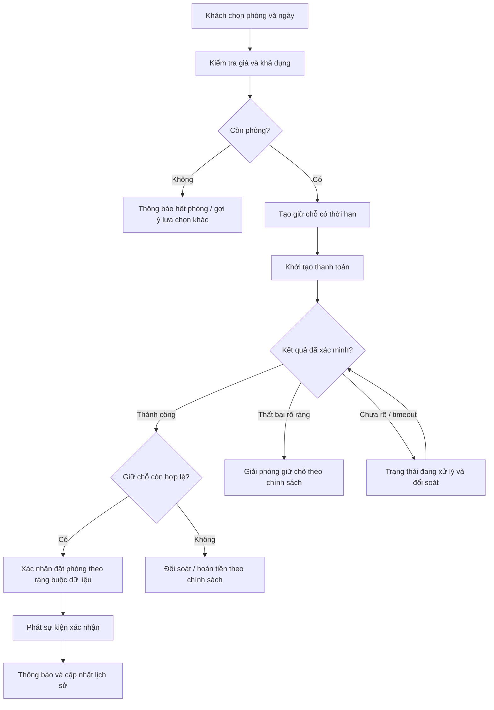
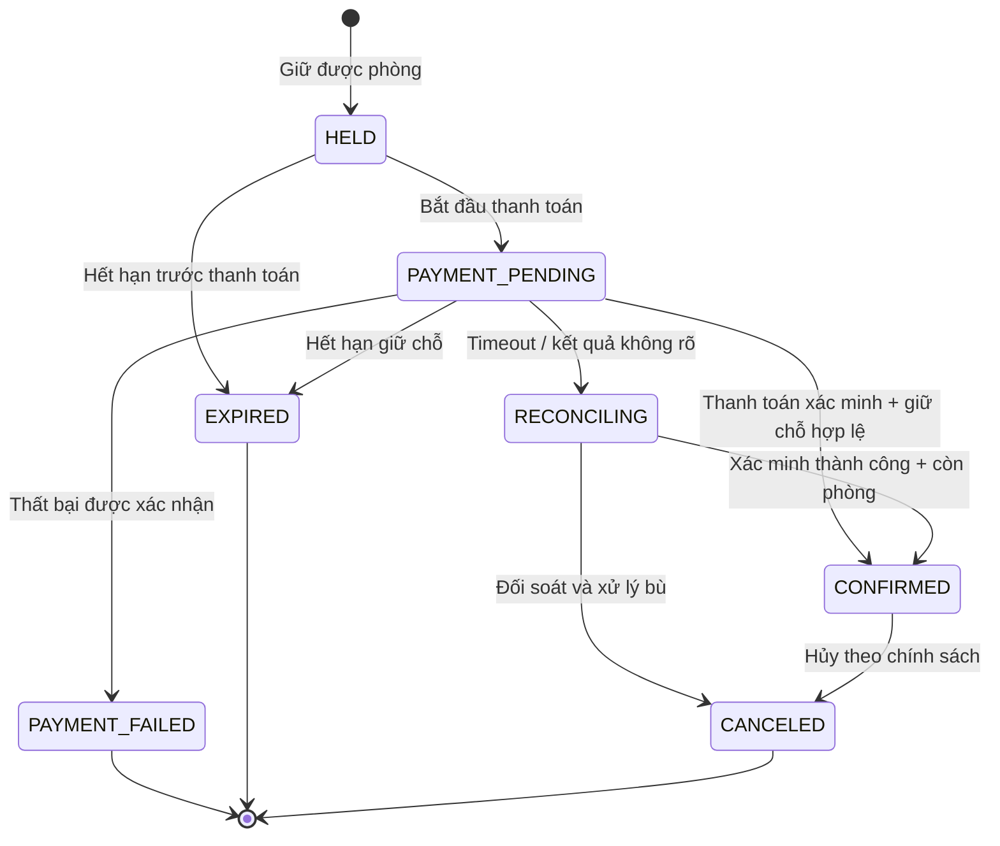
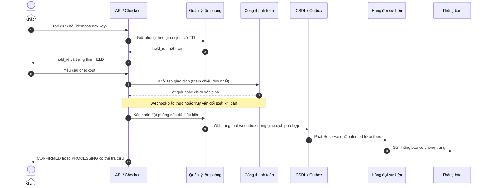

# Phân tích hành trình người dùng và các luồng nghiệp vụ trọng yếu

## 1. Vì sao kiến trúc đám mây phải bắt đầu từ hành trình người dùng?

Một kiến trúc có thể dùng đầy đủ load balancer, container, hàng đợi và cơ sở dữ liệu được quản lý nhưng vẫn thất bại nếu người dùng không hoàn thành được tác vụ quan trọng. Ví dụ, trang tìm kiếm chỗ ở phản hồi nhanh nhưng hai khách có thể thanh toán thành công cho cùng một phòng trong cùng khoảng ngày; hoặc giao dịch đặt phòng đã thành công nhưng người dùng chỉ thấy màn hình lỗi và tiếp tục thanh toán lần nữa. Các sự cố này bắt nguồn từ việc chưa hiểu **luồng nghiệp vụ, trạng thái dữ liệu và điều kiện thành công**, chứ không đơn thuần là thiếu tài nguyên máy chủ.

Trong thiết kế kiến trúc ứng dụng trên đám mây, việc phân tích hành trình giúp chuyển mục tiêu kinh doanh thành yêu cầu cụ thể cho mạng, compute, dữ liệu, tích hợp, mô hình triển khai và vận hành. Nó cũng làm rõ các đánh đổi theo tư duy **Well-Architected**: độ tin cậy, bảo mật, hiệu năng, hiệu quả chi phí và khả năng vận hành. Các quyết định công nghệ chỉ nên được đưa ra sau khi nhóm hiểu luồng nào cần phản hồi tức thời, dữ liệu nào phải nhất quán, chức năng nào được xử lý bất đồng bộ và lỗi nào có thể gây thiệt hại nghiêm trọng.

Sau bài này, người học có thể:

1. Phân biệt hành trình người dùng với luồng nghiệp vụ và mô hình trạng thái của hệ thống.
2. Xác định, ưu tiên và phân rã các luồng nghiệp vụ trọng yếu từ mục tiêu kinh doanh.
3. Chuyển từng bước của hành trình thành yêu cầu kiến trúc có thể đo lường và kiểm chứng.
4. Phân tích các nhánh lỗi, thao tác lặp, phụ thuộc bên ngoài và ranh giới nhất quán dữ liệu.
5. Dùng kết quả phân tích làm đầu vào cho quyết định kiến trúc và đánh giá Well-Architected.

## 2. Ba góc nhìn cần liên kết

| Góc nhìn | Câu hỏi chính | Ví dụ với ứng dụng đặt chỗ ở | Đầu ra |
| --- | --- | --- | --- |
| **Hành trình người dùng** (*user journey*) | Người dùng muốn đạt mục tiêu gì, qua các điểm chạm nào, gặp trở ngại ở đâu? | Tìm nơi ở → xem tình trạng còn phòng → đặt → thanh toán → nhận xác nhận | Bản đồ điểm chạm, kỳ vọng và mức độ ảnh hưởng đến trải nghiệm |
| **Luồng nghiệp vụ** (*business flow*) | Những tác nhân, quy tắc, dữ liệu và sự kiện nào phải phối hợp để hoàn thành mục tiêu? | Giữ chỗ tạm, kiểm tra chính sách giá, xác thực thanh toán, xác nhận đặt phòng, gửi thông báo | Sơ đồ hoạt động, điều kiện đầu/cuối, nhánh ngoại lệ và các *business invariant* |
| **Luồng hệ thống** (*system interaction*) | Thành phần kỹ thuật nào thực hiện từng bước, trao đổi dữ liệu ra sao và lỗi lan truyền thế nào? | API → dịch vụ tồn phòng → cơ sở dữ liệu; checkout → cổng thanh toán; sự kiện → dịch vụ thông báo | Sơ đồ tương tác, ranh giới giao dịch, API/event contract và yêu cầu phi chức năng |

Ba góc nhìn này liên quan nhưng không thay thế nhau. Một bước trên giao diện như “Xác nhận đặt chỗ” có thể bao gồm nhiều thao tác kỹ thuật; ngược lại, một thao tác nền như đối soát thanh toán có thể không có màn hình riêng nhưng vẫn quyết định tính đúng đắn của hành trình.

Một số khái niệm cần thống nhất:

- **Tác nhân (*actor*)**: người sử dụng, nhân viên vận hành, hệ thống đối tác hoặc tác vụ tự động tham gia vào luồng.
- **Điểm chạm (*touchpoint*)**: nơi tác nhân tương tác với sản phẩm như ứng dụng web, điện thoại, email, API của đối tác.
- **Trường hợp sử dụng (*use case*)**: mục tiêu và các bước hợp tác giữa tác nhân với hệ thống, bao gồm đường thành công và ngoại lệ.
- **Sự kiện nghiệp vụ (*domain event*)**: sự thật đã xảy ra, ví dụ `ReservationConfirmed`, khác với lệnh yêu cầu hành động như `ConfirmReservation`.
- **Bất biến nghiệp vụ (*business invariant*)**: điều luôn phải đúng bất kể số lượng yêu cầu hay lỗi hạ tầng; ví dụ một đơn vị phòng không được có hai lượt đặt đã xác nhận trùng khoảng thời gian.
- **Luồng trọng yếu (*critical flow*)**: luồng mà việc thất bại, xử lý sai hoặc chậm nghiêm trọng ảnh hưởng lớn đến khách hàng, doanh thu, tuân thủ hoặc hoạt động vận hành.

## 3. Thu thập thông tin trước khi vẽ sơ đồ

### 3.1. Xuất phát từ kết quả kinh doanh và các tác nhân

Hãy bắt đầu bằng một câu có cấu trúc: **“[Tác nhân] cần [đạt kết quả] trong [bối cảnh], và thành công được đo bằng [chỉ số].”** Ví dụ: “Khách cần đặt một chỗ ở còn trống bằng điện thoại khi đang di chuyển; thành công là nhận một mã đặt chỗ hợp lệ và không bị thanh toán trùng.”

Ghi nhận ít nhất các nhóm tác nhân sau khi có liên quan:

- **Người dùng chính:** khách đặt phòng, chủ cơ sở lưu trú; có thể là người dùng mới hoặc khách quay lại.
- **Người dùng nội bộ:** hỗ trợ khách hàng, kế toán, quản trị nội dung, đội phản ứng sự cố.
- **Hệ thống ngoài:** nhà cung cấp thanh toán, xác thực danh tính, công cụ gửi thông báo, kênh phân phối tồn phòng.
- **Quy trình tự động:** tác vụ hết hạn giữ chỗ, phát hiện gian lận, đối soát, báo cáo.

Với từng tác nhân, xác định quyền hạn, dữ liệu được truy cập, tần suất sử dụng, thiết bị/kết nối thường gặp và hậu quả nếu tác vụ không hoàn thành. Chú ý những trường hợp ít gặp nhưng hậu quả lớn, chẳng hạn hoàn tiền khi cổng thanh toán bị gián đoạn.

### 3.2. Dựa trên chứng cứ, không chỉ suy đoán từ giao diện

Các nguồn đầu vào có thể gồm phỏng vấn người dùng, nhóm nghiệp vụ và hỗ trợ; số liệu *funnel*; log và trace; lịch sử giao dịch; ticket sự cố; quy định pháp lý; tài liệu tích hợp đối tác. Kết hợp định tính (“khách lo lắng khi chờ thanh toán”) với định lượng (“tỷ lệ checkout bị bỏ dở”, “số lỗi timeout”, “thời gian xác nhận”). Nếu chưa có số liệu, ghi rõ **giả định cần kiểm chứng**, không biến giả định thành yêu cầu đã được phê duyệt.

Trong buổi làm việc, nên hỏi:

1. Điểm bắt đầu và dấu hiệu kết thúc thành công của hành trình là gì? Ai xác nhận thành công?
2. Người dùng có thể bỏ dở, mất kết nối, nhấn lại nút hoặc mở nhiều thiết bị không?
3. Bước nào thay đổi dữ liệu hoặc tiền? Bước nào chỉ đọc dữ liệu?
4. Khi đối tác phản hồi chậm, hệ thống có thể hiển thị “đang xử lý” không? Ai chịu trách nhiệm xử lý tiếp?
5. Thông tin cá nhân, thanh toán hoặc quyền truy cập xuất hiện ở những bước nào?
6. Có đỉnh tải theo giờ/ngày, chiến dịch, sự kiện hoặc mùa vụ không?

### 3.3. Lập bản đồ hành trình mẫu

Ví dụ xuyên suốt là hệ thống đặt chỗ ở trực tuyến, nhưng phương pháp này cũng áp dụng cho thương mại điện tử, ngân hàng số, học trực tuyến và SaaS.

| Bước | Mục tiêu / kỳ vọng của khách | Tác vụ nghiệp vụ | Dữ liệu liên quan | Rủi ro hoặc điểm đau |
| --- | --- | --- | --- | --- |
| Tìm kiếm | Có kết quả nhanh và phù hợp | Lọc theo ngày, địa điểm, giá | Danh mục, chỉ mục tìm kiếm, giá tham khảo | Kết quả chậm hoặc giá/còn phòng đã cũ |
| Xem chi tiết | Hiểu giá, chính sách và tồn phòng | Tính lại giá theo ngày và điều kiện | Giá, thuế/phí, tồn phòng, chính sách | Thông tin ở trang chi tiết khác checkout |
| Giữ chỗ | Biết có thể tiếp tục thanh toán | Tạm giữ tài nguyên trong thời hạn | Tồn phòng khả dụng, `hold_id`, thời điểm hết hạn | Hai khách cạnh tranh một phòng |
| Thanh toán | Biết giao dịch đang xử lý hay thành công | Tạo yêu cầu thanh toán, xác minh kết quả | Mã giao dịch, số tiền, trạng thái | Timeout, callback lặp, thu tiền hai lần |
| Xác nhận | Nhận mã đặt phòng đáng tin cậy | Chuyển giữ chỗ sang đặt phòng xác nhận | `reservation_id`, trạng thái thanh toán | Đã thu tiền nhưng chưa có phòng |
| Sau giao dịch | Xem lại, hủy hoặc nhận hỗ trợ | Gửi thông báo, tra cứu, áp dụng hoàn hủy | Lịch sử sự kiện, chính sách, hồ sơ yêu cầu | Email thất bại hoặc tra cứu chậm |

Bản đồ trên là **điểm khởi đầu**, không phải đặc tả đủ để lập trình. Cần mở rộng mỗi bước thành đường thành công, đường lỗi, hành vi thử lại, trạng thái dữ liệu và người chịu trách nhiệm.

## 4. Xác định luồng nghiệp vụ nào thật sự trọng yếu

Không phải mọi trang và API đều cần cùng mức độ sẵn sàng hay cùng cách bảo vệ dữ liệu. Việc ưu tiên nên dựa trên nhiều chiều thay vì chỉ đếm lượt truy cập:

| Tiêu chí | Câu hỏi để đánh giá |
| --- | --- |
| Tác động kinh doanh | Lỗi có làm mất giao dịch, gây thiệt hại tiền, mất uy tín hay vi phạm hợp đồng không? |
| Quy mô ảnh hưởng | Bao nhiêu người dùng/đơn hàng/phòng ban bị ảnh hưởng khi luồng không hoạt động? |
| Tính đúng đắn và bảo mật | Có xử lý tiền, dữ liệu nhạy cảm, quyền truy cập hoặc nghĩa vụ tuân thủ không? |
| Độ nhạy thời gian | Việc chậm vài giây, vài phút hoặc vài giờ có làm kết quả vô giá trị không? |
| Phụ thuộc và khả năng phục hồi | Luồng có nhiều hệ thống hoặc đối tác, có thể lặp lại/khôi phục bằng quy trình thủ công không? |

Có thể chấm mỗi tiêu chí từ 1 đến 5 và dùng trọng số do nhóm nghiệp vụ chấp thuận. **Điểm số là công cụ thảo luận, không thay thế việc phân tích hậu quả:** một luồng hoàn tiền có tần suất thấp vẫn có thể là trọng yếu do liên quan đến tiền và khiếu nại.

Ví dụ phân nhóm phục vụ thiết kế:

- **Trọng yếu với tính đúng đắn:** giữ chỗ, đặt phòng, thanh toán, hoàn tiền; cần bảo vệ bất biến, xử lý thử lại và khả năng đối soát.
- **Trọng yếu với trải nghiệm/tải:** tìm kiếm và xem chi tiết; cần mục tiêu độ trễ, cache và phương án khi các thành phần phụ trợ lỗi.
- **Hỗ trợ hoàn tất nghiệp vụ:** email/SMS thông báo; thường có thể xử lý bất đồng bộ và thử gửi lại mà không làm thất bại giao dịch chính.

Đừng đồng nhất “critical” với “phải đồng bộ”. Một luồng trọng yếu có thể cần các bước bất đồng bộ để đảm bảo chính xác và phục hồi được; điều quan trọng là quy định rõ trạng thái hiển thị và thời gian hoàn tất mà người dùng có thể chấp nhận.

## 5. Phân rã luồng thành điều kiện, bước xử lý và trạng thái

### 5.1. Định nghĩa hợp đồng nghiệp vụ trước hợp đồng API

Đối với thao tác “Đặt phòng”, cần ghi rõ:

| Thành phần | Đặc tả ví dụ |
| --- | --- |
| Điểm bắt đầu | Khách đã đăng nhập hoặc có phương thức nhận diện hợp lệ, chọn phòng và khoảng ngày |
| Tiền điều kiện | Phòng có thể đặt; giá và chính sách hiển thị đã được xác nhận tại thời điểm checkout |
| Thành công | Có `reservation_id` ở trạng thái `CONFIRMED`, quyền sử dụng phòng được ghi nhận; kết quả thanh toán đáp ứng chính sách |
| Bất biến | Không có hai đặt phòng đã xác nhận đè lên cùng một đơn vị phòng và khoảng thời gian; một lần thử có khóa idempotency chỉ sinh một kết quả logic |
| Điểm kết thúc khác | `EXPIRED`, `CANCELED`, `PAYMENT_FAILED` hoặc `RECONCILING`; mỗi trạng thái có hướng xử lý rõ ràng |
| Phụ thuộc | Dữ liệu tồn phòng, công cụ tính giá, nhà cung cấp thanh toán, hạ tầng lưu trữ và hệ thống thông báo |
| Người chịu trách nhiệm | Product owner quyết định chính sách; nhóm backend thực thi bất biến; vận hành theo dõi và xử lý đối soát |

**Lưu ý:** “Đã gửi yêu cầu thanh toán” chưa tương đương “Đã thanh toán thành công”. Kết quả trả về từ ứng dụng khách không được dùng làm bằng chứng giao dịch; cần kiểm tra kết quả với nguồn tin cậy như webhook đã xác thực hoặc API truy vấn giao dịch của nhà cung cấp.

### 5.2. Phân nhánh đường thành công và ngoại lệ



Sơ đồ cố ý có nhánh **“chưa rõ”** vì mất kết nối sau khi gửi yêu cầu không có nghĩa thanh toán thất bại. Việc xử lý giữ chỗ và kết quả đến muộn phải có chính sách cụ thể; nếu giữ chỗ đã hết hạn, hệ thống không tự ý xác nhận khi tồn phòng không còn hợp lệ.

### 5.3. Mô hình hóa trạng thái và quyền chuyển trạng thái

Một mô hình tối giản để thảo luận:



Đây là **mô hình minh họa**, không phải quy trình mặc định cho mọi nhà cung cấp thanh toán. Trong triển khai thực tế, trạng thái thanh toán, giữ chỗ và đặt phòng có thể là ba máy trạng thái độc lập. Nhóm phải ghi rõ thao tác nào được phép thực hiện chuyển trạng thái, sự kiện nào kích hoạt và thao tác nào cần lưu dấu vết kiểm toán.

Các bất biến cần được bảo vệ tại **ranh giới ghi dữ liệu có thẩm quyền**, không chỉ ở giao diện:

- Một yêu cầu đặt phòng đồng thời phải được xử lý bằng giao dịch dữ liệu và ràng buộc chống chồng lấn phù hợp (ví dụ khóa/serialize theo đơn vị phòng và khoảng ngày, hoặc ràng buộc khoảng thời gian nếu hệ quản trị hỗ trợ). Chỉ kiểm tra “còn phòng” rồi mới ghi ở hai thao tác độc lập sẽ tạo điều kiện đua (*race condition*).
- Mã idempotency phải được liên kết với khách/tác nhân và nội dung yêu cầu; gửi lại cùng yêu cầu sẽ trả kết quả logic cũ. Nếu tái sử dụng khóa với dữ liệu khác, hệ thống cần từ chối hoặc xử lý theo hợp đồng đã công bố.
- Thanh toán, xác nhận đặt phòng và hoàn tiền phải có mã tham chiếu để truy vết, đối chiếu và chống xử lý trùng. Với hai hệ thống độc lập, không giả định có một giao dịch ACID bao trùm cả cơ sở dữ liệu của ứng dụng lẫn cổng thanh toán.

### 5.4. Phân biệt thao tác đồng bộ và bất đồng bộ

**Nằm trên đường phản hồi chính (*critical path*):** xác thực yêu cầu, tính giá cuối cùng, kiểm tra quyền, tạo giữ chỗ an toàn, trả trạng thái hiện tại. Các bước này cần giới hạn độ trễ và thời gian chờ. Việc xác nhận thanh toán có thể tiếp tục bất đồng bộ nếu nhà cung cấp chưa trả kết quả cuối cùng.

**Xử lý sau giao dịch:** gửi email, cập nhật báo cáo, làm mới chỉ mục tìm kiếm, đồng bộ hệ thống đối tác. Có thể dùng event bus/queue, miễn là trạng thái hệ thống không dựa vào việc thông báo đã gửi thành công.



Sơ đồ cho thấy quan hệ logic; không có nghĩa API được phép xác nhận khi kết quả cổng thanh toán chưa rõ. Thành phần xác nhận chỉ thực hiện khi các điều kiện nghiệp vụ đã được kiểm chứng. Nếu việc phát sự kiện là bắt buộc sau ghi dữ liệu, **transactional outbox** giúp lưu sự kiện dự kiến cùng giao dịch thay đổi trạng thái, rồi một tiến trình khác phát sự kiện; cách này giảm nguy cơ cập nhật dữ liệu thành công nhưng mất sự kiện do lỗi mạng. Người tiêu thụ vẫn phải xử lý trùng vì phát/nhận có thể lặp lại.

## 6. Phân tích đường lỗi như một phần của yêu cầu, không phải phần phụ

Với mỗi bước của luồng, đánh giá ít nhất bốn loại lỗi: lỗi đầu vào/quyền hạn, cạnh tranh dữ liệu, lỗi tạm thời của hạ tầng/đối tác và lỗi kết quả không xác định.

| Tình huống | Hành vi kỳ vọng | Hệ quả kiến trúc |
| --- | --- | --- |
| Khách nhấn “Thanh toán” nhiều lần | Một ý định thanh toán không gây thu tiền lặp | Idempotency ở API và khi gọi cổng thanh toán; lưu tham chiếu giao dịch |
| Hai khách đặt cùng phòng cùng lúc | Chỉ một yêu cầu có thể giành cùng tài nguyên trong cùng khoảng ngày | Kiểm soát cạnh tranh tại kho dữ liệu nguồn; kiểm thử đồng thời |
| Cổng thanh toán trả timeout | Hiển thị “đang xử lý”; đối soát kết quả trước khi thử thu lại | Timeout giới hạn, trạng thái trung gian, webhook xác thực và tác vụ đối soát |
| Callback thanh toán đến hai lần hoặc sai thứ tự | Không xác nhận/hoàn tiền trùng hoặc chuyển trạng thái ngược | Kiểm tra chữ ký, ID sự kiện, version/trạng thái hợp lệ và tính lặp lại an toàn |
| Database ghi thành công nhưng event bus không nhận được thông báo | Sự kiện được phát lại sau phục hồi | Outbox, retry có backoff, theo dõi backlog và dead-letter queue |
| Dịch vụ email lỗi | Đặt phòng vẫn hợp lệ; thông báo được thử gửi lại | Hàng đợi bất đồng bộ, mẫu thông báo có khóa chống trùng |
| Giữ chỗ hết hạn khi thanh toán được xác minh muộn | Không tự động tạo đặt chỗ xung đột; thực hiện bù/hoàn tiền theo chính sách | Luồng bù trừ (*compensation*), đối soát, hỗ trợ xử lý ngoại lệ |
| Người dùng mất mạng sau khi gửi lệnh | Có thể tra cứu trạng thái theo mã giao dịch mà không tạo lệnh mới | API truy vấn trạng thái, correlation ID, giao diện hiển thị trạng thái cuối cùng |

Để tránh lỗi nối tiếp, phải xác định rõ **chính sách retry** cho từng thao tác. Retry thường phù hợp với thao tác đọc hoặc thao tác ghi có cơ chế chống trùng; không tự động retry mọi lệnh thanh toán. Dùng thời gian chờ có giới hạn, *exponential backoff*, *jitter* và circuit breaker ở điểm phụ thuộc dễ quá tải. Cần phân biệt lỗi tạm thời với lỗi nghiệp vụ vĩnh viễn; nếu không, một yêu cầu vô hiệu có thể lặp vô hạn và làm đầy hàng đợi.

Đối với xử lý bất đồng bộ, theo dõi số thông điệp chờ, tuổi thông điệp già nhất, số lần thử, lỗi bị chuyển sang dead-letter queue và cơ chế xử lý lại có kiểm soát. Thiết kế thao tác bù dựa trên nghiệp vụ thực tế: hoàn tiền, giải phóng tài nguyên và ghi nhận kiểm toán là những hành động riêng có thể thành công hoặc thất bại độc lập.

## 7. Chuyển hành trình thành các yêu cầu phi chức năng đo lường được

Yêu cầu “hệ thống nhanh, an toàn, mở rộng tốt” không đủ để chọn kiến trúc. Cần viết thành kịch bản với **tác nhân, điều kiện tải, phép đo, ngưỡng, thời gian đo và người sở hữu**. Các con số dưới đây chỉ là ví dụ để minh họa cách viết; ngưỡng thật phải được xác nhận bằng dữ liệu và mục tiêu kinh doanh.

| Luồng | Ví dụ yêu cầu có thể kiểm chứng | Đo bằng gì? | Hướng thiết kế cần cân nhắc |
| --- | --- | --- | --- |
| Tìm kiếm | 95% yêu cầu tìm kiếm hợp lệ có kết quả trong 2 giây ở mức tải mục tiêu | p95 latency từ phía người dùng, phân theo vùng và thiết bị | Cache/CDN, search index, tối ưu truy vấn, autoscaling |
| Giữ chỗ | Không xuất hiện hai lượt đặt `CONFIRMED` chồng lấn cho một phòng | Kiểm tra bất biến trong test đồng thời và dữ liệu sản xuất | Transaction, isolation/ràng buộc dữ liệu, idempotency |
| Xem trạng thái | Người dùng có thể tra cứu trạng thái đã lưu sau khi kết nối bị ngắt | Thành công API truy vấn và thời gian cập nhật trạng thái | Nguồn dữ liệu có thẩm quyền, mã tra cứu, không phụ thuộc email |
| Thanh toán | Giao dịch kết quả chưa rõ được nhận diện, theo dõi và đối soát trong thời hạn do nghiệp vụ thống nhất | Tuổi giao dịch `RECONCILING`, tồn đọng, sai lệch đối soát | Webhook, job đối soát, audit trail, cảnh báo |
| Thông báo | Việc lỗi email không làm hỏng giao dịch đã xác nhận | Tỷ lệ thất bại giao dịch khi email service ngừng | Queue, outbox, tách phụ thuộc |
| Khôi phục | Hệ thống đặt chỗ có RTO/RPO phù hợp mức tổn thất chấp nhận được | Diễn tập phục hồi và đối chiếu dữ liệu | Backup, phục hồi, multi-AZ, DR theo nhu cầu |

### 7.1. Phân biệt các chỉ số dễ nhầm lẫn

- **SLI** là phép đo thực tế, như tỷ lệ checkout kết thúc với trạng thái xác định hoặc p95 thời gian phản hồi. **SLO** là mục tiêu đặt cho SLI trong một cửa sổ đo, ví dụ tỷ lệ yêu cầu tìm kiếm thành công trong 30 ngày. **SLA** là cam kết có tính thỏa thuận/hợp đồng với bên sử dụng.
- **Availability** phải gắn với hành vi hữu ích: API trả HTTP 200 nhưng xác nhận sai tồn phòng không được xem là thành công về nghiệp vụ.
- **Latency** cần xác định đo từ đâu: browser, API gateway, service hay nhà cung cấp ngoài; p95 khác với thời gian trung bình.
- **RTO** là thời gian tối đa chấp nhận để khôi phục chức năng sau gián đoạn; **RPO** là mức mất dữ liệu theo thời gian có thể chấp nhận. Các luồng thanh toán/đặt chỗ thường đòi hỏi khôi phục và đối soát chặt hơn luồng xem nội dung tĩnh.
- **Data freshness** là độ cũ tối đa chấp nhận của thông tin. Kết quả tìm kiếm có thể chấp nhận trễ cập nhật trong giới hạn, nhưng xác nhận tồn phòng phải dựa trên dữ liệu nguồn và quy tắc tranh chấp đủ chặt.

### 7.2. Ước tính tải từ hành vi, không từ cảm giác

Tải của hệ thống nên được phân rã theo luồng thay vì lấy một số “người dùng đồng thời” mơ hồ. Công thức ước lượng ban đầu:

```text
Số request/ngày của luồng = người dùng hoạt động/ngày × số lần thực hiện/người/ngày
RPS trung bình giờ cao điểm = request trong giờ cao điểm / 3.600
RPS thiết kế = RPS giờ cao điểm × hệ số burst được quan sát/giả định
```

Ví dụ giả định: 20.000 người dùng hoạt động/ngày, mỗi người tạo 10 request tìm kiếm/ngày; 20% request dồn vào giờ cao điểm và có đỉnh ngắn gấp 3 lần trung bình giờ đó. Khi ấy có `200.000 request/ngày`, khoảng `11,1 RPS` trong giờ cao điểm và mức burst xấp xỉ `33,3 RPS`. Đây mới là **giả định cho kiểm thử tải**: cần xác minh phân bố thực tế, tốc độ tăng trưởng, tỷ lệ cache hit, số truy vấn backend mỗi request, lượng kết nối giữ lâu và tải của những luồng ghi dữ liệu.

Không dùng cùng một hệ số cho mọi luồng: tìm kiếm có thể nhiều gấp hàng chục lần tạo đơn, còn webhook thanh toán có mẫu tải và tính lặp khác. Mỗi luồng cần bảng dự báo riêng cho thông lượng, thời gian phục vụ, kích thước payload, độ tăng dữ liệu và chi phí theo mỗi giao dịch thành công.

## 8. Từ luồng nghiệp vụ đến quyết định kiến trúc đám mây

Sau khi biết bước nào cần kết quả tức thời, nguồn dữ liệu chính và lỗi chấp nhận được, mới so sánh các lựa chọn kỹ thuật.

| Phát hiện từ luồng | Quyết định kiến trúc có thể phù hợp | Đánh đổi cần ghi lại |
| --- | --- | --- |
| Tìm kiếm đọc nhiều, cần phản hồi nhanh; dữ liệu có thể trễ ngắn | Search index và cache tách khỏi kho giao dịch | Tăng độ phức tạp đồng bộ và xử lý cache cũ |
| Xác nhận phòng không được xung đột | Kho dữ liệu giao dịch có ràng buộc/transaction cho inventory và reservation | Có thể giảm thông lượng ghi ở tài nguyên “nóng”; phải thiết kế khóa và phân vùng hợp lý |
| Thanh toán phụ thuộc nhà cung cấp ngoài | Checkout lưu trạng thái bền vững, xử lý webhook và đối soát | Phức tạp hơn luồng HTTP một lần; cần màn hình `PROCESSING` |
| Gửi thông báo có thể chậm nhưng không được làm hỏng giao dịch | Queue và xử lý nền với outbox | Phải quan sát backlog, thử lại và quản trị trùng lặp |
| Lượng truy vấn tăng mạnh theo mùa | Dịch vụ ứng dụng stateless, autoscaling và tối ưu truy vấn | Chi phí dao động; autoscaling không tự giải quyết nút thắt database |
| Cần bảo vệ dữ liệu cá nhân và hệ thống thanh toán | Phân vùng mạng, quyền tối thiểu, mã hóa, quản lý bí mật, nhật ký kiểm toán | Tăng khối lượng quản trị quyền và vận hành khóa |
| Ngưng một availability zone không được làm gián đoạn luồng quan trọng quá mức chấp nhận | Phân bố dịch vụ trên nhiều AZ, backup/restore kiểm chứng | Chi phí và độ phức tạp vận hành tăng |

Không suy ra ngay phải dùng microservices hoặc multi-region. Nếu nhiều bước cần một ranh giới giao dịch nhất quán, kiến trúc đơn khối có module rõ ràng và cơ sở dữ liệu quan hệ được quản lý đôi khi đơn giản, rẻ và đáng tin cậy hơn. Chỉ tách dịch vụ khi ranh giới nghiệp vụ, tải và nhu cầu triển khai/vận hành tạo lợi ích đủ lớn; khi tách, phải chấp nhận giao dịch phân tán, event versioning và quy trình bù trừ.

### 8.1. Gắn với mạng, compute, dữ liệu và triển khai

**Mạng:** vẽ đường đi từ thiết bị qua CDN/WAF, load balancer/API gateway tới dịch vụ; chỉ rõ thành phần công khai, thành phần nằm trong subnet riêng và lưu lượng ra nhà cung cấp thanh toán. Gắn yêu cầu timeout, DNS, TLS, rate limiting, quyền truy cập, kiểm soát nguồn đến webhook và giới hạn mạng để giảm bán kính ảnh hưởng khi bị xâm nhập.

**Compute:** xác định bước nào CPU-intensive, I/O-intensive hoặc chạy nền; chọn autoscaling, concurrency limit và quy mô dự phòng theo từng luồng. Worker xử lý thông báo không nên chiếm hết kết nối database dành cho checkout.

**Dữ liệu:** tách dữ liệu có thẩm quyền (reservation, inventory, payment reference) khỏi bản sao dành cho tìm kiếm/báo cáo; quy định chính sách sao lưu, thời gian lưu, quyền truy cập, mã hóa và nhu cầu khôi phục cho từng loại.

**Mô hình triển khai:** xem xét one-region/multi-AZ, multi-region khi có yêu cầu về độ trễ, phục hồi hoặc lưu trú dữ liệu; quyết định cách deploy không gián đoạn, rollback schema và kiểm soát phiên bản sự kiện. Mọi lựa chọn phải có minh chứng từ mục tiêu của luồng, không dựa trên danh sách dịch vụ sẵn có của nhà cung cấp.

### 8.2. Áp dụng năm góc nhìn Well-Architected thường gặp

| Góc nhìn | Câu hỏi kiểm tra một luồng trọng yếu |
| --- | --- |
| **Operational Excellence / Vận hành** | Có owner, dashboard, runbook, cảnh báo và cách tra cứu từng giao dịch lỗi không? |
| **Security / Bảo mật** | Ai được phép gọi từng thao tác? Dữ liệu nhạy cảm có được giảm thiểu, mã hóa và kiểm toán không? |
| **Reliability / Độ tin cậy** | Thành phần lỗi thì trạng thái nghiệp vụ vẫn đúng chứ? Có retry, đối soát, backup và diễn tập phục hồi không? |
| **Performance Efficiency / Hiệu năng** | Mục tiêu p95/p99 dưới tải đỉnh được kiểm chứng chưa? Có phân biệt đường đọc và đường ghi không? |
| **Cost Optimization / Chi phí** | Đơn giá cho một tìm kiếm/đặt phòng thành công là bao nhiêu? Chi phí queue, cache, database và dự phòng tăng thế nào theo tải? |

Một số bộ khung Well-Architected còn nêu **Sustainability / Tính bền vững** là trụ cột riêng. Khi áp dụng, có thể đánh giá tỷ lệ tài nguyên nhàn rỗi, hiệu quả cache, chính sách vòng đời dữ liệu và mức dùng compute trên mỗi giao dịch hữu ích.

## 9. An toàn, quyền riêng tư và khả năng quan sát theo hành trình

### 9.1. Lập mô hình đe dọa ngay trên điểm chạm

Từ sơ đồ hành trình, đánh dấu nơi dữ liệu hoặc quyền chuyển qua ranh giới tin cậy: login, tạo giữ chỗ, cập nhật giá, thanh toán, webhook, tra cứu lịch sử, trang quản trị. Với mỗi vị trí hãy trả lời: tác nhân đã xác thực chưa, đã được **ủy quyền** với tài nguyên này chưa, dữ liệu nào có thể bị sửa và hệ thống kiểm chứng đầu vào như thế nào?

Các kiểm soát tiêu biểu gồm xác thực, kiểm tra quyền sở hữu đặt phòng (tránh IDOR), kiểm tra dữ liệu phía server, rate limit để tránh lạm dụng giữ chỗ, chống phát lại webhook, xác minh chữ ký từ nguồn thanh toán, mã hóa trên đường truyền/lưu trữ và quản lý bí mật tập trung. Không đưa thông tin thẻ, token hoặc dữ liệu cá nhân không cần thiết vào log, hàng đợi, URL hay dashboard; sử dụng mã tham chiếu đã giảm nhạy cảm để liên kết sự kiện.

### 9.2. Thiết kế telemetry để tái dựng một giao dịch

Mỗi luồng cần một hệ thống quan sát có thể trả lời: “Yêu cầu của khách X đang ở bước nào, bị kẹt ở đâu và ai xử lý?” Mẫu bộ dữ liệu quan sát:

```json
{
  "event": "reservation.checkout.state_changed",
  "trace_id": "trace-7e2f",
  "correlation_id": "checkout-84d1",
  "reservation_id": "res-4921",
  "from_state": "PAYMENT_PENDING",
  "to_state": "RECONCILING",
  "reason_code": "PAYMENT_PROVIDER_TIMEOUT",
  "duration_ms": 1480
}
```

Đây là dữ liệu **minh họa**; định danh không được chứa thông tin cá nhân trực tiếp. Các chỉ số hữu ích bao gồm tỷ lệ hoàn tất từng bước funnel, thời gian từ giữ chỗ đến xác nhận, p95/p99 theo endpoint, tỷ lệ lỗi theo loại, tuổi giao dịch `RECONCILING`, tỷ lệ đối soát thất bại, số thông điệp tồn đọng và số lần bất biến bị từ chối do cạnh tranh.

Phân biệt cảnh báo hạ tầng (CPU, lỗi DB, queue lag) với **cảnh báo nghiệp vụ** (tăng tỷ lệ thanh toán chưa đối soát, có khoản thu không gắn đặt phòng, tỷ lệ thành công checkout giảm). Dashboard toàn hệ thống không đủ nếu không theo dõi luồng mà khách thực hiện. Runbook nên nêu rõ cách tìm giao dịch theo `correlation_id`, kiểm tra trạng thái nguồn, thao tác đối soát và đường chuyển hỗ trợ thủ công có kiểm toán.

## 10. Kiểm chứng kiến trúc bằng kịch bản cụ thể

Một sơ đồ đẹp không chứng minh rằng luồng hoạt động đúng. Cần chuyển nhánh của hành trình thành các bài kiểm thử có kết quả kỳ vọng quan sát được:

| Kịch bản kiểm chứng | Cách thử | Điều kiện đạt |
| --- | --- | --- |
| Hai khách cạnh tranh phòng cuối | Gửi các lệnh đặt cùng phòng/khoảng ngày đồng thời | Không có hai đặt phòng được xác nhận chồng lấn; phản hồi còn lại có trạng thái nhất quán |
| Mạng ngắt sau khi gửi checkout | Ngắt kết nối hoặc giả lập timeout phía client rồi gửi lại cùng khóa | Không tạo giao dịch logic mới; khách tra cứu được trạng thái |
| Payment webhook gửi trùng và đảo thứ tự | Phát lại sự kiện hợp lệ với thứ tự khác nhau | Trạng thái không lùi sai; không xác nhận hoặc hoàn tiền hai lần |
| Dịch vụ thông báo không sẵn sàng | Tắt worker hoặc giả lập lỗi nhà cung cấp gửi email | Đặt phòng vẫn hợp lệ; backlog được theo dõi và có thể phát lại |
| Database hoặc một AZ bị lỗi | Diễn tập trong môi trường kiểm thử an toàn, đo mất dịch vụ | RTO/RPO đạt mục tiêu và không làm sai bất biến dữ liệu |
| Tải đỉnh trên luồng tìm kiếm | Kiểm thử tải dựa trên workload dự báo, gồm cache miss | Đạt mục tiêu độ trễ/lỗi và không làm nghẽn checkout |
| Giữ chỗ hết hạn trong lúc thanh toán chưa rõ | Kiểm soát đồng hồ/trạng thái thử nghiệm và trả kết quả muộn | Không xác nhận phòng đã cấp cho người khác; có trạng thái bù/đối soát |

Thử nghiệm cần có dữ liệu chuẩn, tiêu chí thành công, số liệu đo và người ký xác nhận. Với các tình huống liên quan đến tiền, dùng sandbox của đối tác hoặc mock được kiểm soát; các cuộc diễn tập phá lỗi phải giới hạn trong môi trường phù hợp.

## 11. Quy trình thực hành từ yêu cầu đến bản thiết kế

Có thể tổ chức buổi phân tích cùng product, kỹ thuật, dữ liệu, bảo mật và vận hành theo bảy bước sau:

1. **Chốt kết quả nghiệp vụ:** nêu mục tiêu, tác nhân, ranh giới phạm vi, KPI và các giả định còn thiếu chứng cứ.
2. **Vẽ hành trình đầu-cuối:** ghi từng điểm chạm, động cơ, dữ liệu nhập/xuất, kỳ vọng thời gian và những điểm người dùng có thể bỏ dở.
3. **Liệt kê luồng và ưu tiên:** dùng mức ảnh hưởng, tải, độ nhạy thời gian, tiền/dữ liệu nhạy cảm và khả năng phục hồi.
4. **Phân rã luồng trọng yếu:** ghi tiền/hậu điều kiện, quy tắc tính toán, bất biến, sơ đồ bước xử lý, trạng thái và các nhánh lỗi.
5. **Đánh dấu ranh giới hệ thống:** xác định nguồn dữ liệu có thẩm quyền, API, sự kiện, đối tác, ranh giới đồng bộ/bất đồng bộ và quyền truy cập.
6. **Biến rủi ro thành yêu cầu:** đặt SLI/SLO, RTO/RPO, chỉ tiêu tải, tính đúng đắn, an toàn dữ liệu, đối soát và chi phí; ghi rõ giả định và owner.
7. **So sánh kiến trúc và kiểm chứng:** lập ADR (*Architecture Decision Record*) cho lựa chọn quan trọng, triển khai thử nghiệm và lập kịch bản chấp nhận tương ứng.

### Mẫu phiếu phân tích một luồng

Sao chép mẫu dưới đây cho từng luồng thực tế:

```text
Tên luồng:
Mục tiêu kinh doanh / KPI:
Tác nhân và quyền hạn:
Điểm bắt đầu → dấu hiệu thành công:
Tiền điều kiện / hậu điều kiện:
Các bước và dữ liệu đọc/ghi:
Bất biến nghiệp vụ:
Trạng thái / các chuyển trạng thái hợp lệ:
Nhánh ngoại lệ, timeout, thao tác lặp, bù trừ:
Phụ thuộc nội bộ / đối tác ngoài:
Nguồn dữ liệu có thẩm quyền:
Ranh giới giao dịch và bất đồng bộ:
Yêu cầu về độ trễ, thông lượng, tính sẵn sàng:
Yêu cầu bảo mật / riêng tư / kiểm toán:
RTO / RPO / độ tươi dữ liệu:
SLI / SLO / log, trace và cảnh báo:
Rủi ro / giả định chưa kiểm chứng:
Các phương án kiến trúc / đánh đổi / ADR:
Test chấp nhận / người chịu trách nhiệm:
```

### Những sai lầm thường gặp

- **Chỉ vẽ đường thành công:** dẫn đến không biết phải làm gì khi timeout, callback đến muộn hoặc khách thử lại.
- **Xem bước giao diện là một transaction:** che mất ranh giới dữ liệu và sự phụ thuộc vào hệ thống ngoài.
- **Dùng cache như nguồn chân lý của giao dịch:** kết quả tìm kiếm có thể cũ nhưng quyết định cấp tài nguyên phải kiểm chứng với kho có thẩm quyền.
- **Dùng retry mà thiếu idempotency:** có thể tạo đơn, thu tiền hoặc gửi thông báo lặp.
- **Đặt cùng SLO cho mọi thành phần:** làm tăng chi phí ở bước ít quan trọng nhưng vẫn bỏ sót bất biến ở bước quyết định.
- **Chỉ đo HTTP 200 và CPU:** không phát hiện giao dịch bị kẹt, sai số dư hoặc tồn phòng sai.
- **Chọn microservices/multi-region trước khi biết ranh giới nghiệp vụ:** tạo độ phức tạp phân tán mà chưa có lợi ích đo được.

## 12. Bài tập vận dụng

**Tình huống:** Một nền tảng đặt lớp học trực tuyến bán 100 chỗ cho một buổi học. Người dùng chọn lớp, giữ chỗ trong 5 phút và thanh toán qua nhà cung cấp bên ngoài. Có lúc người dùng mất kết nối, webhook gửi trùng và hàng trăm người tranh những chỗ cuối.

Hãy thực hiện các đầu việc:

1. Vẽ hành trình từ xem lớp đến nhận quyền tham dự; bổ sung đường bỏ dở và yêu cầu hoàn tiền.
2. Xác định ít nhất ba bất biến và mô hình trạng thái cho việc giữ chỗ, thanh toán, ghi danh.
3. Đánh dấu bước cần nhất quán chặt, bước có thể bất đồng bộ, và nguồn dữ liệu có thẩm quyền.
4. Viết hai yêu cầu phi chức năng có chỉ số đo được, một về trải nghiệm và một về tính đúng đắn.
5. Thiết kế ba bài kiểm thử: cạnh tranh chỗ cuối, webhook trùng và thanh toán thành công sau khi giữ chỗ hết hạn.
6. Đề xuất phương án xử lý để việc gửi email thất bại không làm mất đăng ký đã xác nhận; phân tích chi phí vận hành bổ sung.

**Tiêu chí tự đánh giá:** Một bài làm tốt phải giải thích được *tại sao* từng bước đồng bộ/bất đồng bộ, *ở đâu* bất biến được cưỡng chế, *ai* sở hữu trạng thái khi có lỗi và *bằng phép đo nào* có thể chứng minh hệ thống đáp ứng nhu cầu.

---

**Ghi nhớ:** Hành trình người dùng cho biết giá trị cần cung cấp; luồng nghiệp vụ xác định quy tắc phải luôn đúng; luồng hệ thống và yêu cầu phi chức năng cho biết cách triển khai, đo lường và phục hồi trên đám mây. Kiến trúc tốt là kiến trúc mà các quyết định về mạng, compute, dữ liệu và vận hành đều truy ngược được về một mục tiêu hoặc rủi ro cụ thể của các luồng trọng yếu.
