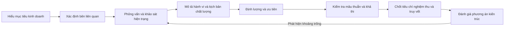
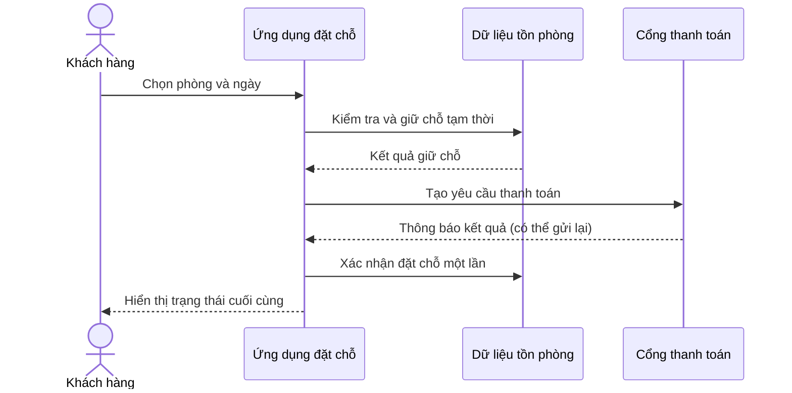

# Thu thập yêu cầu chức năng và yêu cầu chất lượng

## 1. Vì sao phải bắt đầu kiến trúc đám mây từ yêu cầu?

Thiết kế kiến trúc đám mây không bắt đầu bằng câu hỏi “nên dùng Kubernetes, serverless hay máy ảo?”, mà bằng câu hỏi **hệ thống phải làm được gì, trong điều kiện nào và thành công được đo ra sao?** Cùng một nghiệp vụ đặt chỗ có thể triển khai trên một máy chủ, một ứng dụng được quản lý hoặc một hệ thống nhiều vùng. Lựa chọn phù hợp phụ thuộc vào quy mô, rủi ro ngừng dịch vụ, độ nhạy cảm của dữ liệu, năng lực vận hành và ngân sách thực tế.

Trong phạm vi **CLOUD_ARCHITECTURE**, mục tiêu của bước này là chuyển yêu cầu nghiệp vụ thành đầu vào đáng tin cậy để lựa chọn **mạng, compute, dữ liệu và mô hình triển khai**, đồng thời đánh giá sự đánh đổi giữa **độ tin cậy, bảo mật, khả năng mở rộng, chi phí và vận hành** theo tư duy Well-Architected.

Ví dụ xuyên suốt bài: một doanh nghiệp chuẩn bị đưa **nền tảng đặt chỗ lưu trú** lên đám mây. Khách hàng cần tìm phòng, giữ chỗ, thanh toán và nhận xác nhận; nhân viên vận hành cần quản lý tồn phòng và xử lý sự cố. Các chỉ tiêu và con số bên dưới **chỉ là giả định để thực hành thu thập yêu cầu**, không phải khuyến nghị mặc định cho mọi hệ thống.

## 2. Phân biệt bốn loại thông tin đầu vào

| Loại | Câu hỏi cần trả lời | Ví dụ | Vai trò trong thiết kế |
| --- | --- | --- | --- |
| **Yêu cầu chức năng** (functional requirement) | Hệ thống phải thực hiện hành vi nào? | Khách giữ một phòng trong khoảng thời gian xác định; thanh toán thành công thì tạo đặt chỗ | Xác định luồng xử lý, API, dữ liệu và tích hợp |
| **Yêu cầu chất lượng** (quality attribute requirement) | Hệ thống phải thực hiện hành vi đó tốt đến mức nào và trong điều kiện gì? | 95% lượt tìm kiếm trả kết quả trong 800 ms ở tải đã định nghĩa | Định hướng hiệu năng, độ tin cậy, bảo mật, vận hành và cách kiểm chứng |
| **Ràng buộc** (constraint) | Giới hạn nào bắt buộc phải tuân thủ? | Chỉ sử dụng nhà cung cấp đã được bộ phận pháp chế và an ninh phê duyệt | Thu hẹp tập phương án kiến trúc hợp lệ |
| **Giả định** (assumption) | Điều gì chưa được xác nhận nhưng đang được tạm dùng để thiết kế? | Lưu lượng cao điểm bằng 4 lần ngày thường | Cần người chịu trách nhiệm xác minh; có thể làm thay đổi quyết định thiết kế |

**Mục tiêu kinh doanh** như “giảm tỷ lệ bỏ đặt chỗ” là lý do để thu thập yêu cầu, nhưng chưa đủ để chọn cấu hình hạ tầng. Tương tự, “dùng ba availability zone” là một **quyết định thiết kế được đề xuất**; nó không thay thế yêu cầu gốc về khả năng chịu lỗi. Hãy ghi rõ nguồn và cấp độ chắc chắn của từng thông tin để tránh biến một giả định thành cam kết.

### Kiểm tra chất lượng của một phát biểu yêu cầu

Một yêu cầu hữu ích cần:

- **Cụ thể và đơn nghĩa:** người đọc hiểu giống nhau về hành vi, đối tượng, điều kiện và ngoại lệ.
- **Có thể kiểm chứng:** có tiêu chí chấp nhận, phép đo hoặc phương pháp kiểm thử.
- **Có nguồn và người sở hữu:** biết ai đề xuất, ai chấp thuận, khi nào cần xem lại.
- **Có mức ưu tiên và phạm vi:** phân biệt nhu cầu ở ngày ra mắt với mục tiêu mở rộng tương lai.
- **Khả thi và nhất quán:** mâu thuẫn giữa ngân sách, thời gian và mức phục hồi phải được xử lý công khai.

Ví dụ, “hệ thống phải nhanh” chưa kiểm chứng được. Một cách viết rõ hơn là: “Ở môi trường gần tương đương production, với cơ sở dữ liệu tối thiểu 1 triệu mục lưu trú và tổng tải 200 yêu cầu/giây, **p95 thời gian xử lý phía máy chủ** của API tìm kiếm không quá 800 ms trong bài thử 30 phút”. Cần thỏa thuận rõ có bao gồm thời gian qua mạng và dịch vụ bên thứ ba hay không.

## 3. Quy trình thu thập và làm rõ yêu cầu



### Bước 1 — Hiểu kết quả kinh doanh và phạm vi hệ thống

Làm rõ ai sử dụng sản phẩm, các hành trình quan trọng, thị trường phục vụ, thời điểm ra mắt và tác động của gián đoạn. Yêu cầu cho một nguyên mẫu nội bộ sẽ khác yêu cầu của hệ thống thanh toán phục vụ khách hàng liên tục. Xác định ranh giới giữa chức năng hệ thống tự sở hữu và những chức năng do nhà cung cấp bên ngoài đảm nhận, chẳng hạn cổng thanh toán, gửi email/SMS hay dịch vụ định danh.

Kết quả tối thiểu: mục tiêu đo được, sơ đồ tác nhân và luồng nghiệp vụ quan trọng, phạm vi phiên bản đầu và danh sách phụ thuộc bên ngoài.

### Bước 2 — Tìm đúng người và chọn cách thu thập

| Bên liên quan | Điều cần tìm hiểu | Phương pháp phù hợp |
| --- | --- | --- |
| Chủ sản phẩm, kinh doanh | Giá trị sản phẩm, hành trình quan trọng, mức ưu tiên, mùa vụ | Phỏng vấn, workshop sắp xếp ưu tiên |
| Người dùng và chăm sóc khách hàng | Các bước thao tác, lỗi thường gặp, kỳ vọng khi mất kết nối | Quan sát tác vụ, phỏng vấn, phân tích ticket |
| Kỹ thuật ứng dụng và dữ liệu | Quy tắc nghiệp vụ, API, dữ liệu, phụ thuộc, nhất quán giao dịch | Đi qua kịch bản, xem hợp đồng API và lưu đồ dữ liệu |
| SRE, vận hành, hỗ trợ | Giới hạn chịu lỗi, lịch bảo trì, cảnh báo, sao lưu, trực sự cố | Phân tích sự cố cũ, diễn tập kịch bản hỏng hóc |
| Bảo mật, pháp chế, tuân thủ | Phân quyền, dữ liệu nhạy cảm, yêu cầu lưu trữ và kiểm toán | Workshop đánh giá rủi ro và dữ liệu |
| Tài chính, phụ trách cloud | Ngân sách, giới hạn tăng chi phí, chi phí vận hành | Phân tích dự báo chi phí và các kịch bản tải |

Không chỉ hỏi “anh/chị muốn hệ thống thế nào?”. Cần hỏi về **sự kiện cụ thể**: lúc cao điểm xảy ra điều gì, khi thanh toán bị gọi lại thì xử lý thế nào, tối đa có thể mất bao nhiêu dữ liệu và ai được phép xem thông tin khách hàng. Phỏng vấn cần được đối chiếu với số liệu hệ thống hiện tại, nhật ký sự cố, telemetry, hành vi thực tế và nghĩa vụ hợp đồng nếu có.

### Bước 3 — Mô hình hóa hành trình và ngoại lệ

Với mỗi hành trình, xác định **tác nhân → điểm kích hoạt → điều kiện trước → luồng chính → nhánh lỗi → dữ liệu đọc/ghi → kết quả**. Đặc biệt chú ý ranh giới hệ thống và tình huống bất đồng bộ: hai khách cùng giữ một phòng; khách nhấn thanh toán hai lần; cổng thanh toán gửi cùng một webhook nhiều lần; thông báo gửi chậm hoặc lỗi.

Một sơ đồ hành trình đơn giản:



Sơ đồ chỉ biểu diễn ý định nghiệp vụ; nó chưa ấn định kiến trúc đồng bộ hay bất đồng bộ, nhà cung cấp cơ sở dữ liệu hoặc phương thức giữ chỗ. Những lựa chọn đó sẽ được đánh giá sau khi hiểu yêu cầu về nhất quán, thời gian phản hồi và phục hồi khi lỗi.

## 4. Đặc tả yêu cầu chức năng: hệ thống phải làm gì?

Có thể bắt đầu từ *user story* (“Với vai trò ..., tôi muốn ..., để ...”), sau đó bổ sung quy tắc nghiệp vụ và tiêu chí chấp nhận. User story ngắn gọn giúp thảo luận nhưng thường **chưa đủ** để thiết kế dữ liệu, API, tích hợp hay hành vi khi lỗi.

Ví dụ bộ yêu cầu cho nền tảng đặt chỗ:

| ID | Yêu cầu chức năng | Tiêu chí chấp nhận đại diện |
| --- | --- | --- |
| FR-01 | Khách tìm phòng theo địa điểm, thời gian và số khách | Bộ lọc áp dụng đúng; hiển thị rõ trường hợp không có kết quả; không trả phòng không phù hợp |
| FR-02 | Khách giữ tạm một phòng khi bắt đầu thanh toán | Thời hạn giữ chỗ được hiển thị; không thể có hai giữ chỗ còn hiệu lực xung đột theo cùng quy tắc tồn phòng |
| FR-03 | Khách thanh toán và nhận mã đặt chỗ | Chỉ xác nhận khi giao dịch đạt trạng thái thành công hợp lệ; xử lý lặp sự kiện thanh toán mà không tạo hai đặt chỗ |
| FR-04 | Khách xem và hủy đơn theo chính sách | Số tiền hoàn trả và thời hạn hủy phản ánh đúng chính sách tại thời điểm đặt |
| FR-05 | Nhân viên cập nhật tồn phòng và giá | Người không có quyền bị từ chối; thay đổi được ghi nhật ký và phản ánh trong các truy vấn liên quan |
| FR-06 | Hệ thống gửi thông báo trạng thái đơn | Gửi nội dung đúng trạng thái; khi kênh thông báo lỗi, đơn vẫn có trạng thái tra cứu được |

Ví dụ chi tiết hóa **FR-03**:

> **Khi** khách gửi yêu cầu thanh toán cho một giữ chỗ hợp lệ, **nếu** cổng thanh toán xác nhận thành công bằng bằng chứng có thể kiểm tra, **thì** hệ thống chuyển đúng một lần sang trạng thái đặt chỗ đã xác nhận, trả mã đặt chỗ và giữ lịch sử giao dịch. Nếu callback lặp, đến trễ, mất kết nối hoặc trạng thái chưa rõ, hệ thống phải xử lý theo quy tắc đã thống nhất, không thu tiền/ghi đơn trùng do thử lại từ ứng dụng.

Những câu hỏi cần trả lời trước khi chọn giải pháp:

1. Thế nào là “giữ chỗ hợp lệ”? Có thời gian hết hạn và thứ tự ưu tiên không?
2. Hệ thống nào là nguồn sự thật (*source of truth*) của trạng thái thanh toán và đặt chỗ?
3. Khi trạng thái thanh toán chưa xác định, khách nhìn thấy gì? Ai hoặc tiến trình nào đối soát?
4. Các thao tác nào cần **tính nguyên tử hoặc idempotency**; các thao tác nào được phép nhất quán cuối cùng (*eventual consistency*)?
5. Tích hợp có giới hạn tần suất, thời gian phản hồi, cơ chế thử lại và cam kết dịch vụ nào?

Như vậy, đầu ra chức năng không chỉ là danh sách màn hình. Nó còn gồm **quy tắc dữ liệu, vòng đời trạng thái, hợp đồng tích hợp và luồng xử lý ngoại lệ**, những thông tin tác động trực tiếp đến thiết kế compute và lưu trữ.

## 5. Đặc tả yêu cầu chất lượng: hệ thống phải tốt đến mức nào?

Yêu cầu chất lượng thường chi phối phần lớn chi phí và độ phức tạp của kiến trúc cloud. Để tránh các câu như “phải ổn định”, “phải an toàn” hoặc “tự động mở rộng”, hãy ghi một **kịch bản thuộc tính chất lượng** với cấu trúc:

**Nguồn kích thích → sự kiện kích thích → thành phần chịu tác động → bối cảnh → phản ứng mong đợi → thước đo kiểm chứng.**

Ví dụ: “Trong đợt khuyến mãi, khi tải tìm kiếm tăng từ 50 lên 200 yêu cầu/giây trong 10 phút, dịch vụ tìm kiếm đáp ứng p95 ≤ 800 ms và tỷ lệ lỗi máy chủ ≤ 0,5% ở dữ liệu thực tế mô phỏng”. Kịch bản này có thể dẫn đến kiểm thử tải, dự báo tài nguyên và đánh giá khả năng tăng tải của cả ứng dụng lẫn cơ sở dữ liệu.

### Các nhóm chất lượng thường gặp trong kiến trúc đám mây

| Nhóm | Câu hỏi thu thập | Cách định lượng hoặc kiểm chứng |
| --- | --- | --- |
| **Hiệu năng** | Những thao tác nào nhạy với độ trễ? Tải đỉnh ra sao? | p95/p99 latency theo hành trình, thông lượng, số yêu cầu đồng thời, tỷ lệ timeout, bộ dữ liệu kiểm thử |
| **Độ sẵn sàng** | Những hành trình nào phải hoạt động liên tục? Khoảng gián đoạn cho phép? | SLI/SLO theo hành trình, cửa sổ đo, cách phân loại yêu cầu hợp lệ và lỗi |
| **Khả năng phục hồi** | Có thể ngừng dịch vụ bao lâu? Có thể mất bao nhiêu dữ liệu? | RTO, RPO theo tình huống hỏng hóc; bài kiểm tra khôi phục thực tế |
| **Khả năng mở rộng** | Tải tăng theo ngày, mùa hay chiến dịch? Có mức trần? | Tốc độ tăng, tải duy trì/đột biến, thời gian mở rộng, điểm nghẽn và giới hạn tài nguyên |
| **Bảo mật và riêng tư** | Dữ liệu nào nhạy cảm; ai được truy cập; cần lưu ở đâu? | Kiểm thử phân quyền, mã hóa, nhật ký kiểm toán, quản lý bí mật, kiểm tra yêu cầu pháp lý cụ thể |
| **Khả năng vận hành** | Ai phát hiện và xử lý lỗi? Cần truy vết tới đâu? | Thời gian phát hiện, thời gian cảnh báo, mức bao phủ log/metric/trace, quy trình trực và khôi phục |
| **Chi phí** | Ngân sách theo tháng và mức tăng tải có thể chấp nhận? | Dự toán chi phí theo kịch bản, chi phí mỗi giao dịch, cảnh báo và giới hạn ngân sách |
| **Khả năng thay đổi** | Chức năng nào đổi thường xuyên, thời gian triển khai mong muốn? | Thời gian triển khai/rollback, mức ảnh hưởng khi thay đổi, yêu cầu tương thích dữ liệu và API |

Phải xác định **đối tượng đo, điều kiện đo và phương pháp thu thập**. “500 người dùng đồng thời” khác “500 yêu cầu/giây”; “dịch vụ API còn sống” khác “khách thực sự đặt được phòng”. Nếu chỉ dùng CPU hoặc bài kiểm tra `/health` để suy ra độ sẵn sàng toàn bộ hành trình, kết luận dễ sai.

### Bộ yêu cầu chất lượng minh họa có thể kiểm chứng

| ID | Mục tiêu minh họa | Cách xác nhận |
| --- | --- | --- |
| QR-PERF-01 | API tìm kiếm có p95 thời gian xử lý phía máy chủ ≤ 800 ms ở 200 request/giây, dữ liệu ≥ 1 triệu mục và tải duy trì 30 phút | Kiểm thử tải trên môi trường gần production; lưu phân bố latency, lỗi và cấu hình |
| QR-AVAIL-01 | Hành trình tìm kiếm và xem phòng đạt SLO khả dụng 99,95% trong mỗi tháng | Đo từ yêu cầu đủ điều kiện theo định nghĩa SLI đã thống nhất; giám sát cả lỗi và timeout |
| QR-REC-01 | Khi mất vùng triển khai chính, mục tiêu RTO ≤ 2 giờ, RPO ≤ 15 phút cho dữ liệu đặt chỗ | Diễn tập mất vùng và khôi phục; kiểm tra thời gian phục hồi cùng điểm dữ liệu cuối cùng |
| QR-SEC-01 | Chỉ nhân viên có quyền phù hợp được truy cập dữ liệu khách; dữ liệu nhạy cảm được mã hóa khi truyền và lưu | Kiểm thử quyền từ chối, soát IAM, cấu hình TLS, mã hóa và quản lý khóa |
| QR-SCALE-01 | Tải tìm kiếm tăng 4 lần trong 10 phút mà vẫn đạt QR-PERF-01 ở mức tải đỉnh được duyệt | Thử kịch bản tăng tải; theo dõi tốc độ cấp phát, tải DB, hàng đợi và hạn mức dịch vụ |
| QR-OPS-01 | Lỗi nghiêm trọng ảnh hưởng đặt chỗ được phát hiện và cảnh báo người trực trong ≤ 5 phút | Diễn tập tạo lỗi có kiểm soát; đo thời gian từ lỗi tới cảnh báo và khả năng truy vết |
| QR-COST-01 | Chi phí chạy thường kỳ dự kiến ≤ 5.000 USD/tháng tại lưu lượng cơ sở đã thống nhất | Dự toán gồm compute, dữ liệu, băng thông, log, backup và phương án dự phòng; cập nhật bằng số liệu thật |

Các mục tiêu trên phải được người sở hữu xác nhận và xem lại tính khả thi cùng nhau. Ví dụ, **QR-SCALE-01** không có nghĩa có thể duy trì mức p95 đã định ở mọi tải vô hạn; nó chỉ có ý nghĩa với **mức tải đỉnh cụ thể** và tài nguyên giới hạn cụ thể. **QR-COST-01** cũng không chứng minh hệ thống tối ưu chi phí nếu chưa tính dữ liệu truyền ra ngoài, lưu log, sao lưu và mức độ dự phòng.

### SLI, SLO, SLA và error budget

- **SLI** (*Service Level Indicator*) là phép đo thực tế, ví dụ tỷ lệ yêu cầu tìm kiếm hợp lệ nhận kết quả đúng hạn.
- **SLO** (*Service Level Objective*) là mục tiêu của SLI trong khoảng thời gian xác định, ví dụ 99,95% mỗi tháng.
- **SLA** (*Service Level Agreement*) là thỏa thuận dịch vụ có thể gắn hệ quả hợp đồng; không đồng nhất với SLO nội bộ.
- **Error budget** là phần không đạt mục tiêu được chấp nhận trong cửa sổ đo. Với SLO 99,95%, ngân sách lỗi là 0,05% theo chính định nghĩa SLI, không tự động có nghĩa đúng 0,05% thời gian toàn hệ thống được ngừng.

Nếu SLI thực sự được định nghĩa theo **thời gian dịch vụ khả dụng**, 99,95% trong tháng 30 ngày tương ứng khoảng **21,6 phút không khả dụng**. Nếu SLI là **tỷ lệ yêu cầu thành công**, phải tính trên số yêu cầu đủ điều kiện, không được đổi trực tiếp thành số phút ngừng dịch vụ. Cần ghi rõ cách xử lý bảo trì, lỗi từ nhà cung cấp tích hợp, lỗi do đầu vào khách hàng và các yêu cầu vượt giới hạn đã công bố.

### Phân biệt RTO với RPO

- **RTO** (*Recovery Time Objective*): thời gian tối đa mục tiêu để khôi phục mức phục vụ đã định sau sự cố.
- **RPO** (*Recovery Point Objective*): khoảng mất mát dữ liệu theo thời gian tối đa mục tiêu khi phải khôi phục.

RTO 2 giờ và RPO 15 phút **không có nghĩa** chỉ cần sao lưu mỗi ngày. Đối với sự cố mất cả vùng, phải kiểm chứng cách chuyển môi trường hoạt động, vị trí bản sao/backup ngoài vùng và khả năng khôi phục dữ liệu đủ mới. Các mục tiêu là yêu cầu cần thiết kế và thử nghiệm; chúng **không phải bảo đảm** chỉ nhờ bật một tính năng của nhà cung cấp cloud.

## 6. Chuyển câu trả lời mơ hồ thành tiêu chí nghiệm thu

| Phát biểu ban đầu | Câu hỏi làm rõ | Phát biểu có thể kiểm chứng |
| --- | --- | --- |
| “Ứng dụng rất nhanh” | Hành trình nào? Tải nào? Từ đâu tới đâu? | p95 tìm kiếm ≤ 800 ms ở bộ dữ liệu và tải đã xác định |
| “Không được mất dữ liệu” | Loại sự cố nào? Có chấp nhận mất vài giây dữ liệu? | Các giao dịch đã xác nhận cần mức nhất quán xác định; RPO theo từng tình huống sự cố được chủ nghiệp vụ phê duyệt |
| “Bảo mật tốt” | Những loại dữ liệu và vai trò nào? Nghĩa vụ nào? | Vai trò quản trị cần MFA; quyền truy cập dữ liệu khách được kiểm thử và ghi nhận; bí mật không nằm trong mã nguồn |
| “Tăng tải tự động” | Tăng đến đâu, trong bao lâu, được phép tốn bao nhiêu? | Vẫn đạt mục tiêu latency ở mức tải đỉnh X; mở rộng trong Y phút; tổng chi phí không vượt kịch bản ngân sách đã duyệt |
| “Hệ thống luôn online” | Hành trình nào? Tính trong khoảng nào? | SLO khả dụng theo hành trình, định nghĩa SLI và cửa sổ đo rõ ràng |

Thực hành tốt là viết mỗi yêu cầu chất lượng như một bản ghi có cấu trúc:

```text
ID: QR-PERF-01
Nguồn: Product Owner + số liệu đo tải hiện tại
Đối tượng: API tìm kiếm
Bối cảnh: Dữ liệu >= 1 triệu mục, tải 200 request/giây trong 30 phút
Kích thích: Người dùng gửi yêu cầu tìm kiếm hợp lệ
Kết quả mong đợi: p95 thời gian xử lý phía server <= 800 ms
Đo lường: Load test, metric latency, báo cáo tỉ lệ lỗi
Ưu tiên: Must-have cho ngày ra mắt
Chủ sở hữu: Product Owner; xác nhận kỹ thuật: Tech Lead/SRE
Trạng thái bằng chứng: Chưa kiểm chứng; cần chạy load test
```

Khi viết yêu cầu, phải tách rõ **giá trị mong muốn**, **bằng chứng hiện có**, **giả định còn mở** và **phép thử cần thực hiện**. Đây là cơ sở để đánh giá rủi ro trước khi mua dịch vụ cloud hoặc cam kết SLA.

## 7. Xử lý ưu tiên, phụ thuộc và xung đột

Không thể mặc định mọi yêu cầu đều ở mức cao nhất. Một cách đơn giản là gán **Must / Should / Could / Won't for now** cho từng yêu cầu, kèm lý do, chủ sở hữu và kỳ phát hành. Từng *Must* nên gắn với giá trị kinh doanh, nghĩa vụ hoặc rủi ro đã xác nhận. Yêu cầu có chi phí đáng kể cần ghi phương án đánh đổi.

Một số xung đột phổ biến:

- **Sẵn sàng cao ↔ chi phí:** nhiều vùng sẵn sàng, bản sao hoặc môi trường dự phòng làm tăng chi phí và độ phức tạp quản lý.
- **RPO rất thấp ↔ độ phức tạp dữ liệu:** sao chép đồng bộ có thể tăng độ trễ/giới hạn vùng; sao chép bất đồng bộ có cửa sổ mất dữ liệu cần được phê duyệt.
- **Độ trễ thấp ↔ kiểm soát bảo mật:** các bước kiểm tra, ghi nhật ký và kết nối qua các vùng kiểm soát có thể thêm độ trễ; cần tối ưu theo hành trình và rủi ro.
- **Mở rộng nhanh ↔ giới hạn dữ liệu:** tăng số instance ứng dụng không tự xử lý điểm nghẽn ở DB, khóa ghi, dịch vụ ngoài hay quota.
- **Ra mắt sớm ↔ vận hành dài hạn:** phương án nhanh nhất ban đầu có thể thiếu quan sát, kiểm thử khôi phục và kiểm soát chi phí cần thiết.

Ví dụ, với QR-REC-01, nhóm có thể đánh giá hai phương án: **sao lưu ngoài vùng và khôi phục theo quy trình** hoặc **môi trường dự phòng ở vùng thứ hai**. Phương án thứ nhất thường tiết kiệm chi phí thường kỳ hơn nhưng phải chứng minh phục hồi kịp RTO/RPO; phương án thứ hai có thể rút ngắn RTO nhưng làm tăng chi phí, độ phức tạp và yêu cầu kiểm soát đồng bộ dữ liệu. Không chọn chỉ từ tên dịch vụ: cần thử khôi phục và đo thời gian thực tế.

Mọi xung đột chưa giải quyết cần có **người quyết định, thời hạn và tác động nếu giữ nguyên**. Không âm thầm sửa mục tiêu chất lượng cho khớp một kiến trúc đã chọn.

## 8. Từ yêu cầu đến lựa chọn kiến trúc và Well-Architected

Yêu cầu được truy vết tới **quyết định cần đánh giá**, rồi tới **bằng chứng kiểm chứng**. Bảng dưới đây chỉ liệt kê các hướng cân nhắc, không khóa vào một sản phẩm cloud cụ thể.

| Yêu cầu | Tác động kiến trúc cần nghiên cứu | Bằng chứng cần có |
| --- | --- | --- |
| FR-02, FR-03 — tránh giữ/đặt trùng | Kiểu dữ liệu giao dịch, khóa/điều kiện cập nhật, idempotency, outbox hoặc phương thức đồng bộ sự kiện phù hợp | Kiểm thử tranh chấp đồng thời, retry, mất kết nối và callback trùng |
| QR-PERF-01 — độ trễ tìm kiếm | Cache, chỉ mục/truy vấn, mạng, vùng gần người dùng, compute và cơ chế giới hạn tải | Load test có phân bố latency, thống kê query, hit ratio và điểm nghẽn |
| QR-AVAIL-01 — sẵn sàng | Phân tách điểm lỗi đơn, triển khai đa availability zone, health check có ý nghĩa nghiệp vụ, cơ chế xử lý lỗi phụ thuộc | Kiểm thử mất instance/zone, quan sát hành trình người dùng và SLI |
| QR-REC-01 — phục hồi | Backup và point-in-time recovery, bản sao ngoài vùng, quy trình chuyển đổi và khôi phục | Báo cáo diễn tập RTO/RPO, đối soát tính toàn vẹn dữ liệu |
| QR-SEC-01 — bảo mật | IAM đặc quyền tối thiểu, phân đoạn mạng, mã hóa, quản lý bí mật, audit log, kiểm soát dữ liệu | Threat modeling, kiểm thử quyền, đánh giá cấu hình và luồng dữ liệu |
| QR-SCALE-01 — tải đỉnh | Auto scaling, hàng đợi, rate limit, connection pool, quota của DB và dịch vụ tích hợp | Thử tăng tải, theo dõi saturation và phản ứng khi chạm ngưỡng |
| QR-OPS-01, QR-COST-01 | Observability, on-call, runbook, gắn nhãn tài nguyên, cảnh báo chi phí và chính sách lưu dữ liệu quan sát | Diễn tập sự cố, dự toán/đo chi phí và kiểm tra cảnh báo |

Một buổi đánh giá theo tinh thần **Well-Architected** nên đặt câu hỏi theo các khía cạnh: vận hành có runbook và cơ chế cải tiến không; bảo mật có quản lý truy cập và bảo vệ dữ liệu không; độ tin cậy có tránh điểm lỗi đơn và phục hồi đã được thử không; hiệu năng có đo dưới tải thực tế không; chi phí có mô hình và người chịu trách nhiệm không; việc dùng tài nguyên có hiệu quả và hạn chế lãng phí không. Có thể dùng khung Well-Architected của nhà cung cấp đang xét để rà soát sâu hơn, nhưng kết luận phải gắn với yêu cầu và số liệu riêng của hệ thống.

## 9. Hồ sơ đầu ra và cách duy trì yêu cầu

Sau vòng thu thập đầu tiên, nhóm nên có một **bộ hồ sơ yêu cầu kiến trúc đủ để ra quyết định**:

1. **Bối cảnh và phạm vi:** mục tiêu kinh doanh, đối tượng dùng, các hệ thống phụ thuộc, phạm vi hiện tại/tương lai.
2. **Danh mục FR:** mã yêu cầu, tác nhân, luồng chính, nhánh lỗi, quy tắc dữ liệu, tiêu chí chấp nhận.
3. **Danh mục QR:** kịch bản kích thích, môi trường, mục tiêu đo, mức ưu tiên, nguồn, người sở hữu và phương pháp kiểm chứng.
4. **Ràng buộc và giả định:** yêu cầu pháp lý đã được xác nhận, dữ liệu và vị trí xử lý, ngân sách, kỹ năng đội ngũ, các điểm chưa rõ cần trả lời.
5. **Ma trận truy vết:** liên kết mục tiêu kinh doanh → yêu cầu → lựa chọn kiến trúc → thử nghiệm/chứng cứ → quyết định.
6. **Biên bản quyết định:** phương án được chọn, phương án đã cân nhắc, đánh đổi, rủi ro còn lại và điều kiện xem lại.

Khi thay đổi mục tiêu tải, khu vực phục vụ, chính sách dữ liệu hoặc mức độ sẵn sàng, cần đánh giá tác động tới các quyết định kiến trúc liên quan. Đừng để bảng yêu cầu chỉ được ký một lần rồi không cập nhật theo số liệu vận hành. Sau ra mắt, số đo thực tế, sự cố, chi phí cloud và hành vi khách hàng là nguồn để điều chỉnh giả định cũng như đề xuất nâng hoặc hạ SLO có chủ đích.

## 10. Bài thực hành: lập bộ yêu cầu cho một sản phẩm mới

**Bối cảnh giả định:** một hệ thống đặt chỗ hiện đang chạy trên một máy chủ và có nguy cơ quá tải vào mùa cao điểm. Nhóm muốn chuyển lên cloud nhưng chưa quyết định dùng mô hình triển khai nào. Hãy thực hiện theo thứ tự:

1. Phỏng vấn đóng vai Product Owner, SRE, phụ trách bảo mật và tài chính. Thu thập ít nhất **năm yêu cầu chức năng** và **sáu yêu cầu chất lượng** từ các góc nhìn khác nhau.
2. Với mỗi FR, mô tả **một luồng thành công và một trường hợp lỗi**. Đảm bảo có tình huống hai khách cùng đặt một phòng.
3. Viết QR cho **latency, availability, RTO, RPO, security và cost**. Mỗi QR phải có môi trường, ngưỡng đo, cửa sổ đo (nếu áp dụng), người sở hữu và cách xác nhận.
4. Chỉ ra ít nhất **hai giả định chưa có bằng chứng**; nêu dữ liệu hoặc thử nghiệm cần thực hiện để xác minh.
5. So sánh ít nhất **hai phương án triển khai** ở mức nguyên tắc: một phương án tối giản phù hợp giai đoạn đầu và một phương án tăng khả năng chịu lỗi. Lập bảng đáp ứng yêu cầu, điểm chưa đạt, chi phí và rủi ro vận hành.
6. Tổ chức buổi xem xét, xử lý xung đột ưu tiên; ghi quyết định vào một bản ADR ngắn (*Architecture Decision Record*) và chỉ rõ điều kiện khiến quyết định phải thay đổi.

**Tiêu chí hoàn thành:** người khác có thể đọc hồ sơ và trả lời chính xác **hệ thống cần làm gì; cần đạt mức chất lượng nào; dựa vào bằng chứng nào; ai chấp thuận; kiểm chứng bằng phép thử nào; vì sao phương án kiến trúc được chọn đáp ứng các yêu cầu ưu tiên**. Nếu không thể trả lời, yêu cầu vẫn chưa đủ rõ để làm đầu vào thiết kế.

## 11. Tự kiểm tra trước khi chốt yêu cầu

- Có phân biệt rõ mục tiêu kinh doanh, chức năng, thuộc tính chất lượng, ràng buộc và giả định chưa?
- Các hành trình quan trọng có nhánh lỗi, trạng thái dữ liệu và phụ thuộc bên ngoài chưa?
- Các con số về traffic, p95, SLO, RTO/RPO và ngân sách đã có nguồn hoặc được gắn nhãn giả định chưa?
- Chỉ tiêu sẵn sàng đo hành vi người dùng hay chỉ đo tình trạng của một máy chủ?
- Đã có phép thử thực tế cho cạnh tranh ghi dữ liệu, tăng tải, mất vùng và khôi phục chưa?
- Có giải quyết rõ xung đột giữa độ tin cậy, bảo mật, khả năng mở rộng, chi phí và khả năng vận hành chưa?
- Mọi yêu cầu ưu tiên cao đã có người chịu trách nhiệm chấp thuận và có thể truy vết tới quyết định kiến trúc chưa?

Thu thập yêu cầu đạt chất lượng giúp đội ngũ **chọn kiến trúc bằng mục tiêu và bằng chứng**, thay vì chọn công nghệ theo thói quen. Đây là nền tảng cho các bước thiết kế mạng, compute, lưu trữ, dữ liệu, mô hình triển khai và đánh giá Well-Architected tiếp theo.
