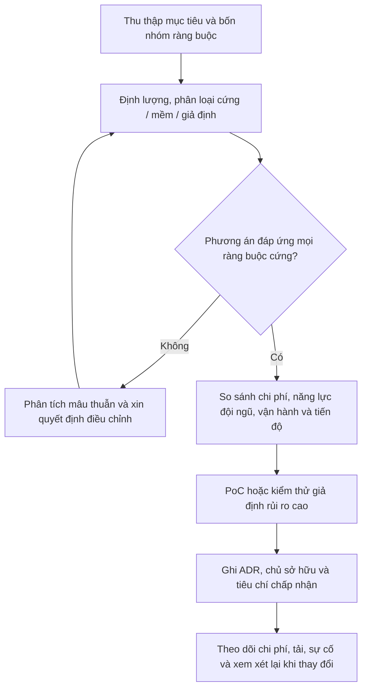

# Xác định ràng buộc về ngân sách, nhân lực, công nghệ và thời gian

## 1. Vì sao phải làm rõ ràng buộc trước khi thiết kế?

Trong thiết kế kiến trúc ứng dụng trên đám mây, **yêu cầu** mô tả hệ thống cần đạt điều gì; **ràng buộc** xác định giới hạn và điều kiện mà phương án phải tuân thủ. Ví dụ, “hệ thống phải phục vụ được 200 yêu cầu/giây vào giờ cao điểm” là yêu cầu về năng lực; “chi phí hạ tầng không vượt quá 25 triệu đồng/tháng” là ràng buộc ngân sách. Hai thông tin phải được xem xét cùng nhau để lựa chọn mạng, compute, cơ sở dữ liệu và mô hình triển khai phù hợp.

Một giải pháp có thể đạt mục tiêu kỹ thuật nhưng vẫn không triển khai được nếu vượt ngân sách, không có người vận hành, không tích hợp được hệ thống hiện hữu hoặc không kịp thời điểm ra mắt. Vì vậy, kiến trúc sư cần **định lượng, xác minh, ghi nhận và thường xuyên rà soát** bốn nhóm ràng buộc: **ngân sách, nhân lực, công nghệ, thời gian**.

Sau bài này, người học có thể:

- Phân biệt ràng buộc bắt buộc, ưu tiên và giả định chưa được xác nhận.
- Biến các phát biểu mơ hồ như “rẻ”, “ít người”, “dùng công nghệ hiện tại”, “ra mắt sớm” thành tiêu chí có thể kiểm chứng.
- Dự toán chi phí sở hữu, đánh giá năng lực đội ngũ, kiểm tra tính tương thích kỹ thuật và lập mốc triển khai khả thi.
- Giải thích tác động của từng ràng buộc lên độ tin cậy, bảo mật, khả năng mở rộng và vận hành; ghi lại quyết định bằng tài liệu kiến trúc.

### 1.1. Ràng buộc cứng, ràng buộc mềm và giả định

| Loại | Ý nghĩa | Ví dụ | Cách xử lý |
|---|---|---|---|
| **Cứng (hard constraint)** | Không được vi phạm nếu chưa được người có thẩm quyền chấp thuận thay đổi | Dữ liệu phải lưu trong vùng địa lý được bộ phận pháp chế phê duyệt | Loại phương án không đáp ứng; nếu mâu thuẫn, phải báo rõ để quyết định lại |
| **Mềm (soft constraint)** | Mong muốn hoặc ưu tiên, có thể đánh đổi bằng lý do và phê duyệt phù hợp | Ưu tiên dùng dịch vụ quản lý sẵn để giảm công vận hành | So sánh lợi ích, chi phí và rủi ro giữa các phương án |
| **Giả định (assumption)** | Thông tin tạm sử dụng vì chưa có bằng chứng | Lưu lượng tăng 20% trong năm đầu | Nêu người xác nhận, cách kiểm tra và thời hạn kiểm tra |

Không nên ghi một ràng buộc chỉ bằng câu “phải tối ưu chi phí”. Một ràng buộc có thể hành động được cần tối thiểu: **giá trị/giới hạn, phạm vi áp dụng, khoảng thời gian, mức bắt buộc, nguồn xác nhận, người chịu trách nhiệm và cách kiểm chứng**.

## 2. Ràng buộc ngân sách: có thể chi bao nhiêu và cho những gì?

Ngân sách quyết định quy mô tài nguyên, mức dự phòng, lựa chọn dịch vụ và cách mở rộng. Trước khi ước lượng, cần hỏi:

1. Giới hạn áp dụng cho **hạ tầng cloud**, toàn bộ **chi phí công nghệ** hay **tổng chi phí sở hữu (TCO)** gồm cả nhân sự?
2. Giới hạn tính theo tháng, năm, giai đoạn thử nghiệm hay toàn dự án? Dùng tiền tệ nào; đã gồm thuế, phí hỗ trợ, giấy phép và biến động tỷ giá chưa?
3. Có ngân sách một lần cho di chuyển dữ liệu, triển khai, thử nghiệm, đào tạo và xử lý sự cố không?
4. Tải trung bình, tải đỉnh và tốc độ tăng trưởng là bao nhiêu? Có được phép dùng dịch vụ thanh toán theo mức sử dụng hay phải đặt trước ngân sách?
5. Ai nhận cảnh báo chi phí và ai có quyền quyết định khi dự báo vượt ngưỡng?

### 2.1. Lập mô hình chi phí theo khối lượng công việc

Đối với một ứng dụng cloud, các khoản chi thường gồm:

| Hạng mục | Đại lượng cần ước lượng | Sai sót thường gặp |
|---|---|---|
| Compute | Số phiên bản, vCPU/RAM, giờ chạy, mức tải đỉnh, autoscaling | Chỉ tính giờ cao điểm hoặc chỉ tính môi trường production |
| Dữ liệu | Dung lượng, IOPS/throughput, bản sao, bản sao lưu, lưu trữ lâu dài | Quên dữ liệu sao lưu, replication và tăng trưởng |
| Mạng và phân phối | Dữ liệu ra Internet, liên vùng, NAT, load balancer, CDN | Giả định mọi lưu lượng truyền dữ liệu đều miễn phí |
| Bảo mật và vận hành | Log, metric, trace, quản lý khóa/bí mật, giám sát, hỗ trợ | Loại bỏ observability khỏi dự toán để làm chi phí có vẻ thấp |
| Phát triển và chuyển đổi | CI/CD, môi trường dev/test/staging, migration, kiểm thử tải | Chỉ tính chi phí sau khi đi vào hoạt động |
| Nhân lực và giấy phép | Nhân sự triển khai/vận hành, đào tạo, phần mềm thương mại | Nhầm ngân sách hạ tầng với TCO |

Có thể dùng công thức lập kế hoạch:

\[
C_{\text{tháng}}=C_{\text{cố định}}+\sum_i \bigl(q_i\times p_i\bigr)+C_{\text{dự phòng}}
\]

Trong đó \(q_i\) là lượng tài nguyên dự kiến sử dụng, \(p_i\) là đơn giá tương ứng. **TCO trong kỳ** còn bao gồm công triển khai, nhân sự vận hành, giấy phép, chuyển đổi và chi phí chấm dứt/chuyển nhà cung cấp nếu có. Cần dùng bảng giá thực tế của vùng triển khai, điều khoản hợp đồng và công cụ dự toán của nhà cung cấp để kiểm chứng giá; công thức chỉ là khung ước lượng.

Đừng chỉ tính một kịch bản. Nên lập tối thiểu ba mức: **cơ sở**, **tăng trưởng** và **tải đỉnh/biến động bất thường**. Kiểm tra ảnh hưởng của các biến nhạy cảm như số yêu cầu, dung lượng dữ liệu, dữ liệu truyền ra ngoài và thời gian giữ log. Đặt ngân sách dự phòng theo rủi ro đã nhận diện, thay vì coi khoản dự phòng là tiền chắc chắn còn thừa.

### 2.2. Biến giới hạn chi phí thành quyết định kiến trúc

- Nếu tải thay đổi mạnh, cân nhắc autoscaling hoặc serverless **sau khi** ước lượng chi phí ở tải thực tế và giới hạn đồng thời; không mặc định serverless luôn rẻ.
- Nếu có ít người vận hành, dịch vụ cơ sở dữ liệu được quản lý có thể giảm công vá lỗi, sao lưu và giám sát, nhưng vẫn phát sinh phí dịch vụ, cấu hình, quản trị truy cập và trách nhiệm phục hồi.
- Nếu yêu cầu độ sẵn sàng cao, cần tính chi phí chạy nhiều instance/zone, cân bằng tải, bản sao dữ liệu, giám sát và kiểm thử khôi phục. Không bỏ dự phòng chỉ để đạt mức chi mong muốn mà không điều chỉnh mục tiêu tin cậy.
- Nếu dữ liệu lớn hoặc truyền liên vùng thường xuyên, quyết định vị trí lưu trữ, phân vùng dữ liệu, chính sách lưu giữ và caching có thể ảnh hưởng chi phí nhiều hơn việc đổi kích thước máy chủ.

**Cơ chế kiểm soát:** gắn nhãn tài nguyên theo dự án/môi trường/đơn vị chịu phí; đặt cảnh báo ngân sách và dự báo vượt chi; theo dõi chi phí trên mỗi giao dịch hoặc mỗi khách hàng; rà soát chênh lệch giữa chi phí dự kiến và thực tế định kỳ. Đây là cách biến ràng buộc thành hoạt động **FinOps** liên tục.

## 3. Ràng buộc nhân lực: đội ngũ có thể xây và vận hành đến mức nào?

Đánh giá nhân lực không chỉ đếm số lập trình viên. Cần xét **kỹ năng, thời gian sẵn có, trách nhiệm vận hành, khả năng phản ứng khi có sự cố và rủi ro phụ thuộc một người**.

### 3.1. Lập bản đồ năng lực và trách nhiệm

| Năng lực cần có | Câu hỏi xác minh | Hệ quả khi thiếu |
|---|---|---|
| Kiến trúc cloud, network, IAM | Ai thiết kế VPC/VNet, phân quyền và kết nối hệ thống? | Thiết kế mạng/quyền truy cập thiếu an toàn hoặc khó kiểm soát |
| Phát triển và tích hợp | Ai hiểu nghiệp vụ, API, xử lý lỗi và tính nhất quán dữ liệu? | Ước lượng tích hợp thiếu thực tế |
| Dữ liệu và phục hồi | Ai quản lý migration, backup, RPO/RTO và thử restore? | Có bản sao lưu nhưng không khôi phục đúng mục tiêu |
| Tự động hóa và triển khai | Ai quản lý IaC, CI/CD, secrets và rollback? | Thao tác thủ công, khó tái tạo môi trường |
| Quan sát và ứng cứu | Ai nhận cảnh báo ngoài giờ, ai là người dự phòng, có runbook không? | Mục tiêu thời gian phục hồi chỉ tồn tại trên giấy |
| Bảo mật/tuân thủ | Ai đánh giá threat model, bảo vệ dữ liệu và kiểm tra cấu hình? | Chậm phê duyệt hoặc để lại lỗ hổng |

Nên ghi rõ mức cam kết bằng **FTE** (full-time equivalent): một kỹ sư dành 50% thời gian cho dự án là **0,5 FTE**, không tương đương một người trực toàn thời gian. Nguồn lực từ đội dùng chung phải có lịch và người chịu trách nhiệm rõ ràng.

Trả lời thêm ba câu hỏi vận hành: **Ai xây? Ai trực/khắc phục? Ai thay thế khi người phụ trách vắng mặt?** Đối với hệ thống cần phục vụ liên tục, phải đối chiếu yêu cầu hỗ trợ ngoài giờ với lịch trực thực tế; quy mô đội nhỏ thường khó duy trì nhiều thành phần tự quản lý có quy trình nâng cấp và khôi phục phức tạp.

### 3.2. Tác động lên lựa chọn kiến trúc

- **Nhân lực vận hành hạn chế:** ưu tiên số thành phần ít, managed service phù hợp, triển khai tự động, quy trình giám sát và khôi phục đơn giản. Tránh triển khai Kubernetes hoặc nhiều microservice chỉ vì đang phổ biến nếu đội chưa có năng lực vận hành cần thiết.
- **Đội mạnh ở một hệ sinh thái:** ưu tiên thành phần tương thích kỹ năng hiện có để rút ngắn đào tạo; chỉ chọn công nghệ mới khi lợi ích bù được chi phí học và rủi ro.
- **Phụ thuộc một chuyên gia:** cần tài liệu, runbook, quyền truy cập theo vai trò, review chéo và diễn tập sự cố; đổi công nghệ không tự giải quyết được “điểm lỗi con người”.
- **Thiếu năng lực bảo mật hoặc database:** lên lịch hỗ trợ chuyên môn/đào tạo hoặc thu hẹp phạm vi ra mắt. Dịch vụ quản lý sẵn không thay thế quyết định về phân quyền, dữ liệu và tuân thủ.

Nhân lực thường là **ràng buộc kép**: chi phí cho con người thuộc TCO, còn số giờ và kỹ năng sẵn có giới hạn độ phức tạp thiết kế. Một phương án hạ tầng rẻ nhưng mất nhiều giờ trực, vá lỗi, backup và điều tra sự cố có thể có TCO cao hơn phương án managed service.

## 4. Ràng buộc công nghệ: phải tương thích với điều gì?

Ràng buộc công nghệ là các điều kiện về hệ thống hiện hữu, tiêu chuẩn nội bộ, tích hợp, pháp lý và đặc tính nền tảng. Cần phân biệt **điều bắt buộc** với **thói quen hoặc sở thích sử dụng công nghệ**.

| Nhóm cần xác minh | Ví dụ ràng buộc | Cách kiểm chứng |
|---|---|---|
| Nền tảng hiện hữu | Phải tương thích PostgreSQL và lược đồ dữ liệu đã sử dụng | Thử migration schema, driver, extension và truy vấn quan trọng |
| Tích hợp | Hệ thống thanh toán ngoài chỉ gửi webhook, yêu cầu xác thực chữ ký | Kiểm thử webhook, retry, idempotency, timeout |
| Network và nhận dạng | Kết nối mạng riêng tới hệ thống nội bộ; SSO theo chuẩn đã dùng | Sơ đồ luồng mạng, thử kết nối, xác minh chính sách IAM |
| Dữ liệu và pháp lý | Dữ liệu cần nằm tại vùng được phê duyệt; thời hạn lưu giữ cụ thể | Xác nhận với pháp chế/bảo mật và kiểm tra cấu hình vùng, backup, log |
| Chính sách tổ chức | Phải dùng registry, công cụ IaC hoặc quy trình CI/CD đã được phê duyệt | Đối chiếu tiêu chuẩn kỹ thuật, thử pipeline end-to-end |
| Giới hạn dịch vụ | Runtime, quota, tính năng HA, kích thước request hoặc kết nối ra ngoài | Đọc tài liệu dịch vụ, kiểm tra quota và thử nghiệm có mục tiêu |

Khi xác minh, cần quan sát cả **vùng địa lý khả dụng của dịch vụ**, cách kết nối private/public, mô hình trách nhiệm chia sẻ về bảo mật, cách xuất dữ liệu và các giới hạn quota. Một dịch vụ có thể rất phù hợp về hiệu năng nhưng không tồn tại ở vùng cần đặt dữ liệu, không hỗ trợ extension của database, hoặc yêu cầu network mà hệ thống hiện hữu không đáp ứng.

**Tránh nhầm yêu cầu với giải pháp:** “Phải có khả năng mở rộng khi tải tăng gấp đôi” là yêu cầu; “phải dùng Kubernetes” chỉ là ràng buộc nếu đã có căn cứ tổ chức/kỹ thuật và người có thẩm quyền xác nhận. Nếu chưa có căn cứ, hãy ghi đó là **phương án đề xuất** để so sánh với managed container, VM hoặc serverless.

### 4.1. Đánh giá khóa chặt nhà cung cấp (vendor lock-in)

Sử dụng dịch vụ đặc thù của cloud có thể rút ngắn thời gian phát triển và giảm công vận hành, nhưng làm tăng chi phí chuyển đổi. Cần đánh giá mức phụ thuộc của API, định dạng dữ liệu, quy trình triển khai, IAM và cách xuất dữ liệu. Với hệ thống cần di chuyển nhà cung cấp trong tương lai, hãy định nghĩa rõ **khả năng di chuyển đến mức nào, trong bao lâu, với chi phí chấp nhận được**. Không mặc định mọi thành phần đều phải trung lập nhà cung cấp; đó cũng là một đánh đổi chi phí và thời gian.

## 5. Ràng buộc thời gian: đâu là hạn chót thực sự?

“Hoàn thành trong 12 tuần” chưa đủ cho thiết kế kiến trúc. Phải biết **12 tuần tính từ khi nào, phạm vi nào được xem là hoàn thành, các mốc duyệt và sự phụ thuộc bên ngoài**.

Những mốc cần làm rõ gồm: thời điểm khóa yêu cầu, hoàn thành PoC, được cấp quyền truy cập và duyệt vùng dữ liệu, sẵn sàng môi trường, hoàn tất tích hợp, migration, kiểm thử tải/bảo mật/phục hồi, chạy pilot và ra production. Lịch triển khai cần có **thời gian dự phòng cho sửa lỗi, khắc phục phát hiện bảo mật, rollback và phê duyệt**, không chỉ lịch viết code.

### 5.1. Tìm đường găng và thiết kế cách ra mắt

Ví dụ chuỗi công việc: **chốt vùng dữ liệu → cấp quyền cloud/network → thiết lập database và kết nối → migration → kiểm thử phục hồi → go-live**. Nếu chậm phê duyệt vùng dữ liệu, các đầu việc sau có thể bị chặn dù đội phát triển hoàn thành API đúng hạn. Đây là phụ thuộc trên **đường găng (critical path)** cần theo dõi sớm.

Tùy mức cấp bách, có thể:

- Ra mắt **MVP** với chức năng thiết yếu, hoãn tiện ích phụ nhưng vẫn giữ các điều kiện bắt buộc về an toàn, bảo vệ dữ liệu và khả năng khôi phục.
- Dùng dịch vụ quản lý sẵn và **Infrastructure as Code (IaC)** để giảm thời gian dựng môi trường và lặp lại thao tác.
- Triển khai **canary/blue-green** nếu tương thích ngân sách và kiến trúc, hoặc dùng rollout có kiểm soát cùng phương án rollback đã thử.
- Dành thời gian thử nghiệm các giả định rủi ro cao trước khi đầu tư triển khai toàn bộ, ví dụ hiệu năng kết nối với hệ thống cũ hoặc thời gian restore database.

Nếu thời hạn và mức chất lượng không thể cùng đáp ứng với nguồn lực hiện có, cần trình bày rõ các lựa chọn: **thêm nguồn lực/ngân sách, giảm phạm vi chức năng, điều chỉnh mốc thời gian hoặc xin phê duyệt thay đổi mục tiêu**. Không âm thầm loại bỏ kiểm thử khôi phục hoặc yêu cầu bảo mật để “kịp tiến độ”.

## 6. Kết hợp bốn ràng buộc thành quyết định kiến trúc

Bốn nhóm tác động qua lại. Chọn giải pháp có phí dịch vụ cao hơn có thể giảm thời gian và công vận hành; dùng hệ thống tự quản lý giảm phí trực tiếp nhưng đòi hỏi người có kinh nghiệm; mở rộng nhiều vùng cải thiện khả năng chịu sự cố ở cấp vùng nhưng tăng chi phí, độ phức tạp dữ liệu và thời gian triển khai.



### 6.1. So sánh phương án theo đúng ngữ cảnh

| Phương án compute/triển khai | Điểm có thể phù hợp | Điều cần đánh giá trước khi quyết định |
|---|---|---|
| VM tự quản lý | Cần tùy biến hệ điều hành/runtime, đội đã có năng lực quản trị | Vá lỗi, scaling, HA, backup, bảo mật, trực vận hành và thời gian cấu hình |
| Managed containers / PaaS | Muốn chuẩn hóa đóng gói và giảm phần vận hành hạ tầng | Giới hạn runtime/network, chi phí chạy tối thiểu, giám sát, năng lực vận hành nền tảng |
| Serverless | Xử lý sự kiện hoặc tải biến động, muốn giảm quản lý máy chủ | Chi phí theo số lần gọi/thời gian chạy, độ trễ khởi động, quota, timeout, kết nối database |

Đây là các đặc điểm để đặt câu hỏi, **không phải thứ hạng cố định**. Chỉ so sánh bằng bảng điểm khi đã loại các phương án vi phạm ràng buộc cứng. Tiêu chí có thể gồm TCO, tốc độ giao hàng, khả năng vận hành với đội hiện tại, độ tin cậy và mức phụ thuộc nhà cung cấp; trọng số do các bên liên quan thống nhất.

### 6.2. Liên hệ với Well-Architected

Một buổi đánh giá kiến trúc theo nguyên tắc **Well-Architected** nên kiểm tra các đánh đổi trên nhiều khía cạnh, không chỉ tổng chi phí:

| Góc nhìn | Câu hỏi đối chiếu ràng buộc |
|---|---|
| Operational Excellence | Với nhân lực hiện có, ai triển khai, trực, phát hiện lỗi, khôi phục và cải tiến? |
| Security | Ngân sách và hạn chót có đủ để thực thi phân quyền, mã hóa, ghi log và kiểm tra an toàn bắt buộc? |
| Reliability | Mức sẵn sàng, RPO, RTO có thể đạt với số vùng/zone, backup và đội ứng cứu không? |
| Performance Efficiency | Dự kiến tải cơ sở/tải đỉnh có phù hợp cấu hình và giới hạn công nghệ không? |
| Cost Optimization | TCO và dự báo tăng trưởng có nằm trong ngưỡng đã cam kết không? |
| Sustainability | Lựa chọn kích thước, tự động dừng môi trường không dùng và hiệu suất tài nguyên có hợp lý không? |

Ràng buộc ngân sách **không** cho phép bỏ qua yêu cầu bảo mật hoặc độ tin cậy bắt buộc. Nếu phương án hợp lệ đều vượt ngân sách, đó là **mâu thuẫn yêu cầu cần quyết định**, không phải lý do để giấu chi phí hay rủi ro.

## 7. Ví dụ xuyên suốt: kiến trúc hệ thống đặt lịch trên cloud

Giả sử một công ty cần đưa hệ thống đặt lịch từ ứng dụng hiện hữu lên cloud. Các số liệu sau **chỉ là giả định cho bài học**, không phải giá niêm yết của bất kỳ nhà cung cấp nào.

**Mục tiêu nghiệp vụ và kỹ thuật:** vận hành ứng dụng có tối đa khoảng 200 request/giây lúc cao điểm, dùng dữ liệu PostgreSQL hiện hữu; đặt mục tiêu khả dụng 99,9% theo tháng, RPO 30 phút và RTO 2 giờ. Cần xác minh tải thực tế bằng log và kiểm thử; các mục tiêu độ tin cậy phải được chủ hệ thống phê duyệt.

**Ràng buộc đầu vào:**

| Mã | Ràng buộc và loại | Chủ sở hữu/xác minh |
|---|---|---|
| B-01 | **Cứng:** chi phí vận hành cloud dự kiến tối đa **25 triệu đồng/tháng**, gồm compute, database, network, backup, observability, hỗ trợ; **chưa gồm nhân công và thuế** | Tài chính duyệt phạm vi và báo giá ở vùng triển khai |
| N-01 | **Cứng:** giai đoạn dự án có **2 backend developer và 0,5 FTE kỹ sư cloud**; không có DBA toàn thời gian | Quản lý kỹ thuật xác nhận lịch công việc, trực và hỗ trợ chuyên môn |
| C-01 | **Cứng:** phải tương thích schema PostgreSQL hiện có và tích hợp webhook thanh toán | Chạy thử migration, idempotency và xử lý retry |
| C-02 | **Cứng, còn thiếu dữ liệu:** vùng lưu dữ liệu và bản sao lưu phải được bộ phận có thẩm quyền phê duyệt | Pháp chế/bảo mật xác nhận trước khi chốt kiến trúc và mua dịch vụ |
| T-01 | **Cứng:** pilot cuối tuần 8, production cuối tuần 12 | Product owner chốt phạm vi nghiệm thu và các mốc tích hợp |
| T-02 | **Cứng:** khi cutover, phải có phương án rollback và giới hạn gián đoạn đã thống nhất | Chủ hệ thống duyệt kế hoạch diễn tập và biên bản kiểm thử |

### 7.1. Ước lượng ngân sách ban đầu

Một bảng ngân sách mẫu có thể như sau (đơn vị: **triệu đồng/tháng**, mọi con số là giả định để thực hành):

| Thành phần | Ngân sách cơ sở |
|---|---:|
| Compute và load balancing | 8,0 |
| Database | 6,0 |
| Network và truyền dữ liệu | 2,0 |
| Backup và lưu trữ | 1,5 |
| Logs, metrics, tracing | 2,0 |
| Hỗ trợ và chi phí dịch vụ khác | 1,0 |
| **Tổng cơ sở** | **20,5** |
| Dự phòng 20% trên tổng cơ sở | 4,1 |
| **Tổng kế hoạch** | **24,6** |

Theo mô hình minh họa này, ngân sách còn dư **0,4 triệu đồng/tháng** so với giới hạn 25 triệu. Khoảng đệm rất hẹp. Nếu báo giá thực tế của database đa zone, tải tăng hoặc chi phí truyền dữ liệu làm dự báo vượt 25 triệu, kiến trúc sư cần báo lại để **giảm phần tiêu thụ có thể tối ưu, điều chỉnh mức ngân sách hoặc xin thay đổi mục tiêu/phạm vi**. Không được tự ý bỏ bản sao lưu, observability hay phương án phục hồi đã cam kết.

Trước khi phê duyệt, phải kiểm tra báo giá thực theo vùng dịch vụ, thuế, chính sách hỗ trợ, môi trường ngoài production, thời gian giữ log, chiều tăng trưởng dữ liệu và các kịch bản tải. Khoản **0,5 FTE** nói trên thuộc ngân sách nhân sự/TCO; không nên hiểu 24,6 triệu đã bao gồm toàn bộ chi phí dự án.

### 7.2. Phương án đề xuất có điều kiện

- **Compute:** ưu tiên managed container hoặc PaaS với autoscaling, vì đội nhỏ và cần giao hàng nhanh; xác minh hiệu năng ở khoảng 200 request/giây, giới hạn kết nối và chi phí ở tải đỉnh trước khi chốt.
- **Database:** thử dịch vụ PostgreSQL được quản lý để giảm công patch/backup. Kiểm tra tương thích schema/extension, khả năng PITR, lựa chọn HA, thực tế restore và báo giá; không mặc định một cấu hình đơn zone đạt mục tiêu 99,9%.
- **Network/bảo mật:** xác nhận vùng dữ liệu, tách mạng và quyền theo môi trường, cấp quyền tối thiểu, quản lý secrets, mã hóa và luồng webhook. Chưa chốt lựa chọn vùng hoặc luồng dữ liệu khi C-02 chưa được phê duyệt.
- **Triển khai:** dựng hạ tầng bằng IaC, pipeline tự động, dashboard và cảnh báo ngân sách/độ trễ/lỗi, runbook vận hành và quy trình rollback.
- **Vận hành:** nêu tên người chịu trách nhiệm giám sát và người thay thế. Nếu không thể bảo đảm năng lực trực và khôi phục theo RTO 2 giờ, phải yêu cầu bổ sung hỗ trợ hoặc điều chỉnh mục tiêu được phê duyệt.

Lộ trình tham khảo: **tuần 1–2** xác thực ràng buộc/vùng dữ liệu, PoC PostgreSQL và dự toán; **tuần 3–5** IaC, network, CI/CD và dịch vụ nền; **tuần 6–8** tích hợp và pilot có quan sát; **tuần 9–10** kiểm thử tải, bảo mật, restore/failover; **tuần 11–12** diễn tập cutover/rollback và ra production. Các mốc phụ thuộc việc phê duyệt và thử nghiệm thực tế; nếu bước đầu bị chặn, phải cập nhật đường găng thay vì giữ nguyên ngày như thể không có rủi ro.

### 7.3. Một quyết định kiến trúc mẫu (ADR)

> **ADR-001 — Ưu tiên dịch vụ ứng dụng và PostgreSQL được quản lý.**
>
> **Bối cảnh:** đội chỉ có 0,5 FTE cloud, hạn production là tuần 12, mục tiêu 99,9% khả dụng và trần dự toán cloud 25 triệu đồng/tháng.
>
> **Lựa chọn có điều kiện:** thử managed compute và managed PostgreSQL để giảm khối lượng quản trị máy chủ/database; triển khai IaC, giám sát và quy trình khôi phục ngay từ pilot.
>
> **Lý do:** ưu tiên tốc độ giao hàng và năng lực vận hành của đội, trong khi vẫn có thể kiểm tra tải và chi phí bằng số liệu.
>
> **Điều kiện thông qua:** vùng dữ liệu được duyệt; PoC schema/webhook đạt; kiểm thử tải, restore và dự toán HA chứng minh đáp ứng các mục tiêu trong ngân sách, hoặc có phê duyệt điều chỉnh ràng buộc.
>
> **Đánh đổi còn tồn tại:** chi phí dịch vụ quản lý và phụ thuộc API/nền tảng của nhà cung cấp; cần theo dõi TCO, quota và phương án xuất dữ liệu.

ADR giúp người đến sau hiểu **vì sao** đã chọn phương án, các giả định nào đang giữ và khi nào phải xem xét lại, thay vì chỉ nhìn một sơ đồ hạ tầng.

## 8. Quy trình thực hành và mẫu sổ ràng buộc

Áp dụng quy trình sau ngay trong buổi làm rõ kiến trúc với product owner, tài chính, bảo mật và đội kỹ thuật:

1. **Thu thập:** hỏi mục tiêu nghiệp vụ, đặc tính tải, SLO/RPO/RTO và bốn nhóm ràng buộc; ghi nguồn và người có thẩm quyền.
2. **Chuẩn hóa:** thay mô tả mơ hồ bằng ngưỡng, đơn vị, thời gian áp dụng, mức cứng/mềm; đánh dấu thông tin chưa được xác nhận thành giả định.
3. **Đối chiếu:** phát hiện ràng buộc mâu thuẫn (ví dụ HA nhiều zone với chi phí quá thấp), tính TCO và năng lực vận hành thay vì chỉ so phí tài nguyên.
4. **Thử nghiệm:** ước lượng bằng calculator/báo giá, PoC tích hợp, kiểm thử tải, thử phục hồi và kiểm tra timeline/đường găng.
5. **Quyết định:** loại phương án vi phạm ràng buộc cứng; so sánh phần còn lại; ghi ADR, rủi ro, người chấp thuận và tiêu chí nghiệm thu.
6. **Theo dõi:** trong triển khai và production, đo chi phí, tốc độ giao hàng, tải, chất lượng dịch vụ, năng lực đội; mở lại quyết định khi giả định hoặc ngưỡng thay đổi.

Một mục trong **constraint register** có thể ghi dưới dạng dữ liệu có cấu trúc (đây là ví dụ tài liệu, không phải cấu hình dịch vụ cloud):

```yaml
id: ARCH-COST-01
group: budget
statement: "Chi phí cloud ở tải cơ sở không vượt 25 triệu VND/tháng"
scope: "production; compute, database, network, backup, monitoring, support"
classification: hard
source: "Ngân sách đã được bộ phận tài chính xác nhận"
owner: "Product owner và Finance"
assumptions:
  - "Tải cơ sở theo số liệu đã thống nhất"
validation:
  - "Báo giá theo vùng triển khai"
  - "Dự toán tải cơ sở, tăng trưởng, tải đỉnh"
review_trigger: "Dự báo chi phí vượt ngưỡng hoặc tải thực tế thay đổi"
```

Với mỗi ràng buộc, nên điền thêm **trạng thái xác minh, ngày rà soát, phương án chịu ảnh hưởng và bằng chứng nghiệm thu**. Khi một ràng buộc chưa có chủ sở hữu, chưa có số liệu hoặc chưa có cơ chế kiểm chứng, hãy xem đó là công việc cần làm rõ, không mặc định là đã đáp ứng.

### Bảng kiểm trước khi chốt kiến trúc

- [ ] Phạm vi ngân sách và TCO đã rõ; dự toán có tải cơ sở, tăng trưởng, tải đỉnh và khoản dự phòng.
- [ ] Có người chịu trách nhiệm cho triển khai, bảo mật, dữ liệu, monitoring, trực sự cố và người thay thế.
- [ ] Danh sách công nghệ bắt buộc có căn cứ; tương thích, quota, vùng dữ liệu và kết nối đã được xác minh.
- [ ] Tiến độ bao gồm phê duyệt, migration, kiểm thử tải/bảo mật/phục hồi và kế hoạch rollback.
- [ ] Các yêu cầu tin cậy, bảo mật và hiệu năng được đối chiếu với bốn nhóm ràng buộc theo Well-Architected.
- [ ] Mâu thuẫn đã được quyết định bởi đúng người có thẩm quyền; các giả định, rủi ro và điều kiện quyết định được ghi trong constraint register/ADR.

**Nguyên tắc áp dụng:** một kiến trúc khả thi là phương án **đáp ứng mục tiêu nghiệp vụ và các điều kiện bắt buộc**, đồng thời có chi phí, năng lực vận hành và lộ trình triển khai được đo đếm và chấp thuận. Khi các con số thay đổi, phải đánh giá lại quyết định kiến trúc tương ứng.
