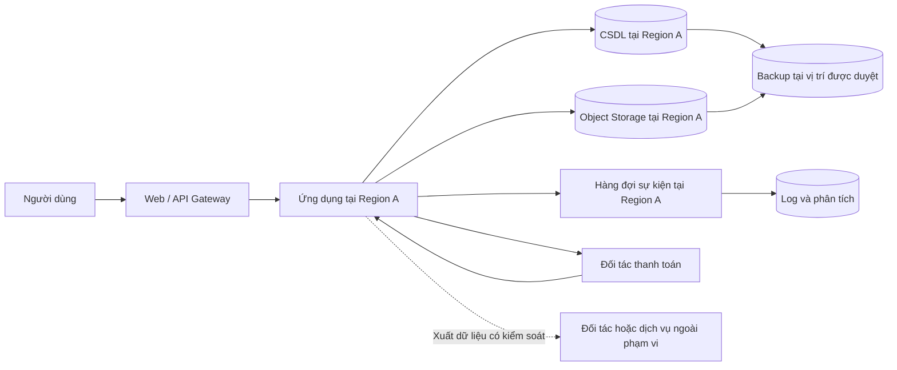

# Phân loại dữ liệu, vị trí lưu trữ và yêu cầu tuân thủ

Trong thiết kế kiến trúc đám mây (**Cloud Architecture**), quyết định chọn cơ sở dữ liệu, vùng triển khai, dịch vụ sao lưu hay nhà cung cấp dịch vụ không chỉ phụ thuộc vào hiệu năng và chi phí. Kiến trúc sư cần biết **đang xử lý dữ liệu gì, dữ liệu được phép xuất hiện ở đâu và những nghĩa vụ nào phải được đáp ứng**. Nếu xác định những điều này quá muộn, việc chuyển vùng dữ liệu, sửa luồng tích hợp hoặc bổ sung khả năng xóa dữ liệu có thể ảnh hưởng đến toàn bộ hệ thống.

Bài học thuộc chương **Yêu cầu kiến trúc**, tập trung vào cách chuyển yêu cầu nghiệp vụ thành các ràng buộc có thể triển khai và kiểm tra. Những quyết định này liên quan trực tiếp đến năm trụ cột thường được dùng khi đánh giá kiến trúc theo tư duy **Well-Architected**: độ tin cậy, bảo mật, hiệu quả hiệu năng, tối ưu chi phí và khả năng vận hành. Một phương án sao lưu đa vùng có thể cải thiện khả năng phục hồi nhưng lại tạo thêm đường truyền dữ liệu qua biên giới; một cơ chế ghi log đầy đủ có thể hỗ trợ vận hành nhưng làm tăng rủi ro lộ thông tin cá nhân. Kiến trúc tốt phải giải thích được những đánh đổi đó.

Sau bài học, bạn có thể:

- Lập danh mục và phân loại dữ liệu theo mức nhạy cảm, mức quan trọng và nghĩa vụ quản lý.
- Xác định vị trí dữ liệu trong các bản chính, bản sao, bản sao lưu, bộ nhớ đệm, log, luồng xử lý và dịch vụ bên thứ ba.
- Phân biệt yêu cầu về vị trí lưu trữ, chủ quyền dữ liệu và chuyển dữ liệu xuyên biên giới.
- Chuyển nghĩa vụ pháp lý, hợp đồng và tiêu chuẩn thành kiểm soát kỹ thuật cùng bằng chứng kiểm chứng.
- Đánh giá phương án kiến trúc qua các đánh đổi về bảo mật, độ tin cậy, khả năng mở rộng, chi phí và vận hành.

## 1. Bắt đầu từ dữ liệu và mục đích sử dụng

Một yêu cầu như “hệ thống phải bảo vệ dữ liệu khách hàng” chưa đủ để thiết kế kiến trúc. Trước khi chọn dịch vụ đám mây, cần trả lời ít nhất sáu câu hỏi:

1. **Dữ liệu nào?** Thông tin định danh, hồ sơ giao dịch, tài liệu tải lên, mã bí mật, chỉ số vận hành hay dữ liệu tổng hợp?
2. **Dùng để làm gì?** Tạo tài khoản, hoàn thành hợp đồng, chống gian lận, hỗ trợ khách hàng hay phân tích sản phẩm?
3. **Ai liên quan?** Chủ thể dữ liệu, bộ phận nghiệp vụ, nhà vận hành, nhà cung cấp đám mây và đối tác xử lý dữ liệu?
4. **Dữ liệu đi qua đâu?** Trình duyệt, API, hàng đợi, cơ sở dữ liệu, kho đối tượng, dịch vụ phân tích, bản sao lưu và hệ thống của đối tác?
5. **Giữ trong bao lâu?** Căn cứ giữ dữ liệu, thời điểm hết hạn, ngoại lệ do tranh chấp hoặc yêu cầu lưu giữ hợp pháp và cách xóa?
6. **Điều gì xảy ra nếu dữ liệu bị lộ, sai hoặc không truy cập được?** Tác động đến khách hàng, vận hành, tài chính, uy tín và nghĩa vụ thông báo?

Đầu ra đầu tiên nên là một **danh mục dữ liệu (data inventory)**, không phải sơ đồ máy chủ. Mỗi mục trong danh mục cần có người chịu trách nhiệm, mục đích sử dụng, nguồn sinh dữ liệu, các hệ thống nhận dữ liệu, thời gian lưu giữ và các yêu cầu kiểm soát.

### Dữ liệu có nhiều hình thái

- **Có cấu trúc:** bảng tài khoản, đơn hàng, hóa đơn, lịch sử giao dịch.
- **Bán cấu trúc:** JSON sự kiện, thông điệp hàng đợi, API payload.
- **Phi cấu trúc:** ảnh giấy tờ, tệp đính kèm, bản ghi âm, tài liệu hợp đồng.
- **Dữ liệu phát sinh:** log, dấu vết truy cập, bản chụp cơ sở dữ liệu, kết quả phân tích, mô hình hoặc tập dữ liệu huấn luyện.

Dữ liệu phát sinh không đương nhiên an toàn hơn dữ liệu nguồn. Một dòng log chứa email, địa chỉ IP, access token hoặc mã giao dịch vẫn có thể nhạy cảm. Dữ liệu đã băm hay được gán mã thay thế vẫn có thể là dữ liệu cá nhân nếu có cách liên kết ngược đến một cá nhân. Chỉ coi dữ liệu là **ẩn danh** khi đã đánh giá đầy đủ nguy cơ tái định danh trong bối cảnh sử dụng thực tế.

## 2. Phân loại dữ liệu theo nhiều chiều

**Phân loại dữ liệu (data classification)** là gán nhãn để quyết định cách truy cập, lưu trữ, mã hóa, truyền tải, sao lưu, ghi log và xóa dữ liệu. Một nhãn “nhạy cảm” duy nhất thường không đủ: thông tin cá nhân có thể yêu cầu bảo mật cao, còn bảng cấu hình định tuyến có thể không chứa thông tin cá nhân nhưng lại đòi hỏi tính toàn vẹn và khả dụng rất cao.

### 2.1. Mức độ nhạy cảm

Một mô hình nội bộ phổ biến gồm bốn mức; tên gọi và chính sách cụ thể cần được tổ chức thống nhất:

| Mức | Ví dụ | Yêu cầu kiểm soát điển hình |
| --- | --- | --- |
| **Công khai (Public)** | Danh mục sản phẩm đã công bố, tài liệu hướng dẫn công khai | Kiểm soát tính toàn vẹn; chỉ công bố nội dung đã phê duyệt |
| **Nội bộ (Internal)** | Tài liệu quy trình, báo cáo hoạt động không công khai | Xác thực, phân quyền theo nhóm, hạn chế chia sẻ ngoài tổ chức |
| **Mật (Confidential)** | Thông tin liên hệ khách hàng, hợp đồng, dữ liệu giao dịch cá nhân | Quyền tối thiểu, mã hóa, kiểm soát xuất dữ liệu, lưu vết truy cập |
| **Hạn chế nghiêm ngặt (Restricted)** | Khóa riêng, bí mật xác thực, bản quét giấy tờ định danh, dữ liệu đặc biệt nhạy cảm | Cô lập mạnh, hạn chế danh tính truy cập, quản lý khóa nghiêm ngặt, giám sát và phê duyệt ngoại lệ |

Đây là **khung tham khảo**, không phải thang phân loại do một tiêu chuẩn quốc tế áp đặt. Doanh nghiệp phải định nghĩa tiêu chí nâng hoặc hạ cấp nhãn, quyền phê duyệt và cách xử lý dữ liệu chưa được xác định. Khi chưa phân loại xong, không được mặc định dữ liệu là công khai.

### 2.2. Các chiều phân loại bổ sung

| Chiều đánh giá | Câu hỏi thiết kế | Hệ quả kiến trúc |
| --- | --- | --- |
| **Bảo mật (Confidentiality)** | Ai được phép xem? Nếu bị lộ sẽ gây hậu quả gì? | IAM, mã hóa, phân đoạn mạng, kiểm soát chia sẻ |
| **Toàn vẹn (Integrity)** | Nếu bị sửa sai hoặc bị giả mạo thì sao? | Kiểm tra đầu vào, chữ ký, versioning, audit log, kiểm soát thay đổi |
| **Khả dụng (Availability)** | Hệ thống có thể thiếu dữ liệu tối đa bao lâu? | Đa vùng sẵn sàng, sao lưu, RTO/RPO, khôi phục và kiểm thử |
| **Nghĩa vụ quản lý** | Có dữ liệu cá nhân, dữ liệu thanh toán, hồ sơ ngành đặc thù hoặc bí mật kinh doanh? | Kiểm soát chuyên biệt, phạm vi kiểm toán, hợp đồng với đối tác |
| **Vị trí và vòng đời** | Được xử lý ở đâu, giữ bao lâu, có được xuất đi không? | Giới hạn vùng, kiểm soát luồng dữ liệu, lịch lưu giữ và xóa |

Ví dụ, một bộ dữ liệu công khai về giá có thể cần bảo mật thấp nhưng tính toàn vẹn cao vì giá bị sửa sẽ dẫn đến giao dịch sai. Ngược lại, bản sao giấy tờ định danh cần bảo mật cao dù tần suất truy cập thấp. **Không suy mức độ khả dụng từ mức độ bí mật**: hai thuộc tính cần được đánh giá độc lập.

### 2.3. Gắn nhãn vào tài sản dữ liệu

Ví dụ giả định về nền tảng đặt thuê thiết bị:

| Tài sản dữ liệu | Nhãn nhạy cảm đề xuất | Nhãn nghiệp vụ hoặc nghĩa vụ | Lưu ý |
| --- | --- | --- | --- |
| Danh mục thiết bị đã công bố | Public | Nội dung công khai | Cần kiểm soát người chỉnh sửa và phiên bản |
| Hồ sơ tên, email, số điện thoại | Confidential | Dữ liệu cá nhân | Quy định mục đích sử dụng và thời gian lưu |
| Bản chụp giấy tờ xác minh danh tính | Restricted | Dữ liệu cá nhân nhạy cảm theo đánh giá áp dụng | Hạn chế số người xem, tránh tạo bản sao không cần thiết |
| Mã đơn thuê, trạng thái thanh toán | Confidential | Hồ sơ giao dịch | Cần bảo đảm toàn vẹn và đối soát |
| Số thẻ thanh toán gốc (nếu có) | Restricted | Có thể thuộc phạm vi PCI DSS | Ưu tiên để nhà cung cấp thanh toán xử lý; kiểm tra chính xác phạm vi hệ thống |
| API key, private key, token truy cập | Restricted | Bí mật hệ thống | Dùng secret manager, cấp quyền và xoay vòng khóa |
| Log request chứa IP hoặc user ID | Confidential, tùy nội dung | Có thể là dữ liệu cá nhân | Lọc trường nhạy cảm, giới hạn người truy cập, đặt thời gian lưu |
| Báo cáo đã tổng hợp | Phụ thuộc khả năng tái định danh | Phân tích | Đánh giá nhóm quá nhỏ hoặc khả năng liên kết với nguồn khác |

Một bản ghi có thể mang **nhiều nhãn cùng lúc**, chẳng hạn `Confidential`, `personal_data`, `business_critical` và `retention_24_months`. Nhãn cần được kế thừa khi dữ liệu đi vào bảng phân tích, bản sao dự phòng hoặc tệp xuất, trừ khi có quy trình biến đổi và đánh giá lại hợp lệ.

## 3. Vị trí dữ liệu: không chỉ là nơi đặt cơ sở dữ liệu chính

Trong kiến trúc đám mây, **vị trí dữ liệu (data location)** cần được mô tả theo cả vị trí vật lý, vị trí logic và những nơi có thể truy cập hoặc xử lý dữ liệu.

- **Quốc gia hoặc lãnh thổ:** ranh giới có thể gắn với nghĩa vụ pháp lý hoặc hợp đồng.
- **Region:** khu vực địa lý do nhà cung cấp định nghĩa. Cần xác minh vị trí thực tế và phạm vi dịch vụ của từng region.
- **Availability Zone (AZ):** miền lỗi bên trong region; triển khai nhiều AZ giúp giảm rủi ro sự cố một AZ nhưng không thay thế chiến lược cho sự cố toàn region.
- **Tài khoản, dự án, mạng và namespace:** ranh giới logic để tách quyền quản trị, môi trường và dữ liệu của các khách hàng.
- **Hệ thống bên ngoài:** SaaS, công cụ quan sát, nhà cung cấp thanh toán, dịch vụ email/SMS hoặc đội hỗ trợ truy cập từ nơi khác.

Các câu hỏi cần hỏi nhà cung cấp không dừng ở “cơ sở dữ liệu có nằm trong region đã chọn không?”. Còn phải kiểm tra **snapshot, bản sao, backup, lưu lượng sao chép, log, dữ liệu hỗ trợ kỹ thuật, hệ thống điều khiển (control plane), khóa mã hóa và dịch vụ có phạm vi toàn cầu**. Phạm vi lưu trữ và xử lý chính xác tùy dịch vụ và điều khoản nhà cung cấp; không nên suy ra từ tên region.

### 3.1. Lập sơ đồ luồng dữ liệu

Ví dụ luồng xử lý dữ liệu của một ứng dụng đặt thuê; tên `Region A` là vùng đã được tổ chức phê duyệt, không đại diện cho một region có thật của bất kỳ nhà cung cấp nào:



Sơ đồ này là **điểm bắt đầu để kiểm kê**, chưa đủ để chứng minh tuân thủ. Mỗi mũi tên phải được làm rõ: trường dữ liệu nào đi qua, mục đích, giao thức, điểm đến, cơ chế mã hóa, ai là bên xử lý, thời gian lưu giữ và cơ sở cho phép truyền dữ liệu. Nếu CDN hoặc WAF có thể cache nội dung chứa dữ liệu cá nhân, chúng cũng phải được đưa vào sơ đồ và chính sách vị trí.

### 3.2. Ma trận vị trí và luồng dữ liệu

| Thành phần | Dữ liệu có thể xuất hiện | Vị trí cần xác minh | Câu hỏi bắt buộc |
| --- | --- | --- | --- |
| Cơ sở dữ liệu chính và read replica | Bản ghi nghiệp vụ, dữ liệu cá nhân | Primary/replica region, AZ | Replica có được tạo tự động ở vùng khác không? |
| Object Storage và CDN | Ảnh hồ sơ, hợp đồng, nội dung cache | Vùng bucket, vị trí cache/edge | Cache có chứa nội dung riêng tư không? Có chính sách hết hạn/xóa không? |
| Backup, snapshot và môi trường phục hồi | Bản sao gần đầy đủ dữ liệu gốc | Vùng sao lưu và vùng khôi phục | Dữ liệu có bị sao chép sang vùng dự phòng bị cấm không? |
| Hàng đợi, cache và tìm kiếm | Payload sự kiện, session, chỉ mục | Vùng dịch vụ, cơ chế persistence | Dữ liệu hết hạn và bản sao được dọn thế nào? |
| Log, tracing, APM và analytics | IP, user ID, đường dẫn, payload lỗi | Vùng thu thập và lưu trữ | Công cụ bên thứ ba có nhận dữ liệu nhạy cảm không? |
| Công cụ CI/CD, support và quản trị | Secret, dump, dữ liệu debug | Nơi lưu artifact và nơi người vận hành truy cập | Ai có thể tải dữ liệu, từ quốc gia nào, trong tình huống nào? |

**Địa điểm xử lý** cũng quan trọng như địa điểm lưu trữ. Một kỹ sư hỗ trợ truy cập hồ sơ từ nước khác, một dịch vụ AI nhận nội dung yêu cầu hoặc việc gửi sự kiện phân tích sang SaaS đều có thể làm phát sinh vấn đề liên quan đến chuyển dữ liệu hoặc quyền truy cập xuyên biên giới, ngay cả khi cơ sở dữ liệu chính không rời region.

### 3.3. Phân biệt các thuật ngữ thường nhầm lẫn

| Thuật ngữ | Ý nghĩa trọng tâm | Ví dụ câu hỏi |
| --- | --- | --- |
| **Data residency** | Dữ liệu được lưu hoặc xử lý ở vị trí địa lý nào | “Bản ghi và backup nằm tại quốc gia nào?” |
| **Data localization** | Nghĩa vụ phải lưu/xử lý một số dữ liệu tại địa điểm được quy định, tùy quy định áp dụng | “Loại dữ liệu này có bắt buộc hiện diện trong nước không?” |
| **Data sovereignty** | Dữ liệu chịu sự điều chỉnh và quyền kiểm soát của những hệ thống pháp luật, chủ thể nào | “Ai có quyền yêu cầu truy cập? Ai kiểm soát khóa và hoạt động quản trị?” |
| **Cross-border data transfer** | Truyền hoặc làm cho dữ liệu có thể được tiếp cận từ một quốc gia/lãnh thổ khác, theo định nghĩa pháp lý áp dụng | “Đối tác, nhân viên hỗ trợ hay hệ thống DR ở nước khác có nhận hoặc truy cập dữ liệu không?” |

Chọn một region trong nước **không tự động chứng minh** mọi nghĩa vụ về chủ quyền hay chuyển dữ liệu đã được đáp ứng. Ngược lại, không phải mọi trường hợp chuyển dữ liệu ra nước ngoài đều bị cấm. Kiến trúc sư phải ghi lại phạm vi luật áp dụng, điều kiện được phép chuyển và tài liệu/phê duyệt cần có trước khi mở luồng.

## 4. Chuyển yêu cầu tuân thủ thành quyết định kiến trúc

**Tuân thủ (compliance)** có nhiều nguồn: pháp luật của những nơi có liên quan, quy định ngành, hợp đồng khách hàng, chính sách nội bộ và các cam kết kiểm toán. Chúng khác nhau về tính bắt buộc, phạm vi dữ liệu và cách chứng minh.

Một số ví dụ để nhận diện phạm vi, **không phải kết luận pháp lý cho mọi hệ thống**:

- Các quy định bảo vệ dữ liệu cá nhân, như **GDPR** khi thuộc phạm vi áp dụng và quy định bảo vệ dữ liệu cá nhân hiện hành của quốc gia liên quan, có thể đặt yêu cầu về mục đích, cơ sở xử lý, quyền của chủ thể, bảo mật, lưu giữ và chuyển dữ liệu.
- **PCI DSS** liên quan đến môi trường xử lý, lưu trữ hoặc truyền dữ liệu tài khoản thanh toán trong phạm vi chuẩn. Dùng dịch vụ token hóa/hosted payment có thể giảm phạm vi kiểm soát của ứng dụng, nhưng phải xác minh ranh giới trách nhiệm.
- **ISO/IEC 27001** là tiêu chuẩn về hệ thống quản lý an toàn thông tin; **SOC 2** là khuôn khổ báo cáo đảm bảo về các kiểm soát của tổ chức cung cấp dịch vụ. Chứng nhận hoặc báo cáo của nhà cung cấp là một phần bằng chứng, không thay thế trách nhiệm của khách hàng đối với cấu hình và cách sử dụng.
- Hợp đồng có thể yêu cầu dữ liệu khách hàng ở các vùng được phép, mã hóa bằng khóa được quản lý riêng, thời hạn thông báo sự cố hoặc quyền kiểm toán, ngay cả khi pháp luật không quy định y hệt.

Vì quy định và phiên bản tiêu chuẩn có thể thay đổi, nhóm kiến trúc cần phối hợp với pháp chế, bộ phận bảo mật và chủ sở hữu dữ liệu để xác minh **văn bản hiện hành, phạm vi áp dụng, ngoại lệ, thời hạn và yêu cầu tài liệu**. Tránh biến một nhận định chung như “dữ liệu cá nhân phải ở trong nước” thành ràng buộc cho tất cả hệ thống khi chưa xác minh đúng đối tượng và hoạt động xử lý.

### 4.1. Chuỗi truy vết từ nghĩa vụ đến bằng chứng

Thiết kế có thể kiểm toán cần nối liền năm phần:

> **Nguồn yêu cầu → tài sản dữ liệu bị ảnh hưởng → quyết định kiến trúc → kiểm soát thực thi → bằng chứng kiểm chứng.**

Ví dụ ma trận truy vết:

| Yêu cầu đã được xác nhận | Quyết định kiến trúc | Cách thực thi | Bằng chứng cần có |
| --- | --- | --- | --- |
| Hồ sơ khách hàng chỉ được lưu tại các vùng đã phê duyệt | Chọn region hợp lệ cho DB, object, cache và backup | Policy chặn tạo tài nguyên ở vùng ngoài danh sách; kiểm tra cấu hình bản sao | Danh mục tài sản, cấu hình region, kết quả quét policy |
| Chỉ nhóm hỗ trợ được phân quyền mới xem được hồ sơ | Tách vai trò người dùng và dịch vụ | IAM ít quyền nhất, MFA, truy cập tạm thời, ghi audit | Danh sách quyền, lịch sử phê duyệt, audit trail |
| Dữ liệu nhạy cảm phải được bảo vệ khi lưu và khi truyền | Dùng mã hóa ở các lớp liên quan | TLS, mã hóa lưu trữ, quản lý khóa KMS/HSM, quy trình xoay khóa | Cấu hình mã hóa, chính sách khóa, kết quả kiểm tra kết nối |
| Dữ liệu phải được xóa hoặc hết hạn đúng chính sách | Thiết kế retention xuyên suốt cả dữ liệu phụ | TTL, lifecycle rule, quy trình xóa, xử lý bản sao lưu | Chính sách retention, log thao tác xóa, kết quả kiểm thử |
| Có khả năng phục hồi sau sự cố | Chọn cơ chế dự phòng theo RTO/RPO | Multi-AZ, backup, bản phục hồi tại vùng hợp lệ | Báo cáo diễn tập restore, số liệu RTO/RPO đo được |

Không nên chỉ ghi “tuân thủ GDPR” hoặc “đạt ISO 27001” trên sơ đồ kiến trúc; cần xác định **điều khoản, đối tượng, người chịu trách nhiệm và cơ chế kiểm soát cụ thể**. Một kiểm soát kỹ thuật không chứng minh được toàn bộ yêu cầu pháp lý nếu thiếu quy trình, hợp đồng hoặc bằng chứng vận hành.

### 4.2. Các nhóm kiểm soát cốt lõi

**Giảm dữ liệu và giới hạn mục đích.** Chỉ thu trường cần thiết; không sao chép toàn bộ hồ sơ sang hệ thống phân tích khi chỉ cần số liệu tổng hợp. Gắn quy trình phê duyệt khi tạo mục đích xử lý mới và hạn chế môi trường thử nghiệm dùng dữ liệu thật.

**Phân quyền và phân tách.** Cấp quyền theo vai trò/danh tính dịch vụ, hạn chế quyền quản trị thường trực, phân chia môi trường production/test và trách nhiệm quản lý khóa. Đối với hệ thống nhiều khách hàng (multi-tenant), thiết kế và kiểm thử cơ chế cô lập dữ liệu giữa tenant ở cả API, DB và xuất báo cáo.

**Mã hóa và quản lý khóa.** Dùng kênh truyền được bảo vệ, mã hóa dữ liệu lưu trữ và bản sao, quản lý vòng đời khóa. Xác định vị trí của KMS/HSM, quyền giải mã, quyền của nhà vận hành và khả năng khôi phục khóa; một bucket được mã hóa không đồng nghĩa mọi người có quyền đọc bucket đều không thể xem dữ liệu.

**Giám sát và phản ứng sự cố.** Ghi các hành động quan trọng như thay quyền, đọc dữ liệu nhạy cảm theo diện đặc biệt, tạo bản sao, xuất dữ liệu và xóa. Log cần đủ phục vụ truy vết nhưng phải lọc mật khẩu, token và payload nhạy cảm. Xác định người nhận cảnh báo, cách xử lý sự cố và thời hạn thông báo theo nghĩa vụ thực tế.

**Quản lý vòng đời.** Định nghĩa khi nào tạo, sử dụng, chia sẻ, lưu trữ, lưu trữ lạnh, xóa và kiểm tra xóa. Chính sách áp dụng cho DB, object, queue, cache, chỉ mục tìm kiếm, bản xuất, log và backup. Nếu cần giữ bản sao lưu theo chu kỳ phục hồi, phải quy định rõ lúc hết hạn và cách hạn chế khả năng truy cập trong thời gian còn tồn tại.

**Quản lý bên thứ ba.** Xác định bên nào là bên kiểm soát/xử lý dữ liệu theo quy định áp dụng, đánh giá hợp đồng, danh sách bên xử lý phụ, vùng lưu trữ, biện pháp bảo mật, quyền truy cập hỗ trợ và quy trình xóa sau kết thúc hợp đồng.

### 4.3. Trách nhiệm chia sẻ với nhà cung cấp đám mây

Nhà cung cấp thường chịu trách nhiệm bảo vệ phần hạ tầng mà họ vận hành; khách hàng vẫn chịu trách nhiệm với **dữ liệu, quyền truy cập, cấu hình, lựa chọn dịch vụ, khóa tùy mô hình và nghĩa vụ sử dụng**. Ranh giới cụ thể thay đổi giữa IaaS, PaaS và SaaS. Chẳng hạn, dùng cơ sở dữ liệu được quản lý có thể giảm việc vá hệ điều hành, nhưng khách hàng vẫn phải cấu hình quyền, kết nối, backup, retention và kiểm tra nơi dữ liệu được sao chép. Luôn đối chiếu mô hình trách nhiệm chia sẻ của **đúng dịch vụ** đang dùng.

## 5. Ví dụ thiết kế: nền tảng đặt thuê thiết bị

Giả sử tổ chức triển khai một ứng dụng có tài khoản khách hàng, hồ sơ xác minh, đơn thuê, thanh toán qua đối tác và báo cáo vận hành. Đây là **tình huống minh họa**; các vùng, thời hạn và chỉ tiêu bên dưới là giả định thiết kế, không phải tuyên bố về luật áp dụng.

**Yêu cầu nghiệp vụ ban đầu:** khách hàng đăng nhập và đặt thuê trực tuyến; đơn hàng không được mất khi một máy chủ gặp sự cố; nhân viên hỗ trợ chỉ xem thông tin cần cho xử lý yêu cầu; tổ chức cần phân tích doanh thu mà không cung cấp hồ sơ định danh cho hệ thống phân tích.

**Các ràng buộc được giả định đã phê duyệt:**

- Hồ sơ khách hàng và bản sao của chúng chỉ được lưu ở `Region A`; mọi luồng ra vùng khác phải được duyệt riêng.
- Tài liệu xác minh danh tính thuộc nhóm `Restricted`, người hỗ trợ thông thường không có quyền tải bản gốc.
- Ứng dụng không lưu số thẻ gốc hoặc mã xác minh thẻ; chuyển người dùng sang bước thanh toán do đối tác phù hợp đảm nhiệm và chỉ lưu mã tham chiếu cần thiết.
- Đối với dữ liệu giao dịch, mục tiêu ban đầu là **RPO 15 phút** và **RTO 4 giờ**. Các chỉ tiêu này phải được thử nghiệm mới có thể tuyên bố đáp ứng.
- Sự kiện phân tích dùng mã thay thế và chỉ số tổng hợp; quyền truy cập và nguy cơ tái định danh vẫn cần đánh giá.

### 5.1. Phương án kiến trúc

1. Triển khai ứng dụng và cơ sở dữ liệu managed database tại `Region A`, ưu tiên nhiều AZ nếu dịch vụ và ngân sách hỗ trợ. Dùng private networking giữa ứng dụng và DB, giới hạn điểm vào công khai.
2. Lưu hồ sơ xác minh trong object storage riêng, đặt quyền mặc định từ chối, chỉ cấp truy cập ngắn hạn qua luồng nghiệp vụ có kiểm tra quyền; tách khóa và log truy cập thích hợp.
3. Bật sao lưu tự động, mã hóa và kiểm soát retention. Xác nhận **mọi bản backup và snapshot** đều ở vị trí cho phép, kể cả khi có tính năng sao chép tự động.
4. Tích hợp đối tác thanh toán bằng luồng được đánh giá và lưu tham chiếu thanh toán thay cho dữ liệu thẻ. Kiểm tra những trường dữ liệu nào thực sự được gửi sang đối tác và địa điểm xử lý của họ.
5. Ghi log kỹ thuật có lọc trường nhạy cảm; tách audit log cho hành động truy cập/xuất hồ sơ. Giới hạn thời gian lưu và nơi đặt dịch vụ quan sát.
6. Cung cấp dữ liệu phân tích từ một luồng biến đổi có kiểm soát, loại bỏ các trường định danh không cần thiết; kiểm tra khả năng liên kết lại với cá nhân trước khi chia sẻ.

### 5.2. Biểu mẫu quyết định cho một tập dữ liệu

Đây là **metadata minh họa**, không phải cấu hình có thể áp dụng trực tiếp vào một nhà cung cấp:

```yaml
dataset: customer_identity_documents
owner: identity_verification_team
purpose: verify_customer_identity
classification: restricted
regulatory_tags:
  - personal_data
integrity_requirement: high
availability_requirement: medium
approved_primary_location: region-a
approved_backup_locations:
  - region-a
external_sharing: requires_explicit_approval
encryption_at_rest: required
encryption_in_transit: required
access_policy: verified_service_roles_only
retention_policy: per_approved_schedule
deletion_scope:
  - primary
  - replicas
  - derived_exports
  - backups_at_expiry
```

Biểu mẫu phải được liên kết với danh mục dữ liệu, người phê duyệt và phiên bản chính sách. Các giá trị như `region-a` hoặc `per_approved_schedule` chỉ là chỗ giữ chỗ; khi vận hành phải thay bằng region, lịch lưu giữ và thủ tục xử lý ngoại lệ đã được xác minh.

### 5.3. Biến ràng buộc thành kiểm tra tự động

Ví dụ **mã giả policy-as-code** thể hiện một nguyên tắc thiết kế:

```text
for each data_store in deployment:
    dataset = catalog.lookup(data_store.dataset_id)

    assert data_store.region in dataset.approved_storage_regions
    assert data_store.replica_regions subset_of dataset.approved_storage_regions
    assert data_store.backup_regions subset_of dataset.approved_storage_regions

    if dataset.classification in ["confidential", "restricted"]:
        assert data_store.encryption_at_rest == true
        assert data_store.public_access == false

    assert data_store.owner is not null
```

Một pipeline triển khai có thể từ chối tài nguyên vi phạm chính sách vùng, quyền truy cập công khai hoặc thiếu mã hóa. Tuy nhiên, policy-as-code phải được bổ sung bằng **kiểm tra dịch vụ chạy thực tế**, vì dữ liệu còn có thể bị xuất qua API, ứng dụng, log hoặc công cụ của người vận hành mà cấu hình hạ tầng không phát hiện được.

## 6. Những đánh đổi phải nêu rõ trong bản thiết kế

| Quyết định | Lợi ích | Chi phí hoặc rủi ro cần xem xét |
| --- | --- | --- |
| Giữ dữ liệu trong một region được phê duyệt | Đơn giản hóa kiểm soát vị trí, độ trễ nội vùng có thể thấp | Khó phục hồi sau sự cố toàn region nếu không được dùng region thứ hai |
| Sao lưu hoặc DR sang region khác | Khả năng chống sự cố cấp region tốt hơn | Nguy cơ vượt giới hạn vị trí, chi phí sao chép/lưu trữ, yêu cầu kiểm soát chuyển dữ liệu |
| Dùng nhiều AZ trong cùng region | Giảm ảnh hưởng khi một AZ gặp sự cố | Chi phí cao hơn; vẫn có rủi ro sự cố toàn region |
| Chọn dịch vụ managed | Giảm gánh nặng vận hành và vá hạ tầng | Cần kiểm tra khả năng cấu hình vị trí, khóa, backup, log và quyền hỗ trợ |
| Tăng thời gian lưu log | Thuận lợi cho điều tra, đối soát và kiểm toán | Tăng chi phí, bề mặt rò rỉ và xung đột với nguyên tắc giới hạn lưu giữ |
| Mã hóa bằng khóa do khách hàng kiểm soát | Tăng quyền kiểm soát việc giải mã và thu hồi khóa | Tăng độ phức tạp quản trị, chi phí và rủi ro mất khả năng khôi phục khi khóa bị mất |
| Ẩn danh/tổng hợp trước khi phân tích | Giảm lượng dữ liệu định danh phải chia sẻ | Tốn xử lý; có thể làm giảm độ chi tiết và vẫn cần đánh giá tái định danh |

**Ví dụ đánh đổi quan trọng:** nếu chính sách chỉ cho phép lưu dữ liệu trong `Region A`, yêu cầu RTO/RPO có thể không còn khả thi khi **cả region ngừng hoạt động**. Nhóm kiến trúc phải nêu rõ phạm vi sự cố được cam kết, đo RTO/RPO qua diễn tập và đưa ra một trong các quyết định được phê duyệt: chấp nhận rủi ro, thay đổi chỉ tiêu khôi phục, tìm phương án vùng thứ hai được phép hoặc điều chỉnh phạm vi dữ liệu cần dự phòng. Không thể dùng thiết kế multi-AZ để mặc nhiên cam kết phục hồi sự cố toàn region.

**Ví dụ xung đột vòng đời:** bản sao lưu bất biến giúp chống xóa phá hoại và ransomware, nhưng có thể khiến yêu cầu xóa ngay một hồ sơ khỏi mọi bản sao trở nên khó thực hiện. Chính sách phải quy định rõ dữ liệu đang hoạt động được xóa thế nào, bản sao lưu được cách ly và hết hạn ra sao, liệu có nghĩa vụ giữ lại hợp pháp hay không và ai phê duyệt ngoại lệ. Không nên hứa “xóa ngay mọi bản sao” khi cơ chế backup thực tế không hỗ trợ.

## 7. Quy trình áp dụng vào một dự án thật

Thực hiện theo trình tự để tránh bỏ sót hệ thống phụ:

1. **Khám phá:** làm việc với chủ sản phẩm, đội dữ liệu và vận hành; lập danh mục tập dữ liệu, mục đích, luồng vào/ra, chủ sở hữu và mức độ tác động.
2. **Phân loại:** gắn mức nhạy cảm, yêu cầu bảo mật/toàn vẹn/khả dụng, nhãn nghĩa vụ và vòng đời. Đánh dấu các mục chưa rõ để được phê duyệt.
3. **Xác định phạm vi tuân thủ:** cùng pháp chế/bảo mật kiểm tra quốc gia, khách hàng, ngành, đối tác, hợp đồng và phiên bản quy định áp dụng; ghi lại giả định và quyết định.
4. **Lập sơ đồ vị trí:** rà soát data plane, control plane, chính sách vùng, bản sao, backup, cache, CDN, observability, truy cập từ xa và nhà cung cấp bên thứ ba.
5. **Thiết kế và kiểm soát:** quyết định region, AZ, phương án DR, phân quyền, mã hóa, quản lý khóa, chia sẻ, retention và xóa; biểu diễn những gì có thể bằng cấu hình và policy-as-code.
6. **Kiểm chứng:** kiểm tra cấu hình trên môi trường thật, diễn tập khôi phục, thử quyền truy cập, kiểm tra xuất dữ liệu, kiểm tra quy trình xóa và đối chiếu với ma trận yêu cầu.
7. **Duy trì:** cập nhật danh mục và sơ đồ khi thêm dịch vụ hoặc đối tác, kiểm tra drift, xem lại quyền và lịch lưu giữ; đánh giá lại khi yêu cầu pháp lý hoặc nghiệp vụ thay đổi.

### Checklist nghiệm thu trước khi triển khai

- [ ] Mỗi tập dữ liệu quan trọng có chủ sở hữu, mục đích, nhãn phân loại và chính sách lưu giữ.
- [ ] Mỗi nơi lưu trữ/xử lý và mỗi luồng chuyển dữ liệu đều có vị trí, bên nhận và cơ sở cho phép rõ ràng.
- [ ] Vùng của dữ liệu gốc, replica, backup, log, object, cache và công cụ phân tích đã được đối chiếu với danh sách được phê duyệt.
- [ ] IAM, mã hóa, quản lý khóa, kết nối mạng, giám sát và quyền truy cập hỗ trợ đã được cấu hình và kiểm tra.
- [ ] Luồng dữ liệu tới đối tác có hợp đồng, phạm vi dữ liệu và cơ chế kiểm soát phù hợp.
- [ ] Quy trình xuất, sửa, lưu giữ và xóa dữ liệu hoạt động trên dữ liệu chính và các bản sao liên quan.
- [ ] RTO/RPO đã được kiểm chứng qua diễn tập trong phạm vi sự cố được công bố.
- [ ] Có bằng chứng cấu hình, báo cáo kiểm tra, chủ sở hữu ngoại lệ và lịch đánh giá lại.

## 8. Những lỗi thiết kế thường gặp

| Lỗi | Vì sao nguy hiểm | Cách phòng tránh |
| --- | --- | --- |
| Chỉ phân loại dữ liệu ở DB chính | Bản xuất, log, bản sao và ảnh có thể chứa cùng thông tin | Phân loại theo **tập dữ liệu** và theo dõi mọi nơi dữ liệu xuất hiện |
| Xem chọn region là hoàn tất yêu cầu vị trí | Một số dịch vụ phụ trợ hoặc hoạt động hỗ trợ có phạm vi khác | Kiểm tra điều khoản và hành vi của từng dịch vụ, lập sơ đồ luồng dữ liệu |
| Coi mã hóa là đủ để bảo vệ dữ liệu | Danh tính có quyền giải mã vẫn có thể lấy dữ liệu | Kết hợp mã hóa với IAM, phân tách nhiệm vụ, audit và kiểm soát xuất dữ liệu |
| Dùng dữ liệu thật trong môi trường thử nghiệm | Bản sao có thể ít được bảo vệ và không được theo dõi | Tạo dữ liệu tổng hợp hoặc làm sạch/ẩn danh phù hợp; quản lý ngoại lệ |
| Đẩy toàn bộ request/response vào log | Token, tài liệu và thông tin cá nhân có thể bị phát tán | Thiết kế allowlist trường log, che/lọc dữ liệu, kiểm thử với tình huống lỗi |
| Đặt retention nhưng không thử xóa | Dữ liệu tồn tại trong chỉ mục, queue, export và backup | Lập bản đồ vòng đời và kiểm thử xóa/khôi phục định kỳ |
| Sao chép DR sang vùng chưa được duyệt | Tăng độ tin cậy nhưng tạo vấn đề vị trí và hợp đồng | Thẩm định vị trí DR trước khi bật replication; ghi rõ đánh đổi |
| Tin rằng chứng nhận của nhà cung cấp bảo đảm toàn hệ thống | Kiểm soát cấu hình và vận hành của khách hàng vẫn có thể sai | Dùng mô hình trách nhiệm chia sẻ và chứng minh kiểm soát của chính hệ thống |

## 9. Kết nối với đánh giá Well-Architected

Khi review một kiến trúc, đừng hỏi chung chung “dữ liệu đã an toàn chưa?”. Hãy dùng các câu hỏi có thể trả lời bằng sơ đồ, cấu hình, phép thử và bằng chứng:

| Góc đánh giá | Câu hỏi nên đặt |
| --- | --- |
| **Bảo mật** | Những dữ liệu nào được phân loại Restricted? Ai có quyền giải mã, sao chép và xuất? Có giám sát truy cập bất thường không? |
| **Độ tin cậy** | Nếu mất một AZ hoặc toàn region, dữ liệu nào được phục hồi? RTO/RPO đo được là bao nhiêu và DR có nằm ở nơi hợp lệ không? |
| **Hiệu quả hiệu năng** | Ràng buộc vị trí gây độ trễ tới người dùng và đối tác ra sao? Có thể dùng cache mà không lưu dữ liệu riêng tư ở vùng bị cấm không? |
| **Tối ưu chi phí** | Chi phí mã hóa, lưu log, lưu giữ dài hạn, replication và egress là bao nhiêu? Có thể giảm dữ liệu dư thừa không? |
| **Khả năng vận hành** | Ai cập nhật data inventory, xử lý yêu cầu xóa, kiểm soát drift và chứng minh tuân thủ khi có thay đổi? |

Một bản thiết kế được coi là có cơ sở khi **mỗi quyết định lớn đều truy ngược được về yêu cầu, tác động và bằng chứng kiểm chứng**. Phân loại dữ liệu tạo ra mức bảo vệ cần thiết; sơ đồ vị trí cho thấy ranh giới dữ liệu thực sự đi qua; ma trận tuân thủ chỉ ra biện pháp và người chịu trách nhiệm. Ba phần này cần được cập nhật cùng nhau trong suốt vòng đời hệ thống.
