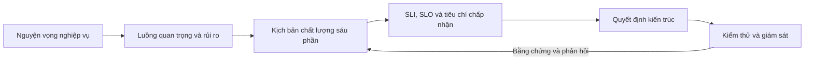

# Chuyển yêu cầu thành kịch bản chất lượng có tiêu chí đo lường

## Mục tiêu học tập

Trong thiết kế kiến trúc ứng dụng đám mây (**Cloud Architecture**), yêu cầu nghiệp vụ thường được diễn đạt bằng những câu như “hệ thống phải nhanh”, “không được mất dữ liệu”, “phải an toàn” hoặc “chi phí hợp lý”. Các câu này thể hiện mong muốn chính đáng nhưng chưa đủ để lựa chọn kiến trúc, thiết kế kiểm thử hay đánh giá kết quả. Bài học này hướng dẫn chuyển chúng thành **kịch bản thuộc tính chất lượng** (*quality attribute scenario*) có ngữ cảnh, hành vi kỳ vọng và tiêu chí đo lường cụ thể.

Sau bài học, bạn có thể:

- Phân biệt yêu cầu chức năng, yêu cầu chất lượng, ràng buộc và giả định thiết kế.
- Viết một kịch bản chất lượng theo sáu thành phần: nguồn tác động, tác động, môi trường, thành phần chịu tác động, phản hồi và thước đo phản hồi.
- Xây dựng các tiêu chí kiểm chứng được cho độ tin cậy, bảo mật, hiệu năng, khả năng mở rộng, khả năng khôi phục, khả năng vận hành và chi phí.
- Liên kết kịch bản chất lượng với lựa chọn mạng, compute, dữ liệu, triển khai và các trụ cột của **Well-Architected**.
- Xác định cách đo, cách kiểm thử và mức ưu tiên để ra quyết định kiến trúc có căn cứ.

## 1. Vì sao phải chuyển yêu cầu thành kịch bản?

Giả sử nhóm sản phẩm đang xây dựng ứng dụng đặt chỗ trên đám mây. Bên nghiệp vụ đề nghị:

> Trong giờ cao điểm, khách vẫn phải đặt chỗ nhanh, không bị đặt trùng và hệ thống phải hoạt động ổn định.

Đề nghị này chưa trả lời được: “nhanh” là bao nhiêu giây, với bao nhiêu người dùng, khi một vùng sẵn sàng (*Availability Zone — AZ*) gặp sự cố thì chuyện gì xảy ra, hay “không trùng” được xác nhận ở bước nào. Nếu các bên hiểu khác nhau, nhóm có thể đầu tư quá nhiều cho hạ tầng hoặc triển khai xong mà vẫn không đáp ứng kỳ vọng.

Kịch bản chất lượng biến mong muốn thành câu hỏi có thể kiểm chứng:

> Khi lưu lượng gửi yêu cầu đặt chỗ tăng từ 100 lên 800 yêu cầu/giây trong 5 phút, hệ thống đang ở trạng thái hoạt động bình thường phải giữ độ trễ `p95` của API đặt chỗ không quá 500 ms, tỷ lệ lỗi dưới 0,5% trong 30 phút thử tải và không phát sinh đặt chỗ trùng do retry.

Các con số ở đây **chỉ là mục tiêu minh họa**. Trong dự án thật, chúng phải được thống nhất với bên nghiệp vụ, đối chiếu số liệu tải hiện tại, rủi ro và ngân sách. Giá trị của kịch bản không nằm ở việc chọn một con số “đẹp”, mà ở việc tất cả bên liên quan có thể dùng cùng một tiêu chuẩn để thiết kế và kiểm chứng.

| Loại thông tin | Câu hỏi cần trả lời | Ví dụ trong ứng dụng đặt chỗ |
| --- | --- | --- |
| Yêu cầu chức năng | Hệ thống **làm gì**? | Khách có thể tìm phòng, đặt chỗ và hủy đặt chỗ. |
| Yêu cầu chất lượng (*non-functional / quality requirement*) | Hệ thống **làm tốt đến đâu** khi có điều kiện xác định? | API tìm phòng có `p95` không quá 300 ms ở 500 yêu cầu/giây. |
| Ràng buộc | Những giới hạn **bắt buộc tuân thủ** là gì? | Dữ liệu cá nhân phải lưu tại khu vực pháp lý được phê duyệt. |
| Giả định | Điều gì đang **tạm được coi là đúng** nhưng cần xác thực? | Dự báo cao điểm tối đa 800 yêu cầu/giây trong quý tới. |

Ràng buộc và giả định ảnh hưởng mạnh đến thiết kế, nhưng không được lẫn với các tiêu chí thành công. Ví dụ, “dùng Kubernetes” là một lựa chọn hoặc ràng buộc công nghệ; “khôi phục lưu lượng trong 5 phút khi một node chết” mới là yêu cầu chất lượng có thể đánh giá. Tương tự, **user story** mô tả mục tiêu người dùng; kịch bản chất lượng làm rõ hành vi của hệ thống dưới áp lực hoặc sự cố cụ thể.

## 2. Cấu trúc sáu phần của kịch bản chất lượng

Một cách viết có hệ thống là mô hình sáu thành phần sau:

| Thành phần | Ý nghĩa | Câu hỏi gợi mở |
| --- | --- | --- |
| **Nguồn tác động** (*source of stimulus*) | Ai hoặc điều gì gây ra sự kiện? | Người dùng, hệ thống bên ngoài, kẻ tấn công, sự cố hạ tầng? |
| **Tác động** (*stimulus*) | Sự kiện gì xảy ra? | Tăng đột biến lưu lượng, lỗi AZ, truy cập trái phép, xóa nhầm dữ liệu? |
| **Môi trường** (*environment*) | Hệ thống đang trong điều kiện nào? | Giờ cao điểm, vận hành bình thường, đang triển khai, đã suy giảm một phần? |
| **Thành phần chịu tác động** (*artifact*) | Phần nào của hệ thống phải phản hồi? | API, hàng đợi, cụm compute, cơ sở dữ liệu, đường mạng, quy trình vận hành? |
| **Phản hồi** (*response*) | Hệ thống được kỳ vọng làm gì? | Tự mở rộng, từ chối truy cập, chuyển hướng lưu lượng, khôi phục từ bản sao lưu? |
| **Thước đo phản hồi** (*response measure*) | Dựa vào đâu kết luận đạt? | `p95`, tỷ lệ thành công, `RTO`, `RPO`, số sự kiện bị chặn, chi phí/giao dịch? |

Một công thức hữu ích khi phỏng vấn bên liên quan:

> **Khi** `[nguồn]` gây ra `[tác động]` **trong điều kiện** `[môi trường]`, **thì** `[thành phần]` phải `[phản hồi]`, **được xác nhận bởi** `[thước đo và phép đo]`.

**Ví dụ — tính sẵn sàng:** Khi một AZ mất kết nối trong giờ cao điểm, dịch vụ đặt chỗ đang xử lý 600 yêu cầu/giây phải điều hướng truy cập đến các instance khỏe mạnh, không xác nhận hai lần cùng một giao dịch, và đạt tỷ lệ yêu cầu thành công ít nhất 99,9% trong khoảng thử nghiệm 15 phút sau khi tiêm lỗi. Muốn kiểm chứng, nhóm phải định nghĩa rõ yêu cầu hợp lệ, điểm đo và thời điểm bắt đầu/kết thúc thử nghiệm.

<details>
<summary>Vì sao không chỉ ghi “tính sẵn sàng 99,9%”?</summary>

Con số đó chưa chỉ rõ dịch vụ nào, cách xác định lỗi, khoảng thời gian, nhóm yêu cầu được tính và tác động tới người dùng. Độ sẵn sàng của trang chủ có thể khác độ sẵn sàng của API thanh toán hoặc đặt chỗ. Một tiêu chí tổng quát vẫn hữu ích cho định hướng, nhưng cần được triển khai thành các kịch bản kiểm tra luồng nghiệp vụ quan trọng.

</details>

## 3. Từ ngôn ngữ nghiệp vụ đến mục tiêu đo lường

### 3.1. Xác định luồng nghiệp vụ và mức độ quan trọng

Đừng bắt đầu bằng việc chọn máy chủ hay cơ sở dữ liệu. Trước hết, xác định:

1. **Ai quan tâm?** Khách hàng, vận hành, an ninh, tài chính, pháp chế và đội phát triển có tiêu chí thành công khác nhau.
2. **Luồng nào quan trọng?** Tìm kiếm, đặt chỗ, thanh toán, đối soát, đăng nhập và quản trị không nhất thiết cùng một mức độ ưu tiên.
3. **Điều gì có thể xảy ra?** Tăng tải, lỗi một tài nguyên, lỗi toàn vùng, lỗi triển khai, dữ liệu không nhất quán, hành vi truy cập bất thường.
4. **Hậu quả là gì?** Mất doanh thu, khách bị tính tiền hai lần, rò rỉ dữ liệu, chậm xử lý, phát sinh chi phí vận hành.
5. **Giới hạn nào có thật?** Ngân sách, tuân thủ, nhân lực trực vận hành, thời gian giao hàng và mức độ chấp nhận rủi ro.

Có thể dùng sơ đồ luồng sau để giữ liên kết giữa nhu cầu và quyết định kỹ thuật:



### 3.2. Chọn đúng chỉ số và cách đo

Một mục tiêu tốt không chỉ có ngưỡng số mà còn có **đơn vị, phạm vi, điều kiện tải, khoảng thời gian, nguồn dữ liệu và cách tính**.

| Khía cạnh | Chỉ số tham khảo | Điều phải định nghĩa trước khi cam kết |
| --- | --- | --- |
| Độ sẵn sàng | Tỷ lệ yêu cầu hợp lệ thành công trong 30 ngày | API nào; mã lỗi nào bị tính; điểm đo từ phía khách; bảo trì có được loại trừ không? |
| Hiệu năng | `p95`/`p99` độ trễ, số yêu cầu/giây | Đo từ client hay server; tỷ lệ đọc/ghi; dữ liệu thử; tỷ lệ lỗi đi kèm. |
| Khả năng mở rộng | Lưu lượng chịu được, thời gian scale-out | Độ dốc tăng tải; giới hạn phụ thuộc ở database, mạng, quota; thời gian ổn định. |
| Khôi phục | **RTO**, **RPO** | Loại sự cố; thời điểm bắt đầu đo; điểm phục hồi; cách xác nhận dữ liệu đúng. |
| Bảo mật | Tỷ lệ ca truy cập trái phép bị từ chối; thời gian phát hiện | Bộ ca kiểm thử, mô hình quyền, phạm vi dữ liệu, quy trình xử lý và lưu nhật ký. |
| Vận hành | **MTTD**, **MTTR**, tỷ lệ cảnh báo hữu ích | Sự cố được nhận diện thế nào; đồng hồ đo bắt đầu lúc nào; người phụ trách là ai. |
| Chi phí | Chi phí mỗi đơn thành công, chi phí môi trường/tháng | Bao gồm thành phần nào; gắn nhãn tài nguyên; phân bổ chi phí cố định; giả định tải. |

- **SLI** (*Service Level Indicator*) là đại lượng quan sát được, ví dụ tỷ lệ yêu cầu đặt chỗ thành công hoặc `p95` độ trễ.
- **SLO** (*Service Level Objective*) là mục tiêu nội bộ dành cho SLI, ví dụ 99,95% yêu cầu đặt chỗ hợp lệ thành công trong cửa sổ 30 ngày.
- **SLA** (*Service Level Agreement*) là cam kết dịch vụ mang tính thỏa thuận/hợp đồng; có thể quy định trách nhiệm khi không đạt mục tiêu. Không tự động đồng nhất SLO với SLA.
- **Error budget** là phần sai lệch còn được chấp nhận theo SLO. Nếu SLO thành công là 99,95%, ngân sách lỗi tương ứng là 0,05% số yêu cầu thuộc tập được đo. Đây là công cụ để cân bằng tốc độ phát hành với rủi ro độ tin cậy.
- `p95 = 500 ms` nghĩa là **95% mẫu độ trễ được tính không vượt 500 ms** trong tập quan sát đã định nghĩa. Nó không nói mọi yêu cầu đều hoàn tất trong 500 ms; cũng không cho biết kết quả lỗi nếu chỉ đo các yêu cầu thành công.
- **RTO** (*Recovery Time Objective*) là thời gian phục hồi tối đa được chấp nhận; **RPO** (*Recovery Point Objective*) là khoảng mất dữ liệu tính theo thời gian tối đa được chấp nhận. RTO và RPO phải được kiểm chứng bằng diễn tập, không thể suy ra chỉ từ việc bật backup hoặc multi-AZ.

Ví dụ một tiêu chí đo tốt:

> Với 500 yêu cầu tìm kiếm/giây, tỷ lệ 80% đọc và 20% lọc nâng cao, tập dữ liệu tương đương 1 triệu bản ghi, trong đợt thử tải 30 phút ở môi trường tương đương production: `p95` độ trễ API tìm kiếm đo tại gateway không vượt 300 ms, `p99` không vượt 900 ms, và tỷ lệ phản hồi `5xx` dưới 0,5%.

Đội dự án có thể thay gateway bằng điểm đo phía khách nếu mục đích là trải nghiệm toàn tuyến. Điều quan trọng là ghi rõ điểm đo và giữ nhất quán giữa lúc đặt mục tiêu, kiểm thử và giám sát.

### 3.3. Phân biệt tiêu chí mục tiêu với giải pháp thiết kế

“Cần triển khai ít nhất hai AZ” có thể là một biện pháp nhằm đạt độ sẵn sàng, nhưng bản thân nó không chứng minh dịch vụ phục hồi được khi AZ lỗi. Kịch bản phải mô tả **kết quả cần đạt**; biện pháp như cân bằng tải, auto scaling, cache, replica, queue hoặc backup nằm trong phần phương án kiến trúc và được kiểm nghiệm sau đó.

Với bảo mật cũng tương tự: “bật mã hóa” là một biện pháp; mục tiêu về quyền truy cập, quản lý khóa, giới hạn thời gian phát hiện sự cố và kiểm toán mới cho biết hệ thống cần đạt điều gì. Không gộp nhiều mục tiêu không liên quan vào cùng một con số rồi coi đó là bằng chứng toàn diện.

## 4. Bộ kịch bản minh họa cho ứng dụng đặt chỗ trên đám mây

Giả định ứng dụng có API tìm kiếm, API đặt chỗ, dịch vụ thanh toán bên ngoài, cơ sở dữ liệu giao dịch và hệ thống thông báo bất đồng bộ. Bảng sau là **điểm khởi đầu để trao đổi**, không phải bộ SLO áp dụng cho mọi ứng dụng.

| Mã | Thuộc tính và điều kiện xảy ra | Phản hồi kỳ vọng | Tiêu chí kiểm chứng minh họa |
| --- | --- | --- | --- |
| `QA-PERF-01` | Lưu lượng đặt chỗ tăng 100 → 800 yêu cầu/giây trong 5 phút | Mở rộng compute và kiểm soát tải xuống database | Trong 30 phút: `p95 ≤ 500 ms`, `p99 ≤ 1.200 ms`, lỗi `5xx < 0,5%`. |
| `QA-REL-01` | Một AZ ngừng hoạt động khi đang xử lý 600 yêu cầu/giây | Cô lập instance lỗi và chuyển lưu lượng sang AZ khỏe | Trong 15 phút thử sự cố: yêu cầu hợp lệ thành công `≥ 99,9%`; không phát sinh booking trùng trong tập kiểm thử retry. |
| `QA-REC-01` | Dữ liệu giao dịch cần khôi phục sau lỗi nghiêm trọng | Khôi phục dịch vụ và dữ liệu từ cơ chế đã diễn tập | Với loại sự cố được quy định: `RTO ≤ 60 phút`, `RPO ≤ 5 phút`; đối soát bản ghi sau restore đạt yêu cầu. |
| `QA-SEC-01` | Tài khoản ở tenant A yêu cầu xem đặt chỗ của tenant B | Từ chối truy cập và ghi sự kiện kiểm toán | 100% ca truy cập chéo tenant trong bộ kiểm thử bị từ chối; không lộ dữ liệu; sự kiện xuất hiện trong log kiểm toán trong 1 phút. |
| `QA-OPS-01` | Tỷ lệ lỗi API đặt chỗ vượt 2% liên tục trong 5 phút | Phát cảnh báo có ngữ cảnh, liên kết runbook và trace | Cảnh báo tới kênh trực trong 2 phút kể từ khi điều kiện kích hoạt; phép đo được xác nhận bằng diễn tập. |
| `QA-COST-01` | Lưu lượng tăng gấp 3 so với mức chuẩn của kỳ đo | Điều chỉnh compute và kiểm soát truy vấn/khả năng lưu trữ | Chi phí bình quân trên một đặt chỗ thành công không vượt ngưỡng ngân sách do tài chính phê duyệt; báo cáo nêu rõ các khoản chi được phân bổ. |

Với dữ liệu quan trọng, còn có thể thêm kịch bản về **độ bền dữ liệu** (không mất bản ghi đã xác nhận), **tính nhất quán** (không bán cùng một chỗ hai lần), **khả năng thay đổi** (triển khai phiên bản tương thích ngược), hoặc **tuân thủ** (xóa dữ liệu khi hết thời hạn lưu giữ). Các thuộc tính này có thể cần phép kiểm tra định tính theo tập trường hợp xác định bên cạnh ngưỡng định lượng.

### 4.1. Phân rã một kịch bản hiệu năng thành sáu phần

**`QA-PERF-01 — Mở rộng khi có đột biến đặt chỗ`**

| Thành phần | Nội dung đã chốt để thử nghiệm |
| --- | --- |
| Nguồn tác động | Người dùng và đối tác gửi yêu cầu qua public API. |
| Tác động | Tăng lưu lượng từ 100 lên 800 yêu cầu/giây trong 5 phút. |
| Môi trường | Hệ thống hoạt động bình thường, dữ liệu thử tương đương production, duy trì tải thêm 30 phút. |
| Thành phần chịu tác động | Load balancer, dịch vụ đặt chỗ, kết nối cơ sở dữ liệu và phụ thuộc đồng bộ. |
| Phản hồi | Tăng năng lực xử lý; kiểm soát pool kết nối; trả kết quả chính xác; tránh retry vô hạn. |
| Thước đo | `p95 ≤ 500 ms`, `p99 ≤ 1.200 ms`, `5xx < 0,5%`; không có đặt chỗ trùng trong bộ thử retry. |

**Hàm ý kiến trúc:** Dịch vụ xử lý yêu cầu có thể cần phần compute hỗ trợ tự mở rộng, load balancer và cơ chế kiểm soát số kết nối tới database. Nếu tác vụ gửi thông báo làm chậm giao dịch chính, nên đánh giá đưa tác vụ đó qua hàng đợi và xử lý bất đồng bộ. Cần thiết kế **idempotency key** cho thao tác đặt chỗ để client retry không tạo giao dịch thứ hai. Việc dùng thêm queue không mặc nhiên làm tăng độ đúng đắn: cơ chế lưu trạng thái giao dịch và xử lý trùng lặp vẫn phải được xác định.

**Cách kiểm chứng:** Chạy công cụ tạo tải với phân bố request đã thống nhất; thu histogram độ trễ, throughput và lỗi ở gateway, compute, database; kiểm tra khóa giao dịch trong database; ghi lại cấu hình và dữ liệu thử. Nếu hiệu năng chỉ đạt khi bỏ bớt bước kiểm tra quyền truy cập, đó không phải kết quả đạt yêu cầu.

### 4.2. Phân rã một kịch bản khôi phục dữ liệu

**`QA-REC-01 — Khôi phục khi dữ liệu giao dịch bị hỏng`**

| Thành phần | Nội dung đã chốt để diễn tập |
| --- | --- |
| Nguồn tác động | Lỗi vận hành hoặc sự cố thành phần lưu trữ. |
| Tác động | Một tập dữ liệu giao dịch quan trọng bị hỏng hoặc không còn dùng được. |
| Môi trường | Hệ thống đã có giao dịch thực tế được xác nhận trước thời điểm xảy ra sự cố. |
| Thành phần chịu tác động | Database giao dịch, bản sao lưu, nhật ký phục hồi và dịch vụ đặt chỗ. |
| Phản hồi | Phát hiện sự cố; ngừng thao tác gây hỏng thêm; khôi phục điểm dữ liệu phù hợp; đối soát trước khi mở ghi trở lại. |
| Thước đo | `RPO ≤ 5 phút`, `RTO ≤ 60 phút` cho **phạm vi sự cố đã định nghĩa**, và các kiểm tra đối soát bắt buộc đều đạt. |

**Hàm ý kiến trúc:** Cần xác định chu kỳ backup, khả năng phục hồi theo thời điểm (*point-in-time recovery*), bản sao ở miền lỗi phù hợp, quyền truy cập bản sao lưu và quy trình diễn tập. **Multi-AZ phục vụ tính sẵn sàng trước lỗi hạ tầng; nó không thay thế bản sao lưu chống xóa nhầm, lỗi logic hoặc dữ liệu bị ghi sai.** Một bản sao đồng bộ thậm chí có thể sao chép thao tác xóa sai rất nhanh.

**Cách kiểm chứng:** Ghi nhận thời điểm giao dịch cuối được xác nhận trước sự cố; mô phỏng sự cố trong môi trường cô lập; thực hiện runbook; đo thời gian khôi phục; xác minh lượng dữ liệu bị mất theo khoảng thời gian và đối soát tính toàn vẹn. Nếu chỉ khởi động được database nhưng API chưa xử lý được đặt chỗ, RTO của **dịch vụ nghiệp vụ** chưa đạt.

### 4.3. Phân rã một kịch bản bảo mật

**`QA-SEC-01 — Ngăn truy cập chéo tenant`**

- **Nguồn:** Người dùng đã xác thực của tenant A.
- **Tác động:** Gửi yêu cầu đọc hoặc sửa booking thuộc tenant B, kể cả thay đổi ID trong URL hoặc request body.
- **Môi trường:** API production-like, người dùng có token hợp lệ nhưng không có quyền trên bản ghi được yêu cầu.
- **Thành phần:** API gateway, tầng kiểm tra quyền và truy vấn dữ liệu.
- **Phản hồi:** Kiểm tra quyền ở phía server trên từng tài nguyên; trả lỗi phù hợp mà không tiết lộ dữ liệu tenant B; ghi vết kiểm toán đã loại bỏ thông tin nhạy cảm.
- **Thước đo:** 100% trường hợp trong **bộ kiểm thử phân quyền đã định nghĩa** bị từ chối, không có trường dữ liệu của tenant B trong phản hồi, sự kiện xuất hiện trong hệ thống audit trong 1 phút.

Kiến trúc có thể dùng identity provider, kiểm tra quyền theo tài nguyên và các giới hạn truy cập ở tầng dữ liệu. Tuy nhiên, “đã bật authentication” không đồng nghĩa đạt yêu cầu **authorization**; kiểm thử phải bao gồm đường truy cập trực tiếp tới tài nguyên và cả API phụ trợ. Không khẳng định “an toàn tuyệt đối” chỉ vì một bộ test đã qua.

## 5. Gắn kịch bản với lựa chọn kiến trúc cloud

Yêu cầu chất lượng tác động trực tiếp đến các quyết định về **network, compute, data và deployment**. Một kịch bản có thể dẫn đến nhiều phương án; nhóm phải xem cả hiệu quả và chi phí đánh đổi.

| Tập trung thiết kế | Quyết định cần đánh giá | Liên hệ với kịch bản và đánh đổi |
| --- | --- | --- |
| **Network** | Phân vùng mạng, load balancer, tuyến private, CDN/WAF, giới hạn truy cập | Giúp cô lập sự cố và giảm bề mặt tấn công; tăng số lớp quản lý, đường đi và chi phí. |
| **Compute** | VM, container, serverless, auto scaling, giới hạn đồng thời | Đáp ứng biến động tải; cần xét cold start, quota, thời gian scale-out, khả năng vận hành. |
| **Data** | SQL/NoSQL, chỉ mục, cache, replication, backup, queue | Cân bằng tính nhất quán, độ trễ, khả năng phục hồi và chi phí; cache cần chiến lược hết hạn/invalidation. |
| **Deployment** | Multi-AZ/multi-region, rolling, blue-green, canary, IaC | Giảm ảnh hưởng của lỗi và phát hành; tăng độ phức tạp, chi phí và nhu cầu quan sát. |
| **Operations** | Logs, metrics, traces, cảnh báo, runbook, diễn tập | Giảm thời gian phát hiện và xử lý; đòi hỏi quyền truy cập, lưu giữ và quản lý dữ liệu quan sát. |

Ví dụ, một yêu cầu `RTO ≤ 60 phút` khi hỏng một AZ có thể đạt bằng triển khai đa AZ và failover được diễn tập. Nhưng nếu yêu cầu là phục hồi sau mất toàn bộ region, kiến trúc, vị trí bản sao dữ liệu và quy trình chuyển vùng phải được đánh giá riêng. Không dùng từ “high availability” để gộp tất cả loại sự cố vào một lời hứa.

Những kịch bản này cũng hỗ trợ đánh giá theo các trụ cột **AWS Well-Architected Framework** (có thể chuyển thành nguyên tắc tương tự trên các nền tảng cloud khác):

| Trụ cột | Câu hỏi khi đánh giá kịch bản |
| --- | --- |
| Operational Excellence | Nhóm có thể phát hiện, triển khai, khôi phục và học từ sự cố như thế nào? |
| Security | Ai được truy cập tài nguyên/dữ liệu nào; có ghi vết và phản ứng với xâm nhập không? |
| Reliability | Khi thành phần lỗi hoặc tải tăng, luồng quan trọng còn hoạt động đúng không? |
| Performance Efficiency | Có đáp ứng độ trễ và throughput với loại tài nguyên hợp lý không? |
| Cost Optimization | Chi phí theo đơn vị nghiệp vụ và theo tải có nằm trong ngân sách không? |
| Sustainability | Tài nguyên dư thừa, hiệu suất sử dụng và vòng đời dữ liệu được quản lý ra sao? |

Đánh giá Well-Architected là quá trình xem xét rủi ro và quyết định liên tục. Nó không thay thế bộ tiêu chí chấp nhận đã được định nghĩa cho từng hệ thống.

## 6. Giải quyết xung đột và ưu tiên kịch bản

Các thuộc tính chất lượng thường xung đột: dự phòng nhiều vùng tăng độ tin cậy nhưng tăng chi phí và độ phức tạp; kiểm tra bảo mật bổ sung có thể tăng độ trễ; đồng bộ dữ liệu chặt chẽ có thể hạn chế throughput. Cần biến các đánh đổi này thành quyết định minh bạch.

Một quy trình thực tế:

1. **Thu thập** các kịch bản từ luồng người dùng, sự cố đã xảy ra, ràng buộc và mục tiêu phát triển.
2. **Chấm mức ảnh hưởng và tần suất/rủi ro** của từng kịch bản, ghi bên sở hữu quyết định. Các rủi ro nghiêm trọng dù hiếm gặp (ví dụ lộ dữ liệu) không nên bị hạ ưu tiên chỉ vì tần suất thấp.
3. **Tách yêu cầu bắt buộc khỏi mục tiêu có thể thương lượng:** quy định pháp lý và tính đúng đắn giao dịch thường là ràng buộc cứng; một phần mục tiêu độ trễ có thể điều chỉnh theo ngân sách.
4. **Đề xuất ít nhất hai phương án phù hợp** cho quyết định lớn, dự đoán tác động đến các kịch bản khác nhau.
5. **Thử nghiệm hoặc tạo nguyên mẫu** với những giả định có rủi ro cao, sau đó cập nhật ngưỡng và phương án.
6. **Ghi quyết định kiến trúc (ADR)**: ngữ cảnh, phương án, lý do, hệ quả, bằng chứng và điều kiện cần xem xét lại.

Ví dụ xung đột về chiến lược dữ liệu:

| Phương án | Lợi ích dự kiến | Rủi ro/chi phí cần kiểm chứng |
| --- | --- | --- |
| Một cơ sở dữ liệu chính, backup định kỳ | Ít thành phần, chi phí vận hành thấp hơn | Khôi phục lâu; giới hạn khi lỗi AZ hoặc hỏng dữ liệu. |
| Database có failover đa AZ và backup theo thời điểm | Khả năng chịu lỗi AZ tốt hơn, hỗ trợ khôi phục dữ liệu | Chi phí cao hơn; failover và restore phải kiểm thử riêng. |
| Triển khai đa region với cơ chế nhân bản phù hợp | Có khả năng thiết kế cho sự cố toàn region | Phức tạp nhất quán dữ liệu, phân giải xung đột, network và vận hành. |

Nếu mục tiêu chỉ là phục hồi khi một instance chết, phương án đa region có thể chưa đáng chi phí. Nếu không được phép mất giao dịch đã xác nhận khi cả region mất, cần xem lại mô hình cam kết giao dịch, cách sao chép và các đánh đổi về độ trễ; không thể giải quyết bằng một công tắc “multi-region”.

## 7. Chuyển kịch bản thành kiểm thử và bằng chứng

Kịch bản chỉ thực sự có ích khi cách xác minh được thiết kế **trước hoặc song song với** việc chọn hạ tầng.

| Nhóm kịch bản | Phép kiểm tra phù hợp | Bằng chứng nên lưu |
| --- | --- | --- |
| Performance/Scalability | Load test, stress test, soak test, thử tăng tải theo đường cong đã mô tả | Biểu đồ độ trễ/throughput/lỗi, thông số tải, phiên bản ứng dụng, cấu hình hạ tầng. |
| Reliability | Tiêm lỗi instance/AZ, thử failover, cắt kết nối phụ thuộc | Dấu thời gian xảy ra lỗi, chuỗi sự kiện, tỷ lệ thành công, hành vi retry. |
| Recoverability | Diễn tập backup/restore và kiểm tra dữ liệu | RTO/RPO thực đo, điểm khôi phục, kết quả đối soát, biên bản diễn tập. |
| Security | Kiểm thử quyền trên tài nguyên, rà soát cấu hình, kiểm thử xâm nhập được phê duyệt | Bộ ca kiểm thử, lỗi bị chặn, nhật ký audit, việc khắc phục phát hiện. |
| Operations | Giả lập tỷ lệ lỗi vượt ngưỡng, thử cảnh báo và runbook | Thời gian phát hiện, thời gian cảnh báo, độ đầy đủ thông tin và hành động của người trực. |
| Cost | Theo dõi tagging, định mức theo workload, so sánh các kịch bản tải | Hóa đơn/phân bổ chi phí, cost per transaction, giả định và cửa sổ đo. |

Trong môi trường production, thiết lập dashboard phản ánh đúng các SLI quan trọng của **người dùng**: khả năng hoàn tất đặt chỗ, tỷ lệ lỗi, độ trễ từ điểm quan sát phù hợp và tình trạng xử lý hàng đợi. Chỉ đo CPU trung bình không đủ để kết luận hành trình đặt chỗ ổn định. Cũng cần tránh nhầm “có log” với “phát hiện sự cố kịp thời”; hãy thử nghiệm cảnh báo end-to-end.

### 7.1. Truy vết từ mục tiêu đến bằng chứng

Một ma trận truy vết đơn giản giúp tránh kịch bản bị bỏ quên sau giai đoạn thiết kế:

| Mã yêu cầu | Mục tiêu nghiệp vụ | Kịch bản | Quyết định kiến trúc được xem xét | Kiểm chứng |
| --- | --- | --- | --- | --- |
| `BR-01` | Khách đặt chỗ được trong cao điểm | `QA-PERF-01` | Auto scaling, pool kết nối, xử lý async | `TEST-LOAD-01` |
| `BR-02` | Không mất đơn khi một AZ lỗi | `QA-REL-01` | Multi-AZ, health check, idempotency | `TEST-FAIL-01` |
| `BR-03` | Khôi phục dữ liệu sau thao tác sai | `QA-REC-01` | Point-in-time restore, backup, runbook | `TEST-RESTORE-01` |
| `BR-04` | Khách chỉ xem được dữ liệu của mình | `QA-SEC-01` | Phân quyền ở API và data layer | `TEST-AUTHZ-01` |

Một dòng được xem là hoàn chỉnh khi người chịu trách nhiệm có thể chỉ đến **kết quả đo thực tế** hoặc bằng chứng kiểm thử tương ứng, chứ không chỉ đến một tài liệu thiết kế ghi “đã hỗ trợ”. Khi phát hiện mục tiêu chưa đạt, có thể điều chỉnh giải pháp, ngân sách hoặc cùng bên liên quan thương lượng lại mục tiêu và ghi rõ tác động.

## 8. Mẫu kịch bản có thể áp dụng vào dự án

Mẫu dưới đây hỗ trợ lưu trữ kịch bản trong backlog, ADR hoặc bộ hồ sơ kiến trúc; tên field không bắt buộc phải tuân theo một hệ thống quản lý cụ thể.

```yaml
id: QA-PERF-01
quality_attribute: performance_and_scalability
business_requirement: BR-01
owner: Product Owner + Tech Lead
priority: high
source: Khach hang va doi tac
stimulus: Luu luong booking tang tu 100 len 800 req/s trong 5 phut
environment: Gio cao diem, du lieu tuong duong production
artifact: Booking API, compute, database
response: Mo rong tai nguyen va xu ly giao dich chinh xac
response_measures:
  latency_p95_ms_max: 500
  latency_p99_ms_max: 1200
  http_5xx_rate_percent_max_exclusive: 0.5
  observation_minutes: 30
measurement_point: API gateway
verification: TEST-LOAD-01
status: proposed
```

Khi áp dụng, bổ sung định nghĩa “yêu cầu hợp lệ”, tập dữ liệu thử, cấu hình môi trường, điều kiện loại trừ và phiên bản mục tiêu. Với các tỷ lệ lỗi ở ngưỡng nghiêm ngặt, cần thống nhất xem phép so sánh là **nhỏ hơn** hay **nhỏ hơn hoặc bằng**, tránh mơ hồ ở biên. Field `status` trong ví dụ là trạng thái của **kịch bản mẫu**, không liên quan đến trạng thái xuất bản của bài học.

### Những lỗi diễn đạt thường gặp

| Diễn đạt chưa đủ | Vấn đề | Cách sửa |
| --- | --- | --- |
| “Hệ thống phản hồi nhanh.” | Không có con số hay điều kiện tải. | Ghi API, `p95`, tải, cửa sổ đo và tỷ lệ lỗi. |
| “Uptime 100%.” | Không có phạm vi, cơ sở đo; thường không thực tế để cam kết. | Chốt SLI/SLO theo hành trình quan trọng và loại sự cố cần chịu. |
| “Hỗ trợ 1 triệu người dùng.” | Không rõ đồng thời hay tổng số tài khoản. | Mô tả concurrent users/requests per second, mẫu truy cập và dữ liệu. |
| “Có backup nên RPO bằng 0.” | Backup không bảo đảm không mất dữ liệu. | Xác định tần suất/điểm phục hồi, đo RPO trong diễn tập. |
| “Đã triển khai multi-AZ nên không downtime.” | Failover và các phụ thuộc khác vẫn có thể gây lỗi. | Tiêm lỗi và đo thành công của luồng giao dịch. |
| “Có firewall nên an toàn.” | Bỏ qua phân quyền ứng dụng, dữ liệu và vận hành. | Viết kịch bản tấn công hoặc lạm dụng quyền với kết quả kiểm chứng. |
| “Giảm chi phí tối đa.” | Không có ngân sách, đơn vị và tác động đến chất lượng. | Chốt chi phí/đơn thành công và ngưỡng SLO cần giữ. |

## 9. Bài tập thực hành

Một công ty cần triển khai hệ thống xử lý đơn hàng đa kênh trên đám mây. Bên nghiệp vụ đưa ra ba yêu cầu:

1. “Đơn hàng không được mất khi hệ thống có sự cố.”
2. “Đợt khuyến mãi phải xử lý được lượng truy cập tăng mạnh.”
3. “Người dùng không được xem đơn hàng của người khác.”

Hãy thực hiện các bước sau:

1. Với mỗi yêu cầu, đặt ít nhất ba câu hỏi để thu thập **môi trường, mức tải/rủi ro và thước đo**.
2. Viết ít nhất một kịch bản đủ sáu phần cho từng yêu cầu; chọn ngưỡng số minh họa và ghi rõ đây là giả định cần xác nhận.
3. Chỉ ra một quyết định kiến trúc thuộc network, compute, data hoặc deployment được thúc đẩy bởi mỗi kịch bản.
4. Thiết kế một phép kiểm chứng có bằng chứng rõ ràng cho từng kịch bản.
5. Nêu một đánh đổi: nếu ngân sách bị giới hạn, mục tiêu nào cần làm rõ hoặc thương lượng với bên liên quan và vì sao?

**Gợi ý tự đánh giá:** Một kịch bản đạt yêu cầu khi người khác có thể đọc riêng nó để xác định được tác động cần mô phỏng, trạng thái hệ thống, hành vi mong đợi, số liệu cần thu thập và điều kiện **đạt/trượt**. Nếu phải hỏi lại “nhanh đến mức nào?” hoặc “mất dữ liệu được tính từ lúc nào?”, kịch bản cần được làm rõ thêm.

## 10. Checklist trước khi đưa kịch bản vào đánh giá Well-Architected

- [ ] Kịch bản xuất phát từ một nhu cầu nghiệp vụ hoặc rủi ro đã được xác định.
- [ ] Có đầy đủ nguồn tác động, tác động, môi trường, thành phần, phản hồi và thước đo.
- [ ] Mỗi số liệu có đơn vị, điểm đo, điều kiện tải, cửa sổ đo và phương pháp tính.
- [ ] Ràng buộc, giả định và các ngưỡng cần xác nhận được ghi riêng.
- [ ] Có người sở hữu, mức ưu tiên và mối liên hệ đến luồng nghiệp vụ quan trọng.
- [ ] Đã xem xét đánh đổi giữa độ tin cậy, bảo mật, hiệu năng, chi phí và vận hành.
- [ ] Có phương pháp kiểm thử/diễn tập và nơi lưu bằng chứng đạt hoặc không đạt.
- [ ] Các mục tiêu được xem lại khi lưu lượng, tính năng, rủi ro hoặc ngân sách thay đổi.

Kết quả mong đợi của bước phân tích yêu cầu không phải một danh sách tính từ như “nhanh, an toàn, ổn định”, mà là **tập kịch bản chất lượng có thể đo và kiểm chứng**. Tập kịch bản này trở thành cơ sở chung để so sánh phương án kiến trúc đám mây, thảo luận đánh đổi với bên nghiệp vụ, định nghĩa kiểm thử và đánh giá hệ thống theo Well-Architected trong suốt vòng đời vận hành.
