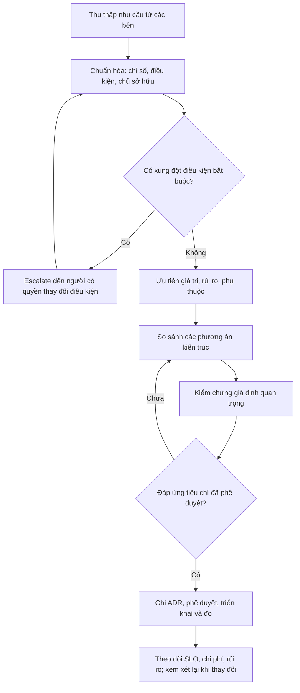
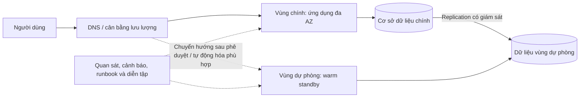

# Ưu tiên yêu cầu và xử lý xung đột giữa các bên liên quan

> **Chương:** Yêu cầu kiến trúc  
> **Phạm vi:** Thiết kế kiến trúc ứng dụng trên đám mây (cloud architecture), từ nhu cầu nghiệp vụ đến lựa chọn mạng, compute, dữ liệu và mô hình triển khai.

## Mục tiêu học tập

Sau bài học, bạn có thể:

1. Phân biệt yêu cầu bắt buộc, yêu cầu có thể thương lượng và giả định cần kiểm chứng trước khi thiết kế kiến trúc.
2. Chuyển mong muốn của các bên liên quan thành yêu cầu có tiêu chí đo lường, người chịu trách nhiệm và thời hạn rõ ràng.
3. Áp dụng cách ưu tiên dựa trên giá trị nghiệp vụ, mức khẩn cấp, rủi ro, phụ thuộc và chi phí thực hiện.
4. Nhận diện, phân tích và xử lý xung đột giữa độ tin cậy, bảo mật, khả năng mở rộng, hiệu năng, chi phí, tiến độ và khả năng vận hành.
5. Ghi lại quyết định kiến trúc, đánh đổi và phương pháp kiểm chứng theo tư duy Well-Architected.

## 1. Vì sao việc ưu tiên yêu cầu quyết định chất lượng kiến trúc?

Một ứng dụng trên đám mây thường có nhiều bên liên quan với mục tiêu hợp lý nhưng không hoàn toàn trùng nhau:

| Bên liên quan | Mối quan tâm thường gặp | Câu hỏi kiến trúc phát sinh |
| --- | --- | --- |
| Chủ sản phẩm (Product Owner) | Ra mắt đúng hạn, trải nghiệm người dùng, khả năng bổ sung tính năng | Có nên ưu tiên thời gian triển khai hơn việc tách nhiều dịch vụ? |
| Kinh doanh | Doanh thu, thời gian phản hồi, tính sẵn sàng trong đợt khuyến mãi | Dự kiến lưu lượng đỉnh là bao nhiêu? |
| Bảo mật/pháp chế | Quyền riêng tư, định danh, phân quyền, lưu trú dữ liệu, kiểm toán | Dữ liệu nào được phép đi qua biên giới hoặc lưu trong bản sao dự phòng? |
| Tài chính | Tổng chi phí sở hữu, ngân sách tháng, mức chi phí dự báo | Có thể đáp ứng mục tiêu phục hồi mà không vượt ngân sách không? |
| Vận hành/SRE | SLO, cảnh báo, tự động hóa, khả năng khôi phục, trực sự cố | Ai trực và diễn tập chuyển đổi dự phòng? |
| Nhóm phát triển | Độ phức tạp, khả năng giao hàng, khả năng thử nghiệm và thay đổi | Đội có đủ năng lực vận hành mô hình đã chọn không? |
| Khách hàng/đối tác | Tốc độ, độ ổn định, tích hợp, cam kết hợp đồng | Chỉ tiêu nào phải chứng minh bằng số liệu hoặc kiểm thử? |

Nếu chỉ nghe ý kiến mạnh nhất trong cuộc họp, nhóm có thể chọn thiết kế rất đắt nhưng chưa cần thiết, hoặc tiết kiệm ngắn hạn nhưng không đáp ứng khả năng phục hồi. **Ưu tiên yêu cầu** là cách biến các mục tiêu khác nhau thành tập quyết định minh bạch: điều gì phải đáp ứng, điều gì có thể hoãn và phần đánh đổi nào được chấp nhận bởi người có thẩm quyền.

Một nguyên tắc quan trọng: **không dùng điểm ưu tiên để bỏ qua nghĩa vụ pháp lý, chính sách bảo mật bắt buộc hoặc rủi ro an toàn không thể chấp nhận**. Chúng là ràng buộc đầu vào, cần được xác nhận trước khi tối ưu các phương án còn lại.

## 2. Chuẩn hóa yêu cầu trước khi xếp hạng

### 2.1. Phân loại đúng bản chất yêu cầu

- **Yêu cầu nghiệp vụ:** mục tiêu kinh doanh, ví dụ mở bán tại thị trường mới trước một ngày cụ thể.
- **Yêu cầu chức năng:** hệ thống phải làm gì, ví dụ hỗ trợ đặt chỗ, xác nhận thanh toán và gửi thông báo.
- **Yêu cầu chất lượng (phi chức năng):** hệ thống phải hoạt động tốt đến mức nào, ví dụ độ trễ, độ tin cậy, bảo mật, khả năng mở rộng, quan sát và phục hồi.
- **Ràng buộc:** giới hạn không được vi phạm, ví dụ ngân sách đã phê duyệt, vùng lưu trú dữ liệu, công nghệ bắt buộc theo hợp đồng.
- **Giả định và phụ thuộc:** điều chưa có bằng chứng hoặc phụ thuộc hệ thống khác, ví dụ dự đoán lưu lượng hoặc năng lực kết nối của cổng thanh toán.

Một câu như “hệ thống cần nhanh, an toàn và giá rẻ” **chưa đủ để thiết kế hoặc nghiệm thu**. Cần hỏi: nhanh đến mức nào, an toàn trước loại rủi ro nào, giá rẻ trong điều kiện tải nào?

### 2.2. Viết yêu cầu có thể kiểm chứng

Dùng cấu trúc:

> **Khi** [điều kiện/tải], **hệ thống phải** [hành vi hoặc mức chất lượng], **được đo bằng** [chỉ số và cách đo], **trước** [mốc thời gian]; **chủ sở hữu** [vai trò].

Ví dụ cho ứng dụng đặt dịch vụ chạy trên cloud:

| ID | Yêu cầu được chuẩn hóa | Nguồn/chủ sở hữu | Cách xác minh |
| --- | --- | --- | --- |
| R-01 | Luồng tìm kiếm có độ trễ **p95 ≤ 300 ms** ở **300 yêu cầu/giây**, theo kịch bản tải đã thống nhất | Product + kỹ thuật | Kiểm thử tải trên môi trường gần production |
| R-02 | Dịch vụ đặt chỗ đạt **SLO khả dụng 99,95% mỗi tháng** theo định nghĩa thành công/thất bại đã công bố | Kinh doanh + SRE | Giám sát SLI và báo cáo SLO |
| R-03 | Sau sự cố mất toàn bộ vùng triển khai chính, **RTO ≤ 60 phút** và **RPO ≤ 15 phút** đối với dữ liệu đặt chỗ | Kinh doanh + SRE | Diễn tập phục hồi, đo thời gian và mức mất dữ liệu |
| R-04 | Dữ liệu cá nhân được mã hóa khi truyền và lưu trữ, có kiểm soát quyền truy cập, lưu trú đúng phạm vi được phê duyệt | An ninh + pháp chế | Rà soát cấu hình, kiểm tra quyền và luồng dữ liệu |
| R-05 | Chi phí hạ tầng và vận hành cloud **≤ 4.000 USD/tháng** trong kịch bản tải dự báo đã chốt | Tài chính | Ước tính TCO, theo dõi chi phí thực |
| R-06 | Có thể triển khai phiên bản mới và quay lui có kiểm soát với khả năng theo dõi lỗi sau triển khai | Phát triển + vận hành | Thử nghiệm pipeline, rollback và quan sát hệ thống |

**Lưu ý khi đọc các chỉ tiêu:**

- **p95** nghĩa là 95% số yêu cầu quan sát được có thời gian phản hồi không vượt ngưỡng; cần chỉ rõ vị trí đo, khoảng đo và kịch bản tải.
- **SLI** là phép đo (ví dụ tỷ lệ yêu cầu thành công), **SLO** là mục tiêu đặt trên phép đo đó; **SLA** thường là cam kết đối ngoại kèm điều kiện hợp đồng.
- **RTO** là thời gian tối đa chấp nhận để khôi phục dịch vụ; **RPO** là mức mất dữ liệu theo thời gian tối đa chấp nhận. RTO/RPO không tự động được bảo đảm chỉ bằng việc bật sao lưu.
- **TCO** gồm compute, dữ liệu, mạng, lưu lượng truyền, giám sát, giấy phép, công vận hành và chi phí khôi phục. Giá máy chủ đơn lẻ không đại diện cho tổng chi phí.

Các ngưỡng trong bảng là **số liệu minh họa**, không phải khuyến nghị mặc định cho mọi hệ thống. Nhóm phải thương lượng và phê duyệt chúng dựa trên tác động nghiệp vụ thực tế.

### 2.3. Lập sổ đăng ký yêu cầu (requirement register)

Với mỗi yêu cầu, nên có tối thiểu: mã ID, phát biểu đo được, nguồn, người chịu trách nhiệm quyết định, loại yêu cầu, tác động nếu không đáp ứng, thời hạn, mức ưu tiên, phụ thuộc, trạng thái chứng cứ và tiêu chí nghiệm thu.

Phân biệt rõ:

- **Đã xác nhận:** có hợp đồng, chính sách, chỉ tiêu vận hành hoặc phê duyệt.
- **Giả định:** chưa đủ dữ liệu, cần thử nghiệm hoặc khảo sát thêm.
- **Tranh chấp:** các bên chưa thống nhất ngưỡng hoặc chi phí đánh đổi.

Không biến giả định thành “yêu cầu chính thức” chỉ vì nó xuất hiện trong một slide.

## 3. Ưu tiên yêu cầu theo nhiều lớp

### 3.1. Lớp 1 — Xác định các điều kiện bắt buộc

Trước khi chấm điểm, rà soát các điều kiện loại trừ phương án: quy định và hợp đồng, phân loại dữ liệu, chính sách an toàn thông tin, hạn chót kinh doanh không thể dịch chuyển, giới hạn ngân sách cứng đã được phê duyệt, và các phụ thuộc kỹ thuật thực tế.

Nếu hai điều kiện bắt buộc cùng lúc không khả thi, **không tự lờ đi một điều kiện**. Ghi nhận xung đột, xác định người có quyền thay đổi từng điều kiện và trình quyết định lên đúng cấp.

Ví dụ: “phải lưu dữ liệu tại một khu vực pháp lý cụ thể” là điều kiện kiểm tra tính hợp lệ của phương án sao chép dữ liệu, không phải một yêu cầu chỉ cần có điểm cao hơn mục tiêu chi phí.

### 3.2. Lớp 2 — Xác định mức ưu tiên giao hàng

MoSCoW phù hợp để trao đổi phạm vi một phiên bản:

| Nhóm | Cách hiểu | Ví dụ |
| --- | --- | --- |
| **Must have** | Thiếu là không thể nghiệm thu hoặc phát hành trong phạm vi đã chốt | Kiểm soát truy cập bắt buộc, lưu trữ đúng chính sách, xử lý thanh toán đúng |
| **Should have** | Rất quan trọng, có phương án tạm thời được chấp thuận | Tự động hóa một phần quy trình phục hồi |
| **Could have** | Có giá trị nhưng ít tác động hơn trong giai đoạn hiện tại | Giao diện phân tích chi tiết cho đội vận hành |
| **Won't have (this time)** | Quyết định chủ động chưa làm trong phiên bản này | Hỗ trợ thêm một vùng thị trường chưa có nhu cầu |

“Must” không nên là danh sách mọi mong muốn. Nếu mọi thứ đều là Must, phương pháp này không còn giúp ra quyết định. Ghi rõ “Won't have **trong phiên bản này**” để tránh hiểu nhầm là loại bỏ vĩnh viễn.

### 3.3. Lớp 3 — Chấm điểm tương đối cho yêu cầu có thể thương lượng

Một cách đơn giản là chấm từng yếu tố trên thang 1–5 và tính:

\[
P = 0{,}4 \times V + 0{,}3 \times U + 0{,}3 \times R
\]

Trong đó:

- \(V\): giá trị nghiệp vụ/tác động người dùng nếu thực hiện.
- \(U\): mức khẩn cấp của thời điểm thực hiện.
- \(R\): mức rủi ro được giảm khi thực hiện (điểm cao = giảm rủi ro lớn).
- \(P\): điểm ưu tiên **tương đối**; trọng số phải do nhóm thống nhất.

| Ví dụ yêu cầu thương lượng | V | U | R | Điểm P |
| --- | ---: | ---: | ---: | ---: |
| Cải thiện giám sát và cảnh báo để phát hiện lỗi sớm | 5 | 4 | 4 | 4,4 |
| Tự động theo dõi, dự báo ngân sách cloud | 4 | 4 | 3 | 3,7 |
| Bổ sung trang dashboard nâng cao | 3 | 2 | 3 | 2,7 |

Công thức và điểm số là **ví dụ phương pháp**, không phải tiêu chuẩn phổ quát. Điểm cao không chứng minh phương án khả thi. Sau khi xếp hạng vẫn phải xem **nỗ lực thực hiện**, phụ thuộc, năng lực đội, chi phí duy trì và điều kiện bắt buộc.

Khi chi phí trễ hạn và quy mô việc làm có thể ước tính tương đối tốt, nhóm có thể tham khảo **WSJF = chi phí của việc trì hoãn / quy mô công việc**. Chỉ áp dụng nhất quán cho các hạng mục đủ tương đồng; tránh tạo cảm giác chính xác giả từ dữ liệu đoán.

### 3.4. Lớp 4 — Sắp thứ tự theo phụ thuộc và rủi ro

Không nhất thiết triển khai theo thứ tự điểm từ cao xuống thấp. Một yêu cầu có thể phải đi trước vì mở khóa nhiều hạng mục khác.

Ví dụ: muốn cam kết RTO 60 phút, trước tiên phải có định nghĩa dữ liệu quan trọng, chiến lược sao lưu/sao chép, quyền phục hồi, runbook, rồi mới diễn tập và công bố mức RTO. Tính năng dashboard dù có điểm cao cũng không thay thế được các phụ thuộc này.

Một thứ tự thực tế thường là: **đảm bảo tuân thủ và khả thi → làm rõ rủi ro lớn → thiết lập nền tảng/khả năng đo → giao các giá trị có tác động cao → tối ưu bổ sung**. Đây là thứ tự suy xét, không phải khuôn mẫu cứng cho mọi dự án.

## 4. Xử lý xung đột: từ ý kiến sang quyết định có chứng cứ

Xung đột phổ biến trong thiết kế cloud:

| Xung đột | Câu hỏi cần làm rõ | Hướng đánh đổi có thể xem xét |
| --- | --- | --- |
| **Độ tin cậy ↔ Chi phí** | Sự cố vùng triển khai gây thiệt hại bao nhiêu? RTO/RPO thực sự cần là bao nhiêu? | Multi-AZ, warm standby, active-active; chọn theo mục tiêu khôi phục và ngân sách |
| **Hiệu năng ↔ Chi phí** | p95 tại tải đỉnh hay tải thông thường? Có thể dùng cache ở đâu? | Tối ưu truy vấn, cache, autoscaling, phân tầng lưu trữ |
| **Ra mắt nhanh ↔ Bảo mật** | Kiểm soát nào là bắt buộc? Thiếu bằng chứng kiểm thử nào? | Thu nhỏ phạm vi ra mắt, dùng dịch vụ quản lý, tự động hóa kiểm tra |
| **Khả năng mở rộng ↔ Độ phức tạp vận hành** | Khi nào thực sự cần phân tách dịch vụ? Đội có năng lực vận hành không? | Modular monolith trước, tách thành dịch vụ khi có ranh giới và số liệu rõ |
| **Độ trễ ↔ Lưu trú dữ liệu** | Dữ liệu nào chịu ràng buộc, có cho phép cache/ẩn danh ngoài vùng không? | Phân loại dữ liệu, giữ nguồn dữ liệu đúng vùng, tối ưu mạng/caching đúng chính sách |
| **Tính nhất quán ↔ Tính sẵn sàng** | Có thể chấp nhận dữ liệu đến chậm ở thao tác nào? | Phân biệt luồng giao dịch cần nhất quán mạnh và luồng phân tích có thể bất đồng bộ |

### Quy trình sáu bước

**Bước 1 — Tách lập trường khỏi nhu cầu thật.** “Phải có active-active” là một *giải pháp được đề xuất*; “khôi phục bán hàng trong 15 phút khi mất một vùng” mới là *nhu cầu cần đáp ứng*. Phỏng vấn người nêu yêu cầu về hậu quả nếu không đáp ứng.

**Bước 2 — Đưa mọi bên về cùng bộ chỉ số.** Thống nhất luồng nghiệp vụ quan trọng, số người dùng, kịch bản tải, SLI/SLO, RTO/RPO, phân loại dữ liệu, chi phí dự báo, hạn chót và năng lực vận hành. Chỉ số phải có điều kiện đo rõ ràng.

**Bước 3 — Xác định quyền quyết định.** Product quyết định phạm vi sản phẩm; an ninh/pháp chế xác nhận điều kiện tuân thủ; tài chính xác nhận giới hạn ngân sách; kỹ thuật đề xuất và chịu trách nhiệm khả thi; người bảo trợ dự án phân xử khi các mục tiêu được phê duyệt xung đột. Một người/chức danh làm **decision owner** cần được ghi rõ.

**Bước 4 — Đề xuất ít nhất hai phương án khả thi.** Bao gồm phương án ít phức tạp hơn, phương án tăng khả năng phục hồi và, khi cần, phương án điều chỉnh phạm vi/ngưỡng. Với mỗi phương án, ghi chi phí ban đầu và định kỳ, lợi ích, rủi ro còn lại, phụ thuộc, khả năng đảo ngược và tác động vận hành.

**Bước 5 — Kiểm chứng giả định có tác động lớn.** Dùng thử nghiệm tải, prototype, đánh giá threat model, ước lượng chi phí có dữ liệu đầu vào, hoặc diễn tập phục hồi. Không đưa ra cam kết SLO/RTO/RPO chỉ dựa vào sơ đồ kiến trúc.

**Bước 6 — Ra quyết định và ghi lại.** Người có thẩm quyền chọn phương án, ký nhận rủi ro còn lại và công bố điều kiện xem xét lại. Nếu không có phương án đáp ứng mọi ràng buộc, phải **escalate**: xin thay đổi ngân sách, phạm vi, thời hạn hoặc mục tiêu chất lượng; ghi lại ai phê duyệt sự thay đổi.



## 5. Ví dụ xuyên suốt: lựa chọn kiến trúc phục hồi cho ứng dụng đặt chỗ

### 5.1. Bối cảnh và các yêu cầu xung đột

Một ứng dụng đặt chỗ đang hoạt động trên đám mây. Trong buổi thiết kế:

- Product muốn hạn chế gián đoạn giao dịch và sớm ra mắt thị trường mới.
- SRE đề xuất dùng hai vùng triển khai để giảm tác động của sự cố mất toàn bộ vùng chính.
- Tài chính đặt ngân sách cloud tối đa **4.000 USD/tháng** cho mức tải dự báo.
- An ninh yêu cầu dữ liệu khách hàng chỉ được lưu/sao chép trong các vùng đã được phê duyệt.
- Nhóm phát triển lo ngại mô hình active-active làm tăng độ phức tạp xử lý giao dịch và kiểm tra nhất quán.

Các bên thống nhất yêu cầu đã chuẩn hóa: **RTO ≤ 60 phút**, **RPO ≤ 15 phút** cho nghiệp vụ đặt chỗ; có diễn tập thực tế; chi phí không vượt ngân sách tại kịch bản tải đã chốt; tất cả vùng lưu dữ liệu đều phải được an ninh phê duyệt.

### 5.2. So sánh phương án

Bảng dưới dùng **số liệu giả định để minh họa cách quyết định**, không đại diện cho giá dịch vụ hay năng lực bảo đảm của bất kỳ nhà cung cấp cloud nào.

| Phương án | Kiến trúc chính | Ước tính/tháng (giả định) | Kết quả phục hồi giả định sau thử nghiệm | Đánh giá |
| --- | --- | ---: | --- | --- |
| A | Một vùng, nhiều availability zone, backup định kỳ | 2.400 USD | RTO 4 giờ; RPO 30 phút khi mất cả vùng | Dưới ngân sách nhưng **không đạt** RTO/RPO |
| B | Vùng chính multi-AZ + **warm standby** tại vùng dự phòng được phê duyệt, sao chép và failover có diễn tập | 3.600 USD | RTO 45 phút; RPO 10 phút | **Đạt các ngưỡng giả định**; yêu cầu runbook và giám sát replication |
| C | Hai vùng **active-active**, định tuyến và đồng bộ liên vùng | 6.500 USD | RTO 10 phút; RPO dưới 1 phút trong kịch bản thử | Có tiềm năng phục hồi nhanh nhưng **vượt ngân sách** và phức tạp nhất |

Với **các giả định đã kiểm chứng trong bài toán minh họa**, nhóm chọn **B** vì đáp ứng ngưỡng được phê duyệt và còn trong ngân sách. Không cần mua mức độ sẵn sàng cao hơn mục tiêu khi lợi ích bổ sung chưa được chứng minh đủ lớn. Tuy nhiên, nếu chính sách không cho phép vùng dự phòng hoặc doanh thu mỗi phút gián đoạn vượt xa ước tính, kết luận phải được xem xét lại.

Mô hình logic của phương án B:



**Những điều sơ đồ chưa bảo đảm:** độ trễ replication, nhất quán khi failover/failback, bí mật truy cập, kết nối phụ thuộc bên thứ ba, DNS/cache, năng lực chịu tải của standby, và khả năng phục hồi tại đúng thời điểm sự cố. Các yếu tố này phải được đưa vào thiết kế chi tiết và kiểm thử. Replication cũng **không thay thế backup có khả năng khôi phục theo thời điểm** trong mọi trường hợp, chẳng hạn lỗi xóa dữ liệu bị đồng bộ sang vùng còn lại.

### 5.3. Điều kiện nghiệm thu quyết định

1. Đo RTO/RPO trên kịch bản mất vùng chính, gồm cả ứng dụng, cơ sở dữ liệu, cấu hình mạng, secrets và tích hợp quan trọng.
2. Thử phục hồi trong các điều kiện lỗi được đại diện hợp lý; ghi bằng chứng, người vận hành, bước thủ công và lỗi gặp phải.
3. Xác nhận vùng chính và vùng dự phòng, luồng replication, nơi lưu backup phù hợp với chính sách dữ liệu.
4. Ước tính chi phí ở tải bình thường, đỉnh, khi chạy DR và khi truyền dữ liệu liên vùng; thiết lập ngân sách/cảnh báo.
5. Phân công owner cho cảnh báo lag, thay đổi hạ tầng, runbook, lịch diễn tập và quy trình quay về vùng chính.

Nếu các phép thử chưa đạt, phương án B mới là **giả thuyết thiết kế**, chưa đủ điều kiện công bố rằng mục tiêu phục hồi đã được đáp ứng.

## 6. Ghi nhận quyết định bằng Architecture Decision Record (ADR)

ADR giúp người đến sau hiểu **vì sao** nhóm chọn một phương án, chứ không chỉ biết đã chọn gì. Một ADR gọn có thể như sau:

```markdown
# ADR-014: Phục hồi ứng dụng đặt chỗ sau sự cố mất vùng

Trạng thái: Chấp thuận có điều kiện
Ngày: YYYY-MM-DD
Decision owner: Người bảo trợ kỹ thuật được chỉ định

Bối cảnh:
- RTO <= 60 phút, RPO <= 15 phút.
- Ngân sách <= 4.000 USD/tháng tại kịch bản tải đã chốt.
- Dữ liệu chỉ được lưu tại các vùng đã phê duyệt.

Phương án:
A. Một vùng multi-AZ + backup.
B. Multi-AZ + warm standby vùng dự phòng.
C. Hai vùng active-active.

Quyết định:
- Chọn B sau khi đo được RTO 45 phút, RPO 10 phút trong
  kịch bản DR đã thống nhất, và dự toán 3.600 USD/tháng.
- Chỉ go-live khi xác minh luồng dữ liệu và các phụ thuộc quan trọng.

Đánh đổi/rủi ro còn lại:
- Phải duy trì replication, runbook, diễn tập và kiểm soát chi phí.
- Chưa chứng minh khả năng đáp ứng nếu hai vùng cùng gặp sự cố.

Điều kiện xem xét lại:
- Tải hoặc giá dịch vụ tăng đáng kể; SLO/RTO/RPO đổi;
  phạm vi dữ liệu hoặc quy định đổi; diễn tập DR không đạt.
```

ADR nên liên kết tới yêu cầu gốc, bằng chứng kiểm thử, phân tích chi phí, risk register và người phê duyệt. Giữ cả phương án bị loại cùng lý do loại để tránh lặp lại tranh luận khi đội thay đổi.

## 7. Từ ưu tiên đến kiến trúc và kế hoạch kiểm chứng

Quyết định cần được nối với từng lớp kiến trúc; nếu không, bảng ưu tiên chỉ dừng ở tài liệu.

| Yêu cầu ưu tiên | Quyết định/đầu việc kiến trúc | Bằng chứng cần thu thập |
| --- | --- | --- |
| Độ trễ p95 và tải đỉnh | Chọn compute, autoscaling, cache, cân bằng tải, truy vấn và kết nối mạng | Kiểm thử tải, p95, tỷ lệ lỗi, saturation, chi phí tại tải đỉnh |
| Tính sẵn sàng và phục hồi | Thiết kế multi-AZ, backup, replication, failover, DNS, runbook | SLI/SLO, thử mất thành phần, diễn tập RTO/RPO |
| Bảo mật và lưu trú dữ liệu | Phân đoạn mạng, IAM tối thiểu quyền, mã hóa, quản lý secrets, kiểm soát luồng dữ liệu | Threat model, kiểm tra cấu hình và quyền, đánh giá tuân thủ |
| Ngân sách | Quy mô tài nguyên, mô hình thanh toán, kế hoạch capacity và cost allocation | Dự toán TCO, cảnh báo ngân sách, đối soát chi phí thực |
| Khả năng vận hành | CI/CD, logging, metrics, tracing, alerting, rollback, runbook | Thử triển khai/quay lui, thời gian phát hiện và xử lý sự cố |
| Tốc độ đổi mới | Chọn mô hình triển khai phù hợp năng lực đội; làm rõ ranh giới module/dịch vụ | Thời gian triển khai, lỗi sau phát hành, độ phức tạp vận hành |

Có thể sử dụng tư duy **Well-Architected** như bộ câu hỏi rà soát quyết định: vận hành có hiệu quả không, có an toàn không, hệ thống có đáng tin cậy không, sử dụng tài nguyên có hiệu năng hợp lý không, tối ưu chi phí chưa, và tác động tiêu thụ tài nguyên có phù hợp không. Đây là lăng kính đánh giá định kỳ, không phải công thức tự động chọn kiến trúc.

### Liên kết yêu cầu → quyết định → kiểm chứng

```text
Nhu cầu kinh doanh
   └── Yêu cầu có mã ID và tiêu chí đo
         ├── Mức ưu tiên + điều kiện bắt buộc
         ├── Phương án/ADR và rủi ro chấp nhận
         ├── Thành phần kiến trúc + owner triển khai
         └── Phép thử/SLI/báo cáo nghiệm thu
               └── Giám sát thực tế và xem xét lại
```

Mỗi yêu cầu quan trọng nên có **đường truy vết hai chiều**: từ yêu cầu tìm được quyết định và phép thử; từ một thành phần tốn chi phí tìm được lý do nghiệp vụ khiến nó tồn tại.

## 8. Quản trị bất đồng trong quá trình triển khai

Quyết định ưu tiên không cố định mãi. Khi xuất hiện sự cố, thay đổi pháp lý, chi phí tăng, số lượng người dùng mới hoặc nhà cung cấp đổi dịch vụ, nhóm phải mở lại phần giả định liên quan.

Cách vận hành hữu ích:

1. **Một nơi lưu phiên bản được chấp thuận** cho requirement register, ADR, risk register và kết quả kiểm chứng.
2. **Người chịu trách nhiệm rõ ràng** cho từng yêu cầu và quyết định; có cơ chế chuyển cấp nếu không đạt đồng thuận trước hạn.
3. **Phiên rà soát có định kỳ hoặc theo thay đổi trọng yếu**, thay vì tranh luận lại toàn bộ kiến trúc mỗi khi có ý kiến mới.
4. **Cơ chế kiểm soát thay đổi:** yêu cầu mới phải mô tả giá trị, mức độ khẩn cấp, tác động đến SLO/chi phí/bảo mật, phụ thuộc và hạng mục nào sẽ bị hoãn.
5. **Dấu hiệu kích hoạt xem xét lại:** SLO bị vi phạm, DR test thất bại, dự báo chi phí vượt ngưỡng, lưu lượng vượt dự báo, phát hiện rủi ro dữ liệu, thay đổi yêu cầu hợp đồng.

Khi xung đột chưa thể giải quyết, ghi bằng văn bản: nội dung tranh chấp, tác động nếu trì hoãn, phương án khả thi, dữ liệu còn thiếu, hạn ra quyết định và người có quyền quyết định. Tránh tình trạng “mọi người đồng ý chung” nhưng không ai nhận trách nhiệm về đánh đổi.

## 9. Sai lầm thường gặp

| Sai lầm | Hậu quả | Cách khắc phục |
| --- | --- | --- |
| Xếp hạng mọi thứ chỉ bằng phiếu bầu | Mong muốn phổ biến che lấp điều kiện bắt buộc | Tách compliance/security gates khỏi điểm ưu tiên |
| Nhận một giải pháp làm yêu cầu (“phải microservices”) | Chốt công nghệ trước khi biết vấn đề | Hỏi mục tiêu, chỉ số, hậu quả và so sánh phương án |
| Không định nghĩa tải và cách đo | Các đội hiểu khác nhau về “nhanh”, “ổn định” | Ghi SLI, kịch bản, khoảng đo, ngưỡng và owner |
| Chỉ so chi phí compute | Bỏ sót truyền dữ liệu, sao lưu, giám sát, nhân lực | So sánh TCO theo các kịch bản vận hành |
| Coi backup là chiến lược DR đã được chứng minh | Không phục hồi kịp thời hoặc mất dữ liệu vượt mục tiêu | Diễn tập và đo RTO/RPO; kiểm tra restore thực tế |
| Ra quyết định theo chức danh lớn nhất trong phòng | Thiếu bằng chứng, khó giải thích và kiểm toán | Ghi rõ quyền quyết định, ADR, kết quả kiểm chứng |
| Không công bố điều kiện xem xét lại | Giải pháp cũ không còn phù hợp nhưng vẫn tồn tại | Gắn ADR với ngưỡng tải, rủi ro, chi phí và sự cố |

## 10. Bài tập thực hành

Một nền tảng đặt chỗ dự kiến tăng từ **100 lên 1.000 yêu cầu/giây trong sự kiện cao điểm**. Product yêu cầu ra mắt sau sáu tuần; SRE đề xuất tự động mở rộng và vùng dự phòng; Finance muốn giữ chi phí dưới mức hiện tại; Security yêu cầu kiểm soát chặt quyền truy cập dữ liệu khách hàng.

Hãy thực hiện:

1. Viết ít nhất **năm yêu cầu có thể đo** (bao gồm tải/độ trễ, độ tin cậy, bảo mật, chi phí, tiến độ) và ghi rõ những chỉ tiêu **chưa được các bên xác nhận**.
2. Phân tách **điều kiện bắt buộc** với các hạng mục **có thể ưu tiên**; dùng MoSCoW hoặc thang điểm với trọng số giải thích được.
3. Đề xuất **hai hoặc ba phương án triển khai** (ví dụ mở rộng một vùng đa AZ, thêm vùng warm standby, hoặc giảm phạm vi ra mắt), nêu lợi ích, chi phí, độ phức tạp và rủi ro.
4. Chọn **một quyết định có điều kiện**, nêu rõ ai phê duyệt và cần đo gì trước khi triển khai production.
5. Viết ADR ngắn và chỉ ra trường hợp nào sẽ khiến nhóm phải xem xét lại quyết định.

**Gợi ý tự đánh giá:** bài làm tốt không cần chọn kiến trúc đắt nhất hoặc công nghệ mới nhất. Bài làm tốt phân biệt đúng ngưỡng đã phê duyệt với giả định, có phép đo để chứng minh quyết định, và không dùng mục tiêu tiến độ hoặc chi phí làm lý do bỏ qua điều kiện bảo mật bắt buộc.

## Ghi nhớ

Ưu tiên yêu cầu kiến trúc là quá trình liên tục giữa **mục tiêu nghiệp vụ → tiêu chí đo → phương án thiết kế → đánh đổi được phê duyệt → kiểm chứng thực tế**. Khi nhiều bên liên quan bất đồng, hãy yêu cầu họ thống nhất điều kiện thành công và người có quyền quyết định trước; sau đó dùng dữ liệu, thử nghiệm và ADR để chọn kiến trúc cloud phù hợp với độ tin cậy, bảo mật, mở rộng, chi phí và khả năng vận hành của tổ chức.
