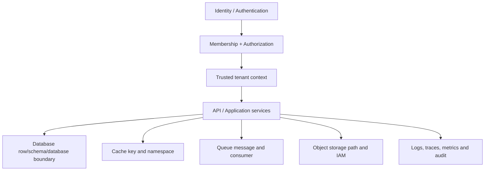
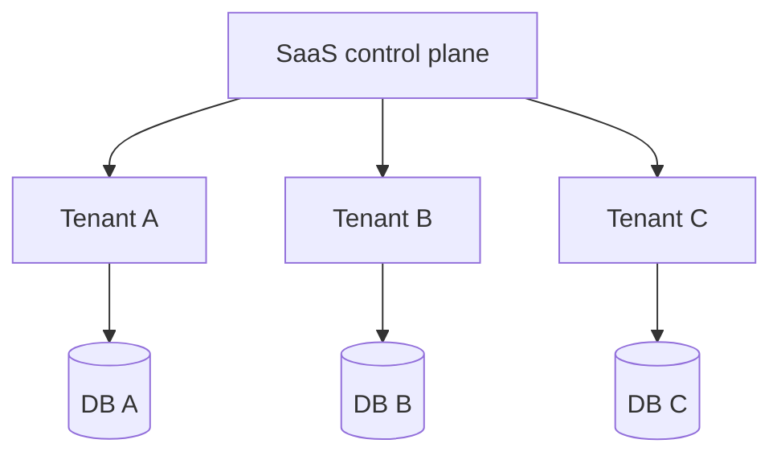
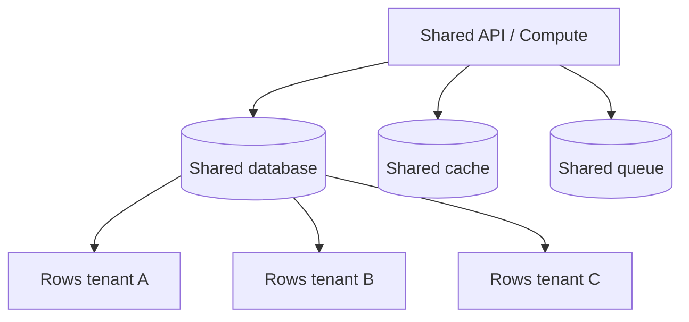
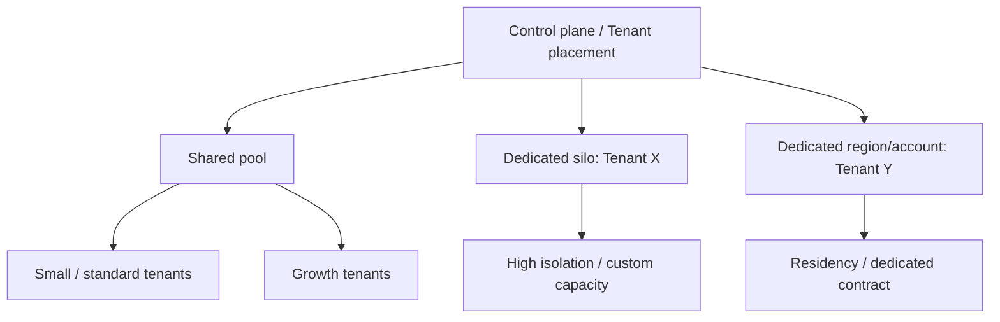
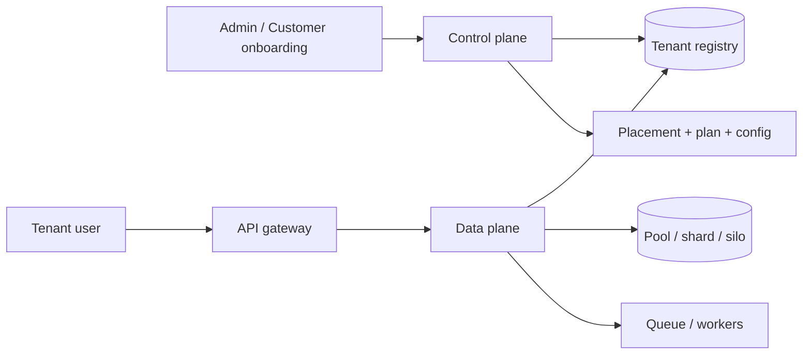
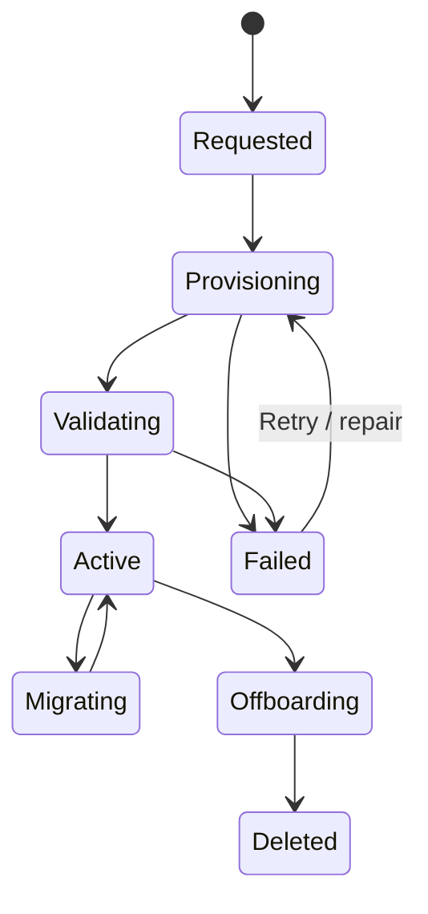
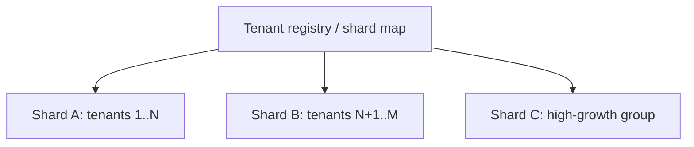
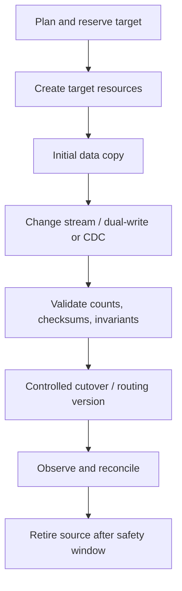

# Lựa chọn silo, pool và mô hình kết hợp cho nhiều tenant

## 1. Vì sao mô hình multi-tenant là quyết định kiến trúc cốt lõi?

Một nền tảng SaaS thường phục vụ nhiều khách hàng (tenant) trên cùng một sản phẩm. Mỗi tenant có người dùng, dữ liệu, cấu hình, workload và hợp đồng dịch vụ riêng. Kiến trúc phải cho phép chia sẻ hạ tầng để đạt hiệu quả chi phí, đồng thời bảo đảm tenant không đọc, sửa hoặc làm suy giảm dịch vụ của tenant khác.

**Multi-tenancy** là cách tổ chức một ứng dụng và hạ tầng dùng chung để phục vụ nhiều tenant với ranh giới dữ liệu, bảo mật, quản trị và usage được xác định rõ. Tenant có thể là một doanh nghiệp, tổ chức, workspace, tài khoản đối tác hoặc một đơn vị kinh doanh; không nhất thiết tương ứng với một user hay một customer record.

Ba mô hình triển khai dữ liệu và tài nguyên thường gặp:

- **Silo:** mỗi tenant có một tập tài nguyên chuyên biệt, ví dụ database/schema/cluster/compute riêng.
- **Pool:** nhiều tenant dùng chung tài nguyên và cùng một runtime/data store; dữ liệu được phân tách logic bằng tenant identity và policy.
- **Hybrid:** kết hợp silo và pool theo nhóm tenant, loại workload, vùng địa lý, mức nhạy cảm hoặc gói dịch vụ.

Không có mô hình nào tốt nhất cho mọi sản phẩm. Silo tăng mức cô lập nhưng thường làm tăng chi phí và gánh nặng vận hành. Pool tận dụng tài nguyên tốt nhưng đòi hỏi tenant isolation xuyên suốt mọi lớp. Hybrid giúp cân bằng theo nhu cầu, đổi lại cần quản lý placement, routing và policy phức tạp hơn.

Trong module **CLOUD_ARCHITECTURE**, chương **Kiến trúc đa khách hàng** đặt quyết định multi-tenant trong bối cảnh độ tin cậy, bảo mật, khả năng mở rộng, chi phí và vận hành theo Well-Architected.

Sau bài học, người học có thể:

1. Xác định tenant, tenant boundary và các loại tài nguyên cần cô lập.
2. So sánh silo, pool và hybrid theo security, reliability, performance, cost và operability.
3. Thiết kế tenant context xuyên suốt API, service, database, cache, queue, object storage và logs.
4. Ngăn rò rỉ dữ liệu và noisy-neighbor bằng kiểm soát truy cập, quota, capacity và fairness.
5. Chọn mô hình theo tier, compliance, geography, workload và nhu cầu tùy biến.
6. Thiết kế onboarding, provisioning, backup/restore, migration và offboarding theo tenant.
7. Xây dựng test, telemetry và ADR để chứng minh mô hình đáp ứng hợp đồng dịch vụ.

## 2. Tenant là gì và ranh giới nằm ở đâu?

Tenant là đơn vị sở hữu dữ liệu và cấu hình trong một hệ thống multi-tenant. Cần phân biệt:

- **User:** danh tính con người hoặc service account đăng nhập.
- **Organization/account:** thực thể khách hàng hoặc pháp nhân.
- **Tenant:** phạm vi cách ly và quản trị tài nguyên trong sản phẩm.
- **Workspace/project:** đơn vị con bên trong một tenant, có thể có quyền và cấu hình riêng.
- **Subscription/plan:** hợp đồng thương mại quyết định tính năng, quota và mức hỗ trợ.
- **Environment:** môi trường dev/staging/prod; một tenant có thể có nhiều environment.

Một organization có thể sở hữu nhiều tenant; một tenant có thể chứa nhiều workspace; user có thể là thành viên của nhiều tenant với vai trò khác nhau. Không suy tenant chỉ từ email domain hoặc một ID client gửi lên.

### 2.1. Tenant context là một phần của security context

Mỗi request phải xác định principal đã xác thực, tenant đang được truy cập và quyền của principal trong tenant đó.

Ví dụ luồng xác thực:

1. Client gửi credential/token.
2. Identity layer xác thực principal.
3. Application kiểm tra principal có membership/role trong tenant được chọn không.
4. Tenant context được gắn vào request context bất biến.
5. Service dùng context để truy vấn và kiểm tra quyền trên từng resource.
6. Audit event ghi principal, tenant, action và kết quả theo policy.

Tenant ID trong URL hoặc body chỉ là **đầu vào để yêu cầu chọn tenant**, không phải bằng chứng quyền truy cập. Server phải xác minh quan hệ giữa user, tenant và resource.

### 2.2. Ranh giới tenant xuyên suốt các lớp



Tenant boundary phải theo dữ liệu qua cả synchronous và asynchronous path. Một API có tenant filter đúng nhưng worker nhận message thiếu tenant ID vẫn có thể truy cập sai dữ liệu.

### 2.3. Tenant identity và tenant lifecycle

Tenant cần một định danh ổn định, không tái sử dụng tùy tiện. Những trạng thái thường gặp:

- Provisioning: tạo tenant, database/schema, storage namespace và cấu hình.
- Active: được phép sử dụng sản phẩm theo plan.
- Suspended: tạm ngừng một số thao tác do chính sách/hợp đồng.
- Migrating: đang chuyển placement hoặc nâng cấp.
- Offboarding: khóa truy cập, export dữ liệu và xử lý retention.
- Deleted: tài nguyên đã được xóa theo quy trình và bằng chứng cần thiết.

Trạng thái tenant nên được quản lý trong control plane có thẩm quyền. Application data plane phải kiểm tra trạng thái thích hợp, tránh mỗi service tự diễn giải khác nhau.

## 3. Silo, pool và hybrid: mô hình khái niệm

### 3.1. Silo model

Mỗi tenant có một hoặc nhiều tài nguyên dedicated: database riêng, schema riêng, cluster riêng, storage account riêng hoặc compute riêng.



Tùy cách triển khai, silo có thể cô lập ở database, cluster, account, project, VPC/VNet hoặc thậm chí cloud account. Silo ở một lớp không tự động cô lập mọi lớp còn lại: ba database riêng vẫn có thể dùng chung API runtime, credentials, network và control plane.

### 3.2. Pool model

Nhiều tenant dùng chung compute và data store; mỗi record mang tenant identifier và mọi truy vấn được scope theo tenant.



Pool tiết kiệm tài nguyên khi tenant nhỏ và workload phân tán. Nhưng lỗi filter, cache key, query policy hoặc message context có thể tạo rò rỉ cross-tenant. Một tenant tải lớn cũng có thể chiếm connection, CPU, IOPS hoặc queue capacity của tất cả.

### 3.3. Hybrid model

Hybrid dùng pool cho nhóm tenant có yêu cầu tiêu chuẩn và silo cho tenant cần cô lập, capacity riêng hoặc compliance đặc biệt.



Control plane cần biết tenant thuộc pool/shard/silo nào, version schema, region, limits và trạng thái migration. Data plane dùng mapping có cache nhưng phải xử lý mapping change an toàn.

## 4. So sánh silo, pool và hybrid

| Tiêu chí | Silo | Pool | Hybrid |
| --- | --- | --- | --- |
| Data isolation | Ranh giới vật lý/logical mạnh hơn tùy placement | Dựa nhiều vào tenant key, policy và query correctness | Theo từng tier hoặc nhóm |
| Blast radius | Thường hẹp hơn nếu dependency tách riêng | Lỗi shared resource có thể ảnh hưởng nhiều tenant | Có thể cô lập tenant ưu tiên |
| Cost nền | Cao hơn do tài nguyên riêng | Thường thấp hơn do chia sẻ | Trung bình, phụ thuộc phân tầng |
| Resource utilization | Dễ có capacity nhàn rỗi | Có thể gom tải hiệu quả | Cần placement và autoscaling tốt |
| Customization | Dễ tùy biến theo tenant | Khó nếu tạo nhiều biến thể | Một số tenant có đường riêng |
| Operations | Nhiều đơn vị cần patch/backup/monitor | Ít hạ tầng hơn nhưng logic isolation phức tạp | Cần điều phối cả hai dạng |
| Noisy neighbor | Hạn chế khi tài nguyên thực sự dedicated | Rủi ro cao hơn | Có thể đưa tenant noisy sang silo |
| Compliance | Dễ chứng minh một số boundary | Cần chứng minh controls logic | Chọn theo yêu cầu dữ liệu |
| Scaling | Scale theo tenant/resource riêng | Scale pool/shard theo tổng và phân bố tải | Cần rebalance và routing |
| Migration | Tốn kém khi nhiều silo | Khó chia pool lớn hoặc tách tenant hot | Cần quy trình placement thống nhất |

**Lưu ý:** “Silo” và “pool” là điểm trên một phổ cô lập. Dedicated database nhưng vẫn chung cluster/credential không tương đương dedicated account/network. Pool có row-level security và kiểm thử tốt có thể an toàn hơn một silo cấu hình sai. Đánh giá theo boundary thực tế, không chỉ tên mô hình.

## 5. Chọn mô hình theo yêu cầu nghiệp vụ

Bắt đầu bằng các câu hỏi:

1. Tenant có yêu cầu hợp đồng hoặc compliance về cách tách dữ liệu không?
2. Workload giữa tenant có chênh lệch lớn về CPU, IOPS, storage và traffic không?
3. Có tenant cần encryption key, backup schedule hoặc retention riêng không?
4. Dữ liệu có giới hạn geography/data residency?
5. Tenant cần schema extension, custom integration hoặc maintenance window riêng?
6. Chi phí dedicated resource có thể thu lại từ plan/customer value không?
7. Đội vận hành có đủ automation để quản lý số lượng silo dự kiến không?
8. Tenant cần restore, export hoặc xóa độc lập tới mức nào?

### 5.1. Ma trận lựa chọn minh họa

| Điều kiện | Hướng lựa chọn ban đầu | Cần xác minh |
| --- | --- | --- |
| Nhiều tenant nhỏ, workload tương tự | Pool | RLS/tenant scoping, quota và shard capacity |
| Tenant lớn có workload áp đảo | Silo hoặc dedicated tier | TCO, autoscaling và isolation thực tế |
| Yêu cầu data residency theo khu vực | Regional pool hoặc regional silo | Mapping, replication và residency controls |
| Hợp đồng yêu cầu customer-managed key | Silo hoặc hybrid key model | Key isolation, rotation và service support |
| Khách hàng có maintenance window riêng | Silo hoặc dedicated deployment cell | Patch/upgrade automation |
| Một số tenant nhạy cảm, phần còn lại tiêu chuẩn | Hybrid | Placement policy và migration runbook |
| POC/sản phẩm mới, workload chưa rõ | Pool có giới hạn và đường tách tenant | Migration readiness, telemetry và capacity |

Không chọn silo chỉ vì khách hàng nói “cần bảo mật cao”. Cần chuyển yêu cầu thành control cụ thể: ai có quyền, key ở đâu, network boundary, backup/restore, audit và bằng chứng compliance.

## 6. Data plane và control plane

Một kiến trúc multi-tenant trưởng thành thường tách hai nhóm năng lực:

- **Control plane:** tạo/quản lý tenant, plan, placement, quota, identity integration, provisioning, billing metadata, migration và lifecycle.
- **Data plane:** xử lý request nghiệp vụ, đọc/ghi dữ liệu, chạy job, phục vụ API và enforce tenant policy.



Data plane không nên tự tạo tài nguyên hoặc đưa tenant sang silo một cách ngẫu nhiên trong từng request. Nó đọc placement policy đã được control plane quản lý và áp dụng nhất quán.

### 6.1. Tenant registry

Registry có thể lưu:

- tenant ID và lifecycle status.
- plan/tier và entitlement version.
- home region và data residency policy.
- placement type: pool, shard, silo.
- database/schema/storage references.
- encryption key reference.
- quota/capacity profile.
- migration state và current placement version.
- provisioning metadata và audit timestamps.

Không lưu secret plaintext trong registry. Lưu reference tới secret manager/KMS và áp dụng quyền đọc tối thiểu.

### 6.2. Provisioning idempotent

Onboarding có thể thất bại giữa chừng. Provisioning nên có operation ID, trạng thái step, retry và reconciliation. Chạy lại một lần provision không được tạo hai database hoặc hai storage namespace cho cùng tenant.

Ví dụ trạng thái:



Mỗi bước cần timeout, owner, audit và cách cleanup tài nguyên dở dang. Không đánh dấu Active trước khi identity, placement, data boundary và backup policy sẵn sàng.

## 7. Silo ở các tầng khác nhau

“Silo” cần chỉ rõ phạm vi dedicated. Các mức thường gặp:

| Boundary | Ví dụ | Mức cô lập và chi phí |
| --- | --- | --- |
| Row/partition | DB chung nhưng tenant key hoặc partition riêng | Chi phí thấp hơn; vẫn chung engine/cluster |
| Schema | Mỗi tenant một schema | Namespace riêng; connection/DDL/backup vẫn có thể dùng chung |
| Database | Database riêng trên cùng server/cluster | Tách DB logic nhưng chung compute/host/failure domain |
| Cluster | Cluster database riêng | Cô lập capacity/failure domain tốt hơn, vận hành tốn hơn |
| Account/project/subscription | Hạ tầng và IAM boundary riêng | Tách quyền/billing/network tốt hơn, automation phức tạp |
| Dedicated deployment cell | Compute, data và network cell riêng | Blast radius nhỏ hơn nếu dependency cũng tách |
| Dedicated region/on-prem | Placement địa lý/chuyên biệt | Phù hợp yêu cầu đặc thù, chi phí cao |

Mức boundary phải được ánh xạ vào threat model và contract. Database riêng trong cùng cluster không nhất thiết đáp ứng yêu cầu “không chia sẻ phần cứng”. Dedicated account cũng chưa đủ nếu logs, support access hoặc backup export vẫn gom chung mà không có policy.

## 8. Pool: thiết kế tenant isolation trong database

Pool tối ưu chia sẻ hạ tầng nhưng đòi hỏi mọi truy vấn và transaction đúng tenant scope.

### 8.1. Shared table với tenant_id

Mỗi row mang tenant ID. Primary key/unique constraint/index thường phải xem tenant dimension:

```sql
CREATE TABLE booking (
    tenant_id UUID NOT NULL,
    booking_id UUID NOT NULL,
    status VARCHAR(32) NOT NULL,
    created_at TIMESTAMP NOT NULL,
    PRIMARY KEY (tenant_id, booking_id)
);

CREATE INDEX idx_booking_tenant_status_created
ON booking (tenant_id, status, created_at);
```

Ví dụ này minh họa cấu trúc; SQL dialect và chiến lược index thực tế phụ thuộc database.

Truy vấn phải scope tenant:

```sql
SELECT booking_id, status, created_at
FROM booking
WHERE tenant_id = :trusted_tenant_id
  AND booking_id = :booking_id;
```

Không lấy tenant ID từ request body rồi gắn vào query mà chưa xác minh membership và authorization. Data access layer có thể yêu cầu tenant context bắt buộc để giảm nguy cơ quên filter.

### 8.2. Composite key và unique constraints

Nếu booking ID chỉ unique trong một tenant, unique constraint phải bao gồm tenant ID. Điều tương tự áp dụng cho slug, email nội bộ, external reference hoặc resource key nếu uniqueness chỉ nằm trong tenant.

Nếu sản phẩm yêu cầu một email duy nhất toàn hệ thống, constraint sẽ khác. Phải định nghĩa scope uniqueness theo domain, tránh tự động cho rằng mọi ID cần global uniqueness.

### 8.3. Row-level security

Một số database hỗ trợ row-level security (RLS), cho phép policy ở DB giới hạn row mà session/role được truy cập.

RLS có thể tạo lớp bảo vệ bổ sung nếu:
- Tenant context được set từ identity đã tin cậy.
- Connection pool reset/session context đúng giữa các request.
- Role ứng dụng không thể bypass policy ngoài ý muốn.
- Background job và migration có policy/role rõ.
- Query admin/audit có quyền riêng và được kiểm soát.

RLS không thay thế authorization nghiệp vụ và không thể sửa một trusted tenant context sai. Cần test transaction pooling, session reuse và connection reset.

### 8.4. Sharding theo tenant

Khi pool lớn, chia tenant thành shards:



Shard key có thể là tenant ID hoặc hash/range theo nhu cầu. Sharding giúp tăng capacity và giới hạn blast radius, nhưng cần tenant-to-shard mapping, rebalancing, cross-shard queries, migration, backup và failover.

Không để client tự chọn shard. Routing phải dựa trên registry đáng tin cậy.

## 9. Tenant isolation ngoài database

Dù database filter đúng, rò rỉ vẫn có thể xảy ra ở các lớp khác.

### 9.1. Cache

Cache key phải chứa tenant scope khi dữ liệu khác nhau theo tenant:

```text
cache_key = tenant_id + ":" + resource_type + ":" + resource_id
```

Nếu bỏ tenant ID, hai tenant dùng cùng resource ID có thể nhận cùng cached representation. Với response phụ thuộc role/locale/entitlement, key cần thêm các dimension phù hợp hoặc cache sau khi authorization.

### 9.2. Object storage

- Đặt object theo tenant namespace hoặc bucket/container phù hợp.
- Policy IAM/storage access phải giới hạn prefix/resource.
- Không tin tenant ID hoặc object path do client gửi.
- Presigned URL có thời hạn, method và object scope giới hạn.
- Lifecycle, versioning, encryption và delete policy theo contract.
- Không để URL tuần tự đoán được thay cho authorization.

Silo có thể dùng bucket/account riêng; pool có thể dùng prefix và policy condition. Cần xác minh khả năng policy thực tế của provider, tránh prefix naming bị nhầm là security boundary.

### 9.3. Queue và event

Message cần mang tenant ID, event ID, schema version và resource reference cần thiết. Consumer phải xác minh event source/identity và scope tenant trước khi xử lý.

Không dùng một global worker với quyền admin vô hạn nếu có thể giới hạn quyền theo workload. Queue partitioning theo tenant hoặc nhóm tenant có thể giúp fairness, nhưng phải tránh tenant hot partition.

### 9.4. Search index và analytics

Document trong search index cần tenant filter bắt buộc ở server side. Không để client truyền filter tùy ý rồi có thể bỏ tenant constraint. Với analytics lake/warehouse, row/column policy, dataset partition, access role và export path phải giữ tenant boundary.

### 9.5. Logs, traces và support tooling

- Có tenant ID dạng opaque để tìm sự cố, nhưng không log PII/secret không cần thiết.
- Dashboard và query tool phải kiểm soát quyền xem cross-tenant.
- Support impersonation cần approval/policy, thời gian giới hạn và audit.
- Trace sampling không được làm mất các audit/security event bắt buộc.
- Export diagnostics cần redaction và scope theo tenant.

## 10. Security: tenant isolation là defense in depth

Mục tiêu là ngăn một tenant đọc hoặc tác động trái phép lên tài nguyên của tenant khác, kể cả khi có bug ở một lớp.

Các lớp kiểm soát:

1. Authentication: xác thực user/service principal.
2. Membership: xác minh principal thuộc tenant.
3. Authorization: kiểm tra action trên resource cụ thể.
4. Tenant context: truyền context bất biến trong request/job.
5. Data access: query scoping, RLS hoặc boundary vật lý.
6. Storage/network: policy, encryption, private connectivity.
7. Audit: ghi lại truy cập và thao tác nhạy cảm.
8. Operational access: support/admin access với least privilege.

### 10.1. Confused deputy

Một service có quyền đọc dữ liệu mọi tenant có thể trở thành confused deputy nếu client yêu cầu nó đọc resource ID bất kỳ và service không kiểm tra quyền thay mặt tenant. Service không được dùng quyền của chính nó để vượt qua authorization của người gọi.

Giải pháp là truyền principal/tenant context đã xác minh, kiểm tra quyền tại service sở hữu resource và giới hạn service identity. Không dựa vào việc API gateway đã xác thực là tất cả service downstream có thể bỏ authorization.

### 10.2. Encryption và key isolation

Có thể dùng:
- Một key dùng chung cho pool theo chính sách.
- Envelope encryption với data key riêng theo tenant.
- Customer-managed key (CMK) cho tenant có yêu cầu.
- Dedicated key vault/account cho silo.

Key riêng tăng isolation và khả năng revoke nhưng thêm chi phí, rotation và quản trị. Key isolation không thay thế data access control; kẻ tấn công có quyền giải mã từ application role vẫn có thể truy cập dữ liệu nếu application authorization sai.

### 10.3. Residency và retention

Control plane phải ghi vùng dữ liệu được phép, replication target, backup location và subprocessors liên quan. Offboarding cần xử lý bản chính, cache, replica, search index, log và backup theo retention/legal hold policy. “Xóa tenant” không đồng nghĩa mọi bản backup đã biến mất ngay lập tức; cần mô tả lifecycle và bằng chứng phù hợp hợp đồng.

## 11. Noisy neighbor và công bằng tài nguyên

**Noisy neighbor** là tenant hoặc workload dùng quá nhiều tài nguyên dùng chung, làm latency, error rate hoặc throughput của tenant khác suy giảm.

Nguồn gây noisy neighbor:

- Query không có index hoặc scan lớn.
- Một tenant gửi burst API hoặc tạo nhiều async jobs.
- Export/report giữ connection và worker lâu.
- Upload/download dùng nhiều băng thông.
- Cache hot key hoặc cache churn.
- Tenant có dữ liệu tăng nhanh gây shard imbalance.
- Background retry storm hoặc message redelivery.
- Một integration đối tác gửi webhook dồn dập.

### 11.1. Các lớp bảo vệ

| Tài nguyên | Cơ chế kiểm soát |
| --- | --- |
| API request | Per-tenant rate limit, cost unit, burst cap |
| In-flight request | Concurrency limit, deadline và admission control |
| Database | Connection budget, query timeout, workload group/resource governor |
| Queue/worker | Per-tenant job cap, fair scheduler, priority class |
| Storage | Quota, lifecycle, per-tenant throughput/size limit nếu hỗ trợ |
| Network | Egress budget, bandwidth shaping hoặc separate path |
| Cache | Namespace, memory quota, hot-key controls |
| Batch/export | Window, size cap, async queue, cancellation |
| Retries | Backoff/jitter, retry budget, DLQ và circuit breaker |

### 11.2. Fairness không chỉ là số request

Một request search có thể tốn 5 ms; một export có thể tốn 10 phút và hàng GB I/O. Đếm request đều nhau không phản ánh cost.

Có thể dùng weighted cost unit:

```text
tenant_usage =
    read_units × read_weight
  + write_units × write_weight
  + export_units × export_weight
  + network_bytes × transfer_weight
```

Policy có thể giới hạn token rate, tổng quota chu kỳ và concurrency đồng thời. Với queue, weighted fair scheduling hoặc deficit round robin giúp tenant backlog lớn không chiếm toàn bộ worker.

### 11.3. Bulkhead và isolation cell

Tách worker pool, connection pool hoặc deployment cell theo nhóm tenant giúp hạn chế blast radius. Không nhất thiết mỗi tenant cần silo; có thể có cells chứa một nhóm tenant và di chuyển tenant gây tải bất thường sang cell khác.

## 12. Reliability và failure domain

Mô hình multi-tenant ảnh hưởng phạm vi lỗi:

- Pool database lỗi có thể ảnh hưởng nhiều tenant cùng lúc.
- Silo database lỗi có thể chỉ ảnh hưởng một tenant, nếu compute/network/identity độc lập đủ.
- Control plane lỗi có thể ngăn onboarding hoặc migration dù data plane đang chạy.
- Shared identity, KMS, DNS, cache hoặc gateway có thể vẫn là dependency chung.
- Một migration schema dùng chung có thể gây outage diện rộng.

### 12.1. Cell-based architecture

Cell là một đơn vị triển khai có phạm vi tenant và tài nguyên được giới hạn. Ví dụ mỗi cell có API workers, database shard, queue, cache và telemetry pipeline riêng; control plane lưu mapping tenant-to-cell.

Ưu điểm:

- Giới hạn blast radius.
- Scale theo cell.
- Triển khai canary theo nhóm tenant.
- Có đường chuyển tenant giữa cells.

Đánh đổi:
- Nhiều cell cần provisioning/patch/backup/monitoring tự động.
- Global feature hoặc cross-tenant operation phức tạp hơn.
- Cell imbalance có thể làm một cell quá tải trong khi cell khác rảnh.

Cell-based architecture có thể là dạng hybrid giữa pool và silo ở cấp deployment boundary.

### 12.2. Backup và restore theo tenant

Pool DB cần chiến lược khôi phục một tenant mà không restore toàn bộ database rồi ghi đè dữ liệu tenant khác. Có thể dùng:
- Logical export theo tenant.
- Point-in-time recovery sang môi trường tạm rồi trích tenant scope.
- Snapshot/shard-level restore nếu tenant mapping thuận lợi.
- Event replay để tái tạo projection.
- Silo backup riêng cho tenant dedicated.

Phải kiểm thử restore theo tenant và đo thời gian. Có backup không chứng minh đã khôi phục được một tenant độc lập.

## 13. Performance và scaling

### 13.1. Pool scaling

Pool tăng capacity khi tổng tenant demand tăng. Có thể scale compute stateless theo request/queue và scale database bằng vertical scaling, read replicas, partitioning hoặc sharding.

Điểm khó: tổng utilization có thể nhìn ổn nhưng một hot tenant hoặc hot shard vẫn quá tải. Dashboard cần percentile và top tenant, không chỉ average toàn pool.

### 13.2. Silo scaling

Silo có thể scale độc lập theo tenant. Nhưng nếu mỗi tenant có compute/database riêng, nhiều silo nhỏ sẽ gây:
- Tài nguyên nhàn rỗi.
- Patch/upgrade nhiều lần.
- Nhiều connection/config/secret.
- Chi phí backup/monitoring cao.
- Khó đạt cùng baseline version.

Automation và standard deployment template là điều kiện cần, không phải tối ưu tùy chọn.

### 13.3. Hybrid placement và promotion

Một tenant có thể bắt đầu ở shared pool, sau đó chuyển sang dedicated silo khi:
- Workload vượt ngưỡng định trước.
- Có yêu cầu compliance/residency.
- Cần key hoặc maintenance window riêng.
- Hợp đồng yêu cầu capacity isolation.
- Noisy-neighbor không thể giải quyết bằng quota.

Promotion cần có policy minh bạch, không chỉ thao tác thủ công ngẫu hứng. Cần đo usage, tính capacity, báo downtime/consistency impact và có rollback plan.

## 14. Cost model: so sánh pool và silo

Pool thường tận dụng multiplexing tốt hơn. Silo có thêm chi phí nền cho mỗi tenant nhưng có thể bán dưới dạng dedicated tier và giảm một số rủi ro blast radius.

Một mô hình đơn giản:

```text
Pool monthly cost =
    shared compute
  + shared database/cache/queue
  + shared operations
  + capacity headroom
  + isolation controls

Silo monthly cost =
    Σ per-tenant compute/database/storage
  + per-tenant backup/monitoring/network
  + provisioning and upgrade overhead
  + shared control plane
```

Không chỉ so chi phí cloud bill. Tính cả engineer hours, on-call, support, restore, migration, compliance evidence và chi phí sự cố.

### 14.1. Unit economics theo tenant

Các chỉ số:

- Cost per active tenant.
- Cost per transaction hoặc workload unit.
- Storage GB per tenant.
- Peak/average CPU, memory và database connections.
- Support/operations hours per tenant.
- Backup/restore cost.
- Network transfer theo tenant.
- Capacity headroom và idle resources.

Pool có economy of scale nếu tenant nhỏ và workload không đồng thời đạt peak. Nếu tất cả tenant có burst cùng thời điểm, capacity phải được thiết kế theo aggregate peak, không lấy average thấp làm căn cứ.

### 14.2. Phân tier

Ví dụ:
- Starter: shared pool với quota tiêu chuẩn.
- Growth: pool/shard có resource budget cao hơn.
- Enterprise: dedicated cell/database hoặc region, key/backup policy riêng.

Gói dịch vụ phải diễn đạt đúng guarantee. “Dedicated database” không đồng nghĩa dedicated compute/network nếu vẫn dùng chung. Không hứa isolation vật lý khi thực tế chỉ có logical isolation.

## 15. Onboarding tenant

Quy trình onboarding cần an toàn và idempotent:

1. Xác minh customer/account và người yêu cầu.
2. Tạo tenant ID ổn định.
3. Gán plan, region, data policy và placement.
4. Provision silo/schema/bucket/namespace theo placement.
5. Tạo encryption/key references và workload permissions.
6. Khởi tạo baseline configuration và default roles.
7. Kiểm tra isolation, backup, quota và telemetry.
8. Đăng ký tenant vào routing/registry.
9. Chuyển trạng thái Active và phát sự kiện onboarding.
10. Ghi audit và thông báo qua kênh sản phẩm.

Nếu một bước thất bại, workflow phải resume/retry hoặc cleanup có kiểm soát. Không để tenant Active khi data boundary hoặc authorization chưa sẵn sàng.

## 16. Migration giữa pool, shard và silo

Migration có thể do growth, compliance, noisy neighbor hoặc thay đổi region.

### 16.1. Quy trình migration tổng quát



Các bước phải có:
- Snapshot/initial copy nhất quán.
- Catch-up các thay đổi phát sinh trong lúc copy.
- Kiểm tra count/checksum/version và foreign references.
- Chặn hoặc điều phối write trong cutover.
- Tenant placement version để routing không split giữa source và target.
- Rollback/compensation nếu validation hoặc cutover lỗi.
- Cleanup nguồn chỉ sau khi hết safety window và retention requirement cho phép.

### 16.2. Dual-write có rủi ro

Ghi cả source và target đồng bộ có thể một bên thành công, bên kia thất bại. Nếu phải dùng dual-write, cần outbox/CDC, idempotency, retry và reconciliation. Một mô hình thường an toàn hơn là initial snapshot + change data capture, sau đó cutover có fencing/routing version.

### 16.3. Tránh split-brain placement

Nếu một request ghi source trong khi request kế tiếp ghi target, hai nơi có thể diverge. Tenant registry cần một placement version/epoch. Router và service phải nhận version hợp lệ; sau cutover, source cũ cần bị fenced hoặc read-only theo kế hoạch.

Không xóa nguồn ngay sau khi sửa mapping. Cần xác minh traffic đã chuyển hết, backlog đã drain và rollback window đã đóng.

## 17. Backup, restore, export và offboarding

Tenant cần quyền và quy trình phù hợp cho vòng đời dữ liệu:

- **Backup:** tần suất, retention, encryption, region và access.
- **Restore:** toàn hệ thống, shard hay một tenant; quy trình kiểm tra sau restore.
- **Export:** scope, định dạng, authorization, encryption và link expiry.
- **Offboarding:** khóa principal, revoke token/integration, ngừng job, export nếu hợp đồng yêu cầu, xóa hoặc giữ dữ liệu theo policy.
- **Deletion:** xử lý cache, object, search, replica, log, backup và legal hold.
- **Audit:** ghi thời điểm, actor, phạm vi, kết quả và bằng chứng.

Pool cần đặc biệt cẩn thận khi export/delete theo tenant: một câu query thiếu filter có thể làm mất dữ liệu khách hàng khác. Dry-run, count reconciliation và approval cho tác vụ destructive là biện pháp cần thiết.

## 18. Observability và tenant-aware operations

Telemetry phải cho biết hệ thống có khỏe tổng thể và tenant nào bị ảnh hưởng.

### 18.1. Metrics

| Nhóm | Metric |
| --- | --- |
| API | Request rate, p95/p99 latency, error/429 theo tenant và route |
| Database | Query latency, connection wait, CPU/IOPS, top tenant workload |
| Cache | Hit/miss, memory, hot keys, eviction và tenant namespace |
| Queue | Backlog age/depth, retry, DLQ, processing duration theo tenant |
| Storage | Bytes/object count, throughput, quota utilization |
| Isolation | Authorization denial, cross-tenant access test, RLS errors |
| Placement | Tenant count per pool/cell, shard utilization, silo health |
| Migration | Copy lag, CDC lag, validation mismatch, cutover status |
| Cost | Cost per tenant, network transfer, idle silo capacity |
| Lifecycle | Provisioning duration/failure, restore/delete completion |

### 18.2. Cardinality và privacy

Gắn tenant ID vào mọi metric label có thể tạo cardinality rất lớn. Có thể dùng:
- Aggregated metrics theo pool/cell/plan.
- Top-N tenant dashboards theo truy vấn có kiểm soát.
- Structured logs với opaque tenant ID và retention.
- Trace sampling có chủ đích.
- Audit riêng cho thao tác bảo mật bắt buộc.

Không log raw tenant payload, token, secret hoặc PII chỉ để tiện debug.

### 18.3. SLO theo tenant

SLO toàn pool có thể đạt trong khi một tenant lớn liên tục lỗi. Xem xét SLO theo tier/region/cell và khả năng truy vấn theo tenant khi có incident. Không nhất thiết công bố mọi metric nội bộ cho khách hàng; nhưng hợp đồng phải nói rõ mức dịch vụ và quy trình thông báo.

## 19. Well-Architected trade-offs

Đánh giá silo/pool/hybrid qua các góc:

- **Operational excellence:** provisioning, patch, migration, backup và restore được tự động hóa đến đâu?
- **Security:** tenant boundary, identity, least privilege, encryption, audit và support access có được kiểm chứng?
- **Reliability:** blast radius, failure domain, isolation cell, RTO/RPO và phục hồi theo tenant ra sao?
- **Performance efficiency:** noisy neighbor, hot shard, cache, database connection và scaling?
- **Cost optimization:** shared utilization so với idle silo, engineering cost và incident cost?
- **Sustainability:** utilization, overprovisioning, data transfer và retention có hợp lý?

Một mô hình có chi phí hạ tầng thấp nhất chưa chắc tối ưu nếu support và incident handling đắt hơn. Một silo có giá cao có thể hợp lý cho tenant chịu SLA/compliance cao và trả phí tương ứng.

## 20. Kiểm thử multi-tenant isolation và failure behavior

| Kịch bản | Cách thử | Điều kiện đạt |
| --- | --- | --- |
| Tenant spoofing | Sửa tenant ID trong URL/body/header | Không truy cập tenant khác |
| ID collision | Hai tenant có cùng resource ID | Trả đúng dữ liệu thuộc tenant context |
| Missing tenant context | Gọi service/worker không có context | Fail safe, không truy vấn global |
| RLS bypass | Dùng role/connection khác nhau | Policy được giữ theo intended privilege |
| Cache collision | Cùng key entity ở hai tenant | Không cache chéo |
| Queue replay | Replay event của tenant A khi consumer xử lý tenant B | Event scope được xác minh |
| Object access | Đổi prefix/object ID hoặc tái sử dụng URL | Policy chặn truy cập ngoài scope |
| Noisy neighbor | Tenant A flood API/export | Tenant B vẫn đạt fairness/SLO |
| Pool outage | Tắt shard/shared DB | Blast radius và degrade đúng kế hoạch |
| Silo outage | Tắt database tenant X | Tenant khác tiếp tục hoạt động nếu boundary độc lập |
| Migration lag | Tăng write trong khi CDC copy | Cutover không mất/thừa update |
| Placement stale | Request dùng route version cũ sau cutover | Source cũ bị fenced hoặc chỉ read-only |
| Restore tenant | Khôi phục riêng một tenant từ backup | Scope đúng, không ghi đè tenant khác |
| Offboarding | Xóa tenant có cache/object/index | Dữ liệu xử lý theo retention/deletion contract |

### 20.1. Test chống rò rỉ phải tự động hóa

Tạo fixture tối thiểu hai tenant có resource ID trùng nhau; chạy cùng một tập API/service/database/cache/object/queue tests với tenant context thay đổi. Kiểm tra cả allow và deny cases. Test phải xác minh không chỉ response mà cả side effect: row update, event publish, object access và audit record.

## 21. Quy trình lựa chọn mô hình multi-tenant

1. **Định nghĩa tenant:** owner, membership, workspace hierarchy và lifecycle.
2. **Lập data inventory:** phân loại dữ liệu nhạy cảm, residency, retention và shared reference data.
3. **Ghi isolation requirement:** logical, schema, database, cluster, account, region hay cell.
4. **Lập workload profile:** tenant count, request/second, storage growth, concurrency, burst và variance.
5. **Chọn silo/pool/hybrid:** dựa trên compliance, blast radius, cost, customization và operations.
6. **Thiết kế control plane:** tenant registry, placement, plan, provisioning và migration state.
7. **Thiết kế data plane:** trusted tenant context, authorization, DB/RLS, cache, queue, object và logs.
8. **Đặt resource budget:** rate/concurrency/quota, query cost, storage và network.
9. **Thiết kế lifecycle:** onboarding, upgrade, backup/restore, export, migration và offboarding.
10. **Đặt telemetry:** tenant-aware SLO, noisy-neighbor signals, placement health và cost.
11. **Kiểm thử:** spoofing, ID collision, noisy neighbor, outage, migration, restore và deletion.
12. **Ghi ADR:** boundary thực tế, trade-off, guarantee và trigger để thay đổi placement.

## 22. Tình huống thực hành: nền tảng SaaS quản lý đặt chỗ

**Bối cảnh:** Nền tảng có 2.000 tenant. Phần lớn là doanh nghiệp nhỏ, mỗi tenant chỉ có vài người dùng và vài nghìn booking. Một số khách hàng lớn có hàng trăm chi nhánh, import/export dữ liệu lớn, yêu cầu key riêng và data residency. Sản phẩm cần triển khai nhanh, có database chung ban đầu và hỗ trợ nâng tier.

### 22.1. Lựa chọn kiến trúc

- Pool cho phần lớn tenant tiêu chuẩn, dùng shared API, tenant ID bắt buộc, RLS/query scoping, tenant-aware cache và queue.
- Chia pool thành nhiều database shards/cells theo capacity và region; control plane ánh xạ tenant tới shard.
- Dedicated silo/cell cho tenant enterprise cần capacity, backup, key hoặc region riêng.
- Dùng cùng API contract và schema baseline để hạn chế code fork giữa pool và silo.
- Đặt quota API, concurrent imports, export jobs và storage theo plan.
- Tenant noisy có thể được chuyển cell hoặc silo theo policy/contract.

### 22.2. Data boundary

- Booking, guest và payment references luôn mang tenant scope.
- Catalog/reference data dùng chung chỉ khi thực sự global và không chứa tenant customization.
- Search document và cache key chứa tenant identity khi cần.
- Object file dùng namespace/policy riêng; signed URL có scope và expiry.
- Queue event mang tenant ID, event ID và schema version.
- Logs dùng opaque tenant identifier và phân quyền dashboard/support.

### 22.3. Promotion từ pool sang silo

1. Chọn tenant dựa usage/compliance/contract.
2. Cấp dedicated target và key/storage policy.
3. Snapshot dữ liệu tenant và CDC các thay đổi tiếp theo.
4. Validate counts, checksums, foreign keys và business invariants.
5. Đóng băng hoặc serialize write trong thời gian cutover.
6. Tăng placement epoch và route tenant sang silo.
7. Kiểm thử read/write và quan sát error/latency.
8. Giữ nguồn cũ read-only trong rollback window, sau đó cleanup theo retention.

### 22.4. Bài kiểm thử

- Hai tenant dùng cùng booking ID: không đọc được chéo.
- Tenant nhỏ flood import: tenant khác vẫn có worker share.
- Dedicated silo của tenant X lỗi: pool tenant còn lại không bị ảnh hưởng.
- RLS connection được reuse: session context không rò sang request kế tiếp.
- Migration cutover: không có booking bị mất hoặc duplicate.
- Support impersonation: mọi truy cập có quyền, thời hạn và audit.
- Offboarding tenant: object, cache, index và backup tuân thủ policy.

## 23. ADR mẫu: hybrid pool và dedicated cell

```text
ADR-091: Hybrid tenancy cho nền tảng SaaS đặt chỗ

Bối cảnh:
- Nhiều tenant nhỏ có workload tương tự.
- Một số tenant enterprise có yêu cầu capacity, key và residency riêng.
- Sản phẩm cần giữ một codebase/schema baseline chung.

Lựa chọn:
A. Silo cho tất cả tenant.
B. Pool duy nhất cho tất cả tenant.
C. Pool/shards cho tenant tiêu chuẩn và dedicated cell/silo cho tenant đặc biệt.

Quyết định:
- Chọn C.
- Control plane quản lý tenant registry, plan và placement epoch.
- Data plane nhận tenant context đã xác minh.
- Pool dùng tenant scope/RLS; enterprise placement dùng database/cell riêng theo contract.
- Quota/fairness bảo vệ shared resources.
- Migration dùng snapshot + CDC + validation + controlled cutover.

Đánh đổi:
- Control plane và routing phức tạp hơn.
- Cần automation provisioning, patching, backup, restore và migration.
- Phải vận hành hai loại placement nhưng giữ chung baseline.

Kiểm chứng:
- Cross-tenant access test không tìm thấy rò rỉ.
- Noisy-neighbor test giữ SLO tenant khác.
- Silo outage có blast radius đúng boundary.
- Tenant promotion không mất hoặc nhân đôi business data.
- Cost per tenant và operations hours phù hợp tier.

Điều kiện xem lại:
- Số tenant/traffic làm pool capacity thay đổi.
- Compliance/data residency thay đổi.
- Dedicated tier không còn bù được TCO.
- Isolation tests hoặc SLO không còn đạt.
```

## 24. Những lỗi thiết kế thường gặp

1. **Coi tenant ID do client gửi là bằng chứng quyền:** tạo IDOR/cross-tenant access.
2. **Chỉ lọc tenant ở API controller:** service, worker hoặc export path có thể quên scope.
3. **Có database riêng nhưng dùng chung credentials rộng:** boundary thực tế yếu hơn giả định.
4. **Dùng cache key thiếu tenant dimension:** trả dữ liệu chéo tenant.
5. **Message thiếu tenant context:** consumer không thể xác định owner dữ liệu.
6. **RLS nhưng connection pool không reset context:** tenant trước có thể ảnh hưởng request sau.
7. **Per-tenant limit mà không có global budget:** tổng demand vẫn vượt hạ tầng.
8. **Chỉ đo average pool utilization:** che giấu hot tenant/shard.
9. **Coi silo là hết noisy neighbor:** compute, network, identity hoặc control plane vẫn có thể shared.
10. **Coi pool luôn rẻ:** engineering, support và incident cost có thể cao.
11. **Tạo silo thủ công:** drift về schema, patch và backup.
12. **Không có tenant registry/placement version:** route nhầm khi migration hoặc failover.
13. **Dual-write thiếu reconciliation:** source và target diverge.
14. **Restore pool không theo tenant:** có thể ghi đè dữ liệu khách hàng khác.
15. **Offboarding chỉ xóa database row:** object, cache, search, logs và backup còn sót.
16. **Customer-specific code fork:** nâng cấp và security patch ngày càng khó.
17. **Hứa dedicated isolation không đúng thực tế:** sai lệch hợp đồng và compliance evidence.
18. **Không kiểm thử support tooling:** công cụ vận hành có thể vượt tenant boundary.

## 25. Checklist trước production

- [ ] Định nghĩa tenant, owner, membership, workspace và lifecycle.
- [ ] Tenant context đến từ identity đã xác minh và bất biến trong request/job.
- [ ] Mọi service/query/cache/object/search/queue/log đều giữ tenant scope.
- [ ] Có kiểm soát authorization ngoài tenant filter.
- [ ] Silo boundary được mô tả chính xác theo row/schema/database/cluster/account/cell.
- [ ] Pool có tenant key, composite constraints, RLS/query guard và test connection reuse.
- [ ] Hybrid có registry, placement policy/version và routing thống nhất.
- [ ] Có rate, concurrency, quota và fairness để chống noisy neighbor.
- [ ] Có global resource budget bên cạnh per-tenant limits.
- [ ] Encryption/key, residency, retention và audit khớp contract.
- [ ] Provisioning idempotent, có retry/reconciliation và không active quá sớm.
- [ ] Backup/restore có khả năng phục hồi theo tenant và đã diễn tập.
- [ ] Migration có snapshot/CDC, validation, cutover fencing và rollback window.
- [ ] Offboarding xử lý object, cache, indexes, logs, backup và legal hold.
- [ ] Observability theo tenant/tier/cell không làm lộ PII hoặc tạo cardinality không kiểm soát.
- [ ] Đã test tenant spoofing, ID collision, RLS, cache, queue, object và support access.
- [ ] Noisy-neighbor test xác nhận tenant khác vẫn đạt fairness/SLO.
- [ ] Có owner, runbook, cost model và điều kiện chuyển pool/silo.

---

**Ghi nhớ:** Silo dành riêng tài nguyên và giảm chia sẻ, pool tối ưu chia sẻ nhưng phụ thuộc tenant isolation xuyên suốt, hybrid phân tầng theo nhu cầu thực tế. Quyết định đúng bắt đầu từ tenant boundary, invariant dữ liệu, threat model và workload; sau đó mới chọn mức silo/pool phù hợp, tự động hóa placement/lifecycle và kiểm chứng bằng test bảo mật, noisy-neighbor, restore cùng migration.
