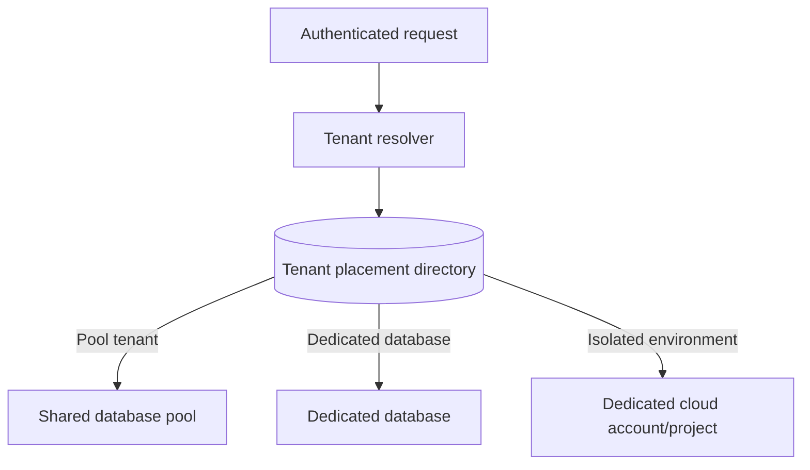
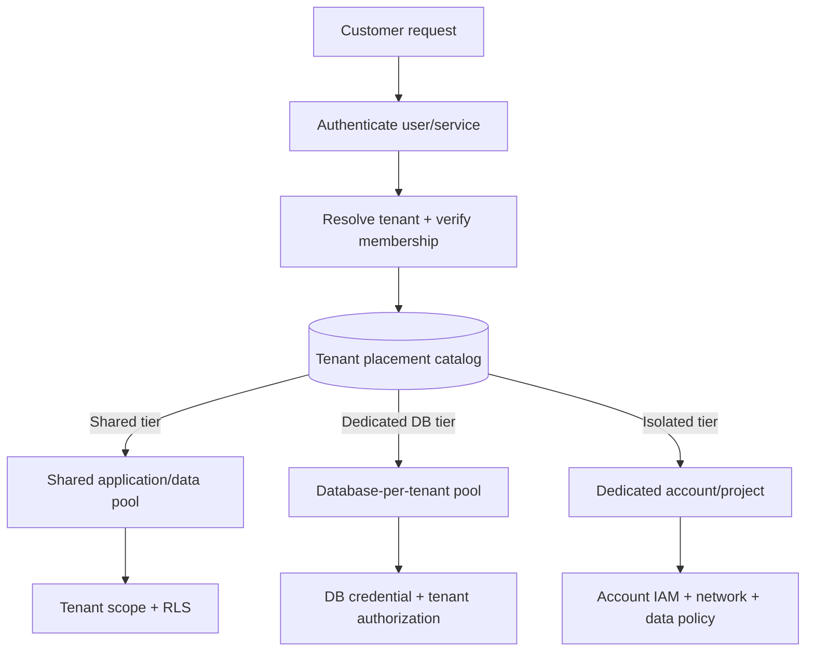

# Cách ly dữ liệu theo hàng, schema, cơ sở dữ liệu hoặc tài khoản

## 1. Cách ly dữ liệu là quyết định kiến trúc cốt lõi của SaaS

Trong hệ thống đa khách hàng (multi-tenant), một nền tảng phục vụ nhiều tổ chức hoặc khách hàng trên cùng một sản phẩm. Các tenant có thể dùng chung API, compute, queue và database để tối ưu chi phí, nhưng dữ liệu của tenant này phải được bảo vệ khỏi tenant khác. Một lỗi định tuyến, truy vấn thiếu điều kiện tenant hoặc cấu hình quyền sai có thể làm lộ dữ liệu xuyên khách hàng.

**Cách ly dữ liệu (data isolation)** xác định dữ liệu của tenant được lưu ở đâu, ai có thể truy cập, request được định tuyến thế nào và phạm vi ảnh hưởng khi có lỗi. Bốn mô hình phổ biến là:

1. **Cách ly theo hàng (row-level/shared tables):** nhiều tenant dùng chung bảng; mỗi record gắn với tenant ID.
2. **Cách ly theo schema (schema-per-tenant):** mỗi tenant có schema riêng trong cùng database.
3. **Cách ly theo database (database-per-tenant):** mỗi tenant có database riêng; có thể cùng cluster hoặc hạ tầng độc lập.
4. **Cách ly theo tài khoản/project/subscription:** tenant được đặt trong cloud account, project hoặc subscription riêng, có thể gồm network, compute, database và khóa mã hóa riêng.

Không có mô hình tốt nhất cho mọi sản phẩm. Lựa chọn phải dựa trên mức cách ly và compliance cần thiết, số tenant, quy mô dữ liệu, phân bố tải, chi phí, nhu cầu tùy biến, backup/restore và mục tiêu phục hồi.

Bài học thuộc chương **Kiến trúc đa khách hàng** của module **CLOUD_ARCHITECTURE**. Nội dung giúp chuyển yêu cầu nghiệp vụ về bảo mật và vận hành thành lựa chọn data plane/control plane, schema, database và cloud account, đồng thời đánh giá theo Well-Architected.

Sau bài học, bạn có thể so sánh bốn mô hình, thiết kế tenant context và authorization, đánh giá backup/restore và migration, nhận diện noisy neighbor, chọn mô hình shared/silo/hybrid và xây dựng kiểm thử tenant isolation.

## 2. Tenant identity và ranh giới tin cậy

Trước khi quyết định dữ liệu nằm ở hàng hay database riêng, phải xác định hệ thống biết tenant nào đang thực hiện request bằng cách nào.

### 2.1. Tenant context phải đến từ nguồn tin cậy

Request có thể chứa tenant ID trong URL, subdomain, header hoặc token. Những giá trị này không tự động đáng tin cậy. Nếu ứng dụng nhận header tenant ID từ client rồi dùng trực tiếp trong SQL, người dùng có thể thay ID để truy cập dữ liệu tenant khác.

Luồng an toàn thường gồm:

1. Xác thực danh tính người dùng hoặc service.
2. Xác định tenant từ claim đã ký, membership đã xác minh hoặc routing domain được kiểm soát.
3. Kiểm tra người dùng có membership và role phù hợp trong tenant đó.
4. Tạo tenant context bất biến cho request/transaction.
5. Truyền context qua service-to-service bằng identity và token có audience/scope phù hợp.
6. Áp dụng tenant scope tại data access layer; kiểm tra quyền ở từng hành động nghiệp vụ.

Tenant ID trong URL có thể dùng để chọn tổ chức người dùng muốn truy cập, nhưng backend vẫn phải xác minh membership. Không cấp quyền chỉ vì subdomain hoặc header hợp lệ.

### 2.2. Tách authentication, tenant resolution và authorization

| Bước | Câu hỏi | Ví dụ |
|---|---|---|
| Authentication | Ai đang gọi? | User đã đăng nhập |
| Tenant resolution | Request thuộc tenant nào? | URL yêu cầu ACME |
| Membership | User có thuộc tenant đó không? | User có membership ACME |
| Authorization | User được làm gì trên resource nào? | Được xem booking B-10 trong ACME |
| Data isolation | Query bị giới hạn trong tenant đó chưa? | RLS/DB routing chỉ truy cập ACME |

Một user có thể thuộc nhiều tenant với vai trò khác nhau. Không lưu một tenant mặc định trong session rồi dùng cho mọi request nếu user có thể chuyển tổ chức. Tenant context phải được xác định và kiểm tra cho từng request/operation.

### 2.3. Context xuyên qua các tầng

Tenant context cần được giữ qua API gateway, service middleware, background job, queue/event consumer, database transaction, cache key, object storage path, audit log và trace. Với background job, message cần mang tenant reference đã được producer xác thực; consumer vẫn phải kiểm tra nguồn phát và quyền thực hiện.

## 3. Bốn mô hình cách ly dữ liệu

### 3.1. Shared database, shared schema, shared rows

Tất cả tenant dùng chung database và bảng. Mỗi bảng nghiệp vụ có tenant ID; mọi truy vấn đều phải bị giới hạn theo tenant.

```sql
CREATE TABLE bookings (
    tenant_id  UUID NOT NULL,
    booking_id UUID NOT NULL,
    status     VARCHAR(30) NOT NULL,
    created_at TIMESTAMP NOT NULL,
    PRIMARY KEY (tenant_id, booking_id)
);

CREATE INDEX idx_bookings_tenant_created
    ON bookings (tenant_id, created_at);
```

**Ưu điểm:** mật độ sử dụng hạ tầng cao; tạo tenant nhanh; migration schema triển khai tập trung; báo cáo tổng hợp thuận tiện nếu quyền riêng được cấp đúng.

**Đánh đổi:** một query quên tenant condition có thể làm lộ dữ liệu; index/query plan phải xét phân bố tenant; tenant lớn gây noisy neighbor; restore riêng tenant khó; compliance và key ownership riêng khó đáp ứng.

Mô hình phù hợp với nhiều tenant nhỏ, workload tương đối đồng nhất và hệ thống có tenant context/RLS/test isolation mạnh.

### 3.2. Schema-per-tenant

Một database instance chứa nhiều schema; mỗi tenant có namespace và bảng riêng. Ứng dụng định tuyến transaction tới schema theo tenant context.

```text
database: saas_main
  schema_tenant_acme:
    bookings
    customers
  schema_tenant_zen:
    bookings
    customers
```

**Ưu điểm:** phân tách namespace; có thể export/backup một schema trong một số engine; vẫn chia sẻ instance để tiết kiệm chi phí; có khả năng migration hoặc tùy chỉnh theo tenant.

**Đánh đổi:** schema/table/index tăng nhanh theo số tenant; migration phải chạy lặp; query/report xuyên schema phức tạp; connection pool và search path dễ giữ nhầm context; CPU, memory, IOPS và failure domain vẫn chung instance.

Schema riêng không tương đương database riêng. Nếu instance hoặc quyền database owner bị xâm phạm, nhiều tenant vẫn có thể bị ảnh hưởng.

### 3.3. Database-per-tenant

Mỗi tenant có database riêng; các database có thể nằm trên cùng cluster/instance hoặc cluster riêng.

**Ưu điểm:** ranh giới dữ liệu và quyền rõ hơn shared rows; backup/restore, export, retention và migration theo tenant thuận tiện hơn; có thể điều chỉnh tier theo nhu cầu; hỗ trợ một số yêu cầu compliance.

**Đánh đổi:** chi phí storage, connection, backup và monitoring tăng; provisioning/patching/migration phải tự động hóa; ứng dụng cần tenant catalog ánh xạ endpoint; báo cáo toàn nền tảng cần ETL/data warehouse; nhiều database tạo tài nguyên nhàn rỗi.

Phù hợp với tenant lớn, có yêu cầu restore độc lập, retention riêng hoặc mức cách ly cao hơn nhưng vẫn chia sẻ application plane.

### 3.4. Account/project/subscription-per-tenant

Mỗi tenant được triển khai trong cloud account, project hoặc subscription riêng; phạm vi có thể gồm network, compute, database, storage, logging và encryption key.

**Ưu điểm:** ranh giới quản trị/quota mạnh hơn nếu cấu hình đúng; dễ áp dụng policy, billing, logging, residency và key ownership theo tenant; giảm blast radius; hỗ trợ network connectivity riêng.

**Đánh đổi:** provisioning và governance phức tạp; cần landing zone, identity federation, network connectivity, policy-as-code và automation; có tài nguyên nền lặp lại; monitoring và incident response xuyên account cần thiết kế riêng.

Account riêng không tự bảo đảm cách ly nếu cross-account role, shared network hoặc central service có quyền quá rộng. Một số control plane vẫn có thể dùng chung nhưng phải tuân thủ least privilege.

## 4. So sánh tổng thể

| Tiêu chí | Shared rows | Schema-per-tenant | Database-per-tenant | Account/project-per-tenant |
|---|---|---|---|---|
| Ranh giới | Row + policy ứng dụng/DB | Namespace/schema | Database; tùy cluster | Cloud account/project và tài nguyên |
| Chi phí nền | Thấp | Thấp-trung bình | Trung bình-cao | Cao |
| Provision tenant | Rất nhanh | Tạo schema | Tạo database/secret | Tạo landing zone/stack |
| Schema migration | Một lần nhưng ảnh hưởng toàn bộ | Lặp theo schema | Lặp theo database | Lặp theo deployment/data stack |
| Restore riêng tenant | Khó | Có thể export/import schema | Rõ hơn | Theo stack/account |
| Noisy neighbor | Cao nếu thiếu quota | Vẫn chung instance | Có thể cô lập hơn tùy cluster | Có thể cô lập nhiều tầng |
| Tùy biến | Hạn chế | Một phần | Tốt hơn | Linh hoạt nhất |
| Báo cáo toàn nền tảng | Dễ hơn, cần quyền riêng | Union/ETL | ETL/fan-in | Pipeline đa account |
| Blast radius DB | Có thể toàn bộ tenant | Instance chung ảnh hưởng nhiều tenant | Hẹp hơn nếu cluster riêng | Có thể hẹp hơn theo stack/account |

Không hiểu các cột như thang bảo mật tuyệt đối. Schema-per-tenant trên một instance với admin credential dùng chung vẫn có blast radius lớn; database riêng trên cùng cluster vẫn chia sẻ host/failure domain. Phải mô tả thành phần nào thật sự được tách: namespace, database, cluster, network, account, key hay operator access.

## 5. Mô hình hybrid: pool, bridge và silo

Tenant thường khác nhau về quy mô, compliance và mức tùy biến. Một mô hình hybrid có thể chia:

- **Pool/shared:** tenant nhỏ dùng chung database hoặc schema.
- **Bridge:** tenant dùng schema/database riêng nhưng chia sẻ compute hoặc cluster.
- **Silo:** tenant lớn/regulated có cluster, account hoặc network độc lập.

### 5.1. Tenant placement directory

Control plane có thể lưu tenant đang thuộc pool hoặc deployment nào:



Directory phải có HA, versioned mapping, cache TTL, audit và quyền cập nhật giới hạn. Tenant placement không được lấy từ input tùy ý của client. Khi di chuyển tenant, cần routing version và cơ chế cutover để request không ghi nhầm hoặc ghi cả hai nơi ngoài kiểm soát.

### 5.2. Tiêu chí chọn tier

- Record count, data volume và growth rate.
- Peak request/transaction rate, latency và noisy neighbor.
- Nhu cầu restore độc lập, RPO/RTO.
- Data residency, encryption key ownership, network/private connectivity.
- Hợp đồng, compliance và willingness-to-pay cho dedicated resources.

Không chỉ chuyển tenant lên silo theo doanh thu; yêu cầu pháp lý hoặc độ nhạy dữ liệu có thể đòi cách ly cao dù tenant nhỏ.

## 6. Shared rows: tenant_id, RLS và ràng buộc dữ liệu

Trong shared rows, tenant ID cần hiện diện ở mọi bảng chứa dữ liệu thuộc tenant. Khóa/index và foreign key nên bảo vệ tenant boundary.

### 6.1. Truy vấn có tenant scope

```sql
SELECT booking_id, status, created_at
FROM bookings
WHERE tenant_id = :authenticated_tenant_id
  AND booking_id = :booking_id;
```

Tenant ID phải lấy từ context server đã xác minh, không lấy mù quáng từ request body. ORM/global query filter giúp giảm lỗi lặp nhưng không thay authorization hay test query thực tế.

### 6.2. Row-Level Security (RLS)

Một số database hỗ trợ RLS để database áp dụng policy theo session/role. Ví dụ khái niệm theo PostgreSQL:

```sql
ALTER TABLE bookings ENABLE ROW LEVEL SECURITY;
ALTER TABLE bookings FORCE ROW LEVEL SECURITY;

CREATE POLICY tenant_isolation_policy
ON bookings
USING (
  tenant_id = current_setting('app.tenant_id')::uuid
)
WITH CHECK (
  tenant_id = current_setting('app.tenant_id')::uuid
);
```

Ứng dụng thiết lập context trong transaction sau khi xác thực:

```sql
BEGIN;
SET LOCAL app.tenant_id = '...trusted-tenant-uuid...';
SELECT booking_id, status FROM bookings
WHERE booking_id = '...';
COMMIT;
```

Đây là ví dụ minh họa; cần kiểm tra phiên bản engine, session variable, connection pooling và role. RLS không an toàn nếu app role có thể tự đặt tenant ID tùy ý mà không có bước xác minh đáng tin cậy. SET LOCAL giới hạn giá trị trong transaction; pool phải reset/kiểm tra context để không rò tenant từ request trước.

### 6.3. RLS không thay thế mọi lớp bảo vệ

- App role không nên là superuser hoặc role bypass RLS.
- Migration/admin job dùng role riêng, audit và phạm vi giới hạn.
- Background worker, export, reporting, stored procedure và query ad hoc cũng cần kiểm thử.
- Kiểm tra cả USING (hàng được đọc/target) và WITH CHECK (hàng insert/update).
- RLS không thay xác thực người dùng hoặc quyền nghiệp vụ.

### 6.4. Composite key và foreign key

Nếu booking ID duy nhất trong tenant, constraint nên bao gồm tenant:

```sql
CREATE TABLE bookings (
    tenant_id UUID NOT NULL,
    booking_id UUID NOT NULL,
    customer_id UUID NOT NULL,
    PRIMARY KEY (tenant_id, booking_id),
    FOREIGN KEY (tenant_id, customer_id)
      REFERENCES customers (tenant_id, customer_id)
);
```

Composite foreign key ngăn booking tenant A tham chiếu customer tenant B nếu engine thực thi constraint đúng. Đây là defense-in-depth bên cạnh authorization và RLS.

## 7. Schema-per-tenant: định tuyến và migration

Ứng dụng phải chọn schema theo tenant context một cách an toàn. Không nối schema name trực tiếp từ input client vào SQL; cần ánh xạ từ catalog đã xác minh và quoting identifier đúng theo engine.

### 7.1. Search path và connection pool

- Pooled connection có thể giữ search_path của tenant trước.
- Query không qualify schema có thể đọc nhầm bảng mặc định.
- Stored procedure/extension có thể chạy với quyền cao hơn dự kiến.
- Migration thiếu một schema khiến tenant chạy phiên bản cấu trúc khác nhau.

Thiết lập schema trong transaction/session và reset rõ ràng; test trên connection pool thực tế.

### 7.2. Migration hàng nghìn schema

1. Ghi schema version hiện tại trong tenant catalog.
2. Chạy migration tương thích ngược theo batch.
3. Theo dõi thành công/thất bại, lock và thời gian chạy.
4. Tạm dừng khi lỗi hoặc latency vượt ngưỡng.
5. Contract-test cả tenant đã nâng cấp và tenant ở phiên bản cũ.
6. Chỉ bỏ cột/format cũ sau khi toàn bộ tenant đạt phiên bản đích và thời gian tương thích kết thúc.

Không chạy một transaction khổng lồ nâng cấp tất cả schema nếu tạo lock kéo dài. Cần retry theo tenant và checkpoint để tiếp tục.

## 8. Database-per-tenant: catalog, connection và quản trị

Ứng dụng cần tenant database catalog ánh xạ tenant → endpoint, credential reference, region, schema version và tier. Catalog là dữ liệu control plane nhạy cảm; cần HA, backup, audit và quyền truy cập chặt.

### 8.1. Connection routing

1. Xác thực user và tenant membership.
2. Tra placement catalog bằng tenant ID đã xác minh.
3. Lấy credential từ secret manager bằng workload identity.
4. Dùng pool gắn với database/credential version.
5. Rotate/đóng pool khi placement hoặc secret thay đổi.

Không tạo connection pool không giới hạn cho mọi tenant. Nhiều nghìn tenant có thể làm cạn memory/socket nếu giữ pool riêng quá lâu. Cân nhắc proxy/pooling, pool theo cụm, giới hạn idle và mở theo nhu cầu; bảo đảm không trộn session state.

### 8.2. Provisioning và deprovisioning

Provisioning có thể tạo database, user, secret, key, backup policy, monitor và tags. Workflow phải tự động hóa, có trạng thái và idempotency. Khi xóa tenant:

- Xác minh yêu cầu, retention và legal hold.
- Chặn request/ghi mới theo trạng thái tenant.
- Export hoặc giữ dữ liệu theo chính sách.
- Thu hồi identity, credential, key access và subscription.
- Xóa tài nguyên theo quy trình được phê duyệt.
- Lưu audit evidence và tránh catalog trỏ endpoint đã tái sử dụng.

## 9. Account/project-level isolation

Account/project/subscription riêng tạo ranh giới quản trị và quota mạnh hơn, nhưng cần landing zone nhất quán.

### 9.1. Những thành phần cần chuẩn hóa

- Organization/folder/account hierarchy, naming và tagging.
- Identity federation, role cross-account, break-glass và least privilege.
- Network connectivity, private endpoint, DNS, firewall và egress.
- Central logging/security monitoring và quyền audit.
- Encryption key ownership, rotation, backup và recovery.
- IaC module, policy-as-code, image/runtime baseline và patching.
- Quota, capacity, cost allocation, budget và alert.

### 9.2. Shared control plane, isolated data plane

Control plane tập trung có thể quản lý tenant catalog, provisioning, billing và policy; data plane của tenant được triển khai riêng theo account/project. Control plane không nên có quyền đọc mọi dữ liệu nghiệp vụ nếu chỉ cần metadata/health. Support access cần JIT, approval, session logging và thời hạn ngắn.

Shared analytics bucket, central bus, support tooling hoặc cross-account role vẫn có thể mở đường truy cập nếu policy quá rộng. Threat model phải bao gồm shared service và đường kết nối account.

## 10. Cách ly cache, object storage, queue và search

Data isolation không dừng ở database. Tenant có thể bị lộ qua cache key, file path, queue message hoặc log.

| Thành phần | Rủi ro | Cơ chế |
|---|---|---|
| Cache | Hai tenant tạo key giống nhau hoặc value trả chéo | Tenant namespace, authorization, TTL và purge |
| Object storage | Bucket/path đoán được, policy quá rộng | Bucket/container/prefix, IAM, encryption, signed URL ngắn |
| Queue/event bus | Consumer xử lý nhầm tenant hoặc subscriber trái phép đọc | Queue/topic scope, producer identity, tenant metadata, consumer authorization |
| Search index | Query thiếu tenant filter | Index riêng hoặc tenant field + mandatory filter |
| Logs/traces | PII/payload rò vào hệ thống quan sát chung | Data minimization, masking, access và retention |
| Export/temp file | File tạm dùng namespace/quyền quá rộng | Per-tenant path, encryption, lifecycle và cleanup |
| Analytics/warehouse | Pipeline union nhầm tenant | Row/column policy, catalog/lineage, access group và audit |

Ví dụ cache key:

```text
tenant:{tenant_id}:booking:{booking_id}:summary:v3
```

Prefix chỉ phân vùng key, không phải authorization. Application và cache service vẫn phải kiểm tra identity/quyền.

## 11. Noisy neighbor và phân bổ tài nguyên

Trong shared model, một tenant có thể tiêu thụ CPU, IOPS, connection, queue throughput hoặc cache memory vượt xa tenant khác. Đây là **noisy neighbor**.

Biện pháp:

- Quota/rate limit theo tenant và API group.
- Fair scheduling hoặc weighted queue cho background jobs.
- Giới hạn concurrency, DB connection, query cost và export size.
- Tách tenant lớn sang dedicated pool/shard.
- Theo dõi usage, growth và cảnh báo bất thường.
- Trả lỗi rõ như 429/Retry-After khi vượt quota.

Quota phải dùng tenant context đã xác minh; client không thể đổi tenant ID để tiêu thụ budget của tenant khác. Background job cũng cần tenant accounting.

## 12. Backup, restore và disaster recovery theo tenant

Backup thành công không đồng nghĩa có thể restore riêng một tenant. Độ phức tạp phụ thuộc mô hình:

| Mô hình | Phục hồi tenant | Vấn đề cần xử lý |
|---|---|---|
| Shared rows | PITR sang môi trường phụ, trích xuất/merge row tenant | Cross-reference, dữ liệu chung, event và thay đổi mới |
| Schema-per-tenant | Export/restore schema rồi nhập lại | Foreign key ngoài schema, extension, role và version |
| Database-per-tenant | Restore database tenant sang endpoint mới rồi đổi catalog | Endpoint, secret, replica, queue và object storage |
| Account/project riêng | Khôi phục data stack và policy trong account/region DR | Identity/network bootstrap, quota, key recovery, mapping |

RPO/RTO có thể khác theo tier/tenant. Restore test phải kiểm tra routing, authorization, encryption key, search index, cache và consumer sau khi khôi phục.

### 12.1. Restore shared-row tenant không được ghi đè tenant khác

1. Restore snapshot/PITR vào database tạm.
2. Trích xuất row thuộc tenant cần phục hồi.
3. Kiểm tra foreign key, dữ liệu tham chiếu chung và thay đổi sau snapshot.
4. Merge theo version/quy tắc nghiệp vụ, không replace mù quáng.
5. Đối soát queue event, file object và cache; chạy reconciliation.
6. Phê duyệt cutover và audit.

Nếu tenant liên quan ledger hoặc bảng dùng chung, cần quy tắc phục hồi riêng. Nên có dry run và người phê duyệt.

## 13. Migration giữa các mô hình cách ly

Tenant có thể bắt đầu ở shared rows rồi chuyển sang database riêng khi tăng trưởng hoặc có yêu cầu compliance. Migration phải bảo đảm request không ghi vào hai nơi ngoài kiểm soát.

### 13.1. Các giai đoạn

1. Provision đích: database/schema/account, user, secret, key, network và backup.
2. Snapshot/backfill: copy dữ liệu theo checkpoint, giữ thứ tự và quan hệ tham chiếu.
3. Bắt kịp thay đổi: CDC/outbox/change log hoặc dual-write được kiểm soát.
4. Đối soát: row count, checksum, business aggregate, uniqueness và referential integrity.
5. Cutover: đổi tenant directory/router theo version; dùng writer authority/fencing để tránh ghi hai nơi.
6. Theo dõi latency, error, missing/duplicate data, connection và background job.
7. Giữ rollback window; không xóa nguồn cũ ngay sau cutover.
8. Thu hồi credential cũ, xóa bản sao theo retention và cập nhật catalog/ADR.

### 13.2. Dual-write có rủi ro

Một request có thể commit database cũ nhưng thất bại ở database mới. Hai nơi sẽ lệch. Nếu dùng dual-write, cần outbox/change log, idempotency, retry, reconciliation và nguồn có thẩm quyền. Hai câu INSERT độc lập không tạo thành một transaction phân tán an toàn.

## 14. Ví dụ SaaS đặt lịch: mô hình hybrid

Giả sử nền tảng có 5.000 tenant: 4.800 tenant nhỏ, 180 tenant trung bình cần restore riêng, 20 tenant lớn/regulated cần network, key và môi trường riêng.

| Phân khúc | Mô hình | Lý do |
|---|---|---|
| Tenant nhỏ | Shared database, shared rows + RLS | Chi phí thấp, provisioning nhanh |
| Tenant trung bình | Database-per-tenant trong pool/cluster | Restore, quota và tuning độc lập hơn |
| Tenant regulated/lớn | Account/project và data stack riêng | Cách ly, residency, key/network policy |

### 14.1. Luồng định tuyến



Tenant placement chỉ quyết định vị trí dữ liệu; membership và authorization vẫn cần được kiểm tra. Database riêng cũng không có nghĩa mọi user trong tenant được truy cập mọi record.

### 14.2. Quy tắc duy trì

- Mọi request có tenant context đã xác thực; thiếu scope thì fail closed.
- Shared tier dùng RLS, composite constraints và query tests.
- Dedicated DB tier có catalog, secret rotation và pool lifecycle.
- Isolated tier dùng landing-zone automation và JIT support role.
- Queue, cache, search, object storage và analytics đều mang tenant ownership.
- Migration có placement version, routing authority, audit và rollback.

## 15. Kiểm thử tenant isolation

Kiểm thử phải chứng minh tenant A không thể đọc, sửa, xóa hoặc suy ra dữ liệu tenant B qua mọi interface.

| Test | Hành động | Kết quả mong đợi |
|---|---|---|
| Tenant ID tampering | Đổi tenant ID trong URL/header/body | Từ chối nếu user không có membership |
| Cross-tenant object ID | Dùng booking của B khi authenticated tenant A | Không trả dữ liệu B |
| Missing context | Gọi data access không có tenant context | Fail closed, không query toàn bảng |
| Connection pool reuse | Request A rồi B trên cùng connection | Context của A không rò sang B |
| RLS bypass | Thử bằng app/migration/background role | App role không bypass; admin có audit |
| Foreign key crossing | Tenant A tham chiếu customer B | Constraint/policy từ chối |
| Cache collision | Key giống nhau giữa hai tenant | Không trả dữ liệu chéo |
| Queue spoofing | Gửi message tenant ID giả | Consumer xác minh producer/context |
| Export/report | Export theo tenant | Chỉ dữ liệu trong scope |
| Support access | Nhân viên hỗ trợ truy cập tenant | JIT approval, scope, expiry và audit |
| Migration | Move tenant khi có traffic | Không mất/ghi đôi; reconciliation đạt |
| Restore | Khôi phục một tenant | Không ghi đè/lộ tenant khác |

Ngoài test chức năng, cần security review, penetration test theo threat model, query-filter fuzzing và static/architecture checks cho data access path.

## 16. Observability và vận hành đa tenant

Theo dõi theo tenant giúp phát hiện noisy neighbor và sự cố cục bộ, nhưng cần hạn chế cardinality và dữ liệu nhạy cảm.

Metrics hữu ích:

- Request rate, p95/p99 latency và error rate theo tier/pool.
- Database CPU/IOPS/connections/lock wait theo pool/database.
- Storage usage, backup status, replication lag và restore test.
- Quota usage, throttling, queue backlog và cache fallback.
- Provisioning/migration state, schema version và placement version.
- Cross-tenant authorization deny và RLS/policy violations.

Không nhất thiết tạo metric time series riêng cho mọi tenant ID nếu số lượng rất lớn. Có thể dùng tenant tier, pool, region và top-N usage; tenant-specific diagnostics nằm trong log có kiểm soát. Tránh PII/full payload trong labels.

## 17. Chi phí và khả năng mở rộng

**Shared model** tận dụng tài nguyên tốt với tenant nhỏ và workload đồng đều, nhưng cần RLS, query review, tenant-aware cache, quota, audit và restore riêng. Một lỗi ứng dụng có thể ảnh hưởng nhiều tenant nên yêu cầu kiểm thử cao.

**Silo model** giảm blast radius và cho phép custom sizing nhưng tăng tài nguyên nhàn rỗi, provisioning, patching, logging và nhân lực. Cần IaC để tránh drift giữa tenant.

**Hybrid model** cho phép isolation theo tier nhưng tạo thêm tenant placement control plane, routing và nhiều đường vận hành. Cần giới hạn số tier, version module, SLA và quy trình migration.

Đánh giá TCO gồm database/account compute, storage, replica, backup, network, tenant catalog, secret manager, monitoring, provisioning, migration, restore, on-call, compliance và capacity dự phòng.

## 18. Bảo mật và quản trị dữ liệu

- Phân loại dữ liệu, xác định data residency theo tenant.
- Encryption at rest/in transit; xác định key dùng chung hay per-tenant.
- Tách quyền application, admin, migration, support và analytics.
- Dùng workload identity/secret manager; không lưu credential plaintext trong tenant catalog.
- Audit truy cập xuyên tenant, export, impersonation và thao tác support.
- Có retention, legal hold, deletion và bằng chứng xóa.
- Bảo vệ backup/snapshot/archive/staging như dữ liệu production.
- Kiểm soát cross-account/shared services; account riêng không thay authorization ở app.

Impersonation hỗ trợ khách hàng cần lý do, phê duyệt khi cần, thời hạn ngắn, banner/session rõ, audit đầy đủ và hạn chế thao tác tài chính/nhạy cảm.

## 19. Đánh giá theo Well-Architected

| Trụ cột | Câu hỏi review |
|---|---|
| **Operational Excellence** | Placement, provisioning, migration, backup và policy được tự động hóa? Có runbook/owner theo tier? |
| **Security** | Tenant identity đáng tin? Có defense-in-depth: app authorization, RLS, IAM, key isolation, audit và cross-tenant tests? |
| **Reliability** | Một DB/account lỗi ảnh hưởng tenant khác đến đâu? Restore riêng tenant và DR đã diễn tập? |
| **Performance Efficiency** | Noisy neighbor, quota, pool, partition và scaling được đo theo tenant/tier? |
| **Cost Optimization** | Shared vs silo có đúng nhu cầu? Tài nguyên nhàn rỗi, backup, logging và vận hành đã tính trong TCO? |
| **Sustainability** | Pooling/right-sizing giảm tài nguyên nhàn rỗi mà vẫn giữ isolation? Tài nguyên tenant xóa được dọn đúng chính sách? |

## 20. Mẫu ADR cho lựa chọn data isolation

Mẫu YAML sau dùng để ghi quyết định; không phải cấu hình triển khai trực tiếp:

```yaml
decision_id: ADR-MULTITENANT-003
title: Tenant data isolation strategy
tenant_tiers:
  shared:
    placement: shared_database_shared_rows
    safeguards:
      - trusted_tenant_context
      - row_level_security
      - composite_tenant_constraints
      - per_tenant_quota
  dedicated:
    placement: database_per_tenant
    safeguards:
      - tenant_database_catalog
      - scoped_credentials
      - independent_backup_restore
  regulated:
    placement: cloud_account_or_project_per_tenant
    safeguards:
      - landing_zone_policy
      - isolated_network_and_keys
      - audited_support_access
control_plane:
  tenant_directory: highly_available
  placement_version: required
  migration_workflow: snapshot_cdc_cutover
operations:
  isolation_tests: required
  restore_test: scheduled
  audit_cross_tenant_access: enabled
review_triggers:
  - tenant_growth_or_hotspot
  - compliance_or_residency_change
  - restore_slo_change
  - isolation_incident
```

ADR chính thức cần ghi owner, lựa chọn thay thế, yêu cầu compliance, benchmark/restore evidence, chi phí theo tier, người phê duyệt và thời điểm xem lại.

## 21. Quy trình chọn và triển khai

1. Xác định tenant, membership, các đường truy cập và shared services trong threat model.
2. Phân loại dữ liệu: PII, tài chính, residency, retention, key ownership và yêu cầu xóa.
3. Đo workload: số tenant, kích thước, read/write, peak, skew, query pattern và growth.
4. Đặt isolation target: row, schema, database, cluster, network hay account; nêu rõ thành phần được tách.
5. So sánh pool/bridge/silo theo TCO, backup/restore, migration và compliance.
6. Thiết kế identity/routing: tenant resolution, membership, catalog, context propagation và authorization.
7. Triển khai defense-in-depth: RLS/constraint, IAM, key, cache/object/queue isolation và audit.
8. Tự động hóa provisioning, upgrade, migration, backup, restore và deprovisioning.
9. Kiểm thử cross-tenant, noisy neighbor, failover, restore, migration và incident response.
10. Rà soát placement định kỳ theo số liệu; cập nhật ADR và runbook.

## 22. Bảng kiểm trước production

- [ ] Định nghĩa tenant, membership và nguồn tenant context đáng tin cậy.
- [ ] Tách authentication, tenant resolution, authorization và data isolation.
- [ ] Chọn row/schema/database/account theo threat model và workload.
- [ ] Shared rows có tenant ID, composite constraints/index và kiểm tra mọi query path.
- [ ] RLS không bị bypass bởi app role; session/connection pool context được reset an toàn.
- [ ] Schema/database routing lấy từ catalog tin cậy, không nối tên từ input client.
- [ ] Database-per-tenant có catalog, secret rotation, pool limit và automation.
- [ ] Account tier có landing zone, IAM, network, key, logging và quota policy.
- [ ] Cache, object storage, queue, search, analytics, export và logs có tenant scope.
- [ ] Có quota/fairness để hạn chế noisy neighbor và load abuse.
- [ ] Backup/restore riêng tenant được thử; RPO/RTO được định nghĩa theo tier.
- [ ] Migration có snapshot/CDC, checkpoint, writer authority, reconciliation, cutover và rollback.
- [ ] Support/impersonation có JIT approval, expiry và audit.
- [ ] Đã test tenant tampering, cross-tenant object ID, RLS bypass, pool reuse, queue spoofing và restore.
- [ ] Có dashboard/alert/owner cho placement, isolation violation, usage và restore.
- [ ] TCO gồm database/account, backup, network, control plane, monitoring và nhân lực được duyệt.

**Nguyên tắc áp dụng:** chọn ranh giới cách ly theo rủi ro và nhu cầu thực tế. Shared rows tối ưu mật độ nhưng đòi tenant context và policy chặt; schema/database riêng tăng mức cô lập và khả năng quản trị nhưng tăng vận hành; account/project riêng mở rộng ranh giới tới cloud governance với chi phí cao hơn. Mô hình hybrid cân bằng được các yêu cầu khi routing, quyền, migration và backup được tự động hóa và kiểm thử xuyên suốt.
