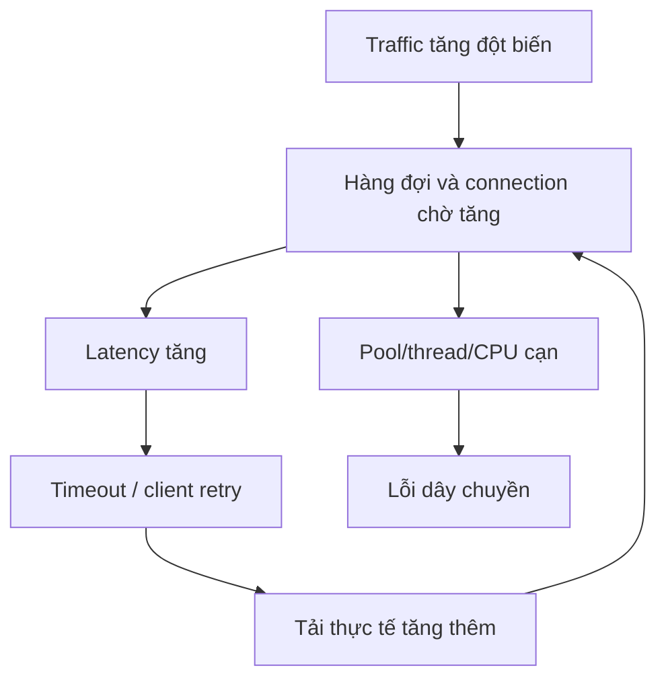
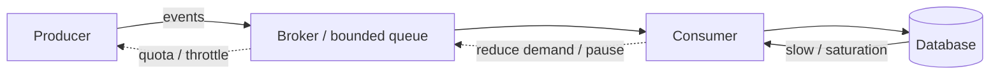
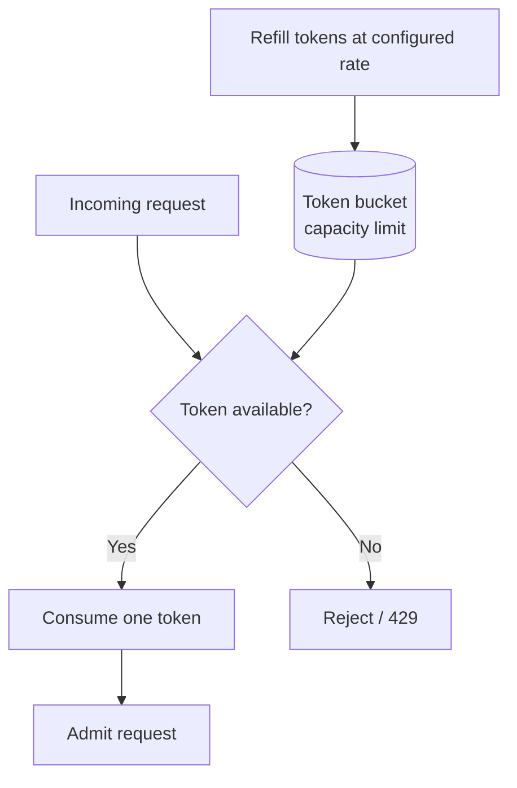
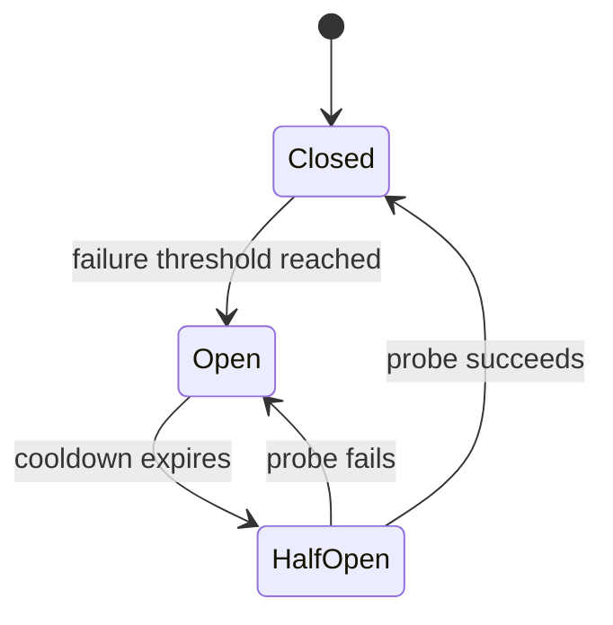
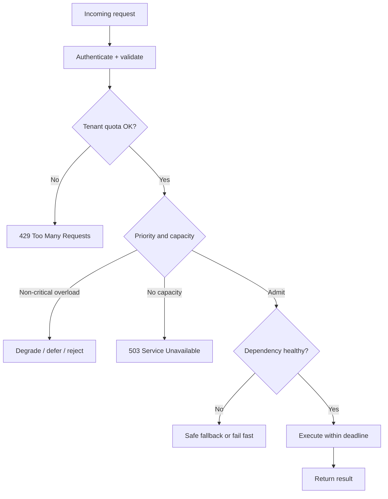

# Kiểm soát tải vào, load shedding và suy giảm có kiểm soát

Một hệ thống cloud được thiết kế để mở rộng vẫn có thể sụp đổ khi lượng request vượt quá khả năng phục vụ. CPU tăng cao, connection pool cạn, hàng đợi kéo dài, dependency chậm và client retry đồng loạt có thể tạo thành vòng xoáy: hệ thống càng chậm thì càng có nhiều request tồn đọng, timeout và retry; những lần retry lại chiếm thêm tài nguyên, khiến hệ thống chậm hơn nữa.

**Kiểm soát tải vào (admission control), loại bỏ tải có chọn lọc (load shedding) và suy giảm có kiểm soát (graceful degradation)** là các kỹ thuật giữ hệ thống trong vùng có thể vận hành khi nhu cầu vượt năng lực. Thay vì để mọi request đi sâu vào hệ thống rồi cùng thất bại, hệ thống quyết định sớm request nào được nhận, request nào phải chờ, request nào bị từ chối và chức năng nào có thể tạm giảm.

Trong module **CLOUD_ARCHITECTURE**, các kỹ thuật này kết nối compute, network, database, queue, autoscaling, SLO và vận hành sự cố. Ví dụ xuyên suốt là nền tảng cho thuê thiết bị có các chức năng tìm kiếm, xem availability, tạo reservation, thanh toán và gửi thông báo. Các ngưỡng tải và thời gian trong bài là số liệu giả định để minh họa; kiến trúc thực tế cần đo workload, benchmark trên hạ tầng tương ứng và xác định ưu tiên theo tác động nghiệp vụ.

## 1. Quá tải hình thành như thế nào?

Mỗi thành phần có một năng lực xử lý hữu hạn. Ví dụ Booking API có thể xử lý ổn định 1.000 request mỗi giây với latency mục tiêu. Khi traffic tăng lên 1.500 request mỗi giây, phần vượt năng lực không biến mất: nó chờ trong queue, connection pool, thread pool, kernel backlog hoặc tại dependency.

Nếu request tiếp tục đến nhanh hơn khả năng xử lý, backlog tăng. Khi hàng đợi lớn, request phải chờ lâu hơn, vượt deadline và thất bại. Client có thể retry, làm tổng lượng công việc tăng thêm.



### Triệu chứng quá tải

| Tín hiệu | Điều có thể đang xảy ra | Rủi ro |
| --- | --- | --- |
| CPU cao liên tục | Compute đang bão hòa hoặc workload đắt | Request mới không được xử lý kịp |
| Memory/GC pressure | Nhiều request, payload hoặc buffer tồn tại lâu | GC pause, OOM, restart |
| Connection pool saturation | Request giữ connection lâu hoặc pool quá nhỏ | Thread chờ, timeout |
| Queue depth/oldest age tăng | Consumer chậm hơn producer | Backlog không hội tụ |
| p95/p99 latency tăng | Tail request bị chờ hoặc dependency chậm | Client timeout và retry |
| 429/503 tăng | Hệ thống đang từ chối hoặc không đủ năng lực | Consumer có thể retry sai cách |
| Database lock wait tăng | Transaction contention hoặc truy vấn dài | Tắc nghẽn lan sang API |
| Network/socket backlog tăng | Connection establishment hoặc downstream bị nghẽn | Từ chối kết nối |
| Error rate tăng ở dependency | Một dịch vụ hạ nguồn không đáp ứng | Chuỗi gọi phía trên bị ảnh hưởng |

Không kết luận quá tải chỉ từ CPU. Một API có CPU 30% vẫn có thể không nhận thêm request vì database connection pool đã cạn hoặc downstream đang timeout.

## 2. Phân biệt capacity, concurrency, throughput và latency

Các khái niệm này giúp chọn tín hiệu admission chính xác.

| Khái niệm | Ý nghĩa | Ví dụ |
| --- | --- | --- |
| **Capacity** | Mức tài nguyên hoặc công việc hệ thống có thể phục vụ trong điều kiện đã xác định | 800 request/s ở SLO latency |
| **Throughput** | Số công việc hoàn tất trong một đơn vị thời gian | 750 request/s thành công |
| **Concurrency** | Số công việc đang được xử lý/chờ đồng thời | 300 request đang in-flight |
| **Latency** | Thời gian từ lúc nhận tới khi hoàn tất | p99 450 ms |
| **Queue wait** | Thời gian chờ trước khi được xử lý | Request chờ 200 ms trong admission queue |
| **Saturation** | Mức độ tài nguyên chính đã được sử dụng tới đâu | Worker pool 100% busy |

Theo định luật Little trong trạng thái ổn định, số công việc trung bình trong hệ thống (L) bằng tốc độ đến trung bình (λ) nhân thời gian trung bình trong hệ thống (W): L = λ × W. Khi thời gian xử lý tăng, số request in-flight cũng tăng nếu arrival rate không đổi. Điều này giải thích vì sao một dependency chậm có thể làm số connection/thread tăng mạnh dù lượng request đến không đổi.

Ví dụ, 500 request/s với thời gian ở hệ thống trung bình 0,2 giây tạo khoảng 100 request đang ở trong hệ thống. Nếu latency tăng lên 2 giây mà arrival rate giữ nguyên, con số đó tăng lên khoảng 1.000. Nếu mỗi request giữ một database connection, pool nhỏ sẽ bị bão hòa rất nhanh.

Capacity không phải một hằng số độc lập. Nó phụ thuộc payload, query plan, cache hit rate, kích thước transaction, fan-out, network latency, concurrency và SLO yêu cầu.

## 3. Admission control: quyết định trước khi nhận công việc

Admission control là cơ chế quyết định request hoặc job có được đưa vào phần xử lý tốn tài nguyên hay không. Nó giúp giới hạn concurrency và bảo vệ hệ thống khỏi nhận nhiều công việc hơn mức có thể hoàn thành.

Một admission controller thường xét:

- Số request đang xử lý.
- Queue depth và thời gian chờ lâu nhất.
- CPU, memory, connection pool hoặc worker utilization.
- Deadline còn lại của request.
- Tình trạng dependency.
- Tenant/client quota.
- Priority và giá trị nghiệp vụ.
- Tài nguyên cần dự kiến cho loại request.

### 3.1. Giới hạn concurrency

Ví dụ Booking API chỉ cho tối đa 400 request tạo reservation đang in-flight. Khi đủ 400 slot:

- Có thể từ chối ngay với 503/429 tùy nguyên nhân và semantics.
- Có thể đưa một lượng nhỏ vào queue bounded để chờ slot.
- Có thể từ chối request có deadline không đủ để hoàn tất.

Không tạo queue vô hạn. Queue chỉ chuyển quá tải tức thời thành chờ đợi; nếu tốc độ đến cao hơn throughput trong thời gian dài, queue sẽ tăng không giới hạn và cuối cùng tiêu thụ memory, disk hoặc connection.

### 3.2. Bounded queue

Một queue có giới hạn cần định nghĩa:

- Capacity tối đa theo số message, byte hoặc estimated work.
- Thời gian chờ tối đa.
- Overflow policy: reject mới, drop loại ưu tiên thấp, hoặc thay thế job cũ nếu semantics cho phép.
- Hành vi khi service shutdown/restart.
- Đảm bảo durability nếu công việc không thể mất.
- Metric queue depth, oldest age và rejection.

Queue có giới hạn giúp hệ thống không tích lũy công việc vượt quá năng lực phục hồi. Nhưng với reservation/payment, không được tùy tiện drop một command đã cam kết nhận. Có thể trả từ chối trước khi nhận, hoặc ghi nhận job bền vững với trạng thái pending và contract rõ cho client.

### 3.3. Deadline-aware admission

Nếu client gửi request có deadline tổng 500 ms, nhưng hệ thống dự kiến phải chờ slot 700 ms, nhận request chỉ tạo ra công việc gần như chắc chắn thất bại. Admission controller có thể từ chối sớm.

Deadline phải là ngân sách xuyên suốt: queue wait + xử lý nội bộ + dependency call + response serialization. Không để mỗi lớp tự đặt timeout lớn hơn deadline của caller.

## 4. Load shedding: loại bỏ công việc khi không thể phục vụ tất cả

Load shedding chủ động từ chối hoặc bỏ một phần tải để bảo vệ phần còn lại. Mục tiêu không phải giảm traffic bằng mọi giá, mà giữ các chức năng quan trọng trong vùng hoạt động.

### 4.1. Từ chối sớm tốt hơn xử lý dở dang

Một request bị từ chối ở edge có thể tiêu tốn rất ít tài nguyên. Một request được nhận, chờ 3 giây, gọi 5 dependency rồi timeout tiêu tốn nhiều CPU, connection và capacity hơn nhưng vẫn không tạo kết quả hữu ích.

Sớm từ chối giúp:

- Giữ thread/connection cho request có khả năng thành công.
- Tránh queue wait lớn hơn deadline.
- Ngăn downstream bị nhận công việc vô vọng.
- Tạo tín hiệu rõ cho client điều chỉnh tải.

### 4.2. Reject, drop, defer và degrade

| Hành động | Ý nghĩa | Trường hợp |
| --- | --- | --- |
| Reject | Từ chối request có phản hồi | API đồng bộ, client có thể thử lại theo policy |
| Drop | Bỏ message/request đã nhận | Telemetry không quan trọng, duplicate event đã xử lý |
| Defer | Nhận công việc nhưng xử lý sau | Báo cáo export, email, batch job |
| Degrade | Trả kết quả đơn giản hơn hoặc bỏ chức năng phụ | Tìm kiếm bỏ personalization, trang chi tiết không tải recommendation |
| Shed selectively | Chỉ giữ nhóm request ưu tiên cao | Reservation confirmation được ưu tiên hơn analytics refresh |

Drop sau khi đã nhận một command quan trọng có thể vi phạm contract. Đối với dữ liệu bền vững, nên dùng reject-before-accept, durable queue hoặc trạng thái job có thể truy vấn.

## 5. Ưu tiên tải theo giá trị nghiệp vụ

Khi năng lực có hạn, không phải mọi request có giá trị như nhau.

Với nền tảng thuê thiết bị:

| Priority | Request | Lý do |
| --- | --- | --- |
| P0 | Xác nhận/hủy giao dịch đã bắt đầu, payment callback cần xử lý | Giữ tính đúng đắn và hoàn tất cam kết |
| P1 | Tạo reservation, kiểm tra availability phục vụ checkout | Chức năng tạo doanh thu và trạng thái nghiệp vụ |
| P2 | Tra cứu reservation của khách, catalog browse | Cần thiết cho trải nghiệm nhưng có thể giới hạn |
| P3 | Recommendation, personalization, dashboard cập nhật tức thời | Có thể tắt hoặc dùng dữ liệu cache |
| P4 | Analytics backfill, báo cáo export không khẩn | Có thể trì hoãn |

Phân cấp này chỉ là ví dụ; payment callback không được bỏ qua xác minh chữ ký/idempotency chỉ vì P0. Ưu tiên quyết định phân bổ capacity, không bỏ qua correctness hoặc security.

### 5.1. Reserved capacity và quota theo class

Có thể giữ một phần worker/connection budget cho operation quan trọng. Ví dụ:

- 50% worker pool dành cho checkout/reservation.
- 25% cho read API.
- 15% cho background workflow quan trọng.
- 10% cho telemetry/maintenance.

Các tỷ lệ này không nên cố định máy móc. Nếu phân vùng pool cứng, một nhóm có thể nhàn rỗi trong khi nhóm khác bị nghẽn. Có thể dùng minimum reserved capacity cộng với phần pool chia sẻ, weighted fair queue hoặc adaptive concurrency.

### 5.2. Tenant fairness

Một tenant có traffic lớn không nên chiếm toàn bộ capacity. Có thể áp dụng:

- Quota theo tenant/API key.
- Weighted fair queue theo tenant.
- Concurrent request cap từng tenant.
- Burst allowance có giới hạn.
- Per-tenant cost accounting.

Quota cần phân biệt abuse và workload hợp lệ. Tenant quan trọng có thể có contract khác nhưng phải được audit, tránh để cấu hình ưu tiên trở thành đường bypass bảo mật.

## 6. Graceful degradation: giảm chất lượng có chủ đích

Graceful degradation giữ chức năng cốt lõi hoạt động bằng cách tạm bỏ hoặc đơn giản hóa chức năng phụ khi tài nguyên/dependency suy giảm.

Ví dụ:

- Catalog vẫn hiển thị sản phẩm nhưng tắt recommendation.
- Availability trả dữ liệu gần nhất kèm timestamp khi inventory read model chậm, nhưng checkout vẫn xác minh trên nguồn authoritative.
- Trang chủ giảm số mục, bỏ ảnh độ phân giải cao hoặc nội dung cá nhân hóa.
- Dashboard dùng snapshot gần nhất thay vì tính query nặng theo thời gian thực.
- Notification chuyển thành job async; booking không đợi email hoàn tất.

Điều quan trọng là **không làm sai ngữ nghĩa nghiệp vụ**. Hiển thị availability cache cũ như một lời đảm bảo còn chỗ có thể dẫn đến overbooking. Có thể hiển thị “đang cập nhật” hoặc dùng giá trị cache chỉ cho browse, sau đó transaction checkout xác nhận lại.

### 6.1. Functional criticality

Phân loại chức năng:

| Loại | Khi thiếu tài nguyên | Hành vi |
| --- | --- | --- |
| Core transaction | Giữ invariant và dữ liệu | Bảo vệ capacity, reject có kiểm soát khi không thể xử lý |
| Essential read | Cần thiết để người dùng tiếp tục | Dùng cache/replica có freshness contract, giới hạn query |
| Optional enhancement | Không quyết định transaction | Tắt hoặc dùng fallback |
| Background work | Có thể chậm | Queue và defer trong giới hạn |
| Analytics/telemetry | Có thể sample/drop một phần | Giảm sampling hoặc tạm dừng non-critical export |

### 6.2. Fallback phải có semantics

Một fallback nên công bố:

- Dữ liệu đến từ cache hay source nào.
- Age/freshness hiện tại.
- Người dùng có thể thực hiện hành động nào.
- Fallback có thể thiếu hoặc stale ra sao.
- Khi nào hệ thống quay về chế độ đầy đủ.

Không trả response HTTP 200 với dữ liệu lỗi hoặc placeholder không phân biệt được với dữ liệu thật. Điều này khiến client và monitoring tưởng request thành công.

## 7. Backpressure: truyền tín hiệu quá tải ngược về producer

Backpressure là cách downstream báo cho upstream giảm tốc độ gửi dữ liệu khi khả năng xử lý không theo kịp. Nó thường xuất hiện trong streaming, reactive systems, message consumers và pipeline.

Các cơ chế:

- Consumer giảm pull rate hoặc số message mỗi batch.
- Producer nhận credit/window nhỏ hơn.
- Stream operator điều chỉnh demand.
- Queue broker giữ bounded backlog và producer chịu throttle/reject.
- HTTP API trả 429/503 kèm Retry-After.
- Internal RPC dùng bounded queue và deadline propagation.



Backpressure chỉ hiệu quả khi tín hiệu được truyền tới nơi có thể giảm công việc. Nếu consumer chỉ dừng đọc nhưng producer tiếp tục ghi vào queue vô hạn, vấn đề chuyển sang storage/backlog.

### Backpressure và load shedding khác nhau

- Backpressure cố làm upstream chậm lại để hệ thống cân bằng.
- Load shedding từ chối/bỏ một phần tải khi giảm tốc không đủ hoặc không thể kiểm soát upstream.
- Admission control quyết định công việc mới có được phép đi vào.

Ba cơ chế thường phối hợp với nhau.

## 8. Rate limiting và quota

Rate limiting giới hạn tốc độ request theo client, tenant, IP, token, operation hoặc tài nguyên.

### 8.1. Các thuật toán phổ biến

| Thuật toán | Cách hoạt động | Ưu điểm | Hạn chế |
| --- | --- | --- | --- |
| Fixed window | Đếm request trong mỗi khoảng cố định | Đơn giản, dễ triển khai | Burst ở ranh giới hai window |
| Sliding window log | Lưu thời điểm từng request trong cửa sổ | Chính xác theo thời gian | Tốn memory/IO khi nhiều request |
| Sliding window counter | Ước tính kết hợp hai window gần nhất | Hiệu quả hơn log | Là phép xấp xỉ |
| Token bucket | Token tích lũy theo rate; mỗi request tiêu token | Cho phép burst có giới hạn | Cần chọn bucket size và refill rate |
| Leaky bucket | Đưa request vào hàng đợi/ra với tốc độ ổn định | Làm phẳng burst | Có thể tăng latency và queue wait |

### 8.2. Token bucket

Giả sử tenant có refill rate 100 token/giây và bucket capacity 200 token. Tenant có thể gửi burst tối đa 200 request khi bucket đầy, sau đó tốc độ dài hạn bị giới hạn gần 100 request/giây.



Rate limit không thay thế concurrency limit. Một client gửi 100 request/s nhưng mỗi request kéo dài 10 giây có thể duy trì 1.000 request in-flight. Cần cả rate và concurrency controls khi workload có latency biến động.

### 8.3. Distributed rate limiting

Khi chạy nhiều API replica, mỗi instance dùng counter riêng sẽ cho tổng quota lớn hơn dự kiến. Cần lựa chọn:

- Shared atomic store/counter.
- Gateway có distributed quota.
- Token allocation theo node để giảm contention.
- Local limit bảo vệ tức thời cộng global quota gần đúng.

Shared counter tăng độ chính xác nhưng thêm network dependency và hot key. Token lease theo node giảm contention nhưng tổng quota có thể overshoot trong giới hạn đã cấp. Phải chọn consistency/cost theo mức độ quan trọng của quota.

### 8.4. HTTP semantics

Khi vượt quota, có thể trả 429 Too Many Requests và hướng dẫn client retry theo Retry-After hoặc rate-limit metadata. Nếu server quá tải toàn cục, 503 Service Unavailable phù hợp hơn trong nhiều API contract. Phân biệt rate limit của một client với capacity failure của service giúp client hành xử đúng.

## 9. Timeout, retry và retry storm

Timeout giới hạn thời gian một request được phép giữ tài nguyên. Retry giúp vượt qua lỗi tạm thời, nhưng retry sai cách khuếch đại quá tải.

### 9.1. Deadline propagation

Giả sử API gateway có deadline 1 giây. Nó gọi Booking API, Booking gọi Inventory và Pricing. Mỗi hop cần dùng ngân sách thời gian còn lại, không được tự đặt timeout 2 giây. Nếu không, caller đã hết hạn nhưng downstream vẫn tiếp tục xử lý vô ích.

### 9.2. Retry chỉ với lỗi phù hợp

Có thể retry lỗi transient như connection reset hoặc 503 nếu operation có idempotency và còn deadline. Không tự động retry validation error, unauthorized, permanent business conflict hoặc mọi 4xx.

### 9.3. Exponential backoff và jitter

Retry delay có thể tăng dần: 100 ms, 200 ms, 400 ms, 800 ms... và thêm jitter ngẫu nhiên để client không cùng retry một thời điểm. Cần giới hạn số lần retry và tổng retry budget.

```text
delay = min(max_delay, base_delay * 2^attempt)
wait = random(0, delay)
if remaining_deadline <= wait:
    stop retrying
else:
    retry only if error_is_retryable and operation_is_safe
```

Không retry vô hạn. Nếu mỗi lớp trong chuỗi có 3 lần retry, ba tầng có thể tạo nhiều lần gọi hơn nhiều so với một retry policy ở caller. Chọn một nơi chịu trách nhiệm retry hoặc truyền rõ retry budget qua các lớp.

### 9.4. Retry storm

Nếu một dependency ngừng hoạt động, hàng nghìn client cùng retry mỗi 100 ms sẽ tạo thêm tải đúng lúc hệ thống yếu nhất. Backoff, jitter, circuit breaker, rate limit và load shedding giúp ngăn hiệu ứng này.

Với lệnh tạo reservation/payment, cần idempotency key hoặc truy vấn trạng thái sau timeout; timeout không chứng minh thao tác chưa commit.

## 10. Circuit breaker: ngừng gọi dependency đang lỗi

Circuit breaker theo dõi lỗi/timeout tới dependency và tạm chặn lời gọi mới khi tỷ lệ thất bại vượt ngưỡng.

Các trạng thái thường gặp:

- **Closed:** cho phép request đi qua và theo dõi lỗi.
- **Open:** chặn lời gọi trong thời gian cooldown, trả lỗi/fallback sớm.
- **Half-open:** cho một số probe request thử lại; nếu phục hồi thì đóng, nếu vẫn lỗi thì mở lại.



Circuit breaker không sửa dependency. Nó bảo vệ caller khỏi tiếp tục chờ và tránh làm dependency quá tải thêm. Cần lưu ý:

- Định nghĩa failure theo timeout, network error hoặc status code; không tính mọi business 4xx.
- Dùng window/volume threshold đủ lớn để tránh mở mạch do một lỗi đơn lẻ.
- Probe concurrency thấp để dependency có cơ hội hồi phục.
- Fallback phải đúng semantics.
- Chỉ dùng circuit breaker cho dependency có failure mode thực sự cần cô lập; quá nhiều breaker cấu hình tùy tiện gây khó vận hành.

## 11. Queue và asynchronous processing

Chuyển công việc không cần phản hồi tức thời sang queue giúp API trả nhanh và tách tốc độ producer/consumer. Tuy nhiên, queue không tạo capacity vô hạn.

### Khi phù hợp

- Gửi email/SMS.
- Tạo báo cáo export.
- Đồng bộ search index.
- Tạo thumbnail hoặc xử lý file.
- Analytics ingestion.
- Workflow cần retry và trạng thái job.

### Điều kiện vận hành

- Queue có capacity/retention giới hạn.
- Consumer có concurrency/throughput control.
- Message có idempotency key.
- Có visibility timeout/lease phù hợp.
- Retry có giới hạn và dead-letter policy.
- Có oldest message age và backlog alert.
- Có cách ưu tiên hoặc tách queue theo business class.

Không đưa mọi workload vào một queue chung nếu việc backlog analytics có thể chặn payment callback hoặc notification giao dịch. Có thể dùng queue/topic riêng theo priority/failure domain và giới hạn tài nguyên riêng.

### Queue age quan trọng hơn queue depth trong nhiều tình huống

Queue 10.000 message có thể bình thường nếu consumer xử lý 50.000/s. Queue 500 message có thể nghiêm trọng nếu message cũ nhất đã chờ 20 phút trong khi job cần hoàn tất trong 1 phút. Theo dõi cả depth, arrival rate, completion rate và oldest age.

## 12. Autoscaling không thay thế admission control

Autoscaling tăng số instance khi load tăng, nhưng thường có độ trễ:

- Metric cần thời gian để phản ánh quá tải.
- Scheduler cần cấp compute.
- Image/container cần khởi động và warm-up.
- Cache, connection pool và JIT cần thời gian ổn định.
- Database/dependency có thể không scale cùng tốc độ.

Nếu traffic tăng 10 lần trong 2 giây, autoscaling có thể đến quá muộn. Admission control bảo vệ hệ thống trong lúc capacity mở rộng; autoscaling giúp nâng capacity khi nhu cầu duy trì.

### Scale đúng bottleneck

Thêm API instance không giúp nếu database đã ở max connection hoặc storage IOPS bão hòa. Cần scale/giảm tải ở bottleneck thực:

- Cache read-heavy query.
- Giảm fan-out và N+1 calls.
- Tách worker pool.
- Giới hạn connection/concurrency.
- Partition workload.
- Scale database hoặc chuyển tác vụ sang async.
- Từ chối sớm request không quan trọng.

## 13. Adaptive concurrency và load control theo tín hiệu

Static concurrency limit dễ hiểu nhưng có thể không phù hợp khi latency hoặc payload biến động. Adaptive concurrency controller điều chỉnh giới hạn dựa trên tín hiệu như queueing delay, latency gradient, timeout rate và saturation.

Ví dụ:

- Khi p95 thấp và dependency khỏe, tăng concurrency từ từ.
- Khi queue wait hoặc tail latency tăng nhanh, giảm concurrency.
- Khi probe thất bại, giảm mạnh và giữ cooldown.
- Khi phục hồi, tăng dần để tránh tạo burst.

Controller phải có giới hạn min/max, smoothing, cooldown và fail-safe. Nếu metric sai hoặc controller dao động nhanh, capacity có thể liên tục tăng/giảm gây instability.

Một pattern là gradient-based concurrency limit: quan sát độ trễ khi hệ thống gần bão hòa, giảm mức concurrency khi latency tăng so với baseline. Cụ thể thuật toán phụ thuộc thư viện/runtime; không coi một threshold latency cố định là universal.

## 14. Load shedding ở các tầng kiến trúc

Kiểm soát tải nên được triển khai nhiều tầng để request không đi sâu rồi mới bị loại.

| Tầng | Cơ chế | Tác dụng |
| --- | --- | --- |
| CDN/WAF/edge | Bot filtering, IP/client rate limit, request size limit | Chặn traffic không hợp lệ trước khi vào compute |
| API gateway | Global/tenant quota, concurrency cap, auth, 429/503 | Admission cho public API |
| Application | Priority queue, deadline, feature degradation | Quyết định theo semantics nghiệp vụ |
| Service-to-service | Bulkhead, bounded pool, circuit breaker | Cô lập dependency chậm |
| Queue/stream | Backpressure, consumer scaling, retention, DLQ | Điều tiết async load |
| Database | Connection limit, statement timeout, query governance | Bảo vệ tài nguyên dữ liệu |
| Background jobs | Priority, schedule, concurrency cap, pause | Nhường tài nguyên cho traffic chính |

Không đặt mọi policy ở gateway. Gateway không biết đầy đủ rằng reservation nào sắp hết hạn hoặc thao tác nào đang ở bước commit. Application/domain layer cần giữ quyết định theo nghiệp vụ.

## 15. Bulkhead: cô lập tài nguyên giữa các workload

Bulkhead lấy ý tưởng từ vách ngăn tàu: lỗi hoặc quá tải ở một vùng không làm chìm mọi vùng khác.

Trong ứng dụng:

- Pool riêng cho database query quan trọng và truy vấn báo cáo.
- Thread/worker pool riêng cho notification.
- Queue riêng cho analytics và payment workflow.
- Connection pool giới hạn cho từng dependency.
- CPU/memory request-limit hoặc deployment riêng cho workload khác priority.

Ví dụ, một truy vấn export báo cáo chạy 30 giây không nên giữ toàn bộ connection pool mà Booking API cần cho transaction. Pool tách biệt giúp report bị chậm mà checkout còn cơ hội phục vụ.

Đánh đổi: tài nguyên có thể nhàn rỗi ở pool này trong khi pool khác bão hòa. Có thể kết hợp reserved minimum với shared overflow có giới hạn.

## 16. Cache và fallback data

Cache có thể giảm tải source, nhưng khi quá tải cache cũng có thể tạo thundering herd:

1. Cache key hết hạn.
2. Nhiều request đồng thời miss.
3. Tất cả truy vấn database.
4. Database quá tải.

Biện pháp:

- Request coalescing/single-flight cho cùng cache key.
- TTL jitter để tránh hết hạn đồng loạt.
- Stale-while-revalidate khi semantics cho phép.
- Cache negative result có thời hạn phù hợp.
- Prewarm dữ liệu nóng.
- Giới hạn concurrent cache refresh.

Fallback cache phải đi kèm freshness label hoặc contract. Không dùng stale inventory làm quyết định cuối khi tạo reservation.

## 17. Thiết kế suy giảm theo từng chức năng

Một degradation matrix giúp nhóm quyết định trước khi sự cố xảy ra.

| Chức năng | Bình thường | Khi quá tải/dependency lỗi | Điều không được vi phạm |
| --- | --- | --- | --- |
| Search catalog | Kết quả cá nhân hóa, ranking đầy đủ | Tắt recommendation, giảm số filter, dùng cache | Không hiển thị item không còn được phép bán/thuê |
| Availability browse | Inventory read model gần thời gian thực | Trả snapshot có timestamp hoặc báo chậm | Không coi snapshot là cam kết giữ chỗ |
| Create reservation | Kiểm tra và commit transaction | Admission giới hạn, từ chối sớm nếu không thể commit | Không tạo booking trùng hoặc trả thành công giả |
| Payment callback | Xác minh và ghi nhận trạng thái | Ưu tiên queue bền vững, retry idempotent | Không drop callback đã nhận, không xử lý charge lặp |
| Notification | Gửi ngay | Defer vào queue, giảm kênh phụ | Không làm rollback booking đã commit |
| Analytics dashboard | Tính toán gần real-time | Dùng snapshot gần nhất, hiển thị stale | Không gắn nhãn dữ liệu cũ là real-time |
| Export/report | Xử lý async | Tạm xếp hàng hoặc hạn chế tạo job mới | Không mất job đã xác nhận |

Degradation matrix nên có owner, trigger, cách bật/tắt, metric và điều kiện phục hồi. Feature flag dùng cho degradation phải có default an toàn khi config service lỗi.

## 18. Ví dụ chiến lược admission cho Booking API

Giả sử benchmark trên môi trường đại diện cho thấy:

- Capacity ổn định: 800 request/s.
- SLO latency: p95 dưới 250 ms.
- Database connection pool: 120 connection.
- Mỗi request create reservation trung bình giữ connection 80 ms.
- Queue bounded cho request được chấp nhận chờ tối đa 100 ms.

Các giá trị chỉ là giả định. Một policy có thể:

1. Gateway giới hạn burst theo tenant.
2. Booking API giới hạn 300 concurrent transaction.
3. Dành concurrency reserve cho P0/P1.
4. Từ chối sớm nếu queue wait dự báo vượt deadline còn lại.
5. Nếu inventory read dependency chậm, dùng circuit breaker; checkout không dùng stale cache để tự xác nhận.
6. Tắt recommendation và defer notification khi cần.
7. Autoscale API theo CPU/throughput nhưng vẫn giữ database connection cap.
8. Khi database saturation vượt ngưỡng, giảm concurrency thay vì tiếp tục scale API replica.

### Luồng quyết định



### Vì sao không nhận hết request?

Nếu API nhận 1.500 request/s trong khi database path chỉ phục vụ ổn định 800 request/s, queue vô hạn khiến wait time tăng và deadline bị vượt. Việc từ chối 700 request sớm giúp 800 request được nhận có xác suất hoàn thành cao hơn. Client nhận 429/503 có thể điều chỉnh tốc độ hoặc thử lại sau theo retry policy.

## 19. Kiểm thử overload và capacity

Kiểm thử ở tải bình thường không chứng minh hệ thống xử lý tốt khi quá tải. Cần test:

- Load test để đo capacity và SLO.
- Stress test để tìm điểm bão hòa.
- Spike test để quan sát traffic tăng đột ngột.
- Soak test để phát hiện leak và queue tích lũy dài hạn.
- Dependency failure/latency injection.
- Retry storm simulation.
- Queue backlog and recovery test.
- Failover trong lúc tải cao.

### Các câu hỏi phải trả lời

1. Khi 2× traffic, request nào bị từ chối đầu tiên?
2. P0/P1 còn được phục vụ khi P3/P4 bị shedding không?
3. Queue có bounded và oldest age có nằm trong SLA?
4. Client nhận retry hint có tuân backoff/jitter không?
5. Database pool có được bảo vệ khi downstream chậm?
6. Autoscaling có làm tăng pressure lên database không?
7. Khi traffic hạ, backlog có được xử lý mà không tạo spike mới?
8. Feature degradation có tự phục hồi và có audit không?

### Recovery ramp

Sau quá tải, không nên lập tức mở toàn bộ admission limit. Tăng tải được phép dần, theo dõi latency, error rate, queue age và dependency saturation. Nếu tất cả consumer cùng xả backlog ngay khi service hồi phục, hệ thống có thể quá tải lần nữa.

## 20. Observability và alert cho load control

| Metric | Cách đọc | Quyết định có thể hỗ trợ |
| --- | --- | --- |
| Accepted/rejected requests theo reason | Tỷ lệ request được admit và lý do từ chối | Điều chỉnh policy/quota |
| In-flight concurrency | Request/job đang giữ tài nguyên | Điều chỉnh concurrency limit |
| Admission queue depth/age | Công việc chờ và thời gian chờ | Pause, reject hoặc scale |
| p50/p95/p99 latency | Trải nghiệm và tail latency | Phát hiện saturation sớm |
| Retry attempts per original request | Mức khuếch đại do retry | Hạ retry budget/backoff |
| Circuit breaker state/transitions | Dependency đang bị cô lập bao lâu | Điều tra và phục hồi |
| Bulkhead pool utilization | Pool nào cạn | Cô lập/điều chỉnh tài nguyên |
| Queue oldest age | Tuổi công việc chưa xử lý | Xác định backlog có vi phạm deadline |
| Degradation flag/state | Chức năng nào đang tắt/giảm | Đảm bảo hiển thị và phục hồi |
| Dependency timeout/error rate | Nguồn gốc bottleneck | Mở breaker hoặc giảm concurrency |
| Capacity headroom | Phần năng lực còn lại | Dự báo và autoscale |

Theo dõi rejected request theo tenant/operation/priority nhưng tránh cardinality vô hạn trong metrics. Có thể dùng log/tracing có kiểm soát cho ID cụ thể. Không gắn thông tin nhạy cảm vào label.

### SLO và error budget

Admission control có thể tăng tỷ lệ 429/503 khi tải cao; điều đó cần được tính vào SLO của API. Nếu chỉ nhìn latency của request được chấp nhận, hệ thống có thể trông khỏe trong khi từ chối phần lớn khách hàng. SLO cần đo cả tỷ lệ request hợp lệ được phục vụ và latency của request thành công, đồng thời phân biệt traffic bị rate limit theo contract với lỗi hệ thống.

## 21. Rủi ro vận hành và bảo mật

### Policy sai có thể tạo outage

- Concurrency limit quá thấp làm utilization kém và request bị từ chối không cần thiết.
- Limit quá cao không bảo vệ được bottleneck.
- Rate limit global đặt ở sai key có thể khiến một tenant ảnh hưởng tất cả.
- Circuit breaker threshold quá nhạy mở mạch liên tục.
- Fallback trả stale data mà không thể hiện freshness.
- Reserved capacity không được kiểm tra có thể bị workload thấp priority chiếm.

### Bảo mật

- Áp rate limit theo identity tin cậy; không chỉ dựa IP nếu có NAT/proxy.
- Xác thực trước khi cấp quota theo user/tenant.
- Bảo vệ endpoint health/admin/metrics khỏi abuse.
- Không để priority header do client tùy ý đặt để vượt quota.
- Audit thay đổi admission policy và feature degradation.
- Giới hạn payload size và parsing complexity.
- Bảo vệ shared rate-limit store và config plane.

### Control plane và data plane

Admission policy thường được cấu hình qua control plane nhưng thực thi trên data plane. Nếu config service mất kết nối, instance cần có policy cache/default an toàn, version config và cơ chế rollout. Không để một dependency quản lý cấu hình quota trở thành điểm lỗi duy nhất khiến mọi API không thể quyết định admit.

## 22. Áp dụng theo Well-Architected

| Trụ cột | Thiết kế hỗ trợ | Đánh đổi cần quản lý | Câu hỏi kiểm chứng |
| --- | --- | --- | --- |
| **Operational excellence** | Load policy, degradation runbook, dashboard và game day | Nhiều policy cần owner, review và tuning | Ai bật/tắt chế độ degraded, có biết lý do không? |
| **Security** | Rate limit, identity-aware quota, payload limit | Policy bypass hoặc priority spoofing | Client có tự nâng priority hoặc né quota không? |
| **Reliability** | Bounded queue, bulkhead, breaker, admission, graceful degradation | Từ chối có chủ đích và fallback có thể ảnh hưởng trải nghiệm | Core transaction có còn hoạt động khi dependency phụ lỗi? |
| **Performance efficiency** | Giữ concurrency gần vùng throughput tối ưu, tránh retry storm | Limit quá thấp làm lãng phí capacity | Capacity được đo bằng workload đại diện chưa? |
| **Cost optimization** | Trì hoãn job rẻ hơn scale vô hạn; ngăn overload gây compute waste | Queue retention, monitoring và reserved capacity có chi phí | Có đang trả tiền xử lý request không thể hoàn thành? |
| **Sustainability** | Giảm công việc lặp, retry vô ích và tải phụ | Quá nhiều reserve/headroom gây tài nguyên nhàn rỗi | Có thể giảm work không tạo giá trị mà vẫn đạt resilience? |

Không tối ưu một metric riêng lẻ. Giữ CPU 100% bằng cách nhận mọi request có thể làm latency và error rate xấu đi; giữ error rate thấp bằng cách reject 90% request cũng không phải kết quả tốt nếu hệ thống được kỳ vọng phục vụ người dùng đó.

## 23. Những anti-pattern thường gặp

1. **Queue không giới hạn.** Quá tải trở thành backlog vô hạn và cuối cùng OOM/disk full.
2. **Chỉ autoscale, không admission.** Scale chưa kịp hoặc bottleneck nằm ở dependency không thể scale.
3. **Retry ngay lập tức.** Tạo retry storm khi dependency vừa lỗi.
4. **Mọi request có cùng priority.** Analytics có thể chiếm connection mà checkout cần.
5. **Fallback dùng dữ liệu stale như sự thật.** Có thể tạo reservation sai hoặc hiển thị giá không còn hiệu lực.
6. **Rate limit nhưng không concurrency limit.** Request dài vẫn tạo quá nhiều in-flight work.
7. **Circuit breaker coi mọi 4xx là failure.** Business validation error có thể mở breaker không cần thiết.
8. **Scale API mà quên database.** Nhiều instance tạo nhiều connection và làm DB tệ hơn.
9. **Một queue cho tất cả.** Backlog công việc phụ chặn luồng quan trọng.
10. **Không đo rejection.** Latency nhìn đẹp do chỉ đo request đã được nhận.
11. **Degradation không có điều kiện phục hồi.** Feature bị tắt mãi hoặc bật/tắt liên tục.
12. **Cho client tự khai priority.** Có thể bị lạm dụng để vượt quota.

## 24. Quy trình thiết kế load control

1. **Đo workload:** arrival rate, payload, request mix, concurrency, latency và dependency fan-out.
2. **Xác định bottleneck:** CPU, memory, database, network, connection, queue hay external dependency.
3. **Phân loại nghiệp vụ:** operation criticality, tenant fairness, deadline và dữ liệu có thể defer/drop.
4. **Đặt capacity envelope:** throughput/concurrency mục tiêu, headroom và SLO theo workload.
5. **Thiết kế admission:** quota, concurrency cap, bounded queue, deadline và reject semantics.
6. **Thiết kế shedding/degradation:** priority, reserved capacity, fallback và feature flag.
7. **Bảo vệ dependency:** timeout, retry budget, backoff+jitter, circuit breaker và bulkhead.
8. **Kết nối backpressure/autoscaling:** giảm upstream demand, scale đúng bottleneck và tránh queue vô hạn.
9. **Instrument:** accepted/rejected, queue age, latency, retry, breaker, pool và degraded state.
10. **Diễn tập:** spike, dependency failure, retry storm, backlog recovery và policy rollout.

## 25. Bài tập thực hành

### Bài tập A — Spike traffic

Booking API ổn định ở 800 request/s. Một chiến dịch tạo spike lên 2.000 request/s trong 30 giây. Database không thể mở rộng kịp.

**Câu hỏi:** bạn sẽ đặt admission, reserved capacity và shedding như thế nào?

**Gợi ý:** giới hạn concurrency theo DB capacity, dành phần cho core booking/payment, tắt recommendation và defer analytics/notification, trả 429/503 sớm cho request không thể phục vụ. Đo latency/rejection và không dùng stale availability để xác nhận booking.

### Bài tập B — Dependency chậm

Inventory Service tăng latency từ 50 ms lên 3 giây. Booking API có 500 request in-flight và thread pool bắt đầu cạn.

**Câu hỏi:** cơ chế nào cần phối hợp?

**Gợi ý:** deadline propagation, timeout ngắn hơn caller deadline, bounded concurrency/bulkhead, circuit breaker và fallback có timestamp cho browse. Checkout phải xác minh availability trên nguồn authoritative; nếu không thể thì fail fast.

### Bài tập C — Retry storm

Payment provider trả 503. 10.000 client retry mỗi 100 ms.

**Câu hỏi:** làm thế nào giảm amplification mà không làm mất callback/payment state?

**Gợi ý:** idempotent request, exponential backoff+jitter, retry budget, queue bền vững cho webhook đã nhận, circuit breaker, concurrency cap và reconciliation. Không ACK callback trước khi lưu bền vững nếu contract yêu cầu tiếp nhận chắc chắn.

### Bài tập D — Queue tăng mãi

Notification worker xử lý 500 message/s nhưng producer gửi 900 message/s trong nhiều giờ.

**Câu hỏi:** queue có giải quyết vấn đề không?

**Gợi ý:** không nếu tốc độ đến dài hạn lớn hơn tốc độ xử lý. Cần scale worker nếu bottleneck cho phép, giảm producer rate, giới hạn/expire thông báo không còn giá trị và bảo vệ queue storage. Theo dõi oldest age và định nghĩa overflow.

### Bài tập E — Degraded mode

Recommendation Service lỗi nhưng catalog và Booking DB khỏe.

**Câu hỏi:** trải nghiệm nào có thể giữ?

**Gợi ý:** tắt recommendation, trả catalog mặc định/cache, không làm hỏng checkout; hiển thị đúng dữ liệu fallback, metric breaker và tự khôi phục sau probe thành công.

### Tiêu chí tự đánh giá

| Năng lực | Bằng chứng cần có |
| --- | --- |
| Capacity | Benchmark, workload mix, throughput/concurrency và headroom |
| Admission | Concurrency cap, bounded queue, deadline và rejection reason |
| Shedding | Priority, tenant fairness và policy rõ |
| Degradation | Feature matrix, fallback semantics và recovery trigger |
| Resilience | Timeout, retry budget, breaker, bulkhead, backpressure |
| Operations | Metrics, alert, runbook và overload drill |

## 26. Checklist review trước production

- Đã đo capacity theo workload mix và SLO thực tế?
- Có biết bottleneck nằm ở compute, database, network hay dependency?
- Có concurrency limit và queue bounded ở từng tầng?
- Queue overflow, max age và durability semantics được định nghĩa?
- Admission có xét deadline còn lại và priority?
- Load shedding có phân biệt critical và optional workload?
- Tenant quota/fairness không cho một client chiếm hết capacity?
- Fallback có nêu freshness và không phá business invariant?
- Backpressure có truyền được tới producer?
- Rate limit có phân biệt client quota và service overload?
- Timeout/deadline propagation có nhất quán?
- Retry có giới hạn, backoff, jitter và idempotency?
- Circuit breaker có threshold, half-open probe và fallback rõ?
- Bulkhead có cô lập pool/queue theo workload?
- Autoscaling không tạo áp lực vượt capacity database?
- Metrics có accepted/rejected, queue age, retry, concurrency và SLO?
- Có test spike, stress, dependency failure và recovery ramp?
- Policy thay đổi có audit, owner và safe default khi control plane lỗi?

Kiểm soát tải vào quyết định công việc nào được bước vào hệ thống; load shedding bỏ hoặc từ chối phần tải mà hệ thống không thể xử lý an toàn; graceful degradation duy trì giá trị cốt lõi bằng cách tạm giảm chức năng phụ. Khi kết hợp bounded queue, backpressure, priority, rate limit, deadline, retry budget, circuit breaker, bulkhead và autoscaling đúng bottleneck, hệ thống có thể thất bại có giới hạn thay vì sụp đổ dây chuyền. Điều quan trọng là đo được capacity, bảo vệ invariant nghiệp vụ và công bố rõ cho client điều gì đã được nhận, bị từ chối hoặc đang ở chế độ suy giảm.
