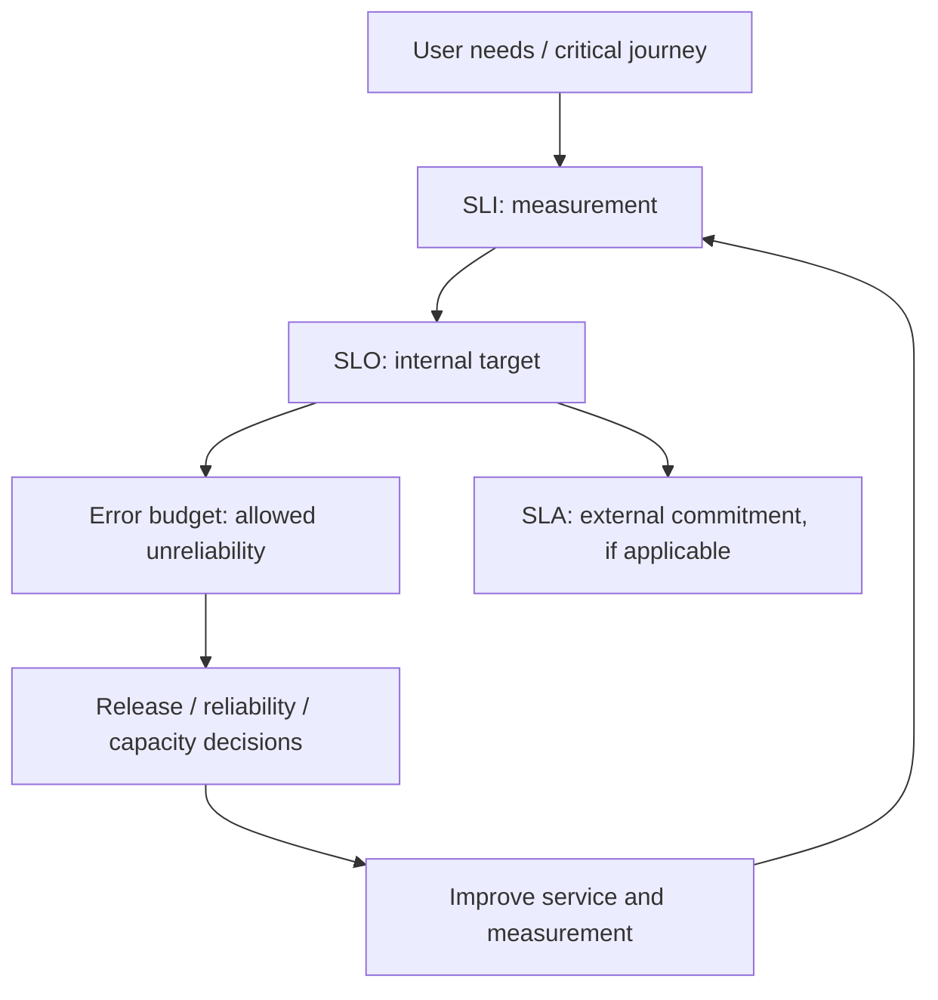

# Xác định SLI, SLO, SLA và ngân sách lỗi

## 1. Độ tin cậy cần được đo bằng kết quả người dùng nhận được

Một dịch vụ có thể có CPU thấp, không có pod restart và mọi dashboard đều xanh nhưng người dùng vẫn không đặt được lịch, thanh toán thất bại hoặc phải chờ quá lâu. Ngược lại, một vài instance có thể khởi động lại mà người dùng không nhận thấy vì hệ thống tự phục hồi nhanh. Vì thế, đánh giá độ tin cậy chỉ bằng trạng thái hạ tầng là chưa đủ.

Để quản lý độ tin cậy có thể kiểm chứng, đội ngũ cần thống nhất bốn khái niệm:

- **SLI (Service Level Indicator):** chỉ số đo một khía cạnh chất lượng dịch vụ mà người dùng quan tâm.
- **SLO (Service Level Objective):** mục tiêu định lượng cho SLI trong một cửa sổ thời gian.
- **SLA (Service Level Agreement):** cam kết dịch vụ với khách hàng hoặc bên liên quan, thường kèm điều kiện, cách đo, ngoại lệ và biện pháp khắc phục khi không đạt.
- **Error budget (ngân sách lỗi):** phần sai lệch được phép so với SLO trong cửa sổ đo; dùng để cân bằng tốc độ phát hành và độ tin cậy.

Các khái niệm này tạo thành một vòng quản trị: xác định điều gì quan trọng với người dùng, đo nó, đặt mục tiêu, thỏa thuận cam kết, rồi dùng phần ngân sách còn lại để ra quyết định vận hành và phát hành.

Bài học thuộc chương **Độ tin cậy** của module **CLOUD_ARCHITECTURE**. Module học cách thiết kế kiến trúc cloud từ yêu cầu nghiệp vụ đến mạng, compute, dữ liệu và mô hình triển khai, cân bằng độ tin cậy, bảo mật, khả năng mở rộng, chi phí và vận hành theo Well-Architected. Bài này đặt nền tảng định lượng để những quyết định kiến trúc đó có mục tiêu và bằng chứng rõ ràng.

Sau bài học, bạn có thể:

- Chuyển trải nghiệm người dùng thành SLI đo được.
- Chọn SLO, cửa sổ đo và cách tổng hợp phù hợp.
- Phân biệt mục tiêu nội bộ với SLA có tính cam kết.
- Tính error budget và burn rate.
- Xây dựng alert theo mức độ tiêu hao ngân sách.
- Dùng SLO để ưu tiên reliability work, phát hành và đầu tư hạ tầng.

## 2. Bắt đầu từ hành trình người dùng và critical user journey

Không nên bắt đầu bằng câu hỏi “có metric nào sẵn trong Prometheus?”. Hãy bắt đầu bằng câu hỏi: **người dùng cần hoàn thành việc gì, và điều gì khiến họ xem dịch vụ là đang hoạt động tốt?**

Ví dụ nền tảng đặt lịch có các hành trình:

1. Đăng nhập và truy cập lịch của mình.
2. Tìm khung giờ còn chỗ.
3. Tạo booking và nhận xác nhận.
4. Hủy hoặc thay đổi booking.
5. Nhận thông báo về thay đổi.

Không phải mọi hành trình có mức quan trọng như nhau. Đọc ảnh đại diện chậm vài giây có thể gây khó chịu; ghi nhận một khoản thanh toán sai có thể gây thiệt hại lớn dù API vẫn trả HTTP 200. SLI phải phản ánh tính đúng đắn và kết quả nghiệp vụ ở mức phù hợp.

### 2.1. Xác định service boundary

Một SLO cần nói rõ dịch vụ nào chịu trách nhiệm. Ví dụ:

| Service boundary | Điều đo | Phần có thể nằm ngoài phạm vi |
|---|---|---|
| Public Booking API | Khả năng nhận và xử lý request booking | Mạng ISP hoặc thiết bị cá nhân của khách |
| Booking workflow | Booking được xác nhận đúng trạng thái trong deadline | Kênh email của bên thứ ba nếu SLA riêng |
| Notification service | Yêu cầu thông báo được provider chấp nhận trong thời hạn | Email vào inbox hoặc người nhận mở thư |
| Data export service | Export hoàn tất và tải xuống được trong thời hạn | Hệ thống lưu trữ đích do khách tự quản lý |

Phạm vi không được chọn để che khuất lỗi. Nếu dependency bên ngoài là phần không thể thiếu của hành trình, cần đo trải nghiệm đầu-cuối riêng, ngay cả khi không trực tiếp kiểm soát dependency đó.

### 2.2. Phân loại request

Trước khi tính SLI, xác định request nào thuộc mẫu số:

- Request hợp lệ từ người dùng hoặc client được hỗ trợ.
- Health check, synthetic probe, internal retry và background operation.
- Request bị từ chối do xác thực/ủy quyền hoặc do dữ liệu đầu vào không hợp lệ.
- Request bị throttling vì quota hoặc abuse.
- Traffic bot, test và traffic nội bộ.

Không được tùy tiện loại các request lỗi khỏi mẫu số sau khi đã quan sát kết quả. Định nghĩa inclusion/exclusion phải ổn định, có lý do và được review. Ví dụ request 401 do credential sai có thể không phản ánh availability của booking service; nhưng nếu dịch vụ xác thực của chính nền tảng lỗi khiến người dùng hợp lệ không đăng nhập được, đó vẫn là một failure trong user journey.

## 3. SLI: chọn chỉ số phù hợp

SLI là phép đo định lượng cho một khía cạnh dịch vụ. Một SLI tốt có nguồn dữ liệu đáng tin, định nghĩa mẫu số rõ, phản ánh trải nghiệm người dùng và có thể hành động khi xấu đi.

### 3.1. Các nhóm SLI thường dùng

| Nhóm | Câu hỏi | Cách đo phổ biến |
|---|---|---|
| Availability | Request hợp lệ có nhận được kết quả thành công? | Good requests / eligible requests |
| Latency | Request hoàn tất nhanh đến mức nào? | Tỷ lệ request dưới ngưỡng thời gian hoặc phân vị |
| Correctness | Kết quả có đúng nghiệp vụ? | Tỷ lệ kết quả đúng / giao dịch được đánh giá |
| Durability | Dữ liệu đã xác nhận có được giữ? | Tỷ lệ record acknowledged còn tồn tại qua kiểm tra |
| Freshness | Dữ liệu có đủ mới? | Tuổi dữ liệu hoặc độ trễ replication |
| Throughput/capacity | Dịch vụ xử lý được nhu cầu cần thiết? | Request/event hoàn tất trong thời gian và tải xác định |
| Delivery | Message hoặc notification được giao đúng hạn? | Tỷ lệ event được consumer/provider xử lý trong deadline |

Không cần tạo SLO cho mọi metric. Chọn một số chỉ số đại diện cho hành trình quan trọng; các metric hạ tầng còn lại dùng để chẩn đoán nguyên nhân.

### 3.2. Availability SLI

Với request-response service, một công thức thông dụng:

\[
Availability\ SLI=\frac{Good\ requests}{Eligible\ requests}\times100\%
\]

Trong đó good requests là request đáp ứng định nghĩa thành công; eligible requests là tổng request thuộc phạm vi đo.

Ví dụ trong một tháng, có 2.000.000 request hợp lệ; 1.998.000 request trả kết quả đạt yêu cầu:

\[
SLI=\frac{1.998.000}{2.000.000}=99,9\%
\]

Phải định nghĩa “good” chính xác. Nếu chỉ coi HTTP 2xx là thành công, response 200 chứa lỗi nghiệp vụ có thể bị tính nhầm. Với booking, good request có thể yêu cầu hệ thống trả trạng thái đã ghi nhận bền vững, không chỉ response thành công trước khi commit.

### 3.3. Latency SLI

Latency có thể đo bằng:

- Phân vị p50/p90/p95/p99 để hiểu phân bố thời gian.
- Tỷ lệ request hoàn tất dưới ngưỡng, ví dụ 99% request dưới 300 ms.
- Deadline cho workflow bất đồng bộ, ví dụ booking được xác nhận trong 10 giây.

Một SLO latency dựa trên threshold:

\[
Latency\ SLI=\frac{Requests\ completed\ within\ T}{Eligible\ requests}
\]

Không nên chỉ dùng p99 mà không quy định sample size, cửa sổ và cách xử lý traffic thấp. Với SLO người dùng, tỷ lệ request dưới ngưỡng thường dễ diễn giải và tính ngân sách hơn. p95/p99 vẫn hữu ích cho chẩn đoán tail latency.

### 3.4. Correctness và durability

Availability cao không bảo đảm dữ liệu đúng. API tạo booking có thể trả 201 nhưng tạo hai booking cho cùng một idempotency key; request thành công ở tầng HTTP nhưng thất bại về correctness.

Một correctness SLI có thể đo:

\[
Correctness\ SLI=\frac{Valid\ outcomes}{Evaluated\ outcomes}
\]

Ví dụ định nghĩa:

- Booking không vượt quá số chỗ.
- Một payment intent không bị charge hai lần.
- Trạng thái booking không quay lùi từ Cancelled sang Confirmed.
- Dữ liệu đã ACK bền vững không bị mất sau failover.

Correctness thường cần đối soát hoặc kiểm tra bất biến nghiệp vụ, không chỉ lấy từ response code.

### 3.5. Freshness và asynchronous SLI

Với event pipeline, người dùng có thể chấp nhận cập nhật bất đồng bộ nhưng cần biết giới hạn chờ. Có thể đo tuổi sự kiện:

\[
Event\ freshness=ProcessingTime-EventOccurredTime
\]

Hoặc tỷ lệ event được xử lý trong deadline T. Phải phân biệt event time, ingestion time và processing time; clock skew có thể làm phép đo tuổi sự kiện sai. Nếu hai timestamp ở các máy khác nhau, đồng bộ clock và causal metadata cần được xét.

### 3.6. Golden signals và metric chẩn đoán

Latency, traffic, errors và saturation là nhóm chỉ số hữu ích:

- Latency: request chậm ở mức nào.
- Traffic: có bao nhiêu request/operation.
- Errors: tỷ lệ và loại lỗi.
- Saturation: tài nguyên hoặc queue gần giới hạn nào.

Đây là tín hiệu vận hành; không phải tất cả đều là SLI người dùng. CPU 95% có thể cảnh báo saturation nhưng chưa chắc người dùng bị ảnh hưởng. Ngược lại, API có latency tốt nhưng ghi sai dữ liệu vẫn không đáng tin cậy.

## 4. Chất lượng của một SLI

Một SLI hữu ích cần:

1. **User-centered:** đo thứ người dùng cảm nhận hoặc kết quả nghiệp vụ cần đạt.
2. **Unambiguous:** có tử số, mẫu số, đơn vị, phạm vi và bộ lọc rõ.
3. **Reliable:** telemetry có thể tin cậy ngay cả khi service đang lỗi.
4. **Actionable:** khi SLI suy giảm, đội ngũ biết cần điều tra đâu hoặc ra quyết định gì.
5. **Tamper-resistant:** không dễ vô tình loại bỏ lỗi, thay đổi label hoặc mất mẫu số.
6. **Affordable:** độ phân giải và chi phí thu thập phù hợp; không cần trace mọi request nếu metric đủ.

### 4.1. Đo từ phía người dùng và phía server

Server-side metrics hữu ích để chẩn đoán nhưng có thể bỏ sót lỗi trước khi request tới service: DNS, TLS handshake, load balancer, CDN hoặc gateway.

Client-side/synthetic measurements quan sát gần trải nghiệm người dùng hơn nhưng chịu ảnh hưởng thiết bị, mạng và khu vực của probe. Có thể kết hợp:

- Server-side SLI cho service boundary đội sở hữu.
- Synthetic probe từ nhiều region cho đường truy cập quan trọng.
- Real-user monitoring (RUM) nếu cần phân bố trải nghiệm thực tế.
- Business reconciliation cho correctness/durability.

Không cộng các phép đo có mẫu số khác nhau thành một con số nếu chưa xác định quan hệ và trọng số.

## 5. SLO: đặt mục tiêu định lượng

**SLO** là mức mục tiêu cho một SLI trong cửa sổ thời gian. Ví dụ: 99,9% request hợp lệ của Booking API trả kết quả đúng trong 500 ms, đo trên cửa sổ 30 ngày.

Một SLO cần có SLI, target và đơn vị, measurement window, scope/traffic eligibility, cách xử lý retry/partial success/dependency, owner và hành động khi không đạt.

### 5.1. SLO không phải mục tiêu 100%

Mục tiêu 100% availability thường đắt và khó đạt vì phần cứng, mạng, phần mềm, dependency và thao tác con người đều có thể lỗi. Đẩy mục tiêu từ 99,9% lên 99,99% có thể yêu cầu kiến trúc multi-region, replication, automation, test và on-call đắt hơn.

SLO phải đủ tốt cho user journey và giá trị nghiệp vụ, không phải cao nhất có thể ghi trên slide. Mục tiêu quá thấp làm người dùng chịu lỗi; mục tiêu quá cao làm đội ngũ đầu tư vượt giá trị sản phẩm nhận được.

### 5.2. Ví dụ target và thời gian lỗi tương đương

Với SLO availability đo theo thời gian liên tục, error budget thời gian gần đúng:

\[
Allowed\ downtime=(1-SLO)\times Window
\]

| SLO | Ngân sách trong 30 ngày (720 giờ) | Ngân sách trong 365 ngày |
|---:|---:|---:|
| 99% | 7 giờ 12 phút | 3 ngày 15 giờ 36 phút |
| 99,5% | 3 giờ 36 phút | 1 ngày 19 giờ 48 phút |
| 99,9% | 43 phút 12 giây | 8 giờ 45 phút 36 giây |
| 99,95% | 21 phút 36 giây | 4 giờ 22 phút 48 giây |
| 99,99% | 4 phút 19,2 giây | 52 phút 33,6 giây |

Đây chỉ là quy đổi để hình dung. Nếu SLI dựa trên request, ngân sách được tính theo số request lỗi, không nhất thiết bằng tổng downtime. Dịch vụ có traffic thấp vào ban đêm hoặc chỉ một phần chức năng lỗi cần được đo theo đúng mẫu số người dùng.

### 5.3. Request-based SLO và time-based SLO

| Loại | Mẫu số | Hợp với |
|---|---|---|
| Request-based | Tổng request đủ điều kiện trong cửa sổ | API, RPC, event processing |
| Time-based | Tổng thời gian service đủ điều kiện hoạt động | Một số dịch vụ liên tục, endpoint/instance availability |

Request-based SLO phản ánh tỷ lệ request thành công; sự cố 5 phút giờ cao điểm có thể tiêu nhiều budget hơn sự cố cùng độ dài lúc ít traffic. Time-based SLO có thể tính mọi phút như nhau dù không có request. Chọn mô hình dựa trên trải nghiệm thật.

### 5.4. Cửa sổ rolling và calendar

- **Rolling window:** ví dụ 30 ngày gần nhất tại mỗi thời điểm; phản ứng liên tục với chất lượng gần đây.
- **Calendar window:** ví dụ tháng dương lịch; dễ đối chiếu báo cáo/SLA nhưng lỗi đầu tháng có thể biến khỏi cửa sổ khi sang tháng mới.

Có thể dùng rolling window cho điều hành SRE và calendar window cho báo cáo SLA. Nếu dùng hai cửa sổ, phải công bố rõ.

## 6. SLA: cam kết dịch vụ với khách hàng

**SLA** là thỏa thuận giữa nhà cung cấp và khách hàng về mức dịch vụ, phạm vi, cách đo, trách nhiệm và biện pháp khi không đạt. SLA thường có tính hợp đồng/thương mại; SLO là mục tiêu kỹ thuật/vận hành để quản lý dịch vụ.

SLA có thể quy định:

- Service và feature được bao phủ.
- Availability/latency target.
- Measurement window, timezone và công thức.
- Điều kiện bảo trì/ngoại lệ theo hợp đồng.
- Cách yêu cầu xem xét sự cố và bằng chứng.
- Service credit hoặc biện pháp khắc phục.
- Trách nhiệm khách hàng, quota, cấu hình và phụ thuộc bên thứ ba.

Nội dung SLA phải được pháp chế/đội hợp đồng review. Không suy diễn rằng một SLO nội bộ tạo quyền nhận service credit hoặc một tỷ lệ uptime có nghĩa mọi request đều thành công.

### 6.1. Quan hệ giữa SLI, SLO và SLA



Thông thường SLO nội bộ nên bằng hoặc nghiêm ngặt hơn SLA bên ngoài để tạo khoảng đệm. Target cụ thể phụ thuộc hợp đồng và khả năng vận hành; không có tỷ lệ chênh lệch cố định.

### 6.2. Ví dụ phân biệt

| Khái niệm | Ví dụ |
|---|---|
| SLI | Tỷ lệ booking request được ghi nhận đúng và trả kết quả trong 500 ms |
| SLO | 99,9% request đạt SLI trong rolling window 30 ngày |
| SLA | Cam kết hợp đồng về availability theo cách đo và điều khoản đã thống nhất |
| Error budget | Phần request được phép không đạt SLO trong cửa sổ đó |

## 7. Tính error budget

Với request-based SLO:

\[
Error\ budget=Eligible\ events\times(1-SLO)
\]

Giả sử tháng này có 2.000.000 request hợp lệ và SLO 99,9%:

\[
Budget=2.000.000\times0,001=2.000\ requests
\]

Nếu đã có 1.200 request không đạt:

\[
Budget_{remaining}=2.000-1.200=800
\]

Tỷ lệ budget đã tiêu:

\[
Budget\ consumed=\frac{1.200}{2.000}\times100\%=60\%
\]

Error budget không phải mục tiêu để cố tình gây lỗi. Nó biểu thị mức rủi ro đã chấp nhận để đội ngũ phát hành và cải tiến với kỷ luật.

### 7.1. Ví dụ theo latency SLO

SLO yêu cầu 99% request hoàn tất trong 300 ms. Một tháng có 500.000 request hợp lệ:

- Good: 495.000 request hoàn tất ≤ 300 ms.
- Bad: 5.000 request mất hơn 300 ms hoặc không hoàn tất theo định nghĩa.
- Budget: 5.000 request.

Nếu 2.500 request vượt ngưỡng, budget đã dùng 50%. Response HTTP 200 mất 2 giây vẫn là bad event của latency SLI.

### 7.2. Không cộng budget khác mẫu số tùy tiện

Availability, latency và correctness có thể có mẫu số khác nhau. Không cộng 500 request availability lỗi với 700 request latency lỗi rồi gọi là 1.200 error nếu hai tập có thể trùng nhau. Có thể duy trì budget riêng cho từng SLO hoặc xây dựng end-to-end user journey SLI có định nghĩa rõ.

## 8. Error budget policy: dùng budget để ra quyết định

Error budget có giá trị khi các bên thống nhất trước hành động khi budget cạn hoặc burn nhanh.

### 8.1. Khi budget còn khỏe

- Phát hành theo quy trình bình thường.
- Thử nghiệm có kiểm soát, canary và progressive delivery.
- Đầu tư feature và reliability theo ưu tiên.
- Theo dõi burn rate để nhận ra xu hướng xấu.

### 8.2. Khi budget tiêu nhanh

- Tăng review release và mở rộng rollout chậm hơn.
- Điều tra error class/region/tenant/version làm burn tăng.
- Tạm dừng thay đổi rủi ro cao nếu liên quan nguyên nhân.
- Ưu tiên fix lỗi, capacity, dependency, rollback safety và observability.

### 8.3. Khi budget cạn

Một policy phổ biến là đóng băng release tính năng có rủi ro cho đến khi SLO phục hồi hoặc có quyết định ngoại lệ được phê duyệt. Vẫn có thể cần emergency security patch, data-loss fix hoặc thay đổi cải thiện reliability; policy phải phân biệt loại thay đổi và đường phê duyệt.

Không dùng budget để đổ lỗi cho một team hoặc cấm mọi deploy vô thời hạn. Mục tiêu là xử lý nguyên nhân gây lỗi trước khi tăng thêm thay đổi rủi ro.

### 8.4. Policy minh họa

| Trạng thái budget | Hành động gợi ý | Người quyết định |
|---|---|---|
| Còn nhiều, burn bình thường | Release theo guardrail hiện hành | Service owner |
| Burn tăng, sắp vượt ngưỡng | Tăng canary, review release và điều tra | Service owner + SRE |
| Dưới ngưỡng thấp | Hạn chế thay đổi rủi ro, ưu tiên reliability | Engineering lead/SRE |
| Hết budget | Tạm dừng release không thiết yếu; kế hoạch phục hồi | Người được chỉ định |
| Emergency change | Đánh giá lợi ích và ghi nhận ngoại lệ | Incident commander/owner |

Ngưỡng cụ thể phải gắn với burn rate, mức nghiêm trọng và cửa sổ đo, không chỉ phần trăm budget còn lại.

## 9. Burn rate: tốc độ tiêu hao error budget

**Burn rate** cho biết dịch vụ đang tiêu error budget nhanh hơn tốc độ cho phép bao nhiêu lần.

\[
Burn\ rate=\frac{Observed\ error\ rate}{Allowed\ error\ rate}
\]

Allowed error rate = (1-SLO). Với SLO 99,9%, allowed error rate là 0,1%. Nếu observed error rate trong một cửa sổ là 1%:

\[
Burn\ rate=\frac{1\%}{0,1\%}=10
\]

Burn rate 10 nghĩa là budget bị tiêu nhanh gấp 10 lần tốc độ trung bình cho phép nếu tình trạng này kéo dài.

### 9.1. Ước tính thời gian cạn budget

Nếu burn rate giữ ổn định và còn nguyên budget:

\[
Time\ to\ exhaust\approx\frac{Window}{Burn\ rate}
\]

Ví dụ SLO rolling 30 ngày, burn rate 6:

\[
30\ days/6=5\ days
\]

Đây là xấp xỉ. Khi budget đã tiêu một phần, thời gian thực còn lại ngắn hơn và cần tính từ số dư hiện tại.

### 9.2. Burn rate khác error count

Service traffic lớn có thể có nhiều request lỗi tuyệt đối nhưng tỷ lệ thấp; service traffic nhỏ có ít lỗi nhưng tỷ lệ cao. Burn rate chuẩn hóa theo budget nhưng cần kết hợp số lượng, user impact và severity để tránh alert sai ở traffic thấp.

## 10. Alert theo nhiều cửa sổ thời gian

Alert chỉ dùng cửa sổ dài có thể phát hiện muộn; chỉ dùng cửa sổ rất ngắn có thể báo động do spike nhỏ. Multi-window alerting kết hợp cửa sổ ngắn để phát hiện lỗi hiện tại và cửa sổ dài để xác nhận tác động.

Ví dụ với SLO 99,9%:

| Mục tiêu cảnh báo | Cửa sổ dài | Cửa sổ ngắn | Burn rate ví dụ |
|---|---:|---:|---:|
| Critical, budget cạn nhanh | 1 giờ | 5 phút | 14,4x |
| High, burn đáng kể | 6 giờ | 30 phút | 6x |
| Medium, cần điều tra | 3 ngày | 6 giờ | 1x hoặc ngưỡng nội bộ |

Đây là ví dụ thiết kế, không phải ngưỡng bắt buộc. Cần tính theo SLO window, traffic, alert fatigue và thời gian phản ứng. Có thể yêu cầu cả hai cửa sổ đồng thời vượt ngưỡng để lọc spike ngắn.

### 10.1. Page và ticket

- **Page/on-call:** user impact lớn hoặc budget bị tiêu rất nhanh; cần phản ứng ngay.
- **Ticket/notification:** xu hướng dài hạn, budget giảm nhưng chưa cần đánh thức on-call.
- **Dashboard only:** metric chẩn đoán không gắn user impact hoặc chưa có action rõ.

Mỗi alert cần owner, runbook, severity, điều kiện clear và hành động mong đợi.

## 11. Ví dụ end-to-end: SLO cho Booking API

Giả sử dịch vụ đặt lịch có ba user journey: xem lịch trống, tạo booking và hủy booking. Đội ngũ thống nhất:

| SLI | Định nghĩa | SLO mẫu |
|---|---|---:|
| Booking API availability | Request hợp lệ được xử lý với outcome đúng, không tính lỗi client được loại trừ rõ | 99,9% / 30 ngày |
| Booking API latency | Request hợp lệ hoàn tất trong ≤ 500 ms | 99% / 30 ngày |
| Booking confirmation freshness | Booking hợp lệ chuyển sang confirmed trong ≤ 10 giây | 99,5% / 30 ngày |
| Booking correctness | Không tạo booking trùng; không vượt invariant slot | Đặt ngưỡng theo rủi ro nghiệp vụ và reconciliation |

Đây là các SLO minh họa; correctness có thể cần ngưỡng gần như tuyệt đối theo invariant, không gộp tùy tiện vào availability.

### 11.1. Tính budget availability

Tháng có 4.000.000 request hợp lệ, mục tiêu 99,9%:

\[
Budget=4.000.000\times0,001=4.000\ requests
\]

Đã có 3.000 request lỗi:

- Budget consumed = 75%.
- Budget remaining = 1.000 request.

Nếu deployment mới tạo thêm 700 lỗi trong một giờ, release đó sử dụng phần lớn budget còn lại và cần rollback/điều tra theo policy.

### 11.2. Đo đúng boundary

- API gateway đo request edge và latency đến response.
- Booking service đo transaction commit/outcome.
- Database đo lock, connection, commit latency và failover.
- Event pipeline đo tuổi event và thời gian consumer xử lý.
- Reconciliation kiểm tra booking trùng, trạng thái bất hợp lệ và invariant slot.

SLI user-facing là kết quả chính; metric component giúp xác định nguyên nhân.

### 11.3. Dashboard SLO

Dashboard nên thể hiện current SLI, target SLO, error budget còn lại, burn rate nhiều cửa sổ, error/latency theo route/region/tenant tier/version, deployment/incident trùng thời điểm SLI giảm và dependency health. Phân nhóm cần tránh cardinality quá cao và không đưa PII vào label.

## 12. SLO cho dependency và dịch vụ đầu-cuối

Một user journey có thể phụ thuộc gateway, authentication, booking service, database, event bus và notification provider. Mỗi thành phần có SLO riêng nhưng không thể cộng các con số đơn giản để suy ra end-to-end SLO.

Nếu dependency nối tiếp và độc lập gần đúng, availability đầu-cuối có thể xấp xỉ tích availability từng thành phần. Ví dụ 99,9% × 99,95% × 99,9% thấp hơn từng giá trị riêng. Thực tế có lỗi tương quan, retry, cache, fallback và degraded mode nên phép nhân chỉ là mô hình sơ bộ.

### 12.1. Ghi rõ SLO đầu-cuối

- Đặt SLI end-to-end cho hành trình quan trọng.
- Đặt SLI component để đội sở hữu theo dõi và chẩn đoán.
- Xác định dependency budget và timeout allocation.
- Không chuyển lỗi dependency ra khỏi mẫu số user-facing thiếu căn cứ.
- Có fallback hoặc graceful degradation nếu nghiệp vụ cho phép.

SLO của ứng dụng bao gồm cách ứng dụng dùng cloud service, cấu hình multi-AZ/region, quota và retry. Provider SLA không tự động bảo đảm SLO đầu-cuối của sản phẩm.

## 13. Các lỗi thường gặp khi xây dựng SLI/SLO

| Sai lầm | Hệ quả | Cách khắc phục |
|---|---|---|
| Chỉ dùng CPU/memory làm SLI | Không phản ánh user outcome | Đo request, workflow và correctness |
| Chỉ coi HTTP 2xx là thành công | Che lỗi nghiệp vụ hoặc request chậm | Định nghĩa good event theo kết quả và latency |
| Mẫu số thay đổi theo release | SLI cải thiện giả tạo | Quản lý eligibility và version hóa định nghĩa |
| Đặt 100% cho mọi service | Không có budget, chi phí cao | Đặt mục tiêu theo nhu cầu và trade-off |
| SLO không có owner/action | Dashboard không thay đổi quyết định | Gắn policy, alert, runbook và review |
| Alert theo error count | Ồn khi traffic cao, bỏ sót tỷ lệ lỗi cao | Dùng error rate/burn rate và impact |
| SLA và SLO dùng lẫn | Nhầm cam kết hợp đồng với mục tiêu nội bộ | Tách tài liệu, owner và measurement |
| Loại request lỗi tùy tiện | Số liệu thiếu đại diện | Công bố inclusion/exclusion trước |
| Quên lỗi dữ liệu | Availability tốt nhưng kết quả sai | Thêm correctness/durability SLI |
| Một SLO cho mọi tenant/region | Che khuất trải nghiệm nhóm người dùng | Phân tầng khi có căn cứ nghiệp vụ |

## 14. SLO theo tier và criticality

Không phải endpoint hoặc tenant nào cũng cần cùng một mục tiêu. Có thể phân loại:

- Tier 0: luồng ghi/đọc ảnh hưởng tiền, booking hoặc bảo mật.
- Tier 1: hành trình chính người dùng sử dụng hàng ngày.
- Tier 2: báo cáo, tìm kiếm hoặc tính năng không thiết yếu có thể chấp nhận delay.

SLO tiered phải minh bạch, không được giảm chất lượng của tenant mà không có căn cứ hợp đồng. Nếu tenant có dedicated deployment hoặc premium tier, cần nói rõ phạm vi, SLO và cách đo.

| Journey | SLI chính | Degraded behavior |
|---|---|---|
| Tạo/hủy booking | Correctness + availability + latency | Bảo vệ transaction; từ chối sớm khi không xác minh được slot |
| Tra cứu lịch sử | Availability + latency + freshness | Có thể dùng read replica/cache trong freshness budget |
| Báo cáo dài hạn | Completion time + freshness | Xử lý async và thông báo tiến độ |
| Gửi email nhắc lịch | Delivery acceptance/latency | Queue/retry; không làm thất bại booking đã commit |

## 15. Error budget và release engineering

SLO nên tác động đến cách phát hành:

1. Mỗi release có owner, risk classification, canary và tiêu chí rollback.
2. Theo dõi SLI/burn trong rollout; rollback khi guardrail bị vi phạm.
3. Release lớn hoặc thay đổi database/network có canary mở rộng dần.
4. Khi budget thấp, giảm batch size, tần suất hoặc phạm vi rollout theo policy.
5. Emergency fix có đường ngoại lệ và review sau thay đổi.

Progressive delivery giới hạn blast radius nhưng không thay test và capacity planning. Canary cần đủ traffic và thời gian để SLI có ý nghĩa; traffic quá thấp thì kết hợp synthetic test hoặc kiểm thử chuyên biệt.

### 15.1. Ưu tiên reliability work

Khi burn do database failover, retry storm hoặc dependency chậm, nhóm có thể ưu tiên:

- Tăng khả năng chịu lỗi hoặc giảm coupling.
- Tối ưu query/index và connection pooling.
- Cải thiện timeout, retry, idempotency và backpressure.
- Thêm capacity/replica hoặc thay đổi region strategy.
- Tăng observability và khả năng rollback.

Không nhất thiết luôn tăng hạ tầng. Thay đổi logic hoặc loại bỏ retry lồng nhau có thể cải thiện SLO với chi phí thấp hơn.

## 16. Measurement pipeline và tính toàn vẹn SLI

SLI phụ thuộc telemetry. Nếu metrics mất ngay trong outage, hệ thống có thể báo tốt giả tạo. Cần xem:

- Metric được ghi ở client/gateway/server/database và cách đồng bộ nhãn.
- Telemetry pipeline có queue/buffer, retention và monitoring riêng.
- Sampling có bỏ qua request lỗi hay chỉ trace một phần không.
- Missing data được coi là unknown hay bad; không mặc định missing = good.
- Counter reset, duplicate scrape và deployment label có làm lệch mẫu số không.
- Synthetic probe có chạy từ region/mạng đại diện hay chỉ từ cùng cluster.

Với SLO quan trọng, dùng nhiều tín hiệu độc lập và business reconciliation. Không để service tự báo mọi request thành công bằng metric mà code path lỗi có thể ghi thiếu.

### 16.1. Ví dụ Prometheus-style ratio

Ví dụ metric tổng hợp:

```promql
sum(rate(api_requests_total{service="booking",result="good"}[5m]))
/
sum(rate(api_requests_total{service="booking"}[5m]))
```

Đây chỉ là query minh họa. Phải bảo đảm nhãn result được gắn theo định nghĩa SLI, denominator không lọc mất lỗi server và label không có cardinality cao. Triển khai thật có thể dùng recording rules, histogram buckets, log-based metrics hoặc backend telemetry khác.

## 17. SLA: cách diễn giải thận trọng

Trước khi công bố SLA, cần thống nhất:

- Service/feature được bao phủ.
- Cách xác định eligible request/time.
- Measurement point và timezone/window.
- Planned maintenance và ngoại lệ theo hợp đồng.
- Bằng chứng khách hàng cần cung cấp khi khiếu nại.
- Cách tính service credit/biện pháp khắc phục và thời hạn yêu cầu.
- Phụ thuộc khách hàng, quota, cấu hình và hành vi sử dụng ảnh hưởng phạm vi.

Không viết điều khoản pháp lý trong ADR kỹ thuật khi chưa review. SRE cung cấp measurement method và bằng chứng; legal/commercial owner quyết định cam kết, ngoại lệ và chế tài.

## 18. Đánh giá theo Well-Architected

| Trụ cột | Câu hỏi cần đánh giá |
|---|---|
| **Operational Excellence** | SLI có owner? SLO/error budget có dashboard, alert, runbook và review? Có post-incident action? |
| **Security** | SLI tính lỗi auth/authorization đúng cách? Telemetry tránh PII? SLA không khuyến khích bỏ qua kiểm soát bảo mật? |
| **Reliability** | SLO phản ánh user journey? Có budget policy, burn-rate alert, dependency objectives và recovery test? |
| **Performance Efficiency** | Latency target phù hợp trải nghiệm/capacity? Có đo p95/p99, saturation và tải đỉnh? |
| **Cost Optimization** | Mục tiêu tương xứng giá trị? Chi phí đạt 99,99% được so với lợi ích? |
| **Sustainability** | Tránh overprovisioning để theo đuổi target không cần thiết; dùng budget ưu tiên đầu tư hiệu quả? |

## 19. Mẫu SLI/SLO specification

Mẫu YAML sau dùng để ghi định nghĩa kỹ thuật, không phải cấu hình cho một monitoring vendor:

```yaml
service: booking-api
owner: booking-platform
user_journey: create_booking
sli:
  name: successful_booking_requests
  type: request_based_availability
  numerator: eligible_requests_with_committed_valid_booking_result
  denominator: eligible_create_booking_requests
  exclusions:
    - documented_invalid_client_input
    - synthetic_test_traffic
  measurement_point: public_api_to_durable_commit_result
slo:
  target: 0.999
  window: rolling_30_days
  alerting:
    multi_window_burn_rate: enabled
error_budget:
  policy_owner: service_owner_and_sre
  low_budget_action: restrict_risky_rollouts
  exhausted_action: prioritize_reliability_work
sla:
  applicable: contract_dependent
  legal_review_required: true
review:
  cadence: monthly
  triggers:
    - user_journey_change
    - traffic_profile_change
    - dependency_architecture_change
```

Numerator/denominator phải được chuyển thành query hoặc measurement cụ thể và kiểm tra bằng dữ liệu mẫu. YAML mô tả không thay kiểm thử telemetry.

## 20. Quy trình xây dựng SLI, SLO, SLA và error budget

1. **Chọn hành trình:** xác định nhiệm vụ quan trọng và hậu quả khi thất bại.
2. **Chọn service boundary:** xác định phần đội sở hữu và dependency ngoài phạm vi.
3. **Định nghĩa SLI:** ghi rõ tử số, mẫu số, unit, timestamp, eligibility và nguồn telemetry.
4. **Kiểm tra dữ liệu:** so sánh metric với log, synthetic probe và business reconciliation.
5. **Đặt SLO:** chọn target/window theo nhu cầu, risk appetite, baseline và chi phí.
6. **Tính budget:** xác định request/time budget và burn-rate.
7. **Viết policy:** thống nhất hành động khi budget khỏe, burn nhanh, thấp hoặc cạn; nêu emergency exception.
8. **Định nghĩa SLA riêng:** commercial/legal owner review scope, measurement, exclusions và remedy.
9. **Vận hành:** dashboard, alert, on-call, canary, rollback và post-incident review.
10. **Rà soát:** điều chỉnh khi journey, traffic, dependency, compliance hoặc business criticality đổi.

## 21. Bảng kiểm trước production

- [ ] SLI xuất phát từ critical user journey và outcome, không chỉ metric hạ tầng.
- [ ] Có định nghĩa good/bad, tử số, mẫu số, eligibility, unit và measurement point.
- [ ] Availability, latency, correctness, durability hoặc freshness được chọn theo nhu cầu.
- [ ] SLO có target, rolling/calendar window, scope, owner và rationale về chi phí.
- [ ] Error budget tính theo đúng mẫu số; SLO khác nhau không bị cộng tùy tiện.
- [ ] Có burn-rate alert nhiều cửa sổ, severity, owner và runbook.
- [ ] Error budget policy quy định release behavior và emergency exception.
- [ ] Dependency và end-to-end journey được đo; không bỏ lỗi dependency khỏi mẫu số thiếu căn cứ.
- [ ] Telemetry pipeline được giám sát; missing data không bị hiểu là good.
- [ ] SLI được đối chiếu với synthetic probe, logs và business reconciliation khi cần.
- [ ] SLA tách khỏi SLO kỹ thuật và được legal/commercial review.
- [ ] Dashboard phân tích theo route/region/version/tier nhưng kiểm soát cardinality và PII.
- [ ] Có review cadence và triggers khi kiến trúc hoặc yêu cầu người dùng thay đổi.
- [ ] Chi phí đạt target được so sánh với giá trị nghiệp vụ và risk appetite.

**Nguyên tắc áp dụng:** SLI cho biết người dùng đang nhận chất lượng nào; SLO đặt mức chất lượng đội ngũ cam kết đạt; SLA là thỏa thuận với khách hàng; error budget định lượng phần sai lệch được chấp nhận để đội ngũ ra quyết định. Định nghĩa đúng mẫu số, đo đúng hành trình và gắn số liệu với hành động mới biến độ tin cậy thành thuộc tính có thể quản trị của kiến trúc cloud.
