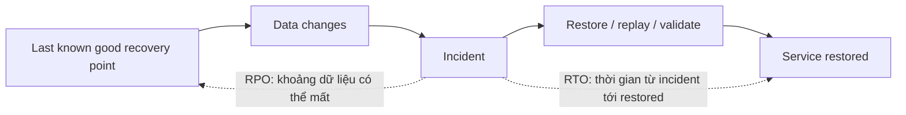
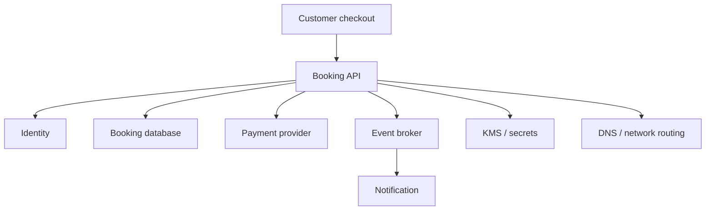
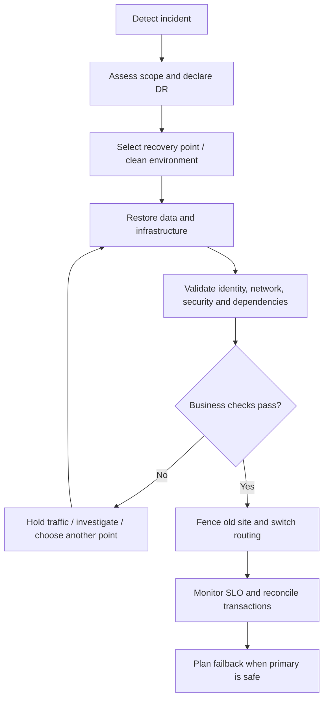

# Phân biệt sao lưu, sẵn sàng cao và phục hồi thảm họa

## 1. Ba năng lực khác nhau trong chiến lược bảo vệ dịch vụ

Một hệ thống cloud có thể chạy trên nhiều instance, nhiều availability zone và có bản sao database ở region khác. Những thành phần này giúp giảm gián đoạn khi có lỗi, nhưng không tự động bảo đảm dữ liệu có thể khôi phục sau khi bị xóa nhầm, mã hóa bởi ransomware hoặc hỏng logic. Ngược lại, hệ thống có backup tốt vẫn có thể ngừng phục vụ nhiều giờ nếu không có compute, network, identity và quy trình để dựng lại ứng dụng.

Cần phân biệt ba năng lực:

- **Backup (sao lưu):** tạo và giữ bản sao dữ liệu hoặc trạng thái hệ thống tại một thời điểm để có thể phục hồi khi dữ liệu nguồn bị mất, hỏng hoặc bị thay đổi ngoài ý muốn.
- **High Availability (HA – sẵn sàng cao):** thiết kế hệ thống để tiếp tục cung cấp dịch vụ với gián đoạn thấp khi một thành phần hoặc failure domain dự kiến bị lỗi.
- **Disaster Recovery (DR – phục hồi thảm họa):** năng lực khôi phục workload và dữ liệu sau sự cố nghiêm trọng làm mất hoặc không thể sử dụng môi trường chính, chẳng hạn mất region, sai cấu hình diện rộng, phá hủy dữ liệu hoặc sự cố bảo mật.

Ba cơ chế bổ sung cho nhau. HA giúp tránh hoặc rút ngắn downtime; backup cung cấp điểm phục hồi; DR kết hợp dữ liệu, hạ tầng, quyền truy cập, quy trình và con người để đưa dịch vụ về trạng thái vận hành trong failure domain khác hoặc sau khi môi trường chính được sửa chữa.

Trong module **CLOUD_ARCHITECTURE**, chương **Phục hồi thảm họa** đặt ba năng lực này trong thiết kế độ tin cậy, bảo mật, khả năng mở rộng, chi phí và vận hành. Mục tiêu là chọn giải pháp theo hậu quả nghiệp vụ, không chỉ theo số lượng bản sao hoặc số AZ.

Sau bài học, người học có thể phân biệt mục tiêu và giới hạn của backup, HA, DR; xác định failure domain và business impact; diễn giải RPO/RTO; chọn mô hình backup, replication, standby và failover; bảo vệ backup khỏi xóa nhầm/ransomware; xây runbook DR cho ứng dụng, database, network và identity; kiểm tra restore/failover bằng diễn tập.

## 2. Backup, HA và DR giải quyết những câu hỏi nào?

| Năng lực | Câu hỏi chính | Ví dụ |
| --- | --- | --- |
| Backup | Có thể quay lại trạng thái dữ liệu trước sự cố không? | Khôi phục database về trước thao tác xóa nhầm |
| HA | Khi component hoặc zone lỗi, dịch vụ có tiếp tục không? | Load balancer chuyển request sang instance ở AZ còn sống |
| DR | Khi môi trường chính không thể sử dụng, làm sao đưa dịch vụ chạy lại ở nơi phục hồi? | Kích hoạt workload ở region DR và chuyển traffic |

### 2.1. Một ví dụ cho thấy ba năng lực không thay thế nhau

Giả sử hệ thống booking có database primary và read replica đồng bộ ở hai AZ:

- Khi một VM application crash, autoscaling tạo instance mới; đây là HA ở compute tier.
- Khi primary database lỗi, replica được promote; đây là HA/failover của data tier nếu quy trình đáp ứng mục tiêu.
- Khi nhân viên chạy nhầm câu lệnh xóa toàn bộ booking, replication có thể sao chép thao tác xóa sang replica. Backup hoặc point-in-time recovery mới giúp lấy lại dữ liệu trước thời điểm đó.
- Khi toàn bộ region bị gián đoạn, cần DR site/region, bản backup hoặc replica ngoài failure domain, hạ tầng có thể dựng lại và quy trình chuyển traffic.

Replica không phải lúc nào cũng là backup độc lập. Replica thường sao chép cả thay đổi hợp lệ lẫn thao tác phá hoại. HA không bảo vệ đầy đủ khỏi logical corruption; backup đơn lẻ cũng không bảo đảm ứng dụng phục hồi trong thời gian yêu cầu.

## 3. Failure domain và loại sự cố cần bảo vệ

Thiết kế tốt bắt đầu bằng câu hỏi: điều gì có thể hỏng cùng lúc?

| Failure domain | Tình huống | Năng lực thường liên quan |
| --- | --- | --- |
| Process/container | Crash, memory leak, runtime failure | Restart, health check, HA |
| Host/node | VM hoặc máy vật lý mất | Replicas, scheduler, HA |
| Rack/power/network segment | Mất nguồn hoặc switch | Placement đa fault domain |
| Availability zone | Zone lỗi hoặc mất kết nối | Multi-AZ HA, backup/replica khác zone |
| Region | Mất region hoặc control plane | DR đa region, backup ngoài region |
| Data/logical | Xóa nhầm, schema lỗi, corruption | Backup, PITR, validation |
| Security | Ransomware, credential compromise | Immutable/offline backup, clean-room recovery |
| Human/process | Sai cấu hình, xóa nhầm resource | Versioning, approval, audit |
| Provider/service | Dependency quản lý không hoạt động | Alternative path, export/backup |
| Organization | Thiếu người có quyền hoặc mất quy trình | Runbook, break-glass, huấn luyện |

Một chiến lược chỉ bảo vệ lỗi host nhưng bỏ qua credential compromise hoặc region loss sẽ có khoảng trống lớn. Ngược lại, không nhất thiết mọi workload đều cần active-active multi-region; mức bảo vệ phải tương xứng với business impact.

### 3.1. Component failure và disaster

**Component failure** thường có phạm vi nhỏ, có thể được scheduler, load balancer hoặc database failover xử lý tự động.

**Disaster** là sự kiện làm mất hoặc không thể tin cậy một phần lớn môi trường: region outage, destructive change diện rộng, ransomware, hỏng dữ liệu lan truyền hoặc mất quyền quản trị.

Ranh giới không luôn cố định. Một incident nhỏ có thể thành thảm họa nếu automation lặp lỗi, backup cùng quyền quản trị bị xóa hoặc không có người thực hiện recovery.

## 4. RPO và RTO: hai mục tiêu cần định lượng

### 4.1. Recovery Point Objective (RPO)

**RPO** là mức mất dữ liệu tối đa có thể chấp nhận khi phục hồi, thường biểu diễn bằng khoảng thời gian dữ liệu.

Ví dụ RPO 15 phút nghĩa là trong kịch bản phục hồi đã định nghĩa, tổ chức chấp nhận có thể mất tối đa khoảng 15 phút dữ liệu mới nhất. Điều này không tự động có nghĩa backup chạy đúng mỗi 15 phút; phải xét replication lag, log shipping, transaction commit và recovery point có thể sử dụng.

RPO nên được định nghĩa theo loại dữ liệu và nghiệp vụ. Booking đã xác nhận, audit log, cache và analytics có thể có yêu cầu khác nhau.

### 4.2. Recovery Time Objective (RTO)

**RTO** là thời gian mục tiêu để khôi phục dịch vụ sau sự cố, theo cách đo và phạm vi đã xác định.

Ví dụ RTO 2 giờ cần làm rõ đồng hồ bắt đầu và kết thúc khi nào:
- Từ lúc sự cố bắt đầu hay được phát hiện?
- Tới khi hạ tầng khởi động hay khi user journey quan trọng hoạt động?
- Có gồm validate dữ liệu, mở quyền truy cập và chuyển traffic không?
- Có yêu cầu đủ capacity hay chấp nhận degraded mode?

RTO của compute boot không phải RTO toàn hệ thống. End-to-end recovery gồm phát hiện, quyết định, dựng hạ tầng, phục hồi dữ liệu, validation, kết nối dependency và khôi phục traffic.

### 4.3. RPO và RTO trên trục thời gian



RPO đo khoảng cách dữ liệu có thể mất; RTO đo thời gian gián đoạn phục hồi. Hai mục tiêu độc lập: RPO thấp nhưng RTO dài nếu restore nhiều TB; RTO thấp nhưng RPO lớn nếu DR site chạy từ bản sao bất đồng bộ có lag.

### 4.4. Các chỉ số liên quan

- **Recovery time actual:** thời gian thực tế trong diễn tập/sự cố.
- **Recovery point actual:** điểm dữ liệu mới nhất có thể khôi phục và xác minh.
- **RLO (Recovery Level Objective):** mức dịch vụ/capacity cần khôi phục; cách dùng có thể khác giữa tổ chức.
- **WRT (Work Recovery Time):** thời gian đối soát, nhập lại hoặc hoàn tất công việc sau khi hệ thống kỹ thuật hoạt động.
- **MTPD/MAO:** thời gian gián đoạn tối đa nghiệp vụ có thể chịu theo phương pháp BIA.

Ghi định nghĩa nội bộ để tránh so sánh các con số đo khác phạm vi.

## 5. Business Impact Analysis và phân tầng workload

**Business Impact Analysis (BIA)** xác định dịch vụ nào quan trọng, ảnh hưởng khi gián đoạn và thời điểm tác động trở nên không chấp nhận được.

| Tier | Ví dụ | RPO mục tiêu minh họa | RTO mục tiêu minh họa |
| --- | --- | ---: | ---: |
| Tier 0 – Critical | Identity, ledger, booking commit | Gần 0 hoặc rất thấp theo guarantee | Vài phút |
| Tier 1 – Important | API chính, customer portal | Vài phút | Dưới 1 giờ |
| Tier 2 – Supporting | Search index, reporting | Vài giờ | Vài giờ |
| Tier 3 – Best effort | Analytics batch, historical export | Một ngày hoặc theo batch | Một ngày hoặc hơn |

Các con số chỉ để minh họa, không phải chuẩn chung. RPO/RTO phải được stakeholder phê duyệt dựa trên doanh thu, safety, compliance, kỳ vọng khách hàng và chi phí.

### 5.1. Dependency mapping

Một user journey có thể phụ thuộc vào nhiều hệ thống:



Khôi phục Booking API nhưng Identity hoặc KMS không hoạt động vẫn không tạo thành checkout khả dụng. DR plan cần dependency map, owner, endpoint và phương án phục hồi cho từng thành phần.

## 6. Backup strategy: loại backup và cách sử dụng

### 6.1. Full backup

Sao chép toàn bộ dữ liệu/phạm vi được chọn tại thời điểm backup.

Ưu điểm: restore path dễ hiểu và là baseline tốt. Nhược điểm: thời gian, storage và transfer cost có thể lớn khi dataset tăng.

### 6.2. Incremental backup

Lưu thay đổi kể từ backup trước đó, tùy implementation là kể từ full hoặc incremental gần nhất.

Ưu điểm: giảm dữ liệu phải copy trong mỗi lần chạy. Nhược điểm: restore có thể cần ghép nhiều bộ backup; mất một phần chain có thể làm phục hồi thất bại.

### 6.3. Differential backup

Lưu thay đổi kể từ full backup gần nhất.

Ưu điểm: restore thường cần full và differential mới nhất. Nhược điểm: differential tăng dần tới lần full kế tiếp.

Cách dùng incremental/differential tùy database, backup product và semantics; không mặc định mọi snapshot hoạt động như file backup truyền thống.

### 6.4. Snapshot và point-in-time recovery

- **Snapshot:** ảnh chụp trạng thái storage/database tại mốc thời gian; tính nhất quán phụ thuộc cách dịch vụ tạo snapshot và application quiesce.
- **PITR (Point-in-Time Recovery):** khôi phục về thời điểm cụ thể bằng base backup/snapshot kết hợp transaction log/WAL/binlog hoặc cơ chế tương ứng.
- **Continuous data protection:** ghi nhận thay đổi liên tục/chi tiết để có nhiều điểm phục hồi, tùy sản phẩm.

Snapshot có thể copy-on-write hoặc incremental dưới nền; không suy luận chi phí/thời gian chỉ từ tên snapshot. Cần kiểm tra restore semantics của dịch vụ.

### 6.5. Application-consistent và crash-consistent

**Crash-consistent** thường tương đương trạng thái sau khi máy dừng đột ngột; filesystem/database recovery có thể cần chạy khi khởi động.

**Application-consistent** phối hợp với ứng dụng/database để dữ liệu liên quan được flush/quiesce hoặc checkpoint theo yêu cầu. Với nhiều database/service, snapshot từng volume tại thời điểm khác nhau không tự động tạo một trạng thái nghiệp vụ thống nhất.

## 7. Backup không phải replication

| Khía cạnh | Backup | Replication |
| --- | --- | --- |
| Mục tiêu chính | Khôi phục trạng thái trước sự cố | Duy trì bản sao cho availability/read scaling/DR |
| Thay đổi phá hoại | Có thể quay lại điểm trước thay đổi | Có thể sao chép lỗi/xóa nhầm sang replica |
| RPO | Theo lịch/log và retention | Theo replication mode/lag |
| RTO | Phụ thuộc restore và dựng dịch vụ | Có thể nhanh khi replica sẵn sàng |
| Chi phí | Storage, transfer, restore và retention | Compute/storage/network liên tục |
| Kiểm thử | Restore và validate | Failover/rejoin và kiểm tra consistency |

Replication có thể là một phần DR, nhưng không nên là bản bảo vệ duy nhất. DR region có replica online vẫn cần backup độc lập để xử lý corruption, malicious deletion hoặc credential compromise.

### 7.1. Rủi ro của replica

- Xóa nhầm được replicate.
- Ransomware mã hóa file được đồng bộ.
- Schema migration lỗi phá dữ liệu ở cả hai nơi.
- Credential bị chiếm có thể truy cập primary và replica.
- Lag bất thường làm RPO thực tế xấu hơn cam kết.

Bảo vệ backup cần retention/versioning, immutability hoặc isolation và quyền xóa tách biệt với quyền vận hành hằng ngày.

## 8. Backup isolation, immutability và ransomware resilience

Một backup chỉ hữu ích khi attacker hoặc lỗi quản trị không thể xóa cùng lúc source và recovery copies.

- **Separate account/project:** đặt backup trong account hoặc security boundary riêng.
- **Immutable/WORM retention:** khóa object/backup trong thời hạn chính sách để khó bị sửa/xóa.
- **Object versioning:** giữ version trước, kết hợp lifecycle và protection phù hợp.
- **Offline/air-gapped copy:** hạn chế kết nối quản trị/ghi trong thời gian lưu trữ.
- **Separate credentials:** tài khoản backup/restore riêng, least privilege và MFA.
- **Deletion protection:** multi-party approval hoặc retention lock cho thao tác phá hủy.
- **Encryption:** mã hóa backup và bảo vệ key/recovery role.
- **Tamper monitoring:** cảnh báo khi retention, backup policy hoặc vault protection bị thay đổi.

Immutability phải đúng thời hạn và scope. Bucket có versioning nhưng attacker vẫn xóa version hoặc sửa lifecycle chưa chắc là backup bất biến. Backup mã hóa nhưng mất KMS key có thể không khôi phục được; key recovery cũng là một phần DR.

## 9. Retention, lifecycle và backup coverage

Retention policy quyết định giữ bao lâu và recovery points nào còn tồn tại. Có thể kết hợp backup thường xuyên cho RPO ngắn, daily/weekly/monthly recovery points cho lỗi phát hiện muộn, archive dài hạn theo yêu cầu pháp lý, retention lock và cross-account/cross-region copies.

### 9.1. Retention và detection window

Nếu corruption chỉ được phát hiện sau 45 ngày nhưng backup chỉ giữ 30 ngày, mọi recovery point trước sự cố có thể đã bị xóa. Retention phải tính thời gian phát hiện corruption và điều tra bảo mật, không chỉ RPO.

### 9.2. Coverage inventory

| Thành phần | Cần bảo vệ |
| --- | --- |
| Database | Data, transaction logs, schema/config phù hợp |
| Object storage | Objects, versions, metadata, access policy |
| File/block volumes | Data và mapping/attachment metadata |
| Secrets/KMS | Key recovery, secret references và quyền sử dụng |
| Infrastructure as Code | Source, state và version |
| Application artifacts | Image/package/version có thể deploy lại |
| Identity/configuration | Tenant, role, federation và break-glass config |
| Queue/event data | Message retention, replay source và offset nếu cần |
| DNS/network | Zone/record, route, firewall policy, IP plan |
| Observability | Dashboard/alert/runbook cần cho recovery |

Không phải mọi dữ liệu phải backup giống nhau. Cache có thể rebuild; artifact có thể tái tạo từ source đã ký; secret/key cần quy trình backup riêng; event log có thể là nguồn replay.

## 10. High Availability: giảm downtime khi component lỗi

HA dùng redundancy và failover để giảm gián đoạn: multiple application instances ở nhiều node/AZ, load balancer health checks, database primary/standby hoặc consensus replicas, replicated cache/message broker, multi-zone storage/network, autoscaling và self-healing.

### 10.1. Active-active và active-passive

| Mô hình | Bình thường | Khi lỗi | Đánh đổi |
| --- | --- | --- | --- |
| Active-active | Nhiều miền cùng phục vụ | Miền còn lại nhận tải | Cần headroom, routing và consistency |
| Active-passive | Một miền phục vụ, miền kia chờ | Promote/activate standby | Chi phí thấp hơn, có RTO/failover risk |
| N+1 multi-zone | Các zone hoạt động với capacity dư | Zone còn lại gánh design load | Tốn headroom |
| Warm standby | DR env chạy capacity thấp | Scale lên khi cần | RTO phụ thuộc scale-up |
| Pilot light | Core data/network tối thiểu sẵn | Dựng compute/app | RTO dài hơn warm standby |
| Backup and restore | Backup/artifact là chính | Dựng môi trường và restore | RTO dài hơn, chi phí thấp hơn |

Active-active không tự động chịu được mọi failure. Identity, DNS, KMS, control plane hoặc database single-writer ngoài vùng vẫn có thể thành shared dependency.

### 10.2. HA không thay backup

HA có thể replicate trạng thái sai. Nếu operator xóa nhầm dữ liệu, multi-AZ database có thể lan truyền thao tác xóa. Backup/PITR cung cấp điểm quay lại; HA giữ dịch vụ sống khi failure mode được hỗ trợ.

## 11. Disaster Recovery: khôi phục cả một hệ thống

DR cần nhiều hơn bản sao database. Kế hoạch phải chỉ rõ:

1. Điều kiện kích hoạt DR và người có quyền tuyên bố disaster.
2. Failure domain/site nào được coi là mất hoặc không đáng tin cậy.
3. Recovery environment và capacity đã chuẩn bị ra sao.
4. Backup/replica/recovery point nào được chọn.
5. DNS, routing, certificate, identity và secrets chuyển thế nào.
6. Dependency bên ngoài được kết nối và xác minh ra sao.
7. Smoke test và business validation nào phải chạy.
8. Khi nào mở traffic, theo tỷ lệ hay toàn bộ.
9. Cách đối soát dữ liệu và giao dịch pending.
10. Điều kiện failback và cách tránh split-brain khi site cũ trở lại.

### 11.1. Các DR tier

| Strategy | Trạng thái bình thường | RTO tương đối | Chi phí tương đối |
| --- | --- | --- | --- |
| Backup and restore | Backup có sẵn; compute chưa chạy đầy đủ | Dài hơn | Thấp hơn |
| Pilot light | Core data/network tối thiểu sẵn | Trung bình đến dài | Thấp-trung bình |
| Warm standby | Environment chạy nhỏ, sẵn sàng scale | Trung bình đến ngắn | Trung bình-cao |
| Multi-site active-active | Nhiều site đang nhận traffic | Có thể ngắn | Cao |

Đây là thứ tự tương đối, không phải cam kết thời gian phổ quát. RTO thực tế phụ thuộc dataset size, automation, quota, test, DNS TTL, capacity, consistency và business validation.

## 12. Chọn mô hình DR theo RPO/RTO

### 12.1. Backup and restore

Phù hợp khi nghiệp vụ chịu được thời gian phục hồi dài và chi phí standby liên tục không hợp lý.

Cần backup ngoài failure domain chính, IaC/artifact để dựng environment, restore procedure đã test, quota/capacity và network plan ở region phục hồi, runbook cho secrets/KMS/identity/DNS.

Rủi ro: tới lúc disaster mới phát hiện backup hỏng, key không truy cập được, image không còn hoặc region DR không còn quota.

### 12.2. Pilot light

Giữ một số thành phần nền như database replica, storage, network hoặc identity integration; compute/application scale khi cần.

Phù hợp khi muốn giảm chi phí so với warm standby nhưng rút ngắn thời gian dựng lại. Cần kiểm tra core service được cập nhật và đường scale-up không phụ thuộc hoàn toàn vào control plane đang lỗi.

### 12.3. Warm standby

Một phiên bản nhỏ hơn của workload chạy ở region/site DR, dữ liệu được replicate hoặc restore liên tục. Khi cần, tăng capacity và chuyển traffic.

Cần kiểm tra version/config parity, giữ capacity cho health check và replication, tính scale-up/quota, diễn tập failover/failback và bảo đảm security policy không drift.

### 12.4. Multi-site active-active

Nhiều site cùng xử lý traffic. Có thể giảm RTO nhưng đòi hỏi capacity dự phòng khi site mất, data consistency/conflict model, global routing/health policy, identity/KMS/DNS/control plane và reconciliation cross-site.

Active-active thường đắt và phức tạp nhất. Chỉ dùng khi business objective biện minh chi phí và tổ chức có thể vận hành.

## 13. Phục hồi database và tính nhất quán dữ liệu

### 13.1. Quy trình restore database

1. Chọn backup/recovery point phù hợp incident timeline.
2. Dựng instance/database đích trong môi trường cô lập.
3. Restore base backup/snapshot.
4. Apply transaction logs tới recovery point được chọn.
5. Chạy integrity checks, schema validation và application checks.
6. Cấu hình user/role/parameter/extension.
7. Kiểm tra foreign references, sequence/identity counters.
8. Chuyển ứng dụng sang database phục hồi theo cutover plan.

Không restore đè production đang hoạt động trước khi hiểu scope sự cố. Với corruption/ransomware, phục hồi trong clean environment trước để tránh tái nhiễm.

### 13.2. Replication lag và RPO

Nếu replication asynchronous, bản DR có thể chậm so với primary. Theo dõi replication lag theo thời gian và log position, last replicated commit, log retention, network/apply throughput và behavior khi primary mất trước khi gửi log cuối.

RPO actual phải được xác minh từ transaction position có thể phục hồi, không chỉ từ metric “replication connected”.

### 13.3. Consistency qua nhiều service

Một booking có thể ghi database, phát event, gọi payment provider và gửi notification. Restore từng database tới timestamp riêng không tự động khôi phục transaction xuyên hệ thống về trạng thái nghiệp vụ nhất quán.

Cần event IDs/idempotency keys, outbox/inbox hoặc durable event log, reconciliation workflow, business invariants, compensating action, đối soát provider và quy tắc xử lý request đang in-flight lúc disaster.

## 14. Phục hồi application, network, identity và secrets

Recovery environment phải có đủ thành phần để vận hành an toàn.

### 14.1. Application và infrastructure

- IaC source và version đã kiểm thử.
- Container image/package và dependency artifact có thể truy cập ở region DR.
- Configuration, feature flags và schema version.
- DNS records, routing, firewall/security groups và load balancer.
- Certificates, WAF, rate limits và ingress/egress policy.
- Autoscaling limits, instance quota, subnet/IP capacity.

### 14.2. Identity và secrets

- Break-glass accounts được bảo vệ và diễn tập.
- Workload identity/federation hoạt động ở region DR.
- KMS key và permission cho decrypt/restore.
- Secrets được phục hồi qua secret manager an toàn.
- MFA, least privilege và audit vẫn được giữ trong emergency mode.

Nếu KMS hoặc identity chỉ tồn tại ở region bị mất, backup mã hóa có thể không sử dụng được. DR plan phải test key access và quyền restore.

### 14.3. DNS và traffic cutover

DNS failover cần xét TTL, resolver cache, connection reuse, certificate và health policy. Không coi DNS change là bằng chứng site cũ đã ngừng ghi. Phải có fencing/ownership cho datastore và xử lý split-brain trước khi mở write ở site mới.

## 15. Security và clean-room recovery

DR thường diễn ra khi môi trường cũ có thể đã bị xâm nhập hoặc chứa dữ liệu bị phá hoại. Khôi phục backup vào cùng identity/network đã bị compromise có thể tái tạo vấn đề.

- Dựng recovery trong account/project/subscription hoặc network boundary sạch.
- Xác minh backup point không chứa malware/corruption đã tồn tại trước restore.
- Rotate credentials, tokens, certificates và key access nếu có dấu hiệu compromise.
- Rebuild từ artifact đã ký và source có provenance.
- Giữ audit log và chain of custody cho điều tra khi cần.
- Quét dữ liệu/file trước khi đưa lại vào production.
- Tách quyền backup deletion, restore và production administration.
- Chỉ mở network path tối thiểu trong recovery.

Không mặc định backup mới nhất là điểm an toàn nhất. Có thể cần chọn recovery point trước khi dấu hiệu xâm nhập xuất hiện rồi đối soát dữ liệu phát sinh sau đó.

## 16. DR runbook và thứ tự hành động



| Phase | Hoạt động | Bằng chứng hoàn tất |
| --- | --- | --- |
| Detect | Alert, xác định blast radius và incident commander | Incident record |
| Decide | Tuyên bố DR, chọn strategy/recovery point | Approval/decision log |
| Prepare | Mở clean environment, quota, identity và key | Access/security checks |
| Recover | Restore data, deploy app, config/network | Restore logs/checksums |
| Validate | Smoke test, business invariants, SLO | Test report |
| Cutover | Fence source, chuyển DNS/routing/traffic | Routing/ownership evidence |
| Stabilize | Monitor, reconcile, notify stakeholders | SLO/queue/transaction report |
| Failback | Đồng bộ ngược, test, chuyển về có kiểm soát | Failback checklist |

Mỗi bước cần người chịu trách nhiệm, quyền thực hiện, dependency, timeout và phương án dừng. Runbook không nên phụ thuộc vào một cá nhân duy nhất biết password hoặc thao tác bí mật.

## 17. Backup/DR automation và Infrastructure as Code

Automation giảm thời gian và lỗi thủ công nhưng cũng có thể nhân rộng sai sót. Cần version hóa và kiểm soát backup policy/vault, IaC/network/security policy, identity role, database restore parameter, DNS/cutover, application artifact, runbook/script, validation test và reconciliation.

Không đặt toàn bộ recovery secrets trong cùng account hoặc repository production mà attacker có thể truy cập. Pipeline DR cần least privilege, approval cho destructive operation và audit.

## 18. Backup verification: phải chứng minh restore được

Các cấp xác minh:

- **Backup job success:** job chạy xong và tạo recovery point.
- **Integrity verification:** kiểm tra checksum/catalog/metadata theo khả năng sản phẩm.
- **Restore test:** phục hồi vào môi trường riêng và mở được dữ liệu.
- **Application validation:** ứng dụng đọc/ghi và nghiệp vụ cốt lõi hoạt động.
- **Recovery exercise:** diễn tập toàn quy trình, thời gian và quyền truy cập.
- **Periodic restore at scale:** đo thời gian khôi phục dataset có kích thước thực tế.

| Test | Mục tiêu |
| --- | --- |
| Restore database nhỏ | Xác minh thao tác và credentials |
| PITR trước một thay đổi | Chứng minh log và recovery point |
| Restore object/version | Xác minh metadata, permission và encryption |
| Restore tenant trong pool | Không làm hỏng dữ liệu tenant khác |
| Restore sang region khác | Xác minh transfer, key và quota |
| Rebuild từ IaC | Xác minh infra source đủ |
| Clean-room recovery | Xác minh isolation và credential rotation |
| Full application recovery | Xác minh end-to-end user journey |
| Failback rehearsal | Xác minh quay về không split-brain |

Backup job success không chứng minh restore success. Chỉ khi kiểm tra dữ liệu và ứng dụng sau restore, tổ chức mới có bằng chứng thực tế về khả năng phục hồi.

## 19. Observability và bằng chứng DR readiness

| Nhóm | Chỉ số |
| --- | --- |
| Backup | Last successful recovery point, job failure, coverage, age |
| Retention | Expiration, immutability lock, vault policy drift |
| Replication | Lag, last commit position, link health |
| Restore | Restore duration, validation failure, throughput |
| DR environment | Version/config drift, quota, capacity, health |
| Identity/KMS | Break-glass availability, key access, decrypt test |
| Network | DNS, route, firewall, certificate, connectivity |
| Business | User journey success, pending transactions, reconciliation backlog |
| Objectives | Actual RPO/RTO so với target |
| Cost | Backup storage, cross-region copy, warm standby và test cost |

Cảnh báo hữu ích: backup critical quá tuổi policy; coverage thiếu database/object/schema mới; immutable retention bị thay đổi; restore test thất bại hoặc lâu hơn RTO; replication lag vượt RPO; DR environment drift; KMS key/permission không decrypt được; quota/capacity DR không đủ; runbook hoặc owner lỗi thời.

## 20. Chi phí và lựa chọn chiến lược

Backup, HA và DR có cost profile khác nhau:

- Backup: storage, request, retention, copy/egress, restore compute và test.
- HA: spare compute, replica, load balancing, cross-AZ traffic và headroom.
- DR: second environment, replication, standby capacity, DNS/network/identity, automation, diễn tập và vận hành.

| Strategy | Chi phí thường trực | Chi phí lúc sự cố |
| --- | --- | --- |
| Backup/restore | Thấp-trung bình | Restore compute, transfer và downtime |
| Pilot light | Trung bình | Scale-up và catch-up |
| Warm standby | Trung bình-cao | Scale-up/cutover |
| Active-active | Cao | Coordination/failover và reconciliation |
| Immutable backup copy | Storage/management premium | Điều tra, clean restore và validation |

Một mô hình đánh giá rủi ro:

```text
Expected annual loss ≈ probability of scenario × business impact

Total protection cost =
    backup + HA + DR + testing + operations

Choose a strategy that brings residual risk
within the business-approved tolerance.
```

Không dùng một xác suất chủ quan để tạo cảm giác chính xác. Dùng nhiều scenario, sensitivity analysis và stakeholder approval. Chi phí thấp nhất không phải luôn là tổng chi phí thấp nhất: outage có thể gây mất doanh thu, SLA credits, support load và reputational damage.

## 21. Tình huống thực hành: nền tảng đặt chỗ

**Bối cảnh:** Nền tảng booking phục vụ khách hàng nhiều vùng. Database giao dịch chạy multi-AZ; backup hàng ngày và transaction log được giữ để PITR; một region thứ hai có bản sao bất đồng bộ. Object storage giữ ảnh căn hộ và tài liệu; event broker phát booking/payment events.

### 21.1. Phân loại bảo vệ

| Thành phần | HA | Backup | DR |
| --- | --- | --- | --- |
| Booking database | Multi-AZ failover | Snapshot + log/PITR | Replica/restore ở region DR |
| Object media | Storage durability/versioning | Versioned/offsite copy | Access từ region phục hồi |
| Application | Multi-instance/autoscale | Artifact/IaC/config version | Deploy vào DR region |
| Identity/secrets | Redundant service/path | Key/secret recovery procedure | Break-glass + KMS access |
| Event broker | Multi-node/replicated | Retention/replay/export nếu cần | Recreate/restore consumer state |
| DNS/network | Redundant endpoints | IaC/zone config backup | Cutover route và certificate |

### 21.2. RPO/RTO minh họa

- Booking/ledger: RPO 5 phút, RTO 30 phút.
- Search index: có thể rebuild, RPO 1 giờ, RTO 4 giờ.
- Media object: RPO theo durability/version/copy policy được xác nhận; RTO 2 giờ.
- Analytics: RPO 24 giờ, RTO 1 ngày.

Đây là mục tiêu giả định cho bài tập; phải xác minh khả năng dịch vụ, replication lag, backup schedule và restore throughput.

### 21.3. Kịch bản region loss

1. Incident commander xác minh primary region không thể phục vụ và tuyên bố DR.
2. Xác định replication position, chọn recovery point đáp ứng RPO.
3. Fence write ở site cũ hoặc xác minh không còn khả năng ghi.
4. Kiểm tra region DR có quyền KMS/identity, network, quota và artifact.
5. Promote replica hoặc restore database theo strategy.
6. Deploy application và cấu hình endpoint mới.
7. Chạy smoke test booking, payment status, read/write và authorization.
8. Chuyển traffic qua DNS/global routing theo tỷ lệ.
9. Đối soát giao dịch pending và event backlog.
10. Theo dõi SLO, thông báo khách hàng và lập kế hoạch failback.

### 21.4. Các lỗi cần kiểm thử

- Backup gần nhất chứa thao tác xóa nhầm; PITR phải chọn được mốc trước thao tác.
- Replica DR lag 8 phút trong khi RPO target là 5 phút; cảnh báo và quyết định business phải rõ.
- KMS primary region mất; key recovery phải hoạt động.
- DNS cutover xong nhưng client giữ connection cũ; fencing phải ngăn dual-write.
- Payment provider đã xử lý request nhưng response mất; reconciliation không tạo charge trùng.
- Object version được khôi phục nhưng permission/metadata sai; application validation phải phát hiện.

## 22. ADR mẫu: backup độc lập và warm standby

```text
ADR-112: Kết hợp backup immutable với warm standby cho booking platform

Bối cảnh:
- Booking/payment state cần RPO/RTO thấp.
- Multi-AZ bảo vệ một số lỗi component/zone.
- Region-wide outage và logical corruption vẫn là rủi ro.
- Replica bất đồng bộ có thể mang theo thao tác phá hoại.

Lựa chọn:
A. Chỉ multi-AZ HA.
B. Backup hàng ngày, phục hồi toàn bộ khi disaster.
C. Multi-AZ HA + immutable/offsite backup + warm standby/replica ở region khác.

Quyết định:
- Chọn C cho workload critical.
- Backup/recovery log lưu ở security boundary riêng.
- Warm standby giữ data replication và application baseline.
- Region cutover có fencing, validation và reconciliation.
- Search/analytics có thể rebuild theo tier RTO thấp hơn.

Đánh đổi:
- Chi phí replica, backup copy, standby, network và test cao hơn.
- Cần vận hành key recovery, replication lag, clean-room restore và failback.
- Không coi replica là backup độc lập.

Kiểm chứng:
- Restore PITR tới trước logical corruption.
- Immutable copy không thể xóa bằng production admin role.
- Region loss game day đạt RPO/RTO được phê duyệt.
- KMS/identity/network hoạt động trong DR.
- Payment/booking reconciliation không tạo duplicate.

Điều kiện xem lại:
- BIA/RPO/RTO hoặc contract thay đổi.
- Replication lag/restore time không đạt.
- Threat model hoặc data residency thay đổi.
- Chi phí standby vượt risk tolerance.
```

## 23. Những lỗi thiết kế thường gặp

1. **Coi replica là backup:** xóa nhầm hoặc corruption được sao chép.
2. **Coi multi-AZ là DR:** không bảo vệ đầy đủ trước region loss hoặc credential compromise.
3. **Có backup nhưng chưa restore test:** không biết dữ liệu/key/catalog có sử dụng được.
4. **Backup cùng account/quyền quản trị:** attacker xóa cả source và backup.
5. **Không backup KMS/identity recovery path:** dữ liệu có nhưng không decrypt/đăng nhập được.
6. **Đặt RPO theo lịch backup mà không đo lag:** recovery point thực tế có thể cũ hơn.
7. **RTO chỉ tính boot server:** bỏ qua restore, validation, DNS, security và business checks.
8. **Chỉ restore database:** application, object, event, secrets và network không sẵn sàng.
9. **Không tính logical corruption detection window:** retention hết trước khi phát hiện.
10. **Failover không fence primary cũ:** nguy cơ split-brain/dual-write.
11. **Chọn backup mới nhất trong ransomware incident:** có thể phục hồi bản đã bị xâm nhập.
12. **Không diễn tập quyền break-glass:** tới disaster không ai truy cập được.
13. **Không tính provider quota/capacity ở region DR:** không dựng đủ compute.
14. **Không kiểm tra dependency ngoài:** payment, identity hoặc email vẫn trỏ cấu hình site cũ.
15. **Không có reconciliation:** pending payment/booking/event bị bỏ lại.
16. **Failback không được thiết kế:** quay về site cũ có thể mất dữ liệu mới hoặc tạo divergence.

## 24. Checklist trước production

- [ ] BIA xác định workload, business impact và thứ tự ưu tiên.
- [ ] Failure scenarios gồm component, AZ, region, logical corruption và security incident.
- [ ] RPO/RTO được phê duyệt và định nghĩa cách đo.
- [ ] Phân biệt backup, HA, replication và DR trong design.
- [ ] Backup coverage gồm database, object, config, identity/key và artifact cần thiết.
- [ ] Có PITR/log retention phù hợp RPO và detection window.
- [ ] Backup nằm ngoài failure/security domain thích hợp.
- [ ] Immutability, deletion protection và separate credentials đã được kiểm chứng.
- [ ] Encryption key và quyền decrypt/restore có recovery procedure.
- [ ] Retention/lifecycle phù hợp compliance, contract và thời gian phát hiện corruption.
- [ ] HA capacity, quorum và failover behavior được test.
- [ ] DR strategy có environment, quota, network, DNS, identity và dependency mapping.
- [ ] Runbook có trigger, owner, approval, action và stop condition.
- [ ] Restore test đo data integrity và business validation.
- [ ] Region failover có fencing, traffic cutover và reconciliation.
- [ ] Failback có plan, data sync và điều kiện an toàn.
- [ ] Metrics theo dõi backup age, replication lag, restore time và actual RPO/RTO.
- [ ] Đã clean-room recovery exercise và kiểm tra break-glass.
- [ ] Chi phí backup, HA, standby, transfer và test được dự toán.
- [ ] Có lịch diễn tập, evidence, owner và remediation tracking.

---

**Ghi nhớ:** Backup tạo điểm quay lại, HA giữ dịch vụ tiếp tục khi failure mode được dự phòng, còn DR khôi phục cả workload sau sự cố vượt quá khả năng HA. Một chiến lược đáng tin cậy kết hợp ba năng lực theo business impact, RPO/RTO và failure domain; quan trọng nhất là thường xuyên chứng minh có thể khôi phục dữ liệu, quyền truy cập và user journey trong mục tiêu đã cam kết.
