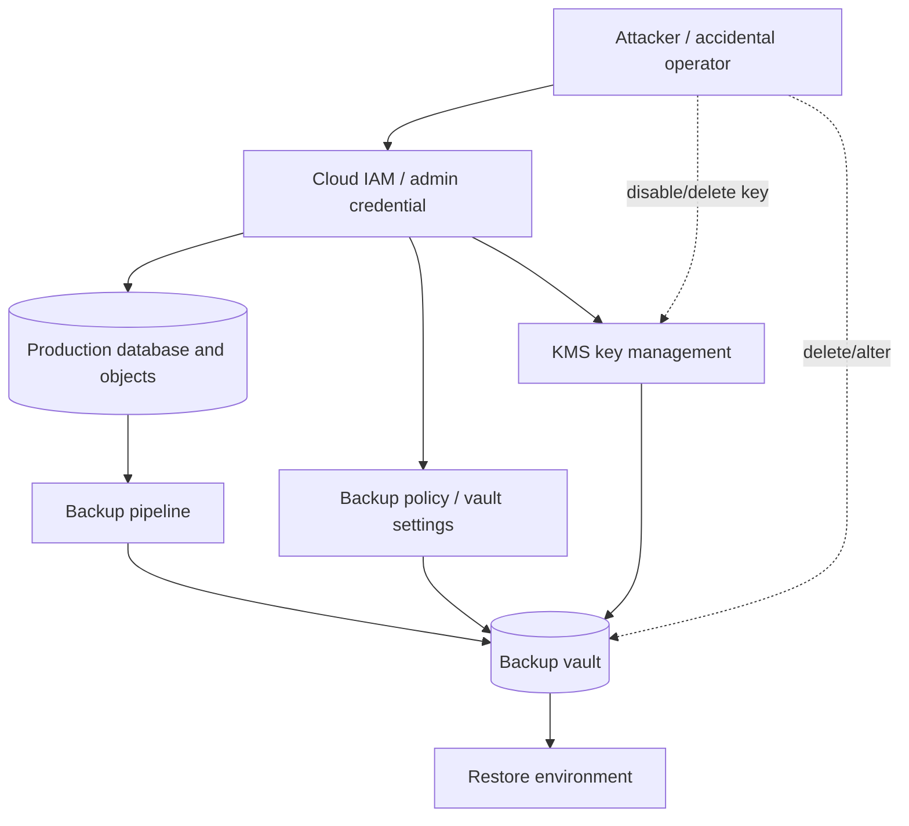
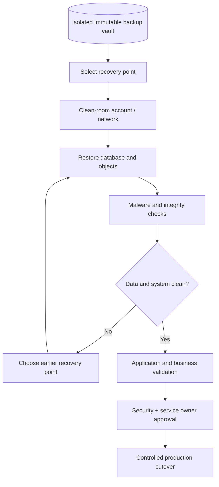
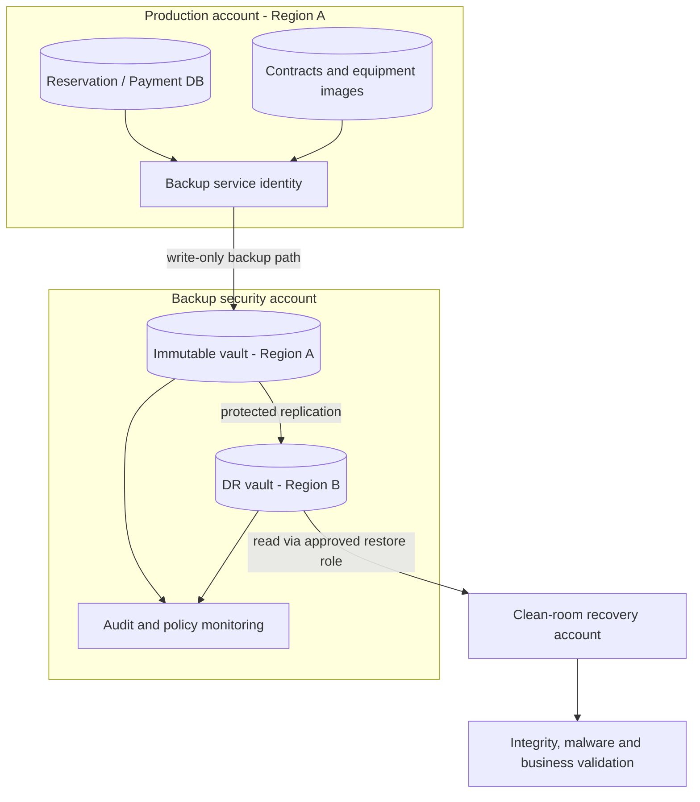

# Bảo vệ bản sao lưu trước xóa nhầm và mã độc

Backup chỉ có giá trị khi tổ chức còn có thể truy cập, giải mã và khôi phục dữ liệu vào thời điểm cần thiết. Một hệ thống có nhiều snapshot vẫn có thể mất toàn bộ khả năng phục hồi nếu tài khoản quản trị production bị chiếm quyền và kẻ tấn công xóa luôn snapshot, backup vault, khóa mã hóa hoặc cấu hình retention. Ransomware cũng có thể mã hóa dữ liệu nguồn rồi làm hỏng các bản sao được đồng bộ ngay sau đó.

**Bảo vệ backup trước xóa nhầm và mã độc** cần thiết kế nhiều lớp: tách failure domain và quyền quản trị, giữ bản sao bất biến hoặc khó thay đổi, giới hạn quyền xóa, bảo vệ khóa mã hóa, phát hiện hành vi bất thường và diễn tập phục hồi trong môi trường sạch. Mục tiêu không chỉ là giữ một file backup tồn tại, mà là có thể khôi phục dữ liệu đáng tin cậy và đưa dịch vụ trở lại hoạt động.

Trong module **CLOUD_ARCHITECTURE**, chủ đề này nối kiến trúc lưu trữ với IAM, network, encryption, monitoring, quy trình vận hành và disaster recovery. Bài học dùng ví dụ nền tảng cho thuê thiết bị, bao gồm reservation, payment ledger, file hợp đồng và ảnh thiết bị. Những khoảng retention, số bản sao và thời gian phục hồi trong ví dụ là giả định; cần điều chỉnh theo phân loại dữ liệu, RPO/RTO, quy định và khả năng của dịch vụ cloud được chọn.

## 1. Backup phải chống được cả lỗi dữ liệu lẫn lỗi quản trị

Backup thường được tạo tự động từ database, volume hoặc object storage rồi lưu vào bucket/vault. Nếu nguồn và backup dùng chung tài khoản, credential, quyền quản trị và policy, một sự cố ở production có thể lan sang cả bản sao.

| Sự cố | Điều gì xảy ra? | Vì sao backup thông thường có thể không đủ? |
| --- | --- | --- |
| Xóa nhầm database/table | Người vận hành chạy lệnh hoặc script sai | Snapshot gần nhất có thể bị xóa cùng tài nguyên hoặc không chứa điểm cần khôi phục |
| Xóa nhầm backup | Operator dọn nhầm vault/object/version | Tài khoản production có thể đồng thời có quyền xóa bản sao |
| Ransomware mã hóa file | File đang mount hoặc đồng bộ bị mã hóa | Đồng bộ thay đổi có thể sao chép file đã mã hóa vào bản sao |
| Chiếm quyền cloud admin | Attacker dùng quyền control plane để xóa snapshot, tắt versioning hoặc đổi retention | Backup cùng security boundary có thể bị phá |
| Đánh cắp khóa mã hóa | Kẻ tấn công xóa/disable key hoặc sử dụng key trái phép | Backup còn về vật lý nhưng không giải mã được |
| Hỏng dữ liệu âm thầm | Application bug ghi sai hoặc xóa logic trên diện rộng | Replica và backup mới có thể chứa dữ liệu sai nếu retention quá ngắn |
| Compromise pipeline backup | Attacker sửa job, destination hoặc lịch chạy | Job vẫn báo thành công nhưng dữ liệu không còn an toàn |
| Mất region | Region chứa nguồn và vault cùng không khả dụng | Bản sao chỉ khác bucket nhưng cùng region không đáp ứng DR |
| Credential bị lạm dụng | Script hoặc nhân sự xóa dữ liệu ngoài ý muốn | Không có approval, audit hoặc cơ chế phục hồi thao tác |

Threat model cần bao gồm cả **data plane** (dữ liệu, object, volume, database) và **control plane** (IAM, backup policy, KMS, vault, retention, replication configuration). Bảo vệ chỉ ở lớp lưu file sẽ bỏ sót những đường tấn công có quyền thay đổi chính sách lưu trữ.

## 2. Phân biệt backup, replica, snapshot và archive

| Cơ chế | Mục tiêu | Rủi ro nếu dùng thay backup |
| --- | --- | --- |
| Replica | Tăng khả năng phục vụ, giảm downtime, mở rộng đọc | Xóa nhầm hoặc ransomware có thể được replicate |
| Snapshot | Lưu trạng thái volume/database tại một thời điểm | Có thể phụ thuộc cùng account/region/key; tính nhất quán ứng dụng cần xác minh |
| Backup | Khôi phục dữ liệu về điểm đã lưu | Cần bảo vệ quyền xóa, retention, key và kiểm thử restore |
| Archive | Lưu dài hạn, audit hoặc tuân thủ | Retrieval có thể chậm và đắt; không tối ưu cho failover nhanh |
| Versioning | Giữ nhiều phiên bản object | Delete marker, lifecycle hoặc quyền xóa version vẫn có thể làm mất bản cũ |
| Immutable backup | Ngăn thay đổi/xóa trong thời hạn bảo vệ | Không cứu được dữ liệu sai trước lúc backup hoặc key bị mất |

Replica bảo vệ một số failure về hạ tầng; backup bảo vệ trước cả một số lỗi logic và thao tác. Archive phục vụ lưu giữ lâu dài; snapshot là một cách tạo điểm lưu nhưng không tự đảm bảo độc lập hoặc có thể restore.

## 3. Xây dựng threat model cho backup

Trước khi chọn dịch vụ, xác định:

1. **Tài sản cần bảo vệ:** database, object, volume, file share, config, schema, secret, encryption key và metadata.
2. **Threat actor:** lỗi vô ý, nhân viên có quyền, credential bị lộ, ransomware, supply-chain compromise hoặc admin account bị chiếm.
3. **Đường tấn công:** console/API, CLI, service principal, automation runner, CI/CD, KMS, backup agent và replication configuration.
4. **Tác động:** mất dữ liệu, mất khả năng giải mã, dữ liệu sai bị lưu lâu dài, lộ PII, không đạt RPO/RTO hoặc không thể chứng minh audit.
5. **Failure boundary:** account/project/subscription, region, network, identity provider và khóa quản trị có dùng chung không?
6. **Khả năng phục hồi:** có thể restore vào môi trường cô lập, kiểm tra malware và dữ liệu rồi mới kết nối production không?

Sơ đồ nhấn mạnh backup có nhiều dependency. Tách vault mà vẫn để cùng admin credential có thể chưa tạo được isolation thực chất.

## 4. Nguyên tắc 3-2-1-1-0

Một cách ghi nhớ phổ biến để thiết kế backup resilience:

- **3 copies:** có ít nhất ba bản dữ liệu tính cả dữ liệu chính theo cách đếm của chính sách.
- **2 media/types:** dùng ít nhất hai loại phương tiện hoặc failure boundary lưu trữ khác nhau.
- **1 offsite:** có ít nhất một bản ở địa điểm hoặc failure domain khác.
- **1 offline hoặc immutable:** có một bản không thể bị sửa/xóa tùy tiện trong thời hạn bảo vệ.
- **0 errors:** kiểm tra backup và restore để không còn lỗi chưa phát hiện trong quy trình đã định nghĩa.

Đây là heuristic, không phải bảo đảm an toàn tuyệt đối hay tiêu chuẩn pháp lý tự động. Cách đếm copy, media và offsite cần được tổ chức định nghĩa cụ thể. Ba object trong cùng bucket/account/region không nhất thiết là ba bản độc lập.

| Bản sao | Vị trí/đặc tính | Mục tiêu |
| --- | --- | --- |
| Primary | Database production ở Region A | Phục vụ giao dịch |
| Backup gần | Backup vault khác account trong Region A | Khôi phục lỗi logic/operational ở database |
| Backup DR | Vault ở Region B, có replication policy | Phục hồi khi Region A mất |
| Immutable copy | Object/vault khóa retention theo policy | Chống xóa/sửa trong thời hạn bảo vệ |
| Restore test copy | Môi trường cô lập, tạo từ recovery point | Kiểm tra tính sử dụng và sạch |

Không nhất thiết có năm bản vật lý riêng. Một bản backup có thể vừa ở region khác vừa immutable nếu thiết kế thực sự đáp ứng; điều cần kiểm chứng là các failure mode độc lập.

## 5. Immutable backup và WORM

**Immutable backup** là bản sao được bảo vệ khỏi sửa hoặc xóa trong một khoảng thời gian theo cơ chế storage/vault. WORM (Write Once, Read Many) mô tả khả năng ghi một lần và đọc nhiều lần, không cho sửa/xóa trong thời hạn khóa được áp dụng.

Các cơ chế có thể bao gồm object lock/retention mode, vault lock, governance/compliance retention, legal hold hoặc immutable/offline media. Tên và semantics khác nhau giữa nhà cung cấp. Phải xác minh ai có thể thay đổi retention, có admin override hay không, policy áp dụng cho version nào và hành vi khi object được replicate.

### Governance lock và compliance lock

Một số dịch vụ có chế độ cho phép administrator đặc biệt bypass retention hoặc chế độ nghiêm ngặt hơn không cho phép rút ngắn thời hạn đã khóa. Ý nghĩa chính xác phụ thuộc provider và cấu hình.

- Governance-style lock phù hợp khi cần quy trình vận hành có quyền override được kiểm soát.
- Compliance-style lock phù hợp với yêu cầu bất biến nghiêm ngặt, nhưng cấu hình sai retention có thể gây chi phí và nghĩa vụ lưu trữ kéo dài.

Không chọn mode chỉ dựa trên tên. Đọc tài liệu dịch vụ, kiểm tra region/feature availability, quyền override và thử trong account riêng.

### Retention và deletion

Retention cần đủ dài để bao phủ thời gian phát hiện corruption, điều tra và phục hồi. Nhưng giữ dữ liệu lâu hơn cần thiết có thể tăng chi phí và xung đột với yêu cầu xóa dữ liệu cá nhân.

Chính sách nên định nghĩa thời hạn theo classification/use case, lịch full/incremental/PITR, immutable lock, legal hold, lifecycle transition, điều kiện hết hạn/xóa và người phê duyệt thay đổi retention.

Retention không phải “càng lâu càng tốt”. Phải cân bằng khả năng khôi phục, nghĩa vụ lưu trữ, privacy, cost và data minimization.

## 6. Tách backup khỏi production bằng account và quyền độc lập

Một kiểm soát quan trọng là **separation of duties**. Người có quyền quản lý production database không mặc nhiên có quyền xóa backup hoặc thay đổi retention vault.

| Principal/role | Production | Backup account/vault | KMS |
| --- | --- | --- | --- |
| Application runtime | DML đúng phạm vi | Không truy cập | Chỉ dùng key theo policy runtime |
| Database operator | Quản lý database theo runbook | Yêu cầu restore, không xóa immutable copy | Không quản trị key backup |
| Backup service identity | Đọc nguồn/nhận snapshot theo policy | Ghi recovery point, không sửa retention | Encrypt với quyền tối thiểu |
| Backup security admin | Không cần sửa dữ liệu production | Quản lý vault/policy theo audit | Quản lý policy với dual control |
| Restore operator | Không có quyền xóa backup | Đọc recovery point, restore vào isolated environment | Decrypt theo approval |
| Break-glass admin | Quyền khẩn cấp có thời hạn | Không mặc định bypass lock | Quy trình kiểm soát và audit |

### Cross-account/cross-project backup

Đưa bản sao vào account/project riêng giúp giảm nguy cơ một credential production xóa tất cả. Cần bảo đảm:

- Backup identity chỉ được ghi vào destination đã chỉ định.
- Principal production không có quyền xóa, đổi retention hoặc disable versioning ở vault.
- Backup account không tin cậy mọi principal từ production.
- Trust policy giới hạn source account, role, resource và điều kiện.
- Thay đổi policy cần approval độc lập và audit.
- Restore operator có thể đọc mà không cần quyền phá hủy.

Cross-account không tự tạo isolation nếu dùng chung global administrator hoặc credential có thể quản trị cả hai account. Hãy xác định blast radius của root/organization-level roles.

### Dual control

Thao tác rủi ro cao như rút ngắn retention, xóa vault, disable immutable policy hoặc xóa key có thể yêu cầu hai người/phê duyệt tách biệt. Cần có đường khẩn cấp được audit để không cản trở phục hồi thật sự.

## 7. Least privilege và bảo vệ đường xóa

Quyền ghi backup và quyền xóa backup cần tách riêng. Pipeline thường chỉ cần tạo recovery point hoặc ghi object; không cần quyền delete mọi version hoặc sửa policy retention.

- Dùng role/service identity riêng cho backup job.
- Không dùng personal admin key trong cron/CI.
- Giới hạn resource ARN/path, action và account.
- Chặn quyền disable versioning, lock, logging và backup policy ở principal thông thường.
- Dùng MFA/approval cho hành động phá hủy.
- Tách quyền tạo restore job và quyền xóa nguồn.
- Rà soát access định kỳ; thu hồi credential cũ.
- Audit mọi thay đổi policy và thao tác xóa.

Delete protection có thể dùng deny delete khi object đang trong retention lock, MFA/approval, resource deletion protection, policy ngăn xóa hàng loạt, soft delete/recovery period và alert khi retention/versioning bị thay đổi.

Các biện pháp này có giới hạn cụ thể. Resource deletion protection có thể chỉ bảo vệ thao tác xóa resource chứ không bảo vệ object bên trong; soft delete có thời hạn và principal override; versioning không bảo vệ nếu mọi version đều bị xóa.

## 8. Versioning, soft delete và lifecycle

### Versioning

Versioning giữ nhiều phiên bản object khi object bị ghi đè. Nếu ransomware mã hóa file rồi upload bản mới, version cũ có thể vẫn còn. Tuy nhiên:

- Delete marker có thể khiến object không còn hiển thị mặc định.
- Lifecycle có thể xóa old version.
- Attacker có quyền xóa mọi version vẫn có thể phá dữ liệu.
- Storage cost tăng theo số version.
- Khôi phục cần chọn đúng version và xác minh.

### Soft delete

Soft delete trì hoãn xóa vĩnh viễn trong một cửa sổ khôi phục. Nó hữu ích cho xóa nhầm nhưng không đủ nếu attacker có thể vô hiệu hóa hoặc chờ hết thời hạn. Kết hợp với immutable retention và quyền độc lập.

### Lifecycle

Lifecycle tự chuyển dữ liệu sang tier rẻ hơn hoặc xóa khi hết hạn. Cấu hình lifecycle là control-plane asset nhạy cảm: rule sai có thể xóa recovery point. Version-control policy, test trên prefix/tag cô lập, review và monitor số bản bị expire.

Không dùng cùng prefix/tag cho backup quan trọng và dữ liệu tạm nếu lifecycle rule không phân biệt rõ.

## 9. Bảo vệ khóa mã hóa và khả năng giải mã

Backup mã hóa là cần thiết, nhưng phải giữ được khả năng giải mã khi production account hoặc region gặp sự cố.

- Key do provider hay customer quản lý?
- Key ở account/region nào?
- Backup vault có phụ thuộc key trong cùng failure domain?
- Ai có quyền disable, schedule deletion hoặc đổi key policy?
- Key rotation có giữ khả năng giải mã backup cũ?
- Có thể khôi phục quyền truy cập key khi identity/control plane gặp sự cố?

Backup cũ có thể vẫn được mã hóa bằng key cũ. Xóa key sau rotation có thể khiến backup không thể giải mã trong nhiều năm. Trước khi retire key, xác nhận không còn recovery point cần key đó hoặc đã re-encrypt bằng quy trình được kiểm thử.

### Key recovery

1. Inventory key và recovery point phụ thuộc.
2. Tách key admin khỏi production workload admin.
3. Bảo vệ policy, rotation và deletion window.
4. Kiểm tra khả năng decrypt trong account/region phục hồi.
5. Lưu thủ tục break-glass và approval.
6. Diễn tập restore bằng key thực tế.

Không lưu plaintext key trong backup, source control hoặc runbook. Escrow/backup key material phải tuân thủ chuẩn bảo mật và chính sách nhà cung cấp.

## 10. Ransomware và backup poisoning

Ransomware không chỉ mã hóa file production. Kẻ tấn công có thể cố xóa backup, làm hỏng backup job, phá catalog/metadata hoặc nằm trong hệ thống đủ lâu để các recovery point sạch hết hạn.

**Backup poisoning** xảy ra khi recovery point được tạo từ dữ liệu đã bị hỏng, mã hóa hoặc chỉnh sửa độc hại. Backup job thành công chỉ chứng minh copy hoàn tất, không chứng minh nội dung sạch hoặc đúng.

Các lớp phòng vệ:

- Immutable retention để attacker khó xóa recovery point.
- Isolated account/network để credential production không truy cập tùy tiện.
- Detection cho mass encryption, file extension/entropy change và delete spikes.
- Malware scanning và content validation khi restore.
- Giữ nhiều generation đủ lâu để vượt thời gian phát hiện compromise.
- Audit/alert khi backup policy, lifecycle, KMS hoặc logging bị thay đổi.
- Clean-room recovery để dựng từ bản sao đã kiểm tra.
- Incident response phối hợp security, infrastructure, application và business owner.

### Không tự động restore bản mới nhất

Bản mới nhất có thể đã chứa dữ liệu bị mã hóa hoặc thay đổi độc hại. Khi nghi ngờ ransomware:

1. Cô lập hệ thống bị ảnh hưởng và bảo toàn bằng chứng.
2. Xác định thời điểm compromise và phạm vi tài khoản/dữ liệu.
3. Chọn recovery point trước thời điểm bị ảnh hưởng theo bằng chứng.
4. Restore trong mạng cô lập.
5. Quét malware và xác minh integrity/consistency.
6. Rotate credential/key/token và đóng đường xâm nhập.
7. Chỉ đưa workload sạch trở lại khi security owner phê duyệt.

## 11. Clean-room recovery

Clean room là môi trường phục hồi cô lập, được dựng để restore và kiểm tra dữ liệu/workload trước khi kết nối production hoặc mạng người dùng.

Đặc điểm:

- Account/project hoặc subscription tách biệt.
- Network segment mặc định deny ingress/egress, chỉ mở luồng cần thiết.
- Identity riêng, credential mới, MFA và quyền hạn chế.
- Golden image/IaC đã kiểm tra integrity.
- Backup mount read-only nếu dịch vụ hỗ trợ.
- Malware scanning và endpoint detection.
- Log/audit riêng, lưu bằng chứng.
- Không tái sử dụng credential có thể đã bị compromise.

Clean room không bảo đảm sạch tự động. Golden image, deployment artifact, schema migration, package dependency, IaC và pipeline cũng cần kiểm tra. Nếu attacker đã sửa image hoặc pipeline, restore dữ liệu lên cùng artifact bị compromise sẽ tái tạo sự cố.

## 12. Chọn recovery point và xác minh tính toàn vẹn

Một recovery point cần được đánh giá theo timestamp/job ID, source database/volume/object range, application/schema version, replication/transaction log position, checksum/integrity metadata, backup job status, retention/immutability status, malware scan result và owner/incident context.

Checksum giúp phát hiện corruption khi truyền/lưu, nhưng không chứng minh nội dung hợp lệ về nghiệp vụ hoặc sạch malware. Có thể kết hợp:

- Checksum per object/block.
- Manifest số lượng object/bản ghi.
- Database consistency checks.
- Foreign-key/orphan checks.
- Business reconciliation: tổng payment, reservation count, ledger balance.
- Malware scan và file type validation.

Nếu lỗi là xóa nhầm lúc 10:05, PITR tới 10:04:59 có thể phù hợp. Nếu ransomware đã hiện diện ba ngày trước nhưng chỉ kích hoạt hôm nay, backup tối qua có thể đã bị poison. Cần dùng forensic signal, log, IOC và kiểm tra nhiều generation.

## 13. RPO, RTO và retention chống mã độc

RPO/RTO cần được xác định riêng cho từng failure scenario:

| Scenario | RPO cần xem | RTO cần xem | Cơ chế |
| --- | --- | --- | --- |
| Xóa nhầm record | PITR/log retention | Thời gian trích xuất và reconcile | PITR, restore isolated, merge |
| Xóa nhầm vault/object | Recovery copy độc lập | Thời gian truy cập bản sao khác | Cross-account, immutable, version |
| Mất node/AZ | Replication/HA lag | Failover duration | Multi-AZ/replica |
| Mất region | Cross-region replication/backup age | Provision + restore + cutover | DR vault/region |
| Ransomware | Recovery point sạch trước compromise | Forensic + clean restore + validation | Immutable generations, clean room |
| Key bị disable/xóa | Recovery key availability | Khôi phục quyền giải mã | Key separation/recovery procedure |

Nếu tổ chức thường chỉ phát hiện compromise sau vài tuần, giữ backup bất biến 7 ngày có thể không đủ. Cần ước lượng dwell time, thời gian điều tra, legal hold và tốc độ cần phục hồi. Có thể giữ daily/weekly/monthly generation khác nhau, kết hợp storage tier để kiểm soát chi phí.

## 14. Kiến trúc backup cho nền tảng thuê thiết bị

### Reservation database

- Backup/PITR để khôi phục thao tác sai hoặc corruption.
- Replica/HA để tiếp tục phục vụ khi node/zone lỗi.
- Immutable copy và account riêng chống xóa backup.
- Restore test kiểm tra reservation invariants và tránh duplicate.

### Payment ledger

- Retention và audit theo nghĩa vụ tài chính/pháp lý.
- Backup có encryption/key management riêng và access hẹp.
- Restore phải đối chiếu transaction, capture, refund và idempotency.
- Không replay side effect thanh toán trong quá trình dựng lại projection.

### Contract/document/image

- Object versioning và immutable retention khi cần.
- Quét malware khi upload và khi restore.
- Kiểm tra MIME/type thực tế, checksum và access policy.
- Tách bản sao khỏi bucket đang được application ghi.

### Infrastructure/configuration

- Lưu IaC, policy, schema, deployment manifest và cấu hình cần thiết.
- Bảo vệ repository/artifact signing và CI/CD identity.
- Không backup plaintext secrets một cách tùy tiện.
- Ghi lại dependency cần thiết để dựng clean room: DNS, network, KMS, identity, registry và certificate.

## 15. Object storage: versioning, object lock và replication

| Tính năng | Giá trị | Câu hỏi phải xác minh |
| --- | --- | --- |
| Versioning | Khôi phục object bị ghi đè/xóa logic | Ai xóa được version cũ? Lifecycle có xóa chúng không? |
| Object lock | Giữ version không thể xóa trong retention | Mode nào? Ai đổi retention? Có legal hold không? |
| Cross-account replication | Tách bản sao khỏi quyền production | Destination trust policy có quá rộng? Delete marker có replicate không? |
| Cross-region replication | Bảo vệ khỏi mất region | Replication lag, failure behavior, encryption key đích? |
| Lifecycle tiering | Giảm storage cost | Retrieval delay/cost có phù hợp RTO? |
| Access log/audit | Điều tra access và deletion | Log có lưu độc lập và chống xóa không? |

Replication object không nhất thiết là bản sao immutable. Nếu cấu hình replicate delete marker hoặc lifecycle xóa version ở cả hai phía, lỗi có thể lan rộng. Thử từng thao tác trong account lab và đọc semantics của dịch vụ được chọn.

## 16. Database backup và consistency

Database backup cần nhất quán với transaction và log:

- Physical backup có thể cần WAL/redo/archive log để PITR.
- Logical export có thể cần snapshot consistency/transaction isolation.
- Volume snapshot có thể chỉ crash-consistent nếu không có application quiesce.
- Distributed database cần cơ chế snapshot/backup phối hợp giữa shard/replica.
- Backup schema, extension, role/permission và encryption configuration có thể cần riêng.

Backup hoàn tất không có nghĩa toàn bộ transaction đã được capture. Phải xác minh recovery point, database engine/version, log chain, schema dependency và cách phục hồi.

Với hệ thống nhiều thành phần, thứ tự restore có thể là identity/network/KMS/secret; database/metadata store và schema; object/document storage; event offsets/checkpoints và queue configuration; application services/workers; cache/search index có thể rebuild; dashboard và integration. Thứ tự thật phụ thuộc dependency graph. Đừng khởi động consumer trước khi database, schema và event checkpoint sẵn sàng nếu nó có thể tạo side effect hoặc consume message sai.

## 17. Backup pipeline là một workload cần bảo vệ

Backup job có thể bị sửa để bỏ qua dữ liệu, gửi về destination attacker kiểm soát hoặc âm thầm xóa backup cũ. Cần quản trị pipeline:

- Version-controlled job definition/IaC.
- Review thay đổi destination, schedule, retention và exclusion.
- Build artifact/image được ký và pin version.
- Service identity least-privilege, credential ngắn hạn.
- Job status gửi tới monitoring độc lập.
- Manifest xác nhận dataset/object coverage.
- Cảnh báo khi số lượng/size backup giảm bất thường.
- Không cho production workload sửa script/vault policy.

Một job exit code 0 chưa chứng minh backup đầy đủ. Đo expected source inventory so với backed-up inventory, object/record count và byte count, age của recovery point, backup duration/error, replication completion, retention lock state và restore validation outcome.

## 18. Monitoring và cảnh báo hành vi phá hoại

| Signal | Ý nghĩa |
| --- | --- |
| Backup deletion hoặc mass delete request | Lỗi thao tác hoặc attacker |
| Retention period bị rút ngắn | Giảm khả năng phục hồi |
| Object lock/vault lock bị thay đổi | Vô hiệu bảo vệ bất biến |
| Versioning/lifecycle/replication bị tắt | Bản cũ có thể không còn được giữ |
| KMS key disable/scheduled deletion | Nguy cơ mất khả năng giải mã |
| Backup job destination thay đổi | Exfiltrate dữ liệu hoặc phá bản sao |
| Backup size/count giảm đột ngột | Job bỏ sót hoặc source bị mã hóa/xóa |
| Role/policy privilege escalation | Attacker có thể lấy quyền phá hủy |
| Restore request bất thường | Exfiltration hoặc thử phá hoại |
| Audit log gap | Mất khả năng phát hiện và điều tra |

Audit log cần lưu ở nơi có quyền và retention độc lập. Nếu attacker có thể xóa cả log cùng backup, việc điều tra sẽ khó hơn. Cảnh báo nên gắn owner, severity, runbook và escalation cụ thể.

## 19. Restore drill: chứng minh backup thực sự dùng được

Restore drill kiểm tra toàn bộ đường phục hồi, không chỉ trạng thái job:

1. Chọn recovery point theo kịch bản và xác nhận retention/key còn hợp lệ.
2. Tạo clean-room account/network hoặc môi trường cô lập.
3. Cấp quyền read/restore tối thiểu và ghi audit.
4. Restore database/object, áp transaction log nếu cần.
5. Kiểm tra checksum, schema, row count và file inventory.
6. Chạy malware scan và kiểm tra artifact/config.
7. Chạy test nghiệp vụ: payment reconciliation, reservation invariants, object access.
8. Đo thời gian và recovery point thực tế.
9. Diễn tập cutover/failback giả lập nếu phạm vi bao gồm DR.
10. Xóa/giữ môi trường drill theo policy và ghi action items.

| Mức | Nội dung | Bằng chứng |
| --- | --- | --- |
| Backup validation | Kiểm tra job, manifest, checksum, retention | Backup report |
| File/database restore test | Khôi phục một phần hoặc bản sao thử | Restore success và integrity |
| Application recovery test | Chạy ứng dụng trên dữ liệu đã restore | Functional/business test |
| Clean-room exercise | Dựng môi trường cô lập, kiểm tra malware và credential | Security approval |
| Full DR exercise | Chuyển workload và xác minh RPO/RTO | Timeline, biên bản và gap |

Không nhất thiết chạy full DR exercise mỗi lần backup. Tần suất theo criticality, thay đổi kiến trúc và yêu cầu tuân thủ; nhưng các bài test nhỏ phải đủ thường xuyên để phát hiện hỏng âm thầm.

## 20. Ứng phó khi nghi ngờ xóa nhầm hoặc ransomware

### Xóa nhầm

1. Dừng hoặc giới hạn automation đang tiếp tục xóa/ghi đè.
2. Ghi nhận actor, command, scope, timestamp và audit evidence.
3. Xác định source of truth và recovery point cần thiết.
4. Restore sang môi trường cô lập.
5. Trích xuất/merge dữ liệu cần khôi phục; tránh rollback toàn hệ thống nếu chỉ một tập record bị ảnh hưởng.
6. Reconcile giao dịch phát sinh sau recovery point.
7. Kiểm tra quyền, script và guardrail để ngăn tái diễn.

### Ransomware/compromise

1. Kích hoạt incident response và security lead.
2. Cô lập host/account/network bị ảnh hưởng; giữ bằng chứng forensic.
3. Chặn credential/token bị lộ và kiểm tra identity/key compromise.
4. Ngăn attacker truy cập backup vault; xác minh immutable retention còn hiệu lực.
5. Xác định dwell time, blast radius và recovery point sạch.
6. Dựng clean room bằng artifact/IaC đã xác minh.
7. Restore, scan, kiểm tra dữ liệu và application.
8. Rotate secrets/certificates và tái thiết lập trust boundary.
9. Cutover sau approval; monitor tái xâm nhập và consistency.
10. Ghi nhận root cause, cải tiến policy và diễn tập lại.

Không vội xóa host hoặc log đang chứa bằng chứng cần điều tra theo quy trình forensic. Các quyết định cô lập, bảo toàn bằng chứng và thông báo phải theo incident response plan của tổ chức.

## 21. Dependency và governance trong phục hồi

| Dependency | Rủi ro | Biện pháp |
| --- | --- | --- |
| Identity provider | Không đăng nhập được account phục hồi | Emergency access được kiểm soát, MFA và runbook |
| KMS | Không giải mã backup | Key recovery và policy độc lập |
| Network/DNS | Clean room không kết nối được dependency cần thiết | IaC, IP plan, DNS/route config được bảo vệ |
| Image/artifact registry | Không có image sạch để deploy | Signed artifact, immutable registry/version |
| Secret manager | Thiếu credential cần thiết | Secret recovery/rotation, không dùng secret cũ đã compromise |
| Certificate | TLS/service-to-service lỗi | Certificate issuance/renewal plan |
| Logging/monitoring | Không quan sát được phục hồi | Logging stack độc lập hoặc bootstrap monitoring |

Immutable backup tạo đánh đổi: dữ liệu đã bị yêu cầu xóa có thể vẫn tồn tại trong backup tới hết retention. Tổ chức cần định nghĩa cách xử lý theo nghĩa vụ pháp lý và privacy policy:

- Backup có được lưu theo căn cứ pháp lý/chính sách áp dụng không?
- Có thể cryptographic erase hoặc tokenization phù hợp không?
- Khi restore, làm sao áp lại deletion/suppression request đã phát sinh sau recovery point?
- Legal hold có ngăn lifecycle xóa không?
- Ai phê duyệt retention exception?
- Khi hết retention, dữ liệu có được xóa khỏi mọi copy/version/archive không?

Một quy trình quan trọng là duy trì deletion ledger/suppression list riêng, có quyền và durability phù hợp. Sau khi restore về điểm cũ, áp lại yêu cầu xóa/hạn chế đã được chấp nhận sau recovery point trước khi mở dữ liệu cho người dùng. Thiết kế phải tránh biến suppression list thành một bản sao PII không được bảo vệ.

Không khẳng định immutable backup có thể bỏ qua mọi yêu cầu xóa dữ liệu. Phải phối hợp legal/privacy/security owner và quy định áp dụng cho dataset cụ thể.

## 22. Chi phí và hiệu năng của backup resilience

Các kiểm soát có chi phí:

- Nhiều generation và retention dài tăng storage.
- Cross-region replication tăng egress và storage.
- Immutable mode có thể làm dữ liệu không thể xóa trong thời hạn đã chọn.
- Archive tier giảm chi phí lưu nhưng tăng retrieval time/cost.
- Malware scan và integrity check tốn compute.
- Restore drill cần môi trường và nhân lực.
- Audit/monitoring và account separation thêm công vận hành.

Tối ưu bằng cách phân tầng theo criticality/classification; dùng incremental/PITR khi dịch vụ hỗ trợ và đã kiểm tra restore chain; lifecycle sang archive sau giai đoạn cần phục hồi nhanh; dedupe/compression khi phù hợp; chỉ backup dữ liệu có giá trị; đo restore cost/time chứ không chỉ storage price; giữ immutable window theo threat dwell time và policy.

Đừng tối ưu storage cost đến mức RTO không thể đạt. Một bản archive rẻ nhưng cần nhiều ngày để lấy ra không đáp ứng mục tiêu phục hồi trong vài giờ.

## 23. Những sai lầm thường gặp

1. **Backup cùng account và quyền admin với production.** Một credential có thể xóa cả nguồn và bản sao.
2. **Coi replication là backup.** Xóa nhầm và ransomware có thể replicate.
3. **Bật versioning nhưng không khóa version cũ.** Attacker có thể xóa tất cả version hoặc lifecycle xóa quá sớm.
4. **Chỉ có immutable nhưng giữ quá ngắn.** Compromise có thể được phát hiện sau khi bản sạch hết hạn.
5. **Không bảo vệ KMS.** Snapshot tồn tại nhưng không thể giải mã.
6. **Backup job thành công nhưng không kiểm tra completeness.** Prefix hoặc partition quan trọng có thể bị bỏ sót.
7. **Chỉ test backup, không test restore.** Không phát hiện thiếu key, quyền, schema hoặc dependency.
8. **Restore thẳng vào production khi chưa quét.** Có thể đưa malware hoặc dữ liệu đã bị poison trở lại.
9. **Dùng cùng credential sau incident.** Attacker có thể tiếp tục truy cập môi trường mới.
10. **Bỏ quên CI/CD và image registry.** Dữ liệu sạch được khôi phục lên artifact bị compromise.
11. **Không áp lại deletion request sau PITR.** Dữ liệu bị xóa hợp lệ có thể xuất hiện trở lại.
12. **Lifecycle policy không được review.** Backup quan trọng bị expire hoặc chuyển tier không phù hợp RTO.

## 24. Case study: bảo vệ backup nền tảng thuê thiết bị

Hệ thống có Reservation database, Payment ledger, object storage cho hợp đồng/hóa đơn/ảnh thiết bị, search index và analytics lake có thể tái tạo, cùng pipeline backup tự động.

### Thiết kế bảo vệ

**Reservation và payment**

- Dùng HA/replica cho lỗi node/AZ.
- PITR và backup định kỳ để xử lý lỗi logic.
- Ghi recovery point vào vault ở account security riêng.
- Khóa retention cho bản copy theo criticality.
- Cross-region copy cho kịch bản mất region.
- Restore test xác minh transaction và ledger reconciliation.

**Object documents**

- Versioning và retention lock cho nhóm tài liệu cần giữ.
- Replicate sang account/region độc lập.
- Quét malware upload và restore.
- Lifecycle riêng theo loại tài liệu và nghĩa vụ lưu trữ.

**Search/analytics**

- Có thể rebuild từ nguồn authoritative.
- Giữ checkpoint/schema/metadata cần để tái tạo.
- Không cần retention backup giống payment ledger nếu business impact khác.

### Kịch bản 1: operator xóa nhầm backup

Operator có quyền production cố xóa vault backup. IAM deny và retention lock ngăn thao tác; alert gửi tới backup security owner. Nếu một bản copy không immutable bị xóa, recovery copy ở account/region khác vẫn tồn tại. Audit ghi actor, resource, request và thời gian.

### Kịch bản 2: ransomware chiếm quyền admin production

Attacker mã hóa Reservation DB và object share, thử tắt backup policy. Credential production không có quyền delete vault hoặc sửa retention ở backup account. Immutable generations còn giữ. Security cô lập account, xác định thời điểm compromise, dựng clean room, restore recovery point trước thời điểm xâm nhập, scan image/file và đối soát payment. Chỉ sau khi rotate credential, kiểm tra app artifact và phê duyệt mới cutover.

### Kịch bản 3: key bị disable

Backup còn trong vault nhưng restore lỗi do key bị disable. Key operation alert được kích hoạt; key admin riêng phục hồi trạng thái theo quy trình dual control. Sau đó restore test xác minh decrypt. Bài học là phải diễn tập key recovery cùng backup recovery.

### RACI minh họa

| Hoạt động | Platform/DBA | Security | Data owner | Incident commander |
| --- | --- | --- | --- | --- |
| Backup schedule/monitoring | R | C | A/C | I |
| Vault IAM/immutability | R | A | C | I |
| Retention/data classification | C | C | A/R | I |
| Ransomware incident | R | R | C | A |
| Clean-room approval | R | A/R | C | C |
| Data/business validation | R | C | A/R | I |
| Production cutover | R | C | C | A |

Phân vai thực tế phụ thuộc tổ chức; cần chỉ định người có quyền quyết định và người thực thi 24/7.

## 25. Quy trình thiết kế backup protection

1. **Inventory dữ liệu:** xác định database, file, object, config, secret và dependency cần bảo vệ.
2. **Phân loại và BIA:** giá trị, sensitivity, khả năng tái tạo, RPO/RTO và retention.
3. **Threat model:** accidental deletion, ransomware, admin compromise, key compromise, region failure và backup pipeline compromise.
4. **Chọn topology:** account/region/network/failure domain; xác định 3-2-1-1-0 áp dụng cụ thể.
5. **Chọn immutability:** retention lock, mode, legal hold, lifecycle và ai có quyền thay đổi.
6. **Thiết kế IAM/KMS:** tách service identity, deletion role, backup admin, restore operator và key admin.
7. **Instrument backup pipeline:** manifest, checksum, age, inventory coverage, replication status và audit.
8. **Chuẩn bị clean room:** network, identity, image, IaC, registry, KMS và dependency.
9. **Diễn tập:** restore, malware/integrity validation, business reconciliation, RPO/RTO và cutover.
10. **Review định kỳ:** retention, access, key lifecycle, cost, policy drift và threat model.

## 26. Bài tập thực hành

### Bài tập A — Ransomware xóa backup

Attacker chiếm cloud admin production, xóa database snapshot và tắt backup schedule. Backup vault ở cùng account.

**Câu hỏi:** những kiểm soát nào đã thiếu?

**Gợi ý:** account/security boundary độc lập, IAM deny, immutable retention, dual control, audit độc lập, alert policy change và DR copy ở region khác.

### Bài tập B — Backup mới nhất đã bị poison

Ransomware nằm trong hệ thống hai tuần trước khi kích hoạt. Backup mới nhất có timestamp hôm qua.

**Câu hỏi:** chọn recovery point nào?

**Gợi ý:** không chọn chỉ theo độ mới. Dựa trên forensic timeline, IOC và kiểm tra nhiều generation; phục hồi trong clean room, scan và validate trước cutover. Retention phải đủ dài để còn bản trước compromise.

### Bài tập C — Backup không giải mã được

Database snapshot còn nguyên nhưng customer-managed key đã bị schedule deletion.

**Câu hỏi:** cần kiến trúc và quy trình gì?

**Gợi ý:** key lifecycle guard, deny/approval schedule deletion, alert, separation of duties, recovery window, key restore procedure và drill decrypt thực tế.

### Bài tập D — Restore làm xuất hiện dữ liệu đã xóa

Database được restore về một ngày trước khi có yêu cầu xóa dữ liệu cá nhân hợp lệ.

**Câu hỏi:** cần xử lý thế nào trước khi mở service?

**Gợi ý:** dùng deletion/suppression ledger bảo vệ độc lập, áp lại xóa/mask/restrict theo policy, kiểm tra downstream copy/archive/export và audit completion.

### Bài tập E — Immutable retention quá dài

Tổ chức khóa tất cả backup 10 năm nhưng một số dataset có PII và không có nghĩa vụ lưu lâu.

**Câu hỏi:** cần sửa policy ra sao?

**Gợi ý:** phân loại theo dataset, xác định legal basis/retention, tách immutable window với archive, quy trình legal hold và xóa khi hết hạn. Không áp một retention toàn cục cho mọi dữ liệu.

### Tiêu chí tự đánh giá

| Năng lực | Bằng chứng cần có |
| --- | --- |
| Isolation | Account/region/network và trust policy độc lập |
| Immutability | Retention lock, version policy và delete protection |
| Identity | Least privilege, dual control, break-glass và audit |
| Encryption | Key lifecycle, recovery và decrypt drill |
| Detection | Alert xóa/sửa policy, key, backup job và audit gap |
| Recovery | Clean room, malware scan, integrity/business validation |
| Governance | Classification, retention, legal hold và deletion workflow |
| Operations | RPO/RTO đo thực tế, runbook và restore drill |

## 27. Checklist review trước production

- Đã inventory toàn bộ dữ liệu và dependency cần phục hồi?
- Có threat model cho xóa nhầm, ransomware, credential/key compromise?
- Backup có tách account/project, region và quyền quản trị với production?
- Principal production có bị chặn xóa/đổi retention ở vault?
- Có immutable/offline copy với retention phù hợp dwell time?
- Versioning, lifecycle và replication có được kiểm tra delete semantics?
- KMS/key policy có separation, deletion guard và recovery procedure?
- Backup job có manifest, checksum, inventory coverage và monitoring?
- Audit log được lưu độc lập và có cảnh báo policy drift?
- Recovery point được chọn dựa trên forensic timeline khi nghi mã độc?
- Clean room có network/identity/image/IaC và registry đã xác minh?
- Restore có malware scan, integrity check và business reconciliation?
- Có áp lại deletion/suppression request sau PITR?
- RPO/RTO có được đo bằng diễn tập, gồm key/network/identity dependency?
- Retention và archive có phân loại, legal hold và cost owner?
- Có runbook, owner, escalation và approval cho cutover?

Bản sao lưu an toàn phải độc lập với sự cố có thể phá dữ liệu nguồn, không thể bị xóa dễ dàng bằng cùng credential, còn giải mã được và đã chứng minh có thể khôi phục. Kết hợp immutable/offline copy, account isolation, least privilege, key protection, audit, clean-room recovery và restore drill giúp tổ chức chống được cả xóa nhầm lẫn mã độc. Chỉ khi kiểm tra được tính toàn vẹn, độ sạch, dependency và RPO/RTO bằng thực hành, backup mới trở thành năng lực phục hồi đáng tin cậy.
