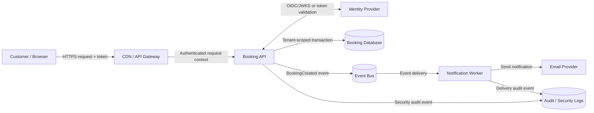
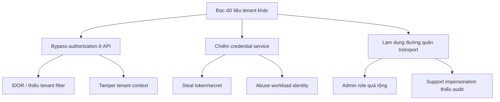
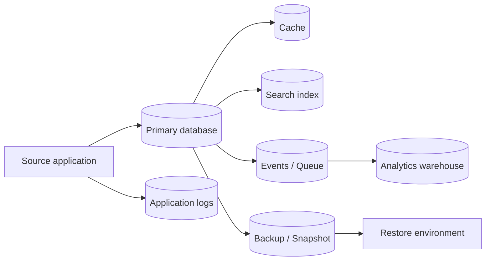
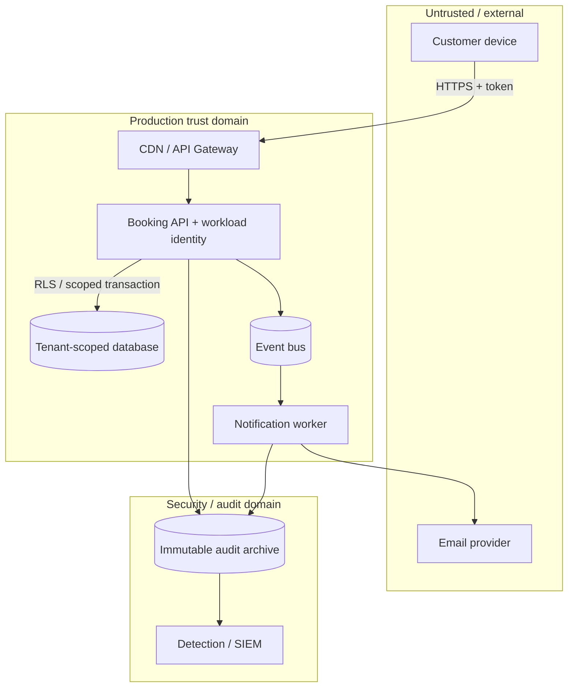

# Mô hình đe dọa theo tài sản, luồng dữ liệu và ranh giới tin cậy

## 1. Vì sao cần mô hình hóa mối đe dọa?

Một kiến trúc cloud có thể dùng firewall, mã hóa, IAM và dịch vụ bảo mật managed nhưng vẫn tồn tại đường tấn công mà đội thiết kế chưa nhận ra. API gateway có thể xác thực người dùng đúng nhưng worker xử lý message không kiểm tra tenant; database mã hóa khi lưu nhưng log chứa access token; workload private không có public IP nhưng role có quyền đọc mọi bucket. Lỗ hổng thường xuất hiện tại điểm giao nhau giữa thành phần, luồng dữ liệu và giả định tin cậy.

**Threat modeling (mô hình hóa mối đe dọa)** là quy trình có cấu trúc để hiểu hệ thống cần bảo vệ điều gì, ai có thể tấn công, dữ liệu đi qua đâu, ranh giới tin cậy nằm ở đâu và những tình huống nào có thể gây hại. Kết quả là danh sách mối đe dọa, mức rủi ro, biện pháp giảm thiểu và cách kiểm chứng.

Bài học thuộc chương **Kiến trúc bảo mật** của module **CLOUD_ARCHITECTURE**. Module học thiết kế kiến trúc ứng dụng cloud từ yêu cầu nghiệp vụ đến mạng, compute, dữ liệu và mô hình triển khai, cân bằng độ tin cậy, bảo mật, khả năng mở rộng, chi phí và vận hành theo Well-Architected. Threat modeling kết nối các quyết định kỹ thuật với tài sản và tác động nghiệp vụ cần bảo vệ.

Sau bài học, bạn có thể nhận diện tài sản và threat actor, vẽ luồng dữ liệu, xác định trust boundary, áp dụng STRIDE/abuse case, ưu tiên risk và gắn biện pháp kiểm soát với kiểm thử.

## 2. Bắt đầu từ hệ thống thực tế

Threat modeling không phải checklist cố định áp vào mọi hệ thống. Hãy bắt đầu bằng kiến trúc, quy trình nghiệp vụ và những gì đang chạy hoặc dự định triển khai.

### 2.1. Xác định phạm vi và mục tiêu

Ghi rõ:

- Hệ thống hoặc user journey đang được đánh giá.
- Thành phần trong phạm vi: client, API, identity provider, service, database, queue, storage, cloud control plane và bên thứ ba.
- Thành phần ngoài phạm vi nhưng có kết nối hoặc ảnh hưởng.
- Môi trường, region, account/project và tenant tier.
- Mức chi tiết: toàn kiến trúc, một service, một luồng dữ liệu hay một thay đổi.
- Người tham gia: kiến trúc sư, developer, SRE, security, data owner, product owner và cloud operations.

Phạm vi quá rộng dễ tạo danh sách chung chung; phạm vi quá hẹp bỏ qua ranh giới nơi dữ liệu chuyển từ service sang queue, account hoặc vendor.

### 2.2. Mô tả kiến trúc và phiên bản

Tập hợp sơ đồ, deployment manifest/IaC, API contract, data schema, IAM role, network route và luồng vận hành. Ghi rõ:

- **As-is:** điều thực sự đang chạy.
- **To-be:** kiến trúc dự kiến sau thay đổi.
- **Assumption:** giả định chưa được xác minh.
- **Unknown:** phần chưa có bằng chứng.

Không biến giả định thành sự thật. “Database không truy cập Internet” cần được xác minh qua route, private endpoint, firewall và egress; chỉ nhìn sơ đồ có chữ private subnet chưa đủ.

## 3. Tài sản (assets): hệ thống cần bảo vệ điều gì?

Tài sản là thứ có giá trị với tổ chức hoặc người dùng, có thể bị mất, lộ, sửa sai hoặc không truy cập được. Không chỉ dữ liệu là tài sản.

### 3.1. Nhóm tài sản

| Nhóm | Ví dụ | Hậu quả khi bị xâm phạm |
|---|---|---|
| Dữ liệu nghiệp vụ | Booking, đơn hàng, hồ sơ, số dư | Lộ/sửa/mất dữ liệu, gian lận |
| Identity và secret | Password hash, token, API key, signing key, KMS key | Chiếm quyền, giả mạo, giải mã dữ liệu |
| Workload/compute | VM, container, function, Kubernetes node | Chạy mã trái phép, di chuyển ngang, cryptomining |
| Control plane | IAM policy, cloud account, pipeline, DNS | Chiếm quyền quản trị, thay đổi toàn hệ thống |
| Giao tiếp | API, webhook, event bus, queue | Giả mạo, replay, nghe lén, sửa message |
| Availability/capacity | Database, quota, queue throughput | DoS, cạn tài nguyên, ngừng dịch vụ |
| Intellectual property | Source code, model, thuật toán | Mất bí mật kinh doanh, supply-chain compromise |
| Bằng chứng vận hành | Audit log, trace, backup, incident record | Không điều tra được, không chứng minh tuân thủ |

### 3.2. Phân loại dữ liệu

Với mỗi tài sản, ghi owner, mục đích, độ nhạy cảm, tenant/data subject, jurisdiction/residency, retention, deletion/legal hold và yêu cầu confidentiality, integrity, availability, authenticity. Theo dõi dữ liệu ở nơi lưu, nơi xử lý, bản sao, backup, cache, log và đường truyền.

Không chỉ gắn nhãn “PII” rồi dừng lại. Email, số điện thoại, lịch sử booking, vị trí, payment reference và metadata có thể có mức nhạy cảm khác nhau; rủi ro phụ thuộc khả năng liên kết và mục đích sử dụng.

### 3.3. Asset inventory minh họa

| ID | Tài sản | Owner | Nơi xuất hiện | Yêu cầu chính |
|---|---|---|---|---|
| A-01 | Hồ sơ khách hàng | Customer domain | API, DB, cache, export | Confidentiality, tenant isolation |
| A-02 | Trạng thái booking | Booking domain | API, DB, event, search index | Integrity, availability |
| A-03 | Payment reference | Payment domain | Backend, secret store, provider | Confidentiality, integrity |
| A-04 | Workload identity | Platform security | Runtime, cloud IAM | Authenticity, least privilege |
| A-05 | Audit trail | Security operations | Log archive/SIEM | Integrity, retention |
| A-06 | Signing/encryption key | Key owner | KMS/HSM, workloads | Confidentiality, controlled use |

Asset inventory giúp nhận diện crown jewel (tài sản trọng yếu) để ưu tiên phân tích. Không phải mọi log line hay cache entry đều có cùng mức rủi ro.

## 4. Chủ thể đe dọa và năng lực

**Threat actor** là cá nhân hoặc tổ chức có khả năng tạo ra mối đe dọa. Actor không nhất thiết là hacker bên ngoài.

| Actor | Năng lực/động cơ | Đường tiếp cận |
|---|---|---|
| Attacker Internet | Khai thác API, credential stuffing, DDoS | Public endpoint, DNS, login |
| Người dùng hợp lệ ác ý | Vượt tenant scope, abuse business logic | API, export, search, support |
| Insider | Lạm dụng quyền, truy cập trái phép | Admin console, DB, logs, CI/CD |
| Compromised workload | Dùng identity của service bị chiếm | Metadata endpoint, internal API |
| Supply-chain actor | Đưa dependency/image/action độc hại | Package registry, build runner |
| Cloud account attacker | Chiếm IAM role hoặc credential | Control plane, federation |
| Vendor bị xâm phạm | Lạm dụng tích hợp hoặc dữ liệu chia sẻ | Webhook, SaaS connector |
| Lỗi cấu hình/vận hành | Cấp quyền rộng, public bucket, route sai | IaC, console, pipeline |

Phân tích actor dựa trên năng lực và đường tiếp cận thực tế. Người dùng tenant A có quyền hợp lệ nhưng tìm cách đọc dữ liệu tenant B vẫn là actor quan trọng trong SaaS.

### 4.1. Động cơ và tác động

Động cơ có thể là lợi ích tài chính, đánh cắp dữ liệu, phá hoại, gián đoạn, gián điệp, tống tiền hoặc lạm dụng tài nguyên. Một kịch bản có thể vừa làm mất confidentiality, vừa cho phép sửa dữ liệu và phát sinh chi phí.

Không cần dự đoán danh tính attacker cụ thể. Cần xác định mức năng lực hợp lý, tài sản bị nhắm tới và đường đi khả thi.

## 5. Luồng dữ liệu (data flow)

Data-flow diagram (DFD) mô tả dữ liệu di chuyển giữa actor, process, data store và kết nối. DFD giúp nhận ra nơi dữ liệu được tạo, đọc, biến đổi, truyền, lưu, sao chép và xóa.

### 5.1. Thành phần của DFD

- **External entity:** user, đối tác, provider hoặc hệ thống ngoài phạm vi.
- **Process:** API, worker, function, service hoặc pipeline biến đổi dữ liệu.
- **Data store:** database, object storage, cache, queue, log archive hoặc backup.
- **Data flow:** request, response, event, file, replication, telemetry hoặc administrative operation.
- **Trust boundary:** đường phân chia miền có mức tin cậy, quyền kiểm soát hoặc giả định bảo mật khác nhau.

### 5.2. DFD minh họa cho đặt lịch



Sơ đồ chỉ minh họa logic. Production DFD cần thêm subnet, account, IAM role, private endpoint, DNS, key, backup, admin path và bên thứ ba thực tế.

### 5.3. Thuộc tính của từng luồng

| Thuộc tính | Câu hỏi |
|---|---|
| Source/destination | Ai gửi, ai nhận, process/store nào? |
| Classification | Dữ liệu public, confidential hay restricted? |
| Protocol | HTTPS, gRPC, SQL, queue, file transfer hay replication? |
| Identity | Ai xác thực producer và consumer? |
| Authorization | Ai được gửi/đọc/sửa? Scope tenant/resource là gì? |
| Protection | Encryption in transit/at rest, signing, integrity check? |
| Trust boundary | Có đi qua network/account/vendor/tenant boundary? |
| Failure behavior | Timeout, retry, replay, duplicate có tạo rủi ro? |
| Logging | Có log metadata/payload? Ai được đọc và giữ bao lâu? |
| Lifecycle | Dữ liệu lưu, archive, replay và xóa thế nào? |

Các luồng dễ bị bỏ quên gồm backup restore, debug export, dead-letter queue, support impersonation, CI/CD deploy, metrics label, crash dump và break-glass access.

## 6. Trust boundary và vùng tin cậy

**Trust boundary** là ranh giới nơi giả định về identity, quyền, bảo vệ hoặc ownership thay đổi. Boundary không nhất thiết trùng firewall hoặc subnet.

Ví dụ:

- Internet → edge/API gateway.
- Browser/mobile app → backend.
- Public subnet → private application subnet.
- Workload → database.
- Workload identity → cloud control plane.
- Tenant A → tenant B.
- Production account → analytics account.
- Organization → SaaS provider/webhook partner.
- CI/CD runner → production deployment role.
- Normal operator session → privileged/break-glass session.

### 6.1. Giả định cần kiểm chứng

- Private subnet không có nghĩa workload đáng tin hoặc không thể bị xâm nhập.
- Service-to-service trong VPC vẫn cần authentication và authorization.
- Cùng cloud account không có nghĩa mọi workload nên chia sẻ quyền.
- Managed service giảm gánh nặng vận hành nhưng không tự cấu hình policy an toàn.
- Internal traffic có thể bị giả mạo khi một workload đã bị compromise.
- TLS mã hóa đường truyền nhưng không bảo đảm peer được phép truy cập resource.

### 6.2. Zero Trust

Zero Trust khuyến khích không cấp niềm tin chỉ dựa vào vị trí network. Mỗi request cần xác minh identity, policy, workload context và resource scope phù hợp. Hệ thống có thể dùng workload identity, short-lived token, mTLS và policy engine; điều đó không thay việc authorization ở resource.

Đánh giá các boundary:

- **Identity:** ai được xem là actor hợp lệ?
- **Network:** traffic được phép đi theo route nào?
- **Data:** dữ liệu nào được truy cập, theo tenant/record nào?
- **Administrative:** ai có quyền đổi policy hoặc hạ tầng?
- **Execution:** mã nào được phép chạy và artifact đến từ đâu?

## 7. STRIDE: phân loại mối đe dọa

STRIDE phân loại threat theo sáu nhóm. Nó giúp đặt câu hỏi có hệ thống nhưng không thay việc hiểu nghiệp vụ và kiến trúc.

| Nhóm | Ý nghĩa | Câu hỏi gợi ý | Ví dụ cloud |
|---|---|---|---|
| **S — Spoofing** | Giả mạo danh tính | Có thể giả user/service/webhook? | Dùng token bị đánh cắp |
| **T — Tampering** | Sửa dữ liệu/mã trái phép | Request, message, artifact có thể bị sửa? | Thay event hoặc pipeline artifact |
| **R — Repudiation** | Chối bỏ hành động | Có audit chứng minh ai làm gì? | Admin đổi IAM policy, audit thiếu |
| **I — Information Disclosure** | Lộ thông tin | Actor trái phép có thể đọc dữ liệu? | Bucket public, thiếu tenant filter |
| **D — Denial of Service** | Làm suy giảm dịch vụ | Có thể làm cạn CPU, connection, quota? | API flood, hot key |
| **E — Elevation of Privilege** | Nâng quyền | Có đường vượt role/trust boundary? | SSRF lấy workload credential |

### 7.1. Áp dụng STRIDE cho từng phần tử

- S: producer/consumer có được xác thực? Token có issuer, audience và expiry đúng?
- T: dữ liệu có integrity protection, validation, transaction và version?
- R: audit có actor, action, target, timestamp và outcome? Actor quyền cao có sửa/xóa được?
- I: encryption, authorization, tenant isolation, output filtering và log redaction đúng?
- D: có quota, rate limit, timeout, backpressure, autoscaling guardrail?
- E: role có least privilege? Có đường từ workload thường sang admin/control plane?

Không phải nhóm nào cũng áp dụng cho mọi phần tử. Static object có thể tập trung vào disclosure, tampering và availability; IAM service cần chú ý spoofing, elevation và repudiation.

STRIDE giúp phân loại điều có thể xảy ra, không tự cho biết xác suất hay mức nghiêm trọng. Sau đó cần đánh giá asset value, exposure, attacker capability, exploit path và controls hiện có.

## 8. Abuse case và attack tree

**Abuse case** mô tả cách actor dùng hệ thống theo hướng gây hại, trái với use case mong muốn.

| Use case hợp lệ | Abuse case |
|---|---|
| Tenant xem booking của mình | Đổi booking ID để đọc tenant khác |
| Admin export dữ liệu tenant | Lạm dụng export lấy dữ liệu hàng loạt |
| Service nhận event | Gửi event giả hoặc replay event cũ |
| CI/CD deploy image đã duyệt | Thay image/tag hoặc dependency độc hại |
| User upload file | Upload file độc hại gây thực thi mã hoặc cạn dung lượng |

Attack tree biểu diễn mục tiêu attacker và các nhánh điều kiện cần đạt. Ví dụ mục tiêu “đọc dữ liệu booking tenant khác”:



Attack tree giúp tìm đường thay thế. Không chỉ bảo vệ một endpoint; cần đánh giá credential, role, background job và export pathway.

## 9. Từ threat đến risk

Threat là khả năng gây hại; **risk** xét cả likelihood và hậu quả trong bối cảnh cụ thể.

### 9.1. Yếu tố đánh giá

- **Likelihood:** exposure, exploitability, attacker capability, frequency và controls.
- **Impact:** confidentiality, integrity, availability, privacy, pháp lý, tài chính, uy tín và vận hành.
- **Blast radius:** số tenant, region, account, service hoặc record bị ảnh hưởng.
- **Detectability:** khả năng phát hiện trước khi thiệt hại lan rộng.
- **Recoverability:** khả năng khôi phục, đối soát và thu hồi quyền.
- **Control effectiveness:** kiểm soát hiện có được kiểm chứng đến đâu.

### 9.2. Ma trận định tính mẫu

| Likelihood / Impact | Thấp | Trung bình | Cao | Nghiêm trọng |
|---|---|---|---|---|
| Thấp | Thấp | Thấp | Trung bình | Cao |
| Trung bình | Thấp | Trung bình | Cao | Rất cao |
| Cao | Trung bình | Cao | Rất cao | Rất cao |
| Rất cao | Cao | Rất cao | Rất cao | Rất cao |

Tổ chức cần định nghĩa tiêu chí cụ thể cho từng mức. Không dùng điểm số tạo cảm giác chính xác giả. Threat có hậu quả nghiêm trọng nhưng likelihood thấp vẫn có thể cần kiểm soát nếu không thể chấp nhận impact.

### 9.3. Risk register minh họa

| ID | Threat scenario | Asset/impact | Likelihood | Impact | Initial risk | Treatment |
|---|---|---|---|---|---|---|
| T-01 | Thay tenant ID để đọc booking tenant khác | Data breach | Trung bình | Nghiêm trọng | Rất cao | RLS, trusted context, negative tests |
| T-02 | SSRF lấy credential runtime | Cloud role/data store | Trung bình | Cao | Cao | Metadata hardening, egress control, least privilege |
| T-03 | Consumer xử lý duplicate payment event | Payment integrity | Trung bình | Nghiêm trọng | Rất cao | Idempotency, source validation, dedup |
| T-04 | API flood làm cạn DB connection | Availability | Cao | Cao | Rất cao | WAF, quota, bulkhead, load shedding |
| T-05 | Admin sửa/xóa audit log | Điều tra/bằng chứng | Thấp | Cao | Trung bình | Immutable archive, separation of duties |

Risk register cần owner, due date, trạng thái, evidence và residual risk. Risk acceptance phải có người đủ thẩm quyền, lý do và thời hạn xem xét.

## 10. Chọn biện pháp xử lý rủi ro

Bốn hướng xử lý:

1. **Mitigate:** giảm likelihood hoặc impact bằng control.
2. **Avoid:** đổi kiến trúc/luồng để loại bỏ đường tấn công hoặc chức năng rủi ro.
3. **Transfer/share:** chia trách nhiệm hoặc chuyển một phần rủi ro qua hợp đồng/bảo hiểm; trách nhiệm pháp lý/vận hành không tự biến mất.
4. **Accept:** chấp nhận residual risk có chủ đích, owner và thời hạn review.

Ví dụ integration không cần quyền đọc database: cách tránh rủi ro có thể là bỏ quyền đó thay vì chỉ thêm alert.

### 10.1. Control gắn với threat

| Threat | Prevention | Detection | Recovery |
|---|---|---|---|
| Token giả/đánh cắp | OIDC validation, short-lived token, audience, mTLS | Identity anomaly | Revoke/rotate, invalidate session |
| Tenant data leakage | Server-derived context, RLS, least privilege | Cross-tenant alert, audit | Contain, investigate, notify theo nghĩa vụ |
| Message tampering/replay | Authenticated producer, integrity, idempotency | Duplicate/out-of-sequence alert | Quarantine, replay có kiểm soát, reconcile |
| Secret exposure | Secret manager, workload identity, no hardcoded key | Secret scanning, access audit | Rotate/revoke, redeploy |
| DoS/resource exhaustion | WAF, quota, bulkhead, capacity limits | Saturation, traffic anomaly | Shed load, recover gradually |
| Privilege escalation | IAM least privilege, separation of duties | Privileged-action audit | Revoke role, rotate credential, rebuild |

Prevention, detection và recovery bổ trợ nhau. Không có control nào ngăn mọi tấn công; kiến trúc phải giả định một số lớp sẽ thất bại.

## 11. Trust boundary trong kiến trúc cloud

### 11.1. Internet và edge

Threats gồm API abuse, credential stuffing, bot/DDoS, injection, malformed/oversized payload, TLS misconfiguration và host/header spoofing.

Controls:

- TLS phù hợp, certificate lifecycle và HSTS khi cần.
- WAF/API gateway, schema validation, body/size limit, rate limit.
- Authentication/authorization ở backend; không coi WAF là ranh giới quyền.
- Request ID, audit, abuse monitoring và quota.

### 11.2. Workload và service-to-service

Threats gồm service bị compromise rồi di chuyển ngang, role quá rộng, SSRF truy cập metadata/control plane, secret lộ trong environment/image/log.

Controls:

- Workload identity, short-lived credential, least privilege.
- Egress allowlist, segmentation, private endpoint.
- Metadata service hardening theo nền tảng; tránh static credential.
- Image signing/scanning, runtime hardening, patching và admission policy.
- mTLS khi phù hợp; vẫn kiểm tra authorization ở resource.

### 11.3. Data store

Threats gồm public exposure, credential theft, injection, thiếu tenant filter, backup snapshot sai quyền và key bị lạm dụng.

Controls:

- Private connectivity, firewall/security group và DB role tối thiểu.
- Parameterized query, RLS/tenant constraints và access tests.
- Encryption at rest/in transit, key rotation, separation of duties.
- Backup access riêng, immutable copy khi phù hợp, restore test và audit.

### 11.4. Cloud control plane và CI/CD

Threats gồm chiếm cloud admin role/federation token, pipeline bị sửa, IaC drift và artifact/dependency bị xâm phạm.

Controls:

- Strong authentication, short-lived federation và privileged access management.
- Separation of duties, approval, signed artifact, provenance và protected branch.
- Policy-as-code, IaC scanning, drift detection và change audit.
- Isolated build runner, dependency pinning, SBOM và artifact verification.

## 12. Shared responsibility và managed cloud services

Cloud provider và khách hàng cùng chia sẻ trách nhiệm bảo mật. Ranh giới cụ thể phụ thuộc IaaS, PaaS, container platform, managed database hoặc SaaS:

- Provider bảo vệ hạ tầng vật lý, nền tảng hoặc phần managed service theo hợp đồng.
- Khách hàng vẫn chịu trách nhiệm về dữ liệu, identity, quyền, cấu hình, network rule và ứng dụng.
- Với managed database, provider có thể vận hành host/patch một phần; khách hàng vẫn thiết kế schema, access, encryption configuration, backup policy và query authorization.
- Với SaaS, khách hàng vẫn quản lý user, federation, sharing, retention và tenant configuration.

Không giả định managed nghĩa là đã an toàn. Threat model phải ghi control nào do provider vận hành, control nào do tổ chức cấu hình và evidence xác nhận.

## 13. Data lifecycle và luồng dễ bị bỏ quên

Dữ liệu có thể tồn tại ngoài database chính:



Mỗi bản sao kéo theo threat riêng:

- Cache có thể giữ dữ liệu đã bị thu hồi hoặc tenant khác.
- Search index có thể thiếu filter hoặc cập nhật trễ.
- Queue/DLQ giữ payload nhạy cảm lâu hơn mong muốn.
- Warehouse có nhiều người phân tích và công cụ export.
- Backup ở account/region khác và có quyền rộng.
- Restore environment yếu hơn production nhưng chứa dữ liệu production.
- Log/trace/crash dump có thể chứa token, PII hoặc SQL parameter.

Theo dõi lifecycle từ creation → use → replication → archive → retention → deletion. Xóa record nguồn không tự xóa cache, index, export hay backup cùng thời điểm.

## 14. Ví dụ threat modeling: nền tảng đặt lịch multi-tenant

Giả sử khách hàng dùng web/mobile để tạo booking. API gateway chuyển request đến Booking API; service xác minh token, đọc/ghi database, phát BookingCreated event; worker gửi notification qua provider. Tenant dùng chung application plane và database theo hàng với tenant ID.

### 14.1. Tài sản và boundary

Tài sản trọng yếu: customer profile, booking, membership, workload identity, payment reference, secret tích hợp, event log, audit trail và backup.

Trust boundaries:

1. User device → Internet/edge.
2. Edge → backend workload.
3. Booking API → identity provider.
4. Booking API → database.
5. Booking API → event bus → notification worker.
6. Worker → email provider.
7. Production account → logging/security account.
8. Tenant A → tenant B trong shared database.

### 14.2. Threat scenario và kiểm soát

| Scenario | STRIDE | Hậu quả | Kiểm soát |
|---|---|---|---|
| Client thay tenant ID | Spoofing/Disclosure | Đọc booking tenant khác | Signed context, membership check, RLS |
| API thiếu tenant condition | Disclosure/Tampering | Trả/sửa record chéo tenant | Tenant-aware repository, composite FK, tests |
| JWT sai audience được chấp nhận | Spoofing | Gọi API bằng token dành cho service khác | Verify issuer/audience/signature/expiry |
| SSRF lấy workload credential | Elevation | Gọi cloud API/storage | Metadata protection, egress, least privilege |
| Event giả kích hoạt email | Spoofing/Tampering | Spam hoặc lộ dữ liệu | Producer identity, schema validation, authorization |
| Replay BookingCreated | Tampering/DoS | Notification lặp | Event ID, idempotency, deduplication |
| Export endpoint bị lạm dụng | Disclosure/DoS | Lấy dữ liệu hàng loạt | Object auth, quota, approval, audit, expiry |
| Flood database connection | DoS | Booking API unavailable | Rate limit, pool cap, bulkhead, backpressure |
| Admin sửa log | Repudiation | Không điều tra được | Separate logging account, immutable retention |

### 14.3. Sơ đồ threat boundary



Đối chiếu sơ đồ với cấu hình thực tế: signing key, event publisher policy, DB role, log read/write role, network egress và admin path.

## 15. Threat register và remediation

Threat model cần tạo đầu việc cụ thể, không chỉ sơ đồ. Threat register có thể chứa:

| Field | Nội dung |
|---|---|
| Threat ID | ID ổn định để tham chiếu |
| Asset/flow | Tài sản và luồng bị ảnh hưởng |
| Scenario | Actor, điều kiện và hành vi |
| STRIDE/category | Nhóm phân loại |
| Existing controls | Kiểm soát và evidence hiện tại |
| Likelihood/impact | Mức đánh giá và lý do |
| Residual risk | Rủi ro còn lại |
| Treatment | Mitigate, avoid, transfer/share hoặc accept |
| Owner/due date | Người chịu trách nhiệm và hạn |
| Validation | Test, scan, review, log hoặc exercise |
| Status | Open, in progress, mitigated, accepted, closed |

Khi threat được đánh dấu mitigated, cần evidence như test pass, IAM review, network reachability, restore evidence hoặc finding đã xác minh. Không đóng threat chỉ vì tạo ticket hoặc thêm policy chưa được kiểm tra.

## 16. Kiểm thử và xác minh control

| Control | Cách xác minh |
|---|---|
| Authentication/token | Test issuer, audience, signature, expiry, key rotation và revoked identity |
| Tenant isolation/RLS | Negative tests xuyên tenant, missing context, pooled connection và worker |
| Network segmentation | Kiểm tra route/firewall từ nguồn đến đích cụ thể |
| IAM least privilege | Policy analysis, access simulation và review quyền thực tế |
| Encryption/key | Xác minh key policy, rotation, deny path và backup access |
| Event authenticity | Producer identity, unauthorized publish, tampering, replay/duplicate |
| Audit integrity | Thử sửa/xóa bằng role thường; kiểm tra immutable archive và alert |
| DoS resilience | Load/fault test có giới hạn, quan sát quota, queue và recovery |
| Supply chain | Dependency scan, image signing, provenance và artifact verification |

Không kiểm thử xâm nhập production hoặc tài sản bên thứ ba khi không có phạm vi và ủy quyền phù hợp. Có thể tái hiện đường tấn công trong staging/lab với dữ liệu tổng hợp.

## 17. Khi nào cập nhật threat model?

Rà soát khi:

- Thêm public endpoint, service, event topic, integration hoặc data store.
- Đổi identity provider, IAM role, trust relationship hoặc secret management.
- Đổi tenant model, schema, encryption key hoặc data residency.
- Chuyển workload sang region/account/platform mới.
- Thêm cross-account access, private endpoint, webhook hoặc partner connectivity.
- Đổi pipeline, base image, dependency hoặc runtime permission.
- Có incident, vulnerability hoặc threat intelligence làm thay đổi assumptions.
- SLO/availability design đổi làm tăng exposure hoặc thay failure boundary.

Có thể gắn threat review vào ADR, pull request và change management. Thay đổi nhỏ không chạm boundary có thể review tập trung; thay đổi lớn cần cập nhật DFD và risk register đầy đủ.

## 18. Đánh giá theo Well-Architected

| Trụ cột | Câu hỏi đánh giá |
|---|---|
| **Operational Excellence** | Threat model có owner/version? Có register, remediation, evidence, runbook và trigger review? |
| **Security** | Asset, actor, flow, trust boundary, IAM, encryption, tenant isolation và audit đã được phân tích? |
| **Reliability** | DoS, dependency failure, credential compromise và recovery được xét? Có graceful degradation và backup protection? |
| **Performance Efficiency** | Security control đặt đúng lớp, hạn chế overhead và đo được tác động? |
| **Cost Optimization** | Chi phí control tương xứng risk? Có công cụ trùng lặp nhưng thiếu coverage? |
| **Sustainability** | Policy/evidence được tự động hóa và vận hành đúng quy mô? |

## 19. Mẫu threat model

Mẫu YAML sau dùng ghi phạm vi, tài sản, boundary và threat; không phải policy có thể áp dụng trực tiếp:

```yaml
threat_model:
  id: TM-BOOKING-001
  system: multi_tenant_booking
  version: 1
  scope:
    in_scope:
      - public_booking_api
      - booking_database
      - event_bus
      - notification_worker
    out_of_scope:
      - customer_personal_device_security
  assets:
    - id: A-01
      name: tenant_booking_data
      classification: confidential
      owner: booking_domain
    - id: A-02
      name: workload_identity
      classification: restricted
      owner: platform_security
  trust_boundaries:
    - internet_to_edge
    - edge_to_workload
    - workload_to_database
    - tenant_to_tenant
    - production_to_external_provider
  threats:
    - id: T-01
      category: information_disclosure
      scenario: cross_tenant_booking_read
      likelihood: medium
      impact: critical
      treatment: mitigate
      controls:
        - trusted_tenant_context
        - row_level_security
        - cross_tenant_negative_tests
      owner: booking_platform
      status: in_progress
  review_triggers:
    - new_data_store
    - new_external_integration
    - identity_or_iam_change
    - security_incident
```

Mẫu cần bổ sung data flows, existing-control evidence, residual risk, due date và phê duyệt phù hợp quy trình tổ chức.

## 20. Quy trình threat modeling

1. **Chọn phạm vi:** user journey, service, environment và thay đổi kiến trúc.
2. **Lập asset inventory:** owner, classification, business impact, lifecycle và dependency.
3. **Xác định actor:** năng lực, động cơ, vị trí và đường tiếp cận.
4. **Vẽ DFD:** external entity, process, data store, protocol, direction và classification.
5. **Đánh trust boundary:** identity, network, tenant, account, admin, vendor và execution.
6. **Sinh threat:** STRIDE, abuse case và attack tree cho thành phần/luồng quan trọng.
7. **Ưu tiên risk:** likelihood, impact, blast radius, detectability và control hiện có.
8. **Chọn treatment:** mitigate, avoid, transfer/share hoặc accept có thẩm quyền.
9. **Gắn owner và test:** remediation, due date, evidence, validation và residual risk.
10. **Tích hợp lifecycle:** review khi đổi API, data flow, IAM, account, dependency hoặc sau incident.

## 21. Bảng kiểm trước production

- [ ] Phạm vi, phiên bản, assumptions và out-of-scope được ghi rõ.
- [ ] Asset inventory có owner, classification, business impact và data lifecycle.
- [ ] Threat actors gồm external, tenant user, insider, compromised workload, vendor và supply chain phù hợp.
- [ ] DFD có external entity, process, data store, flow và hướng dữ liệu.
- [ ] Luồng có protocol, identity, authorization, encryption, logging và failure behavior.
- [ ] Trust boundary gồm internet, workload, database, tenant, account, CI/CD và vendor.
- [ ] Đã áp dụng STRIDE và abuse case/attack tree cho đường quan trọng.
- [ ] Risk đánh giá theo likelihood, impact, blast radius và control evidence.
- [ ] Mỗi threat có treatment, owner, due date và residual risk/acceptance authority.
- [ ] Control có test/evidence; không đóng finding chỉ bằng cấu hình chưa xác minh.
- [ ] Backup, queue, DLQ, cache, log, export, support access và CI/CD được xem xét.
- [ ] Shared responsibility được phân định giữa provider và tổ chức.
- [ ] Có trigger review khi thêm service, integration, data store hoặc đổi identity.
- [ ] Threat model, DFD và register được version hóa và cập nhật sau incident.

**Nguyên tắc áp dụng:** tài sản cho biết điều gì cần bảo vệ; luồng dữ liệu cho biết thông tin đi đâu và qua ai; ranh giới tin cậy cho biết nơi giả định bảo mật thay đổi. Kết hợp ba góc nhìn với STRIDE, risk assessment và kiểm thử giúp threat modeling chuyển từ sơ đồ mô tả thành quyết định kiến trúc và kiểm soát có thể xác minh.
