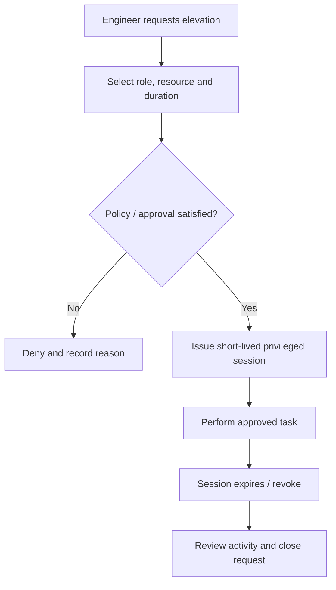
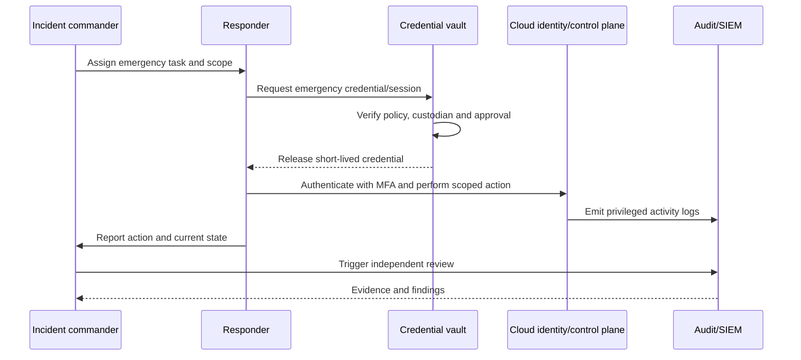

# Truy cập khẩn cấp và giới hạn quyền quản trị

## 1. Vì sao cần thiết kế quyền truy cập khẩn cấp?

Ứng dụng cloud cần quyền quản trị để triển khai, cấu hình network, quản lý database, xoay vòng secret và khôi phục dịch vụ. Nếu mọi kỹ sư đều có quyền administrator thường trực, một credential bị lộ hoặc một thao tác nhầm có thể ảnh hưởng toàn bộ môi trường. Nhưng nếu mọi quyền cao đều phụ thuộc vào một identity provider, một workflow phê duyệt hoặc một control plane duy nhất, đội vận hành có thể không truy cập được chính hệ thống đó khi xảy ra sự cố.

**Emergency access** là cơ chế truy cập đặc biệt được dùng khi quy trình xác thực hoặc quản trị thông thường không đáp ứng được tình huống khẩn cấp. **Break-glass access** là một dạng emergency access, cho phép người được ủy quyền vượt qua một số bước thông thường theo policy được kiểm soát, có thời hạn, có audit và được rà soát sau khi sử dụng.

Mục tiêu không phải mở quyền vô hạn khi có incident. Mục tiêu là bảo đảm người chịu trách nhiệm có thể thực hiện đúng hành động cần thiết trong thời gian giới hạn, đồng thời giảm nguy cơ lạm dụng, xâm nhập và thay đổi không thể phục hồi.

Các nguyên tắc chính:

- **Least privilege:** chỉ cấp quyền tối thiểu cần cho nhiệm vụ.
- **Just-in-Time (JIT):** quyền cao chỉ được cấp khi có nhu cầu và trong thời gian ngắn.
- **Separation of duties:** tách người yêu cầu, phê duyệt và thực thi khi rủi ro cho phép.
- **Strong authentication:** dùng MFA và phương thức xác thực phù hợp với mức rủi ro.
- **Time-bound access:** quyền có hạn dùng, tự hết hiệu lực.
- **Accountability:** mọi hoạt động đặc quyền gắn với danh tính cá nhân và được audit.
- **Recoverability:** quy trình vẫn hoạt động khi thành phần identity hoặc control plane chính bị lỗi.
- **Review and revoke:** quyền và credential được thu hồi, kiểm tra sau incident.

Trong module **CLOUD_ARCHITECTURE**, chương **Kiến trúc bảo mật** xem quyền quản trị và truy cập khẩn cấp là một phần của thiết kế bảo mật, độ tin cậy và khả năng vận hành. Quyền cao phải đủ để xử lý sự cố nhưng vẫn có ranh giới, bằng chứng và khả năng kiểm soát.

Sau bài học, người học có thể:

1. Phân biệt quyền quản trị thường ngày, privileged access và break-glass access.
2. Thiết kế JIT/PAM, role, scope và thời hạn cho quyền đặc quyền.
3. Xây dựng phương án truy cập khi identity provider/control plane chính không khả dụng.
4. Bảo vệ emergency credential, MFA, recovery key và tài khoản dự phòng.
5. Áp dụng approval, separation of duties, session recording và audit.
6. Giới hạn thao tác nguy hiểm bằng policy, guardrail và môi trường.
7. Viết runbook, kiểm thử và rà soát sau mỗi lần emergency access.

## 2. Phân loại quyền truy cập

Không nên gom mọi quyền cao vào một role tên Administrator rồi cấp cho nhiều người. Hãy phân biệt quyền theo nhiệm vụ, phạm vi và thời điểm sử dụng.

| Loại quyền | Mục đích | Cách cấp |
| --- | --- | --- |
| Standard user | Sử dụng ứng dụng và dữ liệu nghiệp vụ | Theo membership và role |
| Developer/operator | Triển khai, quan sát, xử lý tác vụ thường ngày | Role theo môi trường và service |
| Privileged access | Thay đổi IAM, network, database, production config | JIT/PAM, approval và thời hạn |
| Emergency/break-glass | Phục hồi khi quy trình bình thường thất bại | Tài khoản/credential riêng, kiểm soát chặt |
| Workload identity | Quyền của application, job hoặc service | Federated identity/short-lived token |
| Audit/security reviewer | Xem bằng chứng, điều tra và xác minh | Read-only scope, không dùng để vận hành |

### 2.1. Human identity và workload identity

Kỹ sư truy cập bằng danh tính cá nhân; service truy cập bằng workload identity. Không dùng chung một tài khoản admin cho con người và automation vì sẽ mất khả năng xác định actor thực sự.

Workload identity nên dùng federation, managed identity hoặc credential ngắn hạn. Nếu một pipeline cần quyền tạo resource, hãy cấp role cho workload theo repository/environment/artifact được tin cậy, thay vì nhúng access key lâu dài trong CI variable.

### 2.2. Quyền theo môi trường

Tách role và boundary giữa development, staging và production. Quyền ở dev không tự động cho phép sửa production. Production privileged role nên yêu cầu điều kiện bổ sung như approval, device posture, MFA, change ticket hoặc JIT elevation.

Không để quyền thường ngày có thể tự cấp quyền cao hơn cho chính mình mà không có policy độc lập kiểm soát.

## 3. Least privilege và role design

Least privilege cần được áp dụng theo bốn chiều:

1. **Action:** chỉ cho phép hành động cần thiết, ví dụ restart service nhưng không xóa database.
2. **Resource:** giới hạn vào resource, project, account, subscription, cluster hoặc namespace cụ thể.
3. **Condition:** giới hạn theo environment, tag, network, device, time hoặc trạng thái change.
4. **Duration:** quyền chỉ tồn tại trong khoảng cần thiết.

### 3.1. Role theo nhiệm vụ

Ví dụ role vận hành:

| Role | Được phép | Không mặc định được phép |
| --- | --- | --- |
| Incident responder | Xem telemetry, restart workload, scale service trong quota | Thay IAM policy hoặc xóa dữ liệu |
| Database operator | Failover theo runbook, xem replication lag, chạy backup | Export toàn bộ PII hoặc thay đổi IAM toàn account |
| Network operator | Cập nhật route/firewall trong scope được duyệt | Tạo principal có quyền admin |
| Security responder | Disable credential, isolate host, xem audit | Sửa/xóa log điều tra |
| IAM administrator | Quản lý role/binding theo scope | Xóa audit, tự phê duyệt elevation của mình |
| Break-glass custodian | Khởi tạo và kiểm soát emergency session | Dùng credential cho công việc thường ngày |

Role matrix phải dựa trên API/action thực tế của cloud provider. Tên role không chứng minh nó có đúng scope; cần review permission set và inherited permission.

### 3.2. Quyền kế thừa và privilege escalation

Rủi ro thường nằm ở quyền gián tiếp:
- Có thể sửa policy gắn với role mạnh hơn.
- Có thể attach một managed policy rộng.
- Có thể tạo service account rồi cấp role cao cho nó.
- Có thể impersonate workload identity.
- Có thể thay đổi pipeline để deploy artifact tùy ý.
- Có thể sửa logging/alerting để che hoạt động.
- Có thể đọc secret dùng bởi principal có quyền cao.

Review quyền phải xem cả đường leo thang quyền, không chỉ danh sách action trực tiếp.

## 4. JIT và Privileged Access Management

**Privileged Access Management (PAM)** quản lý vòng đời quyền đặc quyền: yêu cầu, phê duyệt, cấp credential/session, giám sát, thu hồi và audit.

**Just-in-Time access** chỉ cấp role khi cần; quyền được gắn với người yêu cầu, nhiệm vụ, resource và thời hạn.



JIT giảm thời gian quyền cao tồn tại nhưng không tự bảo đảm an toàn. Nếu requester có thể tự phê duyệt mọi role, role quá rộng hoặc session không được log thì rủi ro vẫn cao.

### 4.1. Yêu cầu JIT nên chứa gì?

- Principal và danh tính xác thực.
- Role/action cần cấp.
- Resource/account/project/environment scope.
- Incident hoặc change/ticket reference.
- Lý do và business impact.
- Thời gian bắt đầu, duration và expiry.
- Người phê duyệt hoặc policy tự động áp dụng.
- Điều kiện thiết bị, MFA và network nếu cần.
- Phương thức giám sát session.
- Quy trình kết thúc và review.

Không dùng request chung kiểu “cần admin một lúc”. Yêu cầu phải trả lời cần hành động nào, ở đâu và trong bao lâu.

### 4.2. Approval theo rủi ro

Một số thao tác read-only có thể tự động được cấp JIT sau MFA. Thao tác thay đổi production, IAM, encryption key hoặc xóa dữ liệu có thể cần hai người phê duyệt hoặc change approval.

Approval không nên trở thành nút thắt trong incident. Xác định trước người thay thế, escalation path và trường hợp không thể liên hệ approver. Nếu policy cho phép emergency override, phải ghi lại lý do, thông báo hậu kiểm và giới hạn scope.

### 4.3. Session-bound privilege

Ưu tiên session tạm thời hoặc token ngắn hạn thay cho phát credential lâu dài. Khi session hết hạn:
- Token không thể refresh ngoài policy.
- Role assignment được tự động gỡ.
- SSH/RDP session hoặc proxy channel bị đóng khi thích hợp.
- Credential tạm được revoke/rotate.
- Session log và command audit được giữ theo retention.

TTL của token phải phù hợp với nhiệm vụ và thời gian revoke propagation. Xóa role binding không phải lúc nào cũng làm token đã phát mất hiệu lực tức thì; cần hiểu semantics của identity platform.

## 5. Break-glass account: khi nào dùng?

Break-glass dành cho tình huống đường truy cập thường ngày không dùng được hoặc việc chờ quy trình bình thường gây ảnh hưởng nghiêm trọng.

Ví dụ:
- Identity provider chính bị outage, người vận hành không thể đăng nhập.
- Federation/SSO cấu hình sai làm khóa toàn bộ admin.
- MFA provider gặp lỗi diện rộng.
- Control plane hoặc PAM service không khả dụng.
- Credential quản trị chính bị compromise cần cô lập và thay thế.
- Sự cố production yêu cầu hành động khẩn cấp ngoài role thường ngày.

Không dùng break-glass để:
- Tránh quy trình approval vì thấy bất tiện.
- Triển khai feature hoặc thay đổi thông thường.
- Truy cập dữ liệu không liên quan incident.
- Dùng tài khoản chung để chia sẻ mật khẩu.
- Thực hiện việc không có ticket, log hoặc người chịu trách nhiệm.

### 5.1. Thiết kế tài khoản khẩn cấp

Một phương án có thể dùng một số ít emergency principal được kiểm soát độc lập với SSO thường ngày. Mỗi account phải có owner/custodian, scope được định nghĩa, credential được bảo vệ, alert khi sử dụng và bài test định kỳ.

Không nhất thiết mọi tổ chức cần cùng một số account. Nên có đủ redundancy để một credential bị khóa hoặc custodian vắng mặt không làm mất toàn bộ khả năng recovery, nhưng số lượng phải đủ ít để inventory và kiểm toán được.

### 5.2. Tài khoản break-glass không phải tài khoản dùng chung

Nếu nền tảng chỉ hỗ trợ một principal khẩn cấp, việc lấy credential phải được kiểm soát và session phải gắn với người thực thi thực tế. Ghi lại:
- Ai lấy credential.
- Ai phê duyệt hoặc căn cứ policy nào cho phép.
- Thời điểm mở và kết thúc.
- Incident/ticket.
- Các action và resource đã truy cập.
- Cách credential được rotate sau sử dụng.

Không lưu mật khẩu trong chat, wiki không kiểm soát hoặc file script. Dùng vault có access policy, approval và audit.

## 6. Độc lập với identity provider và control plane chính

Emergency access chỉ hữu ích nếu vẫn hoạt động khi thành phần chính bị lỗi. Đây là vấn đề phụ thuộc vòng tròn: cần identity để sửa identity, cần control plane để sửa cấu hình control plane.

### 6.1. Break-glass dependency map

Liệt kê các thành phần:
- Identity provider/SSO/federation.
- MFA service và recovery factor.
- PAM/vault/approval workflow.
- DNS và network route.
- KMS/secret manager.
- Cloud account root/organization admin.
- Audit/log pipeline.
- Device management và endpoint security.
- Out-of-band communication.

Tìm dependency nào cùng failure domain. Nếu vault và identity đều đặt trong một tenant cloud không thể truy cập khi account bị suspend, emergency account bên trong tenant đó không giải quyết được vấn đề.

### 6.2. Out-of-band path

Có thể cần một recovery path độc lập cho một số thành phần cốt lõi:
- Emergency identity/native account theo khả năng provider.
- Credential được giữ trong vault hoặc cơ chế vật lý an toàn, tách khỏi SSO chính.
- Một thiết bị quản trị đã được harden, có thể truy cập từ network dự phòng.
- Recovery contact và provider support path đã xác minh.
- Bản runbook offline hoặc bản sao đọc được khi document system lỗi.

Out-of-band không có nghĩa bỏ MFA hoặc dùng laptop cá nhân không bảo vệ. Nó phải được thiết kế như một control plane dự phòng với quyền và kiểm soát riêng.

### 6.3. Cloud provider root account

Với tài khoản cloud cấp cao nhất, cần tuân theo hướng dẫn của provider về bảo vệ root/break-glass identity. Nguyên tắc tổng quát:
- Không dùng root cho hoạt động thường ngày.
- Bật MFA mạnh và phương thức recovery có kiểm soát.
- Giới hạn số người biết quy trình truy cập.
- Thiết lập alert cho mọi lần đăng nhập/thay đổi đặc quyền.
- Không tạo access key lâu dài cho root nếu provider khuyến cáo không dùng.
- Kiểm tra contact, payment và recovery information luôn chính xác.
- Kiểm tra khả năng truy cập khi federation/organization policy bị lỗi.

Chi tiết cụ thể phải dựa tài liệu và semantics của provider đang dùng.

## 7. MFA và phương thức xác thực mạnh

MFA tăng độ khó khi credential bị đánh cắp. Với quyền cao, ưu tiên phishing-resistant authentication như security key hoặc passkey/FIDO2 khi nền tảng hỗ trợ.

| Factor | Ví dụ | Lưu ý |
| --- | --- | --- |
| Something you know | Password/passphrase | Chống brute force và password reuse |
| Something you have | Hardware security key, authenticator device | Có quy trình mất thiết bị |
| Something you are | Biometric unlock trên thiết bị | Phụ thuộc platform; thường mở khóa factor khác |
| Phishing-resistant | FIDO2/WebAuthn/passkey phù hợp | Ràng buộc origin giúp chống phishing |

SMS OTP có thể tiện nhưng không nên là factor duy nhất cho quyền quản trị nhạy cảm nếu có phương thức mạnh hơn.

### 7.1. MFA recovery

Recovery factor cũng là một con đường vào tài khoản. Cần:
- Không để một admin duy nhất tự reset MFA cho chính mình.
- Xác minh danh tính qua nhiều nguồn độc lập.
- Dùng recovery codes được bảo vệ.
- Alert khi reset/re-enroll factor.
- Giữ audit và approval.
- Có phương án khi nhà cung cấp MFA lỗi.
- Kiểm tra cả khôi phục thiết bị, không chỉ đăng nhập bình thường.

Một account có MFA nhưng quy trình reset yếu vẫn có thể bị chiếm qua recovery path.

## 8. Credential vaulting và quản lý secret

Credential khẩn cấp có giá trị cao và cần quản lý như tài sản rủi ro lớn.

### 8.1. Vault controls

- Mã hóa secret at rest và in transit.
- Role riêng cho read, checkout, rotate và audit.
- Approval hoặc dual control cho secret tối nhạy cảm.
- Access lease/checkout có thời hạn.
- Audit đầy đủ ai đọc, khi nào, từ đâu và lý do.
- Alert tức thời khi emergency secret được truy cập.
- Rotation sau lần sử dụng hoặc nghi ngờ lộ.
- Backup/recovery vault trong failure domain độc lập.
- Kiểm tra khả năng decrypt khi KMS/identity chính lỗi.

### 8.2. Secret không nên nằm trong mã nguồn

Không hardcode password, API key, private key hoặc token trong:
- Repository.
- Container image.
- CI/CD log/artifact.
- Ticket/comment/chat.
- Local shell history hoặc file không mã hóa.
- Runbook công khai.

Runbook có thể nêu đường dẫn vault và quy trình lấy secret, không chứa giá trị secret.

### 8.3. Credential rotation sau incident

Sau khi break-glass được dùng:
1. Kết thúc session không còn cần thiết.
2. Thu hồi token và temporary grant.
3. Rotate mật khẩu/key nếu credential có thể đã bị lộ hoặc policy yêu cầu.
4. Kiểm tra session log và cloud audit.
5. Xác nhận không còn principal/role tạm.
6. Cập nhật custodian/vault record và đóng incident.

Rotation phải tránh làm mất khả năng recovery tiếp theo; giữ credential mới trong vault và test lại theo change được phê duyệt.

## 9. Separation of duties và dual control

Separation of duties giảm rủi ro một người có thể yêu cầu, tự duyệt, thực thi và xóa bằng chứng về một thay đổi đặc quyền.

Ví dụ:
- Người yêu cầu JIT không đồng thời là approver cho cùng request.
- Người sửa IAM policy không tự xóa audit log liên quan.
- Người quản lý backup không một mình được xóa immutable recovery copy.
- Người tuyên bố DR không nhất thiết là người thực hiện mọi thao tác destructive.
- Thay đổi trust policy hoặc root credential cần dual control theo risk.

### 9.1. Khi incident không có đủ người

Trong incident nghiêm trọng, có thể chỉ còn một responder sẵn sàng. Policy nên có emergency single-operator path cho hành động cần thiết, nhưng yêu cầu:
- Ghi lý do không có approver thứ hai.
- Giới hạn action/resource/duration.
- Tự động alert security/incident commander.
- Ghi session/command audit.
- Hậu kiểm độc lập sau khi sự cố ổn định.

Không thiết kế quy tắc hai người mà không có phương án thực tế khi một người không liên lạc được; ngược lại cũng không dùng “incident” làm ngoại lệ không giới hạn.

## 10. Giới hạn quyền quản trị bằng guardrail

Một emergency role không nên được phép tùy ý phá hủy mọi tài nguyên nếu nhiệm vụ chỉ là phục hồi một service.

Các guardrail có thể gồm:

- Organization/account policy ngăn tắt logging hoặc xóa backup vault.
- Deny policy cho hành động phá hủy ngoài change window.
- Resource-level scope, tag/label condition và region boundary.
- MFA condition cho sensitive action.
- Policy cấm tự cấp role mạnh hơn.
- Approval cho xóa database, key, network hoặc production account.
- Quota/limit ngăn tạo tài nguyên bất thường.
- Protected resource lock và retention policy.
- Alert khi policy, trust relationship hoặc audit destination bị sửa.

Guardrail cũng cần emergency exception có thời hạn và audit. Một deny tuyệt đối có thể chặn chính hành động phục hồi cần thiết; ngoại lệ phải hẹp và có quy trình khôi phục policy ban đầu.

### 10.1. Preventive, detective và corrective controls

| Loại control | Ví dụ | Mục tiêu |
| --- | --- | --- |
| Preventive | JIT, MFA, least privilege, deny policy | Ngăn hành động sai |
| Detective | Cloud audit, SIEM alert, session recording | Phát hiện hành động bất thường |
| Corrective | Revoke session, rotate key, restore policy, incident review | Giảm thiệt hại và đưa trạng thái về chuẩn |

Không có một control đơn lẻ đủ mạnh. Kết hợp cả ba để giảm xác suất, thời gian tồn tại và hậu quả của việc lạm quyền.

## 11. Session monitoring và audit trail

Mọi hoạt động đặc quyền cần có bằng chứng mà operator không thể dễ dàng sửa/xóa.

Audit event nên chứa:
- Actor/principal ID.
- Tenant/account/project/environment.
- Role và permission scope.
- Approval/request/ticket ID.
- Thời điểm bắt đầu, kết thúc và expiry.
- Source IP/device/session ID theo privacy policy.
- Action/API call, resource và kết quả.
- Thay đổi trước/sau khi phù hợp.
- Break-glass reason và incident commander.
- Revoke/rotation/review outcome.

### 11.1. Tách nơi lưu audit

Nếu admin có thể xóa audit trong cùng account, log không còn đáng tin khi chính account bị compromise. Có thể chuyển audit sang security account/project khác, bật immutable retention và giới hạn quyền đọc/xóa.

Audit log cần được bảo vệ khỏi sửa đổi, nhưng phải có retention, privacy và data residency phù hợp. Session recording có thể chứa dữ liệu nhạy cảm; chỉ thu những gì cần, kiểm soát người xem và thời hạn lưu.

### 11.2. Alert cho hành động nhạy cảm

Các sự kiện cần alert có thể gồm:
- Login bằng emergency principal.
- Đọc secret/root credential.
- Tạo hoặc sửa admin role/policy.
- Tắt MFA, audit, guardrail hoặc backup protection.
- Thay đổi trust/federation.
- Xóa resource/backup/key.
- Truy cập từ thiết bị, vị trí hoặc thời điểm bất thường.
- Privilege session kéo dài quá yêu cầu.
- Thực hiện hành động ngoài ticket hoặc không có approval.

Cảnh báo phải có owner và escalation path. Alert gửi duy nhất vào hệ thống đang bị outage sẽ không hữu ích; cân nhắc kênh notification độc lập.

## 12. Quy trình break-glass end-to-end

Một workflow mẫu:



Các bước:

1. Incident commander xác định incident, impact và người thực hiện.
2. Responder nêu action, resource, scope và thời lượng cần thiết.
3. Policy kiểm tra danh tính, MFA, approval hoặc emergency exception.
4. Vault/PAM cấp session/credential tạm thời.
5. Responder thực hiện action trong scope và ghi lại outcome.
6. Hệ thống audit/alert độc lập nhận event.
7. Kết thúc nhiệm vụ, revoke session và role.
8. Rotate credential nếu cần.
9. Reviewer độc lập kiểm tra hành động và bằng chứng.
10. Cập nhật runbook, nguyên nhân và remediation.

### 12.1. Stop condition

Dừng sử dụng break-glass khi:
- Đường truy cập bình thường đã phục hồi.
- Action đã đạt mục tiêu hoặc không còn cần thiết.
- Scope không còn phù hợp.
- Có dấu hiệu credential/session bị compromise.
- Audit hoặc safety control không hoạt động và không có ngoại lệ đã phê duyệt.
- Incident commander chuyển quyền điều phối.

Emergency access không nên tồn tại mở sau khi incident đã kết thúc.

## 13. Emergency access trong các tình huống cloud cụ thể

### 13.1. Identity provider outage

Nếu SSO không hoạt động:
- Xác nhận outage qua kênh độc lập.
- Dùng emergency principal/native login đã cấu hình từ trước nếu provider hỗ trợ.
- Duy trì MFA/recovery control.
- Tránh tạo tài khoản admin mới tùy tiện.
- Khi SSO phục hồi, đối chiếu principal/role và rotate credential liên quan.

### 13.2. Mất quyền quản trị IAM

Nếu policy thay đổi làm tất cả admin bị khóa, cần một đường phục hồi độc lập với policy đang lỗi. Bảo vệ emergency account khỏi cùng policy mutation path và định kỳ kiểm tra khả năng đăng nhập. Thao tác khôi phục chỉ sửa policy cần thiết, không mở quyền global vĩnh viễn.

### 13.3. KMS hoặc secret manager outage

Nếu không decrypt được dữ liệu:
- Kiểm tra key status, region, permission và provider service health.
- Dùng key recovery procedure đã được bảo vệ.
- Không thay thế bằng cách export plaintext secret vào file/chat.
- Khôi phục key access trong scope tối thiểu.
- Kiểm tra application decrypt và audit sau phục hồi.

### 13.4. Network lockout

Nếu firewall/route change chặn đường quản trị:
- Sử dụng out-of-band management path đã chuẩn bị.
- Xác minh resource owner và change history.
- Thay đổi rule cụ thể, có expiry nếu là exception.
- Giữ audit path độc lập.
- Kiểm tra đường truy cập bình thường và xóa exception sau incident.

### 13.5. Account compromise

Nếu nghi ngờ admin credential bị chiếm:
- Không tiếp tục dùng credential đó cho recovery.
- Cô lập principal/session bị nghi ngờ và revoke token.
- Dùng emergency identity độc lập, từ thiết bị sạch.
- Rotate credential, kiểm tra trust policy và workload identity.
- Giữ log, snapshot và bằng chứng điều tra.
- Đánh giá backup, KMS và audit destination có bị ảnh hưởng không.

## 14. Multi-account và organizational boundary

Tổ chức cloud thường có nhiều account/project/subscription. Quyền quản trị tập trung thuận tiện nhưng có thể tạo blast radius lớn nếu một identity hoặc organization admin bị chiếm.

Các nguyên tắc:
- Tách production, security/log archive, backup và sandbox theo purpose.
- Giới hạn organization-level administrator.
- Dùng delegated administrator theo service và scope.
- Security account không dùng để chạy workload thông thường.
- Backup vault không chia sẻ quyền xóa với workload administrator.
- Break-glass principal không có quyền cao hơn mọi nơi nếu chỉ cần phục hồi một account.
- Có mapping contact/owner và emergency access cho từng critical account.
- Kiểm tra service control policy/organization policy có cho phép recovery action cần thiết.

Tách account không đủ nếu mọi account đều trust cùng một identity hoặc cùng secret. Review trust relationship và đường federation xuyên account.

## 15. Quản trị quyền của vendor và third party

Vendor/support engineer có thể cần quyền để điều tra hoặc bảo trì. Cần quản lý như privileged access:

- Identity cá nhân/federated, không dùng account chia sẻ.
- Sponsor nội bộ và ticket reference.
- Scope resource và permission rõ.
- JIT access có thời hạn ngắn.
- MFA và device/network conditions phù hợp.
- Session monitoring hoặc command audit.
- Không cấp quyền đọc tenant/customer data nếu không cần.
- Tự động revoke sau cửa sổ hỗ trợ.
- Review log và xác nhận hoàn tất.

Support access khẩn cấp từ provider phải có contract, approval, audit và notification phù hợp. Không cấp quyền dài hạn chỉ vì vendor có thể cần vào một ngày nào đó.

## 16. Emergency access cho data và tenant

Với SaaS multi-tenant, quyền quản trị có thể vượt ranh giới tenant nếu scope không được kiểm soát.

- Xác định tenant/customer scope trước khi truy cập.
- Dùng break-glass role riêng cho platform recovery và customer data access nếu khả thi.
- Không để incident infrastructure mặc định cho phép đọc nội dung nghiệp vụ.
- Support impersonation phải có lý do, thời hạn và audit.
- Export data chỉ khi cần và có approval phù hợp.
- Log truy cập tenant bằng opaque ID, tránh PII.
- Sau incident, kiểm tra access log theo tenant và thông báo theo contract/legal requirement.

Quyền sửa infrastructure và quyền đọc dữ liệu khách hàng là hai loại rủi ro khác nhau; không nên gộp nếu không cần thiết.

## 17. Recovery khi audit hoặc approval service bị lỗi

Một vấn đề khó là approval, PAM và SIEM có thể chính là dịch vụ đang lỗi.

Chuẩn bị trước:
- Policy fallback rõ nếu approval service unavailable.
- Emergency contact tree và người thay thế.
- Audit sink độc lập hoặc local tamper-resistant buffer có thể forward sau.
- Record thủ công tối thiểu gồm actor, time, resource, reason và actions.
- Out-of-band notification.
- Hậu kiểm bắt buộc sau khi service phục hồi.

Không cho phép “không log vì SIEM down” trở thành trạng thái bình thường. Có thể dùng một cơ chế log dự phòng có kiểm soát, sau đó reconcile và xác minh completeness.

## 18. Emergency role lifecycle và review

Quản lý emergency access như một tài sản có vòng đời:

1. **Design:** xác định role, resource scope, action và threat model.
2. **Provision:** tạo principal/credential trong boundary phù hợp.
3. **Protect:** lưu trong vault, bật MFA, tách quyền quản lý.
4. **Test:** kiểm tra đăng nhập, scope, alert và recovery path.
5. **Use:** yêu cầu, phê duyệt, cấp session, monitor.
6. **Expire/revoke:** tự động hết hạn và thu hồi.
7. **Rotate:** thay credential sau use hoặc theo policy.
8. **Review:** kiểm tra session, action, exception và role drift.
9. **Re-certify:** owner xác nhận định kỳ account/role vẫn cần.
10. **Retire:** xóa account/credential không còn cần sau khi có phương án thay thế.

### 18.1. Review định kỳ

Review nên xem:
- Emergency account còn owner/custodian không?
- MFA/recovery factor có hoạt động?
- Credential còn đúng trong vault không?
- Role có bị mở rộng ngoài thiết kế?
- Alert/log tới đúng security destination không?
- Người phê duyệt và contact có còn hiệu lực?
- Provider policy hoặc organization structure có thay đổi?
- DR/identity outage test có đạt?
- Có emergency access nào không dùng lâu tới mức chưa ai nhớ cách vận hành?

Không chỉ kiểm tra password age; phải kiểm tra khả năng thực hiện nhiệm vụ end-to-end.

## 19. Metrics và audit evidence

| Metric/evidence | Mục tiêu |
| --- | --- |
| Emergency account inventory/owner | Biết account nào tồn tại và ai chịu trách nhiệm |
| Privileged standing access count | Giảm quyền cao tồn tại thường trực |
| JIT request/approval latency | Phát hiện quy trình gây chậm incident |
| Session duration and scope | Xác nhận quyền đúng thời hạn |
| Break-glass activation count | Nhận diện xu hướng hoặc quy trình thường ngày bị lỗi |
| Credential rotation completion | Bảo đảm secret sau use được xử lý |
| MFA/recovery test success | Kiểm tra khả năng xác thực |
| Audit delivery/retention | Bảo vệ bằng chứng |
| Unapproved privilege changes | Phát hiện privilege escalation |
| Dormant admin principals | Thu hồi account không còn dùng |
| Post-use review completion | Bảo đảm trách nhiệm hậu kiểm |
| Recovery exercise result | Chứng minh đường khẩn cấp hoạt động |

Không dùng số lần break-glass thấp làm mục tiêu duy nhất; có thể đội vận hành đang ngại dùng hoặc không biết quy trình. Tập trung vào quyền thường trực, sự kiện không kiểm soát và khả năng phục hồi qua test.

## 20. Kiểm thử và diễn tập

Kiểm thử phải chứng minh cả authentication, authorization, action, audit và revoke.

| Kịch bản | Cách thử | Điều kiện đạt |
| --- | --- | --- |
| SSO outage | Làm identity provider chính không khả dụng trong môi trường test | Emergency path đăng nhập được theo policy |
| MFA device loss | Giả lập mất factor của operator | Recovery cần xác minh/approval và có audit |
| PAM/vault outage | Ngắt service trong test | Fallback an toàn vẫn khả dụng |
| Approval unavailable | Ngắt approver workflow | Emergency exception có scope và hậu kiểm |
| IAM lockout | Áp dụng policy test làm admin thường bị khóa | Emergency principal phục hồi đúng scope |
| Expired session | Để session hết hạn | Token/role không tiếp tục cấp quyền |
| Credential leak simulation | Giả lập secret bị lộ | Revoke/rotate và alert hoạt động |
| Audit sink failure | Ngắt SIEM/log destination | Buffer/fallback và reconciliation có bằng chứng |
| Cross-account role | Thử assume role ngoài scope | Policy từ chối |
| Tenant boundary | Emergency infrastructure role truy cập customer data | Không vượt scope đã định |
| Vendor access | Cấp JIT rồi hết cửa sổ | Access tự revoke |
| Break-glass exercise | Thực hiện runbook từ đầu tới cuối | Task hoàn thành, log đầy đủ, reviewer xác nhận |

### 20.1. Tiêu chí một diễn tập đạt

- Người thực hiện xác thực được bằng phương thức dự phòng.
- Chỉ có đúng action/resource trong scope được cho phép.
- Không phải chia sẻ credential qua kênh không an toàn.
- Có log/alert ở nơi độc lập.
- Session và grant hết hạn/được revoke.
- Credential được rotate nếu policy yêu cầu.
- Hậu kiểm có owner và remediation.
- Thời gian thực hiện phù hợp mục tiêu incident response.

## 21. Quy trình thiết kế truy cập khẩn cấp

1. **Liệt kê failure scenarios:** SSO, MFA, PAM, network, IAM lockout và account compromise.
2. **Xác định critical action:** hành động cần để khôi phục dịch vụ trong mỗi scenario.
3. **Tạo emergency role tối thiểu:** scope theo account/resource/action.
4. **Tách identity path:** kiểm tra dependency và thiết kế out-of-band path.
5. **Bảo vệ credential:** vault, MFA, separate custodian, rotation và backup.
6. **Đặt approval policy:** JIT, dual control và emergency exception.
7. **Thiết kế guardrail:** deny, protected resource, audit và alert.
8. **Thiết kế audit/fallback:** log độc lập, buffer và manual record khi cần.
9. **Viết runbook:** trigger, owner, action, stop condition và revoke.
10. **Test end-to-end:** SSO/vault/audit outage, expiration, cross-account và tenant scope.
11. **Review sau use:** rotation, log review, policy restoration và lessons learned.
12. **Recertify:** kiểm tra định kỳ account, role, contact và dependency.

## 22. Tình huống thực hành: khôi phục quyền quản trị production

**Bối cảnh:** Một nền tảng booking chạy production trên cloud. Admin đăng nhập qua SSO liên kết identity provider doanh nghiệp; PAM quản lý JIT role; SIEM thu audit. Một thay đổi federation sai khiến toàn bộ kỹ sư không thể lấy privileged session. API booking vẫn chạy nhưng một database failover đang cần thao tác của database operator. Incident commander xác nhận ảnh hưởng lớn.

### 22.1. Thiết kế trước sự cố

- Có emergency principal được bảo vệ độc lập với federation thông thường.
- Credential và recovery factor lưu trong vault có approval/custodian riêng.
- Role chỉ cho phép database failover trong account/cluster cần thiết.
- MFA phishing-resistant được hỗ trợ; có recovery factor được kiểm thử.
- Audit gửi tới security boundary độc lập.
- Có out-of-band device/network path và runbook offline.
- Emergency principal không được quyền xóa audit hoặc backup protection.

### 22.2. Luồng xử lý

1. Incident commander mở incident và xác định database operator.
2. Operator yêu cầu emergency role, nêu cluster/resource, action và thời lượng.
3. Custodian xác minh danh tính và approval theo emergency policy.
4. Vault cấp credential/session tạm thời.
5. Operator xác thực MFA, kiểm tra cluster state và thực hiện failover theo runbook.
6. Cloud audit ghi action tới security account; incident channel nhận alert.
7. Operator xác minh database health, replication state và application error rate.
8. Session hết hạn; emergency grant được revoke.
9. Security reviewer kiểm tra action, thay đổi và log.
10. IAM team sửa federation, kiểm tra SSO bình thường và đóng exception.

### 22.3. Những rủi ro phải kiểm tra

- Emergency identity có phụ thuộc federation vừa lỗi không?
- Vault có nằm trong account bị lockout không?
- KMS dùng để mở vault secret có khả dụng không?
- Có thể truy cập emergency device/network không?
- Audit có được gửi ngoài production account không?
- Role có cho phép failover đúng cluster nhưng không sửa IAM toàn tổ chức?
- Credential có tự hết hạn hoặc cần rotate không?
- Khi người phê duyệt duy nhất vắng mặt, fallback có được định nghĩa không?

## 23. ADR mẫu: JIT privileged access và break-glass độc lập

```text
ADR-126: Quản trị đặc quyền bằng JIT và emergency identity

Bối cảnh:
- Production được quản lý qua SSO và PAM.
- SSO/PAM có thể lỗi hoặc bị cấu hình sai.
- Quyền admin thường trực làm tăng blast radius.
- Incident cần khả năng phục hồi mà vẫn có accountability.

Lựa chọn:
A. Cấp admin thường trực cho đội vận hành.
B. Chỉ dùng SSO/PAM, không có emergency path.
C. JIT/PAM cho công việc thường ngày và emergency principal riêng với guardrail/audit.

Quyết định:
- Chọn C.
- Role theo nhiệm vụ, resource scope và duration.
- JIT yêu cầu MFA, ticket và approval theo risk.
- Emergency credential tách khỏi SSO path, lưu trong vault và có custodian.
- Audit/alert lưu ở security boundary độc lập.
- Sau use, revoke, rotate khi cần và review độc lập.

Đánh đổi:
- Cần vận hành vault, custodian, recovery factor và diễn tập.
- Approval có thể tăng thời gian cấp quyền; emergency exception phải rõ.
- Nhiều lớp control cần kiểm tra drift và dependency.

Kiểm chứng:
- SSO/PAM outage exercise vẫn cho phép critical recovery action.
- Role không vượt resource/action scope.
- MFA và vault recovery hoạt động.
- Audit độc lập nhận đủ event.
- Session hết hạn và credential rotation hoàn tất.

Điều kiện xem lại:
- Identity/control plane architecture thay đổi.
- Provider thay đổi emergency account semantics.
- Threat model hoặc compliance requirement thay đổi.
- Diễn tập không đạt thời gian hoặc scope control.
```

## 24. Những lỗi thiết kế thường gặp

1. **Cấp admin thường trực cho toàn đội:** tăng blast radius và tác động của credential theft.
2. **Dùng một shared admin login:** không quy trách nhiệm được actor.
3. **Break-glass phụ thuộc chính SSO bị lỗi:** emergency path không dùng được lúc cần.
4. **Credential nằm trong wiki/chat/script:** dễ rò rỉ và không có checkout audit.
5. **Không có MFA hoặc recovery yếu:** tài khoản khẩn cấp trở thành đường tấn công.
6. **Không đặt expiry:** quyền tạm thời tồn tại vô hạn.
7. **JIT nhưng role quá rộng:** thời hạn ngắn không bù được permission scope quá lớn.
8. **Requester tự duyệt request:** separation of duties chỉ tồn tại trên giấy.
9. **Chỉ có một custodian/approver:** người đó vắng mặt làm recovery bị chặn.
10. **Audit nằm cùng account bị quản trị:** attacker có thể xóa bằng chứng.
11. **Cho phép break-glass tắt audit/backup protection:** recovery path cũng phá control.
12. **Không kiểm tra privilege escalation path:** quyền sửa role có thể dẫn tới admin cao hơn.
13. **Coi DNS/network out-of-band là đủ:** identity, KMS hoặc vault vẫn có thể là dependency chung.
14. **Không revoke/rotate sau incident:** credential tiếp tục là mục tiêu tấn công.
15. **Không test MFA recovery:** tới lúc mất thiết bị không vào được.
16. **Không phân biệt infrastructure admin và customer data access:** quyền emergency có thể vượt tenant boundary.
17. **Không có log fallback khi SIEM lỗi:** hoạt động khẩn cấp không có bằng chứng.
18. **Không diễn tập end-to-end:** runbook, secret hoặc contact có thể đã lỗi thời.

## 25. Checklist trước production

- [ ] Danh mục emergency principal/role có owner và custodian.
- [ ] Standard, privileged, workload và break-glass identity được phân biệt.
- [ ] Role theo action/resource/condition/duration và least privilege.
- [ ] Quyền cao thường ngày dùng JIT/PAM, không cấp thường trực nếu không cần.
- [ ] JIT request có principal, scope, reason, duration và ticket reference.
- [ ] Approval/separation of duties có fallback cho incident thiếu người.
- [ ] MFA phishing-resistant và recovery factor được kiểm thử.
- [ ] Emergency identity không phụ thuộc hoàn toàn vào SSO/PAM chính.
- [ ] Vault/credential có mã hóa, dual control, audit, expiry và rotation.
- [ ] Không lưu secret trong repository, ticket, chat hoặc runbook.
- [ ] Guardrail bảo vệ audit, backup, KMS và IAM policy.
- [ ] Audit/session log được gửi tới security boundary độc lập.
- [ ] Có alert cho login, secret checkout, role mutation và destructive action.
- [ ] Break-glass có trigger, owner, scope, stop condition và revoke process.
- [ ] Infrastructure recovery role không mặc định có quyền đọc mọi tenant data.
- [ ] Vendor/support access dùng identity cá nhân, JIT và auto-revoke.
- [ ] Có fallback audit khi SIEM/approval service không khả dụng.
- [ ] Đã diễn tập SSO outage, MFA loss, vault outage, IAM lockout và audit failure.
- [ ] Post-use review, credential rotation và policy restoration có owner.
- [ ] Contact, recovery method, provider procedure và runbook được recertify định kỳ.

---

**Ghi nhớ:** Quyền quản trị thường trực làm tăng blast radius; JIT/PAM giới hạn quyền theo nhiệm vụ và thời gian; break-glass bảo đảm vẫn có đường phục hồi khi identity/control plane chính thất bại. Thiết kế an toàn cần least privilege, MFA, credential vaulting, approval phù hợp, audit độc lập, tự động thu hồi và diễn tập end-to-end để chứng minh quyền khẩn cấp vừa dùng được vừa kiểm soát được.
