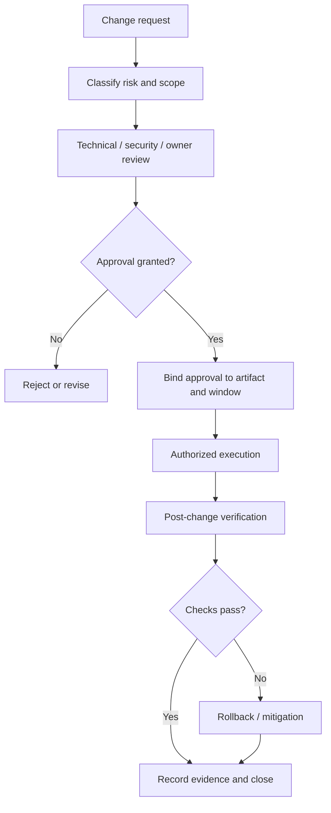
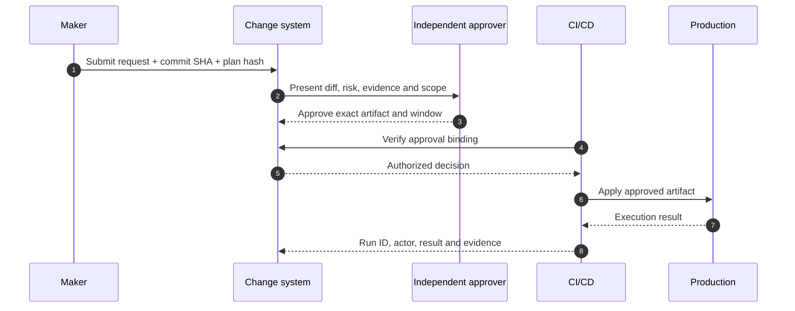

# Phân tách nhiệm vụ và phê duyệt thay đổi nhạy cảm

Trong hệ thống cloud, một thao tác có thể ảnh hưởng tới toàn bộ dịch vụ: thay policy IAM, mở quyền truy cập dữ liệu khách hàng, sửa firewall, tắt mã hóa, xóa bản sao lưu hoặc triển khai phiên bản mới. Nếu một người vừa đề xuất, tự phê duyệt, thực thi và xóa dấu vết của thay đổi, tổ chức khó ngăn lỗi vô ý, lạm dụng quyền hoặc hành vi có chủ đích.

**Phân tách nhiệm vụ (Segregation of Duties – SoD)** là nguyên tắc chia các bước hoặc quyền quan trọng cho những vai trò độc lập để một cá nhân không thể đơn phương thực hiện toàn bộ hành động có rủi ro cao. **Phê duyệt thay đổi nhạy cảm** là quy trình xác nhận thay đổi có mục đích hợp lệ, phạm vi phù hợp, rủi ro đã được đánh giá, người thực thi có quyền đúng mức và kết quả có thể kiểm chứng.

Trong module **CLOUD_ARCHITECTURE**, SoD liên quan trực tiếp IAM, account/subscription/project structure, CI/CD, network, database, KMS, backup, audit và vận hành production. Bài học dùng ví dụ nền tảng cho thuê thiết bị, nơi thao tác như cấp quyền đọc payment data, thay firewall hoặc xóa backup có thể gây tác động tài chính và bảo mật. Vai trò và ngưỡng phê duyệt trong bài là ví dụ; tổ chức cần điều chỉnh theo threat model, quy mô, nghĩa vụ pháp lý và khả năng vận hành.

## 1. Vì sao cần phân tách nhiệm vụ?

Một hệ thống kiểm soát tốt không chỉ hỏi “người này có quyền không?” mà còn hỏi “người này có nên tự thực hiện toàn bộ quy trình không?”. Quyền truy cập đơn lẻ có thể hợp lệ, nhưng kết hợp nhiều quyền có thể tạo xung đột lợi ích hoặc khả năng gây thiệt hại lớn.

Ví dụ, một nhân viên cần quyền tạo thay đổi firewall để xử lý ticket. Nếu cùng người đó có quyền phê duyệt, áp dụng rule trên production và xóa audit log, không còn điểm kiểm soát độc lập. Một lỗi CIDR có thể mở database ra Internet; một hành động cố ý có thể tạo đường truy cập trái phép và che giấu dấu vết.

| Rủi ro | Ví dụ | Hệ quả |
| --- | --- | --- |
| Lỗi thao tác | Operator xóa nhầm production database | Mất dữ liệu, downtime |
| Lạm dụng đặc quyền | Admin tự cấp quyền rồi truy cập payment data | Rò rỉ hoặc sửa dữ liệu |
| Phê duyệt hình thức | Người duyệt không hiểu phạm vi | Kiểm soát không có giá trị |
| Xung đột lợi ích | Người tạo giao dịch tự xác nhận hoàn tiền | Gian lận khó phát hiện |
| Thay đổi ngoài quy trình | Sửa firewall trực tiếp qua console | Không có review hoặc rollback |
| Che giấu dấu vết | Người thực thi có quyền xóa log | Khó điều tra và quy trách nhiệm |
| Credential compromise | Kẻ tấn công chiếm tài khoản admin dùng chung | Vượt qua nhiều lớp kiểm soát |

SoD giảm khả năng một cá nhân tạo và che giấu sai phạm, đồng thời tạo cơ hội để người khác phát hiện lỗi trước khi thay đổi có hiệu lực. SoD không loại bỏ thông đồng, account compromise hoặc lỗi hệ thống; cần kết hợp IAM, audit, monitoring và kiểm thử.

## 2. Phân biệt SoD, least privilege và maker-checker

| Khái niệm | Câu hỏi | Cơ chế |
| --- | --- | --- |
| **Least privilege** | Một identity cần quyền tối thiểu nào? | Giới hạn action, resource, scope và thời hạn |
| **Segregation of Duties** | Những quyền/bước nào không nên nằm trong cùng một actor? | Chia vai trò, account, approval và execution |
| **Maker-checker / four-eyes** | Ai tạo yêu cầu và ai kiểm tra/cho phép? | Người tạo khác người duyệt |
| **Separation of environments** | Quyền dev/test có thể tác động production không? | Tách account/project, credentials và deployment authority |
| **Privileged access management** | Làm sao cấp quyền cao có kiểm soát? | JIT access, session recording, approval và revocation |

Least privilege vẫn cần khi đã có SoD. Nhóm approver có thể tách khỏi nhóm operator, nhưng nếu cả hai đều có quyền Owner toàn organization thì phạm vi quyền vẫn quá rộng. Ngược lại, quyền tối thiểu của một người không tự ngăn họ vừa tạo vừa duyệt một thay đổi.

## 3. Nguyên tắc thiết kế SoD

1. **Vai trò độc lập:** người đề xuất, người phê duyệt và người thực thi được tách ở hoạt động rủi ro cao.
2. **Phạm vi tối thiểu:** quyền chỉ áp dụng cho resource, action, environment và thời gian cần thiết.
3. **Không tự duyệt:** maker không thể tự approve request do mình tạo.
4. **Approval gắn với nội dung:** người duyệt thấy artifact, diff, target và tác động thực tế.
5. **Bằng chứng được bảo vệ:** request, approval, execution và kết quả nằm trong audit trail độc lập.
6. **Quyền có thời hạn:** quyền đặc quyền tự hết hạn hoặc được revoke sau thao tác.
7. **Khả năng khẩn cấp:** có break-glass theo tiêu chí, giám sát và review sau sự kiện.
8. **Kiểm tra định kỳ:** rà soát quyền, conflict matrix, ngoại lệ và owner.

Không chia nhiệm vụ chỉ theo chức danh. Phải phân tích chuỗi hành động, quyền kỹ thuật thực tế và khả năng kết hợp quyền để vượt qua kiểm soát.

## 4. Xác định các nhiệm vụ nhạy cảm

| Domain | Thay đổi nhạy cảm | Lý do cần kiểm soát |
| --- | --- | --- |
| Identity/IAM | Tạo admin, đổi trust policy, cấp quyền cross-account | Mở rộng quyền kiểm soát toàn hệ thống |
| Network | Mở ingress, đổi route/security group/private endpoint | Phơi bày dịch vụ hoặc gây gián đoạn |
| Database | Drop table, đổi schema, export dữ liệu, quyền write | Mất dữ liệu hoặc thay đổi integrity |
| KMS/encryption | Disable/delete key, đổi key policy | Mất khả năng giải mã |
| Backup/DR | Xóa vault, rút ngắn retention, tắt immutable lock | Mất khả năng phục hồi |
| CI/CD | Đổi production pipeline, runner identity, artifact source | Code/config không được kiểm soát lên production |
| Logging/security | Tắt audit, đổi alert route, chỉnh detection policy | Giảm khả năng phát hiện và điều tra |
| Billing/cost | Tăng quota lớn, mua commitment, đổi budget control | Tác động tài chính |
| Data sharing | Cấp quyền export PII hoặc đối tác | Rủi ro privacy và rò rỉ dữ liệu |
| Production operations | Failover, rotate credential, delete resource | Downtime hoặc mất dữ liệu |

Phân loại dựa trên blast radius, reversibility, data sensitivity, financial impact, availability và khả năng phát hiện. Không phải mọi thay đổi production đều cần cùng số người duyệt.

## 5. Xây dựng ma trận xung đột quyền

Conflict matrix ghi lại nhiệm vụ hoặc quyền không được kết hợp:

| Nhiệm vụ A | Nhiệm vụ B | Xung đột? | Kiểm soát |
| --- | --- | --- | --- |
| Tạo payment/refund request | Phê duyệt refund của chính mình | Có | Maker-checker |
| Tạo IAM policy change | Tự approve và deploy policy đó | Có | Reviewer độc lập + pipeline gate |
| Chạy backup job | Xóa immutable backup vault | Có | Tách identity/account |
| Phát triển code | Approve production release do chính mình phát hành | Tùy mức rủi ro | Independent reviewer |
| Quản lý KMS key | Tự phê duyệt xóa key | Có | Dual control |
| Xem audit log | Xóa hoặc sửa audit log | Có | Tách quyền log administrator |
| Yêu cầu quyền khẩn cấp | Tự duyệt và cấp quyền khẩn cấp | Có | Approval/alert độc lập |

Ma trận phải chỉ rõ conflict xảy ra ở cấp người, group, role, workflow hay technical permission. Một người có thể mang hai chức danh khác nhau nhưng vẫn dùng cùng credential; khi đó SoD chỉ tồn tại trên giấy.

### Preventive và detective controls

- **Preventive control:** ngăn hành động ngay từ đầu, ví dụ policy cấm maker approve request của mình.
- **Detective control:** phát hiện trong hoặc sau hành động, ví dụ alert khi một identity tự nâng quyền.
- **Corrective control:** hạn chế tác động và phục hồi, ví dụ revoke quyền, rollback policy và rotate credential.

Thay đổi rủi ro cao nên dùng preventive control làm chính, detective/corrective làm lớp bổ sung. Chỉ dựa vào audit sau khi admin đã xóa dữ liệu không đủ để bảo vệ dữ liệu.

## 6. Vai trò trong quy trình thay đổi

| Vai trò | Trách nhiệm |
| --- | --- |
| **Requester/Maker** | Nêu nhu cầu, phạm vi, lý do, tác động và phương án |
| **Technical reviewer** | Kiểm tra thiết kế, diff, dependency, test và rollback |
| **Security reviewer** | Kiểm tra IAM, network, data classification và threat |
| **Business/data owner** | Xác nhận mục đích nghiệp vụ và acceptable impact |
| **Approver** | Quyết định theo risk tier và authority |
| **Implementer/Operator** | Thực thi đúng artifact, scope và cửa sổ đã duyệt |
| **Observer/Auditor** | Kiểm tra evidence, log, kết quả và ngoại lệ |

Ở đội nhỏ, một người có thể kiêm một số vai trò trong thay đổi ít rủi ro. Với thao tác critical, người đề xuất không được tự phê duyệt; người thực thi không được thay đổi artifact sau approval mà không tạo request mới. Tách danh tính quan trọng hơn việc tên vai trò khác nhau trên biểu mẫu.

### RACI minh họa

RACI gồm Responsible (thực hiện), Accountable (chịu trách nhiệm cuối), Consulted (được tham vấn) và Informed (được thông báo).

| Hoạt động | Maker | Tech reviewer | Security | Owner/Approver | Operator |
| --- | --- | --- | --- | --- | --- |
| Tạo change request | R | C | C | A | I |
| Đánh giá kỹ thuật | C | R | C | A | C |
| Đánh giá security | C | C | R | A | I |
| Quyết định approval | I | C | C | A/R | I |
| Thực thi | I | C | I | A | R |
| Xác minh sau thay đổi | C | R | C | A | R |
| Đóng change/audit | I | C | C | A | R |

Một approval có thể cần nhiều authority theo phạm vi, ví dụ data owner và security. Tránh gán nhiều Accountable mà không quy định ai có quyết định cuối.

## 7. Phân tầng mức rủi ro và số bước phê duyệt

Không nên áp quy trình nặng cho mọi thay đổi. Tạo risk tier dựa trên blast radius và tính không thể đảo ngược.

| Tier | Ví dụ | Kiểm soát gợi ý |
| --- | --- | --- |
| Low | Thay dashboard không chứa dữ liệu nhạy cảm | Peer review, automated test, change record |
| Medium | Đổi config service hoặc thêm quyền đọc dataset internal | Technical approval, owner notification, rollback |
| High | Mở network path, cấp quyền confidential, schema migration | Tech + security/owner review, staged rollout |
| Critical | Xóa KMS key, tắt audit, giảm backup retention, org-wide admin | Dual control, independent approvers, time-bound access, post-review |

Có thể dùng scoring tương đối: impact × likelihood × exposure × irreversibility. Phép nhân này chỉ hỗ trợ xếp hạng, không thay thế đánh giá định tính hoặc nghĩa vụ phê duyệt bắt buộc.

## 8. Quy trình change approval end-to-end

1. **Request:** lý do, mục tiêu, scope, resource, environment, owner và thời điểm.
2. **Risk classification:** tier, data sensitivity, blast radius, reversibility và dependency.
3. **Review:** diff/artifact, test, security, privacy, capacity và operational readiness.
4. **Approval:** đúng vai trò, đúng số người và không tự duyệt.
5. **Scheduling:** change window, freeze calendar, dependency và thông báo.
6. **Execution:** pipeline/identity được duyệt thực thi đúng artifact.
7. **Verification:** health check, postcondition, monitoring và business validation.
8. **Close:** evidence, outcome, exception và revoke quyền tạm thời.



Approval không nên chỉ là trạng thái “Approved”. Nó phải gắn với nội dung cụ thể đã được review, người duyệt, thời điểm, điều kiện và cửa sổ hiệu lực.

## 9. Nội dung cần có trong change request

| Trường | Nội dung |
| --- | --- |
| Change ID | Mã định danh duy nhất |
| Requester | Identity người tạo và team |
| Business reason | Lý do và kết quả mong muốn |
| Scope | Account/project, region, resource, tenant, environment |
| Change type | IAM, network, database, KMS, backup, application... |
| Risk tier | Low/Medium/High/Critical và lý do |
| Artifact/diff | Commit SHA, artifact digest, IaC plan hash, SQL checksum |
| Dependencies | Service, data product, consumer, team và vendor |
| Test evidence | Unit/integration/security/performance/restore test |
| Execution plan | Người thực thi, pipeline/command, change window |
| Rollback/mitigation | Điều kiện rollback, giới hạn và bước phục hồi |
| Monitoring | Metric, alert, postcondition và owner |
| Approval | Người duyệt, quyết định, thời điểm và điều kiện |

Không đưa password, secret, token hoặc PII không cần thiết vào ticket. Link tới evidence có access control và retention phù hợp.

## 10. Maker-checker và four-eyes principle

**Maker-checker** yêu cầu người tạo giao dịch/thay đổi khác người kiểm tra hoặc phê duyệt. **Four-eyes principle** yêu cầu ít nhất hai người độc lập nhìn nhận hành động quan trọng trước khi nó có hiệu lực.

Ví dụ, developer tạo IaC change mở private endpoint; technical reviewer kiểm tra route/security group/DNS; security approver xác nhận policy và scope; pipeline chỉ apply đúng commit được approve.

Với thay đổi critical có thể cần hai approval độc lập: technical authority và security/owner authority. Nhiều lần bấm approve không tự tạo independence nếu mọi approver thuộc cùng nhóm quyền hoặc một người kiểm soát credential của tất cả.

Điều kiện independence:

- Identity khác nhau, không dùng shared account.
- Reviewer không phải maker.
- Người duyệt có kiến thức và authority đúng phạm vi.
- Không có quyền tự sửa approval record.
- Workflow kiểm tra conflict theo user/group/role.
- Audit ghi rõ ai đã xem và quyết định.

### Approval theo quorum

Một số thay đổi có thể cần 2 trong 3 approvers từ các nhóm độc lập. Quy tắc phải nêu rõ nhóm nào được tính phiếu, có bắt buộc security approver không, maker có bị loại khỏi tập approver không, người thay thế được xử lý thế nào và approval hết hạn khi artifact/scope thay đổi ra sao.

## 11. Binding approval với artifact và execution

Một lỗi nguy hiểm là phê duyệt một bản diff nhưng pipeline thực thi artifact khác. Reviewer xem commit A, sau đó branch đổi và pipeline deploy commit B nhưng vẫn dùng approval cũ.

Để tránh:

- Gắn approval với commit SHA, artifact digest, IaC plan hash hoặc migration checksum.
- Khóa scope: account, region, resource và environment.
- Approval có expiry/time window.
- Nếu artifact, policy hoặc scope đổi thì invalidate approval.
- Pipeline xác minh approval token trước khi apply.
- Chỉ deploy artifact đã ký/đã qua kiểm tra.
- Ghi execution run ID và actor identity.



Approval binding biến phê duyệt thành một điều kiện kỹ thuật có thể enforce, thay vì một ghi chú trong chat.

## 12. Just-in-time privileged access

Quyền admin thường trực làm tăng blast radius khi credential bị lộ hoặc sử dụng sai. **Just-in-time (JIT) access** cấp quyền đặc quyền sau khi có nhu cầu hợp lệ, trong khoảng thời gian ngắn và phạm vi cụ thể.

Một workflow JIT:

1. Operator gửi yêu cầu kèm incident/change ID, resource và lý do.
2. Policy kiểm tra role, risk tier, eligibility và SoD.
3. Approver độc lập xác nhận nếu cần.
4. Identity provider/PAM cấp role tạm có TTL.
5. Session dùng MFA và có audit/recording theo policy.
6. Quyền tự hết hạn hoặc bị revoke sau công việc.
7. Đối chiếu hoạt động thực tế với request.

Không để một user có quyền tự cấp Owner cho chính mình. Quyền phê duyệt JIT, cấp role và thực thi cần được tách. Nếu hệ thống tự động cấp quyền theo policy, policy và service identity phải được bảo vệ độc lập.

Giới hạn quyền tạm theo role/action/resource, account/region, thời gian task; không cho tạo credential lâu dài nếu chưa có approval riêng; log session/command/API action theo chính sách.

## 13. Break-glass access: khẩn cấp nhưng vẫn có kiểm soát

Khi identity provider, approval system hoặc control plane gặp sự cố, quy trình bình thường có thể không hoạt động. Break-glass là đường truy cập khẩn cấp để phục hồi dịch vụ hoặc ngăn thiệt hại.

Break-glass phải:

- Chỉ dùng cho tình huống được định nghĩa trước.
- Tài khoản/credential được bảo vệ mạnh, không dùng hàng ngày.
- MFA hoặc cơ chế xác minh nhiều yếu tố phù hợp.
- Credential được lưu trong vault có kiểm soát.
- Alert tức thời khi sử dụng.
- Thời hạn và scope có giới hạn nếu nền tảng cho phép.
- Audit/log được gửi ra ngoài failure domain.
- Có post-incident review và rotate credential sau khi dùng.

Không nên bắt người vận hành chờ approval workflow không khả dụng khi hệ thống đang gây thiệt hại nghiêm trọng. Có thể cho phép emergency action theo tiêu chí cụ thể, nhưng phải ghi lý do, notify owner và review sau sự kiện. Nếu account emergency được dùng thường xuyên, cần xem lại quyền thường ngày hoặc JIT workflow.

## 14. Phân tách account, project và environment

| Environment/account | Mục đích | Kiểm soát |
| --- | --- | --- |
| Development | Phát triển và thử nghiệm | Developer quyền rộng hơn trên dữ liệu giả lập |
| Test/staging | Xác minh tích hợp và release | Dữ liệu masked/synthetic, quyền giới hạn |
| Production workload | Phục vụ khách hàng | Runtime identity hẹp, thay đổi qua pipeline |
| Security/logging | Audit, detection và security tooling | Production admin không thể xóa log |
| Backup/recovery | Bảo vệ recovery point | Tách quyền, immutable retention, restore role |
| Shared platform | Network, registry, CI/CD, identity | Quyền cross-account quản lý riêng |

Tách environment giảm nguy cơ developer credential chạm production. Tuy nhiên organization-level admin, central identity và CI/CD runner vẫn có thể tạo đường vượt boundary. Phải review trust relationship và quyền quản trị cấp cao.

## 15. Policy-as-code và tự động thực thi SoD

Policy-as-code đưa quy tắc kiểm soát vào dạng máy có thể kiểm tra, version-control và test. Ví dụ:

- Không cho user tạo request tự approve request đó.
- Không deploy artifact nếu commit SHA khác approval.
- Production deploy bắt buộc reviewer từ nhóm độc lập.
- IAM policy không được cấp wildcard admin cho runtime identity.
- Không tắt audit hoặc giảm backup retention nếu thiếu approval tier critical.
- Không deploy khi security scan critical fail.
- Tạm quyền phải có TTL và tự revoke.

Pseudocode:

```text
allow_deploy(request, approval, actor):
    require request.status == "APPROVED"
    require actor.id != request.maker_id
    require approval.approver_id != request.maker_id
    require approval.artifact_digest == request.artifact_digest
    require approval.environment == "production"
    require approval.scope == request.scope
    require now < approval.expires_at
    require approval.risk_tier >= required_approval_tier(request)
    return true
```

Đây là pseudocode, không phải cú pháp policy engine cụ thể. Implementation cần xử lý multi-approver, revocation, delegation, group membership và race condition.

Test cả trường hợp allow và deny: maker tự approve, approver độc lập đúng scope/artifact/window, commit thay đổi, approval hết hạn, người duyệt mất membership, deploy ngoài environment và emergency path.

## 16. Phê duyệt IAM và thay đổi quyền truy cập

IAM change có thể mở rộng quyền trên nhiều service. Reviewer cần xác minh principal/role, action, resource scope, trust policy, điều kiện network/MFA/session, thời hạn, khả năng thay đổi KMS/audit/backup và đường privilege escalation gián tiếp.

Ví dụ analyst yêu cầu đọc payment ledger:

1. Data owner xác nhận purpose và dataset.
2. Security kiểm tra classification và privacy.
3. Tạo read-only role chỉ cho view đã mask/curate.
4. Giới hạn tenant/region nếu cần.
5. Cấp quyền qua identity workflow có expiry/review date.
6. Audit query và rà soát access định kỳ.

Không cấp database admin nếu analyst chỉ cần đọc curated view.

### Access review

Định kỳ kiểm tra user nghỉ việc/chuyển nhóm, service identity không còn dùng, quyền tạm chưa revoke, admin membership tăng bất thường, trust policy trỏ principal cũ và role có wildcard/scope quá rộng. Access review cần owner chấp nhận hoặc thu hồi; một báo cáo không được xử lý không phải kiểm soát hiệu quả.

## 17. Phê duyệt network và security boundary change

Network change như mở inbound, peering, route, private link hoặc DNS forwarding có thể làm thay đổi đường tiếp cận dịch vụ. Reviewer nên xem:

- Source/destination CIDR và port.
- Direction và protocol.
- Resource/zone/region bị ảnh hưởng.
- Public/private exposure.
- Authentication/authorization ở lớp ứng dụng.
- Data classification đi qua đường mới.
- Logging, threat detection và expiration.
- Phương án rollback và kiểm tra từ bên ngoài.

Rule “temporary” phải có expiry thực thi được; không chỉ ghi ngày hết hạn trong ticket. Network policy nên được quản lý qua IaC và drift detection để tránh console change ngoài source control.

## 18. Phê duyệt database, backup và KMS change

**Database:** DDL destructive cần data owner/DBA review và recovery point; migration lớn cần test lock/replication/performance; export dữ liệu cần purpose, scope, destination và retention; schema change phải có compatibility và rollback/roll-forward plan.

**Backup/DR:** Xóa vault, giảm retention, tắt immutability hoặc thay destination là critical. Người tạo request không tự phê duyệt; cần approver độc lập từ security/backup authority; kiểm tra recovery copy khác và restore test; audit/alert ngoài production account.

**KMS:** Key disable/delete/schedule deletion cần approval riêng. Xem workload, backup và region phụ thuộc key; kiểm tra rotation/decryptability; có key recovery/break-glass procedure; không để production admin đơn phương xóa key bảo vệ backup.

## 19. Audit trail và bằng chứng phê duyệt

Audit trail phải tái dựng được ai yêu cầu, ai phê duyệt, nội dung gì, ai thực thi, khi nào và kết quả ra sao.

| Trường | Ý nghĩa |
| --- | --- |
| change_id | Liên kết mọi bước |
| requester_id | Người tạo |
| reviewer/approver_id | Người review/approve và role tại thời điểm đó |
| decision | Approve/reject/expire/revoke |
| artifact_digest | Nội dung cụ thể được duyệt |
| scope | Environment/resource/region |
| risk_tier | Phân loại rủi ro |
| timestamps | Created/reviewed/approved/executed/closed |
| execution_identity | Principal thực sự thực thi |
| run_id/result | Kết quả pipeline/command |
| evidence_refs | Test, diff, log, monitoring, rollback evidence |
| exception | Lý do bypass/break-glass và người review |

Log cần protected khỏi sửa/xóa bởi actor được audit. Dùng account/logging boundary riêng, retention policy và alert khi log ingestion ngừng. Không ghi secret hoặc PII không cần thiết.

Nếu ticket chỉ hiện “Approved” và “Done”, điều tra không biết reviewer đã xem artifact nào hoặc pipeline deploy cùng nội dung hay không. Lưu diff/digest, approval version và run ID giúp liên kết quyết định với hành động.

## 20. Ngoại lệ và thay đổi khẩn cấp

Incident có thể yêu cầu thay đổi khẩn cấp để ngăn mất dữ liệu hoặc khôi phục dịch vụ. Emergency change cần:

- Trigger rõ: incident/severity hoặc điều kiện kinh doanh khẩn cấp.
- Scope tối thiểu và thời hạn.
- Người có emergency approval hoặc quy tắc dual confirmation.
- Logging/recording được bật nếu có thể.
- Thông báo owner/security/incident commander.
- Post-implementation review trong thời hạn quy định.
- Xác nhận quyền tạm và config tạm đã được thu hồi/chuẩn hóa.

Ngoại lệ phải có expiry và owner. Nếu kéo dài, tạo risk acceptance chính thức, compensating controls và ngày review. Không để temporary admin tồn tại không thời hạn.

## 21. SoD trong CI/CD và software supply chain

CI/CD có thể trở thành đường thực thi quyền production mạnh nhất. Tách vai trò trên giao diện phê duyệt nhưng để developer sửa workflow có quyền deploy tự do thì kiểm soát có thể bị vô hiệu.

- Protected branches và mandatory review.
- CODEOWNERS/approval theo đường dẫn nhạy cảm.
- Tách quyền chỉnh pipeline khỏi quyền chạy deployment.
- Runner production dùng workload identity riêng và scope hẹp.
- Artifact immutable, ký và xác minh digest.
- Approval gắn với artifact.
- Environment protection rules/manual approval theo tier.
- Secret không được expose cho job untrusted.
- Audit workflow file, runner config và permission change.

Các file IAM, Terraform network, KMS, backup policy, production workflow và database migration có thể cần code owner/reviewer chuyên môn.

## 22. Quản trị service identity và automation

Service identity cũng cần SoD; CI runner có thể sở hữu quyền triển khai, thay IAM và xóa resource nếu policy quá rộng.

- Một service identity cho một nhiệm vụ/workload.
- Không chia sẻ key giữa pipeline và môi trường.
- Dùng short-lived token/workload identity nếu khả dụng.
- Giới hạn resource/action và trust condition.
- Tách backup writer khỏi backup deletion admin.
- Tách deploy identity khỏi IAM policy administrator.
- Rotate/revoke credential khi nghi compromise.
- Review ownership và last-used.

Automation phải có owner, source code/config version và audit identity.

## 23. Đánh đổi giữa tốc độ, an toàn và quy mô tổ chức

| Cách kiểm soát | Ưu điểm | Đánh đổi |
| --- | --- | --- |
| Hai người duyệt mọi thay đổi | Giảm hành động đơn phương | Chậm, approval fatigue |
| Risk-tiered approval | Tập trung thay đổi rủi ro cao | Cần phân loại chính xác |
| JIT access | Giảm quyền thường trực | Thêm bước cấp quyền và phụ thuộc identity/PAM |
| Policy-as-code | Enforce nhất quán, có thể kiểm thử | Logic policy phức tạp, cần bảo trì |
| Central approval board | Nhất quán và audit rõ | Có thể tạo bottleneck |
| Delegated domain approval | Nhanh, gần ngữ cảnh nghiệp vụ | Cần guardrail và access review |
| Break-glass | Phục hồi khi flow bình thường lỗi | Có nguy cơ bị lạm dụng |

Đội nhỏ có thể dùng reviewer độc lập theo lịch trực, approval tự động từ owner khác nhóm và log bất biến. Doanh nghiệp lớn có thể cần role catalog, policy engine, PAM, ticket integration và periodic access certification. Kiểm soát phải theo rủi ro và chứng minh được hiệu lực.

## 24. Những anti-pattern thường gặp

1. **Người tạo tự duyệt.** Maker-checker chỉ tồn tại trên giấy.
2. **Shared admin account.** Không xác định actor và không tách trách nhiệm.
3. **Approval cho branch nhưng deploy branch khác.** Không có artifact binding.
4. **Approver không có ngữ cảnh.** Không xem diff, risk hoặc test.
5. **Quyền admin thường trực.** Credential bị lộ có blast radius lớn.
6. **Break-glass không có review.** Đường khẩn cấp trở thành đường thường ngày.
7. **Temporary exception không expiry.** Quyền tạm thành quyền vĩnh viễn.
8. **Audit log do cùng admin quản lý.** Actor có thể che giấu hành động.
9. **Mọi thay đổi đều cần nhiều approval.** Approval fatigue làm kiểm soát hình thức.
10. **Policy-as-code không có negative test.** Không biết policy có chặn hành vi sai.
11. **Tách chức danh nhưng không tách credential.** Một người vẫn làm cả hai vai trò.
12. **Pipeline có quyền Owner toàn account.** Một thay đổi CI vượt mọi SoD khác.

## 25. Case study: thay đổi quyền truy cập payment ledger

Một analyst cần truy cập dataset payment để phân tích tỷ lệ hoàn tiền. Dữ liệu có transaction reference và một số trường nhận diện khách. Analyst không cần cập nhật giao dịch hoặc đọc toàn bộ PII.

Quy trình:

1. Analyst tạo request ghi purpose, dataset, thời hạn, query use case và team.
2. Data owner xác nhận business purpose và view phù hợp.
3. Privacy/security reviewer kiểm tra classification, masking và data minimization.
4. Platform tạo read-only role chỉ cho curated view, giới hạn region/tenant nếu cần.
5. Approval gắn với principal, policy version, dataset và expiry.
6. IAM workflow cấp membership tạm; không cấp database admin.
7. Query audit được theo dõi; access được review khi hết hạn.
8. Quyền tự revoke hoặc được thu hồi; ticket lưu decision và evidence.

Nếu analyst cần export, tạo request riêng nêu file format, destination, dữ liệu, recipient, retention và purpose. Approval đọc dataset không mặc nhiên bao gồm tải toàn bộ dữ liệu.

Nếu có incident production, break-glass chỉ dùng khi cần ngăn thiệt hại/khôi phục, với scope tối thiểu, alert ngay, log session và review sau sự kiện.

## 26. Case study: thay đổi firewall production

Booking API cần kết nối Payment Provider qua endpoint mới. Thay đổi cần bổ sung egress destination và cập nhật route/DNS.

| Bước | Người/vai trò | Bằng chứng |
| --- | --- | --- |
| Tạo change | Network engineer | CIDR, port, destination, reason |
| Technical review | Platform reviewer | Route, DNS, dependency, rollback |
| Security review | Security engineer | Egress policy, threat, logging |
| Business approval | Service owner | Impact và window |
| Execute | CI/CD network identity | Approved IaC commit digest |
| Verify | Operator/monitoring | Connectivity test, denied traffic, health |
| Close | Change owner | Audit, diff, outcome |

Pipeline chỉ apply digest đã duyệt. Nếu CIDR hoặc route đổi sau review, approval bị vô hiệu và cần review lại. Nếu emergency change áp dụng thủ công, lưu diff thực tế, lý do, actor và chuyển trạng thái về IaC chuẩn sau khi dịch vụ ổn định.

## 27. Đo lường hiệu quả SoD

Không đánh giá SoD chỉ bằng số lượng approval hoặc ticket đã hoàn tất. Đo mức bao phủ, chất lượng và chi phí vận hành.

| Metric | Cách đo | Dấu hiệu cần xem |
| --- | --- | --- |
| Sensitive change coverage | Tỷ lệ thay đổi nhạy cảm đi qua workflow | Thay đổi trực tiếp ngoài pipeline |
| Maker-checker compliance | Tỷ lệ request có reviewer độc lập | Self-approval hoặc identity trùng |
| Artifact binding success | Tỷ lệ deploy khớp digest đã duyệt | Drift giữa approval và execution |
| JIT privilege duration | Thời lượng quyền đặc quyền | Quyền dài bất thường |
| Orphaned privilege | Role/account không có owner hoặc last-used | Quyền thừa |
| Break-glass frequency | Số lần, lý do và action | Dùng thường xuyên hoặc thiếu review |
| Approval lead time | Thời gian từ request tới quyết định | Bottleneck/approval fatigue |
| Exception age | Tuổi ngoại lệ chưa đóng | Temporary control tồn tại lâu |
| Audit completeness | Tỷ lệ change có requester, approver, actor, artifact và result | Thiếu bằng chứng |
| Unauthorized change detection | Số thay đổi ngoài pipeline/policy | Guardrail chưa đủ |

Metric cần phân tích theo risk tier/domain. Lead time dài ở critical change có thể hợp lý; lead time dài cho mọi thay đổi nhỏ có thể là dấu hiệu workflow quá nặng.

## 28. Liên hệ với Well-Architected

| Trụ cột | Thiết kế hỗ trợ | Đánh đổi/rủi ro | Câu hỏi kiểm chứng |
| --- | --- | --- | --- |
| **Operational excellence** | Change workflow, RACI, audit, JIT và runbook | Thêm quy trình, tool và trách nhiệm bảo trì | Người trực có thể thay đổi an toàn đúng lúc? |
| **Security** | Least privilege, SoD, MFA, approval, environment separation | Policy phức tạp và ngoại lệ có thể bị lạm dụng | Một identity có thể tự cấp quyền, thực thi và xóa dấu vết? |
| **Reliability** | Review, staged rollout, rollback và break-glass | Approval quá chậm có thể trì hoãn khắc phục | Có emergency path khi approval system lỗi? |
| **Performance efficiency** | Quyền và thay đổi có kiểm soát giảm misconfiguration | Gate nặng kéo dài release | Approval time có phù hợp risk tier? |
| **Cost optimization** | Ngăn thay đổi gây tài nguyên ngoài dự kiến/gian lận | PAM, audit, workflow và reviewer có chi phí | Kiểm soát nào giảm rủi ro lớn nhất? |
| **Sustainability** | Chuẩn hóa role/policy và automation giảm thao tác lặp | Tooling metadata/audit cần storage | Có tự động hóa review và dọn quyền thừa? |

SoD là một phần của kiến trúc, không chỉ là thủ tục nhân sự. Quyền trong IAM, trust giữa account, pipeline, logging và khả năng phục hồi phải phản ánh các ranh giới trách nhiệm.

## 29. Quy trình thiết kế SoD và checklist

### Quy trình

1. **Inventory sensitive action:** lập danh sách thao tác có impact lớn, irreversible hoặc xử lý dữ liệu nhạy cảm.
2. **Map identity và privilege:** con người, group, service identity, pipeline, admin và break-glass.
3. **Tạo conflict matrix:** xác định tổ hợp quyền/bước không được cùng một actor thực hiện.
4. **Risk tier:** phân mức và số approval phù hợp.
5. **Thiết kế workflow:** maker, reviewer, approver, operator, evidence và expiry.
6. **Enforce bằng policy:** IAM, branch protection, deployment gate, JIT, resource lock và audit.
7. **Test:** self-approval, artifact mismatch, expired approval, privilege escalation và break-glass.
8. **Monitor:** access review, exception age, unauthorized change và audit completeness.
9. **Improve:** giảm approval fatigue, loại quyền thừa và diễn tập emergency flow.

### Checklist review

- Thao tác nhạy cảm và blast radius đã được inventory?
- Maker có bị chặn tự approve?
- Reviewer/approver độc lập về identity, quyền và trách nhiệm?
- Approval gắn với artifact digest, scope, environment và time window?
- Operator chỉ có quyền thực thi đúng thay đổi đã duyệt?
- Quyền admin thường trực được thay bằng JIT khi phù hợp?
- Service identity và CI/CD runner có least privilege?
- Account, production, security logging và backup có trust boundary phù hợp?
- Break-glass có điều kiện, alert, TTL/revoke và post-review?
- Audit log có actor, decision, artifact, execution và result?
- Policy-as-code có negative tests và review?
- Ngoại lệ có owner, expiry và risk acceptance?
- Có access certification và loại bỏ orphaned privilege?
- Thay đổi critical có rollback/mitigation và recovery point?
- Metric đo coverage, approval quality, exception age và unauthorized change?

## 30. Bài tập thực hành

### Bài tập A — Người tạo tự cấp quyền

Một engineer tạo IAM request, tự approve qua một group phụ và triển khai policy cấp Administrator cho chính mình.

**Câu hỏi:** cần kiểm soát ở những lớp nào?

**Gợi ý:** conflict check theo identity thực, deny self-approval, independent approver, protected policy repo, deployment identity tách biệt, artifact binding và alert privilege escalation. Đừng chỉ so sánh tên vai trò.

### Bài tập B — Approval cũ, artifact mới

Commit A được review và approve. Trước deploy, pipeline variable thay đổi destination và tạo artifact B nhưng vẫn dùng approval của A.

**Câu hỏi:** làm sao phát hiện và ngăn?

**Gợi ý:** approval gắn digest/plan hash và scope; pipeline verify tại thời điểm apply; artifact khác phải review lại.

### Bài tập C — Break-glass trong incident

Identity provider gặp lỗi trong khi database production cần failover khẩn cấp.

**Câu hỏi:** làm sao hành động nhanh nhưng vẫn giữ trách nhiệm?

**Gợi ý:** emergency identity được bảo vệ độc lập, MFA, scope tối thiểu, alert out-of-band, session/audit recording và post-incident review; sau đó rotate credential và reconcile quyền.

### Bài tập D — Temporary access không hết hạn

Contractor được cấp quyền đọc payment data trong hai ngày nhưng group membership còn tồn tại sáu tháng.

**Câu hỏi:** thiết kế nào ngăn tái diễn?

**Gợi ý:** JIT/TTL, automatic revocation, owner và end date, periodic access review, alert orphaned privilege và audit query.

### Bài tập E — Thay đổi backup retention

Admin muốn rút ngắn immutable retention vì chi phí storage tăng.

**Câu hỏi:** approval cần xem yếu tố gì?

**Gợi ý:** classification, legal hold, threat dwell time, RPO/RTO, recovery copy khác, cost analysis, restore drill, security/data owner approval và change window; policy cập nhật qua pipeline.

### Tiêu chí tự đánh giá

| Năng lực | Bằng chứng cần có |
| --- | --- |
| SoD design | Sensitive action inventory và conflict matrix |
| Approval | Risk tier, maker-checker, approver authority và artifact binding |
| Privileged access | JIT, MFA, TTL, revoke và break-glass |
| Automation | Policy-as-code, CI/CD gates và negative tests |
| Evidence | Audit trail liên kết request, approval, actor, artifact và outcome |
| Governance | RACI, exception register, access review và owner |
| Operations | Change runbook, rollback, monitoring và incident drill |

Phân tách nhiệm vụ giúp ngăn một actor đơn phương tạo, phê duyệt, thực thi và che giấu thay đổi rủi ro cao. Khi kết hợp least privilege, maker-checker, approval gắn artifact, JIT privileged access, break-glass có audit và policy-as-code, tổ chức có thể thay đổi cloud infrastructure với trách nhiệm rõ ràng mà vẫn duy trì tốc độ triển khai. Giá trị của kiểm soát được chứng minh bằng quyền thực tế, bằng chứng thực thi và khả năng phát hiện/khôi phục, không chỉ bằng số bước trong quy trình.
