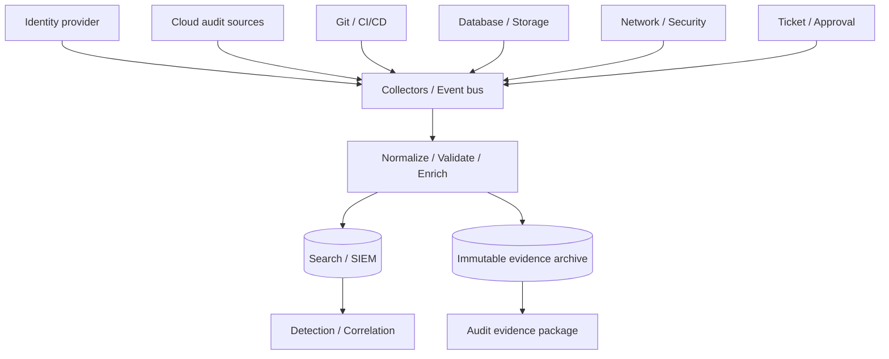
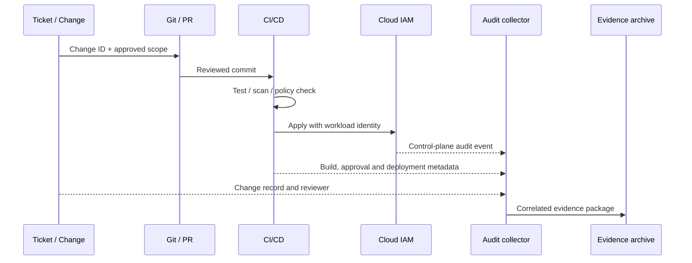

# Thu thập bằng chứng kiểm toán và truy vết thay đổi

## 1. Vì sao kiến trúc cloud cần bằng chứng và khả năng truy vết?

Một tổ chức có thể có quy trình phê duyệt, policy bảo mật và dashboard vận hành nhưng vẫn khó trả lời các câu hỏi cơ bản khi kiểm toán hoặc điều tra sự cố: Ai đã thay đổi quyền truy cập? Thay đổi được yêu cầu và phê duyệt ở đâu? Artifact nào được triển khai? Cấu hình production tại thời điểm đó là gì? Có bằng chứng cho thấy kiểm soát đã hoạt động và ai đã truy cập dữ liệu?

**Bằng chứng kiểm toán (audit evidence)** là thông tin có thể kiểm tra được, hỗ trợ chứng minh một hoạt động, quyết định hoặc kiểm soát đã diễn ra theo quy trình xác định. **Truy vết thay đổi (change traceability)** liên kết một thay đổi từ lý do nghiệp vụ đến phê duyệt, mã nguồn, pipeline, artifact, triển khai và trạng thái runtime.

Trong kiến trúc cloud, thay đổi có thể đến từ pull request, IaC, console, API, autoscaling, policy engine, managed service, operator hoặc automation. Nếu chỉ lưu application log, tổ chức có thể bỏ lỡ thay đổi ở control plane. Nếu chỉ giữ ảnh chụp màn hình, rất khó chứng minh nội dung, thời điểm và nguồn gốc một cách toàn vẹn.

Bài học thuộc chương **Quản trị và tuân thủ** của module **CLOUD_ARCHITECTURE**. Module học cách thiết kế ứng dụng cloud từ yêu cầu nghiệp vụ đến mạng, compute, dữ liệu và mô hình triển khai, cân bằng độ tin cậy, bảo mật, khả năng mở rộng, chi phí và vận hành theo Well-Architected. Khả năng thu thập bằng chứng và truy vết thay đổi giúp những quyết định kiến trúc, cấu hình và thao tác vận hành có thể giải thích, kiểm tra và tái dựng.

Sau bài học, bạn có thể:

- Xác định audit event, evidence source, owner và yêu cầu lưu giữ.
- Thiết kế chuỗi truy vết từ yêu cầu đến thay đổi runtime.
- Thu thập bằng chứng từ identity, cloud control plane, CI/CD, IaC, dữ liệu và vận hành.
- Bảo vệ tính toàn vẹn, nguồn gốc, thời gian và khả năng truy cập của bằng chứng.
- Thiết kế retention, privacy, access control, export và evidence package.
- Tự động hóa thu thập, kiểm tra completeness và chuẩn bị cho audit/incident.

## 2. Phân biệt log, audit event, evidence và record

Các khái niệm có liên quan nhưng không thể dùng thay thế nhau.

| Khái niệm | Mục đích | Ví dụ |
|---|---|---|
| Operational log | Chẩn đoán hành vi của ứng dụng/hệ thống | Request timeout, worker retry |
| Audit event | Ghi nhận hành động có ý nghĩa về bảo mật/quản trị | User đổi role, admin tạo access key |
| Evidence | Tài liệu hoặc dữ liệu chứng minh một assertion/control | Audit event, policy snapshot, approval, test result |
| Record of decision | Lưu quyết định, người chịu trách nhiệm và lý do | ADR, exception approval |
| Change record | Liên kết một thay đổi với yêu cầu và triển khai | Ticket, PR, build, release, deployment |

Một log line có thể trở thành evidence nếu có nguồn gốc, ngữ cảnh, độ tin cậy, bảo vệ và lưu giữ phù hợp. Ngược lại, một ảnh dashboard không nhất thiết là evidence đủ tốt nếu không có thời điểm, phạm vi, bộ lọc, người xuất và cách bảo đảm không bị sửa.

### 2.1. Assertion và evidence

Bắt đầu từ câu muốn chứng minh:

- “Mọi thay đổi production đều được phê duyệt.”
- “Quyền truy cập production được cấp theo least privilege.”
- “Database backup được thực hiện và restore có thể hoạt động.”
- “Dữ liệu nhạy cảm chỉ được truy cập bởi principal được phép.”
- “Release có thể truy về commit và artifact đã được kiểm tra.”

Sau đó xác định loại bằng chứng cần có, ví dụ approval record, CI policy result, cloud audit event, IAM policy snapshot, backup job result và restore test. Không thu thập một lượng log lớn mà không biết đang chứng minh assertion nào.

## 3. Xác định phạm vi audit và yêu cầu bằng chứng

### 3.1. Xác định đối tượng và kiểm soát

Ghi rõ:

- Hệ thống, cloud account/project/subscription, region và environment.
- Dữ liệu, workload, identity và tài nguyên thuộc phạm vi.
- Control hoặc yêu cầu cần chứng minh.
- Khoảng thời gian và tần suất kiểm tra.
- Người sở hữu control, người thu thập và người review evidence.
- Nguồn dữ liệu chuẩn, hệ thống lưu trữ và quyền truy cập.

Scope cần phù hợp với kiến trúc thực tế. Một control “MFA cho admin” phải xét identity provider, break-glass account, service principal và federation path; chỉ xem cấu hình một nhóm người dùng là chưa đủ.

### 3.2. Tạo evidence matrix

| Control/Assertion | Evidence source | Bằng chứng | Owner/cadence |
|---|---|---|---|
| Production change có approval | Ticket/PR/release system | Request, reviewer, approval timestamp | Release owner / mỗi lần change |
| IAM least privilege | Cloud IAM, policy-as-code | Policy snapshot, review result, access simulation | Security / định kỳ và khi đổi |
| Data access được audit | Database/cloud audit logs | Principal, action, resource, outcome | Data owner / liên tục |
| Backup có thể phục hồi | Backup service, restore exercise | Job result, restore record, integrity check | DBA/SRE / theo lịch |
| Artifact có nguồn gốc | CI/CD, registry, signing service | Commit, build ID, digest, signature, provenance | Platform / mỗi release |
| Network boundary được quản trị | IaC, firewall/security group logs | Desired state, deployed state, change approval | Network owner / mỗi change |

Evidence matrix nên chứa assertion, control ID, nguồn chuẩn, query/export method, format, owner, tần suất, retention, access policy và tiêu chí chấp nhận.

## 4. Mô hình audit event thống nhất

Để nối dữ liệu từ nhiều hệ thống, cần một schema event đủ nhất quán. Một audit event thường có:

- **Event identity:** event ID duy nhất, loại event và schema version.
- **Time:** timestamp, timezone/UTC, nguồn đồng hồ và thông tin ingestion nếu cần.
- **Actor:** user/service principal, session hoặc workload identity.
- **Action:** hành động được thực hiện, ví dụ create/update/delete/assume-role/deploy.
- **Target:** resource ID, account/project, region và tenant scope.
- **Outcome:** success/failure, error code hoặc policy decision.
- **Context:** request/correlation ID, change/ticket/PR/release ID.
- **Origin:** source system, API, console, pipeline hoặc automation.
- **Integrity/provenance:** chữ ký, checksum, collector identity hoặc metadata chứng minh nguồn.

Không phải mọi hệ thống hỗ trợ đầy đủ tất cả trường. Khi thiếu trường quan trọng, ghi rõ limitation thay vì tự suy đoán.

### 4.1. Ví dụ audit event

```json
{
  "event_id": "evt-01JABC...",
  "schema_version": "1.0",
  "event_type": "iam.policy.updated",
  "event_time": "2026-11-18T04:20:31Z",
  "ingested_at": "2026-11-18T04:20:32Z",
  "actor": {
    "type": "federated_user",
    "principal_id": "principal-42",
    "session_id": "session-abc"
  },
  "action": "UpdatePolicy",
  "target": {
    "resource_id": "role/booking-deployer",
    "account": "prod-account",
    "region": "ap-southeast-1"
  },
  "outcome": "success",
  "change_ref": "CHG-1842",
  "source": "cloud-control-plane",
  "request_id": "req-98f..."
}
```

Đây là schema minh họa, không đại diện định dạng chuẩn của một nhà cung cấp. Không đưa access token, password, private key hoặc toàn bộ payload nhạy cảm vào audit event. Principal và resource ID cũng có thể cần masking hoặc giới hạn người xem.

### 4.2. Event time và ingestion time

Event time là thời điểm nguồn ghi nhận hành động; ingestion time là thời điểm hệ thống thu thập nhận được event. Chênh lệch giữa hai mốc giúp phát hiện log delivery delay hoặc source outage. Đồng hồ các hệ thống có thể lệch nhau, vì vậy dùng UTC, đồng bộ thời gian, lưu source timestamp và tránh suy ra thứ tự nhân quả chỉ từ timestamp.

### 4.3. Không ghi audit bằng cùng đường log dễ bị actor xóa

Nếu một workload có thể thay đổi dữ liệu và xóa log của chính nó, bằng chứng dễ bị sửa cùng lúc với hành động. Nên gửi audit event đến collector/stream độc lập, tách quyền write/read/admin và lưu trữ có kiểm soát. Hành động có đặc quyền cần audit từ control plane/provider hoặc nguồn độc lập nếu có.

## 5. Truy vết thay đổi end-to-end

Một thay đổi production cần liên kết được các bước:

1. Nhu cầu nghiệp vụ hoặc security finding.
2. Change request/ticket và đánh giá rủi ro.
3. Architecture decision hoặc exception nếu cần.
4. Pull request/commit và review.
5. CI workflow, test, scan và policy evaluation.
6. Build artifact, version, digest và provenance.
7. Approval/release record.
8. Deployment target, actor/workload identity và thời điểm.
9. Runtime state, health/SLO và kết quả sau triển khai.
10. Rollback/incident record nếu thay đổi thất bại.

### 5.1. Change traceability chain

```mermaid
flowchart LR
    NEED[Business / security requirement] --> TICKET[Change ticket]
    TICKET --> ADR[ADR / risk review]
    ADR --> PR[Pull request + commit]
    PR --> CI[CI tests / scans / policy]
    CI --> ART[Signed artifact + digest]
    ART --> APPROVAL[Release approval]
    APPROVAL --> DEPLOY[Deployment event]
    DEPLOY --> RUNTIME[Runtime state / SLO]
    RUNTIME --> REVIEW[Post-change review]
```



Chuỗi này phải dùng ID ổn định để liên kết dữ liệu. Ticket ID trong commit message có ích nhưng không đủ nếu có thể nhập tùy ý; hệ thống cần xác minh rằng commit, PR, build và deployment thực sự thuộc cùng release.

### 5.2. Truy vết IaC

Với Infrastructure as Code:

- Commit xác định desired state.
- Pipeline ghi lại plan/preview và policy check.
- Approval liên kết với đúng commit/plan artifact.
- Apply record ghi actor, workspace/environment, state version và outcome.
- Cloud audit event ghi tài nguyên thực sự thay đổi.
- Drift detection so sánh deployed state với desired state.

Không coi file IaC trong Git là bằng chứng rằng production đang chạy đúng cấu hình đó. Cần liên kết commit với apply và kiểm tra trạng thái thực tế.

### 5.3. Truy vết thay đổi ngoài pipeline

Console, CLI, SDK, emergency session, autoscaling và managed service có thể thay đổi tài nguyên mà không đi qua quy trình release thông thường. Cần:

- Ghi cloud control-plane audit event.
- Áp dụng policy ngăn hoặc cảnh báo thay đổi ngoài pipeline theo mức rủi ro.
- Ghi nhận exception/emergency ticket và người phê duyệt.
- Chạy drift detection để tìm trạng thái không khớp.
- Tự động tạo change record/incident follow-up khi có thay đổi không liên kết được.

Không phải mọi thay đổi runtime đều là thay đổi thủ công; autoscaling và control loop có thể là hành vi dự kiến. Cần phân loại actor và nguồn automation.

## 6. Nguồn bằng chứng trong kiến trúc cloud

| Nguồn | Bằng chứng thường có | Điều cần kiểm tra |
|---|---|---|
| Cloud control plane audit | API action, principal, resource, region, outcome | Coverage account/region/service, delivery và retention |
| Identity provider | Login, MFA, federation, group/role changes | Principal mapping, service account, break-glass |
| CI/CD | Commit, workflow, test, approval, deploy | Artifact digest, runner identity, log integrity |
| Git/code hosting | Review, branch protection, commit history | Force push/admin bypass và retention |
| IaC/policy engine | Plan, apply, policy result, drift | Desired vs deployed state |
| Database | Login, DDL/DML audit, grant/revoke, backup | Query coverage, sensitive data redaction, privilege |
| Network/security service | Firewall/WAF/DNS/VPC flow events | Sampling, flow direction, retention, clock |
| Object storage | Access, policy changes, object lifecycle | Data access logs, versioning, retention lock |
| KMS/HSM/secret manager | Key use, rotation, secret access | Principal, key version, denied events |
| Observability/SIEM | Correlation, alert, incident | Data lineage và người có thể sửa/xóa |
| ITSM/change management | Request, approval, exception, closure | Reviewer identity, timestamps, linkage |

Một nguồn có thể không đủ cho một assertion. Ví dụ CI báo deployment success nhưng cloud audit event giúp xác nhận role thực sự đã thay đổi resource; runtime config snapshot giúp xác nhận trạng thái sau deploy.

## 7. Thu thập bằng chứng tập trung

Một kiến trúc evidence pipeline có thể gồm:



Pipeline nên có:

- Collector identity riêng và quyền đọc tối thiểu ở từng nguồn.
- Durable buffer/queue để chịu source hoặc collector outage.
- Schema validation, source tagging và dead-letter handling.
- Idempotent ingestion để xử lý duplicate.
- Timestamp/source metadata và clock monitoring.
- Monitoring cho ingestion lag, drop count, parse failure và coverage.
- Archive độc lập với quyền quản trị workload được giám sát.

### 7.1. Completeness và coverage

Một log archive có dữ liệu không có nghĩa là thu thập đầy đủ. Cần đối chiếu:

- Số account/region/service đã bật audit.
- Nguồn nào ngừng gửi, event nào bị drop hoặc parse lỗi.
- Khoảng thời gian thiếu dữ liệu.
- Collector bị mất quyền, quota hoặc network connectivity.
- Event types có được bật đầy đủ không.
- Retention/immutability có áp dụng đồng nhất.

Thiếu event không được diễn giải là không có hành động. Báo cáo cần phân biệt “không phát sinh event” với “không có dữ liệu chứng minh”.

## 8. Bảo vệ tính toàn vẹn và nguồn gốc evidence

Evidence chỉ hữu ích khi có thể tin rằng nó đến từ nguồn được xác định và không bị thay đổi ngoài kiểm soát.

### 8.1. Integrity controls

- Tách quyền tạo, đọc, xóa và quản trị evidence.
- Dùng storage versioning và retention lock/immutable policy khi yêu cầu.
- Hash hoặc ký manifest/export để phát hiện thay đổi.
- Lưu manifest ngoài cùng đối tượng được bảo vệ, có audit truy cập.
- Kiểm tra signature/provenance cho artifact và log export khi nguồn hỗ trợ.
- Giám sát hành động tắt audit, đổi retention, xóa log hoặc thay đổi collector.
- Sao lưu archive và thử restore/verification.

Hash chứng minh nội dung không đổi so với hash đã lưu; nó không tự chứng minh nội dung ban đầu là đúng hoặc nguồn phát đáng tin. Cần gắn hash với source identity, timestamp, collection method và chain of custody.

### 8.2. Chain of custody

Khi export evidence phục vụ audit hoặc điều tra:

1. Ghi ai thu thập, thời gian, nguồn, query/filter và phạm vi.
2. Ghi tool/version, export format và timezone.
3. Tạo checksum hoặc chữ ký cho file/manifest.
4. Lưu bản gốc read-only trong kho được kiểm soát.
5. Ghi mọi lần copy, transfer, transform và người nhận.
6. Nếu chuẩn hóa/redact, giữ quan hệ tới bản gốc và mô tả phép biến đổi.
7. Kiểm tra integrity trước khi nộp hoặc sử dụng trong điều tra.

Không chỉnh sửa file evidence gốc để làm đẹp; tạo bản dẫn xuất và ghi rõ nguồn.

### 8.3. Chống sửa/xóa bằng separation of duties

Một nhóm quản trị production không nên một mình có thể thay đổi workload, xóa audit archive và sửa IAM của collector. Tách:

- Workload/platform operator.
- Audit collector identity.
- Evidence archive administrator.
- Evidence reader/auditor.
- Security monitoring administrator.

Với hành động đặc quyền, dùng approval/JIT access, session recording hoặc immutable audit tùy rủi ro. Quyền break-glass cần được audit độc lập và review sau sử dụng.

## 9. Bằng chứng về identity và quyền truy cập

Các câu hỏi thường cần trả lời:

- Ai đã đăng nhập và dùng phương thức xác thực nào?
- MFA/federation/session policy có được áp dụng?
- Ai đã assume role hoặc cấp quyền?
- Quyền được cấp theo ticket nào, trong bao lâu?
- Service principal nào truy cập resource?
- Access bị từ chối có được ghi lại không?
- Credential/key được tạo, rotate, revoke và dùng bởi ai?

Identity evidence cần mapping principal ID ổn định, không chỉ display name có thể đổi. Cần phân biệt user, group, service account, workload identity, federated principal và role session.

### 9.1. Access review

Một access review có thể gồm:

1. Export danh sách principal/role/resource từ nguồn authoritative.
2. Đối chiếu owner, business purpose và ticket cấp quyền.
3. Phát hiện quyền không dùng, quyền quá rộng, wildcard và role không có owner.
4. Xác nhận quyền privileged, emergency và cross-account.
5. Thu hồi hoặc điều chỉnh theo approval.
6. Lưu snapshot trước/sau, reviewer, thời gian và kết quả.

Ảnh chụp danh sách user không chứng minh role effective access nếu có policy inheritance, group nesting, permission boundary hoặc resource policy. Cần dùng công cụ phân tích quyền hiệu lực khi nền tảng hỗ trợ.

## 10. Bằng chứng về dữ liệu và kiểm soát vận hành

### 10.1. Database và data access

Bằng chứng có thể gồm login/access audit, role/grant changes, DDL, query audit cho bảng nhạy cảm, backup status, encryption configuration và restore test. Cần kiểm soát log volume và tránh lưu parameter chứa PII/secret không cần thiết.

### 10.2. Backup và restore

Backup job success chỉ chứng minh tác vụ tạo bản sao báo thành công. Một control hoàn chỉnh cần cả:

- Backup coverage theo database, region và tenant tier.
- Retention, encryption và quyền archive.
- Backup failure alert và retry.
- Restore exercise với RTO/RPO đo được.
- Integrity/consistency validation sau restore.
- Bằng chứng ứng dụng đọc/ghi được sau khôi phục.

### 10.3. Network và security control

Bằng chứng gồm desired/deployed firewall rules, route tables, WAF policy, private endpoint, DNS change, security group change và flow logs. Flow log có thể bị sampling hoặc không chứa payload; cần ghi giới hạn và không coi nó là bằng chứng đầy đủ cho mọi request.

### 10.4. Incident và exception

Incident record nên nối alert, timeline, actor/action, affected resources, mitigation, approval, forensic evidence, customer impact và corrective action. Exception phải có lý do, scope, owner, expiry, compensating controls và review date; exception không có ngày hết hạn dễ biến thành policy ngầm.

## 11. Retention, privacy và data minimization

Audit evidence có thể chứa user ID, IP address, resource name, query metadata và thông tin vận hành nhạy cảm. Lưu giữ lâu hơn không phải lúc nào cũng tốt hơn.

Thiết kế retention cần xét:

- Nghĩa vụ pháp lý/hợp đồng và policy nội bộ áp dụng.
- Điều tra bảo mật, forensic và nhu cầu tái dựng thay đổi.
- Data classification, privacy và jurisdiction.
- Storage cost, index cost và tốc độ truy xuất.
- Legal hold, deletion request và quy trình hết hạn.
- Backup/replica của archive và khả năng xóa theo chính sách.

Không tự đặt thời hạn retention chung cho mọi dữ liệu. Owner pháp lý/compliance và data owner phải xác nhận yêu cầu áp dụng. Nếu có legal hold, cần cơ chế ngăn xóa và lưu lại ai đặt/gỡ hold.

### 11.1. Giảm dữ liệu nhạy cảm

- Không ghi password, private key, bearer token hoặc secret đầy đủ vào log.
- Mask/redact payload và identifier khi không cần nội dung thật.
- Dùng pseudonymous ID cho phân tích nếu đáp ứng mục đích.
- Tách quyền đọc audit metadata khỏi quyền đọc payload nghiệp vụ.
- Giới hạn export, ghi audit của thao tác tìm kiếm/tải evidence.
- Xử lý dữ liệu trong staging và bản sao forensic theo chính sách tương tự nguồn.

Redaction phải nhất quán để không phá khả năng correlation. Khi cần evidence gốc, cấp quyền theo quy trình riêng thay vì mở toàn archive cho mọi auditor.

## 12. Chuẩn bị evidence package cho audit

Evidence package cần giúp người review hiểu assertion, phạm vi, nguồn, kết quả và limitation mà không phải tự tìm toàn bộ hệ thống.

### 12.1. Cấu trúc gợi ý

```text
evidence-package/
  manifest.yaml
  scope-and-assertions.md
  control-matrix.csv
  source/
    cloud-audit/
    identity/
    cicd/
    database/
    backup-restore/
  derived/
    change-traceability-report.csv
    access-review-summary.pdf
  integrity/
    checksums.txt
    signatures/
  limitations.md
```

Đây là ví dụ cấu trúc; không phải mọi audit cần đúng các file này.

### 12.2. Manifest

Manifest có thể ghi:

- Package ID, mục đích, kỳ audit và scope.
- Control/assertion được hỗ trợ.
- Evidence file ID, source system, query/filter, collected_at và collector identity.
- Format, record count, byte size, checksum/signature.
- Redaction/transformations.
- Retention/classification và access restrictions.
- Missing source, time gap hoặc known limitation.

### 12.3. Evidence quality review

Trước khi phát hành:

1. Evidence đúng assertion và đúng thời kỳ?
2. Source có authoritative và scope đầy đủ?
3. Có actor, timestamp, resource, action và outcome?
4. Có thể truy về ticket/PR/release hoặc control owner?
5. Integrity/checksum/signature đã kiểm tra?
6. Export có bị cắt, filter hoặc sampling không?
7. Redaction và privacy đã review?
8. Limitation và khoảng trống đã được ghi?
9. Reviewer độc lập đã xác nhận?

Evidence package không nên che giấu khoảng trống. Ghi rõ dữ liệu không sẵn có, nguồn chưa bật hoặc giới hạn kỹ thuật; đề xuất remediation riêng.

## 13. Ví dụ truy vết một thay đổi IAM production

Giả sử đội Booking cần cấp một service role quyền đọc object prefix chứa hóa đơn. Quy trình có thể là:

1. Ticket nêu business purpose, resource scope, owner, duration và risk.
2. Security reviewer xác nhận least privilege và điều kiện truy cập.
3. Pull request thay đổi IaC policy; reviewer và status check được lưu.
4. CI chạy unit/policy test, IaC scan và tạo artifact/plan có digest.
5. Release approval tham chiếu đúng commit và artifact.
6. Pipeline dùng federated workload identity để apply.
7. Cloud audit log ghi principal, action, resource, outcome và request ID.
8. Policy snapshot/runtime check xác nhận quyền thực tế.
9. Access review xác nhận role có đúng scope và expiry.
10. Evidence collector liên kết ticket, PR, build, approval, apply event và policy snapshot bằng change ID.

### 13.1. Sơ đồ truy vết



Nếu deployment dùng console emergency, chuỗi chuẩn có thể bị đứt. Hệ thống cần emergency change ticket, cloud audit evidence và post-change review để phục hồi traceability.

## 14. Automation và kiểm soát liên tục

Thu thập thủ công một lần mỗi năm dễ bỏ sót, tốn thời gian và không phản ánh trạng thái hiện tại. Có thể tự động hóa:

- Bật audit logging và phát hiện account/region mới chưa được cấu hình.
- Thu thập cloud audit, identity, CI/CD và policy evaluation liên tục.
- Chuẩn hóa event schema và gắn change ID.
- Kiểm tra deployment không có commit/build/approval link.
- Phát hiện IAM, network hoặc storage drift.
- Theo dõi log ingestion delay, missing source và retention policy drift.
- Tạo evidence package định kỳ cho các control đã xác định.
- Cảnh báo khi audit bị tắt, archive bị sửa/xóa hoặc quyền reader thay đổi bất thường.

Automation cần version hóa query, collector, parser và policy. Khi thay đổi parser, lưu schema version và tránh diễn giải lại bằng format mới mà mất bản gốc.

## 15. Rủi ro và anti-pattern thường gặp

| Anti-pattern | Hậu quả | Cải thiện |
|---|---|---|
| Chỉ lưu app log | Bỏ lỡ IAM/control-plane change | Thu thập provider audit và CI/CD evidence |
| Console change không có ticket | Không rõ lý do/approval | Change policy, emergency workflow, drift detection |
| Evidence nằm trong account production | Actor compromise có thể xóa cả workload và log | Archive độc lập, tách quyền, retention lock |
| Chỉ chụp dashboard | Thiếu query, scope, source và integrity | Export raw records + manifest |
| Log không có correlation ID | Không liên kết event và change | Propagate stable request/change/release ID |
| Retention quá ngắn | Không đáp ứng audit/incident | Retention theo control, pháp lý và risk |
| Giữ mọi payload vô thời hạn | Tăng privacy risk và chi phí | Data minimization, redaction, lifecycle |
| Dùng timestamp đơn lẻ | Dễ sai khi clock skew hoặc ingestion delay | UTC, source time, ingestion time và source ID |
| Chỉ thu thập success event | Bỏ qua denied/failed actions | Ghi cả success, failure và policy denial |
| Auditor dùng admin credential | Tăng blast radius, khó phân trách nhiệm | Read-only scoped role, JIT và audit |
| Evidence không có owner | Khoảng trống không được khắc phục | Control owner, cadence, due date |

## 16. Đánh giá theo Well-Architected

| Trụ cột | Câu hỏi đánh giá |
|---|---|
| **Operational Excellence** | Audit sources có owner? Thu thập tự động, có dashboard completeness, runbook, change linkage và review cadence? |
| **Security** | Evidence có integrity, source provenance, least-privilege access, immutable retention và privacy controls? |
| **Reliability** | Collector/queue chịu được outage? Có buffer, retry, gap detection, archive backup và restore test? |
| **Performance Efficiency** | Ingestion/indexing có partition, retention tier và query path phù hợp? Audit không gây tải quá mức lên workload? |
| **Cost Optimization** | Raw log, index và immutable archive có lifecycle/tiering; retention dựa yêu cầu thực? |
| **Sustainability** | Tự động hóa collection, giảm export lặp và xử lý dữ liệu dư thừa theo retention? |

## 17. Mẫu evidence/control matrix

YAML dưới đây là mẫu mô tả control và evidence, không phải cấu hình một cloud provider:

```yaml
evidence_control:
  control_id: GOV-CHANGE-007
  assertion: production_changes_are_approved_and_traceable
  scope:
    environments:
      - production
    accounts:
      - booking-prod
  sources:
    - system: change_management
      records:
        - request
        - approval
    - system: git_ci_cd
      records:
        - pull_request
        - commit
        - test_result
        - artifact_digest
        - deployment
    - system: cloud_audit
      records:
        - principal
        - action
        - resource
        - outcome
  correlation:
    key: change_id
    required_links:
      - ticket_to_pull_request
      - commit_to_build
      - build_to_deployment
      - deployment_to_runtime_change
  integrity:
    checksum_manifest: required
    immutable_archive: required
  governance:
    owner: platform_governance
    reviewer: security_audit
    collection: continuous
    retention: policy_defined
    access: scoped_read_only
  exceptions:
    require_owner: true
    require_expiry: true
    require_compensating_control: true
```

Các giá trị scope, retention và owner phải được tổ chức điền theo thực tế. Không suy ra một thời hạn retention hoặc compliance framework từ ví dụ này.

## 18. Quy trình triển khai khả năng audit và traceability

1. **Xác định assertion/control:** nêu câu hỏi cần chứng minh và phạm vi.
2. **Lập evidence matrix:** nguồn chuẩn, trường cần có, owner, cadence, retention và tiêu chí chất lượng.
3. **Thiết kế event schema:** actor, action, target, outcome, time, source và correlation IDs.
4. **Bật nguồn audit:** identity, cloud control plane, CI/CD, IaC, database, network, storage và provider.
5. **Thiết kế collector/archive:** buffering, normalization, validation, immutable storage và separation of duties.
6. **Nối change chain:** ticket → approval → PR/commit → build → artifact → deploy → runtime state.
7. **Thiết lập completeness/integrity checks:** event gap, source coverage, checksums, signatures và retention drift.
8. **Định nghĩa privacy/access:** redaction, role, JIT access, legal hold và deletion.
9. **Tạo evidence package:** manifest, raw evidence, derived report, limitations và review record.
10. **Diễn tập:** truy vết một thay đổi, audit một access event, phục hồi archive và xử lý một khoảng trống log.

## 19. Bảng kiểm trước production

- [ ] Mỗi assertion/control có scope, owner và evidence matrix.
- [ ] Nguồn audit bao phủ account, region, identity, CI/CD, data và network cần thiết.
- [ ] Event có actor, action, target, outcome, source, timestamp và correlation/change ID phù hợp.
- [ ] Ghi cả success, failure, denied action và thay đổi cấu hình.
- [ ] Event time và ingestion time được phân biệt; clock/source được giám sát.
- [ ] Ticket, approval, PR/commit, build, artifact digest, deployment và runtime state liên kết được.
- [ ] Console/emergency change có exception record, audit và post-change review.
- [ ] Collector có durable buffer, retry, idempotency, schema validation và gap detection.
- [ ] Archive tách quyền, có integrity check, immutable retention khi yêu cầu và backup/restore test.
- [ ] Evidence export có manifest, query/filter, collector identity, checksum và chain of custody.
- [ ] Retention, privacy, redaction, legal hold và deletion đã được owner xác nhận.
- [ ] Auditor có read-only scoped access; privileged access/JIT được audit.
- [ ] Completeness dashboard phân biệt không có event với mất dữ liệu.
- [ ] Evidence package ghi rõ limitation, missing source và residual risk.
- [ ] Automation/query/parser được version hóa và có owner.

**Nguyên tắc áp dụng:** bằng chứng kiểm toán phải chứng minh được một assertion cụ thể, có nguồn gốc, phạm vi, thời gian và tính toàn vẹn. Truy vết thay đổi phải nối lý do và phê duyệt với commit, artifact, triển khai và trạng thái thực tế. Khi audit pipeline độc lập, thu thập đầy đủ và được bảo vệ, kiến trúc cloud có thể giải thích điều gì đã xảy ra, ai thực hiện, vì sao thay đổi được chấp thuận và kiểm soát nào đã hoạt động.
