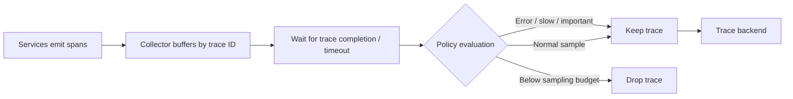
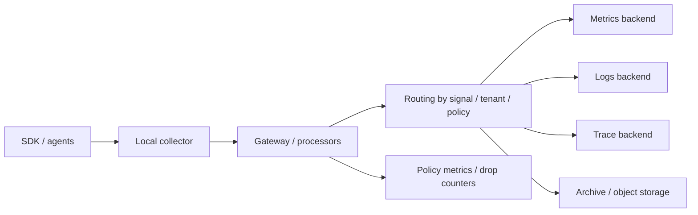

# Chính sách lấy mẫu, cardinality và chi phí dữ liệu quan sát

## 1. Vì sao observability cần một chính sách dữ liệu?

Một nền tảng cloud tạo ra metrics, logs, traces, events và profiling data để hiểu trạng thái hệ thống. Khi số service, instance, tenant và request tăng, lượng telemetry cũng tăng theo. Thu thập mọi sự kiện ở mức chi tiết nhất có thể làm tăng chi phí ingest, index, lưu trữ, truy vấn và truyền dữ liệu; đồng thời cardinality cao có thể khiến backend metrics chậm hoặc không ổn định.

**Observability data policy** xác định tín hiệu nào được thu thập, mức chi tiết, cách lấy mẫu, nhãn nào được phép, thời gian lưu, nơi lưu và ai được truy cập. Policy tốt phải giữ đủ dữ liệu để phát hiện vấn đề, đo SLO, điều tra sự cố và chứng minh hoạt động; đồng thời giới hạn dữ liệu thừa, nhạy cảm và quá đắt.

Ba khái niệm cần phối hợp:

- **Sampling (lấy mẫu):** chỉ giữ một phần events, spans hoặc log records theo quy tắc.
- **Cardinality:** số lượng giá trị duy nhất hoặc tổ hợp label/attribute có thể tạo ra series/index key khác nhau.
- **Observability cost:** chi phí thu thập, truyền, xử lý, index, lưu trữ, truy vấn, export và vận hành telemetry.

Lấy mẫu giảm volume nhưng có thể làm mất tín hiệu hiếm. Giảm cardinality làm backend ổn định hơn nhưng có thể khiến khó phân biệt các nhóm lỗi. Giảm retention hạ storage cost nhưng làm ngắn cửa sổ điều tra. Vì vậy cần thiết kế theo mục tiêu vận hành và mức độ quan trọng của từng loại tín hiệu.

Trong module **CLOUD_ARCHITECTURE**, chương **Khả năng quan sát** đặt policy telemetry trong bối cảnh kiến trúc cloud cần cân bằng độ tin cậy, bảo mật, khả năng mở rộng, chi phí và vận hành.

Sau bài học, người học có thể phân biệt sampling, filtering, aggregation, downsampling và retention; chọn head-based, tail-based, probabilistic, rate-limited và adaptive sampling; ước lượng cardinality; thiết kế labels và attributes có giới hạn; đặt ngân sách telemetry; tối ưu ingest, storage, indexing và query cost; bảo đảm sampling không phá SLO, audit hoặc yêu cầu bảo mật.

## 2. Các loại dữ liệu observability có đặc tính khác nhau

| Signal | Đơn vị dữ liệu | Dùng để trả lời | Cost driver thường gặp |
| --- | --- | --- | --- |
| Metrics | Time series/sample | Hệ thống đang ở trạng thái nào? | Active series, scrape frequency, samples, retention |
| Logs | Log event/record | Điều gì đã xảy ra? | Event volume, byte size, indexing, retention |
| Traces | Trace/span | Request đi qua các thành phần nào và chậm ở đâu? | Trace rate, spans per trace, attribute size, sampling |
| Events | State change/business event | Điều gì đã thay đổi? | Event rate, payload, replay và retention |
| Profiles | Stack sample/time profile | CPU/memory tiêu thụ ở đâu? | Profile frequency, sample detail, retention |
| Dumps/artifacts | Heap/core dump, diagnostic bundle | Trạng thái sâu tại thời điểm lỗi? | Kích thước lớn, sensitivity, storage và access |

Không nên dùng cùng sampling ratio hoặc retention cho tất cả signals. Metrics tổng hợp thường cần giữ liên tục để đo xu hướng và SLO. Traces có thể lấy mẫu theo request. Debug logs có thể giảm mạnh trong normal operation. Audit/security events có thể phải giữ theo policy độc lập và không được rơi vào sampling thông thường.

## 3. Sampling, filtering, aggregation và downsampling

| Kỹ thuật | Hoạt động | Ví dụ |
| --- | --- | --- |
| Sampling | Giữ một phần bản ghi theo xác suất hoặc policy | Giữ 10% request traces |
| Filtering | Loại bản ghi theo điều kiện | Không thu health-check access log |
| Aggregation | Gộp nhiều bản ghi thành thống kê | Đếm request theo route/status |
| Downsampling | Giảm độ phân giải theo thời gian | Từ sample mỗi giây thành mỗi phút |
| Deduplication | Loại bản ghi trùng | Deduplicate event theo event ID |
| Redaction | Xóa/che trường nhạy cảm | Loại authorization header |
| Retention | Giữ dữ liệu trong thời gian xác định | Hot 7 ngày, archive 90 ngày |
| Tiering | Chuyển dữ liệu giữa tầng lưu trữ | Hot index sang cold object storage |

Một pipeline có thể kết hợp nhiều bước. Ví dụ access logs: redact trước khi rời process, filter noisy health checks, aggregate request count thành metrics, sample một phần debug logs, rồi áp dụng retention theo loại dữ liệu.

Thứ tự xử lý quan trọng:
- Redaction diễn ra trước khi dữ liệu nhạy cảm đi tới hệ thống downstream không được phép nhận nó.
- Sampling nên đặt ở nơi có đủ context để chọn dữ liệu có giá trị, nhưng cần cân nhắc chi phí truyền trước sampler.
- Aggregation phải giữ dimensions phục vụ SLO và phân tích; gộp quá sớm làm mất khả năng phân biệt.
- Retention áp dụng theo class và nghĩa vụ lưu giữ; không dùng retention ngắn để né audit/legal requirement.

## 4. Head-based sampling

Head-based sampling quyết định giữ trace ngay khi bắt đầu, thường ở SDK hoặc instrumentation layer. Quyết định có thể dựa trên xác suất, parent sampling flag hoặc rule có sẵn lúc request khởi tạo.

Ví dụ giữ xác suất 10%:

```text
sampled = deterministic_hash(trace_id) % 100 < 10
```

Dùng hash ổn định giúp quyết định nhất quán giữa các service nếu trace context được truyền đúng.

Ưu điểm:
- Giảm traffic ngay tại source.
- Dễ triển khai và dự đoán tỷ lệ.
- Giảm chi phí exporter, network và backend.
- Service downstream có thể kế thừa sampling decision.

Hạn chế:
- Chưa biết request cuối cùng có lỗi hoặc chậm hay không.
- Trace đã drop ở đầu thường không thể khôi phục ở tail collector.
- Lỗi hiếm có thể không được giữ nếu xác suất nhỏ.
- Tỷ lệ xác suất không đồng nghĩa giữ đúng tỷ lệ từng service/tenant khi traffic mix thay đổi.

Phù hợp với high-volume traffic tương đối đồng đều, nơi cần giảm volume ổn định và chấp nhận mất ngẫu nhiên một phần trace bình thường.

## 5. Probabilistic và deterministic sampling

**Probabilistic sampling** giữ mỗi record với xác suất p. Nếu có N records tương đối đồng đều:

```text
Expected retained records = N × p
Expected dropped records = N × (1 - p)
```

Ví dụ 5 triệu spans/ngày với p = 0,02 sẽ giữ trung bình khoảng 100.000 spans/ngày. Đây là kỳ vọng, số thực tế có dao động.

**Deterministic sampling** dùng hash của trace ID, request ID hoặc key ổn định để cùng một logical request luôn được chọn hoặc bỏ nhất quán. Cần dùng đúng key: hash user ID có thể tạo bias theo tenant; hash timestamp có thể tập trung khi pattern thời gian lặp lại.

### 5.1. Sampling có trọng số

| Traffic class | Sampling policy minh họa | Lý do |
| --- | --- | --- |
| Health check | Drop hoặc ratio rất thấp | Tín hiệu lặp lại, có metric riêng |
| Normal read | 1–5% | Volume cao |
| Booking/payment | Tỷ lệ cao hơn hoặc trace có điều kiện | Tác động nghiệp vụ lớn |
| Error response | Giữ 100% trong phạm vi budget | Giá trị chẩn đoán cao |
| Slow request | Giữ nếu vượt latency threshold | Giá trị chẩn đoán cao |
| Internal batch | Theo job type và chu kỳ | Dễ aggregate theo job |

Sampling ratio phải được đánh giá cùng trace volume và budget. Giữ 100% mọi error có thể tạo spike trong sự cố diện rộng; cần giới hạn payload, quota và đường lưu trữ dự phòng nhưng tránh loại bỏ bằng chứng quan trọng.

## 6. Tail-based sampling

Tail-based sampling trì hoãn quyết định tới khi collector nhận đủ một trace hoặc đủ thời gian chờ để đánh giá các spans. Policy có thể ưu tiên trace có status error, vượt latency threshold, có retry/exception, thuộc tenant/operation critical hoặc chứa span thuộc dependency quan trọng.



Ưu điểm: giữ trace bất thường mà head sampling có thể bỏ qua. Hạn chế:
- Collector cần buffer state theo trace ID.
- Trace phải được route về cùng decision point hoặc collector tier phối hợp.
- Trace dài hoặc spans đến trễ gây timeout và partial trace.
- Buffer, memory, CPU và network tăng.
- Khi toàn hệ thống lỗi, số trace cần giữ tăng đột biến.

Tail sampling phù hợp khi trace lỗi/chậm có giá trị cao hơn trace bình thường và tổ chức có thể vận hành collector tier đủ capacity.

### 6.1. Trace decision window

Collector cần đợi một khoảng để nhận spans. Window quá ngắn khiến trace bị đánh giá khi chưa đủ dữ liệu; quá dài làm memory occupancy và decision latency tăng.

Phải đo trace completion delay, late span ratio, buffer occupancy/eviction, decision wait duration, trace size distribution và export backlog. Root span kết thúc không nhất thiết đồng nghĩa mọi async child span đã tới collector.

## 7. Adaptive và rate-limited sampling

Adaptive sampling điều chỉnh tỷ lệ theo traffic, error rate, service importance hoặc budget. Rate-limited sampling đặt giới hạn số trace/events giữ trong một khoảng thời gian.

Ví dụ:

```text
keep up to 200 normal traces / second
prioritize eligible error and slow traces
use remaining budget for probabilistic baseline traces
```

Rate limit bảo vệ backend khỏi traffic spike nhưng tạo nguy cơ drop nhiều dữ liệu trong sự cố. Có thể ưu tiên:
1. Critical operation theo business policy.
2. Lỗi và latency vượt threshold.
3. Trace đại diện mỗi service/version/region.
4. Baseline normal traffic.
5. Debug detail không thiết yếu.

Adaptive controller cần tránh dao động: error rate tăng khiến policy giữ nhiều trace; volume tăng làm collector quá tải; collector drop trace lại khiến controller hiểu sai. Dùng smoothing, minimum/maximum ratio, hysteresis và hard budget.

## 8. Sampling metrics: cần thận trọng

Metrics thường được lưu dưới dạng time series và dùng cho alert/SLO. Random sampling từng metric point có thể làm sai rate, percentile và detection.

Bỏ ngẫu nhiên counter samples có thể tạo sai số, nhất là counter reset hoặc traffic burst. Với histogram, bỏ observations trước aggregation làm quantile không còn chính xác.

Thay vào đó:
- Giảm cardinality qua label design.
- Dùng histogram bucket hợp lý.
- Aggregate ở source hoặc recording rule.
- Scrape interval phù hợp với dynamics của metric.
- Downsample sau khi giữ dữ liệu độ phân giải cao đủ lâu.
- Giữ raw SLI measurements đủ để tính SLO theo window.

### 8.1. Histogram và percentile

Nếu backend dùng histogram aggregation, có thể tổng hợp bucket counts giữa instances rồi ước lượng quantile. Summary quantile tính cục bộ thường không thể cộng gộp chính xác giữa instances. Không coi p95 của từng instance trung bình lại là p95 toàn hệ thống.

Khi giảm bucket hoặc đổi histogram schema, bảo đảm service dùng schema tương thích và recording rules được cập nhật.

### 8.2. SLO và error budget

Không để sampling policy làm sai mẫu số/tử số của SLI:
- Request count/error count lấy từ counter phù hợp, không đếm từ sampled traces.
- Availability SLI dựa trên eligible requests.
- Latency SLI cần histogram hoặc measurements có coverage đủ.
- Trace sample dùng để giải thích nguyên nhân, không thay metric SLI có tính hệ thống.

## 9. Cardinality là gì?

Cardinality là số lượng giá trị duy nhất của một dimension hoặc số tổ hợp dimensions tạo thành series/index entries khác nhau.

Với metric time series, mỗi tổ hợp metric name và label set thường là một series riêng. Ví dụ:

```text
http_requests_total{
  service="booking",
  method="POST",
  status="500",
  region="region-a"
}
```

Nếu service có 8 methods, 6 status codes, 4 regions, 20 versions và 500.000 user IDs, upper bound tổ hợp lý thuyết là:

```text
8 × 6 × 4 × 20 × 500,000
= 1,920,000,000 combinations
```

Không phải mọi tổ hợp đều xuất hiện, nhưng một dimension high-cardinality có thể làm series count tăng rất nhanh.

### 9.1. Cardinality thấp và cao

| Dimension | Cardinality dự kiến | Nhận xét |
| --- | --- | --- |
| environment | Thấp | dev/staging/prod |
| region | Thấp-vừa | Các region cố định |
| service | Thấp-vừa | Catalog service hữu hạn |
| HTTP method | Rất thấp | GET/POST/PUT/DELETE |
| status class | Rất thấp | 2xx/4xx/5xx |
| route template | Thấp-vừa | /bookings/{id}, không phải raw path |
| pod/instance ID | Có thể cao | Scale và rollout tạo churn |
| tenant ID | Có thể rất cao | Nhiều khách hàng |
| user ID/email | Rất cao | Không nên làm metric label mặc định |
| request/trace ID | Gần như duy nhất | Không dùng làm metric label |
| raw URL/query | Rất cao | Có thể chứa PII hoặc token |

Không có ngưỡng cardinality chung cho mọi backend. Tác động phụ thuộc ingestion rate, retention, index implementation, shard topology và workload query.

## 10. Ước lượng series cardinality

Giả sử metric có 5 dimensions độc lập với cardinality lần lượt 4, 6, 10, 8 và 20:

```text
Series upper bound = 4 × 6 × 10 × 8 × 20 = 38,400
```

Nếu thêm tenant ID với 10.000 giá trị:

```text
New upper bound = 38,400 × 10,000
                = 384,000,000
```

Đây là upper bound lý thuyết. Cardinality thực tế cần đo từ series đang hoạt động, không chỉ nhân danh sách dimension.

### 10.1. Active series và total unique values

Một label có 10.000 giá trị có thể chỉ dùng một phần trong một khoảng thời gian. Nhưng khi rollout hoặc tenant churn, series có thể được tạo rồi ngừng hoạt động; backend vẫn có cost cho ingestion/index và retention metadata tùy implementation.

Cần theo dõi active series, new series/hour, series churn rate, series theo metric name, cardinality theo label và top contributors theo service/team/tenant.

## 11. Thiết kế label cardinality thấp

Metric labels nên đại diện cho dimension phân tích ổn định, hữu hạn và có ý nghĩa vận hành.

Nên dùng service, environment, region, HTTP method, status class, route template, operation type, job type, result enum và dependency name đã chuẩn hóa.

Tránh user/customer email, session ID, request ID, trace ID, raw URL/query string, exception message đầy đủ, SQL text, object key, timestamp, UUID hoặc random value.

### 11.1. Route template thay raw path

Không tạo label từ /bookings/12345 vì mỗi booking ID tạo series khác. Dùng route template /bookings/{bookingId} để các request cùng endpoint được aggregate.

Nếu cần phân tích một booking cụ thể, dùng trace/log field có retention và access control phù hợp, không đưa ID đó vào metric label.

### 11.2. Normalize và bucket hóa

- Chuyển status code thành class khi không cần chi tiết từng code.
- Bucket payload size/latency thay raw numeric values.
- Normalize exception class thay exception message.
- Giới hạn enum cho feature flag hoặc result code.
- Map tenant thành tier/plan/region cho aggregate metrics; phân tích từng tenant qua query/log có kiểm soát.

Bucketization giảm cardinality nhưng làm mất độ chi tiết. Chọn bucket theo câu hỏi vận hành.

## 12. Cardinality trong logs và traces

Metrics không phải nơi duy nhất chịu cardinality.

### 12.1. Logs

High-cardinality fields như request ID, user ID và resource ID có thể hữu ích khi tìm kiếm incident, nhưng index mọi field làm tăng index storage và query cost.

Policy có thể giữ fields cần filter thường xuyên ở index; lưu payload/field ít dùng ở object storage hoặc non-indexed field; dùng structured logs và schema ổn định; redact PII/secret trước ingestion; giới hạn field length/value cardinality; áp dụng TTL khác nhau cho debug, application và audit logs.

### 12.2. Traces

Trace/span attributes có thể chứa user ID, tenant ID, URL, SQL statement hoặc error message. Backend trace thường index một số attributes; index high-cardinality có thể tốn nhiều tài nguyên.

Giữ request ID trong trace hữu ích cho correlation nhưng cần quyết định đó là indexed attribute hay chỉ searchable payload. Không đưa raw values vào metric dimensions chỉ vì chúng xuất hiện trong span.

### 12.3. Correlation không gây cardinality explosion

Dùng trace ID trong logs hoặc link từ log record sang trace backend. Không cần biến trace ID thành metric label. Metric cảnh báo lỗi tăng; trace/log giúp tìm request cụ thể sau khi alert kích hoạt.

## 13. Ingestion volume và mô hình chi phí

```text
Telemetry monthly cost =
    ingest / processing
  + active-series or indexing charges
  + hot storage
  + warm/cold archive
  + query / scan
  + export / network
  + collector and pipeline compute
  + retention / compliance overhead
```

Mỗi vendor tính phí khác nhau: theo GB ingest, event count, host, active series, indexed spans, query scan, retention tier hoặc commit capacity. Không dùng một rate chung; đọc pricing model và hóa đơn thực tế của backend.

### 13.1. Ước lượng log volume

Nếu service tạo 2.000 log events/s, event trung bình 1,2 KB và hoạt động 24 giờ:

```text
Daily raw volume =
  2,000 events/s × 1.2 KB × 86,400 s
  = 207,360,000 KB
  ≈ 207.36 GB/day (decimal)

Monthly raw volume (30 days)
  ≈ 6,220.8 GB
  ≈ 6.22 TB/month
```

Đây là raw volume trước compression, filtering, sampling, replication và vendor-specific overhead. Thay đổi nhỏ về event size hoặc log rate có thể tăng cost hàng TB/tháng.

### 13.2. Ước lượng traces

Giả sử 8.000 requests/s, trung bình 12 spans/trace và sampling 5%:

```text
Spans per second retained =
  8,000 × 12 × 0.05
  = 4,800 spans/s

Daily retained spans =
  4,800 × 86,400
  = 414,720,000 spans/day
```

Còn cần nhân với average encoded span size và xét attributes, resource metadata, batching, compression cùng indexing.

### 13.3. Ước lượng metrics samples

```text
Samples per day =
  active time series
  × samples per second per series
  × 86,400
```

Ví dụ 100.000 series scrape mỗi 15 giây:

```text
100,000 × (1 / 15) × 86,400
= 576,000,000 samples/day
```

Scrape interval ngắn gấp đôi gần như nhân đôi sample rate nếu active series không đổi. Active series và churn thường có tác động lớn hơn chỉ nhìn số metric names.

## 14. Logs: sampling và retention

Không drop logs bằng một tỷ lệ ngẫu nhiên duy nhất. Phân nhóm theo severity, source và purpose:

| Log class | Chính sách gợi ý |
| --- | --- |
| Security/audit | Theo policy bắt buộc, integrity và access control; không sampling tùy tiện |
| Error/fatal | Giữ đầy đủ trong budget, giới hạn payload và deduplicate noise |
| Warning | Giữ theo source/condition; aggregate warning lặp |
| Info business event | Chọn event cần thiết, sampling/aggregation nếu chấp nhận |
| Debug/trace logs | Tắt hoặc sampling thấp bình thường; bật có thời hạn |
| Health/access noise | Filter hoặc aggregate nếu không cần từng record |

### 14.1. Log storm

Khi một lỗi tạo log mỗi lần retry, hệ thống có thể tạo nhiều TB log trong thời gian ngắn. Cần rate limit theo source/service, deduplicate repeated messages, giữ first/last occurrence và count, giới hạn stack trace/payload size, backoff cho exporter và buffer bounded. Phân biệt drop telemetry với drop business event.

Không để log pipeline lỗi làm chặn critical request hoặc làm đầy filesystem.

### 14.2. Retention theo mục đích

Hot searchable logs có thể giữ ngắn; archive có thể giữ lâu hơn với chi phí thấp hơn. Audit/security logs có yêu cầu riêng về retention, immutability và residency. Phân biệt application debugging với record có giá trị pháp lý/bảo mật.

## 15. Metrics: giảm cardinality và giữ chất lượng SLI

Metrics dùng phát hiện xu hướng và đo SLO cần policy ổn định hơn debug telemetry.

- Chọn metric hữu hạn và có owner.
- Dùng histogram buckets hợp lý.
- Dùng recording rules cho aggregate phổ biến.
- Tách business SLI khỏi metric debug.
- Drop label không phục vụ câu hỏi vận hành.
- Giới hạn label values và kiểm tra schema trong CI.
- Giữ baseline resolution trong cửa sổ SLO cần đo.
- Downsample dữ liệu cũ sau thời gian phân tích chi tiết.

Không aggregate mất failure dimension quan trọng. Nếu chỉ giữ tổng request count mà không có status class hoặc region, khó thấy lỗi ở một vùng. Ngược lại, giữ raw user ID tạo cardinality lớn. Chọn dimensions hữu ích như service, region, route template, status class và workload tier.

### 15.1. Cardinality budget

Đặt budget theo team/service:
- Maximum active series.
- Maximum series churn/day.
- Maximum labels per metric.
- Approved label keys.
- Maximum distinct values cho label có thể kiểm soát.
- Alert khi vượt budget hoặc tăng bất thường.

Budget là guardrail để bắt thiết kế xấu sớm, không phải hạn mức tùy tiện làm mất metric cần thiết. Exception cần owner, lý do và expiry.

## 16. Traces: giữ trace có giá trị

Trace sampling policy nên cân bằng baseline và exceptional evidence.

1. Giữ 100% traces có error cho operation critical trong hard budget.
2. Giữ traces vượt latency threshold.
3. Giữ tỷ lệ baseline theo route/service/region.
4. Giữ traces thuộc canary/version mới hoặc experiment quan trọng.
5. Rate limit theo tenant/service để một nguồn không chiếm hết capacity.
6. Khi budget cạn, giảm normal traces trước exceptional traces.
7. Emit sampling decision metadata để phân tích coverage.

### 16.1. Head và tail sampling phối hợp

Có thể head sample ở SDK để giảm traffic, sau đó tail sample ở collector trong số trace đã được gửi. Nhưng tail sampler không thể giữ trace đã drop ở head. Với traffic cần giữ lỗi đầy đủ, phải bảo đảm head policy chuyển đủ candidates tới tail sampler hoặc dùng instrumentation path phù hợp.

### 16.2. Sampling probability và tỷ lệ đại diện

Nếu error traces được giữ 100% nhưng normal traces chỉ 1%, tỷ lệ lỗi trong tập trace lưu trữ cao hơn thực tế. Không tính SLI trực tiếp từ tập sampled traces nếu chưa hiệu chỉnh và chứng minh estimator phù hợp.

## 17. Retention, downsampling và storage tiers

| Tier | Mục tiêu | Dữ liệu phù hợp |
| --- | --- | --- |
| Hot | Điều tra incident gần đây, query nhanh | Metrics/logs/traces chi tiết |
| Warm | Phân tích xu hướng và sự cố cũ | Aggregated logs, downsampled metrics |
| Cold/archive | Audit, compliance hoặc long-term reference | Immutable logs, snapshots/exports |
| Expired | Không còn mục đích hợp lệ | Xóa theo retention/lifecycle |

### 17.1. Downsampling metrics

Ví dụ dữ liệu resolution 15 giây được gộp thành 1 phút rồi 5 phút. Điều này giảm sample count nhưng có thể bỏ qua spike ngắn và thay đổi quantile behavior. Nếu cần điều tra incident kéo dài 30 giây, dữ liệu 5 phút không đủ.

Giữ raw resolution trong cửa sổ incident thường dùng; downsample sau đó. Với counter/rate và histogram, dùng aggregation đúng semantics thay vì average mọi sample.

### 17.2. Retention budget

```text
Stored volume ≈
  ingest bytes/day
  × retention days
  × effective storage multiplier
```

Storage multiplier phụ thuộc compression, index, replication, metadata và backend. Không giả định compressed payload tương đương dung lượng billed.

## 18. Cost attribution và chargeback/showback

Chi phí observability thường là shared platform cost, nhưng nguồn phát sinh đến từ service/team/tenant khác nhau. **Showback** phân bổ để nhìn thấy cost; **chargeback** tính chi phí vào ngân sách đơn vị sử dụng.

Có thể phân bổ theo ingest GB/service/environment/team, active series và churn, indexed logs/spans, retained GB-day, query scan/compute, export/network egress và collector CPU/memory.

### 18.1. Không phân bổ chỉ theo request count

Một service ít request nhưng log payload lớn hoặc trace nhiều spans có thể đắt hơn service có nhiều request nhỏ. Dùng cost driver phản ánh volume thực tế và độ phức tạp index/retention.

### 18.2. Cost dashboard

Dashboard nên hiển thị tổng cost theo signal, cost theo service/team/environment, cost per 1.000 requests hoặc business transaction, ingest GB/day và growth, active series/churn, indexed versus non-indexed volume, retention tier, query/export cost, budget/forecast/variance.

Gắn owner cho top contributors. Tránh chỉ báo cáo hóa đơn cuối tháng vì khó tìm nguồn tăng.

## 19. Privacy, security và compliance

Telemetry có thể chứa PII, token, email, query text, SQL parameters, tenant identifier hoặc thông tin hạ tầng nhạy cảm.

- Redact/mask ở source hoặc collector trước hệ thống bên ngoài.
- Không log password, access token, cookie, authorization header hoặc secret.
- Giới hạn trace/log attributes có thể đến từ request.
- Tenant isolation và access control trong observability workspace.
- Encryption in transit/at rest và key management.
- Retention theo classification, legal hold và residency.
- Audit truy cập telemetry nhạy cảm.
- Quy trình deletion/subject request nếu thu thập dữ liệu định danh.
- Không dùng sampling để né nghĩa vụ giữ audit/security event.

Cardinality cao và privacy thường cùng xuất hiện: user ID vừa tạo series/index explosion vừa là định danh nhạy cảm. Loại khỏi metric labels và chỉ giữ dạng được kiểm soát trong log/trace khi thực sự cần.

## 20. Pipeline architecture và kiểm soát tại từng tầng



| Layer | Controls |
| --- | --- |
| Application/SDK | Instrumentation scope, attribute allowlist, head sampling, redaction |
| Node/local collector | Buffer bounded, batch, compression, local filtering |
| Gateway collector | Tail sampling, routing, tenant quotas, schema enforcement |
| Backend | Index policy, retention tier, downsampling, query limits |
| Archive | Encryption, immutability, lifecycle, restore/access policy |
| Governance | Ownership, budget, approval, data classification |

### 20.1. Buffer và backpressure

Collector không nên queue vô hạn. Khi backend chậm:
- Buffer có giới hạn dung lượng/thời gian.
- Export retry có backoff và jitter.
- Drop policy ưu tiên giữ signal quan trọng trong budget.
- Không chặn request path nếu exporter không sẵn sàng.
- Expose queue size, oldest item age, retry và dropped records.
- Cảnh báo khi telemetry pipeline mất coverage.

Telemetry pipeline cũng cần được monitor bằng telemetry độc lập hoặc health signals tối thiểu; nếu mọi quan sát chỉ đi qua chính pipeline đang lỗi, đội vận hành sẽ mất tầm nhìn.

## 21. Ngân sách dữ liệu quan sát và policy mẫu

Observability budget nên có ingest budget theo signal/service/day, active-series budget và churn threshold, retention theo tier/classification, sampling policy cho traces/logs, query/index budget, export/egress budget, privacy rules và allowed attributes, exception owner và expiry.

### 21.1. Policy mẫu cho API booking

| Signal | Normal traffic | Error/incident | Retention minh họa |
| --- | --- | --- | --- |
| SLO metrics | Thu liên tục, low-cardinality | Giữ resolution đủ cao | Raw ngắn, aggregate dài |
| Application logs | Info chọn lọc, debug thấp | Error giữ theo budget, deduplicate storm | Hot ngắn, archive theo class |
| Traces | Probabilistic baseline | Tail keep error/slow/critical | Hot ngắn, archive nếu cần |
| Audit/security | Theo policy, không sampling tùy tiện | Giữ đầy đủ bằng chứng | Theo compliance/contract |
| Profiles | Theo lịch hoặc trigger | Tăng mức thu có thời hạn | Ngắn, access hạn chế |

Duration/ratio phải dựa trên dữ liệu thật và nghĩa vụ tổ chức; đây là cấu trúc policy, không phải con số mặc định.

### 21.2. Dynamic debug window

Khi incident bắt đầu, có thể bật debug telemetry cho service/route cụ thể trong cửa sổ ngắn:
- Có incident/ticket và người phê duyệt.
- Chỉ bật attributes cần thiết.
- Có quota và auto-expiry.
- Redaction vẫn hoạt động.
- Không bật raw payload nhạy cảm.
- Tự trở về baseline và review dữ liệu đã thu.

## 22. Kiểm thử sampling, cardinality và cost

| Kịch bản | Cách thử | Điều kiện đạt |
| --- | --- | --- |
| Sampling baseline | Tạo traffic đại diện, kiểm tra retained ratio | Ratio gần policy theo sai số kỳ vọng |
| Error retention | Tạo lỗi hiếm/critical | Trace/log giữ theo policy |
| Tail decision timeout | Tạo trace dài/span đến muộn | Partial/drop được đo và xử lý |
| Collector overload | Tăng spans/logs vượt budget | Backpressure và drop policy hoạt động |
| Cardinality explosion | Thêm label ID ngẫu nhiên trong test | Guardrail phát hiện/chặn |
| Route normalization | Gửi nhiều resource ID | Cùng route template series |
| Metric SLO integrity | So SLI backend với request source | Sai lệch trong tolerance |
| Log storm | Tạo exception lặp nhanh | Dedup/rate cap tránh ingest runaway |
| Retention expiry | Xác lập test lifecycle | Dữ liệu hết hạn được xử lý đúng |
| Query cost | Chạy scan lớn có kiểm soát | Quota/limit/alert hoạt động |
| Tenant isolation | Truy vấn workspace khác tenant | Access bị từ chối |
| Redaction | Gửi token/PII giả | Dữ liệu nhạy cảm bị mask trước export |
| Cost attribution | Tạo workload theo service/team | Dashboard phân bổ đúng nguồn |
| Backend outage | Ngắt destination | Buffer bounded, app path không bị chặn |

### 22.1. Kiểm chứng sampling không bias

Tạo workload có các nhóm route/status/region với tỷ lệ biết trước. So sánh telemetry sau sampling với source counters:
- Baseline traces có đại diện theo group không?
- Error/slow traces có được giữ đủ không?
- Sampling probability có metadata để hiệu chỉnh không?
- Một tenant lớn có chiếm hết budget không?
- SLI có lấy từ metric nguồn thay vì trace sample không?

## 23. Quy trình thiết kế observability data policy

1. **Xác định câu hỏi vận hành:** alert, SLO, debug, audit, capacity và compliance.
2. **Lập inventory signals:** metrics, logs, traces, events, profiles và owner.
3. **Phân loại dữ liệu:** criticality, sensitivity, privacy, residency và retention.
4. **Đặt volume baseline:** event rate, size, active series, spans/trace và growth.
5. **Thiết kế sampling:** head/tail/probabilistic/adaptive/rate limit theo signal.
6. **Thiết kế labels/attributes:** allowlist, route template, bucket hóa và cardinality budget.
7. **Đặt retention/downsampling:** raw resolution, hot/warm/cold và detection window.
8. **Tính cost model:** ingest, index, series, storage, query, egress và collector.
9. **Đặt tenant/team budgets:** showback, owner, exception và expiry.
10. **Bảo vệ privacy/security:** redaction, access, encryption, audit.
11. **Kiểm thử overload và integrity:** sampling bias, error retention, cardinality, pipeline outage.
12. **Review định kỳ:** so forecast với actual, tối ưu mà không giảm SLO coverage.

## 24. Tình huống thực hành: observability cho nền tảng booking đa tenant

**Bối cảnh:** Nền tảng có nhiều tenant, nhiều region và các service search, booking, payment, notification. Traffic bình thường 10.000 request/s nhưng có campaign burst gấp ba. Search phát sinh nhiều request nhỏ; booking/payment ít hơn nhưng tác động nghiệp vụ cao. Đội trước đây đưa tenant ID, booking ID và raw URL vào metric labels, đồng thời giữ mọi trace 100%.

### 24.1. Vấn đề quan sát được

- Active series tăng mạnh khi tenant mới onboard.
- Metrics backend query chậm và ingest throttling.
- Trace volume tăng theo campaign; storage/index bill tăng.
- Error traces quan trọng bị lẫn trong volume lớn.
- Dashboard SLO dựa vào sampled traces nên tỷ lệ lỗi biến động.
- Logs chứa raw query parameters và định danh không cần thiết.

### 24.2. Policy đề xuất

- Metrics chỉ giữ label hữu hạn: service, region, route template, method, status class, plan tier.
- Tenant-level investigation dùng structured logs/traces có access control và retention phù hợp, không dùng tenant ID làm metric label mặc định.
- Head-based baseline sampling cho normal request, deterministic theo trace ID.
- Tail sampling ưu tiên error, slow và booking/payment critical traces trong budget.
- SLI availability/latency lấy từ counters/histograms có coverage, không từ trace sample.
- Log debug giảm trong normal mode; error được giữ nhưng deduplicate/rate cap.
- Audit/security event theo policy riêng, không sampling generic.
- Dynamic debug window theo incident với expiry.
- Hot retention ngắn, archive theo classification/compliance.
- Dashboard showback theo service/team/tier và cảnh báo cardinality churn.

### 24.3. Kết quả cần chứng minh

1. Active series giảm đáng kể mà dashboard vẫn phân biệt region, route và status.
2. Error/slow traces được giữ với coverage đã đặt.
3. Normal trace volume nằm trong ngân sách khi campaign burst.
4. SLO tính từ metric nguồn không đổi do trace sampling.
5. Redaction chặn token/PII trước export.
6. Cost per 1.000 booking giảm hoặc ổn định trong khi khả năng điều tra không suy giảm.
7. Khi backend outage, collector không làm chậm request nghiệp vụ.

## 25. ADR mẫu: sampling có ưu tiên và cardinality budget

```text
ADR-138: Observability policy cho booking platform

Bối cảnh:
- Trace/log volume tăng theo campaign.
- Metric labels có tenant/resource ID làm cardinality tăng.
- SLO dashboard cần chính xác và error trace cần được giữ.
- Chi phí ingest, index và retention vượt forecast.

Lựa chọn:
A. Giữ mọi signal 100% và tăng backend capacity.
B. Sampling đồng đều cho tất cả telemetry.
C. Low-cardinality metrics, baseline sampling và tail priority cho exceptional traces.

Quyết định:
- Chọn C.
- SLI metrics dùng counters/histograms không dựa vào sampled trace.
- Metric label chỉ dùng dimensions hữu hạn đã duyệt.
- Trace baseline dùng deterministic head sampling; collector tail policy giữ error/slow/critical trong hard budget.
- Logs được phân class, redact tại source/collector và rate limit noisy events.
- Audit/security events theo retention riêng, không sampling tùy tiện.
- Budget và cost attribution theo service/team.

Đánh đổi:
- Một phần normal trace bị bỏ nên không thể điều tra mọi request.
- Tail collector cần buffer/capacity và vận hành phức tạp hơn.
- Cardinality policy hạn chế phân tích trực tiếp từng tenant qua metrics.

Kiểm chứng:
- Compare SLI metrics với source counters.
- Kiểm tra error/slow trace retention và sampling bias.
- Stress test campaign burst và collector/backend outage.
- Cardinality guard chặn dynamic labels.
- Redaction và access boundary được kiểm thử.
- Cost per business transaction nằm trong ngân sách.

Điều kiện xem lại:
- Traffic mix, vendor pricing hoặc retention requirement thay đổi.
- SLO cần thêm dimension.
- Error coverage hoặc cost budget không đạt.
```

## 26. Những sai lầm thường gặp

1. **Giảm mọi telemetry theo cùng ratio:** mất tín hiệu critical và audit cần thiết.
2. **Dùng sampled traces để tính SLO:** tỷ lệ lỗi có thể bị bias.
3. **Tail sampling sau khi head đã drop:** trace bị loại ở source không thể được tail sampler phục hồi.
4. **Giữ mọi error không giới hạn:** error storm có thể làm backend quá tải.
5. **Đưa tenant/user/request ID vào metric labels:** cardinality bùng nổ.
6. **Dùng raw URL thay route template:** mỗi resource ID tạo dimension riêng.
7. **Chỉ đếm metric names:** bỏ qua active series và label combinations.
8. **Gộp metrics quá sớm:** mất dimension cần điều tra region/route/status.
9. **Downsample quá sớm:** mất spike ngắn và không tính lại percentile đúng.
10. **Log debug luôn bật:** tăng volume, privacy exposure và cost.
11. **Drop audit/security event bằng generic sampler:** mất bằng chứng cần thiết.
12. **Không đo collector buffer/drop:** pipeline mất dữ liệu âm thầm.
13. **Không có budget theo owner:** hóa đơn tăng nhưng không tìm được nguồn.
14. **Giảm retention mà không xét detection window:** sự cố phát hiện muộn không còn dữ liệu.
15. **Index mọi field log/trace:** tăng storage và query cost.
16. **Quên network egress/export:** backend ingest rẻ nhưng data transfer đắt.
17. **Không tính tail collector memory:** giữ trace lâu làm collector OOM.
18. **Không redaction trước export:** telemetry thành kênh rò rỉ PII/secret.

## 27. Checklist trước production

- [ ] Có inventory metrics/logs/traces/events/profiles và owner.
- [ ] Có câu hỏi vận hành/SLO/audit cho từng signal.
- [ ] Sampling policy theo signal, service và traffic class.
- [ ] Head/tail/adaptive/rate-limited policy có budget và failure behavior.
- [ ] Error/slow/critical trace có cơ chế ưu tiên.
- [ ] SLI/SLO không phụ thuộc trace/log sampling không hiệu chỉnh.
- [ ] Metric labels dùng dimension hữu hạn; raw IDs không làm label mặc định.
- [ ] Route template, enum normalization và bucket hóa được áp dụng.
- [ ] Có active-series budget, churn alert và owner ngoại lệ.
- [ ] Log/trace indexing fields được giới hạn theo nhu cầu query.
- [ ] Redaction diễn ra trước export; secret/PII không bị thu thập tùy tiện.
- [ ] Audit/security retention tách khỏi generic sampling policy.
- [ ] Retention/downsampling theo tier và detection/compliance window.
- [ ] Collector buffer, retry, backpressure và drop policy có giới hạn.
- [ ] Cost model gồm ingest, series/index, storage, query, export và processing.
- [ ] Showback theo service/team/tenant tier truy nguyên được.
- [ ] Có budget alert, forecast và exception có expiry.
- [ ] Đã test cardinality explosion, log storm, tail timeout và backend outage.
- [ ] Đã test privacy, tenant isolation và audit evidence.
- [ ] Review định kỳ forecast/actual và xác nhận SLO coverage không suy giảm.

---

**Ghi nhớ:** Sampling quyết định bản ghi nào được giữ, cardinality quyết định số lượng series/index dimensions backend phải quản lý, còn cost phụ thuộc toàn bộ vòng đời từ ingest tới query và retention. Policy tốt giữ metrics cần cho SLO, ưu tiên trace bất thường, giới hạn label/attribute không ổn định, bảo vệ audit/privacy và gắn ngân sách với owner. Giảm chi phí chỉ thành công khi đội vận hành vẫn phát hiện, giải thích và khôi phục sự cố được.
