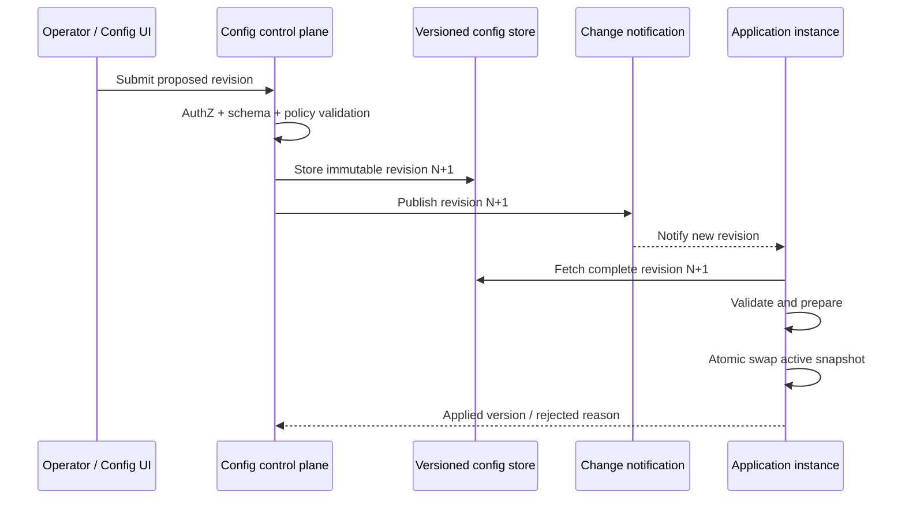
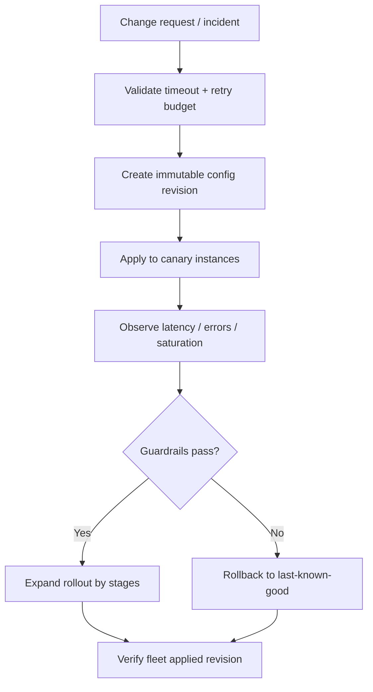

# Quản lý cấu hình động và thay đổi cấu hình an toàn

## 1. Vì sao cấu hình cần được quản lý như một phần của kiến trúc?

Ứng dụng cloud không chỉ thay đổi khi phát hành mã nguồn. Đội vận hành có thể đổi timeout, giới hạn kết nối, ngưỡng autoscaling, endpoint dependency, quota theo tenant, retry policy hoặc feature flag mà không build lại image. Những thay đổi này giúp xử lý sự cố nhanh, điều chỉnh tải và bật tính năng theo từng nhóm người dùng. Nhưng một giá trị sai, một lần cập nhật không đồng bộ hoặc cấu hình thiếu kiểm tra cũng có thể làm gián đoạn toàn hệ thống.

**Cấu hình động (dynamic configuration)** là cấu hình có thể thay đổi trong lúc ứng dụng đang chạy và được workload nhận biết mà không cần đóng gói hoặc phát hành lại toàn bộ ứng dụng. Nguồn thay đổi có thể là control plane, configuration service, database, file mount, feature flag service hoặc nền tảng triển khai.

Quản lý cấu hình an toàn cần trả lời:

- Giá trị nào là cấu hình, giá trị nào là secret hoặc dữ liệu nghiệp vụ?
- Ai có quyền tạo, phê duyệt, triển khai và hoàn tác?
- Làm sao bảo đảm giá trị đúng kiểu, đúng phạm vi và tương thích phiên bản ứng dụng?
- Instance nhận cấu hình mới thế nào và có thể lệch phiên bản trong bao lâu?
- Điều gì xảy ra khi config provider, network hoặc nguồn cấu hình không sẵn sàng?
- Làm sao giới hạn blast radius và khôi phục khi thay đổi gây lỗi?

Bài học thuộc chương **Vận hành hệ thống** của module **CLOUD_ARCHITECTURE**. Module tập trung thiết kế ứng dụng cloud từ yêu cầu nghiệp vụ đến mạng, compute, dữ liệu và mô hình triển khai, cân bằng độ tin cậy, bảo mật, khả năng mở rộng, chi phí và vận hành theo Well-Architected. Quản lý cấu hình là cơ chế vận hành giúp kiến trúc thay đổi có kiểm soát sau khi triển khai.

Sau bài học, bạn có thể phân biệt config/secret/feature flag/dữ liệu runtime; thiết kế source of truth và precedence; xác thực schema; áp dụng atomic update, versioning, staged rollout và rollback; xử lý consistency, cache propagation và failure; bảo vệ thay đổi bằng RBAC, approval, audit; thiết lập metric, alert, test và runbook.

## 2. Phân loại những gì thường được gọi là cấu hình

Không nên gom mọi giá trị thay đổi được vào một kho duy nhất. Mỗi loại có vòng đời, quyền truy cập và yêu cầu consistency khác nhau.

| Loại | Ví dụ | Đặc điểm | Cách quản lý thường phù hợp |
|---|---|---|---|
| Application configuration | Timeout, retry count, endpoint, log level | Điều khiển hành vi ứng dụng | Config file/service, versioning, validation |
| Infrastructure configuration | CPU/memory, replica count, network rule | Tác động tài nguyên và deployment | IaC, policy-as-code, reviewed deployment |
| Secret | Password, API key, private key, token | Nhạy cảm, cần bảo mật và rotation | Secret manager/KMS, workload identity |
| Feature flag | Bật UI mới, thay thuật toán, rollout theo tenant | Quyết định nhánh hành vi | Feature flag service hoặc control plane |
| Business data | Giá, trạng thái booking, quota đã cam kết | Dữ liệu nghiệp vụ có ownership và transaction | Database/domain service |
| Operational limit | Rate limit, concurrency cap, queue threshold | Ảnh hưởng availability và cost | Dynamic config có bounds, audit và rollout |

Một endpoint URL không nhất thiết là secret; API key trong cùng file lại là secret. Feature flag cũng có thể là rule phụ thuộc tenant, region, cohort hoặc phiên bản client thay vì chỉ là boolean.

### 2.1. Cấu hình không thay thế dữ liệu nghiệp vụ

Timeout hoặc số worker có thể đổi nhanh để ứng phó tải. Nhưng trạng thái “booking đã xác nhận” phải đi qua domain transaction và consistency rule. Không dùng config service như database tổng quát cho bản ghi có lịch sử, concurrency hoặc yêu cầu audit nghiệp vụ.

### 2.2. Cấu hình không phải secret store

Nếu file cấu hình có cả endpoint và password, quyền đọc file thường rộng hơn quyền đọc secret. Tách secret khỏi application config; workload lấy secret bằng identity của nó, không nhúng secret trong image, source code, ticket hoặc log.

## 3. Nguồn cấu hình và thứ tự ưu tiên

Một hệ thống có thể lấy cấu hình từ code defaults, file, environment variable, command-line argument, config service, deployment manifest và tenant override. Nếu không định nghĩa precedence, hai instance có thể chạy cùng image nhưng dùng giá trị khác nhau mà không ai giải thích được.

### 3.1. Xây dựng source of truth

Với mỗi nhóm cấu hình, xác định nguồn chuẩn để xem trạng thái hiện hành, nguồn nào được phép ghi, cơ chế phân phối đến workload, cách xử lý khi nguồn chuẩn và cache khác nhau, owner/reviewer và audit trail.

| Nhóm | Source of truth gợi ý | Nguồn runtime |
|---|---|---|
| Static app defaults | Versioned code/config bundle | Image hoặc package |
| Environment config | Config repository/control plane | Config agent/API |
| Secret | Secret manager | Workload identity fetch |
| Feature flag | Flag control plane | SDK/cache có freshness policy |
| Infrastructure | IaC repository + deployed state | Cloud control plane |

Không để console, file VM và config repository cùng ghi độc lập mà không có reconciliation. Emergency override phải có owner, lý do, thời hạn và cách đưa về source of truth.

### 3.2. Precedence cần xác định rõ

Ví dụ thứ tự ưu tiên:

```text
compiled safe defaults
    < environment baseline
    < service-level configuration
    < approved tenant override
    < emergency override with expiry
```

Thứ tự trên chỉ là ví dụ. Không tự động cho tenant override security policy, credential, data residency hoặc giới hạn bảo vệ hệ thống. Những key này cần policy riêng và có thể không cho phép override.

### 3.3. Tránh cấu hình ẩn

- Không sửa environment variable thủ công trên một instance mà không ghi nhận.
- Không để startup script tự sửa config mà control plane không biết.
- Không để defaults khác nhau giữa service version mà không có migration plan.
- Không để nhiều hệ thống quản trị cùng ghi một key không có conflict policy.
- Ghi lại giá trị hiệu lực và nguồn tạo ra nó, nhưng không log secret.

## 4. Thiết kế schema và validation

Cấu hình cần có hợp đồng dữ liệu như API. Validation ở control plane ngăn giá trị sai được lưu; validation ở workload bảo vệ ứng dụng khi provider gửi dữ liệu không hợp lệ hoặc phiên bản cũ/mới không tương thích.

### 4.1. Schema cho cấu hình

Schema nên quy định tên key, type, ý nghĩa, required/optional, default, nullable behavior, min/max, enum hoặc pattern, unit/format, dependencies giữa key, scope áp dụng, schema version và sensitivity.

Tránh key mơ hồ như timeout=30. Dùng tên cho biết đơn vị, ví dụ request_timeout_ms=30000, và validate range hợp lý.

### 4.2. Ví dụ schema khái niệm

```yaml
schema_version: 3
service: booking-api
config:
  request_timeout_ms:
    type: integer
    minimum: 100
    maximum: 30000
    default: 3000
  database_pool:
    type: object
    properties:
      max_connections:
        type: integer
        minimum: 1
        maximum: 80
  feature:
    enable_new_search:
      type: boolean
      default: false
```

Đây là ví dụ minh họa, không phải JSON Schema hoặc format bắt buộc của một nhà cung cấp. Khi triển khai, cần dùng schema validator thực tế và xác định cách xử lý field không biết.

### 4.3. Fail validation trước khi publish

1. Parse cú pháp.
2. Validate type, required field, range và enum.
3. Kiểm tra quan hệ giữa các giá trị.
4. Kiểm tra policy và quyền thay đổi.
5. Kiểm tra compatibility với workload version đang chạy.
6. Chạy preview/test nếu cấu hình có ảnh hưởng rộng.
7. Chỉ publish khi các bước bắt buộc pass.

Không nên cho phép giá trị không hợp lệ được phân phối rồi trông chờ từng instance từ chối. Validation ở workload vẫn cần như lớp bảo vệ cuối.

### 4.4. Validation liên trường và unknown field

Ví dụ min_connections không thể lớn hơn max_connections; retry_attempts phải tương thích request deadline; timeout dependency không nên vượt tổng timeout request; rollout percentage phải nằm trong khoảng 0–100.

Khi schema có key mới, ứng dụng có thể bỏ qua field không biết nếu field optional và không đổi semantics; từ chối toàn bộ config nếu field ảnh hưởng security/correctness; hoặc chọn config version theo capability của binary. Bỏ qua mọi field có thể che lỗi spelling hoặc security setting không được áp dụng. Từ chối mọi field mới lại làm khó mixed-version rollout.

## 5. Cấu hình bất biến và cấu hình động

| Đặc tính | Config bất biến theo release | Dynamic config |
|---|---|---|
| Thay đổi | Build/deploy version mới | Publish và runtime reload |
| Kiểm thử | Test cùng artifact | Test schema, propagation, state transition |
| Truy vết | Release artifact và deployment | Mỗi config version và rollout event |
| Phù hợp | Protocol, schema assumptions, security boundary | Timeout, quota, log level, flag có bounds |
| Rủi ro | Release chậm hơn | Drift giữa instance, partial propagation |

Giữ bất biến những giá trị ảnh hưởng wire protocol, data format, security boundary hoặc initialization không thể reload an toàn. Cho phép dynamic change ở key có semantics ổn định, validation và behavior reload rõ.

## 6. Cập nhật cấu hình atomic và có version

Một update có thể gồm nhiều key phải cùng đúng. Nếu app đọc từng key trong khi config đang ghi, nó có thể quan sát trạng thái nửa cũ nửa mới.

### 6.1. Atomic publish

1. Tạo config revision mới với ID duy nhất.
2. Validate toàn bộ revision.
3. Ghi revision bất biến.
4. Cập nhật pointer/current-version bằng thao tác atomic.
5. Phát notification chứa revision ID.
6. Workload tải snapshot, validate và swap active snapshot.



Không sửa từng key đang được request đọc. Workload nên tạo snapshot mới, kiểm tra đầy đủ rồi đổi con trỏ active một lần. Request đang chạy có thể dùng snapshot cũ; request mới dùng snapshot mới theo semantics đã định nghĩa.

### 6.2. Version và optimistic concurrency

Mỗi revision nên có revision ID/version, parent/base revision, người tạo/phê duyệt, thời điểm tạo/publish, schema version, scope/environment, change reason/ticket và checksum khi cần.

Nếu hai operator cùng sửa từ revision N, control plane nên phát hiện conflict thay vì để lần ghi cuối âm thầm xóa thay đổi trước. Có thể yêu cầu rebase hoặc explicit override.

### 6.3. Phân biệt publish với apply

Publish thành công chỉ cho biết control plane chấp nhận revision. Cần phân biệt Proposed, Validated, Approved, Published, Delivered, Applied, Rejected, Stale/Expired và Rolled back. Trạng thái applied phải được workload báo về, không suy ra từ message publish.

## 7. Runtime reload và propagation

Cách workload nhận thay đổi phụ thuộc runtime: polling, push notification, stream, sidecar/config agent, mounted config volume, SDK truy vấn config service hoặc restart/rolling deployment.

### 7.1. Polling

Polling đơn giản nhưng tạo độ trễ cập nhật và request định kỳ. Dùng jitter để tránh instance poll cùng lúc. Conditional fetch theo revision/ETag giúp giảm network traffic.

### 7.2. Push notification

Push giảm thời gian báo thay đổi nhưng notification có thể mất, duplicate hoặc đến sai thứ tự. Notification nên chỉ báo revision mới; workload fetch snapshot authoritative và so version. Periodic reconciliation phát hiện notification bị mất.

### 7.3. File mount/config agent

Platform có thể cập nhật mounted file theo cơ chế riêng. App cần biết file được atomic rename hay ghi tại chỗ, file watcher có đáng tin không và khi nào nội dung mới xuất hiện. Với file nhiều key, agent nên ghi file mới hoàn chỉnh rồi atomic rename; app parse/validate toàn file trước khi swap snapshot.

### 7.4. Mixed-version rollout

Trong rolling deployment, instance có thể chạy binary version khác nhau. Config mới phải tương thích với mọi instance còn phục vụ traffic. Dùng backward-compatible schema, capability negotiation, rollout app trước config, hoặc expand/contract: thêm field, chuyển consumer, rồi mới xóa field cũ.

## 8. Consistency, cache và stale configuration

Không phải mọi tham số cần mức consistency giống nhau.

| Loại cấu hình | Mức nhất quán thường cần | Hành vi khi stale |
|---|---|---|
| Log verbosity | Eventual consistency thường chấp nhận | Instance cập nhật chậm vài phút |
| UI feature flag | Eventual/near-real-time tùy UX | Có thể dùng cache tạm |
| Rate limit/quota | Phụ thuộc abuse và fairness | Stale có thể cho vượt quota |
| Security policy/denylist | Propagation nhanh, stale limit rõ | Có thể fail closed hoặc revalidate |
| Payment/booking invariant | Không quyết định bằng config cache | Dùng transaction/domain authority |
| Emergency kill switch | Cần propagation và xác nhận nhanh | Có thể cần kênh ưu tiên riêng |

### 8.1. Last-known-good và stale budget

Khi provider tạm mất kết nối, workload có thể dùng last-known-good snapshot trong khoảng cho phép. Cần lưu revision cuối đã validate, ghi tuổi config và nguồn, đặt maximum staleness theo key group, alert khi vượt ngưỡng và không dùng stale cho policy nhạy cảm nếu rủi ro không chấp nhận được.

Nếu revision mới lỗi validation hoặc khởi tạo component, giữ active snapshot hợp lệ trước đó. Không thay active config bằng object parse dở hoặc một phần field mới.

Nếu cold start không truy cập được config service, cần safe defaults hoặc không nhận traffic tới khi có cấu hình đủ điều kiện. Không fallback về empty config nếu empty có nghĩa bỏ qua security control.

### 8.2. Cache propagation

Định nghĩa revision authoritative, cache TTL/refresh, reconciliation khi notification mất, stale limit và cách ngăn revision cũ đến muộn ghi đè revision mới. So version trước khi apply; không dùng timestamp wall clock đơn lẻ để xác định phiên bản mới nhất.

## 9. Thay đổi an toàn: staged rollout và canary

Thay đổi config có thể ảnh hưởng nhiều instance tức thì. Thay đổi có rủi ro nên triển khai theo ring/canary:

1. Local validation: schema, range, policy và dependency.
2. Test environment: test chức năng, tải và compatibility.
3. Canary: một instance, vùng hoặc nhóm tenant nội bộ.
4. Observe: error rate, latency, saturation, business metric và apply status.
5. Expand: mở rộng tỷ lệ từng bước khi guardrail đạt.
6. Complete: xác nhận coverage và lưu change record.

| Stage | Phạm vi ví dụ | Cổng quyết định |
|---|---|---|
| 0 | Validate only | Schema, bounds, policy pass |
| 1 | Internal/test tenant | Không có regression |
| 2 | 1% workload/traffic | Error/latency trong guardrail |
| 3 | 10% | Business outcome và utilization ổn định |
| 4 | 50% | Không có incident hoặc config divergence |
| 5 | 100% | Applied coverage đạt yêu cầu, audit hoàn tất |

Tỷ lệ chỉ là ví dụ. Security kill switch có thể cần propagation nhanh; thay đổi connection pool thường an toàn hơn khi rollout từ từ.

### 9.1. Guardrail và automatic rollback

Định nghĩa trước error rate/SLI, latency p95/p99, database saturation, tỷ lệ apply thành công, config rejection và stop condition. Automatic rollback cần tránh oscillation: có thể rollback một lần rồi khóa rollout, dùng hysteresis/cooldown và quy định người có quyền override. Với data migration hoặc external side effect không thể đảo ngược, cần compensating action.

## 10. Rollback và khôi phục cấu hình

Mọi thay đổi rủi ro cần kế hoạch phục hồi trước khi publish.

### 10.1. Rollback revision

1. Chọn revision mục tiêu đã xác minh tương thích.
2. Tạo revision mới tham chiếu nội dung cũ hoặc đổi active pointer có audit.
3. Phát revision mới với version cao hơn; không replay event cũ như revision hiện tại.
4. Theo dõi apply status toàn fleet.
5. Xác minh SLI và business behavior phục hồi.
6. Ghi incident/change record và follow-up.

Không xóa revision gây lỗi vì cần evidence điều tra. Đánh dấu rejected/rolled back và ngăn publish lại cho tới khi sửa/review.

### 10.2. Khi rollback không đủ

Config có thể đã gửi email/webhook, tạo queue backlog/retry storm, thay đổi dữ liệu, khiến client cache giá trị mới hoặc kích hoạt record theo schema mới. Khôi phục config không tự đảo ngược side effect. Cần compensating action, reconciliation hoặc migration ngược.

### 10.3. Emergency override

Emergency override cần actor/role được chỉ định, lý do/incident ID, thời hạn, giới hạn scope/value, audit bất biến, thông báo owner/reviewer, tự hết hạn hoặc renew sau review và reconcile về source of truth sau sự cố.

Không để emergency override vô thời hạn trở thành nguồn cấu hình thứ hai không ai quản lý.

## 11. Feature flags: cấu hình điều khiển hành vi

Feature flag có thể bật/tắt code path hoặc rollout theo nhóm user. Chúng hữu ích cho release decoupling, canary, kill switch và thử nghiệm, nhưng tích tụ flag tạo độ phức tạp.

### 11.1. Các loại flag

- **Release flag:** bật tính năng theo giai đoạn.
- **Operational flag:** tắt chức năng khi dependency lỗi.
- **Permission/entitlement flag:** quyết định quyền sản phẩm; cần policy và audit riêng.
- **Experiment flag:** phân nhóm thử nghiệm.
- **Kill switch:** vô hiệu hóa một đường chức năng trong sự cố.

Không dùng feature flag thay authorization. Flag bật tính năng cho tenant không có nghĩa user trong tenant được phép thực hiện mọi hành động.

### 11.2. Rule evaluation và vòng đời

Rule có thể xét tenant, region, user cohort, app version hoặc percentage rollout. Xác định attribute nào trusted, rule precedence, default khi provider unavailable, sticky assignment và cách tránh một workflow đọc flag version mâu thuẫn.

Flag cần owner, purpose, created date, expiry/review date và removal plan. Khi rollout hoàn tất, xóa code path cũ và flag không còn dùng; flag tồn tại lâu làm tăng state combination cần test.

## 12. Bảo mật cấu hình và quyền thay đổi

Cấu hình có thể điều khiển network, authentication, encryption, logging, data access và chi phí. Quyền sửa config vì vậy có tác động hệ thống.

### 12.1. Access control

- RBAC/ABAC theo service, environment, scope và sensitivity.
- Tách quyền propose, approve, publish, rollback và administer.
- Production change cần approval/policy check tương xứng risk.
- Tenant admin chỉ đổi key được phép trong tenant scope.
- Workload chỉ đọc config cần thiết, không mặc định được ghi.
- Break-glass có JIT, time-bound access và audit.

### 12.2. Secrets và rotation

- Lấy secret từ secret manager bằng workload identity.
- Không nhúng secret trong Git, image, plain config export hoặc log.
- Ưu tiên short-lived credential và rotation tự động.
- Dùng overlap window khi thay key để instance chuyển dần.
- Thu hồi credential cũ sau khi xác nhận rollout hoàn tất.
- Audit access, denied access và secret version change.

### 12.3. Integrity và supply chain

Config repository/pipeline là một phần supply chain. Dùng branch protection, signed commit/tag, reviewed PR, policy-as-code, approval và immutable revision. Config phân phối cần xác thực nguồn và integrity theo khả năng platform.

## 13. Observability: biết cấu hình thực tế từng instance

Control plane có thể báo revision N+1 đã publish nhưng một số instance vẫn chạy N. Cần quan sát config đã apply, không chỉ thay đổi được tạo ra.

| Tín hiệu | Ý nghĩa |
|---|---|
| Config revision published | Control plane đã phát hành |
| Applied revision by instance/group | Workload đang dùng phiên bản nào |
| Apply/reload success rate | Tỷ lệ instance parse, validate và swap thành công |
| Config propagation lag | Thời gian từ publish đến apply |
| Config rejection count/reason | Lỗi schema, compatibility hoặc initialization |
| Stale config age | Thời gian dùng last-known-good |
| Config provider latency/error | Sức khỏe dependency phân phối |
| Rollback count | Tần suất thay đổi phải hoàn tác |
| Flag evaluation distribution | Tỷ lệ request vào từng behavior |
| Drift count | Runtime config khác source of truth |

Không đưa secret hoặc cấu hình nhạy cảm vào metric label. Dùng revision ID, scope ID được kiểm soát và reason category.

### 13.1. Desired, delivered và applied state

- **Desired state:** revision control plane yêu cầu.
- **Delivered state:** revision đã được gửi/đưa đến agent.
- **Applied state:** workload xác nhận validate và kích hoạt revision.

Dashboard cần hiển thị số instance theo ba trạng thái và binary/schema version đi kèm. Đừng gọi rollout hoàn tất nếu chỉ delivered mà chưa applied.

### 13.2. Alert

- Một phần instance không apply trong propagation deadline.
- Security policy/key vượt stale limit.
- Revision bị reject ở nhiều instance.
- Desired/applied drift kéo dài.
- Provider latency/error tăng.
- Emergency override sắp hết hạn hoặc quá hạn review.
- Feature flag evaluation bất thường hoặc không owner.

## 14. Kiểm thử cấu hình động

Kiểm thử cần bao phủ nội dung config và behavior khi thay đổi hoặc khi dependency lỗi.

| Loại test | Nội dung |
|---|---|
| Schema/unit validation | Sai type, missing key, out-of-range, unknown field |
| Cross-field validation | Timeout/deadline, min/max, retry budget |
| Compatibility | Schema mới với app cũ/mới; mixed-version rollout |
| Atomicity | Request không quan sát snapshot nửa cũ nửa mới |
| Propagation | Push mất/duplicate/reorder; polling delay; reconnect |
| Last-known-good | Provider outage, invalid revision, cold start |
| Rollback | Rollback revision và kiểm tra side effect |
| Security | Principal trái quyền, tenant scope, secret redaction, approval bypass |
| Load/stress | Nhiều key update, fleet lớn, reconnect storm |
| Failure injection | Config service down, DNS lỗi, network partition, file issue |

### 14.1. Kiểm thử mixed-version

Giả sử app v1 chỉ hiểu schema v2; app v2 hiểu v2 và v3. Không publish config chỉ có field v3 khi instance v1 còn nhận traffic. Rollout app v2 trước, đợi coverage, rồi publish config v3. Khi rollback binary, config cần còn tương thích hoặc có bước rollback config trước.

### 14.2. Kiểm thử atomic snapshot

Tạo config có hai giá trị ràng buộc, ví dụ min/max pool. Trong lúc publish, tạo traffic đọc liên tục và xác minh không request nào thấy min lớn hơn max do trạng thái partial. Test nhiều thread và connection/session reuse.

## 15. Failure modes và runbook

| Tình huống | Hành vi cần thiết |
|---|---|
| Config service unavailable | Dùng last-known-good trong freshness budget hoặc fail startup/traffic theo policy |
| Invalid revision | Reject revision mới, giữ active snapshot |
| Notification mất | Reconciliation phát hiện version lệch |
| Notification duplicate/out-of-order | Deduplicate và chỉ apply revision hợp lệ mới hơn |
| Partial fleet apply | Dừng rollout, giới hạn traffic, xác định instance lỗi |
| Secret rotation failure | Giữ overlap credential an toàn, cảnh báo; không log secret |
| Wrong config gây incident | Stop rollout, rollback có version, kiểm tra side effects |
| Control plane compromised | Revoke access, freeze publish, verify revision và restore trusted record |

### 15.1. Runbook khi config gây sự cố

1. Xác định revision, scope, người tạo, người approve và thời điểm publish.
2. Xác định service/instance/tenant đã apply và binary/schema version tương ứng.
3. Dừng mở rộng rollout; nếu cần bật guardrail hoặc controlled degraded mode.
4. Chọn last-known-good revision đã xác minh tương thích và rollback.
5. Xác minh propagation đến toàn fleet, không chỉ canary.
6. Đánh giá side effect: queue, database, external API, client cache và feature exposure.
7. Đối soát dữ liệu và SLI/SLO; xác nhận phục hồi trước khi mở rollout.
8. Ghi incident/change record, root cause và action ngăn tái diễn.

Không chỉnh trực tiếp từng instance để chữa cháy nếu chưa ghi nhận trạng thái; thao tác cục bộ có thể tạo drift và mất dấu nguyên nhân.

## 16. Ví dụ: điều chỉnh timeout của Booking API

Giả sử Booking API gọi Inventory service. Timeout hiện tại 2 giây nhưng latency Inventory tăng, khiến worker bị giữ lâu; request deadline của API là 2,5 giây. Đội vận hành muốn giảm timeout Inventory xuống 700 ms và điều chỉnh retry để bảo vệ thread/connection pool.

### 16.1. Rủi ro nếu đổi trực tiếp

- Một số instance đổi timeout, tạo behavior không đồng nhất.
- Retry count tăng làm request vượt deadline.
- Timeout quá ngắn gây false timeout khi Inventory chỉ chậm nhất thời.
- Operation không idempotent bị gửi lại, tạo duplicate.
- Config mới không tương thích app version cũ.

### 16.2. Thay đổi an toàn

1. Định nghĩa tổng request deadline 2,5 giây và phân bổ budget cho dependency.
2. Xác nhận retry chỉ áp dụng operation idempotent hoặc có idempotency key.
3. Validate timeout range và quan hệ với retry/backoff.
4. Tạo revision mới, liên kết incident/change ID.
5. Apply canary cho nhóm instance.
6. Quan sát Inventory timeout, Booking API p99, error rate, connection utilization và business outcome.
7. Mở rộng theo stage nếu guardrail đạt; nếu lỗi tăng, rollback.
8. Xác minh mọi instance dùng cùng revision và lưu kết quả.

### 16.3. Sơ đồ thay đổi



Các số 700 ms và 2,5 giây chỉ là dữ liệu giả định để minh họa. Giá trị thực phải dựa trên latency distribution, timeout budget, retry semantics và tải production.

## 17. Đánh đổi về hiệu năng, độ tin cậy và chi phí

| Lựa chọn | Lợi ích | Đánh đổi |
|---|---|---|
| Polling config | Đơn giản, phục hồi sau notification mất | Delay và request định kỳ |
| Push/stream | Propagation nhanh | Reconnect, duplicate, reorder |
| Last-known-good | Giữ availability khi provider lỗi | Có nguy cơ stale config |
| Atomic snapshot | Tránh trạng thái partial | Cần giữ revision cũ/mới và swap logic |
| Staged rollout | Giới hạn blast radius | Thay đổi lâu hơn |
| Per-tenant override | Linh hoạt | Nhiều state, test và drift |
| Central config service | Quản trị/audit tập trung | Trở thành dependency/control-plane risk |
| Local config cache | Giảm latency/network dependency | Reconciliation và freshness phức tạp |

Không dùng dynamic config cho mọi thứ. Config service quá phức tạp có thể trở thành điểm lỗi và chi phí vận hành lớn. Dùng static config cho giá trị ít đổi; dùng dynamic khi tốc độ thay đổi và lợi ích vận hành bù được chi phí consistency, security và support.

## 18. Đánh giá theo Well-Architected

| Trụ cột | Câu hỏi review |
|---|---|
| **Operational Excellence** | Có source of truth, version, approval, rollout state, rollback, owner và runbook? |
| **Security** | Quyền propose/approve/publish tách biệt? Secret được quản lý riêng? Emergency override có expiry và audit? |
| **Reliability** | Có last-known-good, atomic apply, stale limit, reconciliation và degraded behavior khi provider lỗi? |
| **Performance Efficiency** | Polling/push, cache và reload có overhead hợp lý? Có tránh reconnect storm? |
| **Cost Optimization** | Dùng đúng mức dynamic config; retention, provider capacity và fleet metrics phù hợp? |
| **Sustainability** | Giảm thao tác thủ công, drift và rollout lặp; loại bỏ flag/config không dùng? |

## 19. Mẫu ADR cho quản lý cấu hình động

Mẫu YAML sau dùng ghi quyết định và policy; không phải cấu hình trực tiếp cho một vendor:

```yaml
decision_id: ADR-OPS-003
title: Safe dynamic configuration for booking services
source_of_truth:
  application_config: versioned_config_control_plane
  secrets: managed_secret_store
  infrastructure: reviewed_iac
revision:
  immutable: true
  schema_version_required: true
  optimistic_concurrency: true
validation:
  schema: required
  cross_field_policy: required
  workload_compatibility: required
rollout:
  strategy: canary_then_staged
  guardrails:
    - error_rate
    - latency_p99
    - dependency_saturation
    - applied_revision_coverage
rollback:
  last_known_good: required
  audit_record: required
security:
  separate_secret_store: true
  approval_for_production: required
  emergency_override_expiry: required
observability:
  - desired_revision
  - applied_revision
  - propagation_lag
  - stale_config_age
review_triggers:
  - config_schema_change
  - new_dynamic_key
  - provider_or_runtime_change
  - config_related_incident
```

ADR chính thức cần ghi owner, lựa chọn thay thế, scope/environment, rollout threshold, freshness budget, retention và kết quả thử nghiệm.

## 20. Quy trình thiết kế và vận hành

1. **Phân loại giá trị:** application config, infrastructure config, secret, flag hay business data.
2. **Xác định owner/source of truth:** định nghĩa ai được ghi và precedence.
3. **Thiết kế schema:** type, unit, default, bounds, cross-field constraints và compatibility.
4. **Chọn cách phân phối:** polling, push, agent, mounted file hoặc deployment reload.
5. **Thiết kế revision:** immutable version, parent, approval, change reason và audit.
6. **Triển khai validation:** kiểm tra ở control plane và workload trước activate.
7. **Đặt failure policy:** last-known-good, stale budget, startup behavior và reconciliation.
8. **Rollout có kiểm soát:** canary, staged expansion, guardrails và stop condition.
9. **Bảo vệ quyền:** RBAC, separation of duties, secret manager, JIT và emergency expiry.
10. **Đo và review:** applied revision, propagation lag, stale age, drift, rollback và cleanup.

## 21. Bảng kiểm trước production

- [ ] Mỗi key được phân loại là config, secret, flag hoặc business data.
- [ ] Có owner/source of truth; precedence giữa default, environment và override rõ ràng.
- [ ] Không có config ẩn sửa thủ công mà không trace.
- [ ] Schema định nghĩa type, unit, range, default, scope và version.
- [ ] Có validation cú pháp, cross-field, policy và workload compatibility.
- [ ] Unknown field có chính sách rõ; không âm thầm bỏ qua security setting.
- [ ] Revision immutable, có ID, parent, actor, approval, reason và audit.
- [ ] Publish atomic; workload validate snapshot rồi swap, không đọc trạng thái partial.
- [ ] Desired, delivered và applied state được phân biệt.
- [ ] Push/poll có retry, jitter, dedup, ordering và periodic reconciliation.
- [ ] Last-known-good và maximum stale age được định nghĩa theo sensitivity.
- [ ] Mixed-version rollout và expand/contract được kiểm thử.
- [ ] Có canary/staged rollout, guardrails, stop condition và rollback.
- [ ] Rollback xét side effect/data migration; không chỉ đổi lại giá trị.
- [ ] Secret nằm trong secret manager; workload identity và rotation có overlap plan.
- [ ] Propose/approve/publish/admin tách quyền; emergency override có expiry.
- [ ] Dashboard thể hiện revision đã apply, propagation lag, rejection và drift.
- [ ] Đã test provider outage, invalid config, notification loss/reorder, cold start và rollback.
- [ ] Feature flag có owner, expiry/review date và removal plan.
- [ ] Config provider, audit archive và automation có capacity, backup và runbook.

**Nguyên tắc áp dụng:** cấu hình động là thay đổi runtime có thể tác động rộng như một lần phát hành. Hãy xác định nguồn chuẩn, validate toàn bộ revision, áp dụng atomic, rollout theo stage, quan sát trạng thái thực tế và giữ last-known-good để rollback. Tách secret và dữ liệu nghiệp vụ khỏi config giúp bảo vệ đúng ranh giới; quản lý version, quyền và audit giúp mọi thay đổi có thể giải thích và phục hồi.
