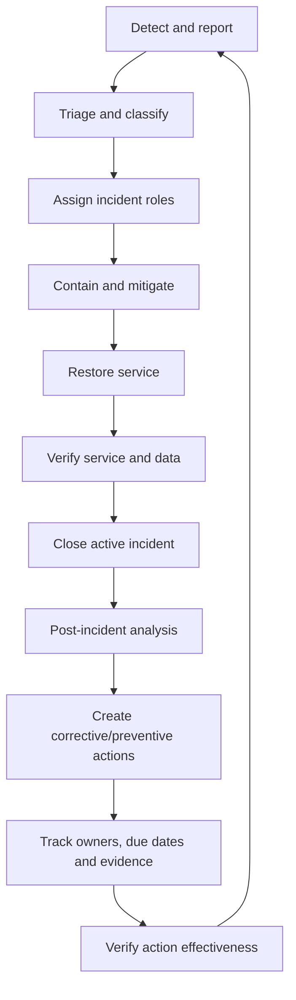
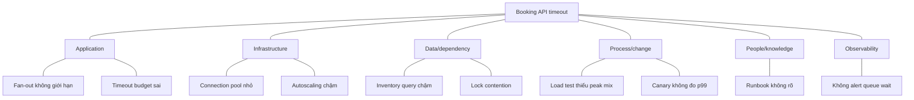
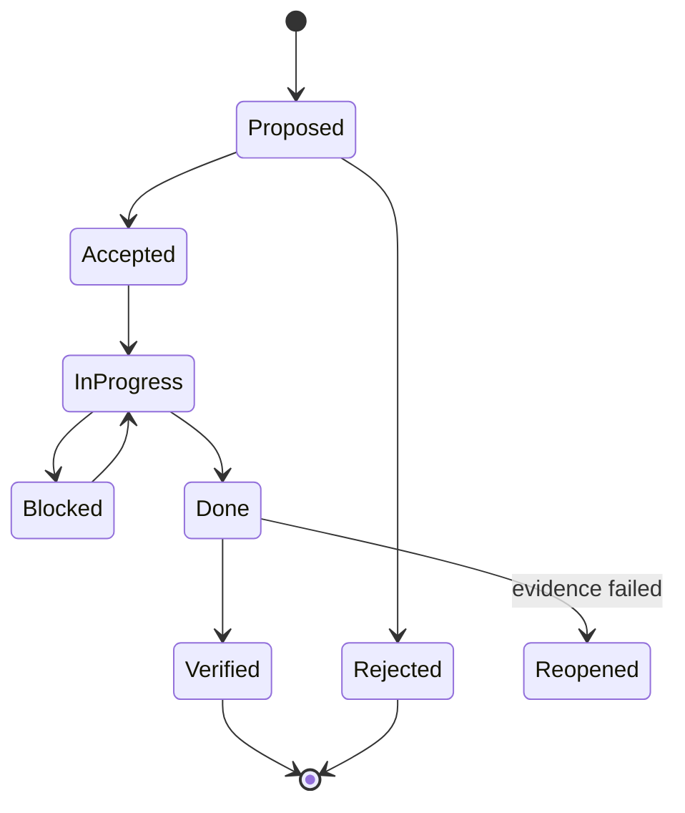

# Phân tích sự cố, hành động phòng ngừa và theo dõi khắc phục

Một sự cố production không kết thúc khi biểu đồ chuyển về màu xanh hoặc người dùng truy cập lại được dịch vụ. Nếu không hiểu điều gì đã xảy ra, vì sao các lớp bảo vệ không ngăn được tác động và những thay đổi nào cần hoàn tất, hệ thống có thể lặp lại sự cố dưới một hình thức khác. Việc sửa lỗi tức thời thường khôi phục dịch vụ; việc phân tích và theo dõi khắc phục mới giúp giảm xác suất và mức độ nghiêm trọng của lần tiếp theo.

**Phân tích sự cố, hành động phòng ngừa và theo dõi khắc phục** là một vòng vận hành liên tục: phát hiện và giảm tác động, thu thập bằng chứng, dựng timeline, phân tích nguyên nhân và yếu tố góp phần, chọn hành động có thể kiểm chứng, giao owner/deadline, theo dõi tiến độ và đo hiệu quả sau khi triển khai. Kết quả phải thay đổi được thiết kế, quy trình, kiểm soát hoặc khả năng phát hiện của hệ thống.

Trong module **CLOUD_ARCHITECTURE**, năng lực này kết nối observability, reliability, security, deployment, backup/DR, data platform và Well-Architected review. Bài học dùng ví dụ nền tảng cho thuê thiết bị: API đặt chỗ tăng lỗi khi inventory chậm, payment callback tồn đọng hoặc một thay đổi cấu hình làm lộ dữ liệu. Các mức độ nghiêm trọng, thời hạn và ngưỡng metric dưới đây là ví dụ; tổ chức cần điều chỉnh theo SLO, business impact, hợp đồng và quy định của mình.

## 1. Incident, problem và corrective action là gì?

Các từ thường được dùng lẫn nhau nhưng mô tả những phạm vi khác nhau:

| Khái niệm | Ý nghĩa | Ví dụ |
| --- | --- | --- |
| **Event** | Một tín hiệu hoặc thay đổi quan sát được | CPU tăng, một request trả 503 |
| **Alert** | Thông báo cần đánh giá hoặc hành động | Error budget burn vượt ngưỡng |
| **Incident** | Sự kiện làm suy giảm hoặc đe dọa dịch vụ, dữ liệu, bảo mật hay nghĩa vụ nghiệp vụ | Khách không thể tạo reservation |
| **Problem** | Nguyên nhân tiềm ẩn hoặc điều kiện góp phần vào một hay nhiều incident | Connection pool không được giới hạn theo workload |
| **Workaround** | Biện pháp giảm tác động tạm thời | Tắt recommendation để dành capacity cho checkout |
| **Corrective action** | Thay đổi xử lý nguyên nhân hoặc khôi phục điều kiện đúng | Sửa pool sizing và giới hạn concurrency |
| **Preventive action** | Kiểm soát giảm xác suất incident hoặc ngăn tái diễn | Thêm load test và alert trước khi pool bão hòa |
| **Post-incident review** | Phân tích sau sự cố để học và quyết định cải tiến | Timeline, causal analysis, action register |

Một incident có thể kết thúc trong vài phút nhưng problem cần nhiều tuần để xử lý. Một workaround có thể đưa dịch vụ trở lại trong khi root cause vẫn còn. Không đóng problem chỉ vì alert đã hết hoặc incident ticket đã được resolve.

## 2. Mục tiêu của incident analysis

Phân tích sự cố tốt phải trả lời được:

1. **Điều gì xảy ra?** Phạm vi, thời gian, user, service, data và business process bị tác động.
2. **Tác động ra sao?** Mức độ, thời lượng, số người dùng/giao dịch, dữ liệu sai/mất/lộ và nghĩa vụ liên quan.
3. **Điều gì làm sự cố bắt đầu hoặc kích hoạt?** Trigger, điều kiện nền và thay đổi liên quan.
4. **Vì sao tác động lan rộng hoặc kéo dài?** Detection, alerting, isolation, capacity, rollback, runbook và quyền truy cập.
5. **Điều gì đã giúp giảm tác động?** Kiểm soát hoạt động tốt, tín hiệu phát hiện sớm và hành động hiệu quả.
6. **Điều gì cần thay đổi?** Action cụ thể, owner, deadline, evidence và cách xác minh hiệu quả.

Phân tích nhằm cải thiện hệ thống và điều kiện làm việc, không nhằm tìm một cá nhân để quy lỗi. Người vận hành thường hành động dựa trên thông tin, công cụ, thời gian và áp lực có tại thời điểm đó. Câu hỏi hữu ích là vì sao hệ thống cho phép lựa chọn đó trở thành lựa chọn hợp lý hoặc cần thiết.

## 3. Vòng đời xử lý incident

Một quy trình phổ biến gồm các giai đoạn sau:



Các bước có thể chồng lấn. Ví dụ incident commander giao người dựng timeline trong lúc một nhóm khác khôi phục dịch vụ. Với sự cố nghiêm trọng, không chờ root cause analysis hoàn tất mới giảm tác động.

### Phân biệt restore và resolve

- **Restore:** khôi phục mức dịch vụ đủ đáp ứng nhu cầu được xác định.
- **Resolve:** nguyên nhân/điều kiện gây incident đã được xử lý hoặc chấp nhận có kiểm soát.
- **Close:** incident record đã có impact, timeline, quyết định và liên kết follow-up cần thiết.

Dịch vụ có thể được restore bằng workaround trong khi problem vẫn mở. Hãy ghi nhận trạng thái đó một cách rõ ràng.

## 4. Phân loại severity dựa trên impact

Severity phải phản ánh tác động thực tế và nguy cơ tiếp tục xảy ra, không chỉ số lượng alert hoặc thành phần kỹ thuật bị lỗi.

| Mức | Mô tả minh họa | Ví dụ | Phản ứng gợi ý |
| --- | --- | --- | --- |
| **SEV-1 Critical** | Dịch vụ cốt lõi ngừng diện rộng, mất/lộ dữ liệu nghiêm trọng hoặc nguy cơ an toàn/pháp lý lớn | Không thể đặt chỗ trên toàn hệ thống; phát hiện payment data bị lộ | Kích hoạt incident command, liên hệ security/business leadership, cập nhật thường xuyên |
| **SEV-2 High** | Chức năng trọng yếu suy giảm đáng kể, nhiều khách bị ảnh hưởng hoặc SLO burn nhanh | Checkout lỗi ở một khu vực; payment callback backlog tăng liên tục | Incident lead, nhóm chuyên môn, mitigation ưu tiên |
| **SEV-3 Moderate** | Phạm vi giới hạn, có workaround và chưa đe dọa hệ thống diện rộng | Một báo cáo chậm, một nhóm tenant gặp lỗi | Owner xử lý theo SLA, theo dõi mở rộng impact |
| **SEV-4 Low** | Lỗi nhỏ hoặc degradation không đáng kể, chưa tác động cốt lõi | Một job phụ retry thành công, dashboard nội bộ chậm nhẹ | Ticket vận hành/backlog và theo dõi |

### Dimensions để đánh giá

- **Availability:** tỷ lệ request/giao dịch bị ảnh hưởng, khu vực và chức năng.
- **Performance:** latency, throughput, queue age và trải nghiệm người dùng.
- **Data integrity:** bản ghi thiếu, duplicate, sai số tiền hoặc trạng thái không nhất quán.
- **Security/privacy:** dữ liệu bị truy cập trái phép, credential lộ hoặc kiểm soát bị vô hiệu.
- **Financial/business:** giao dịch thất bại, doanh thu, nghĩa vụ đối tác, vận hành kho.
- **Duration and trend:** đã kéo dài bao lâu, tốc độ lan rộng và khả năng phục hồi.
- **Recoverability:** workaround có sẵn không, có thể rollback/restore không.

Khi chưa rõ impact, chọn mức thận trọng phù hợp, tiếp tục thu thập evidence và hạ severity khi có căn cứ. Không hạ severity chỉ để giảm mức chú ý.

## 5. Incident roles và trách nhiệm điều phối

Trong incident lớn, một người không nên vừa điều phối, vừa thực hiện mọi lệnh, vừa cập nhật stakeholder. Tách vai trò giúp giảm overload và tránh mất thông tin.

| Vai trò | Trách nhiệm |
| --- | --- |
| **Incident commander (IC)** | Điều phối, xác định ưu tiên, phân công và quyết định escalation |
| **Technical lead** | Điều tra kỹ thuật, đề xuất mitigation/rollback và phối hợp service owner |
| **Operations/responder** | Thực thi runbook, kiểm tra hệ thống và ghi lại hành động |
| **Communications lead** | Cập nhật người dùng, business owner, đối tác và các nhóm liên quan |
| **Scribe** | Ghi timeline, quyết định, command/change ID và evidence |
| **Security/privacy lead** | Điều phối forensic, containment, notification và bảo toàn bằng chứng khi liên quan |
| **Business/data owner** | Đánh giá ảnh hưởng tới nghiệp vụ, tính đúng đắn dữ liệu và chấp nhận phục hồi |

Với incident nhỏ, một người có thể kiêm nhiều vai trò. Khi quy mô tăng, IC nên giao rõ ai quyết định, ai thực thi và ai truyền thông.

### RACI minh họa

RACI gồm Responsible (thực hiện), Accountable (chịu trách nhiệm cuối), Consulted (được tham vấn) và Informed (được thông báo).

| Hoạt động | IC | Technical lead | Scribe | Security/business owner |
| --- | --- | --- | --- | --- |
| Phân loại severity | A | R | I | C |
| Điều tra kỹ thuật | A | R | C | C |
| Mitigation production | A | R | I | C |
| Timeline/evidence | A | C | R | C |
| Security containment | C | R | C | A/R theo policy |
| Business validation | C | R | I | A |
| Truyền thông | A | C | R/C | C |
| Post-incident action | A | R | C | R/C |

RACI là ví dụ; incident policy phải chỉ định người có quyền chấp nhận rủi ro và quyết định cutover/restore.

## 6. Triage: thu thập thông tin có cấu trúc

Triage không phải lúc nào cũng cần biết root cause. Mục tiêu đầu tiên là xác định tình trạng và chọn hành động an toàn tiếp theo.

### Câu hỏi ban đầu

- Triệu chứng đầu tiên và thời điểm bắt đầu?
- Ai/nhóm nào đang bị ảnh hưởng?
- Dịch vụ, region, tenant, endpoint hoặc data product nào?
- Tỷ lệ lỗi, latency, backlog và xu hướng hiện tại?
- Có thay đổi deploy/config/network/IAM/schema gần đây?
- Dữ liệu có bị sai, mất, duplicate hoặc truy cập trái phép?
- Có workaround đã biết và đã được kiểm tra?
- Điều gì cần tránh làm để không phá bằng chứng hoặc gây hỏng thêm?

### Triage board

Có thể duy trì một bảng trạng thái:

| Mục | Giá trị cần ghi |
| --- | --- |
| Incident ID | Mã định danh duy nhất |
| Severity/status | SEV, investigating/mitigating/monitoring/resolved |
| Start/detected time | Thời gian có căn cứ, múi giờ rõ |
| Affected scope | Service, region, tenant, user, dataset |
| Impact estimate | Request, transaction, revenue, data và duration |
| Current symptoms | Error rate, p95/p99, queue depth, security signal |
| Recent changes | Deploy, config, IAM, schema, provider change |
| Hypotheses | Giả thuyết, evidence ủng hộ/phản bác |
| Mitigation | Hành động đã thực hiện và kết quả |
| Next update | Thời gian cập nhật tiếp theo và owner |

Ghi rõ điều gì đã biết, điều gì chưa biết và mức tin cậy. Tránh trình bày giả thuyết như sự thật đã được chứng minh.

## 7. Containment và mitigation trước khi có root cause

Trong incident đang diễn ra, containment giảm blast radius; mitigation đưa chức năng cốt lõi trở lại. Hai hoạt động có thể quan trọng hơn việc xác định ngay root cause.

Ví dụ:

- Rollback release vừa deploy nếu evidence cho thấy lỗi bắt đầu ngay sau release và rollback an toàn.
- Tắt feature flag hoặc optional dependency để giữ checkout.
- Chặn access key bị compromise và cô lập workload nghi bị xâm nhập.
- Tạm dừng batch job có thể ghi sai dữ liệu.
- Giới hạn concurrency để bảo vệ database.
- Route traffic khỏi region/instance không khỏe khi failover đã được kiểm thử.
- Quarantine record/event lỗi để tránh lan vào curated dataset.

### Kiểm tra trước mitigation

Với thao tác có thể phá hủy hoặc khó đảo ngược:

1. Nêu rõ mục tiêu và scope.
2. Xác định owner/approver theo incident authority.
3. Kiểm tra dependency và side effect.
4. Ghi trạng thái hiện tại, evidence và rollback path.
5. Thực thi với phạm vi nhỏ nhất phù hợp.
6. Đo kết quả ngay sau hành động.

Trong incident critical, không tạo thủ tục phê duyệt rườm rà làm chậm containment; dùng emergency authority đã định nghĩa và ghi lại quyết định để review sau.

## 8. Thu thập evidence và bảo toàn tính toàn vẹn

Root cause analysis chỉ đáng tin khi có evidence. Thông tin hữu ích có thể nằm ở logs, metrics, traces, event history, deployment records, audit logs, database statistics, queue offsets và phản hồi người dùng.

### Evidence sources

| Nguồn | Câu hỏi có thể trả lời |
| --- | --- |
| Application logs | Request nào lỗi, error type, tenant/operation nào? |
| Metrics | Khi nào latency/error/saturation đổi? |
| Distributed traces | Dependency nào chậm hoặc thất bại? |
| Cloud audit logs | Identity nào đổi IAM/network/KMS/resource? |
| Deployment history | Artifact/config version nào được release? |
| Database logs/metrics | Lock, query plan, connection hoặc replication có gì bất thường? |
| Queue/broker metadata | Backlog bắt đầu ở đâu, offset/retry/DLQ thế nào? |
| Security telemetry | Credential use, exfiltration, malware hoặc privilege escalation? |
| Customer/business reports | Tác động nhìn thấy từ phía người sử dụng là gì? |

### Evidence hygiene

- Ghi timestamp có timezone và đồng bộ clock; nêu sai lệch nếu có.
- Giữ raw evidence theo retention và legal/incident policy.
- Lưu query, dashboard range, run ID, commit, resource ID và change ID.
- Phân biệt log gốc với bản export/summary.
- Không sửa log hoặc xóa resource có thể chứa forensic evidence.
- Redact secret/PII khi chia sẻ rộng, nhưng bảo toàn bản forensic trong vùng access kiểm soát.
- Hạn chế thay đổi hệ thống điều tra nếu chưa ghi trạng thái cần thiết.

Khi có nghi ngờ security incident, phối hợp security/forensic lead trước khi reboot, re-image hoặc xóa host. Có thể cần snapshot/volatile evidence theo policy và năng lực pháp chứng.

## 9. Dựng timeline sự cố

Timeline chuyển các sự kiện rời rạc thành chuỗi có thể kiểm chứng. Mỗi mốc nên chứa:

- Timestamp và timezone.
- Event/action.
- Actor hoặc component.
- Evidence reference.
- Observed outcome.
- Confidence/uncertainty.

Ví dụ:

| Thời gian (UTC) | Sự kiện | Evidence | Ghi chú |
| --- | --- | --- | --- |
| 09:02 | Deploy Booking API v2.8 | Deployment run 4821 | Release bắt đầu |
| 09:05 | Inventory timeout tăng | Trace dashboard | p99 từ 80 ms lên 2,4 s |
| 09:07 | Booking 503 vượt alert threshold | Alert INC-204 | Checkout bị ảnh hưởng |
| 09:10 | IC được kích hoạt | Incident log | SEV-2 |
| 09:14 | Tắt recommendation fan-out | Change CHG-331 | Giảm tải dependency |
| 09:19 | Error rate giảm | Metrics | Chưa xác nhận nguyên nhân gốc |
| 09:27 | Rollback API v2.8 | Deployment run 4830 | Latency trở lại baseline |
| 09:45 | Theo dõi ổn định | SLO dashboard | Incident được restore |

Timeline không được ép các mốc thành quan hệ nhân quả nếu evidence chưa chứng minh. Deploy xảy ra trước lỗi là correlation cần điều tra; chưa đủ để kết luận release là root cause.

### Timestamp và clock skew

Trong distributed system, clock các node có thể lệch. Ưu tiên correlation ID, trace/span, sequence/offset và audit event ID cùng timestamp. Khi so sánh nhiều nguồn, ghi độ lệch clock nếu biết; không giả định thứ tự theo timestamp millisecond là tuyệt đối.

## 10. Phân biệt symptom, trigger, root cause và contributing factor

Các khái niệm này giúp phân tích không dừng ở biểu hiện dễ thấy.

| Thành phần | Câu hỏi | Ví dụ |
| --- | --- | --- |
| Symptom | Người dùng/hệ thống quan sát thấy gì? | Booking API trả 503 |
| Trigger | Sự kiện trực tiếp làm vấn đề bộc lộ? | Inventory latency tăng sau peak traffic |
| Root cause/causal condition | Điều kiện kỹ thuật hoặc tổ chức nào cho phép incident xảy ra? | Fan-out không có concurrency budget và timeout tổng |
| Contributing factor | Điều gì làm xác suất/tác động tăng? | Alert chỉ theo CPU, không theo queue age |
| Detection gap | Vì sao phát hiện muộn? | Không có synthetic checkout test |
| Recovery gap | Vì sao khôi phục lâu? | Rollback phụ thuộc người có quyền deploy |

Trong hệ thống phức tạp, hiếm khi có một nguyên nhân đơn lẻ giải thích mọi thứ. Có thể có nhiều điều kiện cùng tồn tại: thay đổi code, traffic pattern, dependency behavior, thiếu capacity headroom và runbook chưa đủ rõ.

## 11. Các kỹ thuật root cause analysis

### 11.1. 5 Whys

Hỏi “vì sao?” nhiều lần để lần theo cơ chế gây ra vấn đề. Ví dụ:

1. Vì sao khách không tạo được reservation? Booking API timeout.
2. Vì sao API timeout? Request chờ Inventory Service quá lâu.
3. Vì sao chờ lâu? Nhiều request fan-out đồng thời, pool bị bão hòa.
4. Vì sao fan-out không được giới hạn? Service không có per-dependency concurrency cap.
5. Vì sao release không phát hiện? Load test không dùng workload mix và traffic peak đại diện.

Kết luận không nên chỉ là “thiếu load test”. Có thể cần giới hạn concurrency, budget cho dependency, load test realistic và alert queue wait. Mỗi câu hỏi phải được kiểm tra bằng evidence; không cố đủ đúng năm câu nếu quan hệ đã rõ hoặc cần phân nhánh.

### 11.2. Fishbone/Ishikawa

Phân nhóm giả thuyết để tránh chỉ tập trung vào code:



Fishbone tổ chức giả thuyết, không chứng minh nguyên nhân. Cần kiểm tra từng nhánh bằng logs, metrics, traces, deployment record, config và phỏng vấn người tham gia.

### 11.3. Fault tree analysis

Fault tree bắt đầu từ outcome không mong muốn rồi phân rã tổ hợp sự kiện có thể gây ra nó. Ví dụ “không thể tạo reservation” có thể xảy ra khi API unavailable OR database unavailable OR admission controller reject toàn bộ traffic OR dependency bắt buộc không đáp ứng. Cây giúp nhận diện failure mode và vị trí cần preventive/detective control.

### 11.4. Change correlation

Đối chiếu incident với deploy, config, IAM, network, schema, provider change và traffic pattern. Có thể dùng canary, rollback, replay hoặc controlled experiment để kiểm tra giả thuyết, nhưng phải cân nhắc an toàn và không tái tạo tác động cho khách hàng.

## 12. Phân tích yếu tố con người theo hướng blameless

Blameless không có nghĩa không có trách nhiệm hoặc bỏ qua hành vi cố ý. Nó có nghĩa phân tích không quy mọi thứ thành “operator bất cẩn” khi hệ thống, quy trình, giao diện và điều kiện làm việc đã góp phần tạo ra sai lầm.

Thay vì hỏi “Ai đã chạy lệnh này?”, có thể hỏi:

- Người vận hành nhìn thấy thông tin gì tại thời điểm đó?
- Lệnh có cảnh báo rõ scope/environment không?
- Quyền có quá rộng không?
- Có cơ chế dry-run, confirmation hoặc two-person review không?
- Runbook có lỗi thời hoặc mâu thuẫn không?
- Áp lực khôi phục và thiếu người trực ảnh hưởng quyết định ra sao?
- Có thể làm thao tác an toàn hơn bằng automation/guardrail nào?

Ghi nhận tốt cả quyết định đúng và điểm hệ thống hỗ trợ tốt. Nếu một responder dùng workaround giúp giảm impact, ghi lại điều kiện khiến workaround hiệu quả để biến thành runbook hoặc automation có kiểm soát.

## 13. Viết post-incident review

Post-incident review (PIR) là tài liệu tổng hợp sự cố và kế hoạch học hỏi. Một template tối thiểu:

```markdown
# Post-Incident Review: [Incident ID]

## Summary
- Service / environment:
- Severity:
- Start / detection / restore / close times:
- Incident commander:

## Customer and business impact
- Users / tenants / regions:
- Failed or delayed transactions:
- Data integrity / privacy / financial impact:
- Duration and SLO impact:

## Detection and response
- Detection source:
- Time to detect / acknowledge / mitigate / restore:
- What worked:
- What slowed response:

## Timeline
- [UTC timestamp] event, actor/component, evidence reference

## Causal analysis
- Trigger:
- Root/causal conditions:
- Contributing factors:
- Detection and recovery gaps:
- Evidence and confidence:

## Actions
- Action ID / owner / due date / priority / evidence / success criteria

## Lessons
- What should be preserved:
- What should change:
```

PIR nên đủ chi tiết để người không tham gia incident hiểu chuyện gì xảy ra, nhưng không biến thành bản sao toàn bộ logs. Đính kèm link evidence có access control và retention; tránh đưa credential, PII hoặc thông tin forensic nhạy cảm vào tài liệu phổ thông.

### Những gì không nên làm

- Dùng ngôn ngữ quy lỗi hoặc suy đoán động cơ.
- Chỉ ghi “human error”, “communication issue” hoặc “monitoring issue” mà không nêu cơ chế.
- Gọi một giả thuyết là root cause khi chưa có evidence.
- Tạo hàng chục action chung chung không có owner.
- Đóng PIR khi action quan trọng chưa được ghi vào hệ thống theo dõi.

## 14. Từ finding tới corrective/preventive action

Một finding chỉ hữu ích khi chuyển thành hành động có thể thực hiện và kiểm chứng.

### Các loại action

| Loại | Mục tiêu | Ví dụ |
| --- | --- | --- |
| Corrective | Sửa điều kiện đã gây lỗi | Sửa query thiếu index, khắc phục config sai |
| Preventive | Giảm xác suất tái diễn | Thêm guardrail, validation, automated test |
| Detective | Phát hiện sớm hơn | Alert trên queue age hoặc data invariant |
| Mitigative | Giảm impact nếu lỗi xảy ra | Bulkhead, failover, feature degradation |
| Recovery | Rút ngắn thời gian phục hồi | Tự động hóa restore/rollback, runbook đã diễn tập |
| Governance/process | Cải thiện quyết định và trách nhiệm | Risk-tiered approval, access review |

Không phải mọi action đều cần code. Có thể cần thay đổi architecture, quota, ownership, training, vendor contract, escalation hoặc policy.

### Action phải gắn với finding

| Finding | Action đề xuất | Success criteria |
| --- | --- | --- |
| Inventory fan-out không giới hạn | Thêm concurrency cap và deadline budget | Stress test không làm pool vượt ngưỡng đã chọn |
| Không phát hiện queue backlog | Alert oldest age và burn rate | Alert kích hoạt trước khi SLO bị vi phạm |
| Rollback cần người có quyền hiếm | Cải thiện JIT runbook/approval path | Diễn tập rollback đạt mục tiêu thời gian |
| Payment event duplicate | Idempotency key và reconciliation | Replay test không tạo duplicate ledger entry |
| Audit log cùng quyền admin production | Tách logging account và deny delete | Test identity production không xóa được audit evidence |

Action kiểu “nhắc mọi người cẩn thận hơn” không có success criteria đáng tin. Nếu training thực sự cần thiết, chỉ rõ kỹ năng, nhóm, tình huống mô phỏng và cách đánh giá năng lực.

## 15. Viết action item tốt

Một action item nên có:

- **Action ID:** định danh để theo dõi.
- **Finding/risk:** liên kết tới finding hoặc incident.
- **Description:** động từ cụ thể và kết quả cần tạo.
- **Owner:** một người chịu trách nhiệm cuối; có thể có supporting team.
- **Priority/risk reduction:** vì sao cần làm trước.
- **Due date:** mốc hoàn thành.
- **Dependencies:** team, vendor, approval, budget hoặc release.
- **Status:** proposed/accepted/in progress/blocked/done/verified/cancelled.
- **Evidence:** PR, config, dashboard, test report, runbook hoặc drill.
- **Success criteria:** điều kiện đo được để xác nhận.
- **Effectiveness review:** ngày đánh giá sau triển khai.

### Ví dụ action register

| ID | Hành động | Owner | Due | Priority | Success criteria |
| --- | --- | --- | --- | --- | --- |
| ACT-101 | Thêm per-dependency concurrency cap cho Inventory client | Booking team lead | 15/12 | P1 | Load test 2× peak không làm pool vượt limit |
| ACT-102 | Alert khi queue oldest age vượt ngân sách | SRE | 10/12 | P1 | Alert nhận diện backlog trước SLO breach |
| ACT-103 | Mở rộng canary metric thêm p99 và 5xx | Release owner | 20/12 | P2 | Canary tự dừng khi threshold bị vượt |
| ACT-104 | Diễn tập rollback bằng JIT access | On-call lead | 22/12 | P2 | Drill hoàn thành trong mục tiêu và log đầy đủ |

Các ngày và tiêu chí chỉ minh họa. Action register thực tế phải có owner được chấp nhận và due date theo capacity.

### Một owner chính cho mỗi action

Có thể nhiều nhóm cùng hỗ trợ nhưng chỉ định một accountable owner. Nếu action có nhiều workstream, tách thành subtask với dependency và một owner điều phối. “Platform team” hoặc “mọi người” không phải owner đủ rõ.

## 16. Ưu tiên action theo mức giảm rủi ro

Backlog action sau incident thường lớn hơn capacity thực hiện. Ưu tiên dựa trên:

- Mức độ và phạm vi impact nếu lặp lại.
- Xác suất tái diễn và tần suất phơi nhiễm.
- Khả năng phát hiện trước khi impact lan rộng.
- Thời gian để giảm risk.
- Mức độ reversibility và chi phí triển khai.
- Dependency và action nào mở khóa kiểm soát khác.
- Có kiểm soát tạm thời trong lúc chờ giải pháp dài hạn không.

### Risk-based priority

| Priority | Mô tả | Ví dụ |
| --- | --- | --- |
| P0 | Rủi ro đang mở, có thể gây thiệt hại nghiêm trọng ngay | Revoke credential bị lộ, chặn public exposure |
| P1 | Rủi ro lớn, cần xử lý trong chu kỳ gần nhất | Thêm guardrail ngăn xóa backup |
| P2 | Cải thiện quan trọng, có workaround hiện tại | Nâng alert và load test |
| P3 | Tối ưu dài hạn hoặc giảm toil thấp | Cải thiện dashboard nội bộ |

Không dùng priority thay cho risk acceptance. Nếu action critical bị trì hoãn, phải ghi ai chấp nhận rủi ro còn lại, compensating control và ngày xem xét lại.

### Cost of delay

Action có cost triển khai thấp nhưng ngăn rủi ro lớn thường nên ưu tiên. Ngược lại, một dự án kiến trúc dài hạn có thể cần nhiều bước nhỏ để giảm risk sớm. Chia “quick guardrail” và “structural fix” thành hai action liên kết thay vì chờ dự án lớn hoàn tất mới có kiểm soát.

## 17. Theo dõi remediation lifecycle

Một action register cần phản ánh tiến độ thật, không chỉ trạng thái do owner tự chọn.



### Trạng thái gợi ý

- **Proposed:** finding đã được ghi, chưa cam kết nguồn lực.
- **Accepted:** có owner, priority và deadline.
- **In progress:** đang thực hiện.
- **Blocked:** thiếu dependency/approval/resource; phải có blocker owner và next review.
- **Done:** implementation hoàn tất, evidence được đính kèm.
- **Verified:** success criteria đã kiểm tra và hiệu quả được xác nhận theo kế hoạch.
- **Reopened:** evidence không đạt, risk vẫn còn hoặc issue tái diễn.
- **Cancelled/accepted risk:** có quyết định chính thức, lý do, authority và ngày review.

Không đồng nhất Done với Verified. Một PR merge xong chưa chứng minh alert hoạt động; một policy được deploy chưa chứng minh role thật sự không thể xóa backup.

## 18. Governance cho action item

Để remediation không rơi khỏi ưu tiên, cần cadence và escalation:

| Nhịp | Hoạt động |
| --- | --- |
| Hàng ngày trong incident lớn | Review action tạm thời, blocker và risk còn mở |
| Hàng tuần | Owner cập nhật trạng thái, evidence và dự báo hoàn thành |
| Hàng tháng | Reliability/security review xem action quá hạn, P0/P1 và ngoại lệ |
| Hàng quý | Phân tích xu hướng, action tái diễn, systemic risk và đầu tư lớn |
| Sau khi Verified | Kiểm tra hiệu quả sau một khoảng quan sát phù hợp |

### Escalation

Action quá hạn phải có:

- Lý do và dependency.
- Tác động của việc trì hoãn.
- Biện pháp tạm thời.
- Ngày mới được đề xuất.
- Người có authority chấp nhận rủi ro.

Không tự động gia hạn due date nhiều lần mà không review risk. Nếu scope thay đổi, ghi lại lý do và đánh giá lại finding.

### Risk acceptance

Tổ chức có thể quyết định không thực hiện action nếu chi phí vượt lợi ích hoặc rủi ro được chấp nhận. Risk acceptance cần nêu threat/finding, residual risk, compensating control, người phê duyệt, thời hạn và trigger để xem xét lại. “Không có capacity” không tự động là risk acceptance.

## 19. Xác minh implementation và effectiveness

Có hai mức xác minh:

1. **Implementation verification:** thay đổi đã được triển khai đúng chưa?
2. **Effectiveness verification:** thay đổi có giảm rủi ro hoặc cải thiện kết quả như dự kiến không?

Ví dụ action “thêm alert khi queue age vượt 60 giây”:

- Implementation: rule đã deploy, notification tới đúng on-call và có runbook.
- Effectiveness: trong test spike, alert xuất hiện trước khi request timeout; trong production, responder có đủ thời gian giảm tải.

### Evidence phù hợp

| Loại action | Evidence implementation | Evidence effectiveness |
| --- | --- | --- |
| Code fix | PR, build, deployment ID | Regression test, defect không tái diễn trong điều kiện đại diện |
| IAM guardrail | Policy version, access test | Negative test chứng minh principal bị chặn |
| Alerting | Rule/config, notification test | Detection lead time giảm trong diễn tập/incident |
| Runbook | Version, owner, approval | Game day hoàn thành đúng mục tiêu |
| Backup control | Retention policy, vault config | Restore drill và delete-protection test đạt |
| Capacity control | Concurrency/config | Load/stress test và SLO được giữ |
| Training | Nội dung và attendance | Exercise score/behavior trong mô phỏng |

### Không chỉ đo “issue không quay lại”

Incident có thể không tái diễn vì chưa gặp đúng điều kiện. Cần test chủ động, simulation, fault injection hoặc metric leading indicator. Nếu chỉ chờ incident khác để chứng minh action, thời gian xác minh có thể quá dài và rủi ro vẫn còn.

## 20. Theo dõi tái diễn và systemic pattern

Một incident riêng lẻ có thể là biểu hiện của vấn đề rộng:

- Nhiều service thiếu bounded concurrency.
- Nhiều action quá hạn vì cùng một nhóm là bottleneck.
- Nhiều incident liên quan config drift.
- Alert phát hiện muộn vì chỉ theo CPU, không theo user journey.
- Backup restore test thiếu key/network dependency.
- Thay đổi production thường bypass pipeline.

Gom incident theo failure mode, control gap, service/domain và contributing factor. Không chỉ đếm tên incident giống nhau; hai sự cố cùng “503” có thể có nguyên nhân khác, còn một vấn đề IAM có thể biểu hiện thành nhiều loại symptom.

### Problem record

Một problem record nên chứa:

- Problem ID và owner.
- Incident liên quan.
- Causal hypothesis và evidence.
- Affected services/assets.
- Workaround hiện tại.
- Known error hoặc limitation.
- Permanent fix/action links.
- Risk acceptance/expiry nếu chưa sửa.
- Review date và trạng thái.

Problem management giúp nhiều incident cùng nguyên nhân được xử lý bằng một kế hoạch có cấu trúc.

## 21. Các metric vận hành incident và remediation

| Metric | Ý nghĩa | Cách dùng cẩn trọng |
| --- | --- | --- |
| MTTD | Mean time to detect | Đo khoảng từ bắt đầu tác động tới phát hiện; xác định start time |
| MTTA | Mean time to acknowledge | Đo thời gian có responder nhận trách nhiệm |
| MTTM | Mean time to mitigate | Đo tới khi impact được giảm đáng kể |
| MTTR | Mean time to restore/repair/resolve tùy định nghĩa | Nêu rõ mốc kết thúc, không so sánh khi định nghĩa khác |
| Incident frequency | Số incident theo severity/domain | Chuẩn hóa theo traffic/transaction khi phù hợp |
| Recurrence rate | Tỷ lệ incident có failure mode/problem đã gặp | Cần mapping problem và causal category nhất quán |
| Action aging | Tuổi action chưa verified | Phân tích theo priority, blocker và owner |
| Overdue rate | Tỷ lệ action quá hạn | Không khuyến khích đóng vội để đạt KPI |
| Verification pass rate | Tỷ lệ action đạt success criteria | Theo dõi reopened/failure |
| Detection coverage | Tỷ lệ critical journey có signal/alert đủ | Đo bằng test và mapping user journey |
| Action effectiveness | Mức giảm risk/impact hoặc thời gian khôi phục | Dùng leading indicator và diễn tập |

MTTR là thuật ngữ dễ gây nhầm vì có thể được hiểu là repair, recovery hoặc resolution. Dashboard phải ghi rõ start/end definition, timezone và cách xử lý incident tái mở.

### Tránh metric tạo hành vi sai

- Mục tiêu MTTD thấp có thể khiến tạo quá nhiều alert nhiễu.
- Mục tiêu MTTR thấp có thể khuyến khích rollback vội hoặc đóng incident trước validation.
- Mục tiêu overdue action bằng 0 có thể dẫn tới đóng action hình thức.
- Mục tiêu giảm incident count có thể khuyến khích hạ severity.

Kết hợp metric định lượng với review chất lượng, impact và evidence.

## 22. Problem prevention trong kiến trúc cloud

Từ finding, chọn loại cải tiến phù hợp với lớp gây rủi ro:

| Failure mode | Preventive control | Detective control | Recovery/mitigation |
| --- | --- | --- | --- |
| Database pool cạn | Concurrency cap, query budget, connection governance | Pool saturation/queue wait alert | Shed optional load, retry có budget |
| Config sai | IaC validation, schema/policy test, approval | Drift detection, config diff alert | Rollback config đã version |
| Data corruption | Constraint, idempotency, validation | Reconciliation, invariant check | PITR, replay, repair |
| Credential compromise | Short-lived identity, least privilege, MFA | Identity anomaly/audit alert | Revoke, rotate, isolate |
| Region failure | Multi-region/backup theo RTO | Health check và regional signal | Failover/restore drill |
| Queue backlog | Bounded queue, producer quota | Oldest age, lag, DLQ alert | Scale consumer, defer/drop hợp lệ |
| Deployment regression | Canary, staged rollout, test | Error budget burn, p99 regression | Automatic/manual rollback |

Không chọn công cụ trước khi hiểu failure mode. Một alert mới không ngăn database pool cạn; một autoscaling rule không sửa query lock; một backup mới không đảm bảo dữ liệu được restore đúng.

## 23. Change management và remediation

Action có thể yêu cầu thay đổi production, policy hoặc dữ liệu. Khi đó phải dùng change management tương ứng:

- Phân loại risk và impact.
- Review technical/security/data owner.
- Gắn change với action ID và incident/problem.
- Kiểm tra test, rollback và recovery point.
- Approval theo SoD và risk tier.
- Triển khai theo staged rollout nếu có thể.
- Xác minh success criteria và evidence.
- Cập nhật remediation status sau khi deployment hoàn tất.

Không chỉnh trực tiếp production để “làm cho action hết overdue” rồi bỏ qua change record. Action completion phải chỉ ra change nào đã tạo ra kiểm soát mới.

## 24. Incident liên quan security hoặc data privacy

Security incident cần process riêng hoặc phần mở rộng của incident process:

- Giới hạn chia sẻ incident detail theo need-to-know.
- Bảo toàn forensic evidence và chain of custody theo policy.
- Cô lập credential, host, account hoặc data path.
- Phối hợp security/privacy/legal/compliance owner.
- Đánh giá dữ liệu nào, chủ thể nào và mục đích nào bị ảnh hưởng.
- Xác định nghĩa vụ thông báo và thời hạn theo quy định/hợp đồng.
- Chỉ restore sau khi threat containment và environment trust được xác nhận.
- Kiểm tra remediation không vô tình phá audit hoặc retention.

Không tự kết luận có hay không có nghĩa vụ thông báo dựa trên một template kỹ thuật. Quyết định phải do owner có thẩm quyền dựa trên dữ liệu và quy định áp dụng.

### Security PIR

Phân tích security cần đặc biệt phân biệt:

- Initial access và credential path.
- Privilege escalation và lateral movement.
- Persistence và exfiltration.
- Detection/containment gap.
- Data scope và evidence confidence.
- Recovery point có sạch không.
- Trust boundary và control nào cần thay đổi.

Một bản PIR phân phối rộng có thể dùng bản tóm tắt đã redact; forensic evidence chi tiết được giữ trong vùng truy cập hạn chế.

## 25. Incident communication và stakeholder updates

Giao tiếp tốt giúp stakeholder biết tình trạng mà không làm kỹ thuật viên bị ngắt quãng liên tục.

Một update nên có:

- Incident ID/severity và trạng thái.
- Chức năng/khu vực bị ảnh hưởng.
- Tác động đã xác nhận và phần đang điều tra.
- Hành động giảm tác động đang thực hiện.
- Điều người dùng/business cần làm hoặc tránh.
- Thời điểm cập nhật tiếp theo.

Không suy đoán nguyên nhân hoặc hứa thời gian khôi phục chưa có căn cứ. Tách internal technical detail khỏi customer-facing message; không tiết lộ thông tin bảo mật.

### Tần suất

Tần suất cập nhật phụ thuộc severity và audience. Incident critical có thể cần cập nhật ngắn, đều đặn theo cadence đã công bố ngay cả khi chưa có thay đổi lớn. Scribe/communications lead giúp IC tập trung vào quyết định kỹ thuật.

## 26. Ví dụ end-to-end: Inventory latency gây lỗi Booking API

### Bối cảnh

Trong giờ cao điểm, Inventory Service tăng p99 latency. Booking API gọi inventory nhiều lần cho một request để tính availability và gợi ý thay thế. Thread pool và database connections tăng, Booking trả 503, khách không thể tạo reservation.

### Timeline

1. Traffic tăng theo chiến dịch.
2. Inventory query p99 tăng, nhưng CPU service chưa bão hòa.
3. Booking fan-out làm request concurrency tăng.
4. Thread/connection pool cạn và timeout.
5. Alert chỉ theo CPU chưa kích hoạt; synthetic checkout báo lỗi muộn hơn.
6. On-call nhận incident qua customer support và 5xx dashboard.
7. IC giao một nhóm tắt recommendation, nhóm khác kiểm tra inventory query.
8. Error rate giảm sau khi tắt fan-out; sau đó rollback release làm latency trở lại baseline.

### Impact

- Checkout failure trên một số khu vực trong 18 phút.
- Một số khách retry và tạo request duplicate; idempotency ngăn duplicate reservation.
- Không có bằng chứng mất payment ledger.
- Một số dashboard analytics trễ do backlog.

### Causal analysis

| Finding | Evidence |
| --- | --- |
| Fan-out không có concurrency budget | Trace cho thấy mỗi request tạo nhiều inventory calls |
| Timeout của downstream lớn hơn deadline caller | Config và trace timing |
| Pool dùng chung cho core và optional calls | Runtime configuration |
| Alert không đo queue wait/connection saturation | Monitoring rule inventory |
| Load test thiếu campaign traffic mix | Test plan và workload profile |

Kết luận: spike traffic là trigger; fan-out không giới hạn, deadline budget sai và pool dùng chung là các điều kiện góp phần. Không chỉ quy incident cho “traffic cao”.

### Action register

| Action | Owner | Priority | Success criteria |
| --- | --- | --- | --- |
| Giới hạn inventory concurrency theo dependency | Booking lead | P1 | Stress test không vượt pool cap |
| Tách bulkhead optional recommendation | Platform lead | P1 | Tắt optional path không ảnh hưởng checkout pool |
| Propagate deadline end-to-end | Service owners | P1 | Trace test chứng minh downstream không chạy sau caller deadline |
| Alert pool utilization và queue wait | SRE | P1 | Alert trước khi checkout SLO burn |
| Bổ sung campaign workload vào load test | QA/performance lead | P2 | Test 2× peak và spike profile đạt acceptance |
| Tự động tắt recommendation khi overload | Product/platform | P2 | Game day xác minh degradation và recovery |

### Verification

- Test code/config ở staging với traffic shape đại diện.
- Kiểm tra load 2× peak và spike.
- Game day làm Inventory chậm và mất kết nối.
- Xác minh alert, feature degradation, rollback và runbook.
- Quan sát production sau release theo cửa sổ đủ đại diện.
- Chỉ chuyển action sang Verified khi success criteria đạt và evidence được lưu.

## 27. Những anti-pattern thường gặp

1. **Đóng incident khi metric tạm xanh.** Chưa xác minh data integrity hoặc recurrence risk.
2. **Gắn nhãn human error.** Bỏ qua thiết kế quyền, giao diện, runbook và điều kiện vận hành.
3. **Chỉ ghi symptom.** “API 503” không giải thích cơ chế gây lỗi.
4. **Dùng timeline làm bằng chứng nhân quả.** Sự kiện xảy ra trước không tự chứng minh nó gây ra sự kiện sau.
5. **Một root cause duy nhất cho hệ thống phức tạp.** Bỏ qua các điều kiện kết hợp.
6. **Action không owner hoặc due date.** Không có ai chịu trách nhiệm hoàn thành.
7. **Action mô tả mơ hồ.** “Cải thiện monitoring” không có success criteria.
8. **Done đồng nghĩa Verified.** Không có test/evidence về hiệu quả.
9. **Không link action với incident/problem/change.** Mất traceability.
10. **Không theo dõi quá hạn và ngoại lệ.** Risk tiếp tục mở nhưng không ai quyết định.
11. **Đo MTTR không có định nghĩa.** Không thể so sánh hoặc cải thiện chính xác.
12. **Postmortem chỉ là tài liệu.** Không thay đổi policy, code, architecture hoặc cách vận hành.

## 28. Quy trình thiết kế incident learning loop

1. **Chuẩn bị:** severity model, roles, contact path, dashboard, runbook và evidence policy.
2. **Detect/triage:** xác định scope, impact, uncertainty và incident owner.
3. **Contain/restore:** giảm blast radius, khôi phục service và xác minh dữ liệu.
4. **Record:** giữ evidence, timeline, change/deploy IDs và quyết định.
5. **Analyze:** symptom, trigger, causal condition, contributing factor, detection/recovery gap.
6. **Review:** PIR blameless, stakeholder và owner xác nhận finding.
7. **Plan:** action cụ thể, priority, owner, due date, dependency, success criteria.
8. **Execute:** liên kết change, test, approval và rollout.
9. **Verify:** implementation evidence và effectiveness evidence.
10. **Learn:** cập nhật runbook, architecture decision, training, alert và risk register.

## 29. Bài tập thực hành

### Bài tập A — Alert không phát hiện sự cố

Booking API trả 503 trong 12 phút. CPU chỉ 35%, nhưng thread pool busy 100% và Inventory p99 tăng gấp 20 lần.

**Câu hỏi:** cần thêm evidence và detector nào?

**Gợi ý:** distributed trace, queue wait, pool utilization, dependency timeout, request fan-out và synthetic checkout. Đừng dùng CPU làm tín hiệu duy nhất.

### Bài tập B — Data corruption âm thầm

Một migration làm sai timezone của reservation trong 3 ngày; service vẫn available và alert không kích hoạt.

**Câu hỏi:** phân tích impact và corrective/preventive action thế nào?

**Gợi ý:** xác định row/time range bị ảnh hưởng, downstream consumer, booking conflict và nghĩa vụ khách hàng; restore/reconcile có kiểm soát; thêm invariant/timezone contract, migration test với boundary cases và data quality monitoring.

### Bài tập C — Action quá hạn

Action P1 “tách audit log sang account security” quá hạn hai tháng vì thiếu platform capacity.

**Câu hỏi:** làm gì để quản lý risk?

**Gợi ý:** xác định interim control, người chấp nhận residual risk, deadline mới có căn cứ, resource escalation và review định kỳ. Không chỉ đổi status sang Blocked.

### Bài tập D — Action đã Done nhưng incident tái diễn

Một alert mới được deploy, ticket chuyển Done, nhưng sự cố tương tự vẫn xảy ra.

**Câu hỏi:** cần xem lại gì?

**Gợi ý:** alert có phát hiện đúng signal, threshold và route không; responder có nhận và hành động được không; failure mode có đúng giả thuyết; success criteria có đo effectiveness không. Reopen action hoặc problem khi evidence không đạt.

### Bài tập E — Security incident

Cloud audit log cho thấy một role được cấp quyền export customer data ngoài giờ. Chưa rõ có dữ liệu bị tải xuống hay không.

**Câu hỏi:** triage, evidence và communication cần làm gì?

**Gợi ý:** containment credential/role theo incident authority, bảo toàn audit/network/storage evidence, xác định scope và exfiltration signal, phối hợp security/privacy/legal, không kết luận absence of impact khi evidence chưa đủ.

### Tiêu chí tự đánh giá

| Năng lực | Bằng chứng cần có |
| --- | --- |
| Incident response | Severity, roles, triage, containment và restore record |
| Evidence | Timeline, trace/log/audit, timestamp và confidence |
| Causal analysis | Trigger, causal conditions, contributing factors và detection gap |
| PIR | Impact, what worked, lessons và action links |
| Remediation | Owner, priority, due date, dependency và success criteria |
| Tracking | Status lifecycle, blocker/escalation và evidence |
| Effectiveness | Test/drill/metric sau triển khai và recurrence review |
| Governance | Risk acceptance, change approval và audit trail |

## 30. Checklist review trước khi đóng incident và remediation

- Impact theo user, transaction, data và business đã được xác định?
- Severity, incident roles và communication đã rõ?
- Timeline dùng timestamp/timezone và evidence reference?
- Hypothesis được phân biệt với fact đã chứng minh?
- Root/causal conditions và contributing factors đã được phân tích?
- Detection, containment và recovery gap đã được xem xét?
- Security/privacy/forensic evidence được bảo toàn khi cần?
- Workaround và residual risk còn mở được ghi lại?
- Mỗi action có ID, owner, priority, due date và success criteria?
- Action liên kết với finding, problem và change cụ thể?
- Blocker/overdue có escalation và risk acceptance phù hợp?
- Implementation verification có evidence?
- Effectiveness verification có test, drill hoặc leading indicator?
- Action được Verified hay chỉ Done?
- Runbook, dashboard, policy và architecture record đã cập nhật?
- Có kế hoạch xem xét recurrence và systemic pattern?

Incident analysis chỉ tạo ra giá trị lâu dài khi được nối với remediation có trách nhiệm và xác minh hiệu quả. Dựng timeline bằng evidence, phân biệt symptom với causal conditions, phân tích blameless, chọn action theo risk, gán owner/deadline và theo dõi tới Verified giúp tổ chức chuyển sự cố thành cải tiến có thể đo được. Vòng học hỏi chỉ hoàn tất khi thay đổi đã làm hệ thống khó thất bại theo cùng cách hơn, phát hiện sớm hơn hoặc phục hồi an toàn và nhanh hơn.
