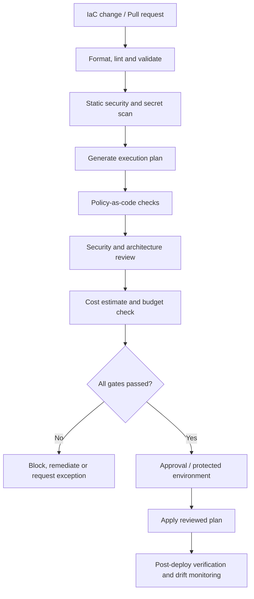

# Kiểm tra chính sách, bảo mật và chi phí trước khi cấp phát

## 1. Vì sao phải kiểm tra trước khi cấp phát hạ tầng?

Infrastructure as Code (IaC) mô tả hạ tầng bằng source code, module và cấu hình có thể review, kiểm thử, version hóa và triển khai lặp lại. Một thay đổi IaC có thể tạo database public, cấp quyền administrator quá rộng, mở firewall ra Internet, bỏ encryption hoặc provision hàng trăm instance ngoài dự toán. Khi thay đổi được apply, tác động có thể xuất hiện ngay trên production và đôi khi khó đảo ngược.

Vì vậy, trước khi cấp phát phải có một chuỗi kiểm tra tự động và thủ công để trả lời ba câu hỏi:

1. **Policy:** tài nguyên và cấu hình có tuân thủ guardrail của tổ chức, môi trường và workload không?
2. **Security:** quyền truy cập, network, dữ liệu, secret, encryption và logging có đáp ứng threat model không?
3. **Cost:** thay đổi có phù hợp budget, capacity, tagging và mục tiêu unit economics không?

**Pre-provision validation** là hoạt động đánh giá thay đổi IaC trước khi thực thi lên môi trường đích. Nó kết hợp source review, static analysis, policy-as-code, plan inspection, security checks, cost estimation và approval. Các bước này nên nằm trong pipeline để mọi thay đổi đi qua cùng một tiêu chuẩn, có bằng chứng và có thể truy vết.

Trong module **CLOUD_ARCHITECTURE**, chương **Hạ tầng dưới dạng mã** xem kiểm tra trước cấp phát là một phần của thiết kế vận hành cloud. IaC không chỉ giúp tạo hạ tầng nhất quán; nó còn là nơi thực thi các nguyên tắc bảo mật, độ tin cậy, khả năng mở rộng, chi phí và quản trị.

Sau bài học, người học có thể:

1. Phân biệt linting, static analysis, policy-as-code, plan review và runtime validation.
2. Thiết kế policy gate cho resource types, regions, network exposure, IAM, encryption và logging.
3. Tích hợp security scanning và secret detection vào pull request/CI.
4. Đọc plan để nhận diện create/update/replace/destroy và rủi ro dữ liệu.
5. Ước lượng chi phí trước apply, phát hiện thay đổi bất thường và kiểm soát budget.
6. Xây dựng tagging, ownership, exception và approval workflow.
7. Lưu evidence để audit và theo dõi drift sau cấp phát.

## 2. Vòng đời kiểm tra trước khi cấp phát

Một pipeline tiêu chuẩn có thể chia thành các lớp:



Các giai đoạn không thay thế lẫn nhau:

| Giai đoạn | Câu hỏi | Ví dụ |
| --- | --- | --- |
| Format/lint | Code có đúng cú pháp và convention? | Format, validate module inputs |
| Static analysis | Có pattern nguy hiểm hoặc cấu hình sai phổ biến? | Public storage, wildcard IAM |
| Secret scan | Có credential bị commit? | API key trong variable file |
| Plan | Terraform/Pulumi/engine dự định thay đổi gì? | Replace database, mở port |
| Policy-as-code | Thay đổi có vi phạm guardrail? | Cấm public database |
| Security review | Threat model và boundary có đúng? | Private endpoint, encryption |
| Cost estimate | Chi phí dự kiến tăng bao nhiêu? | Instance count, data egress |
| Approval | Ai chấp thuận rủi ro còn lại? | Service owner, security, finance |
| Apply | Đúng plan và đúng environment đã duyệt? | Protected deployment |
| Verify | Hạ tầng thật có khớp yêu cầu? | Config, access, tags, alerts |

### 2.1. Fail early và feedback rõ ràng

Lỗi format, missing required tags hoặc public IP ngoài policy nên được phát hiện sớm trong pull request. Người gửi thay đổi cần thấy resource, property, policy ID, mức độ, lý do và cách khắc phục. Một thông báo chung kiểu “policy failed” khiến developer khó sửa và dễ tìm cách bypass gate.

### 2.2. Tách kiểm tra deterministic và approval theo ngữ cảnh

Những điều có thể xác định bằng máy nên tự động hóa: cấm region, bắt buộc encryption, deny wildcard admin, phát hiện secret, ngưỡng cost. Review kiến trúc vẫn cần người đánh giá khi có trade-off, data flow đặc biệt hoặc exception. Approval không nên thay thế các check tự động có thể lặp lại.

## 3. IaC source hygiene và static validation

Trước khi đánh giá policy, cần xác nhận IaC source đáng tin cậy:

- Format nhất quán và diff dễ đọc.
- Module/provider version được pin theo policy.
- Input variables có type, validation và default an toàn.
- Không commit secret hoặc state chứa secret.
- Resource name/tag có convention.
- Environment và workspace mapping rõ ràng.
- Dependencies không kéo module không rõ nguồn.
- Lockfile/provider checksums được quản lý.
- Plan/apply dùng cùng version tool và provider.
- Không cho pipeline lấy code từ branch chưa được review.

### 3.1. Linting, validation và static analysis

| Kiểm tra | Phạm vi | Giới hạn |
| --- | --- | --- |
| Formatter | Style và cấu trúc code | Không chứng minh config an toàn |
| Parser/validator | Cú pháp, type, required argument | Không hiểu hết business policy |
| Linter | Pattern bất thường và best practice | Có thể có false positive/negative |
| Static security scanner | Misconfiguration phổ biến | Không hiểu toàn bộ runtime context |
| Dependency scanner | Provider/module/package version và CVE | Cần đánh giá exploitability |
| Secret scanner | Credential/token trong source/history | Có thể không phát hiện secret được encode hoặc tạo runtime |

Không coi lint pass là security approval. Cũng không coi static scanner có thể tìm mọi lỗi logic hoặc authorization.

### 3.2. Kiểm tra module và provider

Pin version giúp tái lập deployment, nhưng version pin không thay thế patch management. Pipeline nên:
- Chặn provider/module ngoài allowlist nếu policy yêu cầu.
- Kiểm tra checksum và nguồn module.
- Theo dõi advisory/CVE.
- Dùng registry nội bộ hoặc nguồn đã xác minh khi thích hợp.
- Review breaking change trước upgrade.
- Chạy test cho module dùng chung trước khi phát hành version mới.

## 4. Policy-as-code: biến guardrail thành rule có thể kiểm thử

**Policy-as-code** biểu diễn quy tắc quản trị dưới dạng code/dữ liệu có thể chạy tự động trên IaC source, execution plan hoặc deployment request.

Policy thường có:
- **Subject:** resource, principal hoặc thay đổi được kiểm tra.
- **Condition:** property, environment, tag, region hoặc action.
- **Decision:** allow, deny, warn hoặc require approval.
- **Message:** lý do và remediation.
- **Owner/version:** đội chịu trách nhiệm, phiên bản policy và thời điểm áp dụng.
- **Exception:** phạm vi, lý do, approver và expiry nếu được phép.

Ví dụ policy dạng ngôn ngữ tự nhiên:
- Database production không được public network exposure.
- Storage chứa customer data phải encryption at rest và public access bị chặn.
- Workload production phải có owner, service, environment và cost-center tags.
- IAM role không được có wildcard administrator permission nếu không có exception.
- Resource chỉ được tạo ở region đã duyệt.
- Backup cho dữ liệu critical phải bật retention phù hợp.

### 4.1. Deny, warn và require approval

| Decision | Khi sử dụng | Ví dụ |
| --- | --- | --- |
| Deny | Vi phạm không thể chấp nhận | Public database không có ngoại lệ |
| Warn | Rủi ro cần review nhưng có thể phù hợp | Instance family mới chưa benchmark |
| Require approval | Cần người chịu trách nhiệm chấp nhận trade-off | Cross-region data replication |
| Allow | Đáp ứng policy | Private database, encryption enabled |

Không dùng warn cho control bắt buộc; warn dễ bị bỏ qua. Không dùng deny cho mọi lựa chọn kiến trúc nếu tổ chức cần exception có quản trị. Mỗi rule cần xác định mức enforcement phù hợp.

## 5. Policy scope: organization, account và workload

Policy có thể được áp dụng nhiều lớp:

1. **Organization:** regions, identity baseline, audit, logging và service usage.
2. **Account/project/subscription:** network boundary, public access, encryption, budgets.
3. **Environment:** production restrictions, approval, change windows.
4. **Workload:** data classification, SLO, tenant isolation, retention.
5. **Resource:** cụ thể properties và access policy.

Một policy tổ chức có thể cấm public database trên mọi account; workload đặc biệt có thể cần public endpoint cho webhook receiver nhưng vẫn phải đi qua WAF, authentication, restricted ingress và approval. Exception nên được định nghĩa ở scope nhỏ nhất.

### 5.1. Policy precedence

Khi nhiều policy áp dụng cùng resource, cần quy định precedence. Ví dụ:
- Organization deny không thể bị project-level allow ghi đè.
- Workload rule có thể bổ sung điều kiện chặt hơn.
- Exception chỉ áp dụng cho rule và resource cụ thể, không vô tình mở toàn account.
- Policy conflict phải tạo trạng thái fail hoặc require review, không tự chọn rule ít chặt hơn.

## 6. Security gate: IAM và quyền đặc quyền

IAM là một trong các khu vực có tác động lớn nhất khi cấp phát IaC.

### 6.1. Các kiểm tra IAM cơ bản

- Least privilege theo action/resource/condition.
- Tránh wildcard action/resource nếu không thực sự cần.
- Tách human identity và workload identity.
- Dùng short-lived credential/federation thay long-lived access key.
- Giới hạn trust relationship và impersonation.
- Không cấp quyền tự tạo admin role hoặc sửa guardrail.
- Phân biệt read, deploy, operate và security administration.
- Có permission boundary/organization control theo mô hình provider.
- Kiểm tra service account và managed identity có quyền phù hợp.
- Không cho pipeline production dùng credential của developer.

### 6.2. Review đường leo thang quyền

Một role không có action Administrator vẫn có thể trở thành đường leo thang nếu nó được phép:
- Sửa trust policy của role mạnh hơn.
- Gắn policy rộng vào principal khác.
- Tạo service account rồi cấp quyền.
- Impersonate workload identity.
- Đọc secret mà privileged service sử dụng.
- Sửa pipeline/deployment artifact được production tin cậy.

Policy scanner nên xét cả effective permission và đường privilege escalation, không chỉ tìm chuỗi “Admin” trong role name.

### 6.3. IAM policy minh họa

```json
{
  "role": "booking-deployer",
  "scope": "production/booking-service",
  "allowed_actions": [
    "deploy.application",
    "update.service.configuration",
    "read.deployment.status"
  ],
  "denied_actions": [
    "modify.organization.iam",
    "delete.audit.archive",
    "disable.backup.protection"
  ],
  "credential": "federated-short-lived"
}
```

Đây là policy minh họa theo ý tưởng, không phải cú pháp của một cloud provider cụ thể.

## 7. Security gate: network exposure và segmentation

Network rule sai có thể đưa control plane, database hoặc management interface ra public Internet.

Kiểm tra trước apply:
- Database, cache, broker và internal admin endpoint không public mặc định.
- Ingress chỉ mở source CIDR/identity cần thiết.
- Egress được kiểm soát theo dependency và threat model.
- Security group/firewall rule tránh 0.0.0.0/0 hoặc ::/0 cho port quản trị.
- Private endpoint/DNS resolution có đúng scope.
- Network segmentation giữa production, dev, shared services và tenant boundary.
- Load balancer/WAF/TLS policy đáp ứng loại traffic.
- NAT, firewall và route không tạo đường bypass inspection.
- IPv6 policy được kiểm tra tương đương IPv4.
- Management path và break-glass access có kiểm soát.

### 7.1. Public ingress có thể hợp lệ nhưng phải có lý do

Một website public cần ingress từ Internet; đó không phải vi phạm tự động. Policy cần phân biệt public web edge được bảo vệ với database hoặc management endpoint public. Điều kiện có thể gồm WAF, TLS, authentication, rate limit, DDoS controls và private origin.

### 7.2. Egress và data exfiltration

Egress unrestricted có thể cho phép workload bị compromise gửi dữ liệu ra ngoài. Với hệ thống chứa dữ liệu nhạy cảm, cân nhắc egress allowlist, proxy, private service endpoint, DNS policy và flow log. Tránh policy quá cứng làm hỏng cập nhật package hoặc dependency; cần inventory destination và quy trình thay đổi.

## 8. Security gate: encryption, secrets và data protection

### 8.1. Encryption at rest và in transit

Policy cần kiểm tra:
- Storage/database encryption at rest.
- TLS cho external và service-to-service path theo threat model.
- Certificate validation và minimum protocol/cipher baseline.
- KMS key reference hợp lệ và quyền encrypt/decrypt tối thiểu.
- Key rotation/ownership/region compatibility.
- Snapshot, backup và replica kế thừa policy encryption.
- Không tắt encryption để giảm latency hoặc cost nếu không có review rủi ro được phê duyệt.

### 8.2. Secret management

- IaC source không chứa secret plaintext.
- Secret được tạo hoặc tham chiếu từ secret manager.
- Không output sensitive value vào CI log/plan artifact.
- Secret access có least privilege và audit.
- Pipeline dùng workload identity/federation.
- Rotation và revocation có owner.
- State backend được mã hóa và access-controlled vì state có thể chứa sensitive values.

Đánh dấu variable là sensitive có thể che hiển thị nhưng không nhất thiết xóa secret khỏi state hoặc plan. Phải bảo vệ toàn bộ artifact và backend.

### 8.3. Data classification và retention

Resource chứa public, internal, confidential hoặc regulated data có thể cần policy khác nhau. IaC module nên nhận data classification như input có kiểm soát và áp dụng encryption, logging, network, retention, backup, location phù hợp. Không để developer tự gắn nhãn “public” để né guardrail.

## 9. Security gate: logging, monitoring và resilience

Trước khi cấp phát, xác minh:
- Diagnostic/audit logging bật cho critical control plane và data plane.
- Log destination độc lập với workload khi cần chống tampering.
- Retention và access control phù hợp.
- Metrics/alerts cho resource critical được tạo.
- Backup/restore và immutable retention được bật theo classification.
- Health check và failover configuration không bỏ qua security.
- Alert khi policy bị sửa/tắt.
- Resource có owner và on-call.
- Incident response/runbook có dependency cần thiết.

Không tạo resource critical mà chưa có khả năng phát hiện sự cố hoặc phục hồi theo SLO.

## 10. Review execution plan trước apply

Execution plan cho biết IaC engine dự định tạo, sửa, thay thế hoặc xóa những resource nào. Reviewer phải xem plan thay vì chỉ nhìn source diff.

### 10.1. Các operation cần phân biệt

| Operation | Tác động | Rủi ro cần review |
| --- | --- | --- |
| Create | Tạo resource mới | Public exposure, quota, cost, naming |
| In-place update | Sửa resource hiện có | Downtime, policy drift, data migration |
| Replace | Hủy resource cũ và tạo mới | Data loss, endpoint change, downtime |
| Destroy | Xóa resource | Backup, retention, dependency và owner |
| Read/data lookup | Lấy thông tin resource | Secret exposure, wrong environment |
| Unknown/computed | Giá trị chưa xác định trước apply | Policy không đủ dữ liệu để kết luận |

Replacement database, KMS key, network, stateful volume hoặc identity resource cần review đặc biệt. Không approve chỉ vì plan chạy thành công.

### 10.2. Plan artifact phải được bảo vệ

- Plan sinh từ commit đã review.
- Apply đúng plan artifact, không tự generate plan mới ngoài quy trình.
- Plan/state có thể chứa secret và metadata nhạy cảm.
- Artifact được mã hóa, access-controlled và retention ngắn phù hợp.
- Không cho pipeline khác sửa artifact sau approval.
- Xác minh commit SHA, tool version, provider lockfile và workspace/environment.
- Apply identity có quyền tối thiểu và approval đúng environment.

Nếu plan thay đổi sau approval, cần chạy lại policy, security, cost checks và approval theo quy tắc.

### 10.3. Destructive change

Plan có delete/replace nên kích hoạt:
- Owner của resource xác nhận.
- Backup/restore hoặc migration plan.
- Dependency analysis.
- Maintenance window nếu cần.
- Rollback/forward recovery.
- Xác minh retention/legal hold.
- Approval tăng cường cho critical data.

## 11. Cost gate: dự toán trước khi cấp phát

Cost review phải so sánh baseline với proposed change, không chỉ hiển thị tổng giá trị mới.

Một mô hình:

```text
Estimated monthly cost change =
    new compute
  + new storage
  + network / egress
  + managed service charges
  + backup / replication
  + observability
  - removed resources
  - expected discounts / commitments
```

Estimate phụ thuộc region, pricing tier, usage profile, reservation/commitment, storage IOPS, request volume, backup retention và data transfer. Cost tool có thể thiếu một số usage-based charges nên kết quả là dự báo, không phải hóa đơn cam kết.

### 11.1. Các khoản thường bị bỏ sót

- Internet egress và inter-AZ/inter-region transfer.
- NAT gateway, firewall và private endpoint processing.
- Load balancer capacity, LCU hoặc connection processing.
- Backup, snapshot, cross-region copy và retention.
- Logs, metrics, traces và index storage.
- Database IOPS, provisioned throughput, replica và connection tier.
- Public IP, DNS, certificate và gateway.
- Support plan, licensing, marketplace image.
- Idle capacity và non-production environment.
- Data retrieval, archive restore và API request volume.

### 11.2. So sánh trước/sau

| Cost category | Baseline | Proposed | Delta | Owner |
| --- | ---: | ---: | ---: | --- |
| Compute | $ | $ | $ | Service team |
| Database | $ | $ | $ | Data team |
| Storage/backup | $ | $ | $ | Platform |
| Network/egress | $ | $ | $ | Network |
| Observability | $ | $ | $ | SRE |
| Security services | $ | $ | $ | Security |
| Total | $ | $ | $ | Cost owner |

Giá trị cần lấy từ calculator/rate source thực tế tại đúng region và cấu hình. Bảng này là format review, không phải mức giá mẫu.

## 12. Budget, quota và cost guardrails

### 12.1. Budget alert không phải hard cap

Budget alert thường cảnh báo khi forecast hoặc actual vượt ngưỡng; nó không nhất thiết ngăn resource tạo ra. Quota giới hạn một số loại resource nhưng không đảm bảo chi phí dưới ngân sách. Cần kết hợp:
- Budget/forecast alert.
- Resource quota và service limit.
- Approval cho delta lớn.
- Maximum instance count/autoscaling cap.
- Storage lifecycle và retention.
- Egress alert.
- Shutdown schedule cho non-production.
- Emergency override có owner và expiry.

Không dùng tự động xóa database hoặc tắt production service khi budget vượt mà không có safety policy.

### 12.2. Cost threshold theo rủi ro

Ví dụ policy minh họa:
- Delta dưới 5%: tự động pass nếu không có security finding.
- Delta 5–15%: service owner review.
- Delta trên 15% hoặc tạo recurring commitment: finance/FinOps approval.
- Không có estimate hoặc resource không có owner/cost center: block.
- Resource có khả năng tạo bill bất thường: require limit và alert.

Các ngưỡng phải do tổ chức quyết định. Không coi phần trăm cost increase là tiêu chí duy nhất; một resource rẻ nhưng public hoặc privileged vẫn có thể bị block.

## 13. Tags, ownership và showback

Tags giúp phân bổ chi phí, vận hành, security response và lifecycle.

Một bộ metadata thường gặp:
- owner/team.
- service/application.
- environment.
- cost-center/project.
- data-classification.
- criticality/tier.
- managed-by (IaC/module).
- business-unit/tenant scope nếu phù hợp.
- expiry/cleanup date cho ephemeral resources.

### 13.1. Required tags và nguồn tin cậy

Required tags nên được thêm từ pipeline/module hoặc control plane, không chỉ dựa vào người khai báo. Policy cần kiểm tra format, giá trị hợp lệ và owner đang hoạt động.

Tag không phải security boundary nếu principal có thể sửa tag. Không dùng tag do client tự đặt để quyết định quyền truy cập nhạy cảm trừ khi có cơ chế trust và enforcement tương ứng.

### 13.2. Cost allocation

Có thể phân bổ theo service, environment, owner, tenant tier hoặc business capability. Tài nguyên shared cần có quy tắc phân bổ nhất quán: theo usage, request, capacity reservation hoặc tỷ trọng thỏa thuận. Nếu không, showback có thể tạo động lực sai và tranh chấp ownership.

## 14. Reliability và capacity policy trước apply

Security/cost không phải toàn bộ review. Thay đổi IaC cũng có thể làm hệ thống mất availability hoặc vượt capacity.

Kiểm tra:
- Multi-AZ/replica placement cho workload theo SLO.
- Backup/restore policy và retention.
- Autoscaling min/max và quota.
- Database connection budget.
- Network/subnet IP capacity.
- Queue/worker capacity và dead-letter path.
- Health checks, readiness và graceful shutdown.
- Timeout/retry/circuit breaker defaults.
- Resource dependencies và failure domain.
- Maintenance/upgrade strategy.
- DR region, replication và restore requirements nếu cần.

Ví dụ tăng app instances từ 10 lên 100 mà giữ database connection pool 50 mỗi instance có thể tạo tối đa 5.000 connections, vượt khả năng DB. Plan review cần nhìn cross-resource effect, không chỉ resource riêng lẻ.

## 15. Policy test bằng negative và positive cases

Mỗi policy cần kiểm tra cả cấu hình hợp lệ và không hợp lệ.

Ví dụ matrix:

| Policy | Positive case | Negative case |
| --- | --- | --- |
| Database private | Private subnet, public access disabled | Public endpoint enabled |
| Storage encryption | Approved key/encryption enabled | Encryption disabled |
| IAM least privilege | Action/resource scoped | Wildcard admin grant |
| Region allowlist | Region được phê duyệt | Region không được phép |
| Required tags | Owner/service/cost-center đầy đủ | Thiếu owner |
| Network ingress | HTTPS public edge được bảo vệ | SSH/RDP mở toàn Internet |
| Backup | Retention/lock theo class | Critical database thiếu backup |
| Cost threshold | Delta trong budget | Delta vượt ngưỡng không approval |

Policy test phải chạy trong CI của policy repository, không chỉ khi deploy workload. Khi sửa policy, kiểm tra resource cũ và exception hiện hành để tránh rollout deny ngoài dự kiến.

## 16. Exception management: khi policy không phù hợp

Không thể mã hóa mọi bối cảnh vào rule cứng. Một số workload có yêu cầu đặc biệt: public endpoint, region khác, key riêng, resource type mới hoặc migration tạm thời.

Một exception hợp lệ nên có:
- Rule/policy ID được ngoại lệ.
- Resource/workload/environment cụ thể.
- Lý do nghiệp vụ và rủi ro.
- Biện pháp bù trừ.
- Người owner và approver.
- Thời điểm bắt đầu và expiry.
- Cách kiểm tra/giám sát.
- Kế hoạch đóng exception.

### 16.1. Exception không được mở rộng vô hạn

Tránh:
- Wildcard resource hoặc toàn organization khi chỉ cần một service.
- Không có expiry.
- Approver tự phê duyệt exception của mình.
- Exception cho phép tắt audit/security controls không giới hạn.
- Dùng tag dễ giả mạo để bypass policy.
- Sao chép exception sang resource khác mà không review.

Nếu cần ngoại lệ khẩn cấp, sử dụng emergency workflow với thời hạn ngắn, log và hậu kiểm.

## 17. CI/CD integration và bảo vệ apply

Pipeline phải bảo đảm code được review chính là code được apply.

### 17.1. Pull request checks

- Format/lint/validate.
- Secret and dependency scan.
- IaC static security scan.
- Plan generation.
- Policy-as-code.
- Cost estimate.
- Destructive change summary.
- Required reviewers theo file/resource risk.

### 17.2. Protected apply

- Chỉ branch/tag đã bảo vệ mới deploy production.
- Approval gắn với commit/plan artifact.
- Identity pipeline là workload identity có scope nhỏ.
- Environment protection và separation of duties.
- State lock và concurrency control.
- Apply cùng plan đã review.
- Không cho developer tự sửa artifact sau approval.
- Log mọi operation và giữ deployment metadata.
- Post-apply verification và drift detection.

### 17.3. Pipeline compromise

Nếu attacker sửa pipeline hoặc dependency, các gate có thể bị bypass. Cần:
- CODEOWNERS/review cho workflow và policy.
- Pin action/plugin version và verify source.
- Protect secrets/environment.
- Isolate runner, hạn chế network egress.
- Dùng ephemeral runner khi phù hợp.
- Sign/provenance artifact.
- Tách quyền release và policy administration.

## 18. State backend và plan security

IaC state có thể chứa resource identifiers, metadata, sensitive output và giá trị secret tùy engine/provider. Plan artifact cũng có thể chứa dữ liệu nhạy cảm.

Yêu cầu:
- Remote backend với encryption và access policy.
- Versioning/backup và recovery.
- State locking để tránh concurrent apply.
- Least privilege cho read/write state.
- Không đưa state/plan vào public artifact storage.
- Redact output và hạn chế log.
- Review access/audit.
- Không sửa state thủ công nếu chưa có runbook và approval.
- Xử lý state migration/import bằng quy trình có kiểm soát.

Nếu state bị mất hoặc bị sửa sai, IaC có thể tạo duplicate resource hoặc destroy nhầm resource. Vì vậy state integrity là một control của pre-provision process.

## 19. Drift detection và post-provision feedback

Pre-provision checks không đảm bảo cấu hình runtime sẽ không bị thay đổi sau apply. Operator, console, automation khác hoặc managed service update có thể tạo drift.

Quy trình:
1. Scan định kỳ actual resource state so với desired state.
2. Phân biệt drift an toàn, drift khẩn cấp và drift không được phép.
3. Alert owner và tạo remediation task.
4. Không tự động overwrite thay đổi production ngoài policy nếu chưa đánh giá.
5. Reconcile code hoặc actual resource theo quyết định có audit.
6. Thêm rule/guardrail nếu drift phản ánh một lỗ hổng thiết kế.

Có thể dùng cloud config/compliance service hoặc plan refresh để phát hiện drift. Drift scan cần quyền read phù hợp và không nên apply tự động nếu thay đổi có rủi ro data loss.

## 20. Evidence và auditability

Mỗi lần cấp phát production nên giữ bằng chứng:
- Commit SHA, author và reviewers.
- Tool/provider/module versions.
- Plan artifact hash và thời điểm tạo.
- Kết quả policy/security/secret scans.
- Cost estimate và baseline/delta.
- Approval/exception reference.
- Apply identity, timestamp, target environment.
- Actual resource IDs và post-deploy verification.
- Drift findings/remediation liên quan.

Evidence phải được bảo vệ khỏi sửa/xóa trái phép và giữ theo retention. Không cần lưu secret plaintext trong evidence; lưu metadata, hash và reference an toàn.

## 21. Quy trình review một thay đổi IaC

1. **Xác định phạm vi:** service, environment, owner, data classification và change risk.
2. **Review source:** module/provider, variable, defaults và dependency.
3. **Chạy static checks:** format, validate, lint, secret/dependency/security scan.
4. **Tạo plan:** dùng đúng state, workspace, provider version và commit.
5. **Đọc resource diff:** create/update/replace/destroy, unknown values và dependency.
6. **Chạy policy-as-code:** IAM, network, data, region, tags, logging và resilience.
7. **Review security:** threat model, privilege escalation, public exposure và secret path.
8. **Review cost:** delta, usage assumptions, budget, quota và owner.
9. **Xử lý exception:** scope, compensating controls, approver và expiry.
10. **Approve:** owner/security/FinOps theo risk classification.
11. **Apply reviewed plan:** protected environment, state lock và workload identity.
12. **Verify:** actual config, access, encryption, alerts, tags và drift baseline.
13. **Lưu evidence:** commit, plan, result, approval và resource inventory.

## 22. Tình huống thực hành: thay đổi hạ tầng cho dịch vụ booking

**Bối cảnh:** Team booking đề xuất triển khai database managed mới, tăng app replicas từ 8 lên 24 và thêm object storage cho tài liệu khách hàng. Database hiện chỉ private trong VPC. Plan đề xuất mở database port để đội vận hành truy cập trực tiếp, bật backup 7 ngày, dùng encryption mặc định và không thêm cost-center tag. Cost estimator báo monthly delta tăng 28%; replica tăng làm connection budget từ 800 lên 2.400.

### 22.1. Policy và security findings

- Database public ingress không có use case/approval: block.
- Management access nên qua bastion/private endpoint/identity-aware access theo policy.
- Backup 7 ngày không đáp ứng retention class của booking data: require policy update.
- Encryption mặc định cần xác minh key, key owner, backup encryption và rotation requirement.
- Thiếu cost-center/owner tags: block vì không thể phân bổ chi phí và vận hành.
- IAM role của pipeline phải được kiểm tra để không tự cấp quyền rộng.

### 22.2. Reliability/capacity findings

- Connection budget tăng từ 800 lên 2.400, cần kiểm tra DB max connections và pooling.
- Autoscaling max 24 phải phù hợp subnet IP và quota.
- Backup/restore test cần chứng minh RPO/RTO.
- Database failover và app retry behavior cần được kiểm thử.
- Object storage cần lifecycle, versioning và access policy theo classification.

### 22.3. Cost gate

Delta 28% vượt ngưỡng minh họa cần FinOps/service owner approval. Review phải tách cost compute, DB tier/connections, backup retention, storage, requests và egress. Có thể giảm cost bằng pooling, autoscaling bounds hoặc storage lifecycle nhưng không bỏ control bảo mật.

### 22.4. Quyết định

Không apply plan hiện tại. Team cần:
1. Giữ database private và cung cấp đường vận hành an toàn.
2. Cập nhật backup retention và chứng minh restore.
3. Bổ sung tags/owner/cost center.
4. Tính lại connection pooling và DB capacity.
5. Cập nhật cost estimate, giải trình delta và xin approval.
6. Chạy lại toàn bộ checks trên plan mới.
7. Apply đúng artifact đã được review.

## 23. ADR mẫu: policy gates trước production apply

```text
ADR-152: Policy, security và cost gate cho IaC production

Bối cảnh:
- IaC thay đổi network, IAM, database và compute.
- Misconfiguration có thể tạo exposure, downtime hoặc bill bất thường.
- Review thủ công không đồng nhất và khó audit.

Lựa chọn:
A. Cho developer apply trực tiếp sau khi code review.
B. Chỉ chạy static security scan.
C. Pipeline kết hợp plan review, policy-as-code, security, cost và protected approval.

Quyết định:
- Chọn C.
- PR chạy format/validate, secret/dependency scan và static security.
- Plan được tạo từ commit/provider version cố định.
- Policy kiểm tra IAM, network, encryption, logging, region, tags và resilience.
- Cost delta/quota được hiển thị trước approval.
- Destructive/high-risk change yêu cầu owner và reviewer bổ sung.
- Production apply dùng workload identity và đúng plan artifact đã duyệt.
- Post-apply verification và drift detection ghi evidence.

Đánh đổi:
- Pipeline phức tạp và có chi phí vận hành.
- Policy cần owner, test và exception governance.
- Một số thay đổi mất thêm thời gian approval nhưng giảm rủi ro không kiểm soát.

Kiểm chứng:
- Negative policy tests block public database, wildcard admin và missing tags.
- Positive tests cho workload public edge được bảo vệ.
- Plan replace/destroy kích hoạt destructive review.
- Cost delta vượt ngưỡng yêu cầu approval.
- Apply artifact hash trùng plan đã duyệt.
- State, evidence và post-deploy checks được bảo vệ.

Điều kiện xem lại:
- Provider/resource type hoặc pricing model thay đổi.
- Incident cho thấy policy gap hoặc false positive đáng kể.
- Business budget, data classification hoặc compliance thay đổi.
- Pipeline latency làm giảm tốc delivery quá mức.
```

## 24. Những lỗi thiết kế thường gặp

1. **Chỉ chạy lint:** cú pháp đúng không chứng minh policy hoặc security đúng.
2. **Scan source nhưng bỏ qua plan:** không thấy replacement, destroy và computed changes.
3. **Policy chỉ tìm chuỗi tên resource:** bỏ qua effective permission và dependency.
4. **Dùng warn cho control bắt buộc:** gate tồn tại nhưng không ngăn vi phạm.
5. **Wildcard IAM vì tiện:** tạo privilege escalation và blast radius lớn.
6. **Bỏ qua IPv6:** firewall policy IPv4 đúng nhưng IPv6 vẫn public.
7. **Tin sensitive flag bảo vệ secret:** state/plan vẫn có thể chứa giá trị.
8. **Apply plan mới sau approval:** thực thi thay đổi khác với thay đổi đã review.
9. **Không bảo vệ state backend:** mất hoặc sửa state làm IaC quản lý sai resource.
10. **Chỉ ước lượng compute:** bỏ sót egress, NAT, logs, backup, IOPS và license.
11. **Coi budget alert là hard cap:** chi phí vẫn có thể tiếp tục phát sinh.
12. **Tag do client tự khai báo:** owner/cost center có thể sai hoặc giả.
13. **Không có exception expiry:** ngoại lệ tạm thời trở thành cấu hình vĩnh viễn.
14. **Policy không có positive tests:** rule mới chặn cả cấu hình hợp lệ.
15. **Không kiểm tra quota/subnet/IP:** autoscaling không thể tạo đủ resource.
16. **Không verify sau apply:** plan đạt nhưng runtime config hoặc permission khác dự kiến.
17. **Không theo dõi drift:** console change phá baseline IaC.
18. **Không lưu evidence:** khó điều tra ai duyệt và resource được cấp theo policy nào.

## 25. Checklist trước production

- [ ] IaC source format, validate và module/provider versions được kiểm soát.
- [ ] Secret/dependency/static security scans chạy trong PR.
- [ ] Policy-as-code có owner, version, decision và remediation rõ.
- [ ] Organization/account/environment/workload policy scope được xác định.
- [ ] IAM least privilege và privilege escalation path được kiểm tra.
- [ ] Network ingress/egress, IPv4/IPv6 và private endpoint được review.
- [ ] Encryption at rest/in transit, KMS và key rotation đáp ứng classification.
- [ ] Secret không lộ trong source, log, plan hoặc state artifact.
- [ ] Logging, alert, backup, resilience và recovery policy được kiểm tra.
- [ ] Execution plan được review cho create/update/replace/destroy/unknown.
- [ ] Destructive change có owner, backup, migration và rollback/recovery plan.
- [ ] Cost estimate thể hiện baseline, delta, assumptions và usage charges.
- [ ] Budget, quota, autoscaling cap và egress guardrail có owner.
- [ ] Required tags và cost allocation dimensions được xác thực.
- [ ] Exception có scope nhỏ, compensating controls, approver và expiry.
- [ ] Approval gắn với commit/plan artifact không thể sửa sau duyệt.
- [ ] Production apply dùng workload identity, state lock và protected environment.
- [ ] State backend có encryption, access control, versioning và recovery.
- [ ] Post-apply verification và drift detection có lịch/owner.
- [ ] Evidence được lưu an toàn theo retention và audit policy.

---

**Ghi nhớ:** Kiểm tra trước cấp phát là hàng rào đưa policy, security và cost vào chính luồng thay đổi IaC. Static analysis phát hiện lỗi sớm; plan review cho thấy tác động thật; policy-as-code chặn guardrail vi phạm; security và cost review đánh giá rủi ro còn lại; approval gắn với đúng artifact trước apply. Sau cấp phát vẫn cần verify và drift detection để bảo đảm hạ tầng thực tế tiếp tục đáp ứng thiết kế.
