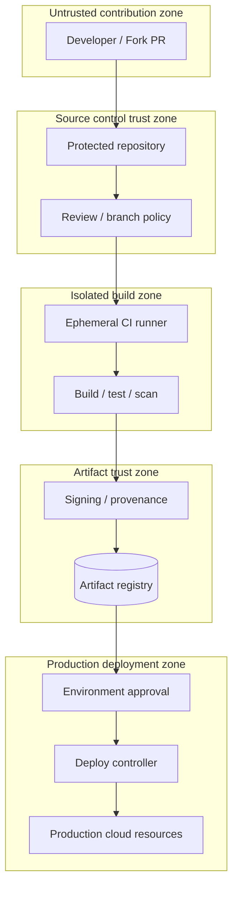
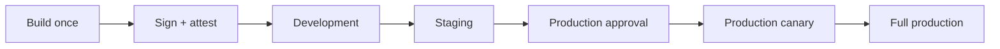
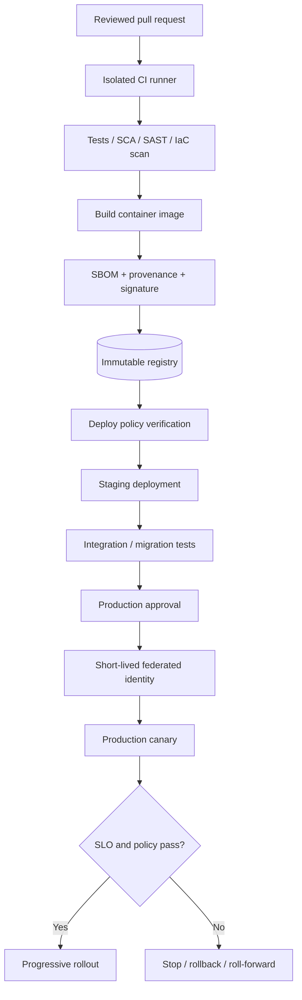

# Thiết kế pipeline CI/CD và ranh giới tin cậy khi triển khai

## 1. CI/CD là một phần của kiến trúc production

Pipeline CI/CD thường được xem như công cụ tự động hóa build và deploy. Trong kiến trúc cloud, pipeline còn là một đường có quyền biến đổi production: nó đọc source code, tải dependency, chạy script, tạo artifact, lấy credential và gọi cloud control plane. Nếu runner bị chiếm quyền, token bị lộ hoặc approval bị giả mạo, kẻ tấn công có thể đưa mã độc vào môi trường production bằng chính quy trình phát hành hợp lệ.

**Continuous Integration (CI)** tự động tích hợp thay đổi mã nguồn thường xuyên, chạy build và kiểm tra để phát hiện lỗi sớm. **Continuous Delivery** giữ phần mềm luôn ở trạng thái có thể phát hành; quyết định phát hành production có thể cần bước phê duyệt. **Continuous Deployment** tự động đưa thay đổi đã vượt guardrail tới production mà không cần approval thủ công cho từng lần.

Một pipeline an toàn cần thiết kế rõ:

- Ai được khởi tạo workflow và từ nguồn code nào?
- Runner thực thi code trong trust domain nào và có quyền gì?
- Dependency và artifact đến từ đâu, được xác minh bằng cách nào?
- Secret và deployment identity được cấp trong bao lâu, cho resource nào?
- Những kiểm tra nào bắt buộc trước khi promotion?
- Ai phê duyệt production và phê duyệt đang áp dụng cho artifact nào?
- Làm sao triển khai từng phần, quan sát, rollback và điều tra khi có sự cố?

Bài học thuộc chương **Phân phối phần mềm** của module **CLOUD_ARCHITECTURE**. Module tập trung thiết kế ứng dụng cloud từ yêu cầu nghiệp vụ đến mạng, compute, dữ liệu và mô hình triển khai, cân bằng độ tin cậy, bảo mật, khả năng mở rộng, chi phí và vận hành theo Well-Architected. Pipeline CI/CD là cơ chế đưa thay đổi vào kiến trúc đang chạy; thiết kế ranh giới tin cậy giúp giảm nguy cơ supply-chain compromise và giới hạn blast radius.

Sau bài học, bạn có thể:

- Thiết kế pipeline từ source đến production và phân biệt CI, delivery, deployment.
- Xác định trust boundary giữa developer, source control, runner, registry và cloud.
- Bảo vệ identity, credential, secret, artifact và deployment approval.
- Thiết lập policy gate, provenance, chữ ký và kiểm tra dependency.
- Chọn runner isolation, deployment strategy, rollback và promotion model.
- Thu thập evidence, quan sát pipeline và xử lý sự cố phát hành.

## 2. Vòng đời CI/CD và các loại pipeline

Một pipeline điển hình gồm các giai đoạn:

1. Source change và review.
2. Trigger workflow.
3. Checkout source, resolve dependency.
4. Build/test/lint/static analysis.
5. Security scan và policy checks.
6. Package artifact và tạo provenance.
7. Sign và publish vào artifact registry.
8. Deploy vào môi trường kiểm thử.
9. Verify integration, security và performance.
10. Approval/promotion tới production.
11. Progressive rollout và health verification.
12. Release record, monitoring và rollback khi cần.

```mermaid
flowchart LR
    SRC[Source / Pull Request] --> CI[Build + Unit Test]
    CI --> SEC[Scan + Policy Gate]
    SEC --> PKG[Package Artifact]
    PKG --> SIGN[Provenance + Sign]
    SIGN --> REG[(Artifact Registry)]
    REG --> TEST[Deploy Test Environment]
    TEST --> VERIFY[Integration / Security Tests]
    VERIFY --> APPROVE[Promotion Approval]
    APPROVE --> PROD[Progressive Production Deploy]
    PROD --> OBS[Health / SLO Verification]
```



Đây là logic tổng quát; mỗi tổ chức có thể thêm bước contract test, schema migration, compliance review, canary hoặc progressive delivery. Điều quan trọng là các stage có input/output và trust boundary được xác định.

### 2.1. Continuous Integration

CI tích hợp thay đổi nhỏ và thường xuyên, thường chạy khi tạo hoặc cập nhật pull request:

- Format, lint và static analysis.
- Unit test và component test.
- Build từ source xác định.
- Dependency/license/security scan.
- Kiểm tra secret vô tình commit.
- Kiểm tra IaC, container image và policy.

CI giúp phản hồi sớm. Nhưng CI pass không có nghĩa artifact đã an toàn để chạy production; cần kiểm soát provenance, quyền deploy, cấu hình môi trường và runtime.

### 2.2. Continuous Delivery

Continuous Delivery tự động hóa tới trạng thái release-ready. Artifact đã kiểm thử được lưu trong registry, có metadata và có thể promotion giữa các environment. Production release có thể yêu cầu approval hoặc change window.

Ưu điểm là quyết định phát hành tách khỏi quá trình build; cùng một artifact có thể được triển khai tới staging rồi production, giảm rủi ro build khác nhau giữa môi trường.

### 2.3. Continuous Deployment

Continuous Deployment tự động phát hành các thay đổi đủ điều kiện. Mô hình này cần test đáng tin cậy, policy gate, canary/gradual rollout, health check, rollback và observability tốt. Tự động deploy không có nghĩa bỏ kiểm soát; kiểm soát được mã hóa thành policy và guardrail thay vì dựa vào thao tác thủ công.

## 3. Xác định trust boundary trong pipeline

Pipeline đi qua nhiều vùng có mức tin cậy và quyền khác nhau. Một commit từ contributor bên ngoài, một workflow trên nhánh protected và một runner có quyền assume production role không thể được coi là cùng trust level.

### 3.1. Các boundary thường gặp

- Developer workstation → source control.
- Fork/untrusted pull request → repository chính.
- Source repository → CI runner.
- Runner → package registry/dependency mirror.
- CI build identity → artifact registry.
- Artifact registry → deployment controller.
- Staging environment → production environment.
- Pipeline identity → cloud control plane.
- Build logs/cache → người dùng có quyền đọc workflow.
- Shared runner → workload hoặc repository khác.

### 3.2. Sơ đồ trust zone



Sơ đồ là mô hình khái niệm. Thực tế cần ghi identity, network path, secret access, artifact read/write, log access và ai quản trị mỗi boundary.

### 3.3. Trust không tự tăng chỉ vì stage chạy thành công

Build success không chứng minh source đáng tin. Test pass không chứng minh dependency không độc hại. Artifact được upload không chứng minh nó được tạo từ commit đã review. Approval cũng không có giá trị nếu không gắn với digest cụ thể. Mỗi lần chuyển boundary cần một điều kiện xác minh: identity, policy, signature, provenance hoặc approval phù hợp.

## 4. Bảo vệ source control và pull request

Source repository là điểm khởi đầu của supply chain. Người có quyền merge hoặc thay đổi workflow có thể thay code chạy trong build/deploy.

### 4.1. Repository protection

- Bảo vệ nhánh production bằng pull request và reviewer theo policy.
- Yêu cầu status check bắt buộc từ workflow tin cậy.
- Giới hạn force push, branch deletion và bypass approval.
- Bảo vệ file pipeline, deployment manifest và policy bằng code owner/reviewer phù hợp.
- Bật MFA/strong authentication cho account có quyền ghi.
- Giới hạn token automation theo repository, permission và thời gian.
- Ghi audit cho branch protection, collaborator, deploy key và webhook changes.

### 4.2. Fork pull request và untrusted code

Code trong pull request từ fork có thể do người ngoài kiểm soát. Workflow chạy code này không nên nhận production secret, token có quyền write hoặc cloud credential. Build/test cần chạy trong sandbox với quyền tối thiểu, không chia sẻ persistent workspace/cache nhạy cảm với job tin cậy.

Không dùng workflow có đặc quyền để checkout và thực thi source không tin cậy mà vẫn giữ credential của workflow. Nếu cần thực hiện tác vụ sau khi PR được review, tạo workflow riêng trên trusted event/branch và kiểm tra lại commit/ref.

### 4.3. Workflow definition cũng là code

Workflow YAML, shell script, Dockerfile, build plugin và deployment action đều có thể thực thi lệnh. Cần review thay đổi các file này như thay đổi security-sensitive code. Pin action/plugin theo version hoặc immutable commit khi phù hợp; tránh tải script động từ URL không xác minh.

## 5. Runner isolation và execution environment

Runner là nơi chạy code và thường là nơi secret/credential có thể xuất hiện. Một runner bị chiếm quyền có thể đánh cắp token, sửa artifact, đọc workspace hoặc tấn công job chạy sau.

### 5.1. Ephemeral runner

Runner dùng một lần cho job hoặc nhóm job tin cậy giúp giảm persistence:

- Tạo từ image chuẩn, được patch và scan.
- Mỗi job có workspace tách biệt.
- Xóa runner sau khi hoàn tất.
- Không để credential tồn tại trong image hoặc persistent disk.
- Giới hạn network egress và quyền tới metadata/control plane.
- Kiểm soát artifact/cache được chia sẻ qua job.

Persistent runner có thể cần cho môi trường đặc thù nhưng cần hardening, re-image định kỳ, access review và separation theo trust tier. Không dùng chung runner có quyền production cho job từ fork hoặc repository có mức tin cậy thấp.

### 5.2. Container không tự động là sandbox hoàn chỉnh

Container giúp đóng gói môi trường nhưng không loại bỏ kernel sharing, privileged mode, host mount, Docker socket hoặc credential host. Một job có quyền truy cập Docker daemon hoặc host path có thể vượt ranh giới container. Chọn mức cách ly theo threat model: VM-based runner, microVM, sandbox runtime hoặc dedicated build pool khi rủi ro cao.

### 5.3. Cache isolation

Build cache và dependency cache tăng tốc pipeline nhưng có thể trở thành kênh rò rỉ hoặc poisoning:

- Không chia cache có nội dung nhạy cảm giữa untrusted và privileged job.
- Namespace cache theo repo/trust domain/toolchain.
- Kiểm soát ai được ghi cache mà job production sẽ đọc.
- Dùng checksum/lockfile để xác minh dependency.
- Xóa hoặc rotate cache khi nghi ngờ compromise.

## 6. Identity và quyền của pipeline

Không nên sử dụng một credential quản trị dài hạn cho mọi stage. Mỗi workload cần identity có scope và thời gian tồn tại phù hợp.

### 6.1. Workload identity và federation

Ưu tiên workload identity hoặc federation từ CI provider sang cloud identity provider:

1. CI job chứng minh danh tính qua token có issuer/audience/subject.
2. Cloud kiểm tra claim và policy trust.
3. Job nhận credential ngắn hạn cho role cụ thể.
4. Role chỉ có quyền trên environment/resource cần thiết.
5. Credential hết hạn sau job hoặc thời gian ngắn.

Điều kiện trust nên ràng buộc repository, branch/tag, workflow identity, environment và audience. Không chỉ tin mọi token phát ra từ cùng một CI organization.

### 6.2. Tách quyền theo stage

| Identity | Quyền thường cần | Không nên có |
|---|---|---|
| PR test runner | Đọc source, chạy test, ghi report | Production deploy, đọc production secret |
| Build job | Đọc dependency, tạo artifact | Quyền thay IAM/network production |
| Artifact publisher | Push đúng repository/package | Delete toàn registry hoặc deploy |
| Staging deployer | Deploy staging và đọc config staging | Production database/admin |
| Production deployer | Update workload/resource đã định | Quản trị toàn cloud account không giới hạn |
| Security scanner | Đọc artifact/source, ghi finding | Quyền sửa production |
| Release approver | Phê duyệt promotion theo policy | Tự sửa artifact hoặc bypass mọi gate |

### 6.3. Least privilege và separation of duties

Tách quyền propose, review, build, sign, approve và deploy khi mức rủi ro yêu cầu. Không nhất thiết có sáu người khác nhau cho một thay đổi nhỏ; có thể dùng policy tự động và nhóm vai trò. Điều cần tránh là một principal vừa tạo code, vừa sửa workflow, vừa tự phê duyệt và triển khai production mà không có kiểm soát độc lập.

## 7. Quản lý secret trong CI/CD

Secret thường xuất hiện trong registry credential, signing key, cloud token, package registry, deployment password và integration test. Secret bị in vào log, lưu trong artifact hoặc cache có thể tồn tại lâu sau khi job kết thúc.

### 7.1. Nguyên tắc

- Lấy secret khi cần từ secret manager, không commit vào repository.
- Ưu tiên short-lived credential và workload identity.
- Scope secret theo environment/repository/job.
- Mask log không phải biện pháp bảo vệ duy nhất; tránh truyền secret qua command line hoặc echo.
- Không lưu secret trong build artifact, Docker layer, cache hoặc test report.
- Rotate/revoke khi nghi ngờ rò rỉ; điều tra nơi secret đã xuất hiện.
- Giới hạn người có thể xem workflow log và download artifact.

### 7.2. Secret và build input

Build từ source không tin cậy không nên được cấp secret production chỉ để tải dependency private. Có thể dùng dependency proxy/read-only token riêng, mirror được kiểm soát hoặc bước fetch tách khỏi execution không tin cậy. Secret phải có quyền đọc tối thiểu và không cấp quyền publish/deploy.

### 7.3. Signing key

Private signing key là tài sản có giá trị cao. Nên sử dụng signing service/KMS/HSM hoặc key được bảo vệ, policy xác thực workload và audit signing request. Không đặt private key lâu dài trong runner image hoặc repository secret có phạm vi rộng.

## 8. Dependency và software supply chain

Artifact có thể bị xâm phạm qua dependency, compiler, base image, build plugin, package registry hoặc build script.

### 8.1. Dependency pinning và lockfile

- Pin version cụ thể và commit/hash khi hệ sinh thái hỗ trợ.
- Commit lockfile để build tái lập.
- Ưu tiên registry/mirror được quản lý.
- Tránh dependency không còn maintain hoặc không rõ nguồn.
- Review package mới, install script và quyền post-install.
- Có quy trình cập nhật security fix thay vì pin mãi một version cũ.

Pin version giúp giảm thay đổi ngoài dự kiến nhưng không chứng minh package an toàn. Một version được pin vẫn có thể chứa mã độc hoặc vulnerability.

### 8.2. Scanning và policy

Pipeline có thể kiểm tra:

- Dependency vulnerability và license policy.
- Secret scanning.
- Static application security testing (SAST).
- Software composition analysis (SCA).
- Container/base image scanning.
- Infrastructure as Code scanning.
- Dynamic test hoặc API security test trong environment phù hợp.
- Malware/signature check và artifact integrity.

Scanner cần baseline, severity mapping, exception owner và expiry. Nếu mọi finding đều chặn release mà không có quy tắc ưu tiên, đội ngũ dễ bỏ qua hoặc tạo bypass không kiểm soát. Với critical finding, cần policy rõ về block, remediation hoặc formal exception.

### 8.3. SBOM

Software Bill of Materials (SBOM) liệt kê thành phần phần mềm trong artifact, ví dụ package, version và dependency relationship. SBOM giúp inventory, impact analysis khi có CVE và hỗ trợ audit. SBOM cần liên kết với artifact digest; SBOM tạo từ source khác hoặc build khác không chứng minh nội dung của artifact đang chạy.

## 9. Build provenance, artifact identity và signing

Để promotion an toàn, cần biết artifact được tạo từ source nào, bởi workflow nào, với builder/toolchain nào và các bước kiểm tra nào đã chạy.

### 9.1. Immutable artifact

Sau khi build và publish, artifact nên được tham chiếu bằng digest/hash thay vì tag có thể ghi đè:

```text
registry.example/booking-api@sha256:<artifact-digest>
```

Tag như latest hoặc release-1.2 có thể hữu ích cho người dùng, nhưng deployment cần pin digest để xác định chính xác nội dung. Không build lại artifact khi promotion từ staging sang production; promotion cùng digest giúp giữ tính nhất quán của thứ đã kiểm thử.

### 9.2. Provenance

Provenance có thể ghi:

- Source repository và commit.
- Trigger/event và workflow identity.
- Builder image/toolchain/version.
- Dependency inputs và materials.
- Build parameters không nhạy cảm.
- Artifact digest và output.
- Test/scan/policy result.
- Timestamp và identity tạo provenance.

Provenance cần được tạo từ hệ thống build có thể tin cậy và được kiểm tra trước khi deploy. Một file provenance do chính artifact tự khai báo mà không có xác thực nguồn không đủ chứng minh.

### 9.3. Artifact signing và verification

Signing xác nhận artifact/statement được ký bởi identity có quyền tương ứng và nội dung không bị thay đổi sau khi ký. Deployment controller cần kiểm tra:

- Signature hợp lệ và chain/trust root đúng.
- Signer identity thuộc pipeline được cho phép.
- Artifact digest khớp provenance/SBOM.
- Source repo/branch/commit được chấp nhận.
- Build workflow và policy result thỏa yêu cầu.
- Signature/provenance chưa bị revoke hoặc policy hết hiệu lực.

Signing không chứng minh source không có bug hoặc logic độc hại; nó tăng khả năng xác minh nguồn gốc và tính toàn vẹn.

## 10. Policy gate và approval trước production

Production deployment cần điều kiện có thể kiểm tra, không dựa vào câu “đã test rồi”.

### 10.1. Các gate thường có

- Required reviewer/status checks từ branch protection.
- Build/test pass và coverage/quality threshold phù hợp.
- Security scan không có finding vượt policy.
- Artifact có digest, signature và provenance hợp lệ.
- IaC plan không vi phạm policy.
- Database migration có compatibility/rollback plan.
- Environment approval/change window khi cần.
- Canary và SLO guardrail sau deploy.

### 10.2. Approval phải gắn với artifact và scope

Approval cần xác định:

- Artifact digest/version nào.
- Environment, region, tenant group nào.
- Change/ticket/release ID nào.
- Policy/test result nào đã được review.
- Người phê duyệt và thời điểm.
- Approval còn hợp lệ sau khi artifact hoặc scope thay đổi hay không.

Nếu build lại sau approval, digest thay đổi thì approval cũ không nên tự động áp dụng cho artifact mới. Tương tự, approval staging không đồng nghĩa approval production nếu policy yêu cầu khác.

### 10.3. Policy as code

Policy có thể kiểm tra actor, source branch, artifact signature, provenance, deployment target, image digest, network exposure và required approval. Lợi ích là kết quả có tính nhất quán, reviewable và có thể test. Policy cũng là code nhạy cảm: thay policy cần review, versioning, test positive/negative và audit.

## 11. Promotion giữa các môi trường

Một mô hình thường dùng:



Nguyên tắc là **build once, promote the same artifact**. Environment-specific configuration được inject ở runtime hoặc qua deployment config; không build artifact khác nhau cho staging và production nếu mục tiêu là kiểm thử đúng binary/container được phát hành.

### 11.1. Tách config và artifact

Artifact nên bất biến; environment config, secret và runtime policy được quản lý riêng, version hóa và audit. Không bake production secret vào image. Cần biết config revision nào kết hợp với artifact digest tại thời điểm deploy để điều tra sự cố.

### 11.2. Schema/database migration

Database migration có thể không tương thích ngược nếu deploy app và schema không đồng bộ. Dùng expand/contract:

1. Expand schema bằng thay đổi tương thích app cũ.
2. Deploy app mới đọc/ghi schema mở rộng.
3. Backfill và xác minh dữ liệu.
4. Chuyển traffic và loại bỏ đường code cũ.
5. Contract schema sau khi mọi consumer không còn cần cột/format cũ.

Migration phá hủy dữ liệu cần backup, validation và phương án restore/forward-fix; rollback app không nhất thiết đảo ngược schema.

## 12. Chiến lược triển khai và giới hạn blast radius

| Strategy | Cách hoạt động | Ưu điểm | Rủi ro/điều kiện |
|---|---|---|---|
| Recreate | Dừng bản cũ, chạy bản mới | Đơn giản | Downtime, khó rollback nhanh |
| Rolling | Thay instance theo batch | Giảm downtime | Hai version chạy đồng thời |
| Blue-green | Hai môi trường, chuyển traffic | Cutover nhanh, rollback routing | Tốn capacity, state/schema cần tương thích |
| Canary | Một tỷ lệ nhỏ nhận version mới | Phát hiện lỗi sớm | Cần metric và traffic đại diện |
| Feature flag | Bật hành vi theo nhóm | Tách deploy khỏi release | Flag drift, state combinations |
| Traffic shadowing | Gửi bản sao request tới bản mới | Kiểm tra hành vi không ảnh hưởng response chính | Không phù hợp side effect nếu không cô lập |

### 12.1. Canary và automatic analysis

Chọn metric đại diện: error rate, latency p95/p99, saturation, business correctness và dependency health. So sánh canary với baseline cùng khoảng thời gian và điều kiện tải. Chỉ mở rộng khi đủ sample size và guardrail đạt; traffic ít không đủ bằng chứng thì giữ rollout ở trạng thái kiểm soát hoặc bổ sung synthetic/load test.

### 12.2. Blue-green và stateful system

Blue-green dễ hình dung với stateless service; database, queue, session, cache và external side effect làm cutover phức tạp. Cần xác định version tương thích, write ownership, replication lag, session drain và cách xử lý event phát ra từ môi trường cũ.

## 13. Rollback, roll-forward và release recovery

Rollback là chuyển về phiên bản trước; roll-forward là phát hành bản sửa để xử lý lỗi. Không phải lỗi nào cũng có thể rollback an toàn.

### 13.1. Khi rollback phù hợp

- Artifact trước còn tồn tại và được xác minh.
- Config/schema vẫn tương thích.
- External side effect không khiến phiên bản cũ xử lý sai.
- Rollback không làm mất dữ liệu hoặc tái mở vulnerability.

### 13.2. Khi cần roll-forward hoặc compensating action

- Database đã thay đổi không thể đảo ngược.
- Event đã gửi tới đối tác hoặc khách hàng.
- Credential/key đã rotate.
- Format dữ liệu mới đã được ghi.
- Version trước có lỗ hổng bảo mật nghiêm trọng.

### 13.3. Release evidence

Lưu release ID, artifact digest, source commit, provenance/signature, config revision, deployment target, approval, rollout timeline, SLO before/after và rollback/roll-forward record. Các dữ liệu này giúp truy vết nguyên nhân và chứng minh thay đổi thực tế.

## 14. Supply-chain security và các mối đe dọa pipeline

| Threat | Đường tấn công | Kiểm soát chính |
|---|---|---|
| Poisoned dependency | Package có mã độc hoặc bị chiếm | Pin/lock, trusted registry, SCA, review |
| Compromised runner | Job trước để lại persistence/token | Ephemeral isolation, no shared secrets, re-image |
| Workflow injection | PR sửa workflow hoặc command input | Review workflow, untrusted input handling, least privilege |
| Secret exfiltration | Log/cache/artifact hoặc network egress | Secret manager, masking, egress control, scoped token |
| Artifact substitution | Tag bị ghi đè hoặc registry bị xâm phạm | Immutable digest, signing, provenance verification |
| Approval bypass | Actor tự merge/deploy hoặc policy bị sửa | Separation of duties, protected environment, audit |
| Build cache poisoning | Job không tin cậy ghi cache cho job release | Cache namespace/access policy, integrity |
| Cloud credential theft | Runner có role rộng hoặc token dài hạn | Federation, short-lived identity, least privilege |
| Pipeline denial of service | Job flood, oversized artifact, exhausted quota | Queue/concurrency limits, quotas, isolation |

Threat model cần xét cả source, build environment, package ecosystem, artifact store, deployment controller và cloud control plane. Bảo vệ một công cụ CI không đủ nếu quyền deploy production vẫn có thể lấy từ runner khác không được quản lý.

## 15. Vận hành và observability của pipeline

Pipeline là một hệ thống production phụ trợ và cần được đo:

| Metric/event | Ý nghĩa |
|---|---|
| Pipeline duration và queue wait | Hiệu suất delivery |
| Build/test failure rate | Chất lượng source/toolchain |
| Security gate findings | Risk trước promotion |
| Artifact signing/verification result | Tính toàn vẹn và nguồn gốc |
| Deployment frequency/lead time | Tốc độ delivery |
| Change failure rate | Tỷ lệ release gây rollback/incident |
| Time to restore | Thời gian khôi phục sau deploy failure |
| Runner utilization/isolation event | Capacity và sức khỏe build plane |
| Credential issuance/denial | Identity behavior |
| Config/infra drift | Khác biệt giữa desired và deployed state |

Không chỉ tối ưu pipeline nhanh. Rút ngắn scan hoặc bỏ test để giảm vài phút có thể làm tăng change failure và chi phí incident. Mục tiêu là flow nhanh nhưng vẫn đáng tin.

### 15.1. Audit và change traceability

Mỗi release nên liên kết ticket/change ID, PR, reviewer, commit, workflow run, builder identity, dependency lock, artifact digest, signature, approval, deploy event và runtime version. Console change ngoài pipeline cần audit và exception record.

### 15.2. Runbook pipeline

Runbook cần hướng dẫn:

- Workflow bị treo hoặc queue quá dài.
- Runner compromise hoặc credential bị lộ.
- Artifact signature/provenance không hợp lệ.
- Security gate phát hiện critical issue.
- Deployment canary vi phạm SLO.
- Registry hoặc CI provider outage.
- Rollback không tương thích schema.

## 16. Ví dụ: phát hành Booking API lên cloud

Giả sử team phát hành Booking API chạy container lên Kubernetes hoặc managed container platform.

### 16.1. Source và build

- Developer mở PR; protected branch yêu cầu review.
- CI chạy lint, unit test, API contract test và dependency scan.
- Runner ephemeral không có production secret.
- Build tạo container image từ commit xác định và lockfile.
- SBOM và provenance gắn với image digest.
- Image được ký qua signing identity giới hạn.

### 16.2. Staging promotion

- Deployment controller xác minh signature và provenance.
- Image digest giống artifact đã build.
- Config/secret staging được inject bằng workload identity.
- Integration/load test và database migration compatibility test chạy.
- Kết quả lưu vào release record.

### 16.3. Production promotion

- Change approval gắn với digest và environment production.
- Production deployer nhận credential ngắn hạn qua federation.
- Canary một nhóm pod/tenant nội bộ trước.
- Theo dõi error rate, p99, DB connection, booking correctness và queue lag.
- Nếu guardrail đạt, mở rộng rollout; nếu không, dừng và rollback/roll-forward theo data migration state.

### 16.4. Sơ đồ deployment trust



### 16.5. Evidence liên kết

Release package có release ID, change ticket, PR/commit, CI workflow run, test/scan output, SBOM, provenance, image digest, signature verification, approval record, deploy event và post-deploy SLO snapshot. Evidence không cần chứa secret hay payload nghiệp vụ.

## 17. Chi phí và đánh đổi vận hành

| Lựa chọn | Lợi ích | Chi phí/đánh đổi |
|---|---|---|
| Ephemeral runner | Giảm persistence và cross-job contamination | Provision time, image maintenance, capacity |
| Dedicated production runner | Isolation cao hơn cho deploy | Tài nguyên và vận hành riêng |
| Central artifact registry | Provenance và access tập trung | Availability, replication, storage |
| Full security scanning | Phát hiện nhiều lớp risk | Pipeline duration, false positive, scanner upkeep |
| Manual approval | Human review cho thay đổi nhạy cảm | Lead time, reviewer bottleneck |
| Automated policy gate | Kết quả nhất quán, scale tốt | Policy maintenance, exception governance |
| Canary/blue-green | Giảm blast radius/rollback time | Capacity dư, metric và routing complexity |
| Multi-region pipeline | Delivery resilient | Cross-region secret/artifact and coordination cost |

Đo TCO gồm CI minutes/runner, registry/storage/egress, scanning/signing, log retention, environment cost, capacity dư cho blue-green, người vận hành và chi phí sự cố. Chọn mức kiểm soát theo criticality và blast radius, không chỉ theo tốc độ pipeline.

## 18. Đánh giá theo Well-Architected

| Trụ cột | Câu hỏi review |
|---|---|
| **Operational Excellence** | Pipeline có versioning, owner, runbook, release evidence, automation và rollback? |
| **Security** | Trust boundary, runner, identity, secret, dependency, provenance, signature và approval có defense-in-depth? |
| **Reliability** | CI/registry/deploy controller failure có xử lý? Canary, health gate và recovery có hoạt động? |
| **Performance Efficiency** | Build cache, parallelism và test selection tối ưu mà vẫn giữ coverage? |
| **Cost Optimization** | Runner, registry, scans, environments và release capacity có đúng quy mô? |
| **Sustainability** | Artifact retention/lifecycle, runner autoscaling và môi trường ephemeral giảm tài nguyên nhàn rỗi? |

## 19. Mẫu release policy

Mẫu YAML sau minh họa các điều kiện promotion; không phải cấu hình cho một CI vendor:

```yaml
release_policy:
  service: booking-api
  source:
    protected_branch_required: true
    pull_request_review_required: true
  build:
    ephemeral_runner_required: true
    lockfile_required: true
    secret_scan_required: true
    test_suite_required: true
  artifact:
    immutable_digest_required: true
    sbom_required: true
    provenance_required: true
    signature_verification_required: true
  promotion:
    same_artifact_across_environments: true
    staging_validation_required: true
    production_approval_required: true
    approval_bound_to_digest: true
  deployment:
    strategy: canary_then_progressive
    health_gate:
      error_rate: required
      latency_p99: required
      business_correctness: required
  identity:
    workload_federation: required
    long_lived_cloud_key: prohibited
  exceptions:
    owner_required: true
    expiry_required: true
    audit_required: true
```

Policy chính thức cần thêm owner, phạm vi environment, threshold, exception authority, retention và test positive/negative.

## 20. Quy trình thiết kế pipeline CI/CD

1. **Xác định release model:** continuous delivery hay continuous deployment, service boundary và criticality.
2. **Vẽ trust boundary:** developer, source, workflow, runner, registry, approval, deployer và cloud account.
3. **Thiết kế source protection:** branch rule, reviewer, workflow file ownership và fork PR isolation.
4. **Cô lập runner:** ephemeral/dedicated pool, workspace, cache, network egress và host boundary.
5. **Thiết kế identity:** federation, short-lived credential và least privilege theo stage.
6. **Bảo vệ supply chain:** pin dependency, scan, SBOM, provenance, immutable artifact và signing.
7. **Định nghĩa policy gate:** test, security, IaC, approval và artifact verification.
8. **Thiết kế promotion:** build once, promote same digest, environment config tách riêng.
9. **Chọn deployment strategy:** rolling, blue-green, canary hoặc feature flag; chuẩn bị rollback/roll-forward.
10. **Vận hành và audit:** metric, evidence, runbook, incident response và review định kỳ.

## 21. Bảng kiểm trước production

- [ ] Pipeline stages, input/output, owner và trust boundary được ghi rõ.
- [ ] Protected branch, required review và workflow file protection được áp dụng.
- [ ] Fork/untrusted PR không truy cập production secret hoặc deploy identity.
- [ ] Runner có isolation, patching, ephemeral cleanup và cache policy.
- [ ] Không dùng privileged container/shared host vượt trust model.
- [ ] Workload federation/short-lived credential được ưu tiên; quyền theo stage là least privilege.
- [ ] Secret không commit, in log, bake vào image hoặc lưu trong artifact/cache.
- [ ] Dependency được pin/lock và scan; exception có owner/expiry.
- [ ] SBOM, provenance và signature gắn với artifact digest.
- [ ] Artifact immutable; deployment dùng digest, không dựa tag có thể ghi đè.
- [ ] Deployment controller kiểm tra signer, source, provenance và policy.
- [ ] Approval gắn với digest, scope, environment và change record.
- [ ] Cùng artifact được promotion từ staging tới production.
- [ ] IaC và database migration có review, test, compatibility và recovery plan.
- [ ] Canary/progressive rollout có guardrail, stop condition và health verification.
- [ ] Rollback/roll-forward xét schema và external side effect.
- [ ] Change traceability nối ticket, PR, build, artifact, approval và runtime.
- [ ] Pipeline/registry/runner có monitoring, quota, backup và incident runbook.
- [ ] Đã diễn tập runner compromise, secret leak, artifact verification failure và deployment rollback.
- [ ] Release evidence có retention/access policy và không chứa secret.

**Nguyên tắc áp dụng:** pipeline CI/CD là đường có quyền thay đổi production, vì vậy phải thiết kế nó như một phần của trust architecture. Bảo vệ source, cô lập runner, cấp identity ngắn hạn, xác minh provenance/artifact, gắn approval với digest và rollout theo guardrail giúp giảm nguy cơ đưa thay đổi không tin cậy vào cloud. Một pipeline trưởng thành không chỉ deploy nhanh; nó còn chứng minh được điều gì được build, ai cho phép, artifact nào đã chạy và cách phục hồi khi release thất bại.
