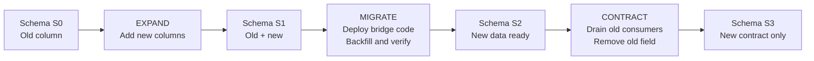
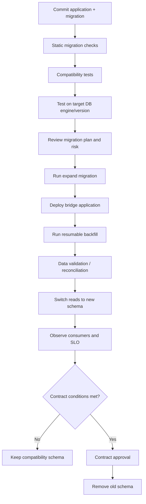

# Thay đổi cơ sở dữ liệu theo expand–contract

Ứng dụng thường được triển khai nhanh hơn vòng đời dữ liệu. Trong một đợt rolling deployment, phiên bản cũ và mới có thể cùng chạy vài phút; worker nền có thể xử lý message đã nằm trong queue từ trước; dashboard, batch job hoặc service khác có thể tiếp tục đọc schema cũ sau khi API đã nâng cấp. Nếu một release đổi tên hoặc xóa cột ngay lập tức, các consumer chưa nâng cấp sẽ lỗi dù binary mới đã chạy tốt.

**Expand–contract** là chiến lược thay đổi database theo nhiều bước tương thích: mở rộng schema trước, triển khai ứng dụng chuyển tiếp, di chuyển và xác minh dữ liệu, chuyển consumer sang cấu trúc mới, sau đó mới loại bỏ cấu trúc cũ. Chiến lược này giúp phát hành liên tục trong khi nhiều phiên bản ứng dụng và schema cùng tồn tại.

Trong module **CLOUD_ARCHITECTURE**, expand–contract kết nối software delivery với database architecture, compute rollout, CI/CD, reliability, data integrity và vận hành. Ví dụ xuyên suốt là hệ thống đặt thuê thiết bị có bảng Reservation và cột customer_name cần được thay bằng customer_first_name và customer_last_name. SQL, thời gian rollout và ngưỡng kiểm thử trong bài mang tính minh họa; cú pháp DDL, lock behavior, transactional DDL và online operation phụ thuộc database engine/version.

## 1. Vì sao thay đổi schema là một bài toán release?

Database là hợp đồng dùng chung giữa nhiều consumer, không chỉ một ứng dụng. Một thay đổi schema có thể ảnh hưởng:

- API instances cũ và mới chạy đồng thời.
- Background worker, scheduler, cron và retry queue.
- ETL/ELT pipeline, data warehouse, BI và export.
- Stored procedure, trigger, view và database function.
- Service khác truy cập trực tiếp database hoặc qua shared schema.
- Mobile/desktop client có vòng đời nâng cấp dài.
- Migration job và script vận hành.

Ví dụ ban đầu có bảng Reservation:

```sql
CREATE TABLE reservation (
    id BIGINT PRIMARY KEY,
    customer_name VARCHAR(200) NOT NULL,
    start_at TIMESTAMP NOT NULL,
    end_at TIMESTAMP NOT NULL,
    status VARCHAR(30) NOT NULL
);
```

Phiên bản V1 đọc và ghi customer_name. Yêu cầu mới muốn lưu riêng tên và họ. Nếu release mới chỉ thêm hai cột rồi xóa ngay cột cũ, V1 còn chạy trong rolling deployment sẽ thất bại. Nếu chỉ deploy code mới và bỏ cột cũ trước, worker V1 hoặc báo cáo cũ có thể lỗi sau deployment.

Vấn đề cần giải quyết là: **mỗi bước triển khai phải duy trì tính tương thích với các phiên bản còn hoạt động trong thời gian chuyển tiếp.**

## 2. Ba giai đoạn Expand–Migrate–Contract

Chiến lược có ba giai đoạn logic:

1. **Expand:** thêm cấu trúc mới theo cách vẫn tương thích với code cũ.
2. **Migrate:** triển khai code chuyển tiếp, chuyển dữ liệu và consumer dần sang cấu trúc mới.
3. **Contract:** sau khi xác minh không còn consumer cũ, loại bỏ cấu trúc và logic cũ.



Không nhất thiết mỗi giai đoạn là một release duy nhất. Một thay đổi lớn có thể cần nhiều release và một khoảng quan sát giữa chúng. Đặc biệt, contract thường nên là release riêng vì đây là bước làm mất khả năng tương thích với code cũ.

## 3. Compatibility matrix: xác định tổ hợp phải hoạt động

Trước khi viết migration, liệt kê schema version và application version có thể cùng tồn tại.

Ví dụ:

| Schema | App V1 | App V2 bridge | App V3 new-only |
| --- | --- | --- | --- |
| S0: chỉ có customer_name | Phải hoạt động | Chưa được deploy nếu không có fallback | Không tương thích |
| S1: có customer_name và hai cột mới | Phải hoạt động | Phải hoạt động | Có thể hoạt động nếu dữ liệu mới đã đầy đủ |
| S2: dữ liệu mới đã backfill/verify | Có thể còn hoạt động trong rollback window | Phải hoạt động | Phải hoạt động |
| S3: chỉ còn cột mới | Không tương thích | Không tương thích nếu còn fallback cũ | Phải hoạt động |

Matrix cần phản ánh cả reader và writer:

- V1 có tiếp tục insert mà không biết cột mới không?
- V2 có đọc được row chưa backfill không?
- V2 ghi dữ liệu mới có giữ cột cũ đồng bộ không?
- Worker cũ có thể cập nhật field cũ sau khi backfill không?
- V3 có yêu cầu mọi record đã có dữ liệu mới không?
- Rollback về V1 còn an toàn ở giai đoạn nào?

Không chỉ kiểm tra API chính. Một consumer ít được dùng nhưng chạy hàng đêm vẫn có thể khiến contract release lỗi nhiều ngày sau.

## 4. Expand: thêm schema theo hướng additive

Giai đoạn expand chỉ thêm cấu trúc cần thiết và cố gắng giữ consumer hiện tại hoạt động.

Ví dụ:

```sql
ALTER TABLE reservation
    ADD COLUMN customer_first_name VARCHAR(100),
    ADD COLUMN customer_last_name VARCHAR(100);
```

Hai cột mới cho phép ứng dụng V2 bắt đầu ghi dữ liệu tách. Cột customer_name vẫn tồn tại cho V1.

### Những thay đổi thường phù hợp với expand

- Thêm nullable column.
- Thêm bảng mới.
- Thêm index bằng phương pháp online/concurrent nếu engine hỗ trợ.
- Thêm view tương thích.
- Thêm field optional vào schema event có compatibility rõ.
- Thêm constraint theo cách có thể validate ở bước riêng.

### Những thay đổi dễ phá tương thích

- Drop hoặc rename cột đang được sử dụng.
- Thêm NOT NULL column mà writer cũ không cung cấp giá trị.
- Đổi kiểu dữ liệu có thể truncate hoặc đổi semantics.
- Thay enum/value mà consumer cũ không hiểu.
- Thêm constraint làm insert/update cũ thất bại.
- Đổi tên table/schema/endpoint mà consumer cũ tham chiếu.

### Nullable không tự động có nghĩa online

ADD COLUMN có thể nhanh ở một engine/version nhưng có thể rewrite bảng hoặc gây lock ở engine/version khác. Default expression, generated column, type và kích thước bảng đều có thể ảnh hưởng. Kiểm thử trên đúng database engine/version, kiểm tra lock duration và transaction behavior trước production.

## 5. Deploy bridge application

Sau khi schema expand thành công, deploy phiên bản chuyển tiếp V2. V2 hiểu cả cấu trúc cũ và mới trong khoảng migration.

Một cách đọc:

1. Nếu cột mới có dữ liệu hợp lệ, dùng cột mới.
2. Nếu cột mới chưa có dữ liệu, fallback sang cột cũ theo quy tắc đã định nghĩa.
3. Emit metric cho mỗi lần fallback.
4. Khi ghi, cập nhật cả hai representation theo cùng transaction nếu chúng ở cùng database.

Pseudo-code:

```text
readCustomerName(row):
    if new_name_fields_are_valid(row):
        return combine(row.customer_first_name, row.customer_last_name)
    return row.customer_name

writeCustomerName(row, input):
    parsed = apply_approved_name_mapping(input)
    begin transaction
        write old representation
        write new representation
    commit
```

Đây là logic minh họa. Tách tên người có thể phức tạp vì tên đa thành phần, tên không có dấu cách, tên tổ chức và locale. Không dùng một phép split đơn giản cho dữ liệu đa quốc gia mà không có quy tắc nghiệp vụ được duyệt.

### Fallback phải quan sát được

Không để fallback tiếp tục vô thời hạn. Metric fallback cho biết dữ liệu mới còn thiếu hoặc consumer cũ vẫn ghi dữ liệu cũ. Khi fallback rate về 0 trong một khoảng quan sát đủ dài, nhóm có thêm bằng chứng để chuyển sang read path mới.

## 6. Dual-write và nguồn dữ liệu chuẩn

Trong giai đoạn chuyển tiếp, V2 có thể ghi cả customer_name và hai cột mới. Nếu cả ba field nằm trong cùng một database, một transaction có thể giữ tính nguyên tử.

```sql
UPDATE reservation
SET customer_name = :display_name,
    customer_first_name = :first_name,
    customer_last_name = :last_name
WHERE id = :id;
```

Phải xác định rõ:

- Representation nào là nguồn chuẩn ở từng giai đoạn?
- Nếu hai representation lệch nhau, field nào thắng?
- V1 có thể ghi customer_name sau khi V2 đã ghi tên mới không?
- Trigger/stored procedure/admin tool có tuân cùng quy tắc không?
- Backfill có thể ghi đè giá trị mới không?
- Khi ngừng dual-write, consumer nào còn cập nhật field cũ?

Dual-write qua hai hệ thống khác nhau không có transaction nguyên tử chung. Nếu ghi database và event broker hoặc hai database, một bên có thể thành công còn bên kia thất bại. Khi cần reliable propagation, xem xét transactional outbox, CDC hoặc reconciliation thay vì giả định cả hai write luôn cùng thành công.

## 7. Migrate dữ liệu bằng backfill

Sau khi V2 có thể đọc/ghi schema mở rộng, các row cũ cần được chuyển sang representation mới. Với bảng lớn, tránh một UPDATE toàn bảng trong transaction dài nếu điều đó tạo lock, log hoặc replication pressure.

### Batch backfill theo khóa

```sql
UPDATE reservation
SET customer_first_name = :derived_first_name,
    customer_last_name = :derived_last_name
WHERE id > :last_id
  AND id <= :next_id
  AND customer_first_name IS NULL
  AND customer_last_name IS NULL;
```

Đây là ví dụ range batching. Chuyển đổi tên nên dùng quy tắc nghiệp vụ được review; record không thể chuyển đổi tự động cần exception queue hoặc giữ nguyên để xử lý sau.

### Pseudocode cho backfill có checkpoint

```text
checkpoint = load_checkpoint()
while true:
    batch = read_next_range_after(checkpoint)
    if batch is empty:
        break
    transform rows
    update only rows still eligible for migration
    commit bounded transaction
    persist checkpoint after successful commit
    record counts and duration
    pause or throttle when production limits are exceeded
```

### Tính chất cần có

- **Idempotent:** chạy lại batch không làm hỏng dữ liệu đã chuyển.
- **Resumable:** job restart có thể tiếp tục từ checkpoint.
- **Bounded:** số row, transaction duration và resource usage có giới hạn.
- **Observable:** đo rows processed/remaining, duration, error và lag.
- **Concurrency-safe:** không ghi đè update mới của application.
- **Auditable:** có job version, run ID và checkpoint.

Keyset/range pagination thường phù hợp hơn OFFSET lớn, nhưng cần key duy nhất và index phù hợp.

## 8. Tránh race condition giữa backfill và application writer

Một lỗi thường gặp:

1. Backfill đọc row với customer_name cũ.
2. V2 cập nhật tên mới từ request vừa tới.
3. Backfill ghi kết quả suy diễn từ giá trị cũ lên cột mới.

Kết quả có thể làm mất update vừa xảy ra.

Có thể dùng conditional update/compare-and-set:

```sql
UPDATE reservation
SET customer_first_name = :derived_first_name,
    customer_last_name = :derived_last_name
WHERE id = :id
  AND customer_first_name IS NULL
  AND customer_last_name IS NULL
  AND customer_name = :observed_old_value;
```

Nếu V2 đã ghi cột mới hoặc customer_name đã thay đổi, điều kiện không còn đúng và backfill không ghi đè. Worker phải đọc lại, phân loại và xử lý theo mapping. Một lựa chọn khác là version column hoặc row lock ngắn trong transaction có giới hạn.

Ghi nhận số row update bằng 0 để phân biệt race hợp lệ với lỗi dữ liệu. Sau backfill vẫn cần reconciliation để tìm row chưa hoàn tất.

## 9. Data validation trước khi chuyển read path

Hoàn tất backfill không đồng nghĩa dữ liệu đúng. Trước khi V2/V3 chỉ đọc cột mới, cần đo:

- Số record còn NULL ở field bắt buộc.
- Số record không thể chuyển đổi theo quy tắc.
- Mismatch giữa representation cũ và mới trong phạm vi so sánh được.
- Duplicate, invalid value và business invariant.
- Record được cập nhật trong lúc migration.
- Partition/range đã thực sự được xử lý.

Ví dụ:

```sql
SELECT COUNT(*) AS missing_new_name
FROM reservation
WHERE customer_first_name IS NULL
   OR customer_last_name IS NULL;
```

Nếu nghiệp vụ cho phép tên không đầy đủ, không nên ép hai cột luôn non-null chỉ để số liệu đạt 0. Validation phải phản ánh semantics thật.

### Data reconciliation

Với chuyển đổi một-một, có thể so sánh display value sau normalization. Với chuyển đổi mất thông tin hoặc mapping phức tạp, cần exception report và business owner review. Không coi một phép so sánh string đơn giản là bằng chứng chính xác cho mọi ngôn ngữ/tên.

## 10. Cutover: chuyển consumer sang schema mới

Khi backfill và validation đạt điều kiện, chuyển read path sang representation mới. Có thể thực hiện theo các bước:

1. Bật feature flag cho một tỷ lệ traffic nhỏ.
2. So sánh output mới/cũ ở chế độ shadow hoặc dual-read.
3. Tăng dần traffic khi metric ổn định.
4. Theo dõi fallback, mismatch, error, latency và business outcome.
5. Chuyển toàn bộ API và worker sang read path mới.
6. Chờ consumer bên ngoài, cron, ETL và report chuyển xong.

Shadow read nên giới hạn chi phí và side effect. Không thực thi cùng một transaction hai lần chỉ để so sánh kết quả.

### Consumer inventory

Trước contract, xác nhận:

- API deployment cũ đã hết.
- Background workers và scheduled job đã nâng cấp.
- Queue message cũ được xử lý hoặc compatibility layer vẫn đọc được.
- ETL/BI/report và export đã chuyển.
- Stored procedure/trigger/view đã cập nhật.
- Consumer ngoài tổ chức đã nhận deprecation notice và thời hạn.
- Không còn query hoặc metric cho thấy field cũ đang được sử dụng trong thời gian quan sát phù hợp.

Deployment V2 hoàn tất không chứng minh toàn bộ consumer đã chuyển.

## 11. Contract: loại bỏ cấu trúc cũ

Chỉ bắt đầu contract khi điều kiện đã được chứng minh:

- Không còn application/worker cần customer_name.
- Backfill hoàn tất, validation đạt.
- Read path mới ổn định qua khoảng quan sát.
- Consumer bên ngoài đã chuyển hoặc được xử lý theo contract.
- Rollback window của release trước đã kết thúc hoặc có recovery plan được phê duyệt.
- Backup/recovery point phù hợp.
- Change được review theo risk tier.

Sau đó có thể phát hành release riêng để bỏ fallback, ngừng dual-write và drop cột cũ.

```sql
ALTER TABLE reservation
    DROP COLUMN customer_name;
```

DROP COLUMN có thể không tốn nhiều thời gian ở một số engine nhưng vẫn cần kiểm tra metadata lock, dependency và khả năng rollback. Không mặc định DDL destructive là instant hoặc transactional.

### Tách contract thành các bước nhỏ

1. Deploy code không còn đọc cột cũ.
2. Deploy code không còn ghi cột cũ.
3. Quan sát và xác minh usage về 0.
4. Drop cột hoặc bảng cũ trong migration riêng.
5. Dọn compatibility flag, metric và code path sau khi chắc chắn không cần.

Giữa các bước có thể cần một release hoặc khoảng quan sát riêng.

## 12. Rollback ở từng giai đoạn

Rollback ứng dụng và rollback schema là hai việc khác nhau. Một binary cũ có thể không đọc schema mới; một migration có thể đã chuyển đổi dữ liệu hoặc xóa thông tin không thể phục hồi.

| Giai đoạn | Trạng thái | Hướng xử lý khi release lỗi |
| --- | --- | --- |
| Trước expand | Schema S0 | Rollback ứng dụng như quy trình thông thường |
| Sau expand | S0 + cột mới | Thường giữ cột mới, rollback code về V1 nếu tương thích |
| Sau deploy bridge | V1/V2 cùng chạy trên S1 | Dừng rollout, quay về version tương thích; giữ schema mở rộng |
| Đang backfill | Một phần row đã chuyển | Pause/resume hoặc repair; không drop field |
| Sau cutover | Consumer đã đọc schema mới | Rollback code chỉ khi schema vẫn giữ field cũ và dữ liệu được dual-write/khôi phục |
| Sau contract | Cột cũ đã drop | Binary cũ không còn tương thích; thường cần roll-forward hoặc restore/repair có kiểm soát |

Không chạy down migration tự động chỉ vì deployment thất bại. Nếu đã xóa cột hoặc chuyển đổi mất thông tin, down migration có thể không khôi phục dữ liệu ban đầu. Thiết kế additive giúp code rollback dễ hơn trong giai đoạn trước contract.

## 13. CI/CD pipeline cho expand–contract

Migration là artifact của release và cần quản lý giống code.

Một pipeline tham khảo:



### Pipeline gates

- Migration syntax và lint.
- Kiểm tra dangerous operation: DROP, TRUNCATE, ALTER TYPE, NOT NULL.
- Compatibility test giữa app cũ/mới và schema cũ/mở rộng.
- Test trên đúng engine/version, không chỉ mock.
- Dataset đại diện để đo lock, duration, I/O và replication lag.
- Expand job chạy có serialization/lock.
- Bridge deploy có health check và canary.
- Backfill có checkpoint, throttle và stop/resume.
- Data validation trước cutover.
- Contract chỉ chạy khi runtime/consumer evidence đạt và approval hợp lệ.

### Migration runner

Không để mọi application replica cùng tự chạy migration khi startup trừ khi framework có cơ chế lock/leader được hiểu rõ. Dùng migration job riêng giúp tách quyền DDL khỏi runtime identity, chạy một lần có audit và làm pipeline chờ kết quả trước khi rollout.

Migration history cần version, checksum, execution identity, timestamp, trạng thái và output. Nếu job bị crash giữa DDL/DML, xác định trạng thái thực tế trước khi retry; không sửa history để che lỗi.

## 14. Online DDL và database-specific behavior

Expand–contract giảm rủi ro tương thích ứng dụng nhưng không tự bảo đảm DDL không gây lock.

Những điều cần xác minh:

- ADD COLUMN có rewrite bảng không?
- Default có phải tính cho mọi row cũ không?
- Tạo index có chặn ghi/đọc không?
- Có online/concurrent index build không?
- Thêm/validate constraint có scan bảng không?
- DDL có transaction và rollback không?
- Có metadata lock hoặc lock queue không?
- Replication xử lý DDL ra sao?

Ví dụ PostgreSQL:

```sql
CREATE INDEX CONCURRENTLY idx_reservation_status
ON reservation (status);
```

Đây là cú pháp riêng của PostgreSQL; CREATE INDEX CONCURRENTLY có giới hạn riêng, bao gồm không chạy trong transaction block thông thường. Nếu thất bại có thể để lại index invalid cần kiểm tra. Engine khác có cú pháp và semantics khác.

Một ALTER nhanh khi chạy trên staging nhỏ có thể chờ lock dài trên production vì transaction khác đang mở. Đặt lock timeout phù hợp, quan sát transaction age và chuẩn bị runbook retry/repair.

## 15. Thêm NOT NULL và default an toàn

Giả sử V2 cần cột booking_source bắt buộc. V1 chưa biết cột đó. Nếu thêm NOT NULL không default, insert từ V1 có thể thất bại.

Một trình tự phổ biến:

1. Thêm cột nullable hoặc default có semantics an toàn.
2. Deploy code mới luôn ghi giá trị hợp lệ.
3. Backfill record cũ.
4. Kiểm tra NULL và business rule.
5. Thêm/validate NOT NULL constraint theo khả năng engine.
6. Loại fallback hoặc default không còn cần trong release phù hợp.

Default ở database và application có thể khác nhau. Chọn nguồn chuẩn hoặc bảo đảm mọi writer dùng cùng quy tắc. Với bảng lớn, tìm hiểu engine có thể thêm constraint chưa validate rồi validate riêng hay không.

## 16. Rename column, đổi kiểu và thay đổi semantics

### Rename column

Không rename trực tiếp khi consumer cũ còn tồn tại. Mô phỏng rename bằng cách thêm cột mới, deploy bridge, dual-write, backfill, chuyển read, xác minh consumer và drop cột cũ ở release riêng.

### Đổi kiểu dữ liệu

Ví dụ amount từ integer đơn vị nhỏ nhất sang decimal major unit. Đây vừa là thay đổi kiểu vừa thay đổi semantics/unit. Không chuyển trực tiếp trên cùng field khi consumer chưa sẵn sàng.

Thêm field mới, định nghĩa currency/precision/rounding, chuyển đổi theo batch, đối soát tổng tiền và chuyển consumer từng bước. Tên cột mới nên biểu đạt unit rõ ràng để giảm nhầm lẫn.

### Đổi enum/state

Consumer cũ có thể exhaustive-switch và lỗi khi gặp enum mới. Triển khai consumer hiểu cả giá trị cũ/mới trước khi producer bắt đầu phát giá trị mới; backfill và xác minh sau đó mới bỏ giá trị cũ.

Nếu mapping phụ thuộc dữ liệu khác, không dùng mapping string đơn giản. Ví dụ HELD có thể là EXPIRED nếu đã qua expires_at; cần rule nghiệp vụ có owner xác nhận.

## 17. Thay đổi quan hệ và split/merge table

### Tách bảng

Nếu Reservation chứa thông tin Payment và muốn tách Payment thành bảng riêng:

1. Tạo bảng Payment mới, key và index.
2. Deploy bridge ghi dữ liệu theo transaction/outbox phù hợp.
3. Backfill dữ liệu cũ theo batch.
4. Reconcile số lượng và business invariants.
5. Chuyển read path.
6. Drain consumer cũ.
7. Ngừng ghi/đọc field cũ, contract.

Nếu Payment chuyển sang service/database khác, không còn một transaction ACID chung đơn giản. Phải xác định consistency, idempotency, outbox/inbox, saga và reconciliation.

### Foreign key/constraint

Trước khi thêm foreign key, kiểm tra orphan row, tạo index phù hợp, sửa dữ liệu cũ và đánh giá lock/scan. Một số engine hỗ trợ validate constraint ở bước riêng; cần xác minh semantics thực tế.

## 18. Event-driven systems và consumer compatibility

Schema database không phải contract duy nhất. Event được lưu trong broker có thể tồn tại lâu sau khi producer deploy. Consumer mới phải xử lý message cũ, và consumer cũ có thể không hiểu field hoặc enum mới.

Quy tắc:

- Thêm field optional trước khi bắt buộc.
- Consumer bỏ qua field chưa biết nếu schema/protocol cho phép.
- Producer chỉ phát enum mới sau khi consumer cần thiết đã tương thích.
- Giữ event version và schema registry compatibility.
- Xử lý replay của event lịch sử.
- Dùng idempotency để không tạo side effect lặp.
- Không drop field khi topic retention vẫn chứa message cũ mà consumer cần đọc.

Backfill database và replay event là hai luồng khác nhau; kiểm soát để chúng không ghi đè dữ liệu mới hoặc phát lại payment/notification side effect.

## 19. Feature flag và staged rollout

Feature flag có thể tách deploy code khỏi thời điểm bật hành vi mới:

- Deploy bridge code khi flag tắt.
- Verify schema mở rộng và compatibility.
- Bật read path mới cho internal/canary traffic.
- So sánh output và metric.
- Tăng dần tỷ lệ.
- Tắt fallback khi đã chứng minh không còn cần.

Feature flag phải có owner, default an toàn, audit, expiry hoặc cleanup task. Một flag tồn tại lâu có thể tạo nhiều nhánh code khó kiểm thử và làm contract không bao giờ hoàn tất.

## 20. Observability trong từng giai đoạn

### Expand

- DDL duration và lock wait.
- Table rewrite/IO nếu có.
- Replication lag.
- Application error sau migration.

### Migrate

- Rows processed/remaining.
- Backfill batch duration và failure.
- NULL/mismatch/exception count.
- Application fallback rate.
- Dual-write mismatch.
- Connection/CPU/IO và queue lag.

### Cutover

- Read path mới so với cũ.
- p95/p99, error rate và business metrics.
- Consumer fallback và unknown schema event.
- Data reconciliation.

### Contract

- Usage còn lại của field cũ.
- Stored procedure/report/worker còn phụ thuộc.
- DDL lock/timeout.
- Error sau khi bỏ compatibility code.

Không chỉ theo dõi job migration thành công. Phải theo dõi cả hành vi của consumer và tính đúng đắn của dữ liệu.

## 21. Security và separation of duties

Migration có quyền thay đổi hoặc xóa dữ liệu, nên tách identity:

| Identity | Quyền |
| --- | --- |
| Application runtime | DML cần thiết, không có DDL tổng quát |
| Migration runner | DDL và DML migration theo phạm vi được duyệt |
| Backfill worker | DML giới hạn trên bảng/cột cần chuyển |
| Read-only validator | SELECT/aggregate phục vụ reconciliation |
| Backup/restore operator | Quyền backup/restore theo approval |

Không nhúng credential trong file SQL, source control hoặc image. Dùng secret manager/workload identity nếu khả dụng. Review destructive migration, yêu cầu approval phù hợp, ghi audit và xác nhận recovery point trước contract.

Đối với export/backfill dữ liệu nhạy cảm, giới hạn scope và không log payload PII. Catalog/lineage giúp xác định downstream consumer và access policy.

## 22. Những lỗi thiết kế phổ biến

1. **Deploy code mới rồi drop cột trong cùng release.** Rolling deployment có thể còn instance cũ.
2. **Thêm NOT NULL khi writer cũ không cung cấp giá trị.** Request cũ bị lỗi.
3. **Backfill một transaction lớn.** Lock, log và replication lag có thể tăng mạnh.
4. **Dual-write không có source of truth.** Hai representation có thể lệch.
5. **Backfill ghi đè update mới.** Thiếu compare-and-set hoặc conditional update.
6. **Không inventory consumer.** Worker/ETL/report cũ lỗi sau release.
7. **Coi job hoàn tất là dữ liệu đúng.** Không có reconciliation.
8. **Migration chạy đồng thời từ mọi replica.** Runner tranh DDL và race.
9. **Giả định online DDL không lock.** Metadata lock hoặc resource contention vẫn có thể gây impact.
10. **Dùng down migration như bảo đảm rollback.** Một số data transformation không đảo ngược.
11. **Contract ngay khi API V2 đã deploy.** Consumer ngoài API có thể còn phụ thuộc schema cũ.
12. **Không dọn feature flag/fallback.** Compatibility code tồn tại vô thời hạn.

## 23. Case study end-to-end: tách customer name

### Bối cảnh

Reservation hiện có customer_name. V2 cần customer_first_name/customer_last_name. Hệ thống dùng rolling deployment, worker xử lý job cũ và analytics pipeline đọc bảng Reservation.

### Kế hoạch release

**Release A – Expand**

- Thêm hai cột nullable.
- Kiểm tra DDL/lock ở database engine/version production.
- Giữ nguyên cột customer_name.
- Xác nhận V1 vẫn insert/update được.

**Release B – Bridge**

- Deploy V2 đọc mới, fallback cũ.
- Dual-write theo một transaction.
- Emit metric fallback/mismatch.
- Nâng cấp worker và pipeline theo compatibility matrix.

**Migration job**

- Backfill theo ID range.
- Xử lý tên theo rule được duyệt.
- Checkpoint sau mỗi batch commit.
- Throttle khi DB latency hoặc replica lag tăng.
- Ghi exception cho record không thể chuyển đổi.

**Validation and cutover**

- Kiểm tra missing/mismatch/exception.
- Shadow-read và so sánh output.
- Chuyển read traffic theo canary.
- Theo dõi API, worker và analytics.
- Xác nhận consumer inventory không còn dùng field cũ.

**Release C – Contract**

- Dừng dual-write/fallback.
- Deploy code chỉ dùng cột mới.
- Quan sát qua rollback window.
- Drop customer_name trong migration riêng.
- Xóa compatibility code và metric tạm.

### Rollback decision

Nếu Release B lỗi, giữ schema S1 và rollback code về V1 nếu vẫn tương thích. Nếu đã bật V3 chỉ đọc cột mới, trước khi rollback phải xác nhận cột cũ vẫn được cập nhật và không mất thông tin mới. Sau contract, thường cần roll-forward hoặc phục hồi có kiểm soát thay vì deploy binary cũ.

## 24. Checklist review migration trước production

- Compatibility matrix có application, schema, worker, ETL và external consumer?
- Expand có additive và tương thích với writer cũ?
- DDL được kiểm thử trên đúng engine/version và dữ liệu đại diện?
- Lock, table rewrite, index build và replication impact đã đánh giá?
- Bridge code có fallback đo được và dual-write có source of truth?
- Backfill có idempotency, checkpoint, throttle và resume?
- Có race protection khi application đồng thời ghi?
- Data validation/reconciliation có tiêu chí và owner?
- Cutover có canary/shadow-read và rollback path?
- Contract có đợi consumer cũ, queue message và report hết?
- Destructive migration có recovery point và approval?
- Migration runner có serialization, history và audit?
- Runtime identity không có DDL dư thừa?
- Feature flag/fallback có owner và cleanup plan?
- Có runbook khi job fail giữa chừng?

## 25. Bài tập thực hành

### Bài tập A – Thêm cột bắt buộc

V1 ghi Reservation nhưng không biết booking_source. V2 yêu cầu field này bắt buộc.

**Câu hỏi:** làm sao triển khai mà V1 không lỗi?

**Gợi ý:** expand nullable/default an toàn, deploy writer mới, backfill, validate rồi thêm constraint theo engine. Chỉ contract khi writer cũ đã hết.

### Bài tập B – Đổi đơn vị tiền

amount hiện lưu integer minor unit; schema mới muốn decimal major unit và currency.

**Câu hỏi:** làm sao tránh client cũ hiểu sai giá trị?

**Gợi ý:** field mới có unit rõ, mapping/rounding/currency được định nghĩa, bridge đọc/ghi, backfill, đối soát tổng tiền và chuyển consumer trước khi bỏ field cũ.

### Bài tập C – Backfill bị race

Backfill đọc dữ liệu cũ, trong khi V2 cập nhật tên mới. Worker có thể ghi đè giá trị vừa sửa.

**Câu hỏi:** cần kiểm soát nào?

**Gợi ý:** conditional update/compare-and-set, version column hoặc lock ngắn; xử lý row update count bằng 0; reconcile sau batch.

### Bài tập D – Consumer ngoài tổ chức

Partner ETL đọc trực tiếp customer_name mỗi đêm. API team đã chuyển sang cột mới và muốn drop cột cũ.

**Câu hỏi:** evidence nào cần trước contract?

**Gợi ý:** inventory consumer, usage/query evidence, partner notice, migration guide, cutover window, xác nhận hoàn tất và fallback/contract date.

### Bài tập E – Migration đã apply một phần

Migration runner mất kết nối sau khi thêm cột nhưng trước khi cập nhật migration history.

**Câu hỏi:** có nên chạy lại migration ngay?

**Gợi ý:** kiểm tra schema thực tế, lock/job state và migration history; xác định DDL đã hoàn thành hay chưa; dùng recovery procedure idempotent hoặc migration repair có audit. Không giả định exit timeout đồng nghĩa rollback.

### Tiêu chí tự đánh giá

| Năng lực | Bằng chứng cần có |
| --- | --- |
| Compatibility | Matrix schema/app và consumer inventory |
| Expand | DDL additive, lock assessment và V1 compatibility |
| Migrate | Bridge code, dual-write/source of truth, backfill resumable |
| Data correctness | Validation, reconciliation và exception handling |
| Cutover | Canary/shadow read, fallback metric và SLO |
| Contract | Consumer drained, rollback window và approval |
| Delivery | CI/CD gates, migration runner và audit |
| Operations | Monitoring, runbook, recovery và owner |

Expand–contract biến thay đổi database từ một thao tác phá vỡ hợp đồng thành một chuỗi release có thể quan sát và kiểm soát. Expand giữ schema cũ hoạt động trong khi cấu trúc mới xuất hiện; migrate chuyển code và dữ liệu với checkpoint, validation và compatibility; contract chỉ loại bỏ phần cũ sau khi consumer đã rời đi và điều kiện phục hồi được xem xét. Khi compatibility matrix, CI/CD gate, database-specific DDL behavior và data validation cùng được thiết kế, nhóm có thể thay đổi schema thường xuyên mà vẫn duy trì dịch vụ trong rolling deployment.
