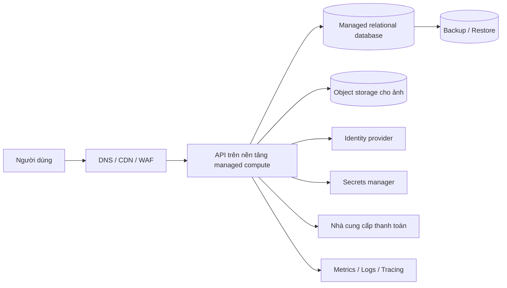

# Thiết kế theo trách nhiệm chia sẻ giữa khách hàng và nhà cung cấp

Khi triển khai ứng dụng lên đám mây, nhà cung cấp dịch vụ (cloud service provider, viết tắt là **CSP**) vận hành một phần hệ thống, còn khách hàng vẫn phải thiết kế, cấu hình và kiểm soát những phần liên quan đến ứng dụng và dữ liệu của mình. Ranh giới này thường được gọi là **mô hình trách nhiệm chia sẻ** (*shared responsibility model*).

Đây là một nguyên lý thiết kế kiến trúc, không chỉ là quy tắc của đội bảo mật. Nó quyết định ai vá lỗi, ai cấp quyền, ai sao lưu dữ liệu, ai phát hiện sự cố, ai khôi phục dịch vụ và bằng chứng nào chứng minh các biện pháp đó đang hoạt động. Đối với kiến trúc sư cloud, phân định sai trách nhiệm có thể tạo ra một hệ thống có vẻ được quản lý đầy đủ nhưng vẫn tồn tại lỗ hổng bảo mật, điểm lỗi đơn hoặc chi phí vận hành không được dự liệu.

## 1. Mục tiêu học tập

Sau bài này, người học có thể:

1. Giải thích trách nhiệm của CSP và khách hàng thay đổi như thế nào giữa IaaS, PaaS, SaaS và các dịch vụ được quản lý.
2. Xác định các ranh giới trách nhiệm cho mạng, compute, ứng dụng, dữ liệu, định danh, sao lưu, giám sát và ứng phó sự cố.
3. Lập bảng phân công trách nhiệm gắn với **biện pháp kiểm soát, người thực hiện và cách kiểm chứng**, thay vì chỉ ghi tên bên chịu trách nhiệm.
4. Phân tích đánh đổi giữa mức kiểm soát, khả năng mở rộng, độ tin cậy, chi phí, bảo mật và công sức vận hành khi chọn dịch vụ cloud.
5. Đánh giá một kiến trúc theo tư duy Well-Architected, phát hiện những trách nhiệm chưa có chủ sở hữu rõ ràng.

## 2. Hiểu đúng mô hình trách nhiệm chia sẻ

Một cách diễn giải phổ biến trong môi trường cloud là:

- **Bảo mật *của* đám mây** (*security of the cloud*): CSP bảo vệ cơ sở vật chất, phần cứng, mạng và các lớp nền tảng mà họ trực tiếp vận hành, theo phạm vi từng dịch vụ.
- **Bảo mật *trong* đám mây** (*security in the cloud*): khách hàng bảo vệ dữ liệu, định danh, ứng dụng, cấu hình và tài nguyên mà họ có quyền quyết định hoặc quản trị.

Ví dụ, CSP chịu trách nhiệm bảo vệ máy chủ vật lý chạy một máy ảo. Nhưng nếu khách hàng tự tạo máy ảo, họ thường phải cập nhật hệ điều hành khách, bảo vệ cổng truy cập, cài đặt ứng dụng an toàn và quản lý thông tin đăng nhập. Khi chuyển từ máy ảo sang một dịch vụ chạy ứng dụng được quản lý, CSP có thể nhận thêm phần quản trị hệ điều hành và nền tảng chạy ứng dụng; khách hàng vẫn phải sửa lỗ hổng trong mã nguồn và các thư viện của mình.

**Quan trọng:** hai bên có thể cùng tham gia một mục tiêu kiểm soát, nhưng thực hiện các phần việc khác nhau. Chẳng hạn:

- CSP cung cấp cơ chế mã hóa ổ đĩa, nhưng khách hàng chọn cấu hình mã hóa, cấp quyền sử dụng khóa hoặc quản lý khóa do khách hàng sở hữu.
- CSP cung cấp khả năng sao lưu của cơ sở dữ liệu được quản lý, nhưng khách hàng xác định lịch lưu, thời gian lưu giữ, phạm vi khôi phục và kiểm tra bản sao lưu.
- CSP bảo vệ nền tảng định danh, nhưng khách hàng quyết định ai được phép truy cập, quyền nào được cấp và tài khoản nào phải thu hồi.

Mô hình này **không mặc định giống nhau với mọi dịch vụ hay mọi nhà cung cấp**. Phạm vi chính xác phải được xác nhận bằng tài liệu dịch vụ, thỏa thuận hợp đồng, SLA, cấu hình đang sử dụng và những lựa chọn triển khai cụ thể.

### 2.1. Phân biệt ba câu hỏi

Để tránh bảng phân trách nhiệm quá mơ hồ, với mỗi thành phần hãy hỏi:

| Câu hỏi | Ý nghĩa | Ví dụ với cơ sở dữ liệu được quản lý |
|---|---|---|
| **Ai thực hiện?** | Bên trực tiếp triển khai hoặc vận hành biện pháp | CSP có thể tự động vá hệ điều hành máy chủ cơ sở dữ liệu |
| **Ai quyết định chính sách?** | Bên chọn yêu cầu, ngưỡng chấp nhận rủi ro và cấu hình | Khách hàng quyết định ai được truy vấn dữ liệu, giữ bản sao lưu bao lâu |
| **Ai kiểm chứng và chịu trách nhiệm giải trình?** | Bên kiểm tra kết quả, xử lý ngoại lệ và cung cấp bằng chứng | Khách hàng kiểm tra quyền truy cập và thử khôi phục theo mục tiêu nghiệp vụ; CSP cung cấp các bằng chứng phù hợp với nghĩa vụ của mình |

Việc nhà cung cấp *thực hiện* một thao tác không đồng nghĩa khách hàng có thể bỏ qua *việc xác nhận thao tác ấy đáp ứng yêu cầu của ứng dụng*.

## 3. Trách nhiệm thay đổi theo mô hình dịch vụ

Mức dịch vụ được quản lý càng cao thường càng giảm công việc quản trị hạ tầng mà khách hàng trực tiếp thực hiện. Tuy nhiên, trách nhiệm đối với dữ liệu, cấu hình an toàn, truy cập và tính đúng đắn của nghiệp vụ vẫn cần được xác định.

| Thành phần | IaaS: máy ảo | PaaS: nền tảng ứng dụng / cơ sở dữ liệu quản lý | SaaS: phần mềm hoàn chỉnh |
|---|---|---|---|
| Trung tâm dữ liệu, phần cứng vật lý | CSP | CSP | CSP |
| Lớp ảo hóa và hạ tầng nền tảng của dịch vụ | CSP | CSP | CSP |
| Hệ điều hành máy chủ phục vụ ứng dụng | Khách hàng thường quản lý OS của VM | CSP thường quản lý OS của nền tảng; phạm vi phụ thuộc dịch vụ | CSP |
| Runtime và các bản vá nền tảng | Khách hàng | CSP hoặc chia sẻ, tùy runtime và chế độ cập nhật | CSP |
| Mã nguồn ứng dụng, thư viện do khách hàng triển khai | Khách hàng | Khách hàng | CSP đối với ứng dụng SaaS; khách hàng chịu trách nhiệm với tích hợp/tùy biến của mình |
| Tài khoản, vai trò, phân quyền nghiệp vụ | Khách hàng | Khách hàng | Khách hàng đối với người dùng và cấu hình thuộc tenant; CSP vận hành cơ chế nền |
| Nội dung dữ liệu, phân loại và chính sách lưu giữ | Khách hàng | Khách hàng | Khách hàng hoặc chia sẻ theo hợp đồng, vai trò xử lý dữ liệu và quy định áp dụng |
| Bảo vệ mạng và giao diện truy cập | Khách hàng cấu hình firewall, phân đoạn mạng | CSP bảo vệ nền tảng; khách hàng cấu hình điểm truy cập, luật mạng và kết nối được phép | CSP bảo vệ nền tảng; khách hàng cấu hình quyền chia sẻ và những thiết lập cho tenant được cung cấp |
| Sao lưu và khôi phục dữ liệu nghiệp vụ | Khách hàng triển khai/điều phối | CSP cung cấp tính năng; khách hàng cấu hình và xác minh theo phạm vi dịch vụ | Phụ thuộc hợp đồng, tính năng xuất/khôi phục và yêu cầu lưu trữ của khách hàng |

Không nên đọc bảng trên như một cam kết cho mọi sản phẩm. Một PaaS có thể yêu cầu khách hàng chọn và cập nhật phiên bản runtime; một SaaS có thể không cung cấp khả năng khôi phục từng bản ghi theo mong muốn; một dịch vụ cơ sở dữ liệu được quản lý có thể tự động cập nhật hệ điều hành nhưng yêu cầu khách hàng lên kế hoạch nâng phiên bản engine.

### 3.1. IaaS: nhiều quyền kiểm soát, nhiều công việc vận hành

Trong Infrastructure as a Service, khách hàng thường quản trị máy ảo, hệ điều hành, ứng dụng, kết nối mạng logic và phần lớn cấu hình bảo mật. IaaS thích hợp khi cần tùy chỉnh sâu, sử dụng phần mềm có ràng buộc hệ điều hành hoặc cần khả năng kiểm soát ở mức máy chủ.

Ví dụ: chạy API trên VM khiến đội vận hành phải có quy trình tạo image an toàn, vá OS, cấu hình tường lửa, xoay vòng khóa, giám sát đĩa, sao lưu và khôi phục. CSP không tự động làm thay các việc đó chỉ vì VM nằm trong cloud.

### 3.2. PaaS và dịch vụ được quản lý: đổi trách nhiệm quản trị lấy sự phụ thuộc vào dịch vụ

Trong Platform as a Service và các dịch vụ như managed database, nhà cung cấp nhận thêm công việc vận hành nền tảng. Khách hàng tập trung vào ứng dụng, chính sách truy cập, cấu hình, chất lượng dữ liệu, lựa chọn cấp dịch vụ và xử lý lỗi nghiệp vụ.

Ví dụ: với managed relational database, CSP có thể quản trị máy chủ vật lý, OS và một số hoạt động bảo trì engine. Khách hàng vẫn phải:

- Thiết lập kết nối riêng tư, danh sách nguồn được phép và tài khoản có quyền tối thiểu.
- Chọn cấu hình độ sẵn sàng, sao lưu, retention và khả năng khôi phục phù hợp mục tiêu RTO/RPO.
- Quản lý schema, truy vấn, migration, các quyền trong DB và bảo vệ dữ liệu nhạy cảm.
- Kiểm tra tác động của bảo trì và nâng phiên bản theo chính sách dịch vụ.

### 3.3. SaaS: ít quản trị ứng dụng, vẫn phải quản trị tenant và dữ liệu

Với Software as a Service, CSP thường vận hành toàn bộ ứng dụng. Tuy nhiên, khách hàng vẫn quyết định người dùng nào được mời vào tổ chức, dữ liệu nào được tải lên, ai có quyền chia sẻ công khai, cách cấu hình xác thực và việc thu hồi quyền khi nhân sự rời tổ chức. Họ cũng cần hiểu khả năng xuất dữ liệu, sao lưu, khôi phục, lưu trữ và xóa dữ liệu theo hợp đồng.

### 3.4. Serverless và Kubernetes không phải ngoại lệ

- **Function as a Service:** CSP vận hành máy chủ và phần lớn runtime nền. Khách hàng vẫn bảo vệ mã nguồn, dependency, quyền thực thi, biến môi trường, secret, luồng sự kiện, timeout, concurrency và cách xử lý lỗi.
- **Managed Kubernetes:** CSP có thể vận hành control plane; trách nhiệm worker node, cluster add-on, workload, container image, ingress và network policy phụ thuộc mô hình node do khách hàng quản lý hay chế độ compute được quản lý.
- **Container image:** việc image chạy trên nền tảng được quản lý không loại bỏ trách nhiệm vá thư viện, xây dựng image tối thiểu và kiểm tra lỗ hổng của thành phần do khách hàng đưa vào.

Khi đánh giá kiến trúc, phải ghi rõ **tên dịch vụ, chế độ triển khai và phiên bản/cấu hình** thay vì chỉ ghi “dùng cloud” hoặc “dùng Kubernetes”.

## 4. Phân định trách nhiệm theo các lớp kiến trúc

### 4.1. Dữ liệu: tài sản của nghiệp vụ, không thể phó mặc

CSP bảo vệ những lớp lưu trữ mà họ vận hành theo cam kết dịch vụ. Kiến trúc sư và chủ sở hữu dữ liệu vẫn phải quyết định:

- Dữ liệu nào là công khai, nội bộ, nhạy cảm; ai được đọc, ghi, xóa và xuất dữ liệu.
- Dữ liệu được phép lưu tại khu vực địa lý nào; có được sao chép sang vùng khác hay không.
- Mã hóa khi truyền và khi lưu trữ cần dùng khóa do CSP hay khách hàng quản lý.
- Thời hạn lưu giữ, khả năng xóa, nhật ký truy cập và quy trình đáp ứng yêu cầu pháp lý/hợp đồng.
- RPO (*Recovery Point Objective* – mức dữ liệu có thể mất tối đa tính theo thời gian) và RTO (*Recovery Time Objective* – thời gian khôi phục mục tiêu).

**Ví dụ:** bucket lưu hóa đơn có thể được mã hóa mặc định, nhưng nếu chính sách truy cập cho phép toàn Internet đọc đối tượng thì mã hóa khi lưu không ngăn được việc lộ dữ liệu qua truy cập hợp lệ theo chính sách sai.

### 4.2. Định danh và đặc quyền

CSP cung cấp hệ thống IAM hoặc tích hợp danh tính; khách hàng cấu hình nó cho đúng bối cảnh:

- Áp dụng quyền tối thiểu (*least privilege*) và phân tách quyền giữa môi trường dev, staging, production.
- Ưu tiên danh tính workload ngắn hạn thay vì khóa API tồn tại lâu.
- Bảo vệ tài khoản quản trị bằng MFA, cơ chế truy cập khẩn cấp và giám sát thao tác nhạy cảm.
- Thu hồi quyền khi thay đổi vai trò; rà soát role, policy và tài khoản dịch vụ định kỳ.
- Tránh cho ứng dụng sử dụng chung danh tính với người vận hành hoặc cấp quyền quản trị toàn tenant.

CSP không thể tự biết một nhân viên có được phép xem dữ liệu khách hàng cụ thể hay không: đây là quy tắc nghiệp vụ phải được thiết kế trong ứng dụng và hệ thống phân quyền.

### 4.3. Mạng, compute và bề mặt tấn công

CSP bảo vệ hạ tầng mạng vật lý và phần nền tảng thuộc quyền quản trị của họ. Khách hàng thiết kế ranh giới tin cậy của ứng dụng: thành phần nào được lộ Internet, kết nối nào phải riêng tư, dịch vụ nào có thể gọi dịch vụ nào và cơ chế kiểm soát luồng ra ngoài.

Ví dụ cho ứng dụng web ba lớp:

- Chỉ tầng CDN / load balancer / API gateway cần điểm truy cập công khai.
- Database và dịch vụ xử lý nền đặt trên kết nối riêng tư khi nền tảng hỗ trợ.
- Chính sách mạng cho phép đúng luồng ứng dụng → database; không mở cổng quản trị cho mọi nguồn.
- WAF, chống DDoS, TLS và rate limiting là các biện pháp phối hợp, phải xem rõ tính năng nào đã được CSP kích hoạt sẵn và quy tắc nào khách hàng phải cấu hình.

Ở IaaS, khách hàng còn quản lý bản vá OS và agent. Ở PaaS, khách hàng vẫn phải chú ý cấu hình endpoint và lỗ hổng ứng dụng.

### 4.4. Độ tin cậy, sao lưu và khôi phục

SLA của một dịch vụ thành phần **không tự động trở thành SLA của toàn ứng dụng**. Ứng dụng vẫn có thể dừng hoạt động vì một database chỉ có một instance, cấu hình failover chưa được bật, hết quota, lỗi deployment hoặc một dịch vụ ngoài gặp sự cố.

Kiến trúc sư cần đánh giá:

1. Thành phần nào là điểm lỗi đơn; chế độ multi-zone, replication hoặc cơ chế chuyển đổi dự phòng có được cấu hình không?
2. Khi một vùng sẵn sàng, vùng địa lý hoặc dịch vụ nền lỗi, hệ thống suy giảm như thế nào?
3. Bản sao lưu có thực sự khôi phục được hay chỉ tồn tại trên bảng điều khiển?
4. RTO/RPO nghiệp vụ có phù hợp với tính năng và giới hạn của dịch vụ đang chọn?
5. Có kịch bản thay đổi cấu hình nhầm, xóa nhầm dữ liệu hoặc khóa mã hóa mất quyền sử dụng không?

Một số hoạt động failover do CSP thực thi; nhưng **quyết định có triển khai dự phòng và xác minh mục tiêu phục hồi** vẫn thuộc phần thiết kế ứng dụng của khách hàng.

### 4.5. Quan sát hệ thống và ứng phó sự cố

Nhà cung cấp theo dõi sức khỏe của nền tảng do họ vận hành. Khách hàng phải có năng lực nhìn thấy sức khỏe **nghiệp vụ của mình**: tỷ lệ lỗi API, latency, tác vụ đặt hàng thất bại, truy cập bất thường, dung lượng, chi phí và kết quả khôi phục.

Nên xác định rõ:

| Hoạt động | Ai thường cung cấp khả năng | Khách hàng cần làm |
|---|---|---|
| Nhật ký của dịch vụ cloud | CSP cung cấp audit log / service log tùy sản phẩm | Bật log thích hợp, phân quyền, chọn nơi lưu và thời gian retention |
| Nhật ký ứng dụng và giao dịch | Công cụ log từ CSP hoặc bên thứ ba | Ghi dữ liệu đủ điều tra, che thông tin nhạy cảm, gắn trace/correlation ID |
| Cảnh báo | CSP cung cấp metric và kênh cảnh báo | Xác định ngưỡng theo SLO, trực xử lý và kiểm tra đường báo động |
| Sự cố hạ tầng của CSP | CSP phát thông báo theo quy trình của họ | Theo dõi trạng thái dịch vụ, kích hoạt phương án giảm ảnh hưởng của ứng dụng |
| Sự cố lộ thông tin đăng nhập | Cơ chế IAM và log giúp phát hiện | Vô hiệu hóa thông tin bị lộ, điều tra phạm vi truy cập, xoay khóa và khắc phục nguyên nhân |

Kế hoạch ứng phó phải chỉ rõ đầu mối liên hệ nhà cung cấp, giới hạn log được cung cấp, thời gian giữ bằng chứng và vai trò truyền thông với người dùng.

### 4.6. Tuân thủ, hợp đồng và bên thứ ba

Chứng nhận hoặc báo cáo kiểm toán của CSP chứng minh **phạm vi kiểm soát được đánh giá của CSP**, chứ không xác nhận ứng dụng khách hàng mặc nhiên tuân thủ mọi yêu cầu. Khách hàng cần đối chiếu nghĩa vụ pháp lý, chính sách dữ liệu, quy trình nội bộ và cấu hình triển khai; CSP cũng có những nghĩa vụ riêng theo hợp đồng và luật áp dụng.

Nếu doanh nghiệp thuê một đối tác triển khai cloud, ranh giới có thêm bên thứ ba: đối tác có thể vận hành tài nguyên theo ủy quyền, nhưng quyền quyết định, giám sát và trách nhiệm cuối cùng vẫn phải thể hiện rõ trong hợp đồng và ma trận phân công. Không giả định đối tác “lo hết” chỉ vì họ được cấp quyền quản trị.

## 5. Ví dụ thực tế: ứng dụng đặt chỗ trực tuyến

Giả sử cần thiết kế hệ thống cho phép khách hàng tìm chỗ ở, đặt lịch, thanh toán thông qua đơn vị thanh toán, và lưu ảnh cùng giấy tờ liên quan. Yêu cầu mẫu:

- API phục vụ người dùng liên tục; dữ liệu đặt chỗ và danh tính cần kiểm soát truy cập chặt chẽ.
- Ứng dụng phải chịu được lỗi của một instance, có khả năng phát hiện giao dịch thất bại.
- Nhóm phát triển nhỏ, ưu tiên managed services để giảm công việc vá OS và quản lý máy chủ.
- Mục tiêu khôi phục ví dụ do nghiệp vụ đặt ra: **RTO 4 giờ, RPO 15 phút**. Đây là mục tiêu cần thiết kế và thử nghiệm, không phải tính năng được bảo đảm chỉ nhờ chọn managed database.

Một phương án kiến trúc có thể là:

Sơ đồ chỉ thể hiện thành phần logic. Khi triển khai thực tế, cần bổ sung cấu hình mạng, cơ chế xác thực, phân vùng lỗi, giới hạn truy cập, luồng dữ liệu và yêu cầu pháp lý.

### 5.1. Bảng phân công đi kèm cách kiểm chứng

| Thành phần / kiểm soát | CSP hoặc đối tác cung cấp | Khách hàng thiết kế và thực hiện | Cách kiểm chứng |
|---|---|---|---|
| Nền tảng managed compute | Vận hành cơ sở hạ tầng, máy chủ nền và lớp runtime theo phạm vi dịch vụ | Triển khai code, cấu hình scaling, secret, quyền workload và xử lý request | Kiểm tra cấu hình, chạy load test và rà soát quyền |
| API và nghiệp vụ đặt chỗ | Cung cấp năng lực chạy ứng dụng | Xác thực, phân quyền sở hữu đặt chỗ, kiểm tra input, chống đặt trùng | Test truy cập trái phép, test idempotency và giao dịch |
| Managed database | Vận hành phần nền tảng được cam kết, cung cấp tùy chọn backup/failover | Chọn HA, backup, kết nối riêng tư, role DB, migration | Thử restore vào môi trường riêng và đo RTO/RPO thực tế |
| Object storage | Vận hành lớp lưu trữ vật lý và tính năng policy | Chặn truy cập công khai, cấp URL tải có giới hạn, mã hóa và vòng đời dữ liệu | Quét policy và thử truy cập trái phép từ ngoài |
| IAM / identity | Vận hành hệ thống định danh nền | MFA, role theo quyền tối thiểu, thu hồi quyền, audit | Rà soát quyền và diễn tập thu hồi khóa |
| Kết nối đến đơn vị thanh toán | Đơn vị thanh toán bảo vệ hạ tầng trong phạm vi dịch vụ của họ | Bảo vệ thông tin xác thực, kiểm tra chữ ký webhook, tránh xử lý trùng giao dịch | Test webhook giả mạo, replay và tình huống timeout |
| Quan sát / sự cố | Cung cấp metric nền tảng, log API và thông báo lỗi dịch vụ | Chọn SLO, cảnh báo nghiệp vụ, trực vận hành, runbook xử lý | Diễn tập cảnh báo và kiểm tra thời gian phát hiện |
| Khôi phục thảm họa | Cung cấp tính năng snapshot, replication hoặc restore theo gói | Thiết kế phương án khôi phục ứng dụng, dữ liệu, secret và DNS | Diễn tập DR, ghi thời gian thực tế và lỗi phát hiện |

### 5.2. Một yêu cầu xuyên suốt: bảo vệ ảnh giấy tờ

Giả sử tính năng tải giấy tờ lên object storage đã hoạt động đúng về mặt chức năng. Kiến trúc vẫn chưa đạt yêu cầu nếu đường dẫn tải trực tiếp có hiệu lực vĩnh viễn hoặc tài nguyên có quyền đọc công khai. Hướng xử lý:

1. Xác định giấy tờ là dữ liệu nhạy cảm, không hiển thị công khai.
2. Chặn public access ở bucket/container và đặt chính sách deny phù hợp.
3. Cho API kiểm tra quyền sở hữu rồi phát đường dẫn tải có thời hạn ngắn hoặc proxy nội dung theo nhu cầu.
4. Bật mã hóa, quản lý khóa, log truy cập và lifecycle theo chính sách lưu giữ.
5. Kiểm thử bằng tài khoản không có quyền, đường dẫn hết hạn và tình huống cấp quyền sai.

Trong ví dụ này CSP chịu trách nhiệm độ an toàn của nền tảng object storage theo hợp đồng; **quyết định ai được đọc giấy tờ** vẫn là quy tắc ứng dụng và cấu hình thuộc trách nhiệm khách hàng.

## 6. Quy trình áp dụng vào thiết kế kiến trúc cloud

### Bước 1: Chuyển yêu cầu nghiệp vụ thành yêu cầu kiểm soát

Trước khi chọn dịch vụ, hãy thống nhất dữ liệu cần bảo vệ, mục tiêu sẵn sàng, RTO/RPO, yêu cầu kiểm toán, giới hạn ngân sách và các ràng buộc triển khai. Nếu thiếu tiêu chí, không thể biết phần trách nhiệm mà nhà cung cấp nhận có đủ đáp ứng hay không.

### Bước 2: Liệt kê thành phần, loại dịch vụ và ranh giới tin cậy

Ghi đầy đủ API, database, storage, DNS, CDN, queue, IAM, mạng, CI/CD, công cụ quan sát và nhà cung cấp ngoài. Phân loại từng thành phần theo IaaS/PaaS/SaaS hoặc chế độ managed cụ thể. Đánh dấu nơi dữ liệu vượt ranh giới: trình duyệt → API, API → database, API → đối tác thanh toán, CI/CD → môi trường production.

### Bước 3: Lập ma trận trách nhiệm cho từng kiểm soát

Mỗi hàng cần có ít nhất: tài nguyên, rủi ro/kiểm soát, bên vận hành, bên quyết định, chủ sở hữu nội bộ và bằng chứng. Một mẫu ngắn:

| Tài nguyên | Kiểm soát cần có | Bên thực hiện | Owner nội bộ | Bằng chứng |
|---|---|---|---|---|
| Managed DB | PITR đáp ứng RPO đã phê duyệt | CSP cung cấp năng lực; nhóm cloud cấu hình | Chủ sở hữu dữ liệu / nhóm nền tảng | Cấu hình retention + biên bản thử restore |
| Object storage | Không cho đọc tài liệu nhạy cảm ẩn danh | Nhóm ứng dụng / cloud cấu hình | Tech lead ứng dụng | Kết quả policy scan + kiểm thử quyền |
| SaaS vận hành | Thu hồi truy cập khi nhân sự nghỉ | Admin tenant nội bộ | IT / quản lý danh tính | Log thu hồi và kết quả rà soát định kỳ |

Với công việc có nhiều đội phối hợp, có thể bổ sung RACI (*Responsible, Accountable, Consulted, Informed*). Tránh ghi cùng lúc hai người “chịu trách nhiệm cuối cùng” cho một quyết định mà không làm rõ cơ chế phân quyền.

### Bước 4: Đối chiếu tài liệu dịch vụ và giới hạn hợp đồng

Đọc phạm vi shared responsibility, SLA, chính sách bảo trì, tính năng mã hóa/sao lưu/nhật ký, giới hạn quota, vị trí lưu dữ liệu và mức hỗ trợ của **chính dịch vụ đã chọn**. Kiểm tra cách xử lý khi mất vùng sẵn sàng, mất region, hết hạn khóa, thay đổi phiên bản hoặc không thể truy cập bảng điều khiển quản trị.

Đánh giá cả những điều dịch vụ **không** cung cấp: ví dụ backup có thể khôi phục cả database nhưng không khôi phục một bảng riêng; SLA thành phần có thể loại trừ một số tình huống; log mặc định có thể không đủ cho điều tra nghiệp vụ.

### Bước 5: Thiết kế biện pháp kiểm soát và tự động hóa

Ưu tiên:

- Hạ tầng và policy được quản lý như mã (*Infrastructure as Code*, *policy as code*), có review và lịch sử thay đổi.
- Mặc định chặn quyền truy cập không cần thiết; bí mật đặt trong secret manager; dùng danh tính workload thay khóa tĩnh khi phù hợp.
- CI/CD có kiểm tra dependency, cấu hình, image và quyền triển khai; thay đổi production có cơ chế phê duyệt phù hợp.
- Cảnh báo và runbook gắn với dịch vụ nghiệp vụ, không chỉ CPU hoặc tình trạng máy chủ.
- Kiểm soát chi phí: nhãn tài nguyên, ngân sách, cảnh báo tiêu thụ, giới hạn scaling phù hợp và rà soát dữ liệu lưu giữ.

### Bước 6: Kiểm tra bằng chứng, không chỉ đánh dấu checklist

Tối thiểu nên kiểm thử tình huống thiếu quyền, lộ quyền, lỗi một instance, lỗi dependency, mất kết nối DB, khôi phục dữ liệu, hết quota và rollback deployment. Đo kết quả thực tế so với yêu cầu. Cấu hình “đã bật backup” không đủ nếu chưa từng khôi phục; tính năng “hỗ trợ multi-zone” không đủ nếu hệ thống đang chạy một zone.

### Bước 7: Cập nhật phân công khi kiến trúc thay đổi

Khi chuyển từ VM sang serverless, nâng gói database, bật public endpoint, thêm đối tác SaaS hoặc chuyển region, hãy cập nhật ma trận trách nhiệm, threat model, runbook, chủ sở hữu và bằng chứng. Ranh giới trách nhiệm là thuộc tính của **kiến trúc đang vận hành**, không phải biểu mẫu làm một lần khi khởi tạo dự án.

## 7. Các ngộ nhận phổ biến và hệ quả

| Ngộ nhận | Rủi ro có thể xảy ra | Cách sửa thiết kế |
|---|---|---|
| “Lưu trên cloud thì dữ liệu được bảo vệ hoàn toàn.” | Bucket công khai hoặc tài khoản có quyền quá rộng làm lộ dữ liệu | Phân loại dữ liệu, cấu hình policy mặc định đóng, kiểm thử quyền từ góc nhìn bên ngoài |
| “Managed database thì không cần tính đến backup.” | Xóa nhầm dữ liệu, retention quá ngắn, không đạt RPO | Chọn chính sách backup/PITR, tách quyền xóa, thử restore định kỳ |
| “PaaS tự vá mọi thứ.” | Thư viện ứng dụng lỗi thời, dependency dễ bị khai thác | Quét dependency, vá code và quản lý phiên bản runtime thuộc quyền khách hàng |
| “CSP có SLA nên ứng dụng sẽ luôn sẵn sàng.” | Điểm lỗi đơn, cấu hình sai, lỗi tích hợp và triển khai | Thiết kế redundancy, timeout/retry phù hợp, circuit breaker và kiểm thử failover |
| “Đã có chứng nhận tuân thủ của CSP.” | Ứng dụng xử lý dữ liệu sai chính sách, thiếu kiểm toán | Đối chiếu phạm vi chứng nhận với phần khách hàng phải kiểm soát |
| “SaaS tự lo cả tài khoản nhân viên.” | Tài khoản nghỉ việc vẫn truy cập hoặc chia sẻ dữ liệu bên ngoài | SSO/MFA, vòng đời tài khoản, rà soát và thu hồi quyền |
| “Bên tích hợp quản lý cloud nên đội nội bộ không cần owner.” | Sự cố không ai quyết định hoặc chấp nhận rủi ro | Chỉ định owner nội bộ, phân vai hợp đồng, cơ chế báo cáo và kiểm chứng |

Một kỹ thuật hữu ích khi rà soát là hỏi: **“Nếu kiểm soát này thất bại lúc 2 giờ sáng, ai nhận cảnh báo, ai có quyền sửa, ai đưa ra quyết định và ai xác nhận đã phục hồi?”** Nếu không trả lời được, ranh giới trách nhiệm vẫn chưa hoàn chỉnh.

## 8. Đánh đổi kiến trúc theo Well-Architected

Trách nhiệm chia sẻ gắn trực tiếp với các trụ cột đánh giá kiến trúc Well-Architected:

| Góc nhìn | Câu hỏi thiết kế cần trả lời | Đánh đổi điển hình |
|---|---|---|
| **Bảo mật** | Ai quản lý khóa, danh tính, quyền, bản vá, phân vùng mạng và audit? | Managed service giảm bề mặt OS phải vận hành, nhưng yêu cầu hiểu sâu cấu hình và IAM dịch vụ |
| **Độ tin cậy** | Ai bật HA/backup, ai diễn tập failover, ai duy trì RTO/RPO? | Multi-zone hoặc sao chép nhiều vùng tăng tính sẵn sàng nhưng tăng chi phí và độ phức tạp |
| **Vận hành xuất sắc** | Ai giám sát hệ thống, thay đổi cấu hình, xử lý sự cố và làm postmortem? | Nền tảng quản lý giảm toil nhưng tăng nhu cầu quan sát giới hạn dịch vụ và hợp đồng hỗ trợ |
| **Hiệu năng** | Ai chọn cấp tài nguyên, giới hạn kết nối, cache và chiến lược mở rộng? | Autoscaling tăng linh hoạt nhưng có giới hạn quota, cold start hoặc chi phí tăng đột biến |
| **Tối ưu chi phí** | Ai sở hữu ngân sách, nhãn, retention, dữ liệu truyền ra và việc tắt tài nguyên nhàn rỗi? | Dùng dịch vụ được quản lý tiết kiệm công vận hành nhưng có thể tăng phí dịch vụ/egress |
| **Bền vững** | Ai giảm tài nguyên cấp thừa, lưu trữ không cần thiết và tác vụ chạy vô ích? | Tối ưu quy mô và vòng đời dữ liệu có thể giảm cả chi phí lẫn tài nguyên tiêu thụ |

Chọn IaaS vì cần điều khiển OS có thể hợp lý, miễn đội ngũ đủ năng lực vá lỗi, backup và vận hành. Chọn PaaS để giảm việc quản trị OS cũng hợp lý, miễn giới hạn cấu hình, khả năng di chuyển dữ liệu và phương án khôi phục đáp ứng nghiệp vụ. **Không có mô hình dịch vụ nào tốt nhất cho mọi hệ thống**; quyết định đúng phụ thuộc vào yêu cầu và khả năng thực thi các trách nhiệm còn lại.

## 9. Bài tập áp dụng

### Tình huống A — Chuyển VM sang managed database

Một nhóm đang chạy PostgreSQL trên VM, tự cập nhật OS và tự sao lưu. Nhóm dự định chuyển sang managed database rồi xóa toàn bộ các tác vụ vận hành DB.

**Câu hỏi:** Nêu ít nhất bốn trách nhiệm nhóm vẫn cần giữ.

**Gợi ý đáp án:** cấu hình quyền DB và mạng riêng tư; xác định mã hóa và quản lý khóa; đặt retention/khả năng khôi phục; kiểm thử restore với RTO/RPO; quản lý schema, migration và query; theo dõi dung lượng, truy vấn chậm, chi phí, giới hạn dịch vụ và sự cố. Những hạng mục CSP nhận thêm chỉ được xác định sau khi kiểm tra tài liệu dịch vụ cụ thể.

### Tình huống B — SaaS có dữ liệu nhân sự

Một công ty dùng SaaS quản lý tài liệu. Nhà cung cấp có báo cáo kiểm toán và hỗ trợ MFA, nhưng toàn bộ nhân sự hiện có quyền chia sẻ file ra ngoài tổ chức.

**Câu hỏi:** Ranh giới trách nhiệm sai ở đâu?

**Gợi ý đáp án:** CSP vận hành và bảo vệ ứng dụng nền, nhưng khách hàng cần thiết kế chính sách chia sẻ, cấu hình MFA/SSO theo nhu cầu, cấp quyền tối thiểu, phân loại dữ liệu và kiểm soát tài khoản. Báo cáo kiểm toán của CSP không thay thế các cấu hình trên.

### Tình huống C — Chỉ có một database instance

Ứng dụng đặt chỗ có API chạy nhiều instance và managed database duy nhất. Chủ hệ thống cho rằng nhà cung cấp cam kết uptime cao nên không cần kịch bản gián đoạn.

**Câu hỏi:** Cần kiểm tra thêm điều gì?

**Gợi ý đáp án:** cấu hình HA theo zone, thời gian failover, mục tiêu khôi phục, khả năng khôi phục từ bản sao lưu, độ bền của transaction, connection retry, thứ tự khôi phục các thành phần, quota và giới hạn theo region. SLA của database chỉ là một phần trong tính sẵn sàng của toàn ứng dụng.

## 10. Checklist trước khi chốt thiết kế

- [ ] Mỗi tài nguyên đã được ghi rõ loại dịch vụ và chế độ quản lý thực tế.
- [ ] Ranh giới CSP / khách hàng / đối tác thứ ba đã được xác nhận từ tài liệu và hợp đồng liên quan.
- [ ] Có owner nội bộ cho dữ liệu, IAM, mạng, ứng dụng, backup, incident response, chi phí và tuân thủ.
- [ ] Các kiểm soát quan trọng có cấu hình, nơi lưu bằng chứng và cách kiểm thử.
- [ ] Các mục tiêu RTO/RPO, tính sẵn sàng và SLO đã gắn với phương án triển khai và diễn tập cụ thể.
- [ ] Thay đổi kiến trúc, thêm dịch vụ hoặc thay nhà cung cấp sẽ kích hoạt rà soát trách nhiệm.
- [ ] Với mọi sự cố nghiêm trọng, biết ai phát hiện, ai xử lý, ai phối hợp CSP và ai xác nhận phục hồi.

**Điểm cần ghi nhớ:** mô hình trách nhiệm chia sẻ không phải một sơ đồ chia đôi hạ tầng. Đó là cách gắn từng quyết định kiến trúc với một người sở hữu, một biện pháp kiểm soát và bằng chứng vận hành. Thiết kế cloud tốt phải tận dụng khả năng CSP thực sự cung cấp, đồng thời chủ động chịu trách nhiệm cho dữ liệu, cấu hình, nghiệp vụ và chất lượng dịch vụ đầu cuối.
