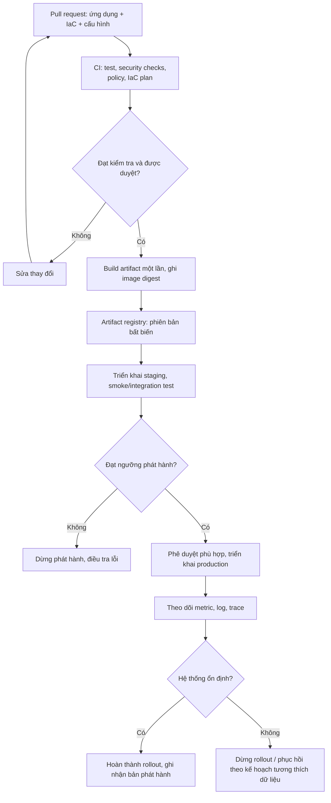
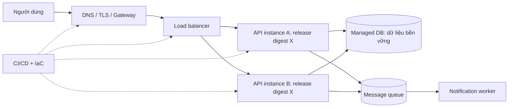

# Ưu tiên tự động hóa, khả năng tái tạo và hạ tầng bất biến

Trong kiến trúc đám mây, một hệ thống chạy tốt hôm nay chưa đủ. Đội ngũ còn phải trả lời: **Nếu cần dựng lại môi trường vào ngày mai, triển khai cùng phiên bản ở nơi khác hoặc phục hồi sau sự cố, chúng ta có thể làm lại một cách đáng tin cậy không?**

Ba nguyên lý bổ trợ cho nhau là **tự động hóa (automation)**, **khả năng tái tạo (reproducibility)** và **hạ tầng bất biến (immutable infrastructure)**. Chúng chuyển phần lớn thao tác vận hành từ những thay đổi thủ công khó theo dõi thành quy trình có phiên bản, có kiểm chứng và có thể lặp lại.

Trong module **CLOUD_ARCHITECTURE**, đây là nền tảng để nối yêu cầu nghiệp vụ với thiết kế mạng, compute, dữ liệu và mô hình triển khai. Mục tiêu cuối cùng là cải thiện **độ tin cậy, bảo mật, khả năng mở rộng, chi phí và khả năng vận hành**, đồng thời nhìn rõ những đánh đổi theo tư duy Well-Architected.

## 1. Phân biệt ba nguyên lý

| Nguyên lý | Câu hỏi cần trả lời | Cách tiếp cận | Dấu hiệu thực hiện tốt |
| --- | --- | --- | --- |
| **Tự động hóa** | Làm thế nào để một thao tác được thực hiện nhất quán và ít phụ thuộc thao tác tay? | Mô tả quy trình thành pipeline, script, policy hoặc controller; có đầu vào, điều kiện, kết quả và cách xử lý lỗi | Mọi lần build/deploy đều chạy các kiểm tra chuẩn; có nhật ký và người chịu trách nhiệm |
| **Khả năng tái tạo** | Có thể dựng lại trạng thái mong muốn từ những đầu vào đã biết không? | Quản lý cấu hình bằng phiên bản, khóa dependency, định danh artifact và tài nguyên; ghi lại thông số môi trường | Người khác có thể dựng môi trường kiểm thử tương đương theo tài liệu và mã nguồn |
| **Hạ tầng bất biến** | Khi cần thay đổi môi trường chạy, có thể **thay thế** tài nguyên đã chuẩn hóa thay vì sửa trực tiếp không? | Tạo image/artifact mới, triển khai instance mới, chuyển lưu lượng rồi loại bỏ instance cũ | Các instance cùng một bản phát hành có cấu hình dự kiến nhất quán; ít sai khác do chỉnh tay |

Đây là ba thuộc tính **liên quan nhưng không đồng nghĩa**:

- Có thể **tự động hóa một thao tác sai**: script đăng nhập từng máy rồi sửa cấu hình vẫn tự động, nhưng kết quả có thể trôi theo trạng thái cũ.
- Có thể **tái tạo bằng thao tác tay** nếu tài liệu rất chặt chẽ, nhưng khó duy trì khi hệ thống và số môi trường lớn lên.
- Có thể triển khai **image bất biến** nhưng không tái tạo được toàn bộ hệ thống nếu mạng, quyền truy cập, secret reference và database được cấu hình tùy tiện.
- Có thể dùng **Infrastructure as Code (IaC)** mà hạ tầng vẫn bị chỉnh sửa trực tiếp sau khi triển khai; khi đó tính tái tạo và bất biến bị suy yếu.

Nguyên tắc kết hợp: **định nghĩa trạng thái mong muốn bằng dữ liệu có phiên bản → tự động tạo và xác minh artifact → triển khai tài nguyên đã chuẩn hóa → quan sát và xử lý sai lệch**.

## 2. Vì sao thay đổi thủ công gây rủi ro kiến trúc?

Giả sử một ứng dụng quản lý đặt thuê thiết bị có môi trường kiểm thử và production. Ban đầu, hai môi trường được cấu hình bằng giao diện cloud:

1. Kỹ sư tạo load balancer, máy ảo, database và chính sách IAM bằng tay.
2. Khi triển khai bản mới, người vận hành SSH vào máy để cập nhật file JAR và sửa biến môi trường.
3. Để khắc phục lỗi khẩn cấp, một người sửa cấu hình trực tiếp trên production nhưng không ghi lại.
4. Khi cần dựng staging mới, nhóm dùng tài liệu cũ và nhớ lại những bước từng làm.

Rủi ro phát sinh:

| Vấn đề | Biểu hiện | Hệ quả |
| --- | --- | --- |
| **Configuration drift** | Production có firewall rule hoặc runtime version khác staging | Lỗi chỉ xuất hiện trên production; tăng bề mặt tấn công |
| **Snowflake server** | Một máy duy nhất chứa chỉnh sửa mà không ai tái tạo được | Thay máy hoặc tăng số instance gây lỗi |
| **Thao tác thiếu nhất quán** | Có lần deploy quên migration hoặc health check | Bản phát hành lỗi dù code đã qua kiểm thử |
| **Thiếu truy vết** | Không biết ai đổi cấu hình, đổi gì, vì sao | Khó điều tra sự cố, rollback và kiểm toán |
| **Khôi phục chậm** | Cần dựng thủ công toàn bộ tài nguyên sau lỗi vùng | RTO không đạt; kéo dài gián đoạn kinh doanh |
| **Chi phí khó kiểm soát** | Tạo tài nguyên thử nghiệm rồi quên xóa | Chi phí tiếp diễn, tài nguyên không có chủ sở hữu |

Tự động hóa tạo ra **quy trình có thể lặp lại**; tái tạo giúp **khôi phục trạng thái mong muốn**; hạ tầng bất biến ngăn các lần sửa trực tiếp tích tụ thành cấu hình không rõ nguồn gốc.

## 3. Tự động hóa những gì trong vòng đời cloud?

Tự động hóa có thể áp dụng từ lúc thay đổi mã nguồn đến khi giám sát ứng dụng đang chạy. Một pipeline triển khai đáng tin cậy thường có các giai đoạn sau:

| Giai đoạn | Việc có thể tự động hóa | Điều kiện kiểm soát |
| --- | --- | --- |
| **Thay đổi** | Kiểm tra format, static analysis, policy và bản xem trước thay đổi IaC trên pull request | Review, quyền thay đổi, quy định nhánh |
| **Build** | Biên dịch, unit test, dependency check, tạo container image hoặc package | Build thất bại thì dừng; phiên bản và dependency được khóa |
| **Kiểm tra artifact** | Quét lỗ hổng, tạo SBOM, ký hoặc ghi chứng thực nguồn gốc khi cần | Quy tắc từ chối artifact không đạt mức rủi ro chấp nhận |
| **Cấp phát hạ tầng** | Lập kế hoạch, kiểm tra và áp dụng cấu hình mạng, compute, IAM, dịch vụ dữ liệu | Review thay đổi gây xóa tài nguyên hoặc mở quyền |
| **Triển khai** | Đưa đúng artifact đã kiểm thử vào staging rồi production | Phê duyệt theo mức độ rủi ro; không build lại bằng cách khác |
| **Kiểm chứng** | Readiness/health check, smoke test, kiểm tra metric, log, trace và tỉ lệ lỗi | Chặn hoặc tự động dừng rollout nếu vượt ngưỡng |
| **Khôi phục** | Chuyển lưu lượng về bản cũ hoặc triển khai lại bản ổn định; kích hoạt runbook | Phải xét trạng thái dữ liệu, migration và tác động bên ngoài |
| **Quản trị vận hành** | Phát hiện drift, quét cấu hình, xoay vòng chứng chỉ/secret, backup, diễn tập restore | Có owner, alert, audit và quy trình xử lý ngoại lệ |

**Tự động hóa không có nghĩa loại bỏ mọi phê duyệt của con người.** Một thay đổi quyền truy cập hoặc xóa database production có thể cần bước duyệt. Chất lượng của tự động hóa nằm ở chỗ các bước lặp lại được chuẩn hóa, còn quyết định có rủi ro cao vẫn có cơ chế kiểm soát thích hợp.

### Đặc tính của một quy trình tự động hóa đáng tin cậy

1. **Idempotent khi có thể:** chạy lại thao tác đưa hệ thống về cùng trạng thái mong muốn, thay vì tạo thêm tài nguyên hoặc lặp tác động không mong muốn.
2. **Đầu vào rõ ràng:** commit, artifact digest, môi trường đích, phiên bản cấu hình, danh tính thực thi.
3. **Điều kiện trước và sau:** xác minh quyền truy cập, tài nguyên hiện có và trạng thái sẵn sàng trước khi chuyển lưu lượng.
4. **Retry có giới hạn:** xử lý lỗi tạm thời bằng timeout, backoff và cơ chế tránh lặp giao dịch nguy hiểm.
5. **Quan sát được:** có log thao tác, thời gian, định danh deployment, metric và cảnh báo.
6. **Có hành động phục hồi:** dừng rollout, quay lại artifact ổn định hoặc kích hoạt quy trình khôi phục dữ liệu khi cần.

Ví dụ: lệnh “tạo user admin” **không tự nhiên idempotent** nếu chạy hai lần tạo hai tài khoản. Tự động hóa cần kiểm tra trạng thái tồn tại hoặc dùng API idempotency key phù hợp; việc viết thành script không tự làm hành vi an toàn hơn.

## 4. Khả năng tái tạo: không chỉ lưu code ứng dụng

Một môi trường cloud phụ thuộc vào nhiều lớp đầu vào. Muốn dựng lại theo cách có kiểm soát, cần quản lý chúng dưới dạng phiên bản và các tham số có thể xác minh.

| Lớp | Cần ghi lại hoặc quản lý | Ví dụ |
| --- | --- | --- |
| **Mã ứng dụng** | Commit, dependency lockfile, toolchain, build instruction | Git SHA, Java runtime version, lockfile |
| **Artifact thực thi** | Định danh bất biến và nguồn gốc | Container image digest, package checksum |
| **Hạ tầng** | IaC code, phiên bản module/provider, tham số triển khai | Network, security group, autoscaling policy |
| **Cấu hình ứng dụng** | Giá trị không nhạy cảm theo môi trường, schema cấu hình | Endpoint, timeout, feature flag có kiểm soát |
| **Secrets và danh tính** | Tham chiếu secret, quyền truy cập, cách cấp workload identity | Secret manager reference, IAM role |
| **Dữ liệu** | Schema migration, quy trình nạp dữ liệu mẫu và backup/restore | Migration V014, seed dữ liệu kiểm thử |
| **Quy trình phát hành** | Pipeline và điều kiện xác minh | Test, phê duyệt, canary, smoke test |

Không nên đặt mật khẩu, token, private key hoặc dữ liệu cá nhân trong Git chỉ để “tái tạo được”. **Khả năng tái tạo yêu cầu tái tạo cấu trúc, quyền, tham chiếu và quy trình cấp bí mật**, còn giá trị bí mật được quản lý trong hệ thống chuyên dụng với quyền truy cập và vòng đời riêng.

### Tái tạo có nghĩa là giống đến mức nào?

Tùy mục đích, “tái tạo” có thể mang nhiều mức:

- **Tái tạo bản build:** cùng nguồn và dependency có thể tạo artifact có hành vi tương đương. Nếu cần kiểm chứng chuỗi cung ứng, hướng đến **reproducible build** có cùng byte/checksum trong điều kiện chuẩn hóa; không phải mọi công cụ mặc định đạt mức này.
- **Tái tạo cấu hình môi trường:** hai môi trường có cùng topology logic và chính sách, nhưng có thể khác kích cỡ tài nguyên, tên miền, region hoặc dữ liệu.
- **Tái tạo một bản phát hành:** cùng image digest và cấu hình đã kiểm soát được triển khai ở staging rồi production. “Build once, promote the same artifact” làm giảm khác biệt do build lại.
- **Tái tạo dịch vụ sau sự cố:** dựng lại hạ tầng và ứng dụng **kết hợp khôi phục dữ liệu** đến điểm đáp ứng mục tiêu RPO/RTO.

Trên cloud, không phải mọi thuộc tính đều được tái tạo từng byte: địa chỉ IP động, ID tài nguyên, thời điểm khởi tạo, trạng thái dữ liệu và hành vi của dịch vụ managed có thể thay đổi. Đích cần hướng tới là **tương đương về cấu hình, hợp đồng và hành vi cần kiểm chứng**, đồng thời lưu lại những tham số có ảnh hưởng.

### Những kỹ thuật nâng khả năng tái tạo

**Pin phiên bản** của runtime, dependency, IaC provider và module thay vì sử dụng phiên bản trôi nổi. Khóa dependency bằng lockfile phù hợp và quản lý thay đổi phiên bản qua pull request. Đối với container, ưu tiên **digest** (sha256) hoặc tag được registry áp chính sách bất biến; tag **latest** hoặc tag có thể ghi đè không chứng minh rằng hai lần triển khai dùng cùng nội dung.

**Mô tả môi trường bằng IaC:** tạo mạng, dịch vụ compute, quyền truy cập, nơi lưu log và các tài nguyên cần thiết từ mã có review. Chia cấu hình thành phần dùng chung và tham số riêng cho từng môi trường, tránh sao chép rồi chỉnh sửa thủ công thành nhiều biến thể khó đồng bộ.

**Phân tách desired state và runtime state:** Git thường lưu mô tả trạng thái mong muốn, trong khi IaC state, database, queue và secret store giữ các trạng thái thực tế cần quản lý riêng. **Không commit Terraform state**, vì state có thể chứa dữ liệu nhạy cảm và cần cơ chế khóa, mã hóa, kiểm soát quyền và sao lưu.

**Dùng tài nguyên tạm thời cho kiểm thử khi phù hợp:** dựng môi trường ngắn hạn từ IaC, chạy kiểm thử tích hợp, sau đó hủy theo quy trình có guardrail. Cần chú ý dịch vụ có thời gian khởi tạo dài, quota, chi phí và data fixtures để tránh biến thao tác này thành gánh nặng.

## 5. Hạ tầng bất biến: thay thế thay vì sửa tại chỗ

**Immutable infrastructure** là cách vận hành tài nguyên thực thi: sau khi một instance được tạo từ image/cấu hình chuẩn, đội ngũ **không đăng nhập để cài thêm gói, sửa file hoặc vá tay** trên instance đó. Khi có bản cập nhật, pipeline:

1. Build một artifact/image mới và kiểm tra nó.
2. Tạo instance/pod/task mới từ image và cấu hình đã xác định.
3. Chờ kiểm tra sẵn sàng, chuyển lưu lượng dần hoặc cùng lúc tùy chiến lược.
4. Quan sát; nếu ổn định thì loại bỏ instance cũ.
5. Nếu lỗi, dừng rollout và phục hồi bằng phiên bản trước hoặc quy trình xử lý sự cố đã định.

Mô hình này đặc biệt hiệu quả với **compute không giữ trạng thái phiên cục bộ (stateless)**, chẳng hạn container API chạy sau load balancer. Runtime của các phiên bản cần nhất quán; trạng thái người dùng, file tải lên và dữ liệu đơn hàng nên nằm ở kho dữ liệu/dịch vụ lưu trữ phù hợp.

| Cập nhật trực tiếp (mutable) | Thay thế phiên bản (immutable) |
| --- | --- |
| SSH vào VM để sửa package/config | Build image chuẩn rồi triển khai instance mới |
| Hai máy cùng tên phiên bản nhưng có lịch sử patch khác nhau | Instance cùng release dùng cùng artifact và cấu hình xác định |
| Khó biết chính xác những gì đã đổi | Biết commit, image digest, cấu hình và lịch sử rollout |
| Khôi phục có thể cần gỡ nhiều thay đổi | Có thể đổi lại bản triển khai ứng dụng trước nếu tương thích dữ liệu |
| Tiết kiệm chi phí tạo bản thay thế trong một số tình huống | Có thể tạm tăng tài nguyên trong lúc rolling/blue-green deployment |

“Bất biến” không có nghĩa **không bao giờ cập nhật**. Nó nghĩa là thay đổi được đóng gói thành **phiên bản/tài nguyên mới**. Việc vá lỗi bảo mật cần thực hiện bằng build lại image gốc đã cập nhật rồi triển khai thay thế; việc có immutable image không miễn trừ nhu cầu theo dõi lỗ hổng và vá thường xuyên.

### Đâu là ranh giới của tính bất biến?

- **Ứng dụng và compute:** có thể thay thế pod/VM/task. Không phụ thuộc dữ liệu lưu trên filesystem tạm của instance.
- **Cấu hình:** giá trị thường được cấp khi deploy. Thay đổi cấu hình ảnh hưởng hành vi có thể đòi hỏi bản release mới; một số hệ thống hỗ trợ thay đổi động có kiểm soát.
- **Bí mật:** secret vẫn cần xoay vòng và thu hồi. Có thể dùng tham chiếu đến secret manager, cơ chế reload hoặc rolling restart, tùy yêu cầu an toàn.
- **Database, object storage, queue:** dữ liệu nghiệp vụ cần tồn tại qua lần thay compute. Không được xóa hoặc dựng lại dữ liệu production chỉ vì muốn “immutable”.
- **Hạ tầng stateful:** có thể quản lý cấu hình bằng IaC và thực hiện thay đổi theo quy trình kiểm soát, nhưng không áp dụng máy móc “xóa rồi tạo lại” cho database, volume có dữ liệu hoặc khóa mã hóa.

**Hạ tầng bất biến chủ yếu nói về vòng đời của tài nguyên thực thi**, không phải lời hứa rằng toàn bộ hệ thống đều vô trạng thái.

## 6. IaC, CI/CD và GitOps: mỗi công cụ đóng vai trò gì?

Các nguyên lý trên thường được hiện thực qua nhiều cơ chế kết hợp:

| Cơ chế | Vai trò | Điều không tự bảo đảm |
| --- | --- | --- |
| **Infrastructure as Code (IaC)** | Khai báo và quản lý tài nguyên cloud bằng mã có version; xem trước và áp dụng thay đổi | Không ngăn drift nếu còn ai đó chỉnh trên console hoặc automation ngoài luồng |
| **CI (Continuous Integration)** | Tích hợp thay đổi và kiểm tra mã, dependency, artifact một cách lặp lại | Không chứng minh ứng dụng chạy đúng trên production |
| **CD (Continuous Delivery/Deployment)** | Chuẩn hóa quy trình phát hành; delivery có thể yêu cầu phê duyệt, deployment tự động đẩy tới môi trường đích | Không bảo đảm rollback dữ liệu an toàn nếu schema không tương thích |
| **GitOps** | Dùng trạng thái mong muốn trong Git và controller/pipeline đối chiếu, hòa giải với trạng thái runtime | Không nên coi Git là nguồn sự thật cho transaction và dữ liệu nghiệp vụ |
| **Image baking / artifact registry** | Tạo artifact đã kiểm thử, lưu bằng định danh cụ thể để tái sử dụng | Không bảo đảm đã quét lỗ hổng, ký artifact hoặc áp chính sách chống sửa nếu chưa cấu hình |
| **Policy as Code** | Kiểm tra những yêu cầu như không public storage, quyền tối thiểu, bắt buộc tag owner | Không thay thế mô hình đe dọa và review kiến trúc |

### Luồng thay đổi mong muốn



Sơ đồ là **luồng tham chiếu**. Thứ tự áp dụng thay đổi IaC, migration, cấu hình và phiên bản ứng dụng phụ thuộc tương thích giữa các thành phần; phải lập kế hoạch cụ thể cho từng phát hành. “Build once” có nghĩa cùng một artifact đã kiểm tra được **promote** giữa môi trường, không bắt buộc mọi môi trường có cùng số lượng instance hay cùng secret.

## 7. Ví dụ: nền tảng đặt thuê triển khai ứng dụng Java trên cloud

Một dịch vụ đặt thuê có API Java, cơ sở dữ liệu giao dịch và hàng đợi xử lý thông báo. Nhóm muốn giảm thao tác SSH và dựng staging mới nhanh hơn.

### 7.1. Bắt đầu từ yêu cầu, tránh chọn công cụ trước

Giả định bài toán:

- Khi triển khai bản mới, các đơn đang xử lý không được mất.
- Thời gian gián đoạn cần được giảm tối đa; cần có cách trở về bản ổn định nếu API lỗi.
- Môi trường staging phải đủ tương đồng về luồng mạng, phân quyền và loại dịch vụ dữ liệu để phát hiện lỗi trước khi phát hành.
- Sự cố mất môi trường chạy phải có cách tái tạo trong thời gian mục tiêu do nghiệp vụ đặt ra.
- Nhóm nhỏ, cần cân bằng chi phí với số công cụ và mức độ tự động hóa.

Những giả định này phải được chuyển thành chỉ số đo được sau khi có số liệu thực tế: ví dụ tỷ lệ yêu cầu thành công, p95 latency, thời gian deploy, tần suất rollback, **RTO** (thời gian khôi phục mục tiêu) và **RPO** (mức mất dữ liệu tối đa chấp nhận tính theo thời gian).

### 7.2. Tổ chức đầu vào và phát hành

Nhóm quản lý:

1. **Mã ứng dụng và test** trong repository có review và bảo vệ nhánh.
2. **IaC** khai báo virtual network, ingress, runtime, database managed, quyền dịch vụ, log và alert.
3. **Cấu hình theo môi trường** chỉ chứa tham số không nhạy cảm cùng secret reference.
4. **Migration có phiên bản** để thay đổi schema database theo quy trình độc lập với việc thay compute.
5. **Release manifest** hoặc deployment record ghi định danh artifact và phiên bản cấu hình đã kiểm soát.

Ví dụ bản ghi phát hành ở mức khái niệm:

```yaml
release:
  sourceCommit: "7f12c0a"
  containerImage: "registry.example.com/rental-api@sha256:<digest>"
  configurationRevision: "config-2026-11-18"
  schemaRevision: "V014"
  infrastructureRevision: "2d56a3e"
environment:
  name: "production"
  region: "ap-southeast-1"
```

Ở đây chuỗi placeholder **digest** là vị trí cần điền digest thực tế, không phải giá trị chạy được. Bản ghi không chứa mật khẩu hay access token. Nếu có thể, pipeline nên lưu thêm nguồn gốc build, thời điểm, người/phương thức phê duyệt và kết quả kiểm chứng để truy vết sự cố.

### 7.3. Hạ tầng và vòng đời deployment



API instances không lưu session hoặc file đơn thuê trong ổ đĩa cục bộ. Nhờ đó, hệ thống có thể bổ sung hoặc thay instance khi cập nhật hoặc autoscale. Database và queue vẫn giữ dữ liệu độc lập với vòng đời API.

Một bản phát hành có thể vận hành như sau:

1. Developer mở pull request; CI chạy test, kiểm tra dependency, policy và tạo IaC plan khi có thay đổi hạ tầng.
2. Sau khi được review, pipeline build image, lưu registry với digest; ký và lưu thông tin nguồn gốc nếu chính sách yêu cầu.
3. Pipeline triển khai đúng digest sang staging, chạy smoke test luồng tạo đơn, đọc đơn và gọi API phụ thuộc.
4. Tại production, rollout **rolling** hoặc **canary** tạo instance mới, chờ readiness thành công rồi mới nhận lưu lượng.
5. Theo dõi tỉ lệ lỗi, p95 latency, kết nối database và sự cố nghiệp vụ như đơn giữ chỗ thất bại. Nếu lệch ngưỡng, dừng rollout.
6. Ghi lại bản phát hành thực tế, thời điểm, kết quả xác minh và nguyên nhân rollback nếu có.

### 7.4. Thực hiện thay đổi database an toàn

Giả sử phiên bản mới cần thêm cột **expires_at** vào bảng đặt chỗ. Vì database **không bị thay thế** cùng với API, nên cần xem tương thích hai chiều:

- **Expand:** thêm cột theo cách bản ứng dụng cũ còn hoạt động; có thể dùng nullable/default phù hợp, tránh lập tức áp NOT NULL khi dữ liệu cũ chưa đầy đủ.
- **Migrate:** cập nhật ứng dụng để ghi/đọc dữ liệu mới; backfill nếu cần với giới hạn tải và quan sát được.
- **Contract:** sau khi xác minh không còn thành phần cần schema cũ, mới bỏ cột/đường code cũ hoặc siết ràng buộc.

Đây là **expand–migrate–contract**. Nó hỗ trợ rolling deployment vì trong một khoảng thời gian có thể đồng thời chạy bản cũ và mới. Việc chỉ “roll back image” sau migration không bảo đảm an toàn nếu bản cũ không còn hiểu schema hoặc dữ liệu mới.

Đối với thay đổi phá hủy dữ liệu, cần kế hoạch phục hồi riêng, sao lưu và kiểm thử restore; đôi khi **roll forward** bằng bản sửa mới an toàn hơn rollback. Việc lựa chọn phụ thuộc tác động nghiệp vụ, dữ liệu và thời gian khôi phục chấp nhận được.

## 8. Thiết kế pipeline có ranh giới tin cậy rõ ràng

Tự động hóa đồng nghĩa pipeline có quyền tạo tài nguyên, phát hành phần mềm hoặc tiếp cận hệ thống quan trọng. **Pipeline là một phần của bề mặt tấn công** và cần được thiết kế như một thành phần production.

| Rủi ro | Biện pháp thiết kế |
| --- | --- |
| Token CI bị lộ, tồn tại lâu | Dùng danh tính liên kết theo phiên (ví dụ OIDC/federation) khi được hỗ trợ, token ngắn hạn, thu hồi quyền và kiểm soát danh tính workflow |
| Pipeline có quyền quản trị mọi môi trường | Tách vai trò staging/production, cấp tối thiểu cần thiết, phân quyền theo repository/nhánh/workflow |
| Mã chưa review tự động chạy trên production | Bảo vệ nhánh, required checks, phê duyệt cho môi trường nhạy cảm; cẩn trọng với PR từ nguồn không tin cậy |
| Supply-chain attack trong dependency hoặc image | Khóa phiên bản, quét dependency, SBOM, provenance/chữ ký khi phù hợp, chỉ triển khai từ registry được tin cậy |
| Secret bị in ra console hoặc lưu trong Git | Secret manager, masking có kiểm chứng, hạn chế log, quyền truy cập theo workload |
| Thay đổi IaC vô tình mở mạng hoặc xóa dữ liệu | IaC plan, policy as code, review thay đổi nhạy cảm, guardrail bảo vệ tài nguyên stateful |
| State IaC bị ghi đồng thời hoặc lộ thông tin | Backend từ xa có locking, mã hóa, giới hạn IAM, backup/versioning khi được hỗ trợ |

**Tách quyền đọc kế hoạch và quyền áp dụng thay đổi** có thể giúp giảm rủi ro. Tuy nhiên, cần xem tính chất của công cụ và tổ chức; một số môi trường cho phép pipeline tự động apply các thay đổi ít rủi ro trong khi vẫn yêu cầu duyệt khi có thay đổi mạng hoặc dữ liệu.

### Tại sao phải quản lý chuỗi cung ứng artifact?

Một image có digest cố định đảm bảo có thể tham chiếu đến **đúng nội dung đã lưu trong registry**, nhưng chưa chứng minh nội dung đó an toàn hoặc được tạo từ nguồn tin cậy. Cần kết hợp kiểm soát nguồn build, dependency, quyền ghi registry, chứng thực nguồn gốc và chính sách xác minh chữ ký khi mức rủi ro yêu cầu. Sử dụng artifact bất biến chỉ là một mắt xích trong bảo mật chuỗi cung ứng phần mềm.

## 9. Quản lý drift và thay đổi ngoài quy trình

**Drift** là sự khác biệt giữa trạng thái thực tế và trạng thái được khai báo. Ví dụ, IaC chỉ cho phép truy cập database từ API subnet, nhưng một người tạm mở truy cập từ Internet rồi quên đóng.

Quy trình quản lý drift có thể gồm:

1. **Phát hiện:** chạy plan/đối chiếu trạng thái theo lịch hoặc khi có thay đổi; giám sát cấu hình nhạy cảm ngoài chu kỳ.
2. **Phân loại:** đó là thay đổi bất thường, thay đổi khẩn cấp hợp lệ hay thuộc tính động được hệ thống tự điều chỉnh?
3. **Xử lý:** với thay đổi sai, khôi phục về cấu hình mong muốn; với thay đổi hợp lệ, cập nhật mã IaC và được review; với trường hợp khẩn cấp, ghi nhận và hợp thức hóa hoặc hoàn nguyên sau sự cố.
4. **Ngăn tái diễn:** giới hạn quyền sửa console, dùng policy, kiểm soát break-glass và có alert.

Không nên áp dụng câu lệnh “tự động xóa mọi thứ khác Git” một cách mù quáng. Autoscaler, controller, dịch vụ managed hoặc quy trình phục hồi có thể tạo ra **trạng thái động hợp lệ**. Cần định nghĩa ranh giới tài nguyên và thuộc tính nào do công cụ nào sở hữu, tránh hai controller tranh nhau ghi cùng một giá trị.

Một ngoại lệ khẩn cấp có thể cho phép thay đổi bằng tay theo quy trình **break-glass**, nhưng phải có định danh người thực hiện, thời gian, phạm vi, lý do, audit và bước đối chiếu sau sự cố. “Ưu tiên tự động hóa” không có nghĩa tuyệt đối cấm xử lý khẩn cấp.

## 10. Chiến lược triển khai và phục hồi khi dùng hạ tầng bất biến

| Chiến lược | Cách hoạt động | Lợi ích | Đánh đổi và điều kiện |
| --- | --- | --- | --- |
| **Rolling deployment** | Thay lần lượt một phần instance | Thường ít cần tài nguyên bổ sung; vẫn phục vụ lưu lượng | Bản cũ/mới cùng tồn tại; API/schema cần tương thích; phải có readiness |
| **Blue–green** | Duy trì hai nhóm, chuyển lưu lượng khi nhóm mới sẵn sàng | Có thể chuyển lại nhanh về nhóm cũ đối với lớp ứng dụng | Có thể tạm tăng gần gấp đôi compute; database và tác động bên ngoài vẫn cần kiểm soát |
| **Canary** | Chuyển một tỷ lệ nhỏ lưu lượng tới bản mới, rồi tăng dần | Phát hiện lỗi dưới tải production trước khi mở rộng | Cần metric đáng tin, định tuyến và quy tắc dừng rõ ràng |
| **Recreate** | Dừng bản cũ rồi chạy bản mới | Dễ triển khai cho hệ thống đơn giản | Có khoảng gián đoạn; không phù hợp nếu SLO yêu cầu liên tục |

“Rollback” có ít nhất ba tầng khác nhau:

- **Rollback compute/ứng dụng:** quay lại image digest và cấu hình tương thích.
- **Khôi phục hạ tầng:** áp dụng lại IaC hoặc chuyển traffic, nhưng phải hiểu resource replacement và trạng thái liên quan.
- **Khôi phục dữ liệu:** cần kế hoạch backup/restore, point-in-time recovery hoặc bù trừ nghiệp vụ; tác động dữ liệu phát sinh sau thời điểm backup phải được tính đến.

Không nên coi cả ba là một nút bấm. Một pipeline tuyên bố “rollback thành công” chỉ vì pod cũ healthy có thể vẫn để lại dữ liệu không tương thích hoặc thanh toán đã xử lý ở hệ thống bên ngoài.

### Quy trình phục hồi cũng phải tái tạo được

Để kiểm chứng khả năng phục hồi, chỉ có IaC là chưa đủ. Đội ngũ cần có **runbook và bài diễn tập**: tạo lại tài nguyên ở môi trường đích, khôi phục dữ liệu từ bản backup đã kiểm tra, cấp lại danh tính và secret phù hợp, khởi động ứng dụng, kiểm tra bất biến dữ liệu và mở lại lưu lượng.

RTO/RPO phải được **đo trong diễn tập**. Ví dụ backup hằng ngày có thể khiến RPO trong kịch bản xấu nhất lên gần một ngày, dù việc dựng container chỉ mất vài phút. Backup tồn tại nhưng chưa từng restore thành công không chứng minh được năng lực khôi phục.

## 11. Đánh đổi theo các trụ cột Well-Architected

| Góc nhìn đánh giá | Tác động tích cực | Chi phí/rủi ro cần cân nhắc | Câu hỏi kiểm chứng |
| --- | --- | --- | --- |
| **Vận hành xuất sắc** | Quy trình phát hành lặp lại, ít thao tác ngầm, dễ điều tra | Cần duy trì pipeline, tài liệu, ownership và cơ chế xử lý lỗi pipeline | Có xác định được ai, khi nào, phát hành artifact nào và vì sao không? |
| **Độ tin cậy** | Ít drift; có thể thay instance và phục hồi cấu hình nhanh | Sai sót trong IaC/pipeline có thể lan rộng nếu không có guardrail | Có dừng rollout tự động và restore được dữ liệu khi cần không? |
| **Bảo mật** | Cấu hình qua review, quyền được quản lý tập trung, giảm SSH | CI/CD và registry trở thành thành phần trọng yếu cần bảo vệ | Pipeline có quyền tối thiểu và xác thực artifact không? |
| **Hiệu năng** | Scale theo nhu cầu, phát hành thay thế có thể giảm gián đoạn | Warm-up, cache lạnh, giới hạn database và thời gian tạo tài nguyên mới | Khi rollout có tăng latency/error rate quá ngưỡng không? |
| **Chi phí** | Giảm công vận hành và tài nguyên bỏ quên; dùng teardown tự động | Blue–green và môi trường tạm thời có thể tăng chi phí; thêm chi phí build/quét | Có ngân sách cho môi trường thử nghiệm, rollback capacity và registry không? |
| **Bền vững** | Định cỡ tự động, loại bỏ tài nguyên dư thừa | Việc rebuild/rollout liên tục cũng tiêu thụ compute và lưu trữ | Có theo dõi tài nguyên tạm, artifact cũ và hiệu suất theo lưu lượng không? |

Các trụ cột không đứng riêng lẻ. Ví dụ, tăng tốc phát hành bằng triển khai tự động có thể cải thiện khả năng sửa lỗi bảo mật, nhưng nếu bỏ qua review và kiểm tra khả năng phục hồi thì một thay đổi IaC sai có thể gây sự cố trên diện rộng.

Mức tự động hóa hợp lý cũng phụ thuộc **độ trưởng thành của đội ngũ**. Một hệ thống ít thay đổi có thể bắt đầu với IaC, build có phiên bản và script triển khai được kiểm chứng; hệ thống nhiều môi trường, phát hành thường xuyên sẽ hưởng lợi hơn từ progressive delivery và controller tự động.

## 12. Những hiểu lầm và phản mẫu phổ biến

### 12.1. “Đã dùng Terraform thì mọi thứ sẽ tái tạo được”

IaC không quản lý toàn bộ trạng thái runtime. Nếu dependency trôi phiên bản, image dùng tag có thể ghi đè, secret không có quy trình cấp phát hoặc migration không được lưu, môi trường có thể khác dự kiến. Terraform state còn cần locking và bảo vệ khỏi truy cập trái phép.

### 12.2. “Script chạy xong tức là triển khai thành công”

Trạng thái pipeline “success” chỉ cho biết các bước đã hoàn thành theo điều kiện được lập trình. Nó không chứng minh API phục vụ nghiệp vụ đúng, độ trễ chấp nhận được hoặc database an toàn. Cần smoke test, health/readiness, metric, cảnh báo và các phép kiểm chứng nghiệp vụ.

### 12.3. “Rollback chỉ cần dùng image cũ”

Đúng ở tầng compute khi giao thức và schema còn tương thích. Nhưng một migration phá hủy dữ liệu hoặc một giao dịch tiền thật không thể tự đảo ngược bằng cách đổi image. Thiết kế rollback phải xét trạng thái bền vững và hành vi bên ngoài.

### 12.4. “Immutable nghĩa là không thể thay đổi cấu hình hoặc vá lỗi”

Thay đổi được thực hiện qua **phiên bản mới**, có kiểm tra và thay thế. Secret có thể được xoay vòng theo cơ chế chuyên dụng. Hạ tầng có dữ liệu bền vững phải áp dụng quy trình update/migration phù hợp, không tùy tiện hủy.

### 12.5. “Tất cả môi trường phải giống nhau 100%”

Staging và production thường khác số lượng instance, mức tải, dữ liệu và quyền quản trị. Điều quan trọng là **giống ở các thuộc tính tác động tới hành vi cần kiểm thử**, như topology logic, chính sách mạng, hợp đồng dịch vụ và phiên bản runtime, đồng thời biết và ghi rõ khác biệt.

### 12.6. “Tự động hóa có nghĩa bỏ hết bước phê duyệt”

Một số thay đổi có rủi ro cao cần manual gate. Việc chuẩn hóa bằng pipeline vẫn hữu ích: người duyệt nhìn thấy diff, kết quả kiểm tra, phạm vi ảnh hưởng và lịch sử quyết định thay vì phải tự thao tác hàng loạt bước.

### 12.7. “Cứ tự động sửa drift về Git là an toàn”

Điều này chỉ đúng khi rõ ownership và tác động của thay đổi. Việc tự động thay/xóa database hoặc tranh chấp với autoscaler có thể gây mất dữ liệu và gián đoạn. Cần policy, phân loại tài nguyên và review những thay đổi phá hủy.

## 13. Lộ trình áp dụng từ đơn giản đến trưởng thành

Không cần triển khai tất cả cơ chế cùng lúc. Có thể đi theo trình tự dựa trên rủi ro:

| Mức | Hành động ưu tiên | Chứng cứ đạt được |
| --- | --- | --- |
| **1. Chuẩn hóa** | Inventory tài nguyên, xác định owner, viết runbook, đặt tên và tag, lưu mã/cấu hình trong Git | Có thể liệt kê phiên bản đang chạy và các bước khôi phục |
| **2. Tái tạo** | IaC cho tài nguyên quan trọng; dependency lock, build artifact định danh, secret reference | Dựng được staging mới từ bộ đầu vào đã lưu |
| **3. Tự động kiểm chứng** | CI test, security/policy checks, IaC plan và release record | Thay đổi có kiểm tra và lịch sử rõ ràng |
| **4. Triển khai bất biến** | Rolling hoặc blue–green, readiness, artifact promotion, không sửa trực tiếp runtime | Thay instance mà không mất dữ liệu nghiệp vụ |
| **5. Phục hồi và tối ưu** | Canary, metric gate, drift detection, diễn tập backup/restore, theo dõi chi phí | Đo được thời gian deploy, phục hồi, tỉ lệ thất bại và chi phí |

Ở mỗi mức, nhóm nên đo **lead time của thay đổi**, **tần suất triển khai**, **tỉ lệ phát hành gây lỗi**, **thời gian phục hồi** và **số lỗi do cấu hình khác môi trường**. Những chỉ số này có giá trị khi được định nghĩa nhất quán và dùng để cải thiện hệ thống, không phải để thúc đẩy phát hành bất chấp rủi ro.

## 14. Bài tập đánh giá kiến trúc

### Tình huống A — Hai máy cùng tag nhưng hành vi khác nhau

Một service chạy trên hai VM. Người vận hành SSH để cập nhật JAR và sửa file cấu hình ở từng máy. Dù cùng hiển thị tag **v2.4**, một máy còn giữ thư viện cũ.

**Câu hỏi:** lỗi thuộc nguyên lý nào, và nên thay đổi gì?

**Gợi ý đáp án:** cả ba. Tạo artifact có checksum/digest và release record để xác định chính xác phiên bản (**tái tạo**); đưa build/test/deploy vào pipeline (**tự động hóa**); triển khai VM/container mới rồi chuyển lưu lượng thay vì chỉnh từng máy (**bất biến**).

### Tình huống B — Database migration làm rollback thất bại

Pipeline tự động triển khai bản mới, xóa một cột database và sau đó phát hiện lỗi. Tự động rollback image nhưng bản cũ cần cột vừa bị xóa.

**Câu hỏi:** vì sao quy trình bất biến vẫn không đảm bảo khôi phục?

**Gợi ý đáp án:** image bất biến chỉ bảo đảm việc thay compute; dữ liệu/schema là trạng thái dùng chung. Phải dùng migration tương thích như expand–migrate–contract, kiểm thử cả khoảng thời gian chạy song song bản cũ/mới và có kế hoạch restore hoặc roll-forward cho thay đổi phá hủy.

### Tình huống C — IaC drift do cấu hình khẩn cấp

Trong sự cố, kỹ sư mở rộng quyền mạng để điều tra. Sự cố hết, nhưng cấu hình không được ghi lại. Job đêm sau tự động chạy IaC và đóng kết nối trong lúc nhóm đang xử lý một tác vụ dữ liệu.

**Câu hỏi:** nhóm nên thiết kế lại quy trình nào?

**Gợi ý đáp án:** cần quản lý quyền break-glass, thời hạn thay đổi, audit, owner và phương án hợp thức hóa hoặc hoàn nguyên cấu hình sau sự cố. Drift detection phải phân loại trước khi tự áp thay đổi có thể gây gián đoạn.

## 15. Checklist dùng trước khi đưa kiến trúc vào vận hành

- **Nguồn gốc:** biết commit, dependency/toolchain, artifact digest, cấu hình và phiên bản IaC của bản đang chạy.
- **Khả năng dựng lại:** có thể triển khai môi trường mới từ mã, tham số và tham chiếu bí mật đã quản lý; khác biệt giữa môi trường được ghi rõ.
- **Quy trình:** build, test, apply, deploy và kiểm chứng có thứ tự, điều kiện dừng, retry và dấu vết.
- **Bảo vệ pipeline:** quyền tối thiểu, secrets an toàn, review/policy cho thay đổi nhạy cảm, state IaC được khóa và bảo vệ.
- **Tính bất biến:** không cần sửa trực tiếp từng instance; có cơ chế build lại image, thay instance, chuyển lưu lượng và thu dọn bản cũ.
- **Dữ liệu bền vững:** migration tương thích, backup/restore đã kiểm tra, biết giới hạn rollback và các mục tiêu RTO/RPO.
- **Giám sát và drift:** đo được sức khỏe ứng dụng sau rollout, phát hiện sai khác cấu hình và có quy trình xử lý ngoại lệ.
- **Chi phí:** hiểu chi phí tài nguyên tạm trong deployment, môi trường thử nghiệm, artifact/backup retention và năng lực dự phòng.

**Tự động hóa** giúp làm lại quy trình với ít sai sót; **khả năng tái tạo** giúp biết chính xác cần dựng cái gì; **hạ tầng bất biến** giúp các phiên bản đang chạy giữ được tính nhất quán. Khi kết hợp cả ba với quản trị dữ liệu, bảo mật và quan sát tốt, nhóm có thể thay đổi kiến trúc cloud thường xuyên hơn mà vẫn kiểm soát được rủi ro, chi phí và thời gian phục hồi.
