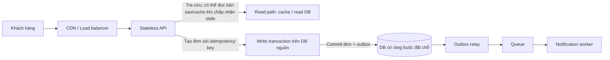
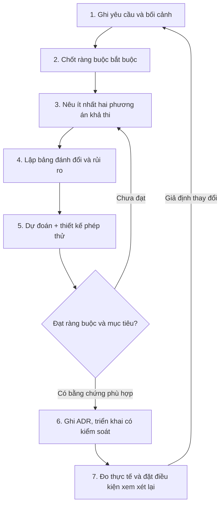

# Đánh đổi giữa độ tin cậy, bảo mật, hiệu năng, chi phí và vận hành

## 1. Vì sao thiết kế kiến trúc là bài toán đánh đổi?

Trong module **CLOUD_ARCHITECTURE**, mục tiêu là đi từ yêu cầu nghiệp vụ đến lựa chọn mạng, compute, dữ liệu và cách triển khai trên cloud. Một hệ thống có thể rất nhanh nhưng đắt và khó vận hành; rất rẻ nhưng khôi phục chậm; hoặc có nhiều lớp bảo vệ nhưng người dùng khó hoàn tất giao dịch. Không thể tối đa hóa mọi thuộc tính bằng cách thêm thật nhiều dịch vụ.

**Đánh đổi kiến trúc (architecture trade-off)** là quyết định chấp nhận một chi phí, rủi ro hoặc giới hạn để đạt mục tiêu khác **trong phạm vi yêu cầu đã định nghĩa**. Đánh đổi tốt phải có lý do, số liệu, người chịu trách nhiệm và cách kiểm chứng. Đánh đổi không có nghĩa là bỏ qua những yêu cầu bắt buộc như bảo vệ dữ liệu cá nhân hoặc ngăn đặt chỗ trùng.

Sau bài học, bạn có thể:

- Phân biệt **yêu cầu bắt buộc (constraint/guardrail)** với **mục tiêu tối ưu** và giải thích vì sao không thể chấm điểm chúng giống nhau.
- Đọc tác động qua lại giữa **reliability, security, performance, cost, operational excellence** trên một sơ đồ cloud.
- So sánh các phương án mạng, compute, dữ liệu, triển khai bằng tiêu chí rõ ràng; tránh suy luận chỉ từ tên công nghệ.
- Ghi quyết định dưới dạng **Architecture Decision Record (ADR)**, nêu giả định, hệ quả, phép thử và điều kiện xem xét lại.
- Dùng tư duy **Well-Architected** để tìm rủi ro còn lại sau khi chọn phương án.

## 2. Năm góc nhìn và cách đo

| Góc nhìn | Câu hỏi thiết kế | Ví dụ thước đo | Hiểu nhầm thường gặp |
|---|---|---|---|
| **Độ tin cậy** (Reliability) | Khi một thành phần lỗi, chức năng quan trọng có còn hoạt động và khôi phục đúng mục tiêu không? | SLI/SLO, tỉ lệ lỗi, RTO, RPO, độ bền dữ liệu, số lần failover thành công | Có nhiều replica tức là không thể mất dữ liệu |
| **Bảo mật** (Security) | Ai được truy cập dữ liệu và hành động nào; tài sản được bảo vệ ra sao? | Kết quả kiểm thử phân quyền, phạm vi IAM, thời gian vá lỗ hổng, số secret lộ, độ phủ audit | Đã có TLS/WAF tức là ứng dụng an toàn |
| **Hiệu năng** (Performance Efficiency) | Hệ thống phản hồi đúng hạn khi tải thay đổi không? | p50/p95/p99 latency, throughput, mức bão hòa, cache hit, thời gian chờ DB | Tăng số server luôn làm API nhanh hơn |
| **Chi phí** (Cost Optimization) | Giá trị nhận được tương xứng chi phí toàn vòng đời không? | Tổng chi phí/tháng, chi phí/giao dịch, tỉ lệ sử dụng tài nguyên, egress | Chọn cấu hình có hóa đơn nhỏ nhất luôn là tối ưu |
| **Vận hành** (Operational Excellence) | Đội ngũ có thể triển khai, quan sát, xử lý sự cố và thay đổi an toàn không? | Lead time triển khai, tần suất lỗi thay đổi, MTTR, cảnh báo hữu ích, thời gian khôi phục thử | Dùng managed service nghĩa là không cần vận hành |

Các thước đo cần có **phạm vi**: API nào, nhóm người dùng nào, khoảng thời gian nào, khi nào tải tăng, và các sự cố nào nằm trong mục tiêu khôi phục. Cần đo **đầu cuối** từ trải nghiệm người dùng, đồng thời có metric từng tầng để tìm nguyên nhân.

### 2.1. Các khái niệm nền tảng

- **SLI (Service Level Indicator):** chỉ số thực tế, ví dụ tỉ lệ yêu cầu đặt chỗ hợp lệ được xử lý thành công.
- **SLO (Service Level Objective):** mục tiêu nội bộ cho SLI, ví dụ 99,9% trong một tháng.
- **Error budget:** phần sai lệch SLO còn cho phép trong kỳ đo. Với SLO theo **thời gian** 99,9% trong đúng 30 ngày, thời gian không đạt mục tiêu tương đương tối đa **43,2 phút**; nếu SLO dựa trên tỷ lệ request thì cần tính từ mẫu request, không suy trực tiếp ra số phút.
- **RTO (Recovery Time Objective):** thời gian tối đa đặt mục tiêu để phục hồi sau loại sự cố đã xác định.
- **RPO (Recovery Point Objective):** độ cũ tối đa của dữ liệu được khôi phục, biểu diễn bằng thời gian; không phải thời gian sửa hệ thống.
- **p95 latency:** 95% số phép đo nằm ở hoặc dưới giá trị này trong tập đo đã định nghĩa; phải xem cả p99 và request bị lỗi/time out.

RTO/RPO là **mục tiêu**, không phải bảo đảm chỉ vì hệ thống được mô tả là “HA”. Kết quả restore/failover thực tế mới cho biết thiết kế có thể đáp ứng hay không.

## 3. Đặt bối cảnh trước khi chọn công nghệ

Xét hệ thống giả định cho thuê thiết bị: khách tìm thiết bị còn trống theo giờ, tạo đơn thuê và nhận email xác nhận. Ứng dụng phục vụ một thị trường địa lý chính, có đội ngũ vận hành nhỏ, ngân sách cần kiểm soát.

| Mã | Yêu cầu giả định | Loại | Hệ quả kiến trúc cần đánh giá |
|---|---|---|---|
| G1 | Một thiết bị không thể được hai khách đặt cùng khung giờ | Bất biến nghiệp vụ bắt buộc | Transaction/ràng buộc hoặc cơ chế giữ chỗ được chứng minh an toàn khi đồng thời |
| G2 | Chỉ người có quyền được xem/sửa đơn; bảo vệ dữ liệu liên hệ | Bảo mật bắt buộc | Authentication, authorization theo đối tượng, mã hóa, quản lý secret, audit |
| S1 | 99,9% yêu cầu API cốt lõi đạt tiêu chí thành công trong tháng | Mục tiêu độ tin cậy | Tránh điểm lỗi đơn, theo dõi SLI, failover và error budget |
| S2 | Khi mất một Availability Zone (AZ), RTO ≤ 60 phút, RPO ≤ 15 phút | Mục tiêu khôi phục | Xác định phạm vi sự cố, DB HA, backup/restore, diễn tập |
| P1 | p95 tra cứu ≤ 400 ms; p95 tạo đơn ≤ 1,5 giây | Mục tiêu hiệu năng | Đo latency đầu cuối, truy vấn DB và mức bão hòa khi tải cao |
| P2 | Giả định tải đỉnh 200 HTTP request/giây, trong đó 15% là ghi | Giả định sizing | Load test theo mẫu đọc/ghi; kiểm tra cạnh tranh trên cùng một khung giờ |
| C1 | Chi phí phải nằm trong ngân sách được chủ sản phẩm phê duyệt | Giới hạn chi phí cần định lượng | Tính chi phí nền, theo tải, egress, backup, quan sát và nhân lực |
| O1 | Đội nhỏ phải có khả năng triển khai, xử lý sự cố và khôi phục | Ràng buộc vận hành | IaC, dịch vụ managed phù hợp, dashboard, runbook, diễn tập |

**Lưu ý:** toàn bộ số liệu là **giả định của bài học**, chưa phải benchmark hay kết quả cam kết. Đặc biệt “ngân sách phù hợp” phải được thay bằng mức tiền và loại tiền cụ thể trước khi phê duyệt kiến trúc.

Thứ tự ra quyết định hợp lý:

1. Giữ **G1/G2** là điều kiện không được vi phạm. Phương án thiếu cách bảo vệ chúng phải được sửa hoặc loại.
2. So các phương án có khả năng đáp ứng **S1/S2/P1** bằng bằng chứng thử nghiệm; không chấm đạt chỉ bằng sơ đồ.
3. Trong các phương án còn lại, chọn cân bằng **C1/O1** phù hợp khả năng vận hành và kế hoạch tăng trưởng.
4. Ghi các giả định chưa được xác minh, lập thời điểm đánh giá lại khi tải, quy định hoặc năng lực đội ngũ thay đổi.

## 4. Vì sao năm mục tiêu ảnh hưởng lẫn nhau?

Mỗi quyết định thiết kế tác động đến nhiều mục tiêu cùng lúc. Bảng sau là **xu hướng thường gặp**, không phải quy luật luôn đúng:

| Quyết định | Lợi ích chính | Chi phí hoặc rủi ro có thể tăng | Cách giảm tác dụng phụ |
|---|---|---|---|
| Thêm replica API trên nhiều AZ | Chịu lỗi instance/AZ, tăng khả năng phục vụ | Chi phí replica/LB; số kết nối DB và độ phức tạp rollout | API stateless, connection pool, autoscaling theo metric, health check |
| Dùng DB managed với HA | Failover/backup được hỗ trợ, giảm công việc hạ tầng | Chi phí nền, giới hạn cấu hình, phụ thuộc nhà cung cấp; failover vẫn gián đoạn | Kiểm thử chuyển dự phòng, retry an toàn, lập runbook và kiểm tra restore |
| Cache dữ liệu tra cứu | Giảm latency và truy vấn DB | Dữ liệu cũ, chi phí cache/invalidation, nguy cơ rò rỉ dữ liệu cá nhân | TTL phù hợp, phân loại dữ liệu, cache key chính xác, kiểm tra tại giao dịch ghi |
| Xử lý gửi email qua queue | Đặt chỗ không phải chờ nhà cung cấp email | Event đến muộn/lặp, backlog, retry và quan sát phức tạp | Transactional outbox, idempotent consumer, DLQ, cảnh báo |
| Mã hóa, phân quyền chặt, kiểm toán | Bảo vệ dữ liệu và hỗ trợ truy vết | Cần quản lý khóa/secret, chi phí log và kiểm thử | Dịch vụ managed, cache khóa công khai an toàn, log tối thiểu cần thiết, tự động kiểm tra quyền |
| Tách thành nhiều microservice | Có thể triển khai/scale một vài miền độc lập | Nhiều điểm mạng lỗi, distributed tracing, phối hợp dữ liệu và on-call | Chỉ tách khi có ranh giới nghiệp vụ và lợi ích đo được; giữ giao tiếp rõ ràng |
| Triển khai nhiều region | Có thể tăng khả năng chịu lỗi region, gần người dùng | Nhân bản dữ liệu, xung đột ghi, egress, chi phí và vận hành tăng mạnh | Xác định primary/secondary, dữ liệu nào được ghi ở đâu, kịch bản DR được diễn tập |

### 4.1. Độ tin cậy và chi phí

Một API chạy trên một instance rẻ và dễ hiểu, nhưng khi instance hoặc AZ hỏng sẽ mất khả năng phục vụ trong thời gian khôi phục. Đặt hai replica ở hai AZ và dùng DB có khả năng failover thường giúp giảm rủi ro gián đoạn do một AZ, đổi lại chi phí hạ tầng tối thiểu tăng và xuất hiện quy trình phối hợp khi lỗi.

**Backup** và **HA** giải quyết các lớp sự cố khác nhau. Replication có thể sao chép cả lỗi xóa dữ liệu do ứng dụng; backup có lịch sử và kiểm tra restore hỗ trợ quay lại trước lỗi. Tăng replica mà bỏ backup không chứng minh được RPO/RTO. Hãy đo thời gian phục hồi, mức mất dữ liệu, và xem những request ở đúng thời điểm failover có được xử lý an toàn không.

### 4.2. Bảo mật và hiệu năng

Xác thực token, kiểm tra quyền từng đơn hàng, TLS và kiểm toán có chi phí xử lý nhất định. Nhưng **bỏ kiểm tra quyền để giảm latency là phương án không hợp lệ** vì vi phạm G2. Hướng tối ưu đúng là giữ bảo vệ rồi cải thiện cách triển khai: xác minh token cục bộ dựa trên khóa công khai đã được lấy và cập nhật đúng quy trình, dùng connection pooling, phân quyền truy cập theo tài nguyên bằng truy vấn hiệu quả và giảm log dư thừa.

Ví dụ, cache kết quả **danh mục công khai** có thể phù hợp; cache **chi tiết đơn thuê riêng tư** dùng chung khóa URL mà không gắn danh tính/quyền truy cập có thể rò rỉ dữ liệu. Cache là quyết định về **mô hình dữ liệu và quyền**, không chỉ về tốc độ.

### 4.3. Hiệu năng và tính nhất quán

Trang tra cứu có thể hiển thị trạng thái “còn trống” từ một cache hoặc read replica hơi trễ. Tuy nhiên, **quyết định đặt thành công** phải được chốt bởi cơ chế ghi nhất quán bảo vệ G1, ví dụ transaction và ràng buộc duy nhất cho khung giờ rời rạc. Không dựa vào kết quả tra cứu để kết luận khung giờ chắc chắn còn trống.

Điều này cho phép tối ưu luồng **đọc** mà vẫn bảo đảm tính đúng đắn của luồng **ghi**:



Sơ đồ logic chưa mô tả số AZ hoặc network ACL. Nếu dùng read replica, cần đặt chính sách dữ liệu có thể cũ; thao tác đặt lịch không dựa vào replica như nguồn quyết định cuối. Việc gửi thông báo bất đồng bộ không thay đổi kết quả commit của đơn.

### 4.4. Chi phí và vận hành

Tự vận hành DB có thể làm một số khoản phí dịch vụ thấp hơn, nhưng phát sinh trách nhiệm vá bảo mật, kiểm tra backup, failover, theo dõi I/O, cập nhật phiên bản, on-call và khôi phục. Với đội nhỏ, dùng dịch vụ managed có thể có tổng chi phí sở hữu hợp lý hơn; với tổ chức lớn và nhu cầu đặc biệt, một phương án tự quản lý có thể đáng cân nhắc.

So sánh chi phí phải tính cả **thời gian kỹ sư**, không chỉ hóa đơn cloud. Ngược lại, không nên mặc định dịch vụ managed tự động thỏa SLO; người dùng dịch vụ vẫn chịu trách nhiệm với cấu hình, phân quyền, mô hình truy vấn, backup policy và cách ứng dụng retry.

### 4.5. Độ tin cậy và vận hành

Tăng số vùng, số service hoặc số loại datastore có thể giúp tránh một vài loại lỗi nhưng cũng tăng số đường truyền, cấu hình và chế độ lỗi. Một hệ thống **đơn giản, được đo và diễn tập tốt** đôi khi đáng tin cậy hơn một sơ đồ phân tán phức tạp nhưng đội ngũ chưa hiểu cách xử lý sự cố.

Ví dụ, active-active đa region cho phép nhận ghi ở nhiều nơi nhưng cần giải quyết đồng thời cùng một khung giờ, độ trễ đồng bộ và tranh chấp dữ liệu. Khi bất biến G1 quan trọng, đây không còn là lựa chọn “bật multi-region là xong”; phải thiết kế rõ quyền ghi và cách giải quyết xung đột.

## 5. So sánh ba phương án triển khai

Giả định nhóm đang lựa chọn cho giai đoạn đầu của sản phẩm:

- **A — Đơn giản một AZ:** API và DB ở một AZ, backup được cấu hình, triển khai cơ bản, không có failover ứng dụng/DB sang AZ khác tự động.
- **B — HA trong một region:** API stateless ở ít nhất hai AZ sau load balancer, DB quan hệ managed có phương án HA, object storage/CDN, queue + outbox cho thông báo, IaC và giám sát.
- **C — Multi-region chủ động:** triển khai ứng dụng ở nhiều region với chiến lược ghi/phân phối dữ liệu riêng, định tuyến liên vùng và quy trình xử lý xung đột/DR.

| Tiêu chí | A — Một AZ | B — Multi-AZ | C — Multi-region |
|---|---|---|---|
| Chịu lỗi một AZ | Phụ thuộc thời gian khôi phục/restore | Có cơ chế tiếp tục hoặc chuyển dự phòng nếu cấu hình đúng | Có thể chịu lỗi AZ và một số lỗi region khi đường dữ liệu được thiết kế đúng |
| Khôi phục dữ liệu | Phụ thuộc lịch backup và restore | Có HA và vẫn phải có backup/restore | Phải thiết kế replication, backup độc lập và nhất quán giữa các region |
| Khả năng mở rộng | Có thể đủ cho tải nhỏ, phụ thuộc tài nguyên | Scale API ngang; DB vẫn có thể là nút thắt | Scale theo vùng nhưng write routing/phối hợp phức tạp |
| Bảo mật | Có thể tốt nếu cấu hình đúng | Có thể tốt nếu cấu hình đúng | Vẫn phải đạt cùng chuẩn; phạm vi quyền và dữ liệu rộng hơn |
| Chi phí nền | Thường thấp hơn | Thường cao hơn A | Thường cao hơn đáng kể do hạ tầng và truyền dữ liệu |
| Vận hành | Ít thành phần hơn, khôi phục thủ công có thể khó | Cần runbook failover, autoscaling, rollback | Cần diễn tập vùng, xử lý xung đột, quan sát liên vùng |
| Bằng chứng còn thiếu | Restore có đạt S2 không? | Failover có đạt S1/S2 và p95 không? | Có giữ G1 khi partition/failover và đáp ứng ngân sách không? |

Không thể kết luận A luôn kém hoặc C luôn tốt. Nếu hệ thống nội bộ chấp nhận downtime dài, A có thể hợp lý. Nếu cần chịu lỗi một AZ với đội nhỏ, B thường là **ứng viên cần kiểm chứng trước**. Nếu có yêu cầu thực sự về gián đoạn toàn region hoặc cư trú dữ liệu đa quốc gia, C có thể trở thành lựa chọn cần nghiên cứu sâu. **Những mô tả trên chưa phải kết quả benchmark.**

### 5.1. Chấm điểm để minh bạch quyết định

Điểm dưới đây **chỉ là ví dụ minh họa** cho cách thảo luận, không phải điểm của một sản phẩm cloud cụ thể. Mỗi tiêu chí có trọng số; thang 1–5, điểm cao là phù hợp hơn với bối cảnh đang xét.

| Tiêu chí | Trọng số | A | B | C |
|---|---:|---:|---:|---:|
| Độ tin cậy | 30% | 2 | 4 | 5 |
| Bảo mật sau khi áp dụng cùng chuẩn tối thiểu | 20% | 4 | 4 | 4 |
| Hiệu năng theo tải giả định | 15% | 3 | 4 | 4 |
| Chi phí phù hợp ngân sách | 20% | 5 | 3 | 1 |
| Khả năng vận hành của đội hiện tại | 15% | 4 | 4 | 1 |
| **Điểm có trọng số** | **100%** | **3,45/5** | **3,80/5** | **3,25/5** |

Cách tính cho B:

```text
Điểm B = 0,30 × 4 + 0,20 × 4 + 0,15 × 4
       + 0,20 × 3 + 0,15 × 4
       = 3,80 / 5
```

Không dùng tổng điểm để “mua quyền” vi phạm G1/G2. Nếu phương án không vượt qua một **ngưỡng bắt buộc** hoặc không chứng minh được mục tiêu bắt buộc, phương án đó phải được sửa hay tạm loại **trước khi** tính điểm. Điểm từ 1 đến 5 mang tính chủ quan, nên cần giải thích nguồn dữ liệu, đánh giá độ nhạy theo trọng số và công khai sự bất định. Chẳng hạn, nếu SLO đã có bằng chứng A không đạt, A bị loại dù có điểm chi phí cao.

### 5.2. Kiểm tra độ nhạy

Hãy thử thay đổi **trọng số** khi mục tiêu kinh doanh thay đổi:

- Nếu thời gian phục hồi sau mất region trở thành yêu cầu cứng, C hoặc một phương án DR mới cần được xem xét; B chưa giải quyết yêu cầu đó.
- Nếu đội vận hành chỉ có một vài kỹ sư và kinh phí cố định thấp, chi phí trực on-call và độ phức tạp của C có thể không chấp nhận được.
- Nếu đo thực tế cho thấy DB mới là điểm nghẽn, tăng API replica chưa chắc giảm p95; phải đánh giá lại truy vấn, locking, pool kết nối hoặc phương án phân vùng.

Kết quả tốt nhất của bảng điểm là **một giả thuyết cần thử**, không phải đáp án cuối cùng.

## 6. Thiết kế theo ngân sách đo được thay vì theo cảm giác

### 6.1. Ngân sách độ trễ

Giả sử p95 tra cứu từ phía client phải không quá 400 ms. Nhóm có thể dùng một **ngân sách thời gian cho request điển hình** để phát hiện thành phần nào đang chiếm nhiều thời gian:

| Đoạn đường | Mức thời gian dự kiến trong một request minh họa |
|---|---:|
| Mạng client/edge/LB | 80 ms |
| Xử lý và kiểm tra quyền ở API | 70 ms |
| Chờ connection + truy vấn DB | 150 ms |
| Serialize/đưa response về client | 50 ms |
| **Khoảng dự phòng** | **50 ms** |
| **Tổng phân bổ** | **400 ms** |

Đây là **phân bổ thiết kế cho một request**, không có nghĩa cộng các **p95 riêng lẻ** của nhiều chặng sẽ bằng p95 đầu cuối. Percentile không cộng tuyến tính trong trường hợp tổng quát. Phải đo distributed trace và p95 đầu cuối dưới tải đại diện để xác nhận P1. Nếu DB p95 tăng vì lock wait, việc giảm 10 ms ở serialization không giải quyết được nguyên nhân gốc.

### 6.2. Ngân sách khả dụng và rủi ro

Với SLO 99,9% trong tháng, hãy định nghĩa rõ request nào là hợp lệ, thành công nghĩa là gì và các lỗi do dependency được tính ra sao. Một email đến trễ có thể không phải lỗi của **API tạo đơn** nếu giao dịch đã commit; nhưng vẫn có thể vi phạm SLO riêng của **dịch vụ thông báo**.

Quản lý **error budget** giúp quyết định khi nào ưu tiên tính năng mới và khi nào cần cải thiện độ tin cậy. Khi lỗi vượt ngân sách, nhóm có thể giảm nhịp phát hành, tập trung xử lý nguyên nhân lặp lại, bổ sung thử nghiệm failover/rollback. Đây là quyết định quản trị rủi ro theo mục tiêu thực tế, không phải quy tắc tuyệt đối cấm triển khai.

### 6.3. Ngân sách chi phí

Tính tổng chi phí theo các nhóm để tránh tối ưu từng máy riêng lẻ:

```text
Chi phí toàn kỳ ≈ compute + database/HA + storage/backup
                 + mạng/egress/CDN + queue + observability
                 + dịch vụ bên thứ ba + chi phí vận hành liên quan

Chi phí trên một đơn thành công
    = chi phí phân bổ cho hệ thống đặt chỗ / số đơn thành công trong kỳ
```

Chỉ số chi phí/đơn cần cùng quy tắc phân bổ giữa các kỳ; nó có thể bị nhiễu khi số đơn nhỏ hoặc khi hệ thống đồng thời phục vụ các chức năng khác. Hóa đơn cloud không tính đủ giờ trực sự cố, kiểm tra backup hoặc làm migration, vì vậy cần cả số liệu vận hành để quyết định.

## 7. Một quyết định mẫu: gửi email đồng bộ hay bất đồng bộ?

Yêu cầu nghiệp vụ: **đơn đã đặt thành công phải được lưu bền vững và khách phải nhận được thông báo**, nhưng email là hệ thống phụ thuộc bên ngoài, có thể chậm hoặc mất kết nối.

**Phương án 1 — gọi email trực tiếp trong request:** dễ viết, ít thành phần. Tuy nhiên API bị kéo dài latency và dễ thất bại khi nhà cung cấp email lỗi. Nếu gửi trước khi DB commit, khách có thể nhận thông báo về đơn bị rollback; nếu gửi sau commit rồi API chết, đơn tồn tại nhưng không gửi được email.

**Phương án 2 — DB transaction + outbox + queue + worker:** ghi đơn và sự kiện `booking.created` trong cùng transaction; trả kết quả sau commit; relay chuyển sự kiện qua queue; worker retry gửi email khi cần. Giảm phụ thuộc thời gian phản hồi của API vào dịch vụ email, đổi lại phải theo dõi outbox tồn đọng, queue backlog, retry, dead-letter queue và trạng thái gửi.

```mermaid
sequenceDiagram
    autonumber
    actor C as Khách hàng
    participant API as Booking API
    participant DB as Transactional DB
    participant R as Outbox relay
    participant Q as Queue
    participant W as Worker
    participant E as Email provider
    C->>API: POST /bookings + Idempotency-Key
    API->>DB: BEGIN; ghi booking và outbox; COMMIT
    alt Commit thành công
        DB-->>API: booking_id
        API-->>C: 201 Created
        R->>DB: Đọc outbox đã commit
        R->>Q: Publish booking.created
        Q-->>W: Giao event (có thể giao lại)
        W->>W: Kiểm tra idempotency/event_id
        W->>E: Gửi email
        E-->>W: Trạng thái gửi
        W-->>Q: Ack sau xử lý thành công
    else Transaction bị từ chối
        DB-->>API: Xung đột/rollback
        API-->>C: 409 Conflict hoặc lỗi phù hợp
    end
```

Quyết định này có các **hệ quả phải chấp nhận và kiểm soát**:

1. **Tính nhất quán nghiệp vụ:** chỉ phát sự kiện của đơn đã commit; thao tác tạo đơn phải chống đặt trùng bằng transaction/ràng buộc, không chỉ dựa vào cache tra cứu.
2. **Tính lặp:** relay hoặc queue có thể phát/giao trùng sau timeout; worker xử lý idempotent theo `event_id` và lưu trạng thái. Với email thực tế, không thể mặc định bảo đảm gửi **chính xác một lần** nếu nhà cung cấp không hỗ trợ deduplication.
3. **Độ trễ thông báo:** cần SLO riêng, ví dụ “95% thông báo được chuyển đến nhà cung cấp trong X phút” với X do nghiệp vụ chọn; chưa được hứa hẹn thời gian nhận email tại hộp thư.
4. **Vận hành:** cần metric tuổi message lâu nhất, retry count, DLQ, số outbox chưa phát, tỷ lệ gửi thành công và cách replay có kiểm soát.
5. **Chi phí:** phát sinh queue, worker, log và công duy trì; so với rủi ro mất đơn/thời gian chờ và chi phí xử lý thủ công.

Phương án 2 phù hợp hơn khi gửi email không phải bước bắt buộc để công nhận **đơn đã tạo**. Nếu nghiệp vụ đòi hỏi email được giao ngay trước khi xác nhận đơn, cần làm rõ định nghĩa thành công và thiết kế lại quy trình; không tự gán tính chất đó cho queue.

## 8. Quy trình ra quyết định kiến trúc có thể kiểm chứng



### 8.1. Bước 1–2: mô tả điều kiện biên

Viết rõ chức năng quan trọng, phạm vi dữ liệu, phân loại người dùng, khu vực triển khai, tải bình thường/đỉnh, thời gian lưu, ngân sách, trình độ đội ngũ và giới hạn pháp lý. Đánh dấu những yêu cầu **không được đánh đổi** như không đặt trùng, kiểm tra quyền hoặc bảo vệ thông tin thanh toán nếu có.

### 8.2. Bước 3–4: so trên cùng một tiêu chí

Không so “Kubernetes” với “bảo mật tốt” vì một bên là công cụ, một bên là thuộc tính. So **mô hình triển khai cùng chức năng** theo các tiêu chí đã thống nhất: SLO, p95, blast radius, chi phí, phạm vi IAM, độ khó rollback, số thành phần cần trực.

Nêu rõ **phương án đối chứng** đơn giản nhất đủ đáp ứng yêu cầu. Đừng chọn microservice, multi-region hay self-managed DB chỉ vì các từ này nghe “enterprise”.

### 8.3. Bước 5: kiểm chứng bằng thử nghiệm đại diện

| Giả thuyết | Phép thử | Dữ liệu đánh giá |
|---|---|---|
| B còn phục vụ khi mất một API instance/AZ | Fault injection tại môi trường kiểm thử, cắt một vùng/instance theo kịch bản | Request lỗi, p95, thời gian phục hồi, kết quả giao dịch đang xử lý |
| DB không cho đặt trùng | Chạy nhiều request cùng `item_id + slot_id` đồng thời | Chính xác một đơn chiếm chỗ thành công, lỗi còn lại có thể giải thích |
| API đáp ứng p95 ở tải đỉnh | Load test theo 200 request/giây với phân bố đọc/ghi và dữ liệu thực tế | p95/p99 đầu cuối, CPU/memory, DB lock wait, saturation và lỗi |
| Queue không làm mất thông báo khi worker lỗi | Dừng worker, cho queue backlog, khởi động lại và replay | Độ trễ, DLQ, số event được xử lý, khả năng chống xử lý lặp |
| Backup có thể khôi phục đạt RPO/RTO | Diễn tập restore vào môi trường tách biệt | Thời gian, mốc dữ liệu cuối, tính toàn vẹn, quyền truy cập sau restore |
| Phân quyền không để lộ đơn của người khác | Test truy cập chéo user/role và kiểm tra log | 403/404 phù hợp, không rò rỉ thông tin, dấu vết audit |

Chỉ đánh dấu “PASS” khi phép thử có điều kiện, kết quả và ngưỡng chấp nhận rõ. Một sơ đồ có nhiều biểu tượng vùng dự phòng **không phải bằng chứng failover đạt yêu cầu**.

### 8.4. Bước 6: ghi ADR

Một ADR ngắn có thể dùng mẫu sau:

```markdown
# ADR-007: Xử lý thông báo sau khi đặt lịch
Trạng thái: Accepted (theo giả định hiện tại)

## Bối cảnh
Giao dịch đặt lịch phải bền vững; email provider có thể lỗi/chậm.
Mục tiêu p95 POST /bookings ≤ 1,5 giây; không gửi email của đơn rollback.

## Các phương án
A. Gọi email đồng bộ trong API.
B. Transactional outbox + queue + worker.

## Quyết định
Chọn B vì API không phụ thuộc độ trễ của provider và sự kiện
được tạo trong cùng transaction với booking.

## Hệ quả
Chấp nhận thông báo trễ, xử lý at-least-once và thêm khâu vận hành.
Cần idempotency, retry có backoff, DLQ, metric và runbook replay.

## Bằng chứng cần thu thập
Load test p95, test API chết sau commit, test provider lỗi,
thời gian xử lý event và chi phí vận hành thực tế.

## Khi nào đánh giá lại
Khi khối lượng event, SLO thông báo hoặc yêu cầu pháp lý thay đổi.
```

### 8.5. Bước 7: đo, vận hành, xem xét lại

Đặt dashboard, alert, runbook và người chịu trách nhiệm trước khi đưa vào sản xuất. Khi traffic tăng, xuất hiện yêu cầu đa region, hoặc chi phí/giao dịch vượt ngưỡng, mở lại ADR dựa trên số liệu mới. **Quyết định tốt hôm nay có thể cần thay đổi sau này**, nhưng không nên thay đổi chỉ vì công nghệ mới xuất hiện.

## 9. Liên hệ tư duy Well-Architected

Đánh giá Well-Architected giúp đặt câu hỏi toàn diện. Ví dụ, **AWS Well-Architected Framework** nêu sáu trụ cột: **Operational Excellence, Security, Reliability, Performance Efficiency, Cost Optimization, Sustainability**. Bài này tập trung năm góc nhìn trong chủ đề; góc nhìn bền vững cũng nên được xem xét khi đánh giá toàn bộ hệ thống.

| Trụ cột/góc nhìn | Câu hỏi gắn với phương án B | Bằng chứng cần có |
|---|---|---|
| Vận hành | Khi DB failover hay outbox backlog, ai biết và làm gì? | Alert, trace, runbook, on-call, thực hành sự cố |
| Bảo mật | Ai được truy cập DB, secret, object storage, thông tin khách? | IAM, network policy, test phân quyền, audit, mã hóa |
| Độ tin cậy | Một AZ lỗi có tạo ra đơn trùng hay mất dữ liệu không? | Test cạnh tranh, failover, restore, RTO/RPO đo được |
| Hiệu năng | P95 đầu cuối còn đạt mục tiêu khi cache miss hoặc DB bị lock? | Load test, traces, slow queries, capacity trend |
| Chi phí | Chi phí HA/backup/logs/egress có phù hợp số đơn và ngân sách? | Hóa đơn gắn tag, cost per booking, forecast |
| Bền vững | Compute nhàn rỗi, bản sao dữ liệu và log giữ lâu có cần thiết không? | Utilization, lifecycle policy, hiệu suất tài nguyên |

Khung đánh giá không thay thế kiến trúc cụ thể. Nó buộc nhóm kiểm tra **chứng cứ và đánh đổi còn lại**. Một quyết định có thể cải thiện độ tin cậy nhưng làm xấu chi phí, hoặc giảm chi phí nhưng tạo rủi ro lớn cho vận hành; điều quan trọng là nêu rõ và kiểm soát.

## 10. Bài thực hành: chọn phương án trong điều kiện thay đổi

**Tình huống A — Giảm một nửa ngân sách.** Đội vận hành đề xuất bỏ DB HA và sao lưu thường xuyên. Hãy phân loại yêu cầu nào đang bị đe dọa, đề xuất phép đo RTO/RPO và các lựa chọn giảm chi phí ít rủi ro hơn (ví dụ tối ưu dữ liệu, instance hoặc log đã được phân loại).

**Tình huống B — Cache cho mọi thứ.** Sau khi thêm CDN cache toàn bộ `GET /bookings/{id}`, người dùng A thấy đơn người dùng B. Hãy giải thích ranh giới bảo mật bị vi phạm, cách sửa và vì sao tăng cache hit không bù được lỗi này.

**Tình huống C — Thêm nhiều API nhưng vẫn chậm.** Ở tải đỉnh, p95 đặt lịch tăng từ 500 ms lên 3 giây, CPU API chỉ 30%, DB lock wait tăng. Hãy chỉ ra ít nhất ba metric cần xem, một giả thuyết nguyên nhân và phép thử xác nhận. Có nên tiếp tục nhân đôi replica API không?

**Tình huống D — Mất một region.** Lãnh đạo yêu cầu RTO 30 phút/RPO 5 phút cho sự cố toàn region. Hãy giải thích vì sao cấu hình multi-AZ hiện tại chưa đủ; nêu quyết định về backup/replication liên vùng, routing, bảo mật dữ liệu, chiến lược writer và diễn tập. Đánh giá chi phí và độ phức tạp mới.

**Tình huống E — Email provider mất kết nối 30 phút.** Đơn đặt phải tiếp tục được ghi; hãy mô tả trạng thái outbox/queue, số lần retry, DLQ, idempotency và metric phản ánh dịch vụ thông báo chưa đạt mục tiêu.

Để tự đánh giá câu trả lời, dùng bảng:

| Yêu cầu liên quan | Phương án đề xuất | Lợi ích | Rủi ro được chấp nhận | Phép thử/metric | Điều kiện xem xét lại |
|---|---|---|---|---|---|
| Ví dụ: không đặt trùng | Transaction + unique constraint cho slot | Đúng nghiệp vụ khi tranh chấp | Có thể trả 409 khi slot đã được người khác giữ | 100 request đồng thời cùng slot, số đơn chiếm chỗ = 1 | Chuyển từ slot rời rạc sang khoảng giờ tùy ý |

**Gợi ý đáp án cốt lõi:** các tình huống A/D xoay quanh xác định lại phạm vi RTO/RPO và ngân sách; B là lỗi phân quyền và cache key; C cần phân tích lock/DB thay vì mặc định scale compute; E đánh giá độ tin cậy bất đồng bộ tách khỏi commit của đơn. Mỗi trả lời phải chỉ ra **điều gì sẽ đo để biết mình đúng**.

## 11. Danh sách kiểm tra khi bảo vệ một quyết định kiến trúc

Trước buổi review, hãy chắc rằng nhóm trả lời được:

1. Yêu cầu kinh doanh cụ thể nào khiến quyết định này cần thiết? Thước đo nào cho biết thành công?
2. Những yêu cầu nào **không được vi phạm** (dữ liệu, bảo mật, tính đúng đắn, pháp lý)?
3. Đã so sánh ít nhất hai phương án thực tế chưa, bao gồm một phương án đơn giản phù hợp?
4. Quyết định ảnh hưởng thế nào đến năm góc nhìn: độ tin cậy, bảo mật, hiệu năng, chi phí và vận hành?
5. Nếu dependency timeout, request retry, một AZ mất hoặc một giao dịch chỉ thành công một nửa, dữ liệu sẽ ở trạng thái nào?
6. Có phép thử, dashboard, runbook, chi phí dự kiến và người chịu trách nhiệm cho rủi ro còn lại không?
7. Giả định nào có thể sai; khi tải, ngân sách hoặc quy định thay đổi thì khi nào mở lại ADR?

Một kiến trúc cloud đáng tin cậy không phải là sơ đồ có nhiều dịch vụ nhất. Nó là tập hợp quyết định có **ràng buộc rõ, đánh đổi minh bạch và bằng chứng kiểm chứng được**, đủ an toàn để vận hành trong điều kiện kinh doanh cụ thể.
