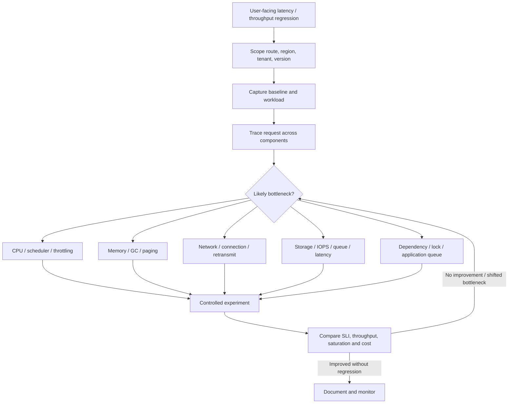
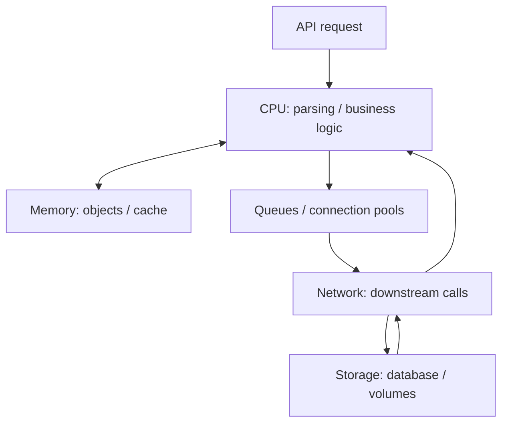

# Đo điểm nghẽn CPU, bộ nhớ, mạng và lưu trữ

## 1. Vì sao cần đo điểm nghẽn theo bằng chứng?

Một API chậm không đồng nghĩa CPU thiếu. Nó có thể đang chờ database, bị giới hạn connection pool, đọc dữ liệu ngẫu nhiên trên ổ đĩa, retransmit gói mạng, cấp phát bộ nhớ quá nhiều hoặc bị throttling bởi quota của nền tảng cloud. Tăng số replica trong những trường hợp này có thể làm chi phí tăng mà latency không giảm; thậm chí còn làm database hoặc network quá tải hơn.

**Performance bottleneck (điểm nghẽn hiệu năng)** là tài nguyên hoặc bước xử lý giới hạn thông lượng hay độ trễ của một workload tại một điều kiện tải nhất định. Điểm nghẽn có thể chuyển từ CPU sang database, từ network sang storage hoặc xuất hiện đồng thời ở nhiều tầng. Vì vậy, tối ưu hiệu năng cần một chu trình đo lường, giả thuyết, thử nghiệm và xác minh thay vì dựa trên một metric đơn lẻ.

Bài học thuộc chương **Hiệu năng** của module **CLOUD_ARCHITECTURE**. Module học thiết kế kiến trúc ứng dụng cloud từ yêu cầu nghiệp vụ đến mạng, compute, dữ liệu và mô hình triển khai, cân bằng độ tin cậy, bảo mật, khả năng mở rộng, chi phí và vận hành theo Well-Architected. Đo điểm nghẽn giúp chọn đúng nơi cần tối ưu, scale hoặc thay đổi kiến trúc.

Sau bài học, bạn có thể:

- Bắt đầu từ user-facing SLI, latency và throughput để xác định phạm vi chậm.
- Phân biệt utilization, saturation, queueing và throttling.
- Đo CPU, memory, network và storage bằng các metric phù hợp.
- Dùng profiling, tracing, load test và benchmark để xác minh giả thuyết.
- Nhận diện dấu hiệu bottleneck trong compute, container, database và cloud network.
- Quyết định tối ưu code, tăng capacity, thay đổi concurrency hoặc điều chỉnh kiến trúc.
- Đánh giá hiệu năng cùng độ tin cậy và chi phí theo Well-Architected.

## 2. Bắt đầu từ workload và trải nghiệm người dùng

Trước khi xem CPU hay IOPS, hãy xác định workload nào đang có vấn đề và điều kiện tải nào làm vấn đề xuất hiện.

### 2.1. Xác định workload

Ghi lại:

- Hành trình người dùng hoặc API bị chậm.
- Loại workload: request/response, batch, stream, database query, background job.
- Traffic rate, concurrency, payload size và phân bố theo thời gian.
- Số lượng tenant, region, route và loại operation.
- Latency mục tiêu, throughput yêu cầu và error budget.
- Thành phần thay đổi gần thời điểm vấn đề bắt đầu: release, config, data volume, traffic, region hoặc dependency.

Không gộp tất cả route vào một latency trung bình. Một endpoint ít traffic nhưng rất chậm có thể bị che bởi endpoint phổ biến và nhanh.

### 2.2. Các chỉ số đầu ra

| Chỉ số | Ý nghĩa | Câu hỏi |
|---|---|---|
| Throughput | Công việc hoàn thành trong một đơn vị thời gian | Hệ thống xử lý được bao nhiêu request/transaction mỗi giây? |
| Latency | Thời gian hoàn thành một operation | Người dùng phải chờ bao lâu? |
| Error rate | Tỷ lệ operation thất bại | Tải tăng có làm timeout hoặc lỗi nhiều hơn? |
| Concurrency | Số operation đang hoạt động cùng lúc | Có quá nhiều request cùng chiếm worker/connection? |
| Queue depth/age | Công việc đang chờ và thời gian chờ | Producer có nhanh hơn consumer? |
| Saturation | Mức gần giới hạn tài nguyên | Tài nguyên nào đang cạn headroom? |

Throughput cần đếm công việc hoàn thành, không chỉ request đến. Hệ thống có thể nhận 10.000 request/giây nhưng chỉ hoàn tất 4.000 request/giây, phần còn lại đang xếp hàng hoặc thất bại.

### 2.3. Percentile quan trọng hơn average trong nhiều workload

Latency trung bình có thể che tail latency. Ví dụ 99 request mất 50 ms và 1 request mất 5 giây; average khoảng 99,5 ms nhưng một nhóm người dùng vẫn chịu độ trễ rất cao.

- p50 mô tả median.
- p90/p95 giúp theo dõi nhóm request chậm.
- p99/p99.9 hữu ích với hệ thống có yêu cầu tail latency chặt, nhưng cần đủ sample size.

Percentile không cộng hoặc trung bình đơn giản giữa instance/region. Để tổng hợp, cần histogram/bucket hoặc tính trên tập sample phù hợp; không lấy trung bình các giá trị p99 của từng pod.

## 3. Phương pháp tìm bottleneck

Quy trình có thể áp dụng cho API, worker, database hoặc workload batch.

1. **Xác nhận triệu chứng:** route, tenant, region, version, thời điểm, latency percentile, throughput và error rate.
2. **Chọn một workload đại diện:** giữ nguyên payload, data set, concurrency và môi trường khi so sánh.
3. **Lập baseline:** đo trạng thái bình thường và tải mục tiêu.
4. **Tạo giả thuyết:** CPU-bound, memory pressure, network-bound, storage-bound hoặc dependency/lock-bound.
5. **Đo ở nhiều tầng:** application trace, process/container, host, network, storage và managed service.
6. **Tìm saturation/queue:** tài nguyên nào chạm giới hạn trước khi throughput ngừng tăng hoặc latency tăng nhanh?
7. **Thử một thay đổi:** chỉ đổi một biến có thể đo, tránh đổi CPU, memory, pool và retry cùng lúc.
8. **Đo lại trong cùng điều kiện:** kiểm tra p95/p99, completed throughput, error và cost.
9. **Xác nhận không chuyển bottleneck:** theo dõi tầng tiếp theo và dependency.
10. **Ghi quyết định:** kết quả, giới hạn, rollback và metric tiếp tục theo dõi.

### 3.1. Performance investigation flow



### 3.2. Sử dụng distributed tracing

Trace thể hiện request qua gateway, service, cache, database và external provider. Tìm span chiếm phần lớn critical path:

- Một span database dài có thể do query, lock, connection wait hoặc storage.
- Nhiều span ngắn lặp lại có thể là N+1 query hoặc chatty service.
- Khoảng thời gian không có span có thể là queueing trong application, scheduler hoặc client.
- Retry làm trace có nhiều attempt và tổng thời gian lớn.

Trace sampling cần được thiết kế để giữ mẫu lỗi/chậm có giá trị. Trace không phải lúc nào cũng ghi mọi request; cần đối chiếu metric tổng hợp và log.

## 4. Phân biệt utilization, saturation và throttling

Ba khái niệm thường bị nhầm:

- **Utilization:** tỷ lệ tài nguyên đang được dùng, ví dụ CPU 70%.
- **Saturation:** mức công việc phải chờ do tài nguyên không đáp ứng ngay, ví dụ run queue, I/O queue hoặc connection wait tăng.
- **Throttling:** nền tảng hoặc quota chủ động giới hạn tài nguyên, ví dụ CPU quota container hoặc network rate limit.

CPU utilization thấp không chứng minh CPU không phải bottleneck nếu thread bị lock hoặc process bị throttled theo quota trong từng khoảng thời gian. Ngược lại, CPU cao có thể là trạng thái bình thường nếu throughput tăng tuyến tính và latency vẫn trong mục tiêu.

| Dấu hiệu | Diễn giải có thể | Bước kiểm tra tiếp |
|---|---|---|
| CPU cao, queue/run queue cao, latency tăng | CPU-bound hoặc quá nhiều runnable threads | Profile CPU, scheduler, concurrency |
| CPU thấp, request pending nhiều | Chờ I/O, lock, network hoặc connection pool | Trace, wait states, socket/pool metrics |
| CPU container chạm quota, host còn rảnh | CPU throttling | Container quota và throttled time |
| Memory tăng liên tục, restart/OOM | Leak hoặc working set vượt limit | Heap profile, allocation, OOM events |
| Disk utilization cao và I/O latency tăng | Storage-bound | Queue depth, IOPS, throughput, block size |
| NIC throughput thấp nhưng retransmit cao | Network loss/congestion hoặc MTU/path issue | Interface errors, TCP metrics, flow path |

## 5. Đo điểm nghẽn CPU

CPU thực hiện tính toán, mã hóa, nén, serialization, parsing, query planning và scheduling. Một workload CPU-bound thường có throughput tăng theo số core đến một điểm, sau đó bị giới hạn bởi contention, memory bandwidth hoặc phần serial.

### 5.1. Metric CPU

| Metric | Ý nghĩa | Cách dùng |
|---|---|---|
| User CPU time | CPU chạy application code | Xác định compute của process |
| System CPU time | Kernel/system call | Phát hiện I/O, networking, context switch |
| CPU utilization | Tỷ lệ CPU bận | Nhìn xu hướng và headroom |
| Run queue/load | Số task chờ CPU hoặc runnable | Phát hiện contention |
| Context switches | Chuyển đổi thread/process | Quá nhiều có thể tăng overhead |
| CPU throttled time | Thời gian bị quota giới hạn | Đặc biệt quan trọng với container |
| Per-core utilization | Mức sử dụng từng core | Phát hiện một thread/core nóng |

Load average là chỉ báo tải của hệ điều hành, không đồng nghĩa trực tiếp với phần trăm CPU; cách tính và ý nghĩa phụ thuộc platform. Đọc cùng số core, runnable task và I/O wait.

### 5.2. CPU-bound và serial bottleneck

Nếu một phần lớn workload chạy trên một thread, tăng từ 4 lên 16 core có thể không cải thiện đáng kể. Định luật Amdahl mô tả giới hạn speedup khi một phần công việc không thể song song:

\[
Speedup(N)=\frac{1}{(1-P)+\frac{P}{N}}
\]

Trong đó P là tỷ lệ workload có thể song song hóa và N là số processor/core hữu ích. Nếu chỉ 80% workload có thể song song, tăng core vô hạn vẫn bị giới hạn bởi 20% serial.

### 5.3. Profiling CPU

CPU profiler giúp xác định function tiêu tốn CPU:

- Sampling profiler lấy mẫu stack theo chu kỳ, thường phù hợp production khi cấu hình overhead thấp.
- Instrumentation profiler ghi chi tiết lời gọi nhưng có thể thêm overhead.
- Flame graph trực quan hóa stack và tỷ trọng sample; bề rộng thể hiện lượng sample, không nhất thiết là thời gian wall-clock chính xác.

Khi đọc profile, tìm hot path, allocation/serialization tốn CPU, regex, compression, encryption, lock contention và function được gọi quá nhiều lần.

### 5.4. Kiểm tra CPU trong container

Container có thể bị giới hạn CPU quota dù host còn nhiều CPU. Kiểm tra:

- CPU request/limit hoặc quota.
- Throttled periods/throttled seconds.
- Pod/container restart và scheduling.
- Số worker/thread so với quota thực.
- CPU steal hoặc noisy neighbor trên hạ tầng chia sẻ nếu có metric.

Đừng tăng thread pool mù quáng: quá nhiều thread trong quota nhỏ làm context switch và queueing tăng.

### 5.5. Cách khắc phục CPU-bound

- Tối ưu thuật toán và cấu trúc dữ liệu.
- Giảm serialize/deserialize, nén hoặc chuyển đổi không cần thiết.
- Cache kết quả tính toán khi semantics cho phép.
- Batch operation để giảm overhead.
- Parallelize phần độc lập nhưng kiểm tra contention và ordering.
- Tăng CPU request/limit hoặc chọn instance compute-optimized khi profile xác nhận thiếu compute.
- Dùng queue/backpressure để giữ tải trong năng lực xử lý.

## 6. Đo điểm nghẽn bộ nhớ

Bộ nhớ ảnh hưởng trực tiếp đến số request đồng thời, cache hit, garbage collection, paging và ổn định của process. Tăng memory limit có thể trì hoãn OOM nhưng không sửa memory leak hay allocation churn.

### 6.1. Những đại lượng cần phân biệt

| Đại lượng | Ý nghĩa |
|---|---|
| RSS | Bộ nhớ vật lý resident của process |
| Virtual memory | Không gian địa chỉ process đã map/reserve |
| Heap used/committed | Bộ nhớ heap đang dùng và đã cấp cho runtime |
| Working set | Phần bộ nhớ đang hoạt động và cần cho workload |
| Page cache | RAM OS dùng cache nội dung file/block |
| Swap/page fault | Hoạt động đưa page ra/vào RAM |
| Allocation rate | Tốc độ tạo object/heap allocation |
| GC pause/frequency | Thời gian và tần suất garbage collection |
| OOM event | Process/container bị kết thúc do vượt giới hạn |

Không cộng RSS, heap và page cache một cách tùy tiện; các đại lượng có thể chồng lấn hoặc được định nghĩa khác nhau theo runtime/platform.

### 6.2. Memory pressure

Các dấu hiệu:

- RSS hoặc working set tăng theo thời gian nhưng không giảm sau khi traffic giảm.
- Heap occupancy tăng qua các chu kỳ GC.
- GC chạy thường xuyên, pause dài hoặc allocation rate cao.
- Major page fault/swap tăng và latency tail tăng.
- Container OOMKilled hoặc process bị restart.
- Cache eviction tăng vì working set vượt RAM.

### 6.3. Memory leak và allocation churn

**Memory leak** là bộ nhớ không còn cần nhưng vẫn được giữ tham chiếu, khiến footprint tăng theo thời gian. **Allocation churn** là tạo và hủy lượng lớn object liên tục; tổng memory có thể không tăng mãi nhưng GC phải làm việc nhiều.

Dùng heap dump/heap profiler, allocation profile và object-retention analysis để tìm:

- Collection không giới hạn.
- Cache không có TTL/size bound.
- Listener/callback không unregister.
- Request context hoặc object graph bị giữ lâu.
- Buffer lớn và duplicate copy.
- Per-request object allocation quá nhiều.

Khi thu heap dump production, cần kiểm soát dữ liệu nhạy cảm vì object có thể chứa token, PII và payload.

### 6.4. GC và latency

GC stop-the-world có thể tạo tail latency, tùy runtime và collector. Xem GC pause distribution, allocation rate, promotion/old-generation occupancy và concurrent GC CPU. Giảm object allocation hoặc điều chỉnh heap/collector chỉ sau khi profile cho thấy nguyên nhân.

### 6.5. Memory trong container

Theo dõi memory working set/usage và limit theo cùng một định nghĩa của platform. Một container có thể bị OOM kill trước khi host memory hết. Headroom phải tính cả native memory, thread stack, direct buffer, runtime metadata và sidecar, không chỉ heap.

### 6.6. Cách khắc phục memory-bound

- Sửa leak và giới hạn cache/queue/buffer.
- Giảm object allocation và bản sao dữ liệu.
- Stream dữ liệu lớn thay vì load toàn bộ vào memory.
- Áp dụng pagination và bounded batch.
- Điều chỉnh concurrency để giảm số request giữ working set cùng lúc.
- Tăng memory hoặc chọn memory-optimized instance nếu workload có footprint hợp lệ.
- Kiểm soát JVM/runtime heap riêng với container memory limit.

## 7. Đo điểm nghẽn mạng

Mạng có thể làm chậm request ngay cả khi CPU và database còn dư tải. Bottleneck có thể ở bandwidth, packet rate, latency, packet loss, retransmission, DNS, TLS handshake, NAT, load balancer hoặc giới hạn connection.

### 7.1. Metric mạng

| Metric | Ý nghĩa | Dấu hiệu bất thường |
|---|---|---|
| Bytes/packets in/out | Lưu lượng qua interface | Chạm bandwidth/packet rate cap |
| RTT/latency | Thời gian round trip | Tăng theo region/path hoặc tải |
| Packet loss | Gói bị mất | Retransmission và throughput giảm |
| TCP retransmits | Gói phải gửi lại | Congestion, loss hoặc path issue |
| Connection count | Socket/connection đang mở | Cạn ephemeral port hoặc pool |
| DNS lookup latency/failure | Độ trễ phân giải tên | Startup/request chậm, retry |
| TLS handshake latency | Thiết lập phiên bảo mật | CPU, network round trip hoặc certificate issue |
| NIC errors/drops | Lỗi/drop tại interface | Driver, queue hoặc capacity |
| NAT/egress metrics | Dịch địa chỉ và lưu lượng đi ra | Port exhaustion hoặc quota |

### 7.2. Bandwidth-bound và latency-bound

**Bandwidth-bound** xảy ra khi lượng dữ liệu cần truyền gần giới hạn băng thông. **Latency-bound** xảy ra khi thời gian round trip chi phối, đặc biệt với nhiều request tuần tự nhỏ.

Ví dụ:

- Một request gửi 20 MB qua kết nối 100 Mbps cần ít nhất khoảng 1,6 giây ở mức truyền lý tưởng, chưa tính overhead.
- Một API gọi 15 service tuần tự, mỗi lần RTT 20 ms, có thể mất khoảng 300 ms chỉ cho network round trips.

Batching, parallel request, compression hoặc colocate workload có thể cải thiện; mỗi biện pháp có đánh đổi CPU, memory và complexity.

### 7.3. Network path cần quan sát

- Client → DNS → CDN/WAF → load balancer → ingress.
- Service → service qua VPC/VNet, service mesh hoặc peering.
- Workload → database/cache/object storage.
- Private subnet → NAT gateway → Internet/external provider.
- Cross-AZ/cross-region traffic.
- VPN, Direct Connect/ExpressRoute hoặc hybrid network.

Vẽ đường đi thực tế thay vì chỉ xem subnet. Security policy, route table, DNS resolver, proxy và service mesh có thể thêm hop hoặc thay đổi MTU/connection behavior.

### 7.4. Connection pool và port exhaustion

Quá nhiều kết nối ngắn có thể tạo TLS handshake và TCP setup overhead; quá nhiều kết nối đồng thời có thể cạn file descriptor, ephemeral port, NAT translation hoặc database connection. Xem pool active/idle/waiters, connection creation rate, TIME_WAIT, reset và timeout.

Dùng keep-alive và connection pooling khi phù hợp; đặt giới hạn pool theo capacity dependency. Pool quá lớn có thể làm database quá tải. Pool quá nhỏ làm request queue chờ dù database còn khả năng.

### 7.5. DNS và TLS

DNS lookup bị lặp trong mỗi request, resolver chậm hoặc cache TTL sai có thể làm tăng latency và failure. TLS handshake tốn CPU và round trips; reuse connection giúp giảm overhead, nhưng session/certificate lifecycle phải tiếp tục được quản lý an toàn.

Đo riêng DNS, TCP connect, TLS handshake, time-to-first-byte và response transfer khi client/platform hỗ trợ. Không quy toàn bộ thời gian từ client đến response cho “network” mà không phân đoạn.

### 7.6. Cách khắc phục network-bound

- Giảm round trips bằng batching hoặc parallelism có giới hạn.
- Tối ưu payload, schema và compression có đo CPU trade-off.
- Tái sử dụng kết nối, tune pool và keep-alive.
- Đặt service gần data/dependency hoặc dùng regional endpoint phù hợp.
- Giảm cross-AZ/cross-region transfer không cần thiết.
- Kiểm tra MTU, route, NAT capacity, DNS và load balancer limits.
- Dùng CDN/cache cho nội dung phù hợp.
- Áp dụng backpressure và quota để tránh connection storm.

## 8. Đo điểm nghẽn lưu trữ

Storage có thể là block volume cho database, file system cho workload, object storage cho artifact/blob hoặc managed storage cho data platform. Cần xác định kiểu I/O và metric tương ứng.

### 8.1. IOPS, throughput, latency và queue depth

- **IOPS:** số operation đọc/ghi mỗi giây.
- **Throughput:** lượng dữ liệu đọc/ghi mỗi giây.
- **Latency:** thời gian hoàn tất một I/O.
- **Queue depth:** số I/O đang chờ hoặc đang xử lý.
- **Read/write ratio:** tỷ lệ đọc và ghi.
- **Block size:** kích thước mỗi operation.

Một volume có thể chạm IOPS limit nhưng chưa chạm throughput limit; hoặc ngược lại. Workload random I/O nhỏ và sequential I/O lớn tạo profile rất khác nhau.

### 8.2. Dấu hiệu storage-bound

| Dấu hiệu | Khả năng nguyên nhân |
|---|---|
| IOPS đạt mức provisioned cap, latency tăng | IOPS-bound |
| Throughput đạt cap với block lớn | Bandwidth-bound |
| Queue depth tăng kéo dài | Storage không theo kịp demand |
| Read latency cao, cache hit giảm | Random read, working set hoặc storage path |
| Write latency tăng, fsync chậm | Durability/flush bottleneck, log device |
| DB query chậm cùng disk await cao | Storage có thể nằm trên critical path |
| Object upload/download chậm | Network, request pattern, object size hoặc service-side limit |

### 8.3. Phân tích read/write pattern

- Sequential read/write thường tận dụng throughput tốt.
- Random read có thể bị giới hạn bởi IOPS và latency.
- Small synchronous write có thể chịu chi phí flush/fsync.
- Compaction, checkpoint và background vacuum có thể tranh chấp I/O với foreground query.
- Snapshot/backup có thể tạo throughput spike hoặc tăng latency nếu chia sẻ resource.

Đọc cùng database wait events, buffer/cache hit, checkpoint, log flush và query execution plan. Disk utilization cao một mình chưa chứng minh storage là nguyên nhân; CPU wait hoặc lock có thể xuất hiện đồng thời.

### 8.4. Object storage khác block storage

Object storage truy cập qua API/network, có request rate, latency, object size, multipart upload và request cost. Nó không có cùng semantics block device/IOPS như attached volume. Với object storage, đo request latency, throughput, throttling/5xx, retry, multipart concurrency và network transfer.

### 8.5. Cách khắc phục storage-bound

- Tối ưu query, index và data layout để giảm I/O.
- Tăng cache hit hoặc dùng read replica khi consistency cho phép.
- Batch và async write nếu business semantics cho phép.
- Tách log/transaction I/O khỏi workload khác khi phù hợp.
- Provision IOPS/throughput hoặc chọn volume/instance class thích hợp.
- Giảm competing backup/compaction hoặc điều chỉnh lịch.
- Dùng partitioning/sharding khi scale dữ liệu và query pattern yêu cầu.
- Đo chi phí tăng storage performance so với tối ưu query/application.

## 9. Queueing và Little's Law

Nhiều bottleneck biểu hiện trước tiên bằng queue tăng. Little's Law liên kết số request trung bình trong hệ thống (L), throughput (λ) và thời gian trung bình trong hệ thống (W):

\[
L=\lambda\times W
\]

Ví dụ service hoàn tất 200 request/giây và mỗi request ở trong hệ thống trung bình 0,25 giây:

\[
L=200\times0,25=50\ requests
\]

Nếu latency tăng lên 1 giây trong khi throughput vẫn 200 request/giây, số request trung bình trong hệ thống tăng lên 200. Nhiều request đồng thời hơn có thể làm tăng memory, connection và lock pressure, tạo feedback loop.

Little's Law áp dụng cho hệ thống ổn định với đơn vị và boundary nhất quán. Khi queue tăng không giới hạn, hệ thống không ở trạng thái ổn định; lúc đó phải đo arrival rate, service rate, queue age và drop rate.

### 9.1. Arrival rate và service rate

- Nếu arrival rate nhỏ hơn service rate trong thời gian đủ dài, queue có thể được xử lý.
- Nếu arrival rate gần bằng service rate, biến động nhỏ có thể làm queue tăng đáng kể.
- Nếu arrival rate vượt service rate kéo dài, queue sẽ tăng cho tới khi đạt giới hạn hoặc hệ thống từ chối request.

Giải pháp không chỉ là tăng worker. Cần xem tài nguyên downstream có chịu được concurrency bổ sung không; nếu database là bottleneck, tăng worker chỉ đẩy nhiều truy vấn hơn vào database.

## 10. Tương tác giữa CPU, memory, network và storage

Các tài nguyên không độc lập:

- Compression giảm network bytes nhưng tăng CPU.
- Cache tăng hit và giảm storage/network nhưng dùng memory.
- Tăng concurrency có thể tăng throughput cho tới khi CPU, memory, connection hoặc database bão hòa.
- Tăng batch size giảm số round trip nhưng tăng memory và tail latency.
- Thêm replica có thể tăng read capacity nhưng thêm replication traffic và storage cost.
- TLS encryption tăng bảo mật nhưng tiêu tốn CPU; hardware acceleration có thể thay đổi trade-off.

### 10.1. Ví dụ chuyển bottleneck

Một API ban đầu CPU-bound do serialize JSON. Sau khi tối ưu và thêm cache, CPU giảm nhưng network egress tăng vì nhiều response được phục vụ nhanh hơn. Tiếp theo, NAT gateway hoặc client bandwidth trở thành giới hạn. Nếu chỉ quan sát CPU, đội ngũ có thể kết luận hệ thống đã tối ưu trong khi throughput tổng thể vẫn không tăng.

### 10.2. Resource dependency map



Sơ đồ nhấn mạnh một request có thể chờ ở nhiều tài nguyên. Distributed trace và metric ở các boundary giúp tìm critical path thay vì quy latency cho một máy.

## 11. Công cụ đo và profiling trong cloud

Công cụ cụ thể phụ thuộc hệ điều hành, runtime và cloud provider. Chọn công cụ theo câu hỏi cần trả lời, đồng thời kiểm soát overhead và quyền truy cập.

| Lớp | Công cụ/nguồn phổ biến | Dùng để |
|---|---|---|
| Application | APM, distributed tracing, runtime profiler | Span latency, hot path, allocation, lock |
| Linux host | top/htop, vmstat, pidstat, iostat, sar, perf | CPU, memory, process, I/O, profile |
| Network | ss, ip, ethtool, tcpdump, flow logs | Socket, interface, packet path, loss |
| Container/Kubernetes | cAdvisor, kubelet metrics, cgroup stats, pod events | CPU/memory limits, throttling, OOM/restart |
| Database | Query plan, wait events, performance insights | Slow query, lock, I/O, connection |
| Cloud monitoring | Provider metrics, logs, traces, service dashboards | VM, volume, load balancer, NAT, managed DB |
| Load test | k6, Locust, JMeter, Gatling, wrk (tùy use case) | Throughput, latency, concurrency, saturation |

Tên metric và mức sẵn có khác nhau theo provider/instance type. Xác nhận đơn vị, aggregation period, dimension và sampling trước khi so sánh.

### 11.1. Profiling và observability an toàn

- Bắt đầu với sampling hoặc profiling duration ngắn để kiểm soát overhead.
- Cấp quyền tối thiểu; không mở profiler endpoint công khai.
- Không xuất heap dump/trace chứa PII hoặc credential vào kho không kiểm soát.
- Đồng bộ clock và dùng correlation ID.
- Ghi lại profiler version, runtime flags, sample window và workload.
- So sánh baseline/candidate trên cùng điều kiện.

### 11.2. Sử dụng metric cloud đúng cách

Cloud metrics thường có chu kỳ lấy mẫu và aggregation. Giá trị average trong 5 phút có thể che spike kéo dài 20 giây. Dùng độ phân giải phù hợp cho sự cố và đối chiếu với application metric. Kiểm tra metric có tính cả burst credit, throttling, queueing hoặc usage per device không.

## 12. Load test và benchmark đáng tin cậy

Benchmark chỉ hữu ích khi mô phỏng đúng workload và có thể lặp lại.

### 12.1. Xây dựng workload model

Ghi:

- Request mix và phân bố payload.
- Arrival rate, concurrency và ramp-up.
- Read/write ratio và data set size.
- Cache warm/cold state.
- Tenant distribution và hot key.
- Dependency giả lập hay thật.
- Duration, warm-up period và steady-state window.
- Expected latency, throughput và error threshold.

### 12.2. Open-loop và closed-loop load

- **Closed-loop:** client gửi request mới khi request trước hoàn tất. Khi server chậm, client tự giảm arrival rate; có thể che quá tải (coordinated omission).
- **Open-loop:** sinh request theo tốc độ định trước, bất kể response trước đó. Cách này phản ánh offered load tốt hơn nhưng cần giới hạn queue và generator capacity.

Với latency-sensitive service, cần hiểu load generator có bị bottleneck không và đo cả offered rate lẫn completed rate.

### 12.3. Warm-up và cache state

Runtime JIT, connection pool, DNS cache, page cache và application cache cần thời gian ổn định. Benchmark lạnh và nóng trả lời hai câu hỏi khác nhau; ghi rõ trạng thái. Không bỏ warm-up tùy tiện nếu production thường xuyên có cold start/scale-out.

### 12.4. Tránh benchmark không công bằng

- Chạy cùng instance class, runtime, version và config.
- Dùng data set đủ lớn để không vô tình nằm hoàn toàn trong cache.
- Giữ cùng concurrency, request mix và thời gian.
- Chạy nhiều lần và báo variance.
- Cô lập noisy neighbor hoặc ghi rõ ảnh hưởng.
- Kiểm tra load generator CPU/network không phải điểm nghẽn.
- Không thay nhiều biến cùng lúc.

### 12.5. Capacity curve

Đo throughput và latency khi tăng offered load theo từng mức. Một hệ thống thường có vùng throughput tăng gần tuyến tính; đến điểm bão hòa, throughput gần như phẳng trong khi latency/queue tăng nhanh. Điểm vận hành an toàn cần có headroom để chịu burst và failure, không đặt sát điểm bão hòa.

## 13. Ví dụ chẩn đoán một API đặt lịch

Giả sử API tạo booking có p95 tăng từ 180 ms lên 900 ms khi traffic tăng gấp đôi. Error rate cũng tăng, trong khi CPU của pod chỉ khoảng 45%.

### 13.1. Phân tích tín hiệu

| Tín hiệu | Quan sát giả định | Diễn giải |
|---|---|---|
| API p95 | 900 ms | User impact rõ |
| Pod CPU | 45% | CPU chưa chắc là bottleneck |
| DB connection pool wait | Tăng mạnh | Request chờ connection |
| DB active connections | Chạm pool/database limit | Có saturation |
| DB lock wait | Tăng trên bảng slot | Contention |
| Network RTT app-DB | 2 ms ổn định | Network không phải nguyên nhân chính |
| Disk latency DB | Bình thường | Storage chưa có dấu hiệu giới hạn |

Trace cho thấy request chờ pool 500 ms, query và lock thêm 300 ms. CPU thấp vì worker chủ yếu chờ DB.

### 13.2. Giả thuyết và thử nghiệm

1. Xác minh connection pool không bị rò connection và transaction không giữ lâu.
2. Kiểm tra query plan và index trên tenant/slot/time.
3. Giảm transaction scope, tránh gọi external service trong transaction.
4. Kiểm tra lock order và mức cô lập transaction.
5. Thử tải lại với concurrency tăng từng bước và theo dõi pool wait/lock wait.
6. Chỉ điều chỉnh pool size sau khi database capacity và lock contention đã được đánh giá.

Tăng pool có thể làm nhiều query đồng thời hơn và khiến DB quá tải. Giải pháp có thể là tối ưu query/index, giảm thời gian transaction hoặc queue write thay vì chỉ tăng connection.

### 13.3. Sau khi tối ưu

Đo lại cùng request mix, data set và offered load. Thành công cần thể hiện ở completed throughput tăng, p95/p99 giảm, error rate không tăng, database headroom còn phù hợp và chi phí trên mỗi booking không xấu đi.

## 14. Ví dụ: phân biệt bottleneck ở object upload

Một dịch vụ upload file lên object storage bị chậm khi file lớn:

- CPU thấp và memory ổn định.
- Network egress/inbound gần giới hạn path.
- Throughput tăng theo multipart concurrency đến một điểm, rồi retransmission tăng.
- Storage service không báo throttling đáng kể.

Khả năng bottleneck nằm ở network path hoặc client-side bandwidth. Thử nghiệm:

1. Đo DNS, TLS, connect và transfer duration riêng.
2. So sánh workload cùng region với cross-region.
3. Kiểm tra MTU, packet loss, NAT, proxy và gateway.
4. Điều chỉnh multipart chunk/concurrency có giới hạn.
5. Đo lại throughput, retry, memory buffer và request cost.

Nếu tăng multipart concurrency làm network bão hòa hoặc buffer chiếm memory lớn, cần giới hạn concurrency theo client/tenant và backpressure.

## 15. Capacity planning và headroom

Khi đã xác định resource bottleneck, cần dự báo tăng trưởng và failure scenario.

### 15.1. Capacity dimensions

- CPU cores và compute class.
- Memory working set và cache footprint.
- Network bandwidth, packet rate, connection/NAT capacity.
- Storage IOPS, throughput, capacity và latency.
- Database connections, locks, read/write capacity.
- Queue throughput, backlog và consumer concurrency.
- Autoscaling delay và warm-up time.

### 15.2. Headroom

Không vận hành liên tục sát giới hạn tối đa. Headroom cần xét:

- Peak traffic và burst.
- Một AZ/instance/replica bị mất.
- Rolling deployment cần chạy đồng thời old/new version.
- Backup, compaction và batch job.
- Traffic skew theo tenant hoặc hot partition.
- Autoscaling delay và quota cloud.

Không có một phần trăm headroom phù hợp cho mọi hệ thống. Mức dự phòng cần được tính từ workload profile, SLO, RTO và failure scenario.

### 15.3. Autoscaling

CPU utilization là một scaling signal, nhưng có workload bị giới hạn bởi queue age, request concurrency, memory hoặc custom metric. Scale-out chỉ có ích nếu downstream capacity tăng hoặc được bảo vệ. Scale-in cần tránh làm gián đoạn request đang chạy hoặc consumer có state.

Kiểm tra:

- Scale metric và target tracking.
- Cooldown/stabilization window.
- Minimum/maximum replica và cloud quota.
- Pod startup/readiness, image pull và cache warm-up.
- Connection pool được điều chỉnh theo replica count.
- Downstream database/queue có đủ capacity.

### 15.4. Cost per unit of work

Ngoài tổng chi phí, đo cost per request, cost per booking hoặc cost per GB processed. Tối ưu đúng thường là tăng throughput hoặc giảm tài nguyên trên một đơn vị công việc trong khi vẫn đạt SLO. Một instance lớn hơn có thể tăng chi phí nhưng giảm số replica và overhead; cần benchmark TCO thay vì so giá VM riêng lẻ.

## 16. Các anti-pattern khi tìm bottleneck

| Anti-pattern | Vì sao gây sai | Cách làm tốt hơn |
|---|---|---|
| Chỉ xem CPU average | Bỏ lỡ lock, I/O wait và throttling | Xem per-core, run queue, throttled time và trace |
| Tăng replica ngay | Có thể đẩy tải sang DB/network | Xác định bottleneck và downstream headroom |
| Tăng DB pool để hết wait | Có thể làm DB saturation nặng hơn | Đo query, lock và connection service time |
| Chỉ dùng p50 | Che tail latency | Xem p95/p99 cùng sample volume |
| Benchmark bằng một request | Không có contention/steady state | Dùng workload model, ramp và nhiều lần chạy |
| Dùng data set quá nhỏ | Cache làm kết quả không đại diện | Kiểm thử cache warm và cold với dữ liệu thực tế |
| Profile mọi request | Overhead và dữ liệu nhạy cảm | Sampling, targeted capture và access control |
| Chỉ đo application | Bỏ qua host, network và managed service | Kết hợp trace và resource telemetry |
| Thay nhiều biến cùng lúc | Không biết yếu tố nào tạo cải thiện | Controlled experiment từng biến |
| Tối ưu một resource riêng | Có thể chuyển bottleneck | Đo lại toàn critical path và cost |

## 17. Đánh đổi bảo mật và độ tin cậy trong đo hiệu năng

Profiling và benchmark cũng có rủi ro:

- Heap dump, core dump và packet capture có thể chứa secret/PII.
- Debug endpoint hoặc profiler port có thể mở quyền đọc thông tin nội bộ.
- Load test sai phạm vi có thể gây DoS cho production hoặc provider.
- Synthetic traffic có thể làm tăng bill hoặc kích hoạt side effect thật.
- Tắt TLS/auth để benchmark có thể tạo kết quả không đại diện production.

Ưu tiên staging có data tổng hợp hoặc production load test có kiểm soát, quota, window, owner và stop condition. Nếu cần production profiling, giới hạn thời gian, sampling, quyền và nơi lưu artifact. Không tắt security control chỉ để số benchmark đẹp hơn.

## 18. Đánh giá theo Well-Architected

| Trụ cột | Câu hỏi review |
|---|---|
| **Operational Excellence** | Có baseline, dashboard, trace, runbook, owner và quy trình controlled experiment? |
| **Security** | Profiler/heap dump/packet capture có bảo vệ? Load test có scope và authorization? |
| **Reliability** | Bottleneck có headroom? Có queue limit, backpressure, autoscaling guardrail và dependency protection? |
| **Performance Efficiency** | Đo đúng critical path? Có tối ưu CPU, memory, network, storage theo workload? |
| **Cost Optimization** | Có đo cost per unit và tránh scale-up khi chưa xác định nguyên nhân? |
| **Sustainability** | Tăng utilization hiệu quả, giảm retry/I/O/compute lãng phí và right-size tài nguyên? |

## 19. Mẫu performance investigation record

YAML dưới đây là mẫu ghi nhận điều tra, không phải cấu hình monitoring vendor:

```yaml
investigation:
  id: PERF-BOOKING-006
  service: booking-api
  symptom:
    route: create_booking
    baseline_p95_ms: 180
    observed_p95_ms: 900
    workload_window: peak_traffic
  workload:
    offered_requests_per_second: 1200
    concurrency: 400
    dataset_profile: production_like
  observations:
    cpu_utilization_percent: 45
    database_pool_wait_ms: elevated
    database_lock_wait_ms: elevated
    network_rtt_ms: stable
    storage_latency_ms: stable
  hypothesis:
    primary: database_connection_and_lock_contention
    rejected:
      - cpu_saturation
      - network_latency
  experiment:
    change: reduce_transaction_scope_and_optimize_query
    rollback_plan: revert_application_release
  success_criteria:
    - p95_within_slo
    - completed_throughput_increases
    - error_rate_does_not_increase
    - database_headroom_preserved
  owner: booking_platform
  status: in_progress
```

Ghi lại đơn vị, thời gian, nguồn metric, version, instance type và giới hạn đo để người khác có thể tái hiện. Các con số trong mẫu chỉ minh họa cách tổ chức evidence.

## 20. Quy trình đo và xử lý bottleneck

1. **Xác định user impact:** route, tenant, region, p95/p99, throughput và error rate.
2. **Mô tả workload:** request mix, concurrency, payload, data size, cache state và arrival pattern.
3. **Thu baseline:** application trace, host/container metric, DB/network/storage telemetry và cost.
4. **Phân loại:** CPU, memory, network, storage, queue, lock hoặc dependency.
5. **Tìm saturation:** run queue, GC, throttling, pool wait, packet loss, I/O latency và queue age.
6. **Lập giả thuyết:** ghi evidence ủng hộ, evidence phản bác và phép đo tiếp theo.
7. **Controlled experiment:** thay một biến, giữ workload và môi trường tương đương.
8. **Đo lại:** completed throughput, latency distribution, error, saturation, SLO và cost per unit.
9. **Kiểm tra chuyển bottleneck:** xác nhận tầng tiếp theo còn headroom.
10. **Ghi quyết định:** thay đổi, evidence, rollback, owner và metric vận hành sau tối ưu.

## 21. Bảng kiểm trước production

- [ ] Có workload model và baseline cho critical user journey.
- [ ] Đo throughput hoàn thành, latency percentiles, error rate, concurrency và queue age.
- [ ] Dashboard phân biệt utilization, saturation và throttling.
- [ ] CPU có per-core, run queue, context switch và container throttling.
- [ ] Memory có RSS/working set, heap, allocation, GC, paging và OOM.
- [ ] Network có bandwidth, RTT, packet loss/retransmit, connection, DNS/TLS và NAT path.
- [ ] Storage có IOPS, throughput, latency, queue depth và read/write pattern.
- [ ] Database wait, connection pool, lock, cache hit và query plan được đo.
- [ ] Trace liên kết request với dependency và critical path.
- [ ] Profiling/load test có sampling, scope, privacy và stop condition.
- [ ] Benchmark có warm-up, data set, offered/completed rate và nhiều lần chạy.
- [ ] Controlled experiment chỉ thay biến có thể đo và có rollback.
- [ ] Headroom tính tới burst, failure, rolling deploy, quota và autoscaling delay.
- [ ] Autoscaling xét downstream capacity, startup time và pool multiplication.
- [ ] Có cost per unit of work và theo dõi sau tối ưu.
- [ ] Kết quả xác nhận không chuyển bottleneck hoặc làm SLO/security xấu đi.

**Nguyên tắc áp dụng:** bắt đầu từ trải nghiệm và workload, dùng trace để tìm critical path, dùng metric tài nguyên để xác định saturation, rồi xác minh bằng thử nghiệm có kiểm soát. CPU, memory, network và storage tương tác với nhau; tối ưu một tầng chỉ có ý nghĩa khi throughput hoàn thành, latency, độ tin cậy và chi phí của toàn hệ thống cùng được đánh giá.
